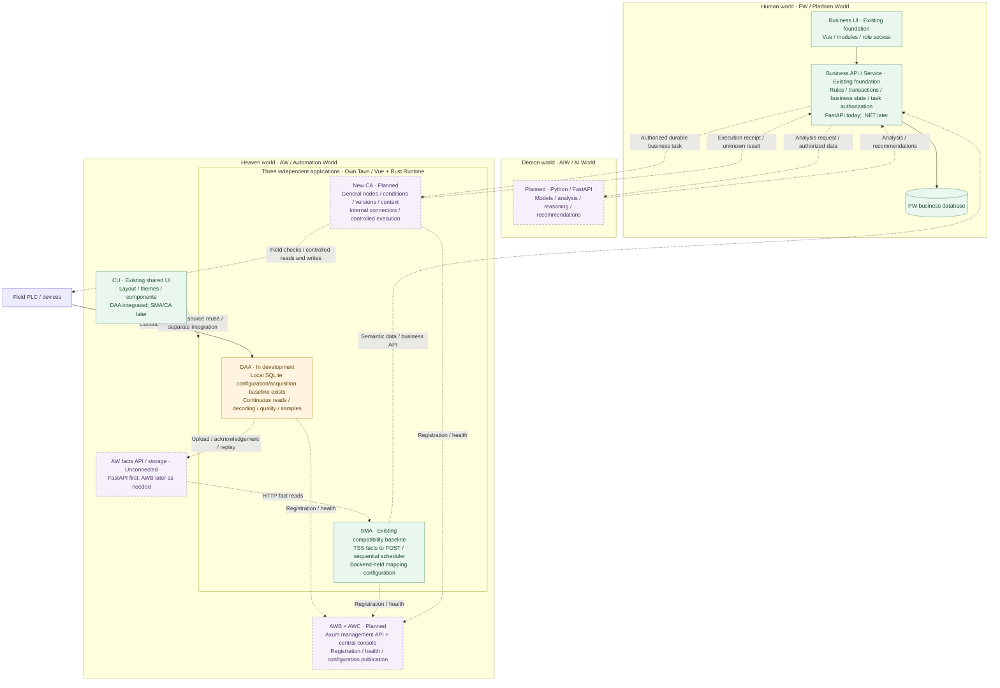
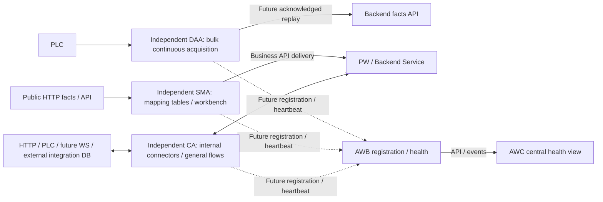

# AIIS ICS Architecture Roadmap

Chinese version: [ROADMAP.zh-CN.md](ROADMAP.zh-CN.md)

## 1. Purpose and baseline

This roadmap describes the target responsibilities of PW, AW and AIW, and the capability stages for reaching them while preserving the stable baseline. It is a development direction, not a claim that the target applications, tables or deployments already exist.

The current source surfaces remain `backend/` (FastAPI/SQLAlchemy/Alembic), `frontend-js/` (Vue JavaScript) and `automation-world/` (Rust/Tauri). The frozen CAF compatibility source path collects and decodes PLC values, writes backend-owned raw/latest snapshots directly to the database, and supplies the backend Projection framework. The new DAA local SQLite baseline is described in the snapshot below. The public template does not imply that a customer Handler or a live PLC chain is running.

Existing documentation at `automation-world/control-agent/` records the relocated frozen old CA baseline. New CA targets general node orchestration and controlled execution; CAF relocation/path needs its owning task evidence and is not certified here. DAA inherits an independent project from frozen CA; SMA contains a filtered copy of generic HTTP mapping from `data-twin-backend` (DTB) Twin State Studio (TSS), with original TSS retained. [ARCH-AW-001](plans/ARCH-AW-001-agent-foundation/spec.md) tracks initialization and no-I/O native startup; its bundle owns independent QA/final acceptance. CU shared UI source has been delivered and DAA has adopted its layout; SMA/CA integration remains separately scoped. New AW APIs, DAA upload/acknowledgement/replay and the end-to-end business chain remain targets; the status snapshot below distinguishes existing code from those goals.

| Document | Responsibility |
| --- | --- |
| [README.md](README.md) | Current identity, source layout and run entrypoints |
| This ROADMAP pair | Long-term responsibilities, stages, dependencies and completion gates |
| [PLAN.md](PLAN.md) | Current task status, evidence summary and next gate |
| [ARCH-MULTI-001 r2](plans/ARCH-MULTI-001-versioned-stack-roadmap/spec.md) | Original roadmap documentation scope; r1 retained as history |
| [AW whitepaper](docs/AIIS_AW_Whitepaper_Roadmap_v0.4.md) / [runtime design](docs/AIIS_AW_Runtime_Design.md) | ARCH-AW-002 r2 role, local SQLite/API and shared visual flow design; no implementation claim |
| [ARCH-AW-007 r2](plans/ARCH-AW-007-general-agent-fleet-roadmap/spec.md#r2-design) | r2 three-application, CA internal-connector and all-kind fleet-health direction; r1 history retained; exact approval, delivery, independent Verification and Human Owner final acceptance states are recorded in its task bundle |
| [ARCH-MULTI-002 r1](plans/ARCH-MULTI-002-three-worlds-diagram-sync/spec.md) | Documentation synchronization scope for the latest overview and status snapshot |
| Each implementation task bundle | Exact approved scope, Development evidence and independent Verification |

The future direction replaces r1's interchangeable-backend/default-stack roadmap with responsibility-based evolution. Old version defaults, database matrices, directory proposals and Ant Design Vue migration are not commitments of this roadmap. Any remaining need requires a separate task.

## 2. Three-world responsibilities

| World | Owns | Current transition and target |
| --- | --- | --- |
| PW | Business models, users and permissions, business rules, transactions and business APIs | Existing FastAPI business capabilities remain PW responsibilities; future target is C#/.NET/ASP.NET Core with FastEndpoints |
| AW — Automation World | Acquisition, field facts, semantic mapping; later archiving and controlled execution as needed | Rust; reuse CAF/TSS material. DAA owns local SQLite configuration; SMA currently uses Backend-held TSS mapping configuration. Existing FastAPI is the near-term host for AW API contracts; the new upload/durable-intent chains and AWB/Axum remain future work. |
| AIW | Models, analysis, reasoning and recommendations | Python/FastAPI; PW business rules and authorization decide how outputs are adopted |

These are responsibility boundaries. They do not require three repositories, three immediate deployments or a simultaneous language migration. Python business code does not become AIW merely because it is Python. AIW does not acquire direct authority over field actions.

Keep the current stable baseline usable and approve each implementation independently. Field control, database changes, PW migration and AWB remain separate work. This direction does not restore Celery, Redis or retired industrial-command contracts.

### 2.1 Three-world architecture overview

**Status snapshot: 2026-10-21.** PW owns business rules and authorization, AIW provides analysis and recommendations, and AW owns acquisition, mapping and field execution. The overview organizes responsibilities without requiring directory, repository or deployment separation.

Solid lines in this overview describe responsibilities already represented in source; dotted lines represent planned, unconnected or separately integrated relationships. Neither establishes accepted live-field operation. Green marks existing source baselines, amber an application whose overall development/verification remains open, and dashed purple future work. The source tasks in §2.2 own exact scope and acceptance.



### 2.2 Implemented, in development and planned

“Implemented” means the corresponding source or bounded baseline exists; it does not establish whole-stage acceptance, field verification or deployment. The owning tasks may advance after this dated snapshot.

| Area | Status | Current boundary and next gate | Source |
| --- | --- | --- | --- |
| PW | Existing foundation; stack migration planned | FastAPI + Vue continue to own business capabilities; .NET/FastEndpoints migration is separate future work | [Root README](README.md), [current PLAN](PLAN.md) |
| DAA | Local baseline exists; overall development/verification open | SQLite configuration, acquisition, history and imports exist; overall Stage B remains open, DAA–DS S7-to-SQLite validation requires separate approval, and upload/acknowledgement/replay are unconnected | [DAA README](automation-world/data-acquisition-agent/README.md), [DAA PLAN](automation-world/data-acquisition-agent/PLAN.md) |
| SMA | Existing TSS compatibility baseline; focused-workbench evolution planned | Backend-held mapping configuration, HTTP facts-to-POST and sequential scheduling today; arbitrary HTTP sources, per-row continuous runs, local SQLite/reliable outbox and similar extensions need separate scope | [SMA README](automation-world/semantic-mapping-agent/README.md), [three-application roadmap](plans/ARCH-AW-007-general-agent-fleet-roadmap/spec.md#r2-design) |
| CU | Shared source and workbench implemented | DAA adopted its layout; SMA/new CA integrate separately. Built applications run their own artifacts without an online CU process | [CU PLAN](automation-world/console-ui/PLAN.md), [DAA PLAN](automation-world/data-acquisition-agent/PLAN.md) |
| DS | In development: product MVP refinement and independent verification | Final acceptance pending; full DAA–DS application S7-to-SQLite validation requires separate approval, and partial DS evidence does not close overall DAA Stage B | [DS implementation task](plans/ARCH-AW-005-ds-g0-prototype-validation/spec.md), [current PLAN](PLAN.md) |
| Field Flow | Planned; documentation only today | Two independent Rust/Python field-flow programs have no runtime source yet; their future flows can provide input for CA migration | [FF README](field-flow/README.md) |
| New CA | Planned; design direction defined | General nodes, versions, context, internal connectors and controlled execution await implementation; connectors require explicit support matrices | [CA flow design](plans/ARCH-AW-006-unified-flow-agent-design/spec.md#r2-design) |
| AW fact-upload chain | Planned / unconnected | New DAA upload, receipt acknowledgement, idempotent replay and facts-to-business integration follow their API/runtime contracts | [DAA README](automation-world/data-acquisition-agent/README.md), [three-application roadmap](plans/ARCH-AW-007-general-agent-fleet-roadmap/spec.md#r2-design) |
| AWB / AWC | Planned | Registration/heartbeat and read-only health first, then configuration publication and remote operations; heartbeat is neither business completion nor a device-write lease | [Three-application roadmap](plans/ARCH-AW-007-general-agent-fleet-roadmap/spec.md#r2-design) |
| AIW | Planned | Python/FastAPI analysis and recommendations are adopted through PW validation/authorization; no direct field-action authority | This section and [collaboration background](docs/AIIS_Three_Worlds_Background_Notes_v0.1.md#bg-01) |
| CAF / old CA | Existing frozen compatibility baseline | `automation-world/control-agent/` retains raw/latest and Projection reference behavior, distinct from new general CA; this document does not switch the field chain | [CAF README](automation-world/control-agent/README.md) |

The two main target paths are:

- Data upward: `PLC → DAA → AW facts API → SMA → PW business API → business database / UI`.
- Business actions downward: `Human or AIW recommendation → PW validation/authorization → CA field checks → device execution → receipt`.

Ordinary point-value exchange can still compose supported CA connectors directly under the resource and side-effect contracts in §3/§5. `aw_` marks AW-owned backend tables only; exact schemas, independent storage, HA/SA and archiving follow §7/§8. Example table names do not assert that those tables already exist.

## 3. Data and configuration flows

### Frozen CAF compatibility source path

```text
PLC -> original CA / CAF acquisition/decoding -> backend raw/latest snapshot database
    -> backend Projection input resolution -> module business Handler
    -> business state/records -> business API/UI
```

Source anchors: [CAF historical acquisition](automation-world/control-agent/src-tauri/src/services/plc_collection.rs), [snapshot writer](automation-world/control-agent/src-tauri/src/infrastructure/database/repositories/mod.rs), [Projection runner](backend/projection/runner.py). This is a source-level responsibility description, not field validation.

The current DAA application instead uses local SQLite configuration and acquisition storage; its new upload chain is not connected. See the dated snapshot in §2.2. This documentation update does not switch or retire a field runtime.

### Near-term target path

```text
PLC -> DAA acquisition/decoding -> FastAPI AW facts API / aw_* latest facts
    -> SMA binding/validation/request assembly -> PW business API
    -> business Service / business tables -> UI; later AIW consumption when authorized

DAA UI -> local Rust configuration service -> own SQLite -> validation/explicit activation
SMA UI -> current Backend-held TSS mapping configuration / HTTP runtime
CA UI -> target own versioned configuration/progress; implementation separately scoped
Third party -> system API validation/durable intent -> CA atomic claim -> device write/ack
                                                     CA -> execution receipt
Later as needed: central publication -> Agent download/validation/activation/status
```

Business APIs accept semantic device/business identities, measurements, timestamps and events. Business Services do not interpret PLC DB numbers, offsets, bits or raw point names; provenance can remain available for tracing. SMA owns HTTP field conversion/request assembly; CA handles general flows. Order transitions, business-state rules and transactions remain in PW.

Freeze the configuration, facts, mapping/receipt contracts and one actual business API pilot first. The pilot does not require implementing all eight inventoried legacy Handler APIs. Once contracts are fixed, Backend, DAA, SMA and CA implementation can proceed in parallel; integration requires real callable APIs.

Ordinary HTTP-to-HTTP or PLC-to-PLC point-value exchange can run within CA under explicit resource and side-effect contracts without passing through Backend. Orders, recipes, quality decisions and other PW-owned business state still use the owning Service/API; a point-value exchange cannot silently assume those business responsibilities. The fact-upload and durable-intent paths above remain targets, not claims that they are connected.

## 4. DAA, SMA, CA and CU

**DAA, SMA and CA remain three applications.** DAA handles bulk continuous PLC acquisition, decoding/quality, sample identity, local buffering/history and future acknowledged replay. Its current SQLite acquisition baseline does not include the new upload chain. SMA evolves from the filtered TSS baseline into a focused application for many similar HTTP-read → field-map → HTTP-deliver configurations, with table/batch management and a home workbench. SMA remains independent rather than a CA scenario.

CA owns the general Tauri/Rust node orchestration design: local workbench, flow table, popup canvas, saved versions, contexts and extensions. CA may also run simple HTTP mappings; SMA specializes their bulk configuration and diagnosis. This split uses task shape and usability rather than unproven throughput or a fixed mapping-count threshold. Each application/instance owns independent configuration, writable state, queues, credentials and lifecycle; reuse foundations after real overlap is established without requiring every shared Core or another application's process. CAF remains frozen. CU is reusable UI source; AWC is a future central console, distinct from local workbenches.



| Component | Responsibility | Boundary |
| --- | --- | --- |
| DAA | Continuous sampling, decoding/quality, original time/identity, history/capacity and future replay | Current upload is not connected; no general business flows or device-task dispatch |
| SMA | Tables/batch management for many similar HTTP mappings, workbench and delivery diagnosis | Current TSS Backend-held configuration; no general PLC/DB connectors |
| CA | Typed nodes/conditions/subflows, internal connectors, pinned versions and execution/reconciliation | Does not assume PW rules or equate protocol success with device/business completion |
| PW / Backend | Rules, data owner, transactions, Service/API and schema | Request threads do not poll PLCs; connectors do not bypass owned business writes |
| CU / local UI | Reusable CU source; each App workbench manages its local objects | Shared source is not an online dependency; local workbenches differ from central AWC |
| AWB / AWC | Future registration/control plane, layered health and central reads | Do not replace App execution/field facts or directly connect to each PLC/DB |

DAA's full target remains `PLC read → decoding/quality → local sample buffer → HTTP POST → acknowledgement/replay`. Its locking, SQLite, import and diagnostics may inform reuse, without proving a shared Core, connectors or heartbeat delivery. Window close, background continuation, exit and OS hosting follow each App's implementation contract.

SMA already has a [mapping table](automation-world/semantic-mapping-agent/src/app/twin-facts/components/MappingConfigurationsPanel.vue), [JSON/XLSX batch preview/import](automation-world/semantic-mapping-agent/src/app/twin-facts/components/MappingBatchOperationsDialog.vue) and [start/pause/resume/stop controls](automation-world/semantic-mapping-agent/src/app/twin-facts/components/ApiFirstMappingRuntimePanel.vue). The current [scheduler](automation-world/semantic-mapping-agent/src-tauri/src/services/mapping_runtime/mod.rs) loads enabled POST mappings, awaits each `run_mapping_tick` sequentially and reads fresh bound Facts Snapshot chunks per mapping. This supports refinement of existing tables and a home workbench, without proving batch concurrency or throughput.

Continuous selection of a subset or per-row start/stop, arbitrary HTTP GET sources, bounded concurrency/isolation, capacity optimization and persistent SQLite/checkpoint/outbox recovery need separately approved runtime/storage contracts and evidence. The current all-enabled-POST continuous run and saved-row single-round test are distinct; a rowVersion is not a complete historical-version store. The [006 r2 design](plans/ARCH-AW-006-unified-flow-agent-design/spec.md#r2-design) supplies the detailed workbench, mapping and CA version/context/extension behavior; no immediate SMA storage migration is required.

## 5. CA internal connectors and source reuse

**Typed connectors belong inside CA.** CA's initial scope remains the 006 r2 proposal for HTTP GET/POST and explicitly supported S7, with no login authentication. Later CA nodes/adapters may add selected PLC drivers, WS subscription/sending and approved external/integration database reads/controlled writes. Supported inputs/outputs may be combined freely; this creates no separate connector Agent or dependency for SMA's table/workbench delivery. Support is accepted per protocol/CPU/access/driver/version/OS/type/read-write matrix, never as all PLCs or databases.

WS contracts define message identity, snapshot/delta continuity, reconnect, gaps, backpressure and bounded storage. DB adapters own credentials, parameterized queries and transactions; declare read-only and write capabilities separately with data-owner, table/operation, idempotency and unknown-result contracts. PW/Backend-owned rules, schema and business state continue through their Service/API. Arbitrary SQL/DDL and cross-system atomicity are outside the first version; delivery retry cannot replace reconciliation of uncertain device actions.

Connectors may compose DB→HTTP, WS→PLC, PLC→DB or HTTP→WS within supported capabilities. Typed I/O preserves identity, time, quality, cancellation, side effects and recovery. Each combination distinguishes planned / implemented / verified; HTTP polling does not establish streaming reliability. DB adapters also define pools, cursor/paging, reentry/cancellation and bounded resources. No distributed transaction across PLC, HTTP and databases or exactly-once physical action is promised.

CU supplies reusable UI source outside PLC/DB execution. Each App composes its own UI and runtime; extract versioned HTTP/logging/driver/pure-type/recovery foundations only after real overlap is established. A complete shared Flow Core is not a prerequisite. CA's workbench, flow table and popup canvas pin saved flow/node versions; the Vue canvas interprets definitions, with Vue Flow a candidate and Node-RED + Rust service an alternative without arbitrary JSON/Function compatibility. Actual SDK/crate layout, dependency versions, Vite/TypeScript resolution, frontendDist, ports, packaging and target-OS evidence belong to later implementation. Shared source requires rebuilds, not an online workbench.

## 6. Reuse CAF, TSS and generic backend capabilities

| Source | Reuse | Required adaptation |
| --- | --- | --- |
| Frozen reference [CAF](automation-world/control-agent/README.md) | PLC reading, decoding, collection loops, diagnostics and logs | Explicitly import configuration into local SQLite; upload through facts APIs; central publication is later work |
| DTB `twin-state-studio/` | Pure Rust mapping Domain, scheduler, facts/target-API binding, value rules, editing and diagnostics | Adapt lifecycle, networking and backend dependencies; retain functional logic while reusing CAF visual material |
| DTB generic backend | Fact/configuration APIs, execution leases and receipts | Fit this repository's MySQL, Registry/manifest, authentication/permissions, response contract and explicit Alembic migrations |

External source references in DTB are `twin-state-studio/README.zh-CN.md`, `twin-state-studio/src-tauri/src/domain/mapping_runtime/mod.rs`, `twin-state-studio/src-tauri/src/services/mapping_runtime/mod.rs` and `backend/app/tss/`. They fix SMA provenance. The current SMA uses Backend-held TSS mapping configuration and retains applicable desktop HTTP/pure computation and excludes customer/SQL/legacy IPC and cross-DTB help generation. It starts independently; online capabilities still require compatible Backend contracts. This foundation neither imports DTB backend nor implements new AW APIs.

MSSQL-specific mechanisms such as `ROWVERSION` need a MySQL-compatible contract. DTB migration files are historical source material, not ready-to-run migrations for this repository. Preserve source attribution and applicable licensing. Import reusable public capabilities and sanitized examples only; customer pages, real configurations, data/resources and legacy direct-business-table writes remain outside the new AW boundary.

The original CAF database-snapshot and Backend Projection chain remains a historical compatibility/rollback reference until a separately approved switch. The current DAA README describes SQLite-owned local acquisition and retirement of the inherited direct-database/headless path; its new fact upload and acknowledgement chain is not connected. Preserve these current facts separately from the earlier roadmap snapshot. Future CA database connectors may read and perform controlled writes against approved external/integration databases under their data-owner contracts; PW/Backend-owned business state still passes through its Service/API. This direction neither restores legacy business-table writes nor authorizes a live-chain switch.

## 7. Configuration, facts, instances and fleet health

Configuration authority differs by App: DAA already owns local SQLite; SMA currently retains Backend-held TSS mapping configuration, with technical startup preferences distinct from mapping authority; CA's own versioned SQLite/progress remains a target design. The general SQLite summary in §2 describes direction, not a requirement to migrate all Apps now. FastAPI facts, durable intents, claims and receipts follow their contracts. The `aw_` names below illustrate Backend AW ownership, not an additional editable authority beside each object's chosen writer.

| Illustrative table | AW responsibility |
| --- | --- |
| `aw_collection_configs` | Versioned acquisition configuration |
| `aw_collection_facts` | Fact definitions and latest values |
| `aw_target_apis` | Target API parameter contracts |
| `aw_mapping_configs` | Fact/constant bindings and mapping configuration |
| `aw_mapping_runtime_states` | Mapping runtime states, leases and receipts |
| `aw_agent_states` | Agent status and applied configuration versions |

These names illustrate ownership, not a final schema. Orders, device business states and business sampling records keep their business owners and table names. A table does not become AW-owned because a Mapping references it. The prefix establishes neither database/permission isolation nor a completed AW split.

Acquisition configuration must cover both [plc_points.yaml](automation-world/control-agent/config/plc_points.yaml) (connections, DB blocks, types, offset/bit) and [plc_snapshot_policy.yaml](backend/config/plc_snapshot_policy.yaml) (raw/latest retention selection). Explicitly import, preview and validate legacy configuration; local Rust saves drafts and activates complete revisions. Central publication/download is later work. SQLite commit and memory activation are distinct; recovery remains to be specified.

Facts can reuse `(sourceKey, factName)` identity. API/schema tasks must define source/Agent identity, stable sample ID or sequence, collection and receive times, quality, point-contract version and mapping version, together with batch atomicity, authorization, idempotency and version behavior.

Latest facts describe current state; they cannot prove every intervening change was consumed. Events, append-only business records and history need explicit separate contracts. Missing, bad-quality, stale and out-of-order values need policies so a stopped source's last value is not indefinitely treated as valid.

**Configuration and fleet management cover all three application types.** DAA currently owns local SQLite configuration; SMA currently uses Backend-held TSS configuration and may refine its tables/workbench before a separately approved local-SQLite or reliable-outbox project. CA's versioned local configuration/progress is a target design. Neither this roadmap nor AWB management forces a simultaneous storage migration. Future publication requires one writable authority per object, desired/cached/applied versions and separate receipt, validation and application acknowledgements; rollback preserves pending samples/work, unknown outcomes, outboxes, cursors and audit.

Future enrolled DAA, SMA and CA instances use a common identity/heartbeat contract: stable agentId and deployment/site/project, agentKind as application type distinct from duty profile, actual software/capability and acquisition/mapping/flow versions, process instance/boot/sequence, desired/applied configuration and observedAt. AWB adds receivedAt/lastSeen, rejects conflicting identity and old/replayed generations from refreshing TTL, and uses configurable stale/offline thresholds and bounded latest-state heartbeat retention. Types report their own work: DAA sampling/disk/replay; SMA mapping results/delivery latency/backlog; CA flows/nodes/unknown outcomes. Unsupported metrics remain explicit rather than fabricated zeros.

AWC reads AWB APIs/events for all types; liveness, work results, external connections and data freshness/backlog remain separate, with unknown/online/stale/offline/conflict and an independent degraded flag. Heartbeat is neither business completion nor HA/write-lease authority. Local active work normally continues through AWB outages under its own contract; lease/fencing exceptions and restart recovery remain application-specific. Read-only health precedes central configuration and remote operations. Future enrollment trust and communication protection are separate platform work, adding no first-version login prerequisite and making no permanent-anonymity promise.

Heartbeat receipt does not prove sampling completeness, successful mapping, PLC availability/safety or business completion. Existing Backend authentication/actor dependencies require a separately scoped adaptation for the first-version no-login path; this direction does not silently disable repository-wide authentication. Agents do not acquire internal Backend/Redis storage credentials; approved external DB connector credentials remain separately scoped.

### 7.1 Minimum instance, configuration and version concepts

These camelCase fields express roadmap information needs, not a formal API/schema:

| Group | Minimum fields | Lifecycle and constraint |
| --- | --- | --- |
| Stable identity | `agentId`, `displayName` | agentId survives restarts; display/duty names are neither keys nor credentials |
| Deployment | `deploymentId`, `siteId`, `projectId`, display labels | Membership grants no resource-write permission |
| Process generation | `instanceId`, `bootId` | Identify resident process/boot generation; a new boot does not reuse an old heartbeat sequence |
| Application type / duty | `agentKind`, `dutyProfileId`, `dutyProfileRevision` | agentKind is DAA/SMA/CA; duty expresses tasks/resources within that type. Neither is a login role or ACL; relabeling cannot change the actual App/capabilities |
| Actual capability | `softwareVersion`, `capabilityManifest`, manifest version/digest | Actually compiled/registered nodes, driver versions and read/write capabilities, never fabricated by labels |
| Assigned work | `assignmentId`, `flowId/flowRevision`, `resourceRefs` | DAA uses acquisition/point-definition versions; SMA uses mapping versions; `flowId/flowRevision` applies only to CA flow/node work. Pin the applicable work/bindings; missing capabilities or exceeded resources prevent activation |
| Configuration state | `configSource`, `desiredConfigRevision`, `appliedConfigRevision`, digest/application result | Report source, central desired, downloaded cache and locally effective state separately |

Profile/host-image cloning explicitly chooses restoring the original deployment or creating a new agentId. AWB retains conflicting instance/boot/kind evidence rather than last-write-wins merging into a healthier record; registration contracts define replacement/revocation. Assignments report received / validated / applied / failed separately; ACK is not execution or business completion. Activation checks pinned complete versions/dependency digests and switches at defined boundaries. Rollback preserves old work/unknown/outboxes/cursors/audit rather than rerendering old requests using new configuration; software downgrade also verifies old node/state schema readability instead of clearing stores.

### 7.2 Proposed AWB interfaces and heartbeat information

The following URLs are unimplemented and unfrozen proposals. Enrollment/health is not a local-first-version startup dependency; DAA, SMA and CA each need accepted adapters under the common contract. Management state is stored/queried separately from business execution facts.

| Proposed interface | Responsibility |
| --- | --- |
| `POST /api/aw/v1/agents/register` | Register stable identity, agentKind, deployment, generation and duty/software/capability/configuration summaries; return results and conflicts |
| `POST /api/aw/v1/agents/{agentId}/heartbeats` | Ordered health snapshot/receipt for a specified instance/boot, not execution commands |
| `GET /api/aw/v1/agents`, `GET /api/aw/v1/agents/{agentId}` | Query instances/generations, health layers, lastSeen, staleness reasons and desired/applied versions |
| `POST /api/aw/v1/assignments/{assignmentId}/acknowledgements` | Later assignment receipt/validation/application/failure acknowledgement, without automatic task-change authority |

| Heartbeat group | Minimum information and timing boundary |
| --- | --- |
| Identity/order | `agentId`, `agentKind`, `instanceId`, `bootId`, `seq`; seq increases within a boot, with old generations/duplicates/reordering/conflicts handled distinctly |
| Versions/duty | Duty profile, software, desired/applied config and capability manifest version/digest; summaries reference full registration rather than resending definitions |
| Typed work summary | DAA sampling/disk/replay; SMA mapping/read/delivery results, latency and observable backlog; CA flows/nodes/unknown outcomes. Define windows/restart meanings; unavailable metrics are explicit, never fabricated zeros |
| Dependencies/backlog/resources | Connection health, pending count/bytes/oldest age and resource/disk summaries; no credentials, full requests or PLC payloads |
| Time | Agent `observedAt` and AWB `receivedAt`, `lastSeen`; original observation supports diagnosis, receipt time determines online TTL |

| App | Minimum typed health/backlog summary |
| --- | --- |
| DAA | Acquisition connections, last successful sample/quality, progress, disk/capacity and replay count/bytes/oldest age; upload not connected reports unavailable/unconfigured |
| SMA | Enabled/running/success/failed mappings, last successful read/delivery, target errors, latency and observable backlog; no durable outbox means reliable backlog cannot be reported as zero |
| CA | Flow/node states and versions, waiting/failure, unknown/pending reconciliation, output backlog and resource summary |

Parameterize `heartbeatInterval`, jitter, `staleAfter`, `offlineAfter` and bounded retry/storage with positive values and ordered thresholds. Only qualified new heartbeats from the current valid generation refresh lastSeen; old boots, duplicates/reordering, historical uploads and replay cannot restore liveness. Reconnect sends current snapshots. Offline latest-state coalescing or bounded retention must not crowd out reliable tasks/samples.

### 7.3 Layered health and management outages

| Layer | Independently visible result |
| --- | --- |
| Agent / management link | Enrollment, current instance/boot, receipt time, TTL and duplicate-identity conflicts |
| App work | DAA acquisition quality/progress, SMA mapping/delivery results or CA flow/node/reconciliation states, versions and failure summaries |
| External connections | HTTP/WS, PLC and DB connection/recent request results individually; normal connections do not prove fresh data |
| Data/progress | Original time/quality, last successful processing/acknowledgement, gaps, staleness, pending capacity and oldest age |

`unknown` means no valid current evidence; `online` means qualified heartbeat age is within staleAfter; `stale` exceeds staleAfter but has not reached offlineAfter; `offline` reaches offlineAfter; `conflict` means active instances/generations sharing agentId cannot safely merge. `degraded` is an independent flow/dependency/data/capacity flag that may coexist with online. Offline describes management unreachability, not proven process death.

During AWB outages, continue only locally effective work that does not depend on online eligibility, under connector capacity/recovery contracts; AWC shows last receipt and staleness reasons. Restart follows each App lifecycle/recovery contract; CA first-version design remains stopped/recovery_required without automatic new writes. Independent device-lease tasks follow their own fencing/renewal/loss-of-contact contracts rather than universally continuing writes or stopping everything. Standbys cannot take over on heartbeat timeout. Submitted unknown outcomes still use original identities for reconciliation; offline status does not delete facts.

## 8. Capability stages and transition gates

S0–S4 are capability milestones, not version numbers, dates or approval to implement. Each implementation needs its own scope and acceptance evidence.

| Stage | Goal | Dependency / entry condition | Checkable completion condition |
| --- | --- | --- | --- |
| S0 — Documentation baseline | Bilingual three-application/CA/fleet direction and historical notices | Exact r2 document scope approval | Five-document Development handoff, bilingual/link/history checks, fresh document QA and Human Owner final acceptance; retain r1 |
| S1 — Contracts and one business pilot | Narrow APIs and all-kind identity/capability/heartbeat contracts | Identify data/resource owners | Fix sample identity, quality/time/version, permissions/idempotency, registration conflict/TTL; API/migration verification separately approved |
| S2 prerequisite — Agent engineering foundation | Original CA/CAF relocation/freeze, independent DAA and filtered TSS-to-SMA | May precede S1 implementation; applicable S1 contracts remain | Retain ARCH-AW-001 evidence without implying new CA/fleet/shared UI/business-chain completion |
| S2 — Independent local deliveries | DAA continuous acquisition, TSS-based SMA simplification/tables/workbench and CA design/prototype | Narrow-chain contracts; no AWB, shared-storage, complete shared Core or other App process prerequisite | Each App's build/run, configuration/lifecycle/recovery and limited chain validated under separate implementation scope; SMA storage migration is not forced |
| S3 — Reliability and selected connectors | Sampling/delivery/flow recovery, isolation/capacity; selected CA PLC/WS/external DB read/write matrices | Explicit corresponding requirements and support limits | Measured disconnect/restart, duplicates/order/gaps, backpressure/capacity, unknown/rollback/logs; field/long-run/deployment separately approved |
| S4 — Central management and three-world hosting as needed | All-kind AWB/Axum registration/heartbeats→AWC read-only health→duty/config publication→remote operations/HA; retain PG/Redis, HA/SA, independent Rust Runtime, PW .NET/FastEndpoints and AIW Python/FastAPI directions | Project demand and stable contracts, independently scoped lines | Generation conflict, TTL/outage behavior; one authority/ACK/application/rollback before publication; separate fencing for remote/lease/HA, unique ownership/equivalence/migration gates for existing directions |

The three Apps, CA connector additions and AWB management contracts may progress independently rather than as a strict serial sequence, with no dates attached. PG/Redis, HA/SA, OS hosting and PW/AIW directions are not bundled prerequisites for heartbeats. Tauri/sidecar names do not prove persistence after window close, logout or host restart; target-OS hosting still requires separate acceptance.

TSS currently rereads bound facts each cycle and sends even unchanged values. Failed or uncertain target requests are not automatically replayed. This is not reliable offline delivery. Append APIs need stable idempotency keys, transactional business writes and receipts, success acknowledgment, and explicit retry/manual-recovery boundaries. Per-Mapping leases do not arbitrate conflicts between different Mappings targeting the same business object.

Compare old/new results before switching by source/target. Disable the corresponding old Projection before enabling SMA production writes so each business target has one effective writer. Define cursor/sample identity, rollback and duplicate-consumption behavior. These are future switching gates, not authorization to change a field system now. Short smoke runs do not replace long-duration or field validation.

## 9. Deferred decisions and task alignment

- [ARCH-BE-003](plans/ARCH-BE-003-mapping-service-api-pilot/spec.md) needs its own revision for the target project, sample identity, idempotency and permissions. Begin with one business API, not the complete legacy Handler inventory.
- [CA-CONFIG-001](plans/CA-CONFIG-001-packaged-configuration-management/spec.md) needs separate reassessment against local SQLite authority and later central publication. This roadmap does not modify or approve its implementation.
- [ARCH-BE-002](plans/ARCH-BE-002-energy-price-api/spec.md) is an independent reusable public capability, not a prerequisite of the sampling pilot.
- [ARCH-AW-006 r2](plans/ARCH-AW-006-unified-flow-agent-design/spec.md#r2-design) supplies the three-application, SMA table/workbench and CA flow design with sanitized production-line/laboratory cases. Exact approval and stages remain in its bundle; software implementation is separately scoped. CA first-version HTTP GET/POST, supported S7 and no-login scope is unchanged.
- [ARCH-AW-007 r2](plans/ARCH-AW-007-general-agent-fleet-roadmap/spec.md#r2-design) owns this roadmap synchronization. CA directory/identifier/OS, SMA runtime/storage/capacity extensions, connector matrices, formal identity/API/schema/thresholds/trust, central-authority migration and remote operations/fencing remain for their owning specs; the three Apps, connectors and management plane advance by their own dependencies.
- Advance AWB, headless Runtime extraction, unified AWC, database changes and PW technology migration when justified, with enrollment/read-only health before central publication and remote operations. PW/AW/AIW capabilities may advance independently; no all-at-once migration is required.
- Exact component versions/drivers, supported database combinations, deployment forms, directory decisions beyond this target and schedules belong to their implementation tasks. Automatic OpenAPI ingestion, full import/export and simulation can be scoped there as needed.

Document rollback removes only the exact 007 body/index additions without resetting or overwriting existing dirty work. Original bundles retain their sources, QA and acceptance; these are not retroactive approval for 007 or 006. Configuration rollback does not undo external effects.

This documentation task creates no Agent directories, code, APIs, tables or deployment artifacts. Future stages remain planned. Runtime/build/site evidence and final acceptance are recorded in their owning task bundles, not inferred from this roadmap.
