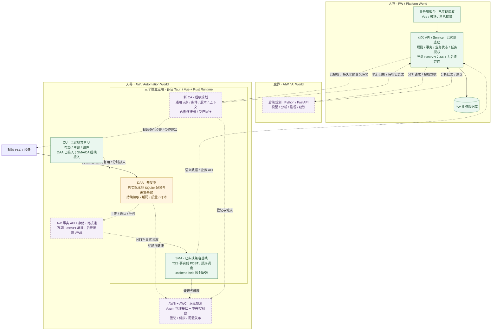
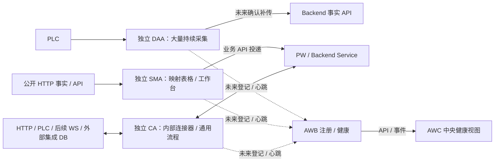

# AIIS ICS Architecture 发展路线

English version: [ROADMAP.md](ROADMAP.md)

## 1. 定位与当前基线

本路线描述 PW、AW、AIW 的目标职责，以及保留稳定基线、逐步到达目标的能力阶段。它是发展方向，不表示目标应用、数据表或部署已经存在。

当前源码仍为 `backend/`（FastAPI/SQLAlchemy/Alembic）、`frontend-js/`（Vue JavaScript）和 `automation-world/`（Rust/Tauri）。冻结 CAF 兼容源码路径采集、解码 PLC 数据，直接写入后端拥有的 raw/latest 快照表，供后端 Projection 框架消费。新 DAA 的本地 SQLite 基线见下方状态快照。公开模板不代表已包含客户业务 Handler，也不证明真实 PLC 链路正在运行。

`automation-world/control-agent/` 的既有文档记录迁移验证后冻结的旧 CA 兼容基线；新 CA 面向通用节点编排与受控执行，CAF 的精确迁移路径由对应任务核对。本次不认证迁移。DAA 已从冻结 CA 继承独立工程，SMA 已从 `data-twin-backend`（DTB）Twin State Studio（TSS）过滤复制通用 HTTP 映射工程，原 TSS 保留。工程初始化和 no-I/O 原生启动由 [ARCH-AW-001](plans/ARCH-AW-001-agent-foundation/spec.md) 跟踪；独立 QA/最终验收以该 bundle 为准。CU 共享 UI 源码已交付，DAA 已接入其布局；SMA/CA 接入仍由各自任务处理。新 AW API、DAA 上传/确认/补传及业务闭环仍是目标，下方状态快照区分已有源码与这些目标。

| 文档 | 职责 |
| --- | --- |
| [README.zh-CN.md](README.zh-CN.md) | 当前项目身份、源码结构与运行入口 |
| 本 ROADMAP pair | 长期职责、阶段、依赖与完成门槛 |
| [PLAN.zh-CN.md](PLAN.zh-CN.md) | 当前任务状态、证据摘要与下一 gate |
| [ARCH-MULTI-001 r2](plans/ARCH-MULTI-001-versioned-stack-roadmap/spec.md) | 原路线文档批准范围；保留 r1 历史 |
| [AW 白皮书](docs/AIIS_AW_Whitepaper_Roadmap_v0.4.md) / [详细原理](docs/AIIS_AW_Runtime_Design.md) | ARCH-AW-002 r2 修订的角色、近期 SQLite/API 与共享可视化流程设计；不代表实现 |
| [ARCH-AW-007 r2](plans/ARCH-AW-007-general-agent-fleet-roadmap/spec.md#r2-design) | r2 三应用、CA 内部连接器与全类型健康方向；保留 r1 历史；精确批准、交付、独立 Verification 与 Human Owner 最终验收状态由其任务 bundle 记录 |
| [ARCH-MULTI-002 r1](plans/ARCH-MULTI-002-three-worlds-diagram-sync/spec.md) | 最新总图与状态快照的文档同步范围 |
| 各实施任务 bundle | 精确获批范围、Development 证据与独立 Verification |

未来方向由 r1 的可互换后端/默认技术栈路线调整为按职责演进。旧版本默认值、数据库矩阵、目录建议及 Ant Design Vue 迁移不再作为本路线承诺；仍有实际需求时另立任务。

## 2. 三界职责

| 领域 | 拥有的职责 | 当前过渡与目标 |
| --- | --- | --- |
| PW | 业务模型、用户与权限、业务规则、事务、业务 API | 现有 FastAPI 业务继续属于 PW；未来目标为 C#/.NET/ASP.NET Core + FastEndpoints |
| AW — Automation World | 采集、现场事实、语义映射；后续按需归档与受控执行 | 使用 Rust，复用 CAF/TSS 素材。DAA 使用本地 SQLite 配置，SMA 当前使用 Backend-held TSS 映射配置；现有 FastAPI 暂承 AW API 合同，新上传/持久意图链与 AWB/Axum 仍按后续任务推进。 |
| AIW | 模型、分析、推理与建议 | Python/FastAPI；由 PW 业务规则和授权决定如何采用其输出 |

三界首先是职责边界，不强制三个仓库、立即独立部署或同时迁移语言。Python 业务代码不会因使用 Python 自动成为 AIW；AIW 也不直接取得现场动作权。

保留当前稳定基线，每项实施独立批准。现场控制、数据库更换、PW 迁移与 AWB 均另行推进；本方向不恢复 Celery、Redis 或退役工业命令合同。

### 2.1 三界架构总图

**状态快照日期：2026-10-21。** PW 负责业务规则与授权，AIW 提供分析与建议，AW 负责采集、映射与现场执行。总图按职责组织，不强制目录、仓库或部署拆分。

本图实线表示已有源码中的职责关系，虚线表示规划、尚未接通或需要各应用分别接入的关系；均不代表真实现场链路已验收。绿色为已有源码基线，橙色为整体仍在开发/验证中的应用，紫色虚框为后续规划。具体范围和验收以 §2.2 来源任务为准。



### 2.2 当前已实现、开发中与后续规划

“已实现”仅说明对应源码或有限基线已存在，不自动表示整阶段验收、现场验证或部署完成。状态会随所属任务变化，本表保留上述日期的快照。

| 部分 | 状态 | 当前边界与后续门槛 | 来源 |
| --- | --- | --- | --- |
| PW | 已实现底座；技术栈迁移为后续规划 | 当前 FastAPI + Vue 继续承载业务；.NET/FastEndpoints 后续单独迁移 | [根 README](README.zh-CN.md)、[当前 PLAN](PLAN.zh-CN.md) |
| DAA | 已实现本地基线；整体开发/验证中 | 本地 SQLite 配置、采集、历史和导入已有实现；阶段 B 整体未关闭，DAA–DS S7→SQLite 联调另批；上传/确认/补传尚未接通 | [DAA README](automation-world/data-acquisition-agent/README.zh-CN.md)、[DAA PLAN](automation-world/data-acquisition-agent/PLAN.zh-CN.md) |
| SMA | 已实现 TSS 兼容基线；专用工作台演进为后续规划 | 当前 Backend-held 映射配置、HTTP 事实→POST、逐项调度；任意 HTTP 源、逐行常驻、本地 SQLite/可靠 outbox 等另立范围 | [SMA README](automation-world/semantic-mapping-agent/README.zh-CN.md)、[三应用路线](plans/ARCH-AW-007-general-agent-fleet-roadmap/spec.md#r2-design) |
| CU | 已实现共享源码与工作台 | DAA 已接入布局；SMA/新 CA 接入分别推进。构建后各应用运行自身产物，无需 CU 在线 | [CU PLAN](automation-world/console-ui/PLAN.zh-CN.md)、[DAA PLAN](automation-world/data-acquisition-agent/PLAN.zh-CN.md) |
| DS | 开发中：产品 MVP 收敛与独立核验 | 尚未最终验收；DAA–DS 完整应用 S7→SQLite 联调独立批准，不以 DS 局部证据关闭 DAA 阶段 B | [DS 实施任务](plans/ARCH-AW-005-ds-g0-prototype-validation/spec.md)、[当前 PLAN](PLAN.zh-CN.md) |
| Field Flow | 后续规划；当前只有文档 | Rust/Python 两个独立现场流程程序尚无运行源码，未来可作为 CA 流程迁移来源 | [FF README](field-flow/README.zh-CN.md) |
| 新 CA | 后续规划；设计方向已明确 | 通用节点、版本、上下文、内部连接器及受控执行待实施；各连接器按支持矩阵验收 | [CA 流程设计](plans/ARCH-AW-006-unified-flow-agent-design/spec.md#r2-design) |
| AW 事实上传链 | 后续规划 / 待接通 | 新 DAA 上传、接收确认、幂等补传及事实到业务闭环按各自 API/运行合同实施 | [DAA README](automation-world/data-acquisition-agent/README.zh-CN.md)、[三应用路线](plans/ARCH-AW-007-general-agent-fleet-roadmap/spec.md#r2-design) |
| AWB / AWC | 后续规划 | 先登记/心跳与只读健康，再配置发布及远程操作；心跳不代表业务完成或设备写租约 | [三应用路线](plans/ARCH-AW-007-general-agent-fleet-roadmap/spec.md#r2-design) |
| AIW | 后续规划 | Python/FastAPI 分析与建议；由 PW 校验、授权采用，不直接获得设备动作权 | 本节三界职责与[协作背景](docs/AIIS_Three_Worlds_Background_Notes_v0.1.md#bg-01) |
| CAF / 旧 CA | 已有冻结兼容基线 | `automation-world/control-agent/` 保留原 raw/latest 与 Projection 参考；与新通用 CA 分开，不据本文切换现场链路 | [CAF README](automation-world/control-agent/README.zh-CN.md) |

两条目标主链路为：

- 数据上行：`PLC → DAA → AW 事实 API → SMA → PW 业务 API → 业务库 / 界面`。
- 业务动作下行：`人员或 AIW 建议 → PW 校验授权 → CA 检查现场条件 → 设备执行 → 回执`。

普通点值交换仍可按 §3/§5 的资源与副作用合同由 CA 直接组合已支持连接器。`aw_` 仅标记 AW 所属后端表，具体 schema、独立存储、HA/SA 与归档按 §7/§8 推进；不将示例表名写成已落库事实。

## 3. 数据流与配置流

### 冻结 CAF 兼容源码链路

```text
PLC -> 原 CA / CAF 采集/解码 -> 后端 raw/latest 快照数据库
    -> 后端 Projection 输入解析 -> 模块业务 Handler
    -> 业务状态/记录 -> 业务 API/UI
```

源码入口：[CAF 历史采集](automation-world/control-agent/src-tauri/src/services/plc_collection.rs)、[快照写入](automation-world/control-agent/src-tauri/src/infrastructure/database/repositories/mod.rs)、[Projection Runner](backend/projection/runner.py)。这是源码职责说明，不是现场验证。

当前 DAA 应用采用本地 SQLite 配置与采集存储，新上传链尚未接通，见 §2.2 日期快照。本次文档更新不切换或退役现场运行程序。

### 近期目标链路

```text
PLC -> DAA 采集/解码 -> FastAPI AW 事实 API / aw_* 最新事实
    -> SMA 绑定/校验/请求组装 -> PW 业务 API
    -> 业务 Service / 业务表 -> UI；后续 AIW 按授权消费

DAA UI -> 本机 Rust 配置服务 -> 自身 SQLite -> 校验/显式启用
SMA UI -> 当前 Backend-held TSS 映射配置 / HTTP runtime
CA UI -> 目标自身版本化配置/进度；实施另立范围
第三方 -> 本系统 API 校验/持久化 -> CA 原子领取 -> 设备下发/确认
                                      CA -> 本系统执行回执
长期按需：中央配置发布 -> Agent 下载/校验/应用/状态回报
```

业务 API 接收设备/业务身份、测量值、时间和事件等语义数据。业务 Service 不解释 PLC DB 编号、offset、bit 或原始点名；来源信息可保留用于追踪。HTTP 字段转换和请求组装归 SMA，通用流程归 CA，订单流转、业务状态规则及事务留在 PW。

先冻结配置、事实、映射/回执合同和一个实际业务 API 试点，无需先实现已盘点的全部八个旧 Handler API。合同固定后，Backend、DAA、SMA、CA 可并行实施；闭环联调以真实可调用 API 为准。

普通 HTTP→HTTP 或 PLC→PLC 点值交换，可在明确资源与副作用合同下由 CA 直接执行，不强制经过 Backend。订单、配方、质量判定等 PW 拥有的业务状态仍经所属 Service/API，点值交换不能暗中承接这些业务责任。上述事实上传与持久意图链仍是目标，不代表已接通。

## 4. DAA、SMA、CA 与 CU

**DAA、SMA、CA 保留为三个应用。** DAA 承担大量持续 PLC 采集、解码/质量、样本身份、本地缓冲/历史与未来确认补传；当前 SQLite 采集基线尚未接入新上传链。SMA 沿已过滤 TSS 基线收敛为专用应用，以表格/批量管理和首页工作台承载大量同构 HTTP 读取→字段映射→HTTP 投递；SMA 独立存在，不作为 CA 场景。

CA 承担通用 Tauri/Rust 节点编排设计，包括本机工作台、流程表格、弹窗画布、保存版本、上下文与扩展；CA 也可执行简单 HTTP 映射，SMA 优化同构映射的批量配置与诊断。分工依据工作形态与易用性，不靠未验证吞吐或固定映射数量阈值。各应用/实例独立拥有配置、可写状态、队列、凭据与生命周期；按真实重复复用基础，不要求先建完共享 Core 或依赖另一应用进程。CAF 保持冻结；CU 是复用 UI 源码，AWC 是未来中央控制台，与本机工作台区分。



| 组件 | 职责 | 边界 |
| --- | --- | --- |
| DAA | 持续采样、解码/质量、原时间/身份、历史/容量与未来补传 | 当前上传未接通；不负责一般业务流程或设备任务下发 |
| SMA | 大量同构 HTTP 映射的表格/批量管理、工作台与投递诊断 | 当前 TSS Backend-held 配置；不拥有通用 PLC/DB 连接器 |
| CA | 有类型节点/条件/子流程、内部连接器、固定版本与执行/核实 | 不代行 PW 规则，不把协议成功当设备/业务完成 |
| PW / Backend | 规则、数据 owner、事务、Service/API 和 schema | 请求线程不轮询 PLC；连接器不绕过所属业务写入 |
| CU / 本机 UI | CU 源码复用，各 App 工作台管理本机对象 | 共享源码不成为在线依赖；本机工作台与中央 AWC 分开 |
| AWB / AWC | 未来登记/控制面、分层健康与中央读取 | 不代替 App 执行/现场事实，不逐台直连 PLC/DB |

DAA 完整目标仍为 `PLC read → 解码/质量 → 本地样本缓冲 → HTTP POST → 确认/补传`。其实例锁、SQLite、导入及诊断可供复用参考，不证明共享 Core、连接器或心跳已交付。窗口关闭、后台继续、退出与 OS 托管按各 App 实施合同确定。

SMA 已有[映射表格](automation-world/semantic-mapping-agent/src/app/twin-facts/components/MappingConfigurationsPanel.vue)、[JSON/XLSX 批量预览/导入](automation-world/semantic-mapping-agent/src/app/twin-facts/components/MappingBatchOperationsDialog.vue)及[启停/暂停/恢复控制](automation-world/semantic-mapping-agent/src/app/twin-facts/components/ApiFirstMappingRuntimePanel.vue)。当前[调度器](automation-world/semantic-mapping-agent/src-tauri/src/services/mapping_runtime/mod.rs)加载已启用 POST 映射，逐项 await `run_mapping_tick`，每条按绑定点分块读取 fresh Facts Snapshot。这支持精简已有表格与建设首页工作台，不证明批量并发或吞吐。

勾选子集或逐行常驻启停、任意 HTTP GET 源、有界并发/隔离、容量优化及持久 SQLite/checkpoint/outbox 恢复，均需另批 runtime/存储合同与证据。当前全部已启用 POST 集合连续运行与已保存行单轮测试分开，rowVersion 不等于完整历史版本库。[006 r2 设计](plans/ARCH-AW-006-unified-flow-agent-design/spec.md#r2-design)提供工作台、映射及 CA 版本/上下文/扩展细节，不要求 SMA 立即迁库。

## 5. CA 内部连接器与源码复用

**类型化连接器归 CA 内部。** CA 首版仍以 006 r2 提议的 HTTP GET/POST 和明确受支持 S7 为范围，首版无登录认证。后续 CA 节点/adapter 可增加选定 PLC 驱动、WS 订阅/发送和获准外部/集成数据库读取/受控写入。已支持输入输出可自由组合，不形成独立连接器 Agent，也不成为 SMA 表格/工作台交付前置。按协议/CPU/访问方式/驱动/版本/OS/类型/读写矩阵分别验收，不承诺所有 PLC 或数据库。

WS 合同定义消息身份、快照/增量衔接、重连、缺口、背压与有界存储。DB adapter 管理凭据、参数化查询和事务，分别声明只读/写入能力，以及数据 owner、表/操作、幂等和未知结果合同。PW/Backend 的业务规则、schema 与状态仍经所属 Service/API；任意 SQL/DDL 和跨系统原子性不在首版，投递重试不能代替设备不确定动作核实。

连接器可在已支持能力内组合 DB→HTTP、WS→PLC、PLC→DB、HTTP→WS。类型化 I/O 保留身份、时间、质量、取消、副作用与恢复。每个组合区分 planned / implemented / verified；HTTP 轮询不证明流式可靠性。DB adapter 还须定义连接池、游标/分页、重入/取消与有界资源；不承诺 PLC、HTTP 与跨数据库分布式事务或物理动作恰好一次。

CU 提供 UI 复用源码，不执行 PLC/DB 操作。各 App 组合自身 UI 与 runtime；真实重复出现后才抽取版本化 HTTP/日志/驱动/纯类型/恢复基础，不以完整共享 Flow Core 为前置。CA 工作台、流程表格和弹窗画布固定已保存流程/节点版本；Vue 画布解释定义，Vue Flow 为候选，Node-RED + Rust 服务为备选，不承诺任意 JSON/Function 兼容。实际 SDK/crate 落点、依赖版本、Vite/TypeScript 解析、frontendDist、端口、打包及目标 OS 证据归后续实施；共享源码需重建，不依赖工作台在线。

## 6. CAF、TSS 与通用后端复用

| 来源 | 复用内容 | 必要适配 |
| --- | --- | --- |
| 冻结参考 [CAF](automation-world/control-agent/README.zh-CN.md) | PLC 读取、解码、采集循环、诊断与日志 | 配置显式导入本地 SQLite，事实经 API 上报；长期中央发布另行设计 |
| DTB `twin-state-studio/` | 纯 Rust 映射 Domain、调度器、事实/目标 API 绑定、值规则、编辑与诊断 | 适配生命周期、网络和后端依赖；保留功能逻辑，复用 CAF 视觉素材 |
| DTB 通用后端 | 事实/配置 API、执行租约与回执 | 适配本仓库 MySQL、Registry/manifest、认证权限、响应合同与显式 Alembic 迁移 |

DTB 外部来源路径为 `twin-state-studio/README.zh-CN.md`、`twin-state-studio/src-tauri/src/domain/mapping_runtime/mod.rs`、`twin-state-studio/src-tauri/src/services/mapping_runtime/mod.rs` 和 `backend/app/tss/`。它们固定 SMA 的来源归属；当前 SMA 沿 Backend-held TSS 映射配置，保留适用桌面 HTTP/纯计算实现，并排除客户/SQL/legacy IPC、跨 DTB 帮助生成。SMA 可独立启动，其在线功能仍要求兼容 Backend 合同；本轮不迁入 DTB backend，也未建立新 AW API。

MSSQL 的 `ROWVERSION` 等专有机制需要 MySQL 兼容合同。DTB 旧迁移文件属于来源历史，不能作为本仓库现成迁移。保留来源归属与适用许可，仅接纳可复用公共能力与脱敏示例；客户页面、真实配置、数据/资源及 legacy 直接写业务表路径不进入新 AW 边界。

原 CAF 数据库快照与 Backend Projection 链路保持历史兼容/回退参考，实际切换另行批准。现行 DAA README 描述 SQLite 权威的本地采集，继承的直库/headless 路径已退役；新事实上传和接收确认链尚未接通。须将这些当前事实与较早 ROADMAP 快照分开。未来 CA 数据库连接器可按数据 owner 合同读取并受控写入获准外部/集成数据库；PW/Backend 拥有的业务状态仍经其 Service/API。该方向不恢复 legacy 业务表直写，也不授权切换现行链路。


## 7. 配置、事实、实例与集中健康

配置权威按 App 区分：DAA 已有本地 SQLite；SMA 当前保留 Backend-held TSS 映射配置，技术启动偏好不等于映射权威；CA 自身版本化 SQLite/进度仍为目标设计。§2 的 SQLite 总述表达方向，不要求三 App 立即迁移。FastAPI 的事实、持久意图、领取与回执各依合同；下列 `aw_` 名称仅说明 Backend AW 归属，不在每个对象选定写方之外增设可编辑权威。

| 表名示例 | AW 职责 |
| --- | --- |
| `aw_collection_configs` | 版本化采集配置 |
| `aw_collection_facts` | 事实定义与最新值 |
| `aw_target_apis` | 目标 API 参数合同 |
| `aw_mapping_configs` | 事实/固定值绑定与映射配置 |
| `aw_mapping_runtime_states` | 映射运行状态、租约和回执 |
| `aw_agent_states` | Agent 状态与已应用配置版本 |

这些名称说明归属，不是最终 schema。订单、设备业务状态与业务采样记录保留各业务 Owner 和表名；被 Mapping 引用不代表改归 AW。前缀不等于数据库隔离、权限隔离或已经完成 AW 拆分。

采集配置同时覆盖 [plc_points.yaml](automation-world/control-agent/config/plc_points.yaml) 的连接、DB-block、类型、offset/bit，以及 [plc_snapshot_policy.yaml](backend/config/plc_snapshot_policy.yaml) 的 raw/latest 保存选择。旧配置须显式导入、预览和校验；通过本机 Rust 服务保存草稿，再明确启用完整版本。长期才增加中央发布/下载；SQLite 提交与内存切换分开，恢复协议待定。

事实可沿用 `(sourceKey, factName)` 身份。API/schema 任务需要明确来源/Agent 标识、稳定采样 ID 或序列、采集和接收时间、quality、点位合同版本与映射版本，以及批量原子性、鉴权、幂等和版本机制。

latest 表示当前状态，不能证明期间每次变化都已消费。事件、追加型业务记录和历史归档需要分别明确合同；缺失、坏质量、过期和乱序数据需要处理策略，避免来源停止后最后一个值长期被视为有效。

**配置与集中管理覆盖三个应用类型。** DAA 当前本地 SQLite 权威；SMA 当前沿 Backend-held TSS 配置，可先精简表格/工作台，本地 SQLite 或可靠 outbox 另立任务；CA 的版本化本地配置/进度仍为设计目标。本路线和 AWB 管理不强制同步迁移三者存储。未来发布须保证每个对象单一可写权威，区分期望/缓存/已生效版本与接收、校验、应用确认；回退保留待补传样本/任务、unknown、outbox、游标与审计。

未来登记 DAA、SMA、CA 实例采用统一身份/心跳合同：稳定 agentId 与部署/现场/项目、作为应用类型的 agentKind 与独立职责 profile、实际软件/能力及采集/映射/流程版本、进程 instance/boot/seq、期望/生效配置及 observedAt。AWB 补 receivedAt/lastSeen，冲突身份和旧代次/回放不刷新 TTL，阈值可配置，心跳按有界 latest 保留。各类型报告自身工作：DAA 采样/磁盘/补传，SMA 映射结果/投递延迟/积压，CA 流程/节点/unknown；尚不支持的指标明确说明，不伪造零值。

AWC 经 AWB API/事件查看所有类型；存活、工作结果、外部连接和数据新鲜度/积压分层，显示 unknown/online/stale/offline/conflict 及独立 degraded 标记。心跳不等于业务完成或 HA/写租约授权。AWB 失联时本地已激活任务通常按自身合同继续，租约/fencing 例外与重启恢复按各 App 合同；先只读健康，再中央配置和远程操作。未来登记可信度/通信保护归平台专项，不增加首版登录前置，也不承诺永久匿名。

收到心跳不证明采样完整、映射成功、PLC 在线/安全或业务完成。首版无登录路径所需现有 Backend 认证/actor 依赖改造另立范围，本方向不静默关闭全仓认证。Agent 不取得 Backend/Redis 内部存储凭据；获准外部 DB 连接器凭据仍另定范围。

### 7.1 实例、配置与版本的最小概念字段

以下 camelCase 字段是路线信息需求，不创建正式 API/schema：

| 字段组 | 最小字段 | 生命周期与约束 |
| --- | --- | --- |
| 稳定身份 | `agentId`、`displayName` | agentId 跨重启稳定；显示名/职责名不是主键或凭据 |
| 部署归属 | `deploymentId`、`siteId`、`projectId`、显示标签 | 归属不授予资源写权限 |
| 进程代次 | `instanceId`、`bootId` | 标识驻留进程/启动代次；新启动不用旧心跳序号 |
| 应用类型 / 职责 | `agentKind`、`dutyProfileId`、`dutyProfileRevision` | agentKind 为 DAA/SMA/CA，职责表达该类型内任务/资源；两者均非登录角色或 ACL，改标签不改变实际 App/能力 |
| 实际能力 | `softwareVersion`、`capabilityManifest`、manifest 版本/摘要 | 实际编译/注册的节点、驱动版本和读写能力，不由标签伪造 |
| 已分配工作 | `assignmentId`、`flowId/flowRevision`、`resourceRefs` | DAA 用采集/点定义版本，SMA 用映射版本；`flowId/flowRevision` 仅用于 CA 流程/节点工作。固定适用工作/绑定，缺能力或超出资源时不可激活 |
| 配置状态 | `configSource`、`desiredConfigRevision`、`appliedConfigRevision`、摘要/应用结果 | 来源、中央期望、已下载缓存、本机实际生效分别报告 |

克隆 profile/主机镜像须显式选择恢复原部署或创建新 agentId；AWB 保留冲突 instance/boot/kind，不能 last-write-wins 合并成“更健康”记录。注册合同另定替换/注销。分配分别报告 received / validated / applied / failed，ACK 不是执行或业务完成。激活校验完整固定版本/依赖摘要并在明确边界切换；回退保留旧任务/unknown/outbox/游标/审计，不按新配置重渲染旧请求；软件降级还须验证旧节点/状态 schema 可读，不能清库解决。

### 7.2 AWB 提议接口与心跳信息

以下 URL 均未实现、未冻结；登记健康不成为本地首版启动依赖。DAA、SMA、CA 均须按统一合同完成各自适配验收，管理状态与业务执行事实分开存取。

| 提议接口 | 职责 |
| --- | --- |
| `POST /api/aw/v1/agents/register` | 登记稳定身份、agentKind、归属、代次、职责/软件/能力/配置摘要，返回结果与冲突 |
| `POST /api/aw/v1/agents/{agentId}/heartbeats` | 指定 instance/boot 的有序健康快照与接收结果，不是执行指令 |
| `GET /api/aw/v1/agents`、`GET /api/aw/v1/agents/{agentId}` | 查询实例/代次、健康分层、lastSeen、陈旧原因与期望/实际版本 |
| `POST /api/aw/v1/assignments/{assignmentId}/acknowledgements` | 后续分配的接收/校验/应用/失败确认，不授予自动改任务权 |

| 心跳组 | 最小信息与时序边界 |
| --- | --- |
| 身份/顺序 | `agentId`、`agentKind`、`instanceId`、`bootId`、`seq`；seq 在启动代次内递增，旧代次/重复/倒序/冲突分别处理 |
| 版本/职责 | duty profile、软件、config 期望/实际版本、capability manifest 版本/摘要；摘要关联登记全量，不每次传全定义 |
| 类型化工作摘要 | DAA 采样/磁盘/补传；SMA 映射/读取/投递结果、延迟及可观测积压；CA 流程/节点/unknown。定义统计窗口/重启含义；不可用指标明确说明，不伪造零值 |
| 依赖/积压/资源 | 连接健康、pending 数/字节/最老年龄、资源/磁盘摘要；不传凭据、完整请求或 PLC 载荷 |
| 时间 | Agent `observedAt` 与 AWB `receivedAt`、`lastSeen`；原观察时间用于诊断，接收时间判断在线 TTL |

| App | 最小类型化健康/积压摘要 |
| --- | --- |
| DAA | 采集连接、最近成功样本/质量、进度、磁盘/容量、待补传量/字节/最老年龄；上传未接入报告 unavailable/未配置 |
| SMA | 启用/运行/成功失败映射、最近成功读取/投递、目标错误、延迟与可观测积压；尚无持久 outbox 时不能将可靠 backlog 报为零 |
| CA | 流程/节点状态与版本、等待/失败、unknown/待核实、输出积压及资源摘要 |

`heartbeatInterval`、抖动、`staleAfter`、`offlineAfter`、有限重试/存储量须参数化、正值且阈值有序。仅当前有效代次的合格新心跳刷新 lastSeen；旧 boot、重复/倒序、历史补传及回放不能恢复在线。重连发当期快照；离线 latest 合并或有限保留，不挤占可靠任务/样本空间。

### 7.3 分层健康与管理失联

| 层次 | 独立展示的结果 |
| --- | --- |
| Agent / 管理链路 | 登记、当前 instance/boot、接收时刻、TTL、重复身份冲突 |
| App 工作 | DAA 采集质量/进度、SMA 映射/投递结果或 CA 流程/节点/核实状态、版本与失败摘要 |
| 外部连接 | HTTP/WS、PLC、DB 各自连接和最近请求结果；正常不证明数据新鲜 |
| 数据/进度 | 原时间/质量、最近成功处理/确认、缺口、陈旧、pending 容量与最老年龄 |

`unknown`＝无有效当前证据；`online`＝合格心跳在 staleAfter 内；`stale`＝超过 staleAfter 尚未到 offlineAfter；`offline`＝达到 offlineAfter；`conflict`＝同 agentId 有不能安全合并的活跃实例/代次。`degraded` 是独立流程/依赖/数据/容量异常标记，可与 online 同时存在；offline 只表示管理不可达，不证明进程死亡。

AWB 不可用时，仅继续本机已生效且不依赖在线资格的任务，按连接器容量/恢复合同运行；AWC 显示最后接收和陈旧原因。重启遵循各 App 生命周期/恢复合同；CA 首版设计仍为 stopped/recovery_required，不自动新写。独立设备租约任务遵循自身 fencing/续租/失联合同，不能一概失联继续写或全部停机；备用实例不凭心跳超时接管。已提交 unknown 仍按原身份核实，不因离线删除事实。

## 8. 能力阶段与切换门槛

S0–S4 是能力里程碑，不对应版本号、日期或实施授权。每项实施需要独立范围与验收证据。

| 阶段 | 目标 | 依赖 / 准入条件 | 可检查的完成条件 |
| --- | --- | --- | --- |
| S0 — 文档基线 | 双语三应用/CA/fleet 方向与历史提示 | 精确 r2 文档范围批准 | 五正文 Development handoff、双语/链接/历史检查、fresh 文档 QA 与 Human Owner 最终验收；保留 r1 |
| S1 — 合同与单业务试点 | 窄 API 与全类型身份/能力/心跳合同 | 明确数据/资源 owner | 固定样本身份、质量/时间/版本、权限/幂等、注册冲突/TTL；API/迁移另批验证 |
| S2 前置 — Agent 工程初始化 | 原 CA/CAF 迁入冻结、独立 DAA 与 TSS 过滤为 SMA | 可先于 S1 实现，适用 S1 合同保持 | 保留 ARCH-AW-001 证据，不暗示新 CA/fleet/共享 UI/业务闭环完成 |
| S2 — 独立本地交付 | DAA 持续采集、沿 TSS 的 SMA 精简/表格/工作台、CA 设计/原型 | 窄链路合同；无 AWB、统一存储、完整共享 Core 或另一 App 进程前置 | 按独立实施范围验证各 App 构建/运行、配置/生命周期/恢复及有限链；不强制 SMA 迁库 |
| S3 — 可靠性与选定连接器 | 采样/投递/流程恢复、隔离/容量；选定 CA PLC/WS/外部 DB 读写矩阵 | 明确对应需求及支持边界 | 实测断线/重启、重复/顺序/缺口、背压/容量、unknown/回退/日志；现场/长期/部署另批 |
| S4 — 按需中央管理与三界承接 | 全类型 AWB/Axum 登记/心跳→AWC 只读健康→职责/配置发布→远程操作/HA；保留 PG/Redis、HA/SA、独立 Rust Runtime、PW .NET/FastEndpoints、AIW Python/FastAPI 方向 | 项目需求与稳定合同，各线独立立项 | 代次冲突、TTL/失联行为；发布前单一权威/ACK/应用/回退；远程/租约/HA 单独 fencing，既有方向各保留唯一 owner/等价/迁移 gate |

三 App、CA 连接器扩展与 AWB 管理合同可分别推进；阶段不要求整齐串行，也不绑定日期。PG/Redis、HA/SA、OS 托管及 PW/AIW 方向不是心跳系统的强制一揽子依赖。Tauri/sidecar 名称不证明窗口关闭、注销或主机重启后的常驻能力，目标 OS 托管仍需单独验收。

TSS 当前每周期重新读取绑定事实，相同值也发送；失败或结果不确定的目标请求不自动重放。这不等于可靠离线投递。追加型 API 需要稳定幂等键、事务内业务写入与回执、成功确认，以及明确的重试/人工恢复边界。单个 Mapping 的租约不负责不同 Mapping 对同一业务目标的冲突仲裁。

先比较新旧结果，再按来源/目标切换。停用对应旧 Projection 后才能启用 SMA 生产写入，保证每个业务目标只有一个有效写入方；明确游标/采样身份、回退和重复消费边界。这些是未来切换门槛，不授权现在改变现场系统。短时 smoke 不替代长期或现场验证。

## 9. 延后决策与任务衔接

- [ARCH-BE-003](plans/ARCH-BE-003-mapping-service-api-pilot/spec.md) 需要针对目标项目、采样身份、幂等与权限独立修订；从一个业务 API 开始，不先补齐全部旧 Handler。
- [CA-CONFIG-001](plans/CA-CONFIG-001-packaged-configuration-management/spec.md) 按本地 SQLite 权威及长期中央发布的阶段独立重审；本路线不修改或批准其实施。
- [ARCH-BE-002](plans/ARCH-BE-002-energy-price-api/spec.md) 是独立公共能力，不是采样试点的前置依赖。
- [ARCH-AW-006 r2](plans/ARCH-AW-006-unified-flow-agent-design/spec.md#r2-design) 提供三应用、SMA 表格/工作台、CA 流程设计及产线/实验室脱敏案例；精确批准与阶段归其 bundle，软件实施另立范围。CA 首版 HTTP GET/POST、受支持 S7、无登录范围保持。
- [ARCH-AW-007 r2](plans/ARCH-AW-007-general-agent-fleet-roadmap/spec.md#r2-design) 管理本次路线同步。CA 目录/identifier/OS、SMA runtime/存储/容量扩展、连接器矩阵、正式身份/API/schema/阈值/信任、中央权威迁移与远程操作/fencing 仍待所属规格；三 App、连接器、管理面按各自依赖推进。
- AWB、无界面 Runtime 提取、统一 AWC、数据库更换和 PW 技术栈迁移按需推进；登记/只读健康先于中央发布与远程运维。PW/AW/AIW 能力可分别推进，无需一次性全迁。
- 精确组件版本/驱动、数据库支持组合、部署形态、本目标以外的目录决策与工期归实施任务。自动 OpenAPI 导入、完整导入导出与模拟器按需要再确定范围。

文档回退只撤销 007 的确切正文/索引增量，不 reset 或覆盖既有 dirty；历史来源、QA、验收仍由原 bundle 证明，不追认为 007 或 006 的批准。已发生外部动作不由配置回退撤销。

本轮文档不创建 Agent 目录、代码、API、表结构或部署产物；后续阶段均为规划。构建、运行、现场证据及最终验收记录在所属任务 bundle 中，不从本路线推断。
