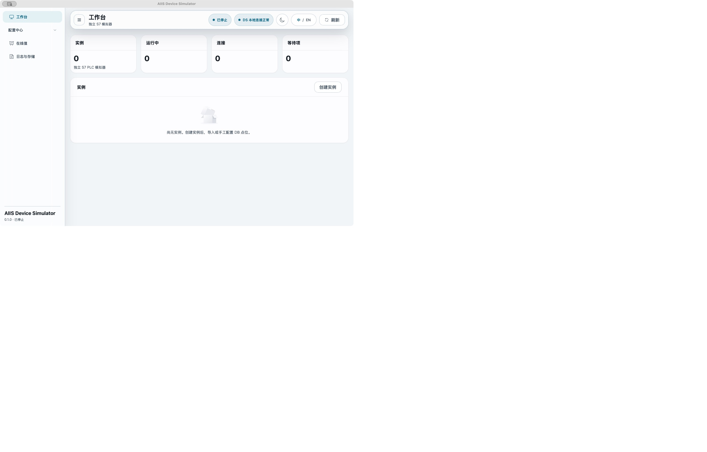
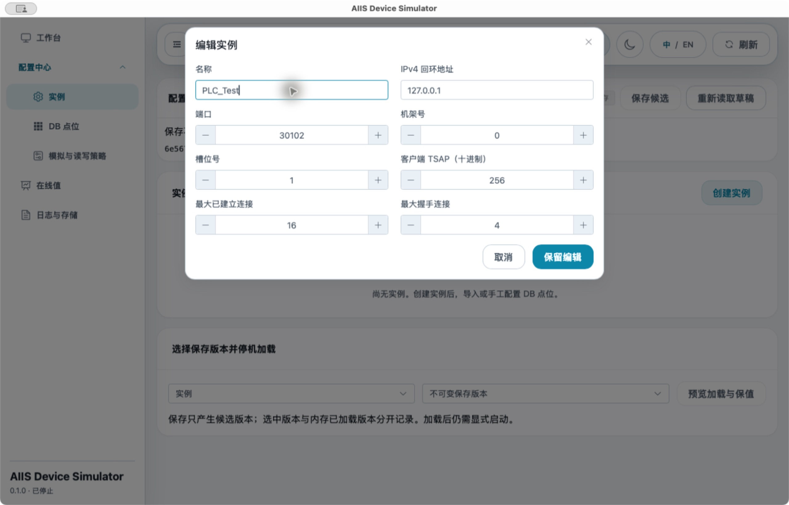
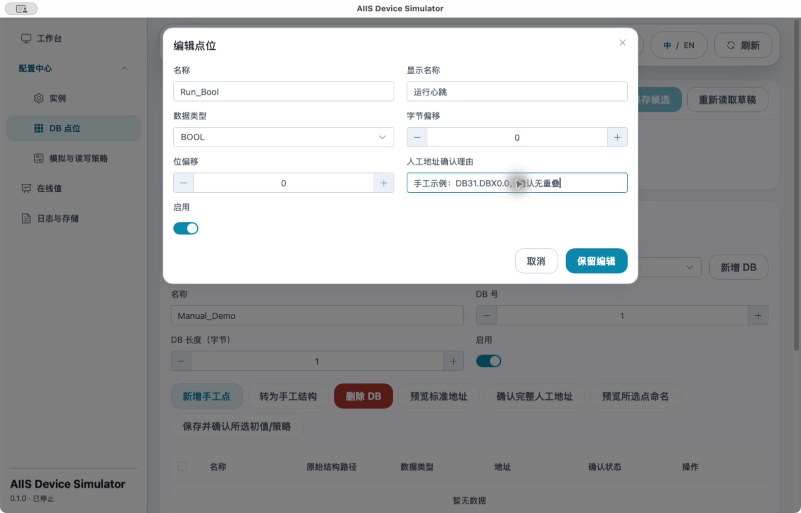
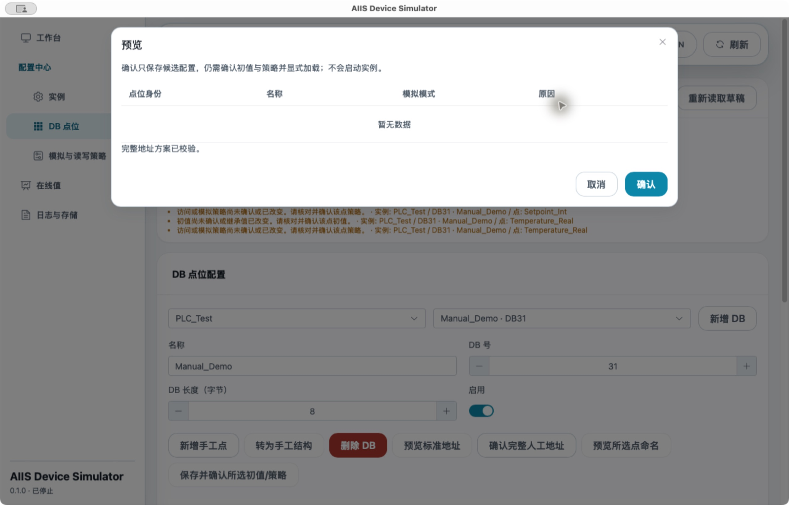
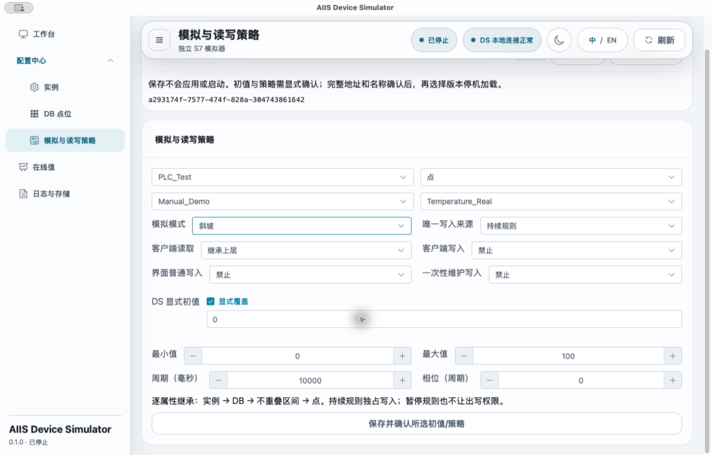
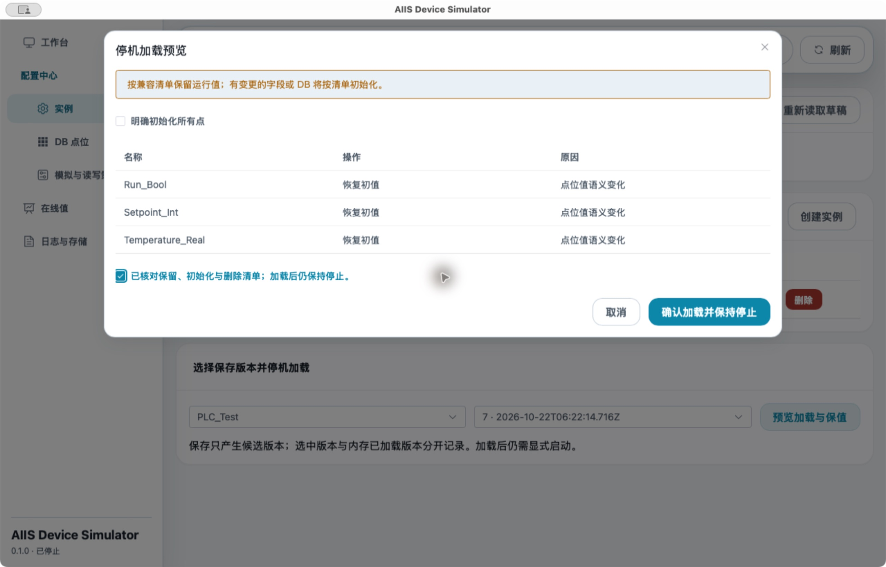
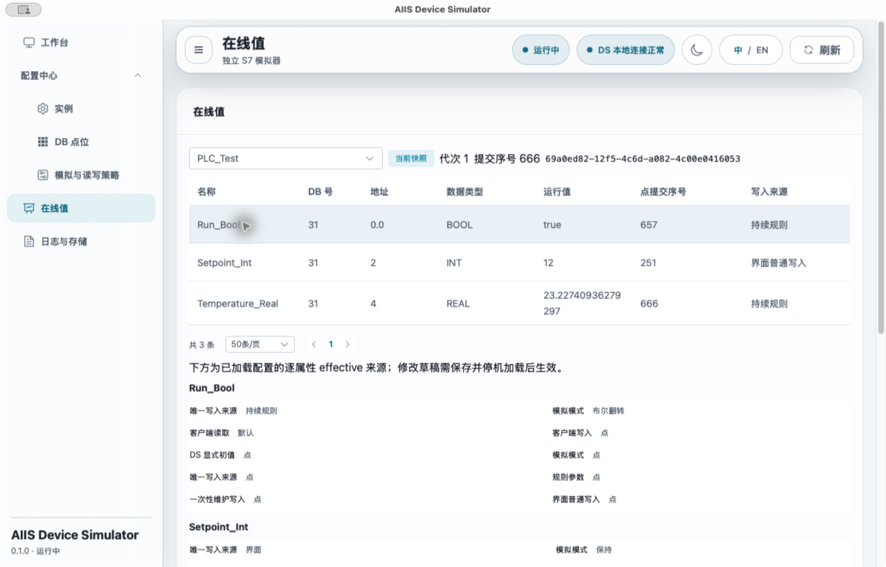

# Device Simulator User Guide

[中文](USER_GUIDE.zh-CN.md) · [Project entry](README.md) · [Build instructions](BUILD.md) · [Screenshot provenance](docs/user-guide/images/README.md)

First run an instance with three manual points, then import two DBs and one UDT. All examples use loopback and synthetic data. DB numbers, point names and ports are editable examples. DS runs independently; DAA, SMA and Backend need not be started. Screenshots use the Chinese UI; the English labels below describe the same controls.

> **Known limitation (2026-10-22):** ordinary typing of custom nonzero initial values reverts to the previous value. The continuous-fixed value input has the same event-binding risk; a separately authorized fix is pending. Planned initials 7/20 and imported count 10 were not completed and are not successful expectations. This guide explicitly uses BOOL `false` and INT/REAL `0`, then demonstrates a nonzero runtime value with an ordinary write of `12`. This open issue remains relevant to final product acceptance; see [reproduction and evidence boundaries](#nonzero-initial-input-reproduction-and-evidence-boundaries).

## 1. Start and prepare

### 1.1 Start the desktop application from source

The validated environment is macOS 15.7.7/arm64, Node 22.19.0, pnpm 11.11.0, Rust/Cargo 1.89.0, CMake 4.0.2 and Apple clang 17/SDK 26.1. Prepare the toolchain using [Build and Run](BUILD.md); the first compilation may need to obtain locked dependencies. An installer or installation on another platform was not validated in this task.

From the repository root:

```sh
cd automation-world/device-simulator
pnpm install --frozen-lockfile
export DS_PROFILE_DIR="$HOME/aiis-ds-demo"
pnpm tauri dev
```

`DS_PROFILE_DIR` is an optional isolated tutorial directory. Choose a new absolute path that you own. DS creates its configuration and logs there; do not point it at DAA or unknown existing data. Reuse this exact path when reopening the tutorial. Without it, Tauri's DS application local-data directory is used. **Logs and storage** shows the actual configuration database path. macOS stores WebKit data separately by a persistent store UUID; deleting the configuration database does not remove all application data.

Expected: a native DS window. A new profile has no instances and no S7 listener. The project builds and links the native adapter automatically; old `DS_G0_*` variables or temporary prebuilt libraries are not prerequisites. `pnpm dev` starts only the browser frontend at `127.0.0.1:15194`. Without the desktop bridge it reports unavailable desktop operations and cannot complete this guide's save, load or control actions.

### 1.2 Understand pnpm store messages

For `ERR_PNPM_UNEXPECTED_STORE` or a modules-rebuild prompt, inspect `pnpm store path` and this project's generated `node_modules/.modules.yaml` `storeDir`. Do not edit the lockfile to match generated installation metadata. Historical validation used isolated temporary stores; `/private/tmp/arch-aw-005-r5-exec/...` is not a long-term product dependency.

A read-only check on 2026-10-22 found `/Users/jason/Library/pnpm/store/v11` in this working tree; your machine may differ. To use your current user's store, run `pnpm install --frozen-lockfile` from DS with the same pnpm version, review that any rebuild prompt concerns only this project's `node_modules`, then continue. Do not delete profiles, edit locks or upgrade dependencies to fix a store mismatch. If the prompt's scope is unclear, retain its complete output for diagnosis.

### 1.3 Pages and four separate actions

| Page / Chinese label | Tutorial purpose |
| --- | --- |
| Workbench / 工作台 | Runtime and revision facts; Start, Pause rules, Resume rules, Stop, Reset runtime values |
| Configuration → Instances / 配置中心 → 实例 | Create instances; select a saved revision and load while stopped |
| Configuration → DB points / DB 点位 | Manual DBs/points, import, address and name confirmation |
| Configuration → Simulation and access / 模拟与读写策略 | Per-point initial values, write ownership and rules |
| Runtime values / 在线值 | Actual loaded DB/address/value, ordinary/maintenance writes, connections |
| Logs and storage / 日志与存储 | Bounded logs, database path, storage and log-loss counters |

1. **Keep changes / 保留编辑** puts dialog edits into the local draft. It does not save.
2. **Save candidate / 保存候选** saves configuration and an immutable revision. It neither loads nor starts. Incomplete candidates may be saved; remaining issues appear in the configuration bar.
3. **Load and remain stopped / 确认加载并保持停止** loads the explicitly selected revision into memory without listening.
4. **Start / 启动** opens the instance listener and advances rules.



## 2. Example one: manual DB31

### 2.1 Create and save PLC_Test

1. Open **Configuration → Instances**, then **Create instance**. The Workbench button of the same name only navigates here; click this page's button to open the editor.
2. Fill **Edit instance** as below and click **Keep changes**.
3. Click **Save candidate** above. Wait until **Unsaved changes** becomes **Saved**. An issue such as “no DB configured” is expected at this stage and does not mean the save failed.

| Field | Example input |
| --- | --- |
| Name | `PLC_Test` |
| IPv4 loopback address | `127.0.0.1` |
| Port | `30102` |
| Rack / Slot | `0` / `1` |
| Calling TSAP (decimal) | `256` |
| Established connection limit / Handshake limit | `16` / `4` |

Expected: the instance table shows PLC_Test, `127.0.0.1:30102` and `16/4`. Until loaded, it may have no runtime row in Workbench. Do not create a duplicate for that reason.



### 2.2 Create DB31 and three points

1. Open **Configuration → DB points**, select PLC_Test, then **Add DB**.
2. Set Name to `Manual_Demo`, **DB number** to `31`, **DB length (bytes)** to `8`, and leave Enabled on. Replace the automatically assigned number and default length 1.
3. Click **Add manual point** for each row below, fill its fields, then **Keep changes**. Enable all three points. Display names may use the descriptions below; the Name field uses the ASCII identifiers exactly.

| Name | Display name | Data type | Byte offset | Bit offset | Example manual address confirmation reason |
| --- | --- | --- | --- | --- | --- |
| `Run_Bool` | Run flag | BOOL | `0` | `0` | `Synthetic tutorial: DB31.DBX0.0, only this bit is mapped.` |
| `Setpoint_Int` | Setpoint | INT | `2` | Not shown | `Synthetic tutorial: DB31.DBW2 occupies bytes 2 and 3.` |
| `Temperature_Real` | Temperature | REAL | `4` | Not shown | `Synthetic tutorial: DB31.DBD4 occupies bytes 4 through 7.` |

Every point needs a reason. Non-BOOL types do not retain a bit offset. Check the point table shows `0.0`, `2`, `4`, then **Save candidate**. The highest touched byte is 7, so length 8 fits these points. Unmapped gaps do not automatically become readable/writable points.



### 2.3 Confirm the complete manual layout, then names

1. With the draft saved, click **Confirm complete manual layout**. **Preview standard layout** is unavailable for a manual DB; do not convert this DB into an imported one.
2. Enter a complete-DB reason, for example: `Synthetic DB31: BOOL bit 0.0, INT bytes 2-3, REAL bytes 4-7; length 8; no overlap.`
3. Click **Preview**. The dialog reports **The complete address plan has been validated**. This layout dialog has no per-address row table; an empty row area is not a failure. Click **Confirm** to save the complete-DB address proof.
4. Back in the point table, verify length and addresses. Use its header checkbox to select all three points on this page; click **Preview selected point names**.
5. Check `Run_Bool`, `Setpoint_Int`, `Temperature_Real` and **Confirm**. Valid manual names remain unchanged rather than gaining a DB prefix.

Selection rules: the header selects **the current page only**. Selections can accumulate across 10/20/50-row pages; changing DB or instance clears them. Naming and batch initial/policy confirmation submit only selected point IDs. The table's Pending/Confirmed column describes initial values/policies; it may still say Pending after addresses and names have been confirmed.



### 2.4 Set and explicitly confirm each point's initial value and policy

Open **Configuration → Simulation and access**. Select PLC_Test, level **Point**, DB `Manual_Demo`, then each point below. Avoid editing the Instance or DB level accidentally.

For each point, fill the table, check **Override** beside **DS initial value**, keep the default `false` or `0` produced by checking it; do not attempt a nonzero initial value in this example. Click **Save and confirm selected initial values/policies** on this page and wait for Saved before selecting the next point. This button both saves and confirms the current point; a separate Save candidate beforehand is unnecessary.

| Field | Run_Bool | Setpoint_Int | Temperature_Real |
| --- | --- | --- | --- |
| Simulation mode | Boolean toggle | Hold | Ramp |
| Write owner | Continuous rule | UI | Continuous rule |
| Client reads | Inherit (default Allow) | Inherit (default Allow) | Inherit (default Allow) |
| Client writes | Deny | Deny | Deny |
| Ordinary UI writes | Deny | Allow | Deny |
| One-time maintenance writes | Deny | Deny | Deny |
| DS initial value | `false` | `0` | `0` |
| Minimum / Maximum | `0` / `1` | Not shown | `0` / `100` |
| Period (ms) | `1000` | Not shown | `10000` |
| Phase (cycles) | `0` | Not shown | `0` |
| Toggle half period (ms) | `1500` | Not shown | Not shown |

Toggle uses half-period1500ms, giving an approximately3-second full cycle. The generic Period field remained1000ms in the capture; it does not determine Toggle timing. Inherited maintenance permission defaults to Deny; review the effective policy.

Choosing an automatic mode sets the rule owner and denies external writes; still verify the final form. A Hold point with UI owner needs ordinary UI writes allowed and client writes denied. Allowing both write sources is rejected by policy compilation. Hold retains an accepted write; Continuous fixed continuously generates a rule value.

Return to **DB points**, select DB31 again, and check all three points are **Confirmed**. Later DB-number, length, structure, type or address changes require reviewing address/name proofs and reconfirming affected initial values/policies. An old value remains only an editable candidate, not proof for the new layout.



### 2.5 Select the latest revision and load while stopped

1. Open **Configuration → Instances**. Select PLC_Test under **Select a saved revision and load while stopped**.
2. Explicitly select the **highest saved sequence** in **Saved revision** (labels are “sequence · timestamp”). This dropdown does not automatically follow every later save. Do not load an older candidate merely because it remains selected.
3. With no unsaved edits and the instance not running, click **Preview loading and retention**. If configuration issues block it, locate the unconfirmed point in the configuration bar instead of repeatedly clicking Start.
4. On first load, the preview should initialize all three points. Check the instance and retention/initialization/deletion list. Leaving **Initialize all points** unchecked is sufficient for this first load: new points must initialize anyway.
5. Check **I reviewed the retention, initialization and deletion list. Loading keeps the instance stopped**, then **Load and remain stopped**.

Expected: PLC_Test now appears in Workbench as **Stopped**, connections 0. Selected and loaded revisions match the revision you chose. Stopped runtime values are `false`, `0`, `0`. Saved is candidate history, selected is persistent selection, loaded is the actual memory revision; they may differ.



### 2.6 Start and observe runtime values

1. In **Workbench**, click PLC_Test's **Start**. Expect Running and a listening endpoint. On failure, inspect the error and Logs and storage instead of hiding a conflict by changing ports.
2. Open **Runtime values**, select PLC_Test, and check the loaded revision at the top plus actual DB31 addresses/types/values, not just point names.
3. Run_Bool toggles every 1500 ms; Setpoint_Int holds 0; after Start, Temperature_Real runs between 0 and 100 with a 10000 ms period. **0 is this example’s stopped initial value after loading/reset; a running ramp does not remain at 0.**
4. Visible UI snapshots refresh at most about 1 Hz. Observe several seconds and point sequence/write source. One frame cannot prove a BOOL toggle; a 500 ms half period can also alias with this refresh rate. Hidden/background pages do not refresh continuously.



### 2.7 Ordinary writes, pause, stop and reset

1. Find Setpoint_Int in Runtime values and click **Ordinary write**. Enter `12`. Check the page's loaded revision and the dialog's old value, epoch and point sequence. Check **I checked this value, revision and sequence**, then **Confirm this write**.
2. Expect value 12, Ordinary UI write source and an advancing point sequence. Its configured initial value remains 0. Ordinary write buttons for the two automatic-rule points should be unavailable.
3. In Workbench, **Pause rules** changes state to Rules paused and freezes BOOL/temperature rules. Listening, reads and permitted Hold writes remain available. Pause does not transfer a rule point to UI ownership.
4. **Resume rules** continues from frozen simulated time without replaying paused elapsed time.
5. **Stop** and wait for Stopped and connection release. Listening stops and rules freeze, but value 12 is retained within this process. A later Start continues that memory; it is not Reset.
6. While stopped, click **Reset runtime values**, review the discard-all-values message and **Confirm**. Expect Stopped, loaded initial values `false/0/0`, and rule time zero. Reset does not start the instance.

### 2.8 Close normally and reopen

Save configuration you intend to retain and explicitly load the intended revision. Close the native window. With unsaved edits, choose **Cancel**, **Save and close**, or **Discard and close** as intended. Save and close saves a candidate without loading it.

Run `pnpm tauri dev` again using the same DS_PROFILE_DIR from section 1. Expect the selected configuration to restore, loaded values to initialize, **Stopped**, connections 0. Running intent and a previous runtime write of 12 are not restored. Select the correct instance and wait for the snapshot when inspecting values. Terminal watcher shutdown differs from normal Window.close; do not use force-killing to prove persistence.

**Operation status: not completed during this capture; awaiting Owner manual feedback. No image is available for this step.**

## 3. Example two: import Alpha/Beta DBs and Measure UDT

Keep DB31 in PLC_Test and add DB71/88. First **Stop** PLC_Test in Workbench and wait for connections to release. **Save candidate** for any local edits. Do not change the two fixture files.

### 3.1 Select files, declarations and closure

1. Open **DB points**, select PLC_Test, then choose these two repository files together in the **DB / UDT source import** file picker:
   - `automation-world/data-acquisition-agent/src-tauri/tests/fixtures/source-import-multi-db/multi.db`
   - `automation-world/data-acquisition-agent/src-tauri/tests/fixtures/source-import-multi-db/types.udt`
2. For this first import, leave each file as **New source lineage** and **Scan declarations**. File/declaration/UDT labels contain filename, batch ordinal and short identity; use these to distinguish even equal filenames.
3. Select only the two rows below. Leave all other DB declarations unselected. The initial DB number 1 is not this example's target.

| DB declaration | Target DB | DB number | Explicit UDT closure |
| --- | --- | --- | --- |
| Alpha (multi.db) | Add DB | `71` | Empty; select no UDT |
| Beta (multi.db) | Add DB | `88` | Only Measure (types.udt) |

Do not select Frame/Spare, do not attach Measure to Alpha, and do not import all six DBs merely because the file contains them. **Preview import changes**, inspect Alpha/Beta full trees, target numbers, preserved DB31 and the ignored-initializer notice, then **Save import candidate**. It saves the candidate without modifying the running image or starting a listener.

**Operation status: not completed during this capture; awaiting Owner manual feedback. No image is available for this step.**

### 3.2 Confirm a complete standard layout for each imported DB

Choose **Alpha · DB71**, **Preview standard layout**, review success, then **Confirm**. Choose **Beta · DB88** and repeat. Neither DB can be skipped.

These examples contain no STRING. Shared `siemens-step7-v20-standard-word-v1` lays out the complete non-optimized tree using word alignment. Expect the following in the confirmed point table; this does not prove a real TIA project's offsets.

| DB / length | Structured path | Type | Byte.bit |
| --- | --- | --- | --- |
| DB71 / 4 bytes | ready | BOOL | `0.0` |
| DB71 / 4 bytes | count | INT | `2` |
| DB88 / 8 bytes | unit.running | BOOL | `0.0` |
| DB88 / 8 bytes | unit.value | REAL | `2` |
| DB88 / 8 bytes | bytes[3] | BYTE | `6` |
| DB88 / 8 bytes | bytes[4] | BYTE | `7` |

REAL is word-aligned in this profile, not necessarily four-byte aligned. Do not change it to byte 4. The array's declared lower bound 3 remains `[3]`/`[4]`, not `[0]`/`[1]`.

### 3.3 Select, preview and confirm names per DB

1. Select Alpha/DB71; use the header checkbox for its two points, **Preview selected point names**, review and **Confirm**.
2. Changing to Beta/DB88 clears selection. Select all four points again, preview, review and **Confirm**.

| Original path | Expected name |
| --- | --- |
| Alpha.ready | `DB71_ready_Bool` |
| Alpha.count | `DB71_count_Int` |
| Beta.unit.running | `DB88_unit_running_Bool` |
| Beta.unit.value | `DB88_unit_value_Real` |
| Beta.bytes[3] | `DB88_B6_Byte` |
| Beta.bytes[4] | `DB88_B7_Byte` |

Index segments use address fallback rather than an invented `bytes_3` semantic name. Address proof must exist before that fallback can resolve. Naming checks the entire instance's reserved namespace; it does not allow duplicates just because they are in different DBs.

**Operation status: not completed during this capture; awaiting Owner manual feedback. No image is available for this step.**

### 3.4 Set DS initial values, confirm, then load and run

1. In **Simulation and access**, select `PLC_Test`, level **DB**, and Alpha (DB71). Set **Hold**, **No write owner**, Client reads **Allow**, and client/ordinary UI/maintenance writes **Deny**. Keep initial values inherited; do not enable a single DB-wide initial override for mixed BOOL/INT types. Click **Save candidate**.
2. In **DB points**, select Alpha. Check neither point has explicit point overrides; if present, restore the affected properties to Inherit at Point level and save. Select both points with the table header, then **Save and confirm selected initial values/policies**. This confirms their effective values; it does not assign rules in bulk.
3. Repeat the DB-level settings/save for Beta (DB88), then select and confirm its four points together. BOOLs default to false and INT/REAL/BYTE to 0. Source `count : INT := 7` does not import an initial value: count's 0 is the DS type default, not imported 7 or a claim that the planned 10 was entered. Two DB policies replace six individual edits, assuming newly imported points have no explicit point overrides.
4. Check DB71's two and DB88's four points are Confirmed and DB31 was not removed/rebound. In Instances, select the **highest saved sequence**, **Preview loading and retention**, review new DB initialization and existing points, acknowledge, then **Load and remain stopped**.
5. **Start** in Workbench. Check the actual loaded revision, three DBs and nine points in Runtime values. On first load count should be 0; DB31 Hold retention follows the load preview. Import was not submitted during this capture: these instructions describe existing implementation behavior and await Owner feedback, rather than proving a completed import run.

## 4. Advanced operations

### 4.1 One-time maintenance writes

Use only when an operator needs a one-time override of a client-owned or unowned **Hold** point. For example, change DB71_count_Int to **S7 client** owner, Client writes **Allow**, Ordinary UI writes **Deny**, One-time maintenance writes **Allow**, retaining other values as intended. **Save and confirm selected initial values/policies**, Stop, select latest revision, preview/confirm load, then Start.

In Runtime values, **One-time maintenance write**, enter the new value, check old value/revision/epoch/sequence, acknowledge and submit. It changes neither the initial value nor ownership; a client can overwrite it later. Automatic-rule points cannot be maintained even while paused. Maintenance is disabled by default and is not a way around ordinary-write protection.

For an unknown reply, do not retry automatically. Refresh current value/sequence and review again. After a later concurrent write, the current readback cannot prove the original write succeeded. For a stale revision or sequence, close the old dialog, refresh and reconfirm.

### 4.2 STRING and complete manual addresses

Supported `STRING[1..254]` occupies maximum length+2 bytes, including S7 max/actual headers and the complete character area; characters must be ASCII. An imported DB containing STRING cannot use Preview standard layout. Assign non-overlapping addresses/reasons to **every point in the complete DB**, set sufficient DB length, save, then Confirm complete manual layout with a DB-wide reason, followed by names and initial/policy confirmation. This tutorial does not import STRING and cannot establish its offsets from other fields.

### 4.3 Reimport and invalidation

For an existing source, explicitly select its previous **source lineage** on the file row; select the existing target DB rather than Add DB, and choose closure/DB number again. Review changes before confirming. Identical source bytes/bindings/closure may return unchanged. Unselected DBs/instances remain protected. Changed DB number/length/structure/address/type invalidates affected confirmations; previous initial values are candidates and are not converted automatically. Reconfirm layout, names and affected initial values/policies, then select and load the new revision while stopped. Do not repeatedly create new lineages or select every UDT merely to remove an error.

### 4.4 Retention, full initialization and rollback

Default loading retains values by the compatibility list: Hold points with stable identity/address/type/value semantics may retain runtime values. New points or changed DB/value semantics initialize as listed. Changed rules can also reset rule time. A display-name or connection-limit edit need not discard a compatible Hold value; review the actual list. Retention failure is an explicit failure, not a successful load.

To discard all runtime values, check **Initialize all points** in the preview, review its revised list and confirm. Selecting a revision older than the current selected revision forces full initialization on rollback. A historical revision is its complete saved configuration; current draft confirmations do not fill gaps in it. An already loaded revision may return already_loaded and does not imply Reset.

### 4.5 Multiple instances and connections

Add another instance in Instances, for example on local port 30103. Each instance independently selects and loads its revision. Names are not identities; do not copy UUIDs. DB numbers are unique per instance and can repeat across different instances. Listener endpoints must not conflict. Limits of 8 instances, 32 DBs/instance, 4096 leaves/instance and 64 KiB/DB are configuration bounds, not an 8×16 capacity guarantee. Per-instance C/H and global resource admission may reject connections.

The **Connections** panel below Runtime values belongs to the currently selected instance. Check peer, connection identity, Handshaking/Established/Closing, reserved bytes and times; scroll inside the table for technical fields. **Close this connection**, review the selected peer/identity, then **Confirm**. Only that connection closes. Committed writes do not roll back; reconnection gets a new identity. With no external client, connections 0 and an empty table are expected.

### 4.6 S7 client parameters (instructions only)

| Parameter | PLC_Test example |
| --- | --- |
| Address / TCP port | `127.0.0.1` / `30102`; do not use default 102 |
| Rack / Slot | `0` / `1` |
| Local / Calling TSAP | Decimal `256`, hexadecimal `0x0100` |
| Remote / Called TSAP | `0x0101` (257) for this rack/slot |
| DB31 point reads | BOOL bit 0.0; INT byte 2/length 2; REAL byte 4/length4 |

Use a compatible S7 client supporting a custom port and TSAP; some libraries derive Called TSAP from rack/slot. Only a started instance accepts connections. Pause retains communications; stop/start disconnects clients, which must reconnect. On another computer, 127.0.0.1 refers to that computer, not this DS host.

Requests must cover complete mapped fields and satisfy per-point permissions. Avoid reading an entire DB containing unmapped padding. A byte-wide BOOL request touches seven other bits and may be rejected; use the actual bit address. STRING needs the full n+2 bytes. Current limited protocol: S7 PDU 480, at most 4 items, at most 256 B/item, AMQ 1. Multi-item results are per item; a later failure does not roll back earlier commits, and disconnect/timeout can leave results unknown. The configured DB length limit does not imply arbitrary packet support.

This guide does not run the DAA application or DAA→SQLite joint acquisition. Existing independent S7 evidence, actual scope and current acceptance status are in [tasks](../../plans/ARCH-AW-005-ds-g0-prototype-validation/tasks.md) and the [independent checklist](../../plans/ARCH-AW-005-ds-g0-prototype-validation/checklist.md). Stage C, real devices and complete PLC CPU behavior remain outside this guide.

### 4.7 Configuring many points: current bulk capabilities

Shared properties can inherit **Instance → DB → non-overlapping Region → Point**, with lower-level explicit overrides taking precedence. For example, for a read-only Hold DB, select DB level in Simulation and access, set Hold/No write owner, allow client reads and deny other writes, leave initials inherited/type-defaulted, then Save candidate in the configuration bar. Do not blindly share one initial value or automatic rule across mixed BOOL/numeric/STRING types. Existing point overrides remain; choose Inherit for the relevant point fields when inheritance is intended.

With addresses/names confirmed, return to DB points, select the DB and use the header checkbox for this page or accumulate selections across pages. **Save and confirm selected initial values/policies** confirms each selected point’s current effective values/policy. It **does not assign a common rule or parameters in bulk**. Changing DB/instance requires selecting again. Select and load a saved revision while stopped before runtime changes.

Different per-point ramps, periods or owners currently require individual point edits. There is no multi-selection assignment, policy spreadsheet or XLSX configuration import/export entry. The older [Python virtual-PLC tool](../../tools/plc/s7-virtual-plc/README.md) init-profile generates an XLSX with DB sheets/one row per point and mode/fixed_value/min_value/max_value/hold_seconds/period_seconds/sequence_values. That workbook belongs to another application and cannot be imported directly into DS. Its seconds must not be treated as DS milliseconds. Table editing, multi-point rule assignment, templates and import/export can be discussed as future separately authorized work; this guide adds none of them and does not substitute the old runtime for DS.

## 5. Common blockers and diagnosis

| Symptom | Check and recovery |
| --- | --- |
| Save candidate unavailable | Keep changes or cancel the current editor, wait for busy to finish; use the native app when no bridge exists |
| Import/layout/name button unavailable | Save dirty edits; choose the correct instance/DB; select points for naming; manual DBs do not support standard layout |
| Address confirmed but point still Pending | The table column concerns initial/policy proof; explicitly set/confirm each point and inspect located issues |
| Standard layout fails | Check the complete DB, explicit UDT closure and supported types; handle STRING/manual addresses as a complete manual DB rather than guessing |
| Configuration issues block loading | Locate the instance/DB/point needing confirmation; explicitly choose latest saved sequence rather than an old candidate |
| Saved but runtime unchanged | Save does not load; Stop, preview/confirm load. Runtime values show loaded, not draft |
| Start fails / port occupied | Check 127.0.0.1:30102 and logs; let the owning process's operator resolve it, without killing unknown processes or blindly switching ports |
| profile_in_use | Another DS owns that directory; close your own instance normally, do not delete a lock to seize it |
| Draft ETag conflict | Preserve your edit intent, reread current facts and reapply; Reload draft discards unsaved local edits |
| Write button unavailable | Check actual loaded mode/owner/permissions and Running/Paused state; refresh stale data; rules never surrender ownership |
| Stale snapshot or sequence conflict | Wait for a normal refresh, check instance/loaded revision/epoch/point sequence, reopen the dialog; do not automatically resubmit the old write |
| Corrupt/incompatible/read-only/full database | Retain original database/logs and stop to diagnose; do not delete history, alter schema or overwrite with an empty database |
| Observability degraded | In Logs and storage inspect lost/stdout/file counters and database path; retain original output, since missing evidence cannot prove success |

**Refresh** queries current bounded logs. Enter an actual event name and **Filter**; clear it to restore the list. Pages contain 50 entries, not unlimited sampling history. Time fields are monotonic nanoseconds rather than dates. Long technical tables scroll internally.

### Nonzero initial input: reproduction and evidence boundaries

- Page/control: Simulation and access → Point → Temperature_Real → DS initial value → Override.
- Action: type 20 normally, then Tab. The expected value should remain; the actual native capture still showed the previous 0. Do not claim an initial-value change from the typing attempt. The executable main flow keeps explicit 0; an ordinary runtime write 12 does not change that configuration initial.
- Read-only source explanation: [PolicyEditor](src/app/simulator/components/PolicyEditor.vue) handles only change for initial/fixed text inputs; frozen Element Plus restores the unchanged modelValue after input. The fixed-value input has the same binding and is not offered as an executable setting flow here. Documentation authorization did not authorize a code fix.
- The existing native driver dispatches input/change synchronously before waiting. This differs from separate ordinary typing actions. Preserve the original technical QA record without extending it to a successful real-typing claim. Screenshot/document verification does not close this product issue.

## 6. Documentation and screenshot basis

This guide describes existing six-page/normal-IPC behavior of product candidate `306a09d5…`. Screenshots dated 2026-10-22 use an isolated synthetic profile. See the [image index](docs/user-guide/images/README.md) for all seven actual native PNG dates, steps, original hashes and provenance. Values, saved sequences and UUIDs belong to that session; use your own actual revisions, addresses and state when repeating it. The [owning checklist](../../plans/ARCH-AW-005-ds-g0-prototype-validation/checklist.md) records this document increment's verification and Owner status. Screenshot capture adds no protocol or performance claim.

This capture completed manual DB31 loading, Start, ordinary write 12, Pause/Resume and Stop. Reset, normal close/reopen and import confirmation were not performed. Owner took over the still-open file chooser and will provide feedback; the three outstanding steps have no fabricated images.
