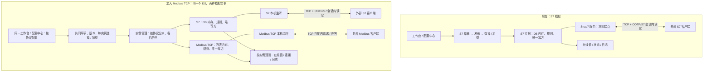

Task ID: DS-002
Revision: r2
Status: draft
Owner Role: PM
Allowed Writers: PM, Human Owner
Handoff: PM scope draft -> Human Owner approval of exact DS-002 r2 -> Development A0, then A1 only on A0 pass -> fresh-context Verification -> Human Owner final acceptance
Workflow Mode: STD
Execution Mode: agent_team_same_session
Task Namespace: device-simulator
Classification: root
Capability: 同一DS产品的Modbus TCP模拟与S7兼容（本次待批）；独立设备读写调试与点位导出（后续设计）
Owner: Device Simulator
Acceptance Chain Reference: DS-002 r2 PM draft -> Human Owner exact scope approval -> Development developer_handoff -> fresh-context Verification checklist -> Human Owner final acceptance
Related Task: device-simulator::DS-001 r1; aiis-ics-arch::ARCH-AW-004 r2; aiis-ics-arch::ARCH-AW-005 r5; aiis-ics-arch::DAA-007 r2

# DS 多协议设备模拟与设备读写调试设计 r2

## 1. 当前效力、唯一归属与可审阅交付

**当前为 `draft / r2`。** 2026-11-14（Asia/Shanghai），Human Owner确认把上一轮界面对比及节点图补入本设计，先审 Modbus TCP 模拟范围和 S7 兼容，设备读写调试留下一阶段，确认范围后才改代码。此次“可以”批准的是文档补充；没有 r1/r2 实施批准或最终验收。本文仍是同一个 DS-002 的唯一规格，归 [DS PLAN](../../PLAN.zh-CN.md) 和[任务目录](../README.zh-CN.md)管理，不继承其他任务的批准、QA 或例外。

**本次送审的实施合同是 §4、§5、§8、§10–13：** A0 用独立合成客户端验证候选 Modbus TCP 服务和资源释放；A0 全过后进入 A1，在现有 DS 内增加 IPv4 loopback Modbus TCP 模拟实例并保持 S7 行为。一次精确批准涵盖两阶段及这个先后条件。§6、§7 的设备读写调试、§9 的跨端导出，以及 r1 的候选文件、旧验收编号和旧审批文字，仅作后续设计或历史。范围冲突以本段和 r2 验收矩阵为准。

本轮只更新本 `spec.md`（PM）及 DS 的 [PLAN](../../PLAN.md) / [PLAN.zh-CN](../../PLAN.zh-CN.md)、[任务目录](../README.md) / [任务目录中文版](../README.zh-CN.md)中的现有 DS-002 条目（主协调）。不创建 `tasks.md` 或 `checklist.md`。本轮在正式工作树读时的 HEAD 为 `21cd789277695bbafaa55c24e39261fc7247f9b0`，DS 范围起点干净，保留其他任务的并行修改。

## 2. 已核现状与历史效力

以下是 r1 的历史记录与 2026-11-14 复核的 DS 源码入口。§4.2 补充直接影响 S7 兼容和回退的当前行为。后续实施重新冻结实际输入。

| 表面与定位 | 当前事实、复用与改造风险 |
| --- | --- |
| [配置值对象](../../runtime/src/domain/configuration.rs) | Rust `Workspace.schema_version=1`，实际 JSON 键是 `schemaVersion`。实例有 host/port/rack/slot/calling_tsap/dbs，DB 有编号和字节长度，点有 byte/bit 和 TIA 来源；serde 拒绝未知字段，当前校验只接收旧 S7 模型。 |
| [layout](../../runtime/src/domain/layout.rs)、[image](../../runtime/src/domain/image.rs)、[request](../../runtime/src/domain/request.rs)、[owner](../../runtime/src/services/owner.rs) | 编译、coverage、image和请求均按S7 DB/byte/bit工作；Request载荷固定256B。现有唯一写owner、权限、CAS、规则/控制可借鉴，不能把Modbus表塞入DB map或沿用S7 STRING编码。 |
| [配置解码](../../runtime/src/infrastructure/config_store/queries.rs)5–11行、[schema检查](../../runtime/src/infrastructure/config_store/schema.rs) | payload先验原字节SHA再按Workspace解码；库appID/user_version、migration SHA及sqlite_master SQL均严格核对。新增payload分型、SQL表变动和旧版兼容是不同问题，不能靠删除字段/忽略校验处理。 |
| [configuration](../../runtime/src/services/configuration.rs)、[apply](../../runtime/src/services/apply.rs)、[versions](../../runtime/src/services/versions.rs) | 来源只读、布局/初值/策略确认、草稿CAS、不可变版本、selected/实际loaded、停机加载及引用保护已有完整业务。改造必须覆盖所有读写和版本路径，保留同版加载不重置、回退引用及预览保护。 |
| [native构建](../../native/CMakeLists.txt)、[Rust FFI](../../runtime/src/infrastructure/native_ffi.rs)、[bridge](../../native/bridge/ds_s7_bridge.h) | 当前CMake已编译上游client/micro-client源码，但产品Rust FFI/bridge仅有模拟server的create/start/stop/close/destroy等入口；没有产品调试client facade及其任务生命周期。构建硬限制macOS arm64，不能称已有三平台客户端。 |
| [前端facade](../../src/services/deviceSimulator.ts)、[宿主状态](../../src/console/composables/useDeviceSimulator.ts)、[导航](../../src/console/sections.ts)、[桌面入口](../../src-tauri/src/lib.rs) | 六页面为本地模拟业务；dirty草稿与runtime快照分开。没有远端调试会话；现有`ds_write_point`写本地模拟image，不能用于远端PLC写入。 |
| [source DTO](../../runtime/src/domain/source.rs)、[命名服务](../../runtime/src/services/naming.rs) | 稳定point UUID、技术name、display_name、结构化segments/source_path、DB绑定与不可变source_versions可导出。原始名称来自绑定tree/结构化段，不应靠拆字符串猜；手工点可没有TIA来源。Modbus对应模型尚不存在。 |

历史只链接原件，不复制完整多轮规格或重开旧任务：

- [ARCH-AW-004 r2](../../../../plans/ARCH-AW-004-ds-detailed-design/spec.md)及其[tasks](../../../../plans/ARCH-AW-004-ds-detailed-design/tasks.md)、[checklist](../../../../plans/ARCH-AW-004-ds-detailed-design/checklist.md#owner-acceptance-r2)：2026-10-18接受的是S7设计，Modbus/响应模拟延期；设计数字不自动成为实测能力。
- [ARCH-AW-005 r5](../../../../plans/ARCH-AW-005-ds-g0-prototype-validation/spec.md)及其[tasks](../../../../plans/ARCH-AW-005-ds-g0-prototype-validation/tasks.md)、[QA4及Owner接受](../../../../plans/ARCH-AW-005-ds-g0-prototype-validation/checklist.md#owner-acceptance-r5)：2026-10-27接受有限S7产品/既有G0退役。原306a09d5候选、34核心测试、16会话/第17条拒绝及macOS原生矩阵保持原证据边界；r4不完整、QA1–3失败、F-r5-001/002/003及后续关闭事实全部留原处。不能把后来代码重标成原QA4。
- [DS-001 r1](../DS-001-policy-table-and-usability/spec.md#owner-acceptance-ds001)及其[tasks](../DS-001-policy-table-and-usability/tasks.md)：2026-10-27接受当前DS，独立QA豁免只对DS-001有效；没有checklist是旧任务明确例外，本任务仍按STD独立核验。
- [DAA-007 r2 spec](../../../data-acquisition-agent/plans/DAA-007-ds-joint-validation-and-time-contract/spec.md)、[tasks](../../../data-acquisition-agent/plans/DAA-007-ds-joint-validation-and-time-contract/tasks.md)、[Owner接受](../../../data-acquisition-agent/plans/DAA-007-ds-joint-validation-and-time-contract/checklist.md#owner-acceptance-r2)：2026-10-30接受受控DS S7→SQLite联调及阶段B的该有限范围；8590样本/4295轮完整重开比较保留。早期checkpoint缺失、15:27来源未明事件仍跟踪，阶段C/自动启动/真实现场未启动。它不代验新DS版本/Modbus/调试客户端。
- DS [当前README](../../README.zh-CN.md)的2026-10-29 DIRECT草稿/版本管理增量仍标为DEV自检交付、待Owner按手册确认。新设计以当前源码评估兼容性，不将该增量倒记为旧接受或本轮QA。

PM读取当前有效Revision、批准/失败/交接/收尾段及源码，历史重复引文按原件定位去重；不重新核算旧持久原始协议证据，不声称本轮复验旧产品。

## 3. R01：同一产品、协议维度与两种运行角色

推荐继续同一个DS应用，协议为`s7`、`modbus_tcp`；品牌/型号/固件是可选资料，不能参与选择驱动或推导地址。“西门子版/汇川版”会复制草稿/版本/生命周期/UI维护，不采用。RTU需串口参数、设备/端口占用和不同帧/时序合同，列后续，不在TCP方案中隐含支持。

汇川目标目前只有“好像是EVO800”。CPU、固件、通信模块、Modbus Server启用方式、Unit ID、端口、寄存器映射和点表均未核实；不套EVO700/H5U/AM600地址，不宣称EVO800兼容。没有这些资料仍可完成通用协议设计和合成验证；真实目标适配另批。

| 维度 | 设备模拟：本地模拟服务 | 设备读写调试：连接远端设备 |
| --- | --- | --- |
| 目标/配置 | 持久模拟草稿、不可变版本、selected/loaded；监听端点 | 手工连接参数及会话内请求；首增量不持久化调试目标/运行意图，不进入模拟版本 |
| 数据所有者 | 每个模拟实例自己的内存、规则、版本与写入准入 | 远端设备拥有实际值；DS只保存有界结果/采样事实，不能成为本地image |
| 任务/连接 | 监听器、已接入客户端、模拟tick | 主动连接、串行请求、一次读/有界轮询 |
| 停止/权限 | 单实例stop关闭其server与接入连接，按旧合同保值 | 停止轮询/关闭调试连接只影响该调试session；独立远端写入开关/确认 |
| 状态/日志 | `role=simulator`、instance_id、loaded_revision、epoch | `role=debugger`、session_id、generation、request_id/chunk |

两角色可以在同一进程并存，但共用进程资源总预算。连接调试不调用simulator start，停止模拟不隐式停止独立远端会话；应用退出由组合根按共同期限分别关闭两类资源。用户可明确把正在运行的本地模拟器作为一个调试目标，仍须走真实协议socket，不回退为内存短路，连接本身不会帮它启动。

```text
模拟页面 -> 薄IPC -> 模拟配置/版本服务 -> S7实例或Modbus实例 -> 本地协议server
调试页面 -> 独立薄IPC -> 调试会话/有界请求服务 -> S7或Modbus client -> 远端设备
                    复用适用的纯类型/规则辅助、日志设施和通用表格
```

不建立插件平台、通用工作流引擎、中央调度服务、Backend代理或新共享可写数据库。

## 4. R02–R03：协议分型、存储兼容与模拟业务边界

### 4.1 R02：一个实例、一个协议

v2 配置共享稳定实例 ID、名称、监听端点/连接上限、公共策略和版本事实，以明确的 `protocol` 区分专属字段：

| 分型 | 协议专属内容 |
| --- | --- |
| `s7` | listen.host/port、rack/slot/calling_tsap、S7 DB（id/number/length/points/byte/bit/来源/确认），保留现有语义 |
| `modbus_tcp` | listen.host/port、显式 Unit ID、四表区域/点位和 32 位字序；无 rack/slot/DB |

一个已保存模拟实例的protocol不可直接翻转；用户新增另一协议实例并显式配置，避免同UUID的DB历史被解释为寄存器。Modbus `Area`有稳定id、table、零基start_address、quantity；bit表按bit计数，register表按16-bit register计数，区间不重叠且起点+长度不溢出65536。point引用area及绝对PDU地址，type占用范围必须完全位于area内；首版拒绝相互重叠的typed point/别名，禁止多寄存器标量被半写。

S7继续由其已验证owner/image/native adapter处理；新增Modbus模型、image和adapter有自己的寻址，不把S7 `Request.db/start/data[256]`改名后冒称公共协议请求。实例manager只用小型枚举分派公共start/pause/stop/reset/snapshot；共享纯值规则/校验工具须有实际两处消费者，S7 codec和Modbus register codec分开。协议adapter负责帧/连接/协议异常映射，共享模拟业务负责初值、唯一写方、规则、版本、提交和观测；adapter不持第二份权威业务内存。

### 4.2 R03：S7 兼容、首次 v2 保存和回退

**当前源码事实。** [schema.rs](../../runtime/src/infrastructure/config_store/schema.rs) 校验 SQLite 完整性、外键、appID、`user_version=1`、迁移记录和实际库结构，并校验已选实例及其摘要。[queries.rs](../../runtime/src/infrastructure/config_store/queries.rs) 对被读取的 payload 先校验原字节 SHA-256，再用旧 DTO 解析与校验。打开时读取草稿及已选版本；列历史只读元数据，打开特定版本才解码该 payload。[transactions.rs](../../runtime/src/infrastructure/config_store/transactions.rs) 分别处理草稿 CAS、发布不可变版本及保留策略、选择实例版本及前一版本保护。

**r2 操作合同。**

1. 保留现有 SQLite v1 物理格式、DDL、appID、迁移记录、约束和锁。新增的是 payload JSON 的 `schemaVersion: 2`，不是 SQLite `user_version: 2`。对每个实际读取的 v1 payload，仍先用原字节/原 hash 校验和原 DTO 解码，后在内存识别为 S7；旧 `slice_sha256` 继续按原 S7 DTO 算法验证。同一内容的 v1/v2 S7 表现一致；不同编码的摘要无需相同。坏库、坏 hash/引用、未知 payload 版本明确拒绝，不建空库掩盖错误。
2. 打开、查询、关闭、重启不转换、不发布、不裁剪。只使用 S7 且尚无 v2 的旧 profile，可照常编辑、显式保存及发布，继续使用原 v1 编码，仍可由旧程序读取。旧历史和来源 BLOB/hash 不重编码；实例/DB/点位 IDs、来源版本、名称确认、规则、原时间、草稿序号及 selected/previous 引用不因启用新程序而改变。显式发布仍执行既有预览和保留规则，保护原本受保护的引用；读操作和首次保存不会借机删历史。
3. 第一次写入 v2 只能发生于用户**显式保存含 Modbus 的草稿**。沿用草稿保存流程：预览说明格式改变、旧程序不再适合打开该 profile，以及先保留可恢复的停机副本；操作者明确确认后，以同一草稿内容和当前 etag 一次 CAS 提交。服务层对所有保存入口执行同一个门，包括关窗时的“保存草稿并关闭”；未确认保留草稿和窗口，可回配置中心继续。普通 S7 保存没有这一步；缺确认、取消、预览过期或已知提交前失败不转换、不发布、不切 selected、不改 loaded。提交或回执结果未知时，沿现有未知结果处理重读草稿、版本及 etag，再决定是否继续，不盲重试。已写入 v2 的 profile 继续用 v2，即使删除最后一个 Modbus 实例。没有自动原位降级，也不新增迁移工具或数据库标记。
4. 测试从独立新合成 profile 和旧 S7 合成库的**停机副本**分别验证首写。维护者在停机并释放锁后保全完整已关闭 profile、库字节和身份，记录哈希；使用另一个显式 `DS_PROFILE_DIR` 操作副本，备份留在配置子目录之外。旧库副本与原库共享原 profile ID，桌面 WebKit 也用该 ID；副本用测试宿主，或原件与副本串行，不能把路径不同当作 WebKit 隔离。产品防误转换靠预览确认和 CAS；本任务准入仅限自有合成数据，已有真实用户 profile 的复制、采用、替换或恢复留给 Owner 另行选择。
5. 新程序同库读取 v1/v2 草稿或历史版本，按各自编码验证，再按同一 S7 规则运行；保存/发布不自动加载，加载不启动。已选、实际加载、待应用和前一版本分别显示。现有停机预览/保值、同版加载不重置、stop/start 保值、重开从 selected 初始化且不自动监听的规则继续有效；不得为版本切换重写历史。
6. 旧程序遇 v2 草稿或需解码的 v2 已选版本时应拒绝并保留原件；只有未选 v2 历史时可能仍能打开，读到该版本或将其作为最新版本比较时会失败。单切 selected、删除 Modbus 或导出部分记录都不等于旧版回退。验证回退时先停机，保全升级后的完整库和新增记录，再把停机前完整副本作为单独 profile 用旧程序打开核验；两个版本各自保留。没有覆盖或合并历史的隐式步骤。

继续遵守 [profile 锁](../../runtime/src/infrastructure/profile_lock.rs)及 [profile 身份](../../runtime/src/config/profile.rs)规则。新的日历时间用 `Asia/Shanghai`、携带 `+08:00`；原历史时间不改写。若需 DDL、改变容器版本/迁移清单或调整 profile 规则，超出 r2，返 PM。

## 5. R04：Modbus TCP模拟的首增量合同

四表为`coils`、`discrete_inputs`、`holding_registers`、`input_registers`。配置和协议使用零基PDU地址0..65535；常见0xxxx/1xxxx/3xxxx/4xxxx编号仅可作为明确基准的辅助显示，用户不能输入40001后由系统默默猜成地址0。bit值为BOOL，寄存器按16位值传输。四表及PDU寻址依据[Modbus官方V1.1b3 §4.2–4.4](https://www.modbus.org/file/secure/modbusprotocolspecification.pdf)。

| 本次可批准的功能码 | 本地模拟服务行为 |
| --- | --- |
| FC01/02 | 读 coils / discrete inputs，每次 1..2000 bit。 |
| FC03/04 | 读 holding / input registers，每次 1..125 register。 |
| FC05 | 写一个完整 BOOL coil，值只接受 `0xFF00` / `0x0000`。 |
| FC06 | 写一个完整 16 位 holding 点；32 位点的两个半字都拒绝。 |
| 其余功能码 | 对可识别的合法请求返回异常；无批量写、广播、网关路由或设备调试客户端。 |

协议数量上限来自 [Modbus 官方 §6.1–6.6](https://www.modbus.org/file/secure/modbusprotocolspecification.pdf)。每个 Modbus 实例仅监听一个 IPv4 loopback 端点，端口 1024..65535（例 15020），只响应一个显式 Unit ID 1..255（默认 1）；0 不可配置。其它 Unit ID 的合法帧忽略、无响应和副作用，诊断限频。同端口不复用不同 Unit ID；与 S7 冲突的绑定必须报实际失败。S7 已有端口配置合同不变。

bit 表支持 BOOL，register 表支持 U16/I16/U32/I32/F32（有限值）；32 位点占两个连续 register。寄存器内字节采用网络大端，跨寄存器配置 `high_word_first` / `low_word_first`。在线值显示原始 register 与类型值；32 位值可以经本地规则或本地手工写更新并由外部读取，禁止用 FC06 拼写 32 位值。不支持字节交换、64 位、字符串、BCD、品牌地址和缩放。

每个 Modbus 实例最多 16 个区域、4096 个点、256 KiB 原始镜像。配置地址为零基 PDU 0..65535；同一表内区域和点位各自不重叠，读取必须落在同一已配置区域内，区外、跨区和地址溢出拒绝。区域内无点的原始位置读为 0，只读；合法原始读取可只读 32 位点中的一个 register。只有实际配置的 coil/16 位 holding 点在现有控制模式、唯一写方及协议权限均允许时可由客户端写入。discrete inputs / input registers 永远不能经协议写。BOOL 支持 hold/fixed/toggle，数字支持 hold/fixed/ramp/sine/random；暂停只冻结规则推进，不释放写方权限。所有本地、协议、规则和重置写走实例唯一提交入口；拒绝无值或序号变化。

对可响应的合法报文，异常功能码是原 FC 加 `0x80`；`01` 不支持、`02` 地址/范围/写入不可用、`03` 数量或值非法、`04` 已知内部失败、`06` 处理队列忙。响应关联原 Transaction ID 和 Unit ID。无效 Protocol ID、MBAP Length 不在 2..254（TCP ADU 上限 260 字节）或超时半帧应结束该连接，不入业务队列。合法且已提交的写若回应丢失不保证客户端可判定结果；服务端不重放或制造第二次提交。

## 6. 后续设计 R05–R07：手工调试、范围采样与受控单点写

### 6.1 R05：直接手工输入

首次使用无需先创建模拟实例、发布版本、导出文件或启DAA。选择协议后手工填写连接参数，显式连接一次，随后复用该连接多次请求：

| 操作表单 | 必填事实与反馈 |
| --- | --- |
| S7连接 | 目标host/port、rack/slot，必要的TSAP选择须显式可见；首轮建议IPv4字面地址，DNS/IPv6另批准。不同设备的非优化DB/访问许可由实际目标资料确认，不能把连接成功当任意DB可读写。 |
| S7单点 | DB号、byte offset、BOOL bit（如适用）、明确type；STRING须声明最大长度/编码；显示实际请求字节数。 |
| S7范围 | DB号、起始byte、byte长度，先显示将读取的区间/分块；raw hex/byte为事实，typed解码按用户声明的offset/type附加展示。 |
| Modbus连接 | 目标host/port、显式Unit ID；Unit ID改变视为目标变更，先结束旧代次。 |
| Modbus单点/范围 | table、零基PDU起点、quantity（bit或register），type/word_order；读取功能码由table确定且可见，不能选择不匹配功能码。 |

连接/协议拒绝、超时、解码失败分别显示；不能把缺值填0/false，不能使用上次成功值冒充本次值。连接成功只说明握手/transport事实；单点成功不代表整段或其他表成功。

### 6.2 R06：有界读取与逐块事实

支持“读取一次”和显式“开始轮询/停止轮询”。每个逻辑请求有request_id，每块有chunk_index、目标generation、真实地址/数量、DS本机请求开始/响应完成的观测时间`+08:00`、耗时、raw结果或错误。这些时间不等于设备内部采样或事件发生时刻；只有设备实际提供事件时间时才另列该事实及其来源，不能从请求时间推算。整体给complete/partial/failed/cancelled及成功块/总块数；某块失败保留已完成块，本轮后续块默认停止，未读块标not_attempted，不补上轮值。协议异常可保留同一干净连接供下一次显式请求；transport超时/帧关联异常则走§7恢复。

分块上限取协议、协商PDU、用户已确认设备限制和产品硬预算的最小值。S7建议单块≤256B且必须适配实际协商PDU与目标限制；Modbus取FC01/02≤2000bit、FC03/04≤125register并允许更小设备上限。规划前检查起点+数量溢出、类型完整性及总块数，拒绝跨DB/跨table隐式拼接。

多块只构成先后采样，**不是跨块原子快照**；即使底层库返回一份大数组，也须揭示其分块事实。[Snap7官方client说明](https://snap7.sourceforge.net/snap7_client.html)的大请求可能内部拆PDU，候选adapter须按受控块调用并确认没有隐藏更小拆分，无法获得块级证据时不得宣称已逐块取证。typed值尽量完整落在一个块；跨块/缺字节时标incomplete，若允许组合则明确多时刻来源，不伪装同刻值。STRING头/长度、signed范围、NaN/Inf及非法编码按声明解码并保留raw，不静默转型。

### 6.3 R07：远端写入独立、默认一次

调试首阶段只读；后续受控写增量独立批准。远端写开关默认关闭、只在当前目标generation有效，切目标/断线/重开即失效。模拟器的client_write/ui_maintenance、TIA可写资料、点位文件或品牌字段均不授予调试写权限。

单点写预览必须列出协议/目标/端口/Unit ID或rack-slot、DB/table、地址、type、编码后的精确范围和值；用户确认后默认只执行一次，不轮询写、不自动重发、不自动“读全块→覆盖全块”。最近读到的值只是样本，不是远端CAS条件；读回核对另记新采样，不能反推此前unknown请求的执行结果。

- S7首增量只考虑明确完整标量及受限STRING写：沿已支持BOOL/BYTE/WORD/INT/DINT/REAL等类型逐项冻结；STRING仅ASCII、最大长度1..254、实际长度≤最大值、完整头及载荷，未明确最大长度不发写。BOOL必须使用能证明邻位保持的位写；若候选只有整byte读改写，首增量拒绝该位写，不能隐式覆盖并发邻位。多字节单点在候选/设备不能证明一次受控操作时缩小支持集。
- Modbus先FC05 BOOL与FC06 U16/I16单register；input/discrete表拒写，32-bit单点写在FC16单独批准前拒绝。FC16“一个typed点占多个register”与“批量/整段写”是不同范围，仍须另行定义完整准入、回执和设备边界。
- 请求未发送可确定cancelled；发出后缺可靠应答为`unknown`，即使UI取消、socket关闭或超时也不声称没写/已回滚。明确协议异常与已确认成功分别记录。协议write ACK只代表该协议请求结果，不代表设备工艺动作完成。
- 批量、整块、读改写、掩码写、命令握手、自动恢复写列后续；须定义每操作/每块的部分成功、unknown及停止点，不能以一个布尔总成功隐藏前面已执行的写。

## 7. 后续设计 R08–R09：调试连接复用、有界排队、取消与观测

### 7.1 R08：会话和期限

每个调试连接由一个会话owner拥有client/context/socket与在途请求；首增量建议全应用最多1个调试session，不建立连接池。一个连接支持多次单点/范围/轮询请求，底层始终最多1个wire在途操作；UI操作、轮询和恢复共用同一有界入口，不能每次点击开新线程/新连接，也不能多个`&mut client`跨任务并发使用。

推荐预算供后续精确阶段批准；以下均未实测，既有S7模拟容量不能当这些数字的证明：

| 项目 | 首轮建议上限/行为 |
| --- | --- |
| 调试会话/队列 | 1会话，1在途块+16待处理逻辑请求，排队描述/待发载荷总≤64KiB；超额明确busy，不丢旧写换新写 |
| 单次范围 | S7≤16KiB；Modbus≤4096register或8192bit；最多128块；一项超限就在发包前拒绝 |
| 轮询 | 每session最多1任务，间隔≥250ms，单次启动最多10分钟或1000轮，先到即停止；每次仅保留一个待执行轮次，慢轮跳过/合并，记missed/coalesced，不追赶堆积 |
| 时间预算 | connect建议3s；单块IO建议2s；排队上限2s；逻辑范围总期限30s（含排队）；超总期限返回已完成块及剩余not_attempted，写仍按发送事实判unknown |
| 结果/刷新 | 当前结果与最近100个逻辑结果总≤4MiB，过限淘汰最旧并显示截断；UI可见刷新≤1Hz，不每tick追加无限DOM |
| 关闭 | 共同关闭目标≤5s；先封准入/取消未发项，结束在途IO并等待实际task/worker join；超时保持closing/fault，不能假报disconnected或归还资源 |

范围分块间给手工请求执行机会，轮询只占有限轮次；公平单位为有界wire块，单个范围不永久占住连接。排队期限/取消在真正发送前再次核对，过期写绝不补发；控制不排到普通请求队尾。轮询参数来自当前手工表单的冻结副本，编辑表单不悄悄改变已启动任务。

状态至少为disconnected→connecting→connected，错误进入fault，关闭进入closing→disconnected。连接目标和协议指纹绑定generation；切目标先停止轮询、封旧队列、关闭并释放旧连接，再建立新代次；旧请求结果只归旧上下文，不能写入新目标表格。用户单次请求取消移除其未发块；若在途取消无法安全保持帧对齐，结束整个transport并换generation，不能只取消前端Promise。停止轮询不必断开健康连接，但必须等该任务已无待发/在途轮次再报告stopped；若中止在途IO需关闭transport，显示实际断开原因。

transport超时、晚到响应或关联不明后，建议废弃旧context，清理/join后由用户显式重连，不自动恢复原逻辑请求；保留unknown写且从不重放。若以后自动只读重连，需另定有界退避和恢复范围，不能先写一个通用无限retry。候选库公开API不保证取消安全：[tokio-modbus client](https://docs.rs/tokio-modbus/0.17.0/tokio_modbus/client/trait.Client.html)与[上游超时问题报告#324](https://github.com/slowtec/tokio-modbus/issues/324)只能支持进一步审查，问题报告不是本地已复现事实。

候选S7阻塞FFI由专用有限worker承担，必须有底层connect/send/recv期限及安全中断/完成后join；不能用每请求`spawn_blocking`加外层timeout冒充可取消，[Tokio官方说明](https://docs.rs/tokio/latest/tokio/task/fn.spawn_blocking.html)明确已开始的blocking任务不能abort。Modbus server/client采用Tokio时也须跟踪全部child tasks；[server serve/serve_until](https://docs.rs/tokio-modbus/0.17.0/tokio_modbus/server/tcp/struct.Server.html)的每连接task及任意await中止边界不自动满足业务提交/关闭合同。任何候选不能证明真实结束/释放就否决或返PM，不用无界线程、强杀进程或仅丢JoinHandle兜底。

### 7.2 R09：真实状态、日志和资源证据

调试连接/断开/恢复、轮询启停、准入拒绝、手动请求终结、写确认/发送/ACK/unknown、错误及资源关闭须有必要的可关联事件；日志包含role/session_id/generation/request_id及适用chunk、目标指纹/协议、地址/数量、错误分类、已发送/应答事实及时间。普通成功轮询结果（包括各chunk）只进入有界结果环，不逐轮/逐块写持久JSON Lines；轮询持久事件限启停、异常/状态变化及有界节流汇总，重复异常可聚合并保留首末时刻和计数，汇总窗口/条数预算由实施阶段冻结。持久JSON Lines和有界内存环复用现有设施，日志不得把模拟instance_id与远端session混为一项。业务日历为`+08:00`，耗时/期限用单调时钟；UI刷新不是请求/响应观测或设备事件时间。默认不持久化整段raw值、用户敏感载荷或凭据；写值可在当前确认/结果界面核对，持久日志保存必要摘要/长度及结果，公开证据脱敏。

后续验收同时观察会话owner/在途数/队列/轮询任务、socket/线程/句柄和实际join。包括无应答、半帧、断连、取消、切目标、重复关闭和应用退出；必须看到自有任务结束与资源回落，再报告释放。Stop按钮变灰、页面隐藏、连接对象析构、listener不在均不能单独证明已释放。模拟/调试并发要核全进程预算和互不误停，既有native硬崩可能影响整个进程的边界继续保留，不承诺进程级故障隔离。

## 8. R10：六个页面现在与加入 Modbus 后的对比

| 页面 | 现在：S7 | 加入 Modbus TCP 后 |
| --- | --- | --- |
| 工作台 | 一张 S7 实例表，显示监听端点、状态、连接与版本；可启停实例。 | 仍用一张表，增加协议列；S7 与 Modbus 行独立启停、暂停和重置。区分草稿端点、实际加载配置及实际绑定端点；连接面板按协议显示状态、占用/上限及拒绝原因，Modbus 显示 Unit ID。停其中一台不影响另一台。 |
| 配置中心 | 新增实例填写地址、端口、Rack、Slot、TSAP；走草稿 → 发布 → 选择/加载。 | 创建时先选 S7 或 Modbus TCP；共同填写名称、地址、端口和连接上限。S7 仍显示原参数和导入；Modbus 只显示 Unit ID 等适用参数。已保存实例协议不可就地翻转；首写 v2 提示与版本流程见 §4.2。 |
| DB 点位 | 以 DB、byte/bit、点类型、来源/命名确认管理 S7 点。 | 页面统一叫“点位”，按实例展示 S7 DB/原导入与命名，或 Modbus 四表、区域起点/长度、零基 PDU 地址、数据类型和 32 位字序。寄存器/位单位随表变化；保持稳定点 ID、名称/显示名及 S7 来源，Modbus 手工点不要求 TIA 来源。 |
| 模拟策略 | 查看实例、DB、点位的规则和写入来源；配置客户端及界面权限。 | 延用实例 → 区域（S7 DB 或 Modbus 区域）→ 点位继承。显示实际规则、写方和有效权限；Modbus 两种只读表及 32 位点不可开协议写，仍可由本地规则或许可的本地操作改变。 |
| 在线值 | 查看 S7 地址、类型、当前值、写方、质量和最后更新；可按权限写本地模拟值。 | Modbus 行显示表/地址、类型值、原始位或 register、字序、写方和最后真实更新；S7 保留旧显示和操作。写入仍针对本机实例内存，显示权限/状态阻止原因，无远端读写入口。 |
| 日志与存储 | 现有本机存储和日志页显示 S7 连接、权限、状态等事件。 | 保留同一个日志与存储页，按协议/实例筛选；S7 保留握手/TSAP 上下文，Modbus 适用时显示 Unit ID、FC、事务 ID、异常码和关闭结果。沿用日志留存与限频；不逐帧持久记录普通读，也不记录整帧。 |

样稿示例：工作台两行分别为 `PLC_Test`（S7，`127.0.0.1:30102`）和 `FlowMeter_Demo`（Modbus TCP，`127.0.0.1:15020`，Unit ID 1）。后者的 `Flow_F32`（holding 100–101）由规则写入 42.5，高字在前显示 `422A 0000`、低字在前显示 `0000 422A`；`Setpoint_U16`（holding 102）为 60 / `003C`，可以按权限用 FC06 写。其它区域分别示例 coils 0–7、discrete inputs 0–7 和 input registers 300–307。这些是合成界面数据，不是已接设备的点表或原生运行结果；评审以本表和下图为准，上一轮 HTML 样稿不进仓库。



两种协议都先有 TCP 连接。Modbus TCP 可以连一次读写后断开，也可以复用同一 TCP 连接请求多次；S7 在 TCP 上还有 COTP/S7 会话建立。对 DS 而言，两者都是本地服务端：启动后监听、接收外部客户端请求、更新各自内存、停止时关该实例的监听和连接。

普通表格列用现有公共列宽工具，允许拖拽、横滚、按稳定键本机保存并恢复默认。操作表单能正常键入、Tab 切换并说明单位和无效输入；所有新增文案进入对称的中英文 locale，错误以稳定键翻译。§6/§7 的连接参数、单点/范围输入、采样结果和独立写入口是后续调试页面的设计；不在这六页附加远端功能。

## 9. 后续设计 R11：向 FF 的 JSON 字段映射与可导出性反馈

Field Flow 的 [FF-004 r2 A](../../../../field-flow/plans/FF-004-plc-json-catalog-and-multi-plc/checklist.md) 已在自己的任务内验收 Rust S7 切片；其 Modbus 是格式校验范围，未运行 Modbus。下表保留 r1 时的 DS 来源/缺口反馈，字段是当时提议，不是 FF 当前合同或 DS 已实现导出能力。正式对接时按 FF 已生效合同重新映射；本次不创建导出文件或改 FF，DS 模拟也不依赖导出。

| 提议字段 | DS当前S7来源 / Modbus所需来源 | 交接约束 |
| --- | --- | --- |
| `schema_version` | DS自身Workspace版本不能直接当跨应用合同版本 | 独立合同版本，未定；不能写“FF已支持” |
| `source` | 选定不可变revision的id/saved_seq/原payload SHA，导出模式和`generated_at(+08:00)` | 记录工具/合同版本及来源，不嵌SQLite文件、原源码全文/私有路径 |
| `devices[].id / protocol` | InstanceConfig.id；当前v1明确映射`s7`，v2来自分型 | 保留稳定UUID；品牌/型号另列metadata，不根据品牌猜协议 |
| `connection`端点 | host/port是server listen配置，不天然等于客户端可达端点 | 用户明确提供/确认client host和目标端口，禁止wildcard；loopback仅同机有效。debug target不反向默认取模拟listen并自动启动 |
| S7 TSAP方向 | `calling_tsap`是server期待的client calling TSAP；server的`called_tsap()`由rack/slot导出，lifecycle分别校验两者 | 以client视角，local/calling候选对应server期待的calling，remote/called候选对应server的called；必须核候选SDK参数语义及真实COTP方向后映射，不能直接改名移植，也不由listen端点推断TSAP或可达host |
| 设备来源/运行摘要 | 指定saved revision切片；selected与实际loaded由各自事实查询 | 显示export_mode及每设备saved/selected/actual_loaded id、seq/hash、观察时刻；实际loaded可为空、可不同版本，不把latest当loaded |
| S7 DB列表 | DbConfig.id/number/length/enabled与地址确认 | 导出实际DB号/长度，不能从name或顺序猜；不导出不存在的DB |
| `points[].id / name / display_name` | PointConfig.id/name/display_name | id是身份，name可经明确命名变化；地址变更不重建ID；稳定身份不代表地址合同不变 |
| 来源名称/路径 | 绑定tree及结构化segments/source_path/source_versions | 保留原名/路径和来源版本/hash；手工点可无source_name，不把display_name或拆字符串猜值当TIA原名 |
| `data_type / enabled` | data_type/enabled；BYTE/USINT/WORD/INT/DINT/REAL/BOOL/STRING等需显式字典映射 | 保留native type及STRING最大长度/ASCII约束；跨语言规范类型后续确认，不能大小写替换充当转换 |
| S7地址 | DbConfig.number及point.byte/bit | BOOL带bit，完整长度由已验证type推导；缺地址/确认失败给问题，不导出可执行假地址 |
| Modbus地址/读取功能码 | 未来table/area/start_address/quantity、type width/word_order、Unit ID | 四表和零基PDU是主事实，FC01/02/03/04由table派生；写功能码资料不是写授权；目前无模型可供真实导出 |

推荐导出入口首先选择**一个不可变saved revision**；同文件所有点取自该冻结配置，附各实例当时actual_loaded摘要及不一致提示，不混入未保存草稿或在线值。若另提供“按各实例actual_loaded导出”，则逐实例从其真正loaded的不可变版本取点/DB/来源，允许不同版本并明确其观测时间；它是独立后续增量，不能用selected代替，也不宣称跨实例瞬间原子一致。

只导出已声明、确认且类型受支持的点；未类型化raw区域/空洞不是自动生成的FF点。默认全部问题先列清单且不生成文件，若未来允许排除需用户明确选择并输出omitted摘要，禁止静默遗漏。模拟initial/rule/client_write/ui_maintenance不转成FF写权限；运行值、用户.env/凭据、SQLite可写路径不进入清单。DS通过自身服务生成文件，FF只消费人工选择的文件，不共享或直接修改DS SQLite。后续导出测试要验证schema/未知版本、稳定ID/重复ID、地址/类型边界、来源版本/hash、reachable host、selected≠loaded、缺确认与失败无半文件；只有正式合同获批后才能称“合同验证通过”。

DS导出可独立阶段实施，先给S7提供文件；无需等Modbus模拟或调试全部完成。FF可以先手写/维护其自身获批格式的JSON，不以DS导出为其前置依赖。本会话不发送跨会话消息或变更FF任务归属。

## 10. R12：A0 技术验证、A1 产品范围和资源边界

| 阶段 | 有界交付和进入条件 |
| --- | --- |
| A0：候选验证 | 精确批准 r2 后，在自有合成数据、IPv4 loopback、非特权临时端口，用小型测试服务及独立原始 TCP 夹具核验 AC07。只改 §11 的 A0 文件；不接产品 UI/配置存储、不启普通应用新 feature。 |
| A1：产品模拟 | AC07 全过才接入现有 DS 的配置、版本、实例、点值和六个页面，完成其余验收。无需在两阶段之间重复批准；AC07 失败、需换库、放宽资源、增文件或改兼容合同则停止并回 PM。Development 留存两个阶段的实际证据。 |

**锁定候选。** [tokio-modbus 0.17.0 清单](https://raw.githubusercontent.com/slowtec/tokio-modbus/v0.17.0/Cargo.toml)为 `=0.17.0`、`default-features = false`、只启 `tcp-server`（会带入公共 `tcp` API，不提供产品客户端或 RTU），MSRV 1.76、MIT 或 Apache-2.0。[Tokio 1.52.3 清单](https://raw.githubusercontent.com/tokio-rs/tokio/tokio-1.52.3/tokio/Cargo.toml)为 `=1.52.3`（现有桌面锁版本），关闭默认功能，直接依赖只启 `io-util`、`net`、`rt`、`sync`、`time`，MSRV 1.71、MIT。核对实际传递 features、许可证、两份 Cargo 锁和 macOS arm64 工具链；不改 Rust 最低版本或其他无关依赖。runtime 与 Tauri 转发使用 `modbus-tcp` feature；A1 的 [Tauri 配置](../../src-tauri/tauri.conf.json)同时传递原 `native-s7` 与新 feature，普通入口仍为 `pnpm tauri dev`。

**候选库的两个门。** [TCP codec](https://raw.githubusercontent.com/slowtec/tokio-modbus/v0.17.0/src/codec/tcp.rs)不提供 §5 的 ADU 上限和半帧期限；在放入库解码器前必须限制 header、长度和时间。[TCP server 源码](https://raw.githubusercontent.com/slowtec/tokio-modbus/v0.17.0/src/server/tcp.rs)每连接 spawn，`serve_until` 返回或发取消信号不足以证明子任务已退出。允许在 transport 层做有限 IO 包装、连接准入和退出跟踪；不改上游源码、不另写一套协议栈。独立夹具按[官方 TCP 指南](https://www.modbus.org/file/secure/messagingimplementationguide.pdf)构造字节，不依赖候选库的客户端、解码器或期望值生成器。

**资源上限。** Modbus 每实例最多 8 个连接（可配置 1..8），进程合计最多 16 个 Modbus 连接，连接计入清理完毕为止；每连接至多 1 个未完成请求，每实例最多 4 个等待处理的协议请求，忙时拒绝，不无限接纳或缓存流水请求。半帧自首字节至完整最多 2 秒，入队到处理完成最多 1 秒，响应写入最多 2 秒，空闲连接最多 60 秒；超时未提交不得稍后补写。沿用全 DS 8 个实例上限、512 MiB 分配准入及 64 线程预算，保留现有 S7 transport 独立约束；新增 Modbus worker、连接、任务和内存须进入合计准入，不能按两种协议的独立满配相加承诺。单实例停机沿用现有 stop 合同；应用退出所有实例共享原 4 秒期限。超时仍报清理失败/未完成，不冒充已关闭；以监听释放、真实 socket 关闭、任务/worker join 及资源回到基线为准。

**排除。** §6/§7 的设备读写调试（含仅只读的远端连接、调试页面、轮询和设备写入）、§9 导出、RTU、批量写、设备网关、多 Unit 同端口、非 loopback 监听、品牌适配、真实设备/用户 profile、其他 AW 模块、共用 UI 组件库改造和新平台适配均不在 r2。现有 DS 以 macOS arm64 验证，Linux/Windows 或任何 EVO/S7 真机需独立证据，不从 Rust 库能力推导整应用支持。

## 11. 精确的未来实施文件范围（当前不授权）

下表以 `automation-world/device-simulator/` 为前缀；花括号仅逐项展开列出的名字，不匹配其他文件。未列文件不写；既有文件仅改 r2 触达部分。下列范围供 Human Owner 对 r2 一次审阅；不是本轮 PM 的写权限。

| 阶段 / 类别 | 已有文件 | 可新建文件 |
| --- | --- | --- |
| A0 依赖和候选服务 | `runtime/{Cargo.toml,Cargo.lock}`；`src-tauri/{Cargo.toml,Cargo.lock}`；`runtime/src/{lib.rs,infrastructure/mod.rs}`（仅候选 feature/入口及两锁） | `runtime/src/infrastructure/modbus_tcp.rs`；`runtime/tests/modbus_transport.rs`；`tests/protocol/modbus_tcp_wire.py` |
| A1 运行时入口和领域 | `runtime/src/{app.rs,lib.rs,config/workspace.rs,domain/configuration.rs,domain/mod.rs,domain/rule.rs,domain/layout.rs,domain/policy.rs}` | `runtime/src/domain/{device_configuration.rs,modbus.rs}` |
| A1 配置、版本和生命周期 | `runtime/src/services/{configuration.rs,apply.rs,queries.rs,versions.rs,layout.rs,naming.rs,source_import.rs,lifecycle.rs,mod.rs}`；`runtime/src/infrastructure/config_store/{mod.rs,queries.rs,schema.rs,transactions.rs}`；`runtime/src/infrastructure/logging.rs`（只扩日志字段与分页前筛选）；A0 候选服务与注册文件 | `runtime/src/services/{modbus_owner.rs,modbus_lifecycle.rs}` |
| A1 桌面桥接 | A0 两份 Cargo 清单/锁；`src-tauri/tauri.conf.json`；`src-tauri/src/{lib.rs,commands/configuration.rs,commands/runtime.rs,commands/queries.rs}` | 无 |
| A1 六页和本机状态 | `src/services/deviceSimulator.ts`；`src/console/composables/useDeviceSimulator.ts`；`src/console/sections.ts`（仅日志页接入）；`src/components/console/{ConfigRevisionBar.vue,LocalLogPanel.vue}`；`src/App.vue`（只在关窗保存需要接入确认时）；`src/app/simulator/views/{overview,instances,points,policies,values}/index.vue`；`src/app/simulator/components/{InstanceEditor.vue,PointEditor.vue,PolicyEditor.vue,PolicyBatchDialog.vue,ApplyPreviewDialog.vue,ConnectionPanel.vue,ValueWriteDialog.vue}`；`src/app/simulator/locales/{en-US,zh-CN}.json`；`src/locales/{en-US,zh-CN}/navigation.json` | `src/app/simulator/components/ModbusAreaEditor.vue` |
| A1 回归、证据和说明 | A0 两个测试文件；`runtime/src/bin/ds-test-host.rs`；`tests/ui/{native_driver.js,scenarios.json}`；`{README,README.zh-CN,BUILD,BUILD.zh-CN,USER_GUIDE,USER_GUIDE.zh-CN,CODE_INDEX}.md`；`runtime/{README,README.zh-CN}.md`；`tests/{README,README.zh-CN}.md` | `runtime/tests/{workspace_compatibility.rs,modbus_model.rs,modbus_protocol.rs}`；`tests/modbus-presentation.test.mjs` |
| STD 角色记录 | 本 `spec.md` 仅 PM/Owner；状态导航按规范同步同一条目 | 批准后由 Development 创建同 bundle `tasks.md`；交接后由 fresh-context Verification 创建同 bundle `checklist.md` |

已跟踪的 `src/console/sections.ts` 当前引用被 Git 忽略的极薄日志页 wrapper，纯跟踪源码无法依赖它。A1 仅将该日志入口接到已跟踪的 `LocalLogPanel.vue`，保留页标记 `page-logs`，不动 `.gitignore` 或本机 wrapper。SQL 迁移文件、SQLite 物理结构、native S7 bridge/CMake、pnpm 锁及共享工程也不在文件范围内。现有测试用作旧行为的参考，不改旧期望来迁就新行为。临时编译、进程、端口、profile 和日志按 §13 处理，运行生成物不作为源码变更。

## 12. 实施验收矩阵（均未执行）

S7 兼容单独核验。由旧候选建立自有合成 S7 库，包含多个版本、已选/前一版本、TIA 来源、名称确认、规则和不同点类型；对照旧二进制、原字节及实际协议输出。记录前后 `user_version`、appID、SQLite 结构/完整性、不可变 payload 与来源 SHA、实例摘要、ID/引用和读取行为。

| 编号 | 场景和通过标准 |
| --- | --- |
| AC01 旧库常规打开 | 用新程序打开、查询草稿/版本/来源、关闭并重开；继续严格校验容器/原 BLOB SHA/旧 DTO，无隐式升级、发布或裁剪。坏库、错 hash、坏引用和未知 payload 版本拒绝且不覆盖原件。 |
| AC02 旧 S7 日常编辑 | 从纯 v1 profile 编辑、保存、发布 S7 草稿；保存及新版本仍编码为 v1，旧程序能打开、查看、选择并运行；既有旧历史 BLOB/hash、ID、来源、规则/命名和保护引用按 §4.2 保留。 |
| AC03 首次含 Modbus | 新合成 profile 及完整备份后的旧库合成副本各验证：打开、编辑、取消、缺确认、旧 etag 和已知提交前失败不转换；关窗保存未确认不关闭或丢草稿；提交回执丢失时重读实际结果。明确确认仅提交 v2 草稿，SQLite 结构不变，旧版本/来源/摘要和运行中加载值不变，显式发布才产生 v2 版本。 |
| AC04 同库读取及保值 | 同库读取并核验 v1/v2，选取内容相同的 S7 切片对照地址、初值、规则、读写/拒写、返回字节；运行时编辑、停机加载预览、同版加载、可兼容保值、停止后再启动、关闭重开、重置和前一版本保护按旧合同，选中状态不冒充 loaded，无历史重写。 |
| AC05 旧程序和完整回退 | 用合成夹具分别隔离 v2 草稿、v2 已选和仅有未选 v2 历史：旧程序对前两种拒绝且无覆盖；第三种可能打开，读取 v2 版本明确失败。删最后 Modbus/切 selected 不降级。先保全 v2 库及后来新增版本，再在独立路径打开完整旧备份，核对原身份、hash、历史和 S7 运行；两边资料保留。 |
| AC06 原生 S7 回归 | macOS arm64 运行原 Snap7 native/独立 S7 协议基线，覆盖 DB、BOOL 邻位、STRING、写入权限、初值/规则、16 会话及第 17 条拒绝等既有场景；另外在混跑环境验证 S7 正常读写和状态。不能以 Rust 单测替代这层证据。 |

Modbus 模拟及整合验收：

| 编号 | 阶段 | 场景和通过标准 |
| --- | --- | --- |
| AC07 候选先行 | A0 | 两份 Cargo 锁、feature、许可证、工具链可核对；独立 raw TCP 核一个连接连续多次请求、FC01–06 正常帧/异常关联、错 Protocol ID/Length、超大帧及慢半帧。限额实测；关闭包含监听及所有连接，实际任务退出、permit 归还并可重新绑定。任一不达标则不进入 A1。 |
| AC08 模型和规则 | A1 | 四表、0/65535、溢出、重叠、区域边界、Unit ID、点类型、读空位与区外拒绝；黄金字节核 F32 与 32 位高/低字序及本地规则更新，原始/typed 结果一致。实例/点位身份、规则继承、权限和初值行为可核。 |
| AC09 独立线协议 | A1 | 用 AC07 夹具验证产品 FC01–04 数量边界、bits/寄存器、异常码/事务关联、错 Unit ID、断线及重连。FC05/06 准许、拒绝、权限、非法值、32 位两半各测；同地址的只读表值不可被改写。拒绝或未提交超时前后比较完整值及序号，合法单值一次提交。 |
| AC10 混跑与资源 | A1 | S7 和 Modbus 同时监听/读写、各自启停/暂停、端口冲突、复位和关闭不串实例；错端口/占用/队列满/慢输入输出的状态真实。至少 20 次 stop/start，另测退出；记录监听/连接/待处理数、实际 tasks/线程、FD/Mach ports 和内存趋势，确认完成后回到空闲基线、重绑可用、应用共同期限及组合准入。 |
| AC11 六页原生 UI | A1 | macOS arm64 用普通 `pnpm tauri dev` 和实际桥接验证 §8 六页、协议创建/不可就地改协议、S7 原表单、首次保存提示、草稿/loaded/绑定分别可见。验证四表/字序、权限、值与日志筛选，中文英文、正常键入、列宽恢复及退出；静态样稿或浏览器无桥接不算通过。 |
| AC12 证据和交付 | A1 | 核对新增 feature/两份锁、生产入口、`pnpm build`、适用 Rust/Node 测试和静态检查；正式跟踪源码构建不依赖被忽略的日志 wrapper。关键日志含实例/协议、Unit ID/FC/事务或 S7 上下文、错误/关闭结果，记录真实 +08:00 日历时间并限频。对正式树候选记录命令、退出码、fixture、环境、未跑项和资源收尾；测试/QA 不代表 Owner 最终验收、真实设备或平台支持。 |

## 13. 风险、停止条件和回退

| 风险 | 处理 |
| --- | --- |
| S7 回归或历史摘要误算 | AC01–06 对照旧程序、旧字节、协议及保护引用。失败停止交接；不通过改写历史修正摘要。 |
| 旧程序无法读取 v2、产生后续配置 | 首写确认与合成备份回退按 §4.2 / AC03–05。回退保全两个完整 profile；真实用户的选用与维护另行批准。 |
| 候选库的超时/取消遗漏连接或任务 | AC07 先证明限制、停止和回收；不以强杀进程、丢 handle 或只看 UI 状态作为通过。选型、预算或风险实质变化返 PM。 |
| 点位偏一、字序错误或误写 | 明示零基/单位、raw 与 typed 并列，验证已知字节；单值权限及 32 位半写检查先于提交。 |
| 合成资源与并行任务冲突 | 只用自有临时目录、独立 `DS_PROFILE_DIR`、可用的 loopback 高位端口；冲突先确认，勿接管其他监听。Development/Verification 记录资源归属、PID/端口、清理条件和持久证据；关闭并核验自己创建的 socket、进程与临时文件，不触碰其他任务或真实数据。 |

## 14. 修订历史、角色与批准点

| 日期 | Revision / 决定 |
| --- | --- |
| 2026-11-02（Asia/Shanghai） | r1：授权设计草案。完整旧版（含旧验收/候选和讨论）保存在 Git `21cd789277695bbafaa55c24e39261fc7247f9b0` 下同一路径；未记录精确实施批准。 |
| 2026-11-14（Asia/Shanghai） | r2：用户确认补充界面对比和节点图，先整理 Modbus TCP 模拟及 S7 兼容范围，设备读写调试后移。当前仍 `draft`，等待精确实施范围批准。 |

实际 PM 按 [pm 角色](../../../../.codex/agents/pm.toml)和 [canonical workflow](../../../../.codex/workflows/development-lifecycle-workflow.md)，使用 `aiis`、`project-governance` 和 `plc-point-mapping`。Development/Verification 使用对应角色；Rust 用 `rust-runtime`，Tauri 配置/启动用 `desktop-tauri`，Vue 用 `frontend-ui`，文案用 `i18n-workflow`，新源码和索引用 `code-document-indexer`，点位模型用 `plc-point-mapping`。本轮自检只读源码、核本地引用/Markdown 和审计文档差异，未执行构建、项目测试、依赖安装、SQLite 实验、UI 启动、协议连接或任何真实 profile / 设备操作。

**请 Human Owner 审阅并明确批准 DS-002 r2 的 A0 与有条件的 A1：** §4.2 的 v1/v2 与回退、§5/§8 的功能和界面、§10–11 的候选门及文件范围、§12 AC01–AC12、§13 的风险/资源。批准后才由 Development 创建 `tasks.md`；A0 通过后才做 A1，真实交接后由 fresh-context Verification 创建 `checklist.md`，最后由 Human Owner 验收。设备读写调试、导出和任何实质变更另行审阅。
