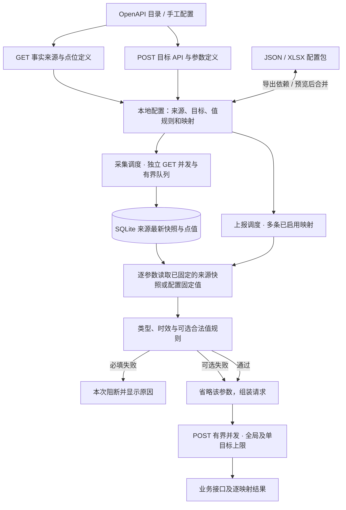

Task ID: SMA-001
Revision: r3
Status: owner_approved
Owner Role: PM
Allowed Writers: PM, Human Owner
Handoff: Human Owner 已批准 SMA-001 r3，交 Development 按 §5 范围实施并按 §8 验证，交接后由 fresh-context Verification 独立验证
Workflow Mode: STD
Execution Mode: agent_team_same_session
Task Namespace: aiis-ics-arch.aw.sma
Classification: root
Capability: SMA HTTP 映射桌面应用的整体交付
Owner: AIIS Automation World / SMA 模块 Human Owner
Acceptance Chain Reference: SMA-001 精确 Revision 范围批准 → Development handoff → fresh-context Verification → Human Owner 最终验收
Scope Slice: 多路 GET、参数映射与规则、并发 POST、独立运行控制、配置交换及整体验收
Related Task: SMA-002, SMA-003, SMA-004, SMA-005, SMA-006, SMA-007, SMA-008, SMA-009, SMA-010, aiis-ics-arch::ARCH-ACQ-006

# SMA-001：多路 HTTP 映射与转发整体实施规格

## 1. 本次目标与状态

SMA 提供多路 HTTP GET 事实来源、点位定义、目标 POST 接口、字段映射和值规则。采集和上报由工作台分别控制。已启用映射按配置读取来源最新值、组装请求并发往目标 API。配置可以统一导入和导出。一个 GET 来源可以供多条映射复用，一条映射的不同参数可以来自不同 GET 来源或各自的固定值。

Human Owner 于 2026-11-24 要求按当前可视化原型及原理图整理整体实施范围，明确多路 GET／POST 并发、采集与上报独立启停、跨来源参数绑定、JSON／XLSX 导入导出，把 `taskNo` 按普通参数处理，以「炉温 → 实绩」作为整体验收用例。Human Owner 已于同日明确批准 SMA-001 r3 实施范围，详见 §10。批准时尚无本 Revision 的 Development handoff 或独立验证。原型中的数值和并发状态是模拟，用于说明交互，不是容量证据。

本规格描述一次整体交付。§7 的工作顺序用于组织实现与检查，所有范围共同形成同一验收候选，不把单次闭环另设为本次整体开发的独立前置批准或最终验收。可在本 Revision 内按组件分解 Development 工作，职责归属及实际交接记入 tasks。发现本规格范围、接口、风险或验收条件须实质改变时返回 PM 修订。

## 2. 现状和既有任务

SMA 来自 DTB TSS 的过滤副本，既有 OpenAPI 材料、目标参数、固定值与事实绑定、同类型合法值规则、本地 SQLite 配置、JSON 备份及纯预览。TSS 派生 domain 提供类型、合法值和组包的可复用基础。现有自动上报入口仍关闭，旧 TSS 的配置、claim、租约和审计依赖与本仓 HTTP 合同不同。执行本规格须验证当前实际调用链，不能仅以存在旧算法或原型演示宣称 GET→POST 已交付。 [SMA 当前说明](../../README.zh-CN.md)

| 记录 | 既有状态及本次关系 |
| --- | --- |
| [SMA-002](../SMA-002-scope-cleanup/checklist.md) | 职责清理的原候选 `owner_accepted`，历史条件和证据以其 bundle 为准。 |
| [SMA-003](../SMA-003-cu-integration/checklist.md) | CU 接入的原候选 `owner_accepted`，不代表本次整体 UI 或业务运行已验收。 |
| [SMA-004](../SMA-004-local-configuration/checklist.md) | 本地配置与纯预览原候选 `owner_accepted`。本草案扩展为受控采集最新值与整体运行，保留旧配置兼容。 |
| [SMA-005](../SMA-005-page-interaction/checklist.md)、[SMA-006](../SMA-006-dialog-interaction/spec.md)、[SMA-007](../SMA-007-dev-profile-path/checklist.md) | 分别保留已有 `qa_blocked`、`draft`、`qa_passed` 状态及尚未关闭的验收事项。 |
| [SMA-008](../SMA-008-acquisition-data-get/checklist.md)、[SMA-009](../SMA-009-workspace-and-loopback-ui/checklist.md) | 原采集写回入口已按 Human Owner 后续 DIRECT 要求撤走。两项原有 `qa_blocked`／`qa_passed` 记录与待 Owner 决定的事项保留，不用本草案追认旧项通过。 |
| [SMA-010 r2](../SMA-010-single-performance-mapping/spec.md) | 曾提出「炉温 → 实绩」单次闭环，仍是未批准草案。本次将业务场景作为 §8 整体验收用例，以本规格的通用多来源规则为准；不要求先批准或验收 SMA-010 才能实施本整体范围。 |
| [ARCH-ACQ-006](../../../../plans/ARCH-ACQ-006-acquisition-consumption-delivery/checklist.md) | 后端稳定续读与投递状态的精确候选及隔离证据已获验收。当前整体采用最新值转发，不以该验收宣称 SMA 已接入或历史逐条投递完成。 |

原 `control-agent`、原 TSS、DAA、DS 和 Backend 的现有状态由各自任务管理。原 TSS 与 SMA 的实现可以作为代码和界面复用来源，新的事实源与本地配置权威以本规格确定。用户先前已实际执行的 SMA 工作树 DIRECT 变更是交接时需核对的现有状态，不能覆盖或将其包装成 r3 的新验收证据。

## 3. 整体原理与运行口径

本次运行按配置周期发送**最新快照**。同一 GET 响应中的可用字段在一次本地提交中整体发布，映射的一次执行开始时固定各引用来源的快照版本和时间，再逐参数解析。一个上报可同时使用来源 A 的当前快照与来源 B 的当前快照，界面与诊断按来源列出版本、采集时间或样本身份；不同来源各自更新，系统不声称它们属于同一次物理采样。

同一 GET 响应也可能是上游拼出的多点 latest，不能因来自同一次 HTTP 响应就声称点位来自同一 PLC 样本。上游提供各点 `sampleId`、`observedAt` 和质量时保留并展示；§8 的炉温实绩用例使用一条实际历史详情证明同次样本。没有上游标识时显示缺失，不能推测。

上报可以读仍在有效期内的最近成功快照。来源尚未成功、点位缺失、质量不满足配置、类型不兼容或快照超过映射配置的有效期时，按字段必填／可选规则处理。GET 失败保留上次成功值及其真实时间，并显示本次失败和数据老化；不得把查询时刻写成采集时刻。覆盖缓存可能跳过两次上报之间的中间变化，本规格不声称逐条历史完整投递。

## 4. 功能范围

### 4.1 GET 来源、点位和 SQLite 最新值

- 「事实来源」维护多条可启用来源。每条有稳定 ID、名称、HTTP(S) GET 地址、路径或完整 URL、查询参数、采集间隔、请求超时、响应取值路径及所选点位定义。允许从 OpenAPI 目录选入或手工填写；已保存配置经显式保存生效。用户可对单个来源执行测试 GET，检查 HTTP／响应、返回 JSON 和选点结果。
- 首批支持 JSON 标量叶子：字符串、整数、数值、布尔值与携带偏移的日期时间。类型、路径、来源 ID 与点位 ID 有稳定身份。嵌套对象及数组中已配置的标量路径应能准确提取；无法表示的动态结构应明确报错或留待后续扩展。保留 `0`、`false`、空字符串和非空有效数值的类型，不以真假判断丢值。
- 对接采集数据 API 时可通过 `GET /api/v1/acquisition-data/options` 选择 PLC／DB，并以 `GET /api/v1/acquisition-data/latest` 或明确配置的 `GET /api/v1/acquisition-data/history/{id}` 选点与测试。对 `data.items`／`data.points` 这类点位数组，允许按响应中的稳定点位 ID 选定目标，而不是依赖数组顺序；不同请求顺序变化时仍取同一 ID。SMA 按实际 GET 合同取得数据，不根据来源名称推断身份。
- SQLite 保存连接、来源、目标、规则和映射配置，以及**独立的来源最新快照／点值运行数据**。配置备份与交换包不携带最新值、原始响应、待发正文、回执、日志、凭据或 UI 偏好。配置与运行数据逻辑隔离，运行数据写入不能冒充配置 revision 修改。
- 启动时旧的点值如被保留，应保留原采集时间、来源及有效期状态，标记为上次数据并遵循过期判断，不自动视为新采集。SQLite 写入失败不发布半份快照，原快照保持可读并显示错误。配置保存、禁用、删除和导入须校验引用及并发 revision。

### 4.2 POST 目标、规则和映射

- 「目标 API 配置」以行管理目标，支持从 OpenAPI 选入或手工配置 HTTP(S) POST 地址、请求参数、路径、query、header、body 模板及必填／可选和标量类型。显示实际地址和测试结果。单目标的测试先预览用户给出的示例正文，再经用户确认发送一次。
- 「值规则」沿用 TSS 的独立类型合法值预设，可从事实点位派生类型或独立创建，可被多个映射引用。规则仅在该参数明确选择时校验；空集合为待填写，不能作为有效规则使用。类型不匹配、非法固定值或删除仍被引用的规则应反馈到具体位置。类型转换、表达式和枚举转换如未来需要，另在具体实施范围确认，现有合法值功能不因此缩水。
- 「映射配置」以行维护多条映射。每条指定一个 POST 目标、执行间隔、快照最长有效期、启用状态，以及目标参数到任意兼容 GET 来源／点位或该参数固定值的绑定。支持一源多目标、多源同目标、复用同一点位、多映射共享规则。设置 body、query、path、header 的不同参数时均沿用对应目标定义。配置合法性在保存及导入时校验。
- `taskNo`、设备号和时间等均是目标 API 的普通参数。任何来源的兼容点位都可绑定，或由操作人在该映射参数上设置固定值。SMA 核心不内建业务字段名、任务号规范化、上一任务号或固定值回退。目标合同需要的格式校验或显式配置属于该目标映射；真实实绩候选合同对任务号的规则只应用于该业务验收。
- 必填参数缺失、无效、过期、类型不匹配或违反绑定规则时，阻断该映射本次 POST 并展示具体字段和原因。可选参数同类失败时从请求中省略；模板里对应字段也须删除，不偷偷使用旧默认值、`null` 或其他来源的值。未绑定可选参数同样省略。其他映射继续执行。
- 「测试此映射」与周期上报复用同一套取值、规则、组包和诊断逻辑。测试先显示实际目标 URL、HTTP 方法、参数正文、每个来源快照身份／时间和失败诊断。用户明确确认后只发送该预览一次；配置、目标或所选测试输入改变时旧预览失效，发送中禁止重复提交。取消、关闭和遮罩关闭不 POST。实际目标有只读查询接口时可按目标合同回读。
- 一个通用 POST 的 HTTP 成功、业务回执、失败和结果未知须按目标配置及实际合同显示。不得将任意 HTTP 200 或回读值相同一概宣称业务已提交。超时、断连及可能已提交的情况显示结果未知；本 Revision 不自动重试或补发这一条结果未知的请求。普通下一周期作为独立的执行按当时最新快照和规则运行，不把它记作此前请求已确认。目标合同约束下的自动安全重试、幂等和未知对账留待后续定义。

### 4.3 并发、队列与独立控制

- 工作台的「启动／停止采集」统一管理已启用 GET 来源，「启动／停止上报」统一管理已启用映射。两组运行独立，采集可单独运行供事实点位查看；上报只在启动后读取符合有效期的最新快照。每次应用启动后由操作人显式启动，应用打开、保存或导入配置不得静默发起网络请求。既有启动偏好作为配置数据兼容读取，本 Revision 不激活该偏好，也不新增自动启动设置。
- GET 与 POST 各有独立、可配置的并发上限与有界等待队列；POST 同时有可配置的单目标上限。上限、单位、运行中数量、排队数、完成数、失败／阻断数、超时、实际并发峰值和各映射最近结果应可查看。并发控制作用于真实在途 HTTP，线路数、累计请求和线程数均不能冒充实际并发。
- 同一来源或映射在一次执行尚未结束时不无界叠加周期任务。队列达到容量时必须有明确且可观察的跳过或排队饱和结果；恢复后各来源和目标继续有机会执行。慢 GET、慢／失败 POST、单目标上限与超时不能让其他可运行来源和目标永久饥饿；停止一侧不能停止或耗尽另一侧。
- 停止某侧立即停止该侧新入队和派发，已排队任务清理并计数或明确显示处置。已在途请求按有限超时完成或安全取消并报告结果；POST 已发送但无法判定时记录未知。状态区分停止中与已停止。另一侧维持其原运行状态，完成在途后不能出现该侧新的网络请求。重复启动／停止和应用关闭均可安全收口。
- 应用意外退出或重启后配置可读取，运行状态按显式偏好处理。持久的逐条待发队列、历史游标、跨重启自动补发与 exactly-once 不是最新值模式的保证。需要历史每条都送达的目标须另定义持久进度、幂等、未知对账和验收。

### 4.4 工作台、配置管理和导入导出

沿用 SMA 现有 CU 壳层、主题、表格和前端 skill，按最近的可视化方向提供以下八个二级页面。

| 一级 | 二级页面 | 主要操作 |
| --- | --- | --- |
| 工作台 | 连接、配置管理、映射执行 | 保存地址／测试 OpenAPI；统一导入导出；独立控制全部采集及上报并查看运行明细。 |
| 源事实 | 事实来源、事实点位 | 配置／单点测试 GET 及选点；查询来源点位、最新值、质量、时间和身份。 |
| 目标接口 | 目标 API 配置 | 从 OpenAPI 或手工添加 POST，编辑、测试和删除。 |
| 映射与规则 | 值规则、映射配置 | 维护可复用合法值；逐参数绑定来源或固定值、编辑映射和单条测试。 |

普通业务管理页以一张主卡承载列表、筛选和行操作，映射明细、运行控制或配置管理可用两张主卡。弹窗包含标题、可滚动内容、右对齐页脚，遮罩关闭等同取消。相应动作需要可见的加载、空态、禁用原因和错误反馈。配置管理集中提供文件交换；原散落入口在新能力覆盖并完成兼容验证后统一移除或指向该页面，既有数据和备份合同保留。

- JSON 与 XLSX 均为可实际读写的独立、版本化本地配置文件。支持按来源、点位定义、目标、规则、映射及可选连接地址选择导出；点位随其来源归属。选择映射时递归带出其引用的来源／点位、目标和规则，选择规则时带出必要点位依赖。展示被自动包含的依赖；连接地址由用户明确勾选。
- 两种格式共享稳定 ID、字段类型和引用语义。XLSX 使用结构化多工作表，显式记录格式版本、所属来源／目标／映射 ID 及字段路径；0、false、字符串及嵌套配置往返不改变类型。文件不携带 bearer、密码、真实凭据或运行快照。用户提供的目标配置中的敏感 header／query 需排除或显式脱敏，导入后提示用户补充。
- 导入只做本地预览，按稳定 ID 列出逐项新增、更新、相同、冲突或缺失引用，包含各工作表和具体行／字段错误。可复用已有类型、规则和跨引用校验；任意配置错误不部分应用。显式确认后在绑定预览 revision 的单次事务中完成合并；期间配置已变更时拒绝旧预览并要求重新预览。
- SMA-004 的既有 v1 SQLite 配置和旧 JSON 备份保持可读、可显式恢复；旧的单集合 JSON／XLSX 文件能力应按现有合同兼容或明确经新入口转换。不能在应用启动时静默改写、清空或覆盖旧配置。新的本地持久结构和升级方式由 Development 在获批范围内记录并用自有旧 profile 夹具验证；此草案不授权迁移真实用户库或后台库。

## 5. 复用与交付面

Development 应先核对当前源码后复用：CU 布局与表格、OpenAPI 材料与目标参数、TSS 派生参数绑定／固定值／合法值纯 domain、配置 revision、备份和 XLSX 解析。DAA 的采集与上报独立控制、状态表达和本地存储经验可参考，HTTP 采集与业务映射属于 SMA。复用时须保证普通应用入口、旧配置及本规格的并发与快照语义均正确；无需依赖另一应用进程或 checkout。

拟交付源码工作树为本仓 `automation-world/semantic-mapping-agent/`。允许调整其中直接相关的 `src/`、`src-tauri/src/`、`tests/`、SMA 双语 README、模块文档与必要的 SMA 测试夹具；真实结构改变时按仓库规则维护根 `CODE_INDEX.md`。Development 及 Verification 依具体触达使用 `frontend-ui`、`desktop-tauri`、`rust-runtime`、`i18n-workflow`、`code-document-indexer`；需要接口合同说明时遵守 `backend-arch`。使用仓库声明的 pnpm、Cargo 及锁文件。

开发和独立验证使用专属可丢弃 profile 与 HTTP 夹具，不改用户真实配置或历史。若现有 dev 可供联调，先核对实际 OpenAPI、字段和测试对象。真实 dev 上的 POST 按本会话约定由 Human Owner 在页面自行确认执行；提交可能更新真实实绩和同号计划，先确认专用测试任务及 `planSync` 影响。来源 GET、固定任务号、逐字段绑定和目标 POST 均以实际环境合同与操作人的配置为准。

本范围不修改 Backend、DAA、DS、CU 公共源码或其数据库，不恢复旧 TSS claim／租约依赖，不部署、发布、操作真实 PLC 或迁移现场数据。若需要上述变更，另行确定范围与授权。无需为了联调第一版而把 consumer Bearer 当作必需依赖；现有开发接口实际鉴权仍以其部署合同为准。

## 6. 关键边界与失败处置

1. GET 结果只有在 HTTP 和该来源配置的响应条件通过后进入解析。完整响应中配置点位失败时显示具体字段，已知值、质量和时间的语义以来源合同为准；不会无提示把未知值变成 `0`、`false` 或旧值。
2. 每次映射固定配置 revision 和所引用来源快照版本、质量及原时间。配置在组包／预览期间变化时旧预览失效；进入发送的请求使用已经冻结的字节，不与新 revision 混装。采集并发提交与上报读取应保证同一来源不会出现半份快照。
3. 周期执行默认使用最新可用快照，映射配置的有效期决定能否发送。单独停采后上报仍可运行，但快照超过有效期应按必填／可选结果阻断或省略并提示。GET 只读测试不会触发 POST。
4. 同一目标的不同映射即使并发，也要分别记录各自快照来源、请求结果和时间。服务限流、请求超时、响应异常和队列饱和均可见。固定值只作用于当前配置参数，不回写来源快照。
5. JSON／XLSX 预览和应用在用户本机完成，失败不造成部分配置写入或运行态意外启动。导出前依赖闭包和敏感字段排除可见；无效文件、重名 ID、冲突引用、过期 revision、模板和类型不合规均逐项反馈。
6. 真实业务 target 的超时可能表示已经写入，重发是否安全由该 target 合同决定。实绩 upsert 的 `planSync`、默认状态和重复写入语义须实际核对。未知不等于失败或成功，本 Revision 不自动重试或在重启后补发未知请求。

## 7. 实施组织

批准本整体 Revision 后，Development 可按同一候选的以下依赖组织工作，记录每步自检并最终一起 handoff。该顺序不产生额外用户批准门槛。

1. 对齐本地配置与旧数据读取，建立来源定义、最新快照和目标参数合同，接通 JSON 路径、配置引用和规则。
2. 打通多来源绑定、固定值、预览／人工单次与同一组包结果，使用隔离 GET／POST 目标验证。
3. 接通独立 GET／POST 调度、并发上限、队列、状态、停止与错误处置；在此基础上完成八页操作。
4. 统一 JSON／XLSX 配置管理并覆盖旧备份；运行隔离多路负载和整体验收用例，记录源码、工具、环境和结果。

Development handoff 后由 fresh-context Verification 针对同一候选独立复核 §8；结果交 Human Owner 做最终验收。任何隔离测试通过不替代真实 dev 业务写入结果。允许先完成全部独立夹具证据，再由用户操作受控 dev 测试任务以补齐实际业务证据。

## 8. 整体验收标准

每条标准均在应用正常 UI／IPC／Rust 入口上验证，观察请求记录、SQLite 文件、导出文件和界面状态。测试环境为独立 profile 和可记录请求、可模拟延迟／失败的 HTTP 夹具；详细命令、fixture、参数、数据及结果由 Development 和 Verification 分别记录。

| ID | 可观察的通过标准 |
| --- | --- |
| AC01 页面与输入 | 八个页面的连接、GET 来源、POST 目标、事实点位、规则、映射、执行和配置管理入口可达。从 OpenAPI 和手填分别创建 GET／POST，单次测试 GET 展示解析字段；GET 测试前后目标 POST 数为零。 |
| AC02 多源与普通参数 | 配置来源 A、B、C，让一条映射的至少三个参数分别绑定 A、B、C 的点位，另设一个固定标量参数。任意兼容字符串点均可用于目标 `taskNo`，切换其绑定后请求取对应来源值；数字／布尔／日期时间也按类型组包。核心不按参数名隐式规范化或回退。 |
| AC03 最新快照与并发一致性 | 同一 GET 返回两字段，以带版本的有序响应和交错上报验证一次请求中的两个值来自同一已提交响应。跨两 GET 的各自版本可独立变化，预览展示每个来源版本／时间；单次组包固定所见快照，不声称不同来源同采样。 |
| AC04 失败与时效 | GET 空响应、HTTP 错误、超时、解析失败及 SQLite 提交失败后，不出现部分新快照；最近成功值保留原采集时间，状态可见。过期、缺失或质量不满足配置时必填阻断、可选省略；0、false 和空字符串按类型与规则保留。 |
| AC05 绑定与合法值 | 固定值、点位绑定可按参数单独切换，规则可从点位派生或独立配置并供多映射引用。字符串、整数、数值、布尔和日期时间的合法值通过／拒绝可观测；固定值不符合规则无法保存或预览成功，动态值在执行时检查。 |
| AC06 预览和单次推送 | 用户预览实际 URL、参数和源快照身份后确认一次，目标只收到一次对应正文；取消、遮罩关闭、GET 和纯预览均不发 POST。双击、并发确认及配置或来源切换后的旧预览不能复用。测试与定时执行对同一固定快照产生相同的组包与诊断。 |
| AC07 独立启停 | 只启动采集时多个来源更新、POST 接收计数为零；只启动上报时 GET 调度计数不增加。各自停止后在途有限收口、队列可见处置、停止侧不再派发，另一侧继续。重复启动／停止、窗口关闭及显式重启均无重复运行器和隐式网络启动。 |
| AC08 多路并发与隔离 | 配置不同 GET／POST 全局上限及单目标上限，夹具记录在途请求，实际峰值均不越限且在允许时 GET 与 POST 峰值各大于 1。构造慢 GET、慢目标、HTTP 失败和超时，其他可运行来源与目标仍完成；两个队列各受上限约束，饱和／跳过有计数，恢复后可继续。 |
| AC09 可重复规模检查 | 用原型的 **128 个 GET 来源和 384 条映射**作为隔离线路数规模，目标至少两组，其中一组模拟慢响应。记录机器／工具、配置、观察时长、完成和失败／跳过数、观察窗口内 GET／POST 完成率（次／秒）、峰值在途 GET／POST、每目标峰值和队列峰值。按实际配置核对上限且观察正常目标持续进展；128／384 是线路数量，完成率是本次测量结果，不冒充并发数或生产吞吐承诺。 |
| AC10 回执与未知 | 覆盖非成功状态、业务拒绝、请求超时、发送后断连和无效回执。分别呈现失败或未知并归属映射，不以回读恰好一致自动认定此前提交成功；用目标计数核对未知请求没有被自动重试或重启补发。下一周期作为独立执行，其记录与此前未知结果可区分。 |
| AC11 配置交换 | 实际写出和读回 JSON 与 XLSX，覆盖全部及单映射选择、依赖闭包、多来源引用、标量类型 `0`／`false` 和字段路径。逐项预览新增／更新／相同／冲突，缺引用、错类型、重复 ID、损坏文件及 revision 变化均不部分保存或启动运行。确认合并后重开可重新建立相同引用。 |
| AC12 旧配置与备份 | 在自有 v1 profile、旧完整 JSON 备份及现有单集合 JSON／XLSX 夹具上验证读取、显式导入／导出、重开和配置引用。新运行快照独立于配置备份；检查交换文件无点值、回执、日志、凭据。未知 schema 或无效文件有错误而不静默重建。 |
| AC13 炉温 → 实绩 | 使用已启用且允许写入的实绩字段。夹具的采集来源 A 返回两份不同历史详情 H1、H2，每份包含炉温、原点时间及可用任务号点；独立来源 B 返回不同时刻的另一任务号点。将普通 `taskNo` 参数先绑 A 再绑 B，实际请求随绑定及来源值变化，展示各自快照；另一个配置使用固定测试号。被选任务号点缺失／bad／类型错误时不回退。预览、测试 POST 与定时组包共用 evaluator；可选字段失败不发，必填失败不 POST。用 H1、H2 各自详情核对炉温值和该点 `observedAt`，不把 B 的时间标作同次采集。 |
| AC14 真实 dev 证据 | Human Owner 用专用测试任务只读核对实际 OpenAPI、启用字段、来源样本与同号计划，人工预览并确认一次实绩 POST，核对 HTTP／业务结果、`planSync` 与按该任务号回读的炉温和 `lastObservedAt`。如合同／样本不可用如实记录缺项；隔离结果不能冒充 dev 写入。 |
| AC15 界面、无漂移与交付 | 中／英文、浅／深主题在 1440×900 和 1024×768 覆盖主卡、真实表格列宽偏好、预览、规则和导入弹窗，验证键盘、遮罩关闭、错误和长内容滚动。记录 `pnpm check`、`pnpm test`、`pnpm build`、适用 Cargo 检查、链接与 diff 检查及退出码。工作树交付与独立验证候选一致。 |

验收需分别呈现隔离软件检查、负载测量、Human Owner dev 手工证据和最终接受决定。本规格的设计、演示及旧任务历史均不能替代这些证据。

## 9. 风险与后续

旧链接所指的 r2 后续阶段内容保存在 [r2 快照](evidence/r2-before-r3/spec.md)。以下为 r3 整体范围的风险与后续。

- 最新快照的跨来源拼装适用于目标接受各源最新状态的场景。若目标要求同一物理样本或全事件送达，应配置其可证明的上游样本身份，并以独立合同和可靠历史消费方案实施。
- 任意远端的业务成功条件和安全重试语义不相同。目标 HTTP 成功或某一映射成功不代表所有目标成功。持续运行后的恢复、外部系统幂等和现场吞吐由各目标合同及真实负载证据确定。
- 开发／验证自有源和目标仅证明所测环境；原型中的 128／384 数量及并发上限不是生产容量指标。实际规模以目标响应时间、机器资源、目标限流和后续测量为准。
- 旧配置与新增来源／点位模型需要可追溯映射。现有 profile 若无法兼容或未知，不自动重建或覆盖，报告原因并先制定可恢复的显式迁移方法。
- Human Owner 已批准 r3 范围。Development 按生命周期创建 tasks；Verification 在 Development handoff 后创建 checklist。原本已批准子任务的历史不因此改变。

## 10. 修订、历史与交接

| 日期（Asia/Shanghai） | Revision | 真实状态 |
| --- | --- | --- |
| 2026-11-03 | r1 | 合并早期 CU 与职责清理的未实施草案。 |
| 2026-11-04 至 2026-11-24 | r2 | 作为分阶段总规格草案，记录 SMA-002 至 SMA-010 各自的批准、证据和待审事项。 |
| 2026-11-24 | r3 | 按 Human Owner 当前要求整理通用多路 GET／POST 整体实施草案，等待范围审阅。 |
| 2026-11-24 | r3 | Human Owner 明确批准本 Revision。批准前规格 SHA-256 为 `a9bb9fae4a860698aba300181ac3d3d51ec052eb4070d0056cf5fef120152e7a`。 |

[r1 历史规格](evidence/r1-before-task-split/spec.md) 的 SHA-256 为 `2af6751eff91a9d082fd99fd058c4e90cd314be8f79708b3dd7b0ac6247544f6`。[r2 改写前工作树原文](evidence/r2-before-r3/spec.md) 的 SHA-256 为 `3c48e05154f83644a45c2e12bb0d27d7ba1b32029d9edc404d75b92d81c99800`；r2 快照中的相对链接以改写前本任务 bundle 根目录为解析基准。历史快照只记录当时内容，不追加批准或验证。

Human Owner 的批准原文如下。

> 批准 SMA-001 r3《多路 HTTP 映射与转发整体实施规格》。按草案第 5 节的范围实施，将采集、映射、并发调度和 JSON／XLSX 配置管理作为同一个候选交付，按第 8 节 AC01–AC15 验证。开发和独立验证使用隔离环境。“炉温 → 实绩”作为整体验收用例，真实 dev 的 POST 由我核对实际接口和专用测试任务后，在 SMA 界面亲自确认。最终验收另行决定。

Development 按已批准 r3 实施并记录 tasks，交接后 fresh-context Verification 创建 checklist；最终验收由 Human Owner 作出。临时资源由各执行阶段按实际占用和证据依赖收尾。
