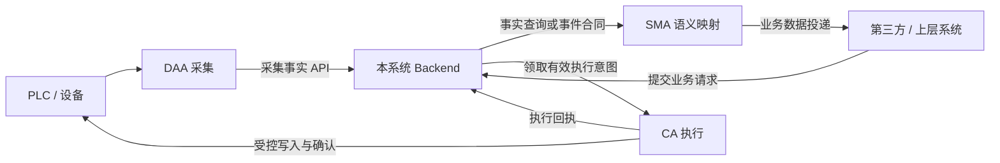

# Automation World 运行原理与详细设计

**内容修订：2026-10-15 · ARCH-AW-002 r2；DS 增补：2026-10-18 · r3**
**效力：设计依据与合同草案；未实施能力、依赖与现场操作仍需精确任务批准。**

> **方向更新（ARCH-AW-007 r2）：** 新路线保留 DAA、SMA、CA 三应用：DAA 负责大量持续采集，SMA 沿已过滤 TSS 基线精简表格化批量 HTTP 映射与工作台，CA 承担通用节点编排及内部多协议连接器。AWB/AWC 未来统一管理三类实例，先登记/心跳与只读健康，再配置/远程操作。全项目 [中文 ROADMAP](../ROADMAP.zh-CN.md)、[English ROADMAP](../ROADMAP.md) 与 [007 r2](../plans/ARCH-AW-007-general-agent-fleet-roadmap/spec.md#r2-design)、[006 r2](../plans/ARCH-AW-006-unified-flow-agent-design/spec.md#r2-design) 提供当前方向；精确批准、交付、独立 QA 与最终验收状态归所属 bundle，原设计正文/来源及 r1 验证历史保留。DAA 当前 SQLite 本地采集且新上传未接入；SMA 当前 Backend-held TSS/Facts→POST 与逐项 await 调度，子集/逐行常驻、任意 HTTP 源、本地 SQLite/可靠 outbox 和容量优化分期，不强制近期迁库；CA 自身版本化存储仍为目标。本文旧表单/共享 Core/角色节点限制等按当时范围解释，不构成三 App 统一迁移或 CA 能力总界限；CAF/旧 CA 保持冻结。CA 首版 HTTP GET/POST、明确受支持 S7 与无登录前提依 006 r2；原可靠投递、PW Service/API owner、版本固定及 unknown 核实原则仍为适用参考，后续实施 spec 明确采用/替代条款。本提示不宣称软件、QA、设备或部署许可。

## 1. 阅读依据与阶段

本文承接先行修订的 [AW 白皮书](AIIS_AW_Whitepaper_Roadmap_v0.4.md)，由 [ARCH-AW-002 r2](../plans/ARCH-AW-002-agent-runtime-design/spec.md) 管理本次文档范围。白皮书回答角色与路线，本文回答各部件如何协作，后续实施 spec 再固定单次范围、验收和风险。

**DAA/SMA 局部细化（2026-10-17 · ARCH-AW-003 r2）：**[DAA 详细设计](AIIS_DAA_Detailed_Design.md)保留 r1 多 PLC/跨 DB 单点单组、双库激活、全样本/确认/容量/最新优先补传，增加唯一连接供采集/诊断串行共享、自描述 points、派生目录、UTC 原采集时刻加最多三自然月及逐绑定定义漂移；[SMA 详细设计](AIIS_SMA_Detailed_Design.md)明确表单式首版、本地 SQLite 配置、HTTP 事实输入、转换预览及持久双进度/outbox/业务可靠确认。r1 文档 QA 为历史快照，r2 需独立核验，Human Owner 尚未终验。本文第 5/12 节的 DAA latest/samples 待决和第 10 节采集合并/丢弃等通用选项保留为原讨论历史，本次 DAA 采用 samples、保护数据满额停采，不静默丢弃。相关 DAA/SMA 细节以两份局部正文为后续依据；SMA 首版不要求先建设本文第 6–7 节通用画布/共享 Flow Core，其他 Agent 设计保持原范围。两文仍是目标设计，不是现行可执行合同或代码/运行授权。

| 层级 | 本文采用的依据 |
| --- | --- |
| 已有工程 | [ARCH-AW-001](../plans/ARCH-AW-001-agent-foundation/spec.md) 记录原 CA 冻结、DAA/SMA 独立初始化；不证明新 API/SQLite/流程能力 |
| 确定方向 | 原 CA 称 CAF 冻结参考，新 CA 为 Control Agent；DAA 首版 S7、DB/UDT、SQLite、事实 API；SMA 对外语义投递，CA 对内执行持久有效意图；CA 基于 Tauri |
| 推荐方案 | CU 共享 UI 源码与工作台；SMA/CA 共享可视化编辑器与 Rust Flow Core，独立宿主和状态 |
| 待细化 | SMA/CA SQLite 生命周期、draft 保留、画布选型、节点/API/握手/支持矩阵和后台托管 |
| 长期方向 | AWB/Axum、中央配置、PG/Redis、HA/SA、统一 AWC，不是近期闭环前置 |

只读核对时，`automation-world/control-agent/` 仍存在，README 使用旧 CA 冻结说明；`automation-world/console-ui/` 已存在但文档仍沿用旧 CA。用户已说明老 CA 移出；本文记录命名与目标，不认证该迁移、CU 已实现或新 CA 已运行，不改写冻结 receipt。CAF 英文展开与最终路径待核对，AWC 长期控制台角色与 CU 共享源码不是同一命名层次。

## 2. 职责边界

| 角色 | 输入与处理 | 主要输出与完成依据 | 边界 |
| --- | --- | --- | --- |
| CAF | 原 CA 冻结参考素材 | 来源与兼容记录 | 不是新 CA，不作为活动共享运行时；英文全称未确认 |
| CU / console-ui | UI 组件、布局、主题、页面配置 | 共享源码及可运行设计工作台 | 构建依赖，不是在线前置；不拥有 Flow Core/设备权限 |
| DAA / Data Acquisition Agent | PLC 点位、采集策略；连接、读取、解码、时间与质量标记 | 向 Backend 交付结构化采集事实，按 API 回执确认接收 | 不编排业务流程，不执行设备写入，不映射平台业务表 |
| SMA / Semantic Mapping Agent | AW 事实及公开 API 材料；提取、转换、聚合、条件判断 | 语义对象/记录、第三方或上层 API 投递；分别记录各输出确认 | 不写 PLC，不直连对方业务库，不代替接收方业务校验 |
| CA / Control Agent | 本系统校验、持久化且具备执行资格的意图；映射、现场校验、仲裁 | 设备下发、核实结果及执行回执 | 不直接把任意外部 URL 数据变成设备指令，不通过 SQL 轮询任意业务表 |
| DS / Device Simulator | 模拟区域、点位和规则；开发联调客户端读写 | 隔离的模拟设备端点与诊断 | 非生产 Agent/依赖，不证明真实设备、联锁或物理动作 |
| Backend | 第三方接入、权限与业务校验、持久化、事实接口、领取与回执 | API 合同和持久状态 | 不在 FastAPI 请求内运行 PLC 常驻循环；拥有存储实现与 schema |

“SMA 对外、CA 对内”描述主要业务结果。SMA 可以 GET 补充材料，CA 必须 POST 领取、心跳或回执；HTTP 请求方向不改变角色职责。CA 的执行闭环不依赖 SMA 代传回执。




### 2.1 CU、共享编辑器与 Rust 的模块关系

CU 承载通用视觉组件、布局主题、节点外观/表单等适用 UI 代码及可运行设计工作台。UI 低代码编排描述页面布局与参数呈现；SMA/CA 业务流程画布描述触发、数据处理与副作用执行。二者可以共用交互组件，发布目标与权限仍分开。

**构建视图（目标示意，非新增目录承诺）：**

```text
CU 共享 UI 源码 ─→ DAA UI ─→ DAA 前端产物/安装包
              ├→ SMA UI + 流程编辑器 ─→ SMA 前端产物/安装包
              ├→ CA UI  + 流程编辑器 ─→ CA 前端产物/安装包
              └→ CU 设计工作台（组件预览、调参、页面组合）
共享 Rust Flow Core ─→ SMA Rust 宿主 / CA Rust 宿主
```

**运行视图：**

```text
DAA UI ↔ DAA Rust 配置/采集服务 ↔ 自身 SQLite → Backend 事实 API
SMA UI ↔ SMA Rust 宿主 + Flow Core ↔ 自身 SQLite/outbox → 目标 API
CA UI  ↔ CA Rust 宿主  + Flow Core ↔ 自身 SQLite/执行记录 ↔ Backend/设备
CU 工作台独立用于设计；三应用安装运行不依赖工作台在线或外部共享源码目录。
```

Rust Flow Core 不归 CU 管理，CU 不直接操作 PLC 或拥有运行队列。共享代码更新通过明确版本、构建与验证进入各 Agent，不以工作台在线热替换正在执行的规则。共享包/workspace 和 headless 入口的实际组织在实施时确定；关闭窗口、后台继续、显式退出与开机托管仍需独立合同，不能由 Tauri/sidecar 名称推定。

## 3. DAA 首版采集范围

DAA 使用固定链路：`有效配置 -> 定时 S7 读取 -> 解码与质量标记 -> 批次 -> Backend API`，通过表单和点位表完成配置，无需低代码流程画布。首版只确定 S7 方向；CPU 系列、访问方式、驱动、支持类型和最低周期须由后续技术范围逐项定义，不宣称支持全部 S7/TIA 组合。

- 导入的是 TIA 导出的 DB/UDT 文本源；扩展名 `.db` 是 PLC 源文件，与 SQLite 数据库文件无关。
- 保存完整结构、字段顺序、UDT 引用和来源摘要；导入不自动覆盖生效配置或启动设备 I/O。
- 单点编辑包括标识、说明、启用状态、类型和地址等；手工值与推算值保留来源区别。
- 配置连接、采集分组、采集周期、超时、重连和上报周期；错误数据不能用 `0` 或旧值冒充成功新样本。
- 诊断展示配置版本、连接状态、最后采集/上报时间、失败原因与缓冲积压，不只显示“接口在线”。

整 DB 偏移推算必须由用户手动点击。界面先提醒“DB 与全部 UDT 信息须完整，且须与目标 PLC 程序核对”，再检查全部嵌套引用、字段顺序、数组边界、字符串长度及支持类型。无法解析、缺少定义或不支持的布局应停止推算并定位原因，不能猜地址。

绝对地址推算限定标准、非优化 DB；推算必须基于完整 DB 结构，不能只计算已选采集点。布局按所支持的 S7 规则处理 BOOL 打包、对齐、数组、Struct/UDT 等，精确算法属于 `plc-point-mapping` 技术任务。西门子说明标准块允许绝对寻址，优化块采用不同访问方式；不能将优化块当作固定偏移布局。[Siemens 块访问说明](https://docs.tia.siemens.cloud/r/en-us/v20/programming-basics/blocks-in-the-user-program/blocks-with-optimized-access/basics-of-block-access)

推算先展示旧/新偏移、受影响点位与来源，经确认后写入草稿；不会直接切换正在采集的配置。结构、类型或数组长度改变时，应将受影响偏移标为待复核。完整性检查只能证明输入可解析，不能证明其与 PLC 当前下载程序相同；实施验收须与 TIA 实际偏移核对。

## 4. 本地 SQLite 配置

DAA 本版以本地 SQLite 为配置权威来源；不要求同时维护另一套 YAML。SMA/CA 建议采用相同生命周期并保存自身流程、映射及端点配置，但每个应用、每个实例拥有独立库和目录，不共用一个可写配置库。

| 配置状态建议 | 含义 |
| --- | --- |
| draft | 正在导入、编辑或推算的候选内容，不驱动外部 I/O |
| active | 已校验并明确应用的完整版本；每次采集/流程执行固定引用此版本 |
| previous | 上一次被替换的完整有效版本，用于显式、兼容性校验后的回退 |

以上是本地编辑的生命周期建议；active 对应白皮书长期 current 的概念，previous 是上次切出版本，不是按版本排序的次新版。draft 的保留量/schema 及其与长期两个稳定运行槽的关系待定，不直接声称已实现精确双槽合同。

配置由 Rust 配置服务统一办理写入和校验，Vue 通过受控 Tauri command 提交；运行时不让多个进程直接编辑同一打开的 SQLite 文件。激活应事务保存完整版本，并在明确批次边界或停止状态切换内存配置；SQLite 提交和运行切换是两个步骤，须定义崩溃后的恢复行为。建议每个批次/流程 run 固定完整 revision，在允许边界暂停新工作后准备并提交；提交后内存切换失败应进入可诊断停止/待恢复状态，不能继续使用旧内存却报告新版本已生效。重启核对持久生效指针、摘要与兼容性，再恢复或等待显式处理，精确机制待定。

凭据安全存储、配置保留量、缓冲容量/保留期/超限策略仍待定。运行记录与配置按表或独立库区分：待上报批次、SMA outbox、消费进度、CA 执行记录、回执和审计不得随配置回退删除或倒退。本地配置 SQLite 本身不意味着已具备数据缓冲、无限补传或磁盘容灾。凭据仅保存引用，具体安全存储和迁移另行设计。

启动路径、应用身份及明确 env override 沿用现有工程隔离原则；实际业务配置从 SQLite 读取，禁止形成 env/YAML/SQLite 多个可编辑业务真相源。旧配置需要显式导入、预览和回退方案，不能启动时静默迁移用户 profile。

## 5. API 隔离与采集合同草案

DAA 只消费公开的采集接收 API，不引入 Redis 客户端、业务表名或数据库凭据。Backend 可以在合同保持一致的前提下调整关系库、最新值缓存或历史存储；具体采用 Redis 仍属于独立后端任务，本设计不恢复该中间件，也不让易失缓存替代可靠执行意图的真相源。

“写入成功”的确认语义必须明确：已接收、已可靠持久化或仅入队不能混用。后端换存储后不能降低已有承诺却继续返回同样的成功语义。API 包装、字段命名、错误码、认证和部分接收策略由 `backend-arch` 范围统一定义；下表仅是信息需求，非现有接口或冻结 schema。

| 合同 | 最小信息需求 |
| --- | --- |
| 采集批次 | 批次 ID、实例/设备身份、配置 revision、样本/序号、点位标识、值与类型、采集时间、质量 |
| 批次回执 | 接收批次 ID、确认范围、接收/拒绝结果及可重试原因；明确整体原子或部分接收 |
| 事实读取/事件 | 原始样本身份、采集时间、质量、顺序/游标及过期信息，供 SMA/CA 按合同消费 |
| 执行意图 | requestId、目标设备/资源、意图类型、payload、源版本、幂等键、有效期及执行资格 |
| 领取/执行回执 | 执行者、领取令牌/租约、执行记录 ID、状态、设备确认身份与结果摘要 |

采集周期和上报周期分开配置，例如 100 ms 采集、1 s 上报。后续任务必须明确选择以下模式，不把“定期上报”默认为完整历史：

- `latest`：保留各点位最后已知值，允许合并中间样本，带原采集时间和质量。
- `samples`：批量交付已实际采到的样本；需要有界持久缓冲、批次去重、容量/保留期、断网重试和超限策略。

轮询只能发现采样时刻可见的状态，不能承诺捕获两次采样之间的短脉冲。需要完整事件的场景应约定计数器、锁存或 PLC 事件缓冲。Backend 变慢不能无限阻塞采集循环；超限选择暂停、丢弃、合并或拒绝必须显式可观测，不能静默丢样后声称无损。

## 6. SMA/CA 共享可视化流程底座

对于 SMA，本节是后续通用流程平台方向；本次表单/规则式首版及本地持久投递见 [SMA 详细设计](AIIS_SMA_Detailed_Design.md)，可先于共享 Core 建设独立立项。CA 的既有设计边界保持原范围。

推荐采用 Tauri 中的 Vue 流程画布及参数面板，发布标准化流程定义，由 Rust 解释执行；每次改流程无需生成和重新编译 Rust 源码。画布负责编辑、预览和诊断，Rust 负责最终校验、执行和持久状态。Tauri 提供 command/event 通信机制，但不自动提供流程或后台托管语义。[Tauri IPC](https://v2.tauri.app/concept/inter-process-communication/)

```text
共享编辑器代码：画布 / 节点表单 / 字段映射 / 校验提示 / 运行状态
                           ↓ 版本化流程定义
共享 Rust Flow Core：模型校验 / 调度 / 步骤执行 / 分支 / 取消 / 跟踪
                  ↙                              ↘
SMA 宿主 + 映射/投递节点                    CA 宿主 + 领取/设备执行节点
独立配置、队列、outbox、运行状态             独立配置、执行记录、设备权限
```

共享的是代码、模型和适用算法；两角色保持独立入口、进程、可写状态、凭据与生命周期。可以部署同机，但不能把它们的队列和恢复状态合并成一个任务系统。共享 crate/前端包的实际目录和 workspace 在技术任务评审时确定；本轮不创建空 shared 工程。

Vue Flow 是画布候选，提供拖动、连线与自定义节点等交互，仍需自行实现节点语义、表单、校验及执行器；未批准具体依赖、版本或许可证清单。[Vue Flow 官方说明](https://vueflow.dev/guide/)

完整 Node-RED 作为备选：Node-RED 编排，Rust 提供受控设备操作服务，会增加 Node.js 运行时、进程管理和执行责任协调。仅复用编辑器再转换为 Rust 需限制节点并逐项定义语义；不能把任意 Node-RED JSON 或 Function 节点直接交给 Rust 执行。官方嵌入示例使用 Node.js/Express，自定义节点包括 JavaScript 执行代码和 HTML 编辑定义。[嵌入方式](https://nodered.org/docs/user-guide/runtime/embedding)、[节点结构](https://nodered.org/docs/creating-nodes/first-node)

## 7. 流程模型与节点装配

流程定义草案包含：schemaVersion、flowId、revision、role、触发器、节点及其类型/版本/参数、连线、端点/点位引用、并发与超时限额、内容摘要。画布位置属于编辑元数据，不决定执行顺序；连线及明确的控制规则决定执行。执行记录另外保存 runId、输入身份、配置版本、步骤结果和恢复状态。

首版建议限定单触发入口、有向无环流程、顺序与条件分支、有限等待；定时器在图外触发新一轮，等待由节点内有界实现。暂不引入任意循环、任意脚本、动态插件市场、分布式编排或“兼容全部 Node-RED 节点”的承诺。每轮结束前如何处理新触发，须明确 skip、排队或拒绝及容量。

| 节点/能力 | SMA | CA |
| --- | --- | --- |
| 提取字段、类型转换、受限表达式、条件分支、定时调度 | 共用实现 | 共用实现 |
| 事实读取、变化/上升沿触发、语义对象生成、目标 API 投递 | 主要能力 | 事实只用于条件/反馈；不承担一般事实投递 |
| 执行意图领取、资格校验、资源仲裁、设备下发与确认 | 不装配 | 专属能力 |
| 重试与恢复 | 依据投递端幂等合同，用原事件身份补发 | 先核实设备结果，按节点副作用语义决定是否重试 |

节点合同须描述输入/输出类型、必需权限、超时、取消边界、副作用、幂等及恢复方式。Rust 装配和加载校验必须拒绝 SMA 中的 PLC 写入节点、未知节点和无权引用；不能只隐藏 UI。流程权限不得扩大 Agent 实例原有权限。


每种节点需声明以下合同，运行时据此校验和执行，而不是仅根据节点名称调用函数：

| 合同项 | 内容草案 |
| --- | --- |
| 类型与版本 | 节点类型/实现版本、输入输出 schema 和端口、必填/空值处理 |
| 资源与权限 | 端点/点位引用、角色允许能力、设备和数据访问范围 |
| 时间与并发 | 超时、最大等待、重入策略、资源互斥范围 |
| 取消 | 尚未产生副作用时能否停止；已提交后如何核实与终结 |
| 副作用与恢复 | 是否写设备/发送请求、幂等身份、确认点、unknown 核实方式 |
| 证据 | 固定输入身份/版本、步骤结果、错误原因和关联请求/设备确认 |

`ready == true` 是持续条件；`false -> true` 是一次触发事件，两者须明确区分。多源组合保留各自采集时刻和质量，不能把不同时刻的值虚构为一个现场快照；发布规则也不产生新的采样时间。

## 8. CA 执行语义与安全边界

CA 通过本系统 API 获取稳定合同，不直接查询业务表。第三方 POST 后，Backend 校验身份、业务数据和执行资格，保存明确的请求或版本化目标值。入库本身不等于可执行，草稿、取消、过期记录不能被领取；本版不默认增加人工审批流程。

参数同步与动作请求分别设计：前者可比较源版本并合并过时目标；后者须逐条领取、追踪和终结。GET 待处理列表只供查询，原子领取通过独立变更接口完成；领取令牌、租约与回执必须避免两个实例同时认为自己拥有同一工作。

建议状态语义区分 `received / eligible / claimed / executing / accepted / completed / rejected / unknown`；具体状态机及取消点待技术任务定义。API 接收、协议写入成功、PLC 接受和物理动作完成分别确认，不能用一次 HTTP 200 或 write 返回代替全部结果。

任务/配方下发推荐封装为单个“下发并确认”节点，内部处理：`写暂存区数据和请求序号 -> 提交 -> PLC 校验/接受或拒绝 -> 返回确认序号和结果 -> CA 回执`。需要 PLC 程序配合；多字段参数避免在半写入时被设备使用。

同一设备冲突资源应只有一个有效写入方；租约、重连和备用实例切换不能只依赖进程内锁，应定义设备侧或等效可核验的唯一写入约束。CA 的条件数据须检查时效与质量，必要时写前读取；PLC 保有最终联锁，流程不能代替实时控制或安全保护。

超时、断线或崩溃可能发生在设备已接受之后。此时记录 `unknown` 并核实确认序号/现场状态，不盲目重发；不能承诺数据库去重等于物理动作恰好一次。设定值与“启动一次”动作必须使用各自恢复策略，重启、取消和租约失效后的处理在实施前定义。

## 9. 配置发布与典型流程

`编辑草稿 -> 静态/角色/类型校验 -> 无设备副作用预览 -> 保存发布版本 -> 显式应用 -> Rust 启用`。发布流程只安装规则；业务下发另由请求入口触发。生效中的执行固定原版本，新配置不会改写半途执行；回退只切换配置，不撤销已经发生的设备动作。

```text
DAA：有效点表 -> 定时读 S7 -> 解码/质量 -> 形成批次 -> 采集 API 回执
SMA：事实变化/周期 -> 固定输入身份 -> 映射/条件 -> 待投递记录 -> POST -> 投递确认
CA ：定时领取 -> 固定意图/配置版本 -> 参数映射/范围校验 -> 现场条件 -> 下发并确认 -> 执行回执
```

SMA 需要断网补报时，先持久保存事件与 outbox；仅保存最新值不能恢复每次变化。不同目标各有确认及积压状态，避免一个慢目标堵住全部映射。预览允许使用脱敏样例或已读事实计算，但不得调用设备写入节点或把预览结果记为真实回执。

## 10. 故障行为与记录

| 场景 | 设计行为 | 需要后续验证的边界 |
| --- | --- | --- |
| 导入不完整/布局不支持 | 草稿给出定位错误，拒绝推算/启用 | 全嵌套引用、标准/优化 DB 识别和 TIA 对照 |
| SQLite 保存后尚未启用即崩溃 | 重启核对持久版本与运行状态，不伪报已应用 | 磁盘提交与内存切换恢复协议 |
| 事实 API 不通/慢 | 依有界容量合并、缓冲或显式降级，采集不无限阻塞 | latest/samples 和容量耗尽策略 |
| SMA POST 超时 | 按接口合同保留原事件身份，核实/补发 | 接收方幂等、顺序和部分确认 |
| CA 半写/确认丢失/重启 | 用原请求/设备序号核实，结果不明进入 unknown | PLC 暂存/提交合同，避免重复设备动作 |
| CA 租约失效或取消 | 停止领取/提交新动作；已提交动作继续按合同核实 | 旧执行者隔离、设备写入所有权、取消点 |
| 配置回退 | 切换规则，保留执行记录、outbox、游标与审计 | 不撤销外部动作或让旧状态覆盖新状态 |
| CU 工作台关闭 | 已构建 Agent 不受影响 | Agent 自身窗口/进程退出规则另定 |
| 本地磁盘/主机损坏 | 按备份与重新配置策略恢复 | 配置 SQLite 不等于离线无损/主机容灾 |

诊断至少包含实例、配置/流程 revision、runId/输入身份、节点、采集/投递/设备确认时间、质量、错误、积压及恢复状态。日志/审计应关联同一执行身份，控制容量并避免凭据和敏感载荷泄露；精确事件合同归后续实现，不在本文声称已有日志能力。

## 11. 后续候选阶段与验证设计

| 阶段 | 可独立收敛的成果 | 进入实施前需确定 / 验证 |
| --- | --- | --- |
| A | DAA SQLite、受限 DB/UDT 导入/推算、S7 事实 API 闭环 | CPU/驱动/类型矩阵、TIA 偏移、样本模式、回执/容量、旧配置导入与启用隔离 |
| B | CU 与有限流程编辑器/Core | 组件边界、候选库、有限节点/DAG、SMA 拒绝写节点、独立构建/运行、预览无副作用 |
| C | SMA 单目标投递、CA 模拟设备分别闭环 | 原子领取、重复/乱序、半写/丢回执、重启/取消/unknown、仲裁及版本固定 |
| D | 授权现场与可靠性验证 | PLC 程序与最终联锁、实点核对、设备/网络失效、长时间运行、后台托管与回退 |
| E | 按需中央发布/AWB/PG/Redis/HA/SA | 独立收益、配置权威迁移、保留与恢复、公开接口兼容，不捆绑近期实施 |

这些阶段是实施范围的候选输入，不是本次全部交付或批准。先用真实窄流程验证共性，再提取共享能力；文档通过不能替代原生打包、设备安全、生产、长时间运行或 Human Owner 最终验收。

## 12. 开放决策、兼容与来源

待决项包括 S7 CPU/驱动/访问方式/类型支持矩阵；DAA 已选 samples 后的正式载荷/确认细则；API 路径、认证、响应包装、幂等/部分接收/容量和领取合同；SMA HTTP 目录/latest/安全 raw feed 的正式编码与回执；SQLite schema、draft 保留、previous 与崩溃恢复；凭据安全存储；Vue 画布及首批节点；CA 握手/仲裁；实例身份、后台托管与目标平台打包。业务算法超出受限表达式时，先定义有类型扩展模块，不默认任意脚本。

当前 DAA 保留旧 raw/latest 直库实现，SMA 保留既有 HTTP 合同，CAF 保留冻结参考；本设计不静默退役它们。未来迁移明确配置导入、数据/写入归属、旧记录保留、新旧比对和回退，正式切换时一个目标只能有一个有效写入方。具体代码和迁移证据以 owning bundle 为准。

设计来源是 2026-10-15 讨论、ARCH-AW-002 r1 设计素材、r2 批准范围，以及本轮原位修订白皮书；有效历史来源和许可继续保留。下列官方技术链接用于核验事实，不代表已批准依赖/版本：Siemens 标准块访问、Tauri IPC、Vue Flow、Node-RED 嵌入与节点结构均在对应段落引用。示例合同不形成 `contracts/` 中冻结的可执行 schema。

后续任务按具体实现面加载 `rust-runtime`、`desktop-tauri`、`frontend-ui`、`i18n-workflow`、`plc-point-mapping`、`backend-arch` 等；本次只交付文档。精确 spec 批准、Development、自检交接、fresh-context Verification 与 Human Owner 最终验收仍逐层记录，不产生平台 ACL、自动路由、设备或部署授权。

<a id="ds"></a>
## 13. DS 设备模拟器设计增补（2026-10-18 · r3）

本节依据 [ARCH-AW-002 r3 §9](../plans/ARCH-AW-002-agent-runtime-design/spec.md) 的实际批准增补；r2 与 ARCH-AW-003 的既有正文、来源和 QA 历史继续保留。以下是后续实施设计，不声称现有库/工程已经支持协议服务端写入。

### 13.1 定位、界面与配置

DS = Device Simulator，用于开发、测试及联调。它为 DAA 提供可读取的模拟设备，为 CA 的允许写入提供观察目标，间接支撑 SMA 链路测试；不承担生产 Agent 职责，也不是任何 Agent 的生产运行依赖。模拟通过不能证明真实 PLC 行为、安全联锁、设备握手或物理动作完成，DS 不复刻完整 PLC 执行系统。

UI 可采用 Tauri，复用 DAA/CU 中适用的设备/点位页面、布局和组件。DS 采用类似 DAA 的 DB 新增、TIA DB/UDT 导入和编辑管理逻辑，DB 号、名称、点位可编辑；每个区域分别配置模拟模式与来源读写权限，本地 SQLite 保存这些定义和规则。上述均为设计复用方向；仍需完整结构、受支持布局和显式应用校验，不能把 DAA 的采集客户端实现当成 DS 服务端读写证明。SQLite 保存定义/规则不自动持久保存运行内存。

Tauri 管理层与模拟服务核心分开。核心可在实施评审中选择 Python 或 Rust，协议库、读写拦截、运行形态和进程管理均待定；本轮不安装依赖、不创建工程，也不因复用 UI 就固定服务核心语言。

### 13.2 多实例与生命周期

| 实例信息 | 隔离要求 |
| --- | --- |
| 实例 ID / endpoint | 明确目标实例；同机可配置不同端口，端口冲突应可见；须验证目标客户端/驱动支持自定义端口 |
| 设备内存 / 区域定义 | 每实例独立分配；相同 DB 号在不同实例没有共享内存含义 |
| 模拟规则 / 调度状态 | 每实例独立启停、周期和状态；停止后不再有旧周期写入 |
| 日志 / 配置引用 | 保留实例身份与配置版本，日志可分别查看，不交叉归属 |
| 初始化 / 重置 | 只影响指定实例，重置与在途读写/规则的顺序须明确；连接或重连不是初始化 |

同机 endpoint 示例可用“实例 A 的端口 P1”和“实例 B 的端口 P2”，具体地址端口由配置决定；不声称所有 S7 客户端可以连接任意端口。运行值跨进程重启是否恢复、配置导入是否创建新实例及端口更改时的连接处理，留给实施合同。

### 13.3 自动模拟与写入保持

区域模式与 DB 身份分别配置，不固定 DB 编号、数量或必须两个 DB 的拓扑；可按需要新增和编辑 DB/区域。完整结构、引用、地址范围和重叠校验继续适用，运行中编辑及应用结构变更的具体语义待后续实施确认，不默认热改立即生效。以下按区域模式说明行为：

| 区域模式 | 初始值与后续行为 | 默认客户端权限 |
| --- | --- | --- |
| 自动模拟区 | 初始化后由已配置规则按周期更新，例如计数/波形；规则类型、边界与周期待定 | 只读；内部规则按自身授权可写，不能沿用客户端身份绕过限制 |
| 写入保持区 | 初始化或显式重置时应用初始值一次；随后允许的客户端写入保持为当前值，周期模拟器不得覆盖 | 按点位/范围允许写入；是否只读、类型和长度均受入口校验 |

例如某写入保持区的字段初始为 0，客户端写入 42 后，跨多个模拟周期及客户端重连仍读到 42；显式重置才按初始配置恢复。该例不承诺程序退出/重启后仍为 42，重启持久性是待决项。

**初始值**只是初始化时赋值，**固定值**是运行期间持续保持指定值的策略。二者必须在配置和界面分开。持续固定字段与客户端可写字段重叠时，建议配置校验直接拒绝，要求先明确唯一所有者；不能周期覆盖写入后仍宣称该字段是写入保持。UI 手动改值也使用明确权限和同一写入仲裁，不成为隐藏的例外通道。

### 13.4 统一内存入口、并发与拒写

模拟规则、协议客户端、UI 手动修改、初始化/重置统一调用实例内受控写入入口；读取需看到定义清楚的一致结果，任何来源都不能直接操作底层缓冲区绕过校验。

```text
写请求（实例、来源、区域、地址/bit、长度/类型、载荷）
  → 校验实例与区域存在、地址范围和载荷有效
  → 校验来源权限、规则所有权和重叠范围
  → 在实例内仲裁并发，重新核对适用配置/生命周期
  → 提交内存变更 → 返回真实结果与日志
拒绝分支：返回明确失败，内存不改变
```

冲突检查覆盖整个被触达的字节/bit 范围：例如整字节写入不能绕过其中受保护 BOOL 位的权限；不同字段/规则有重叠时须拒绝或按明确策略处理。对同字节不同位的合法写入也须避免并发读改写丢失更新。串行化、原子更新粒度、批量部分成功规则及协议错误码映射在实施时确认，默认不能用最后写入者偶然覆盖来解释冲突。

服务端必须在接受并提交前完成权限判断，**拒写不能先返回成功、再由周期规则恢复旧值**；读操作可能已看到被污染值，此法也会误导客户端。协议库若不能在写入提交前拦截并返回相应失败，就不能据此宣称满足区域写保护，需要换适配或保留限制。此项是技术选型验收条件，不是已核验的库能力。

### 13.5 扩展、验证关注与未决项

首批设计围绕西门子 S7 数据区域；支持矩阵、字节/位布局、协议库服务端能力、自定义端口兼容、地址边界与失败返回均待实施确认。后续 Modbus 保留线圈/寄存器等自己的地址空间与寻址模型，不能机械套用 S7 DB 编号。命令触发响应、握手联动、状态机和延迟/故障响应模拟以后单独扩展，不把普通写入保持当成 PLC 程序仿真。

后续实现验证至少检查：实例间内存/日志/停止重置隔离；自动模拟区周期变化与客户端拒写；写入保持区初始化一次、写入保持、重连不重置；固定值与可写重叠拒绝；跨字节/重叠位越权及并发写；失败回执与内存实际不变一致；配置与运行值分离。验证 DS 本身或模拟链路仍不授予真实设备运行结论。

本 r3 仅增加本节、角色表和修订信息，来源是 2026-10-18 DS 讨论与批准 spec；r2 QA 不自动覆盖本节。开发实现、库/语言选择、跨重启保存及上述验证由后续精确任务决定。
