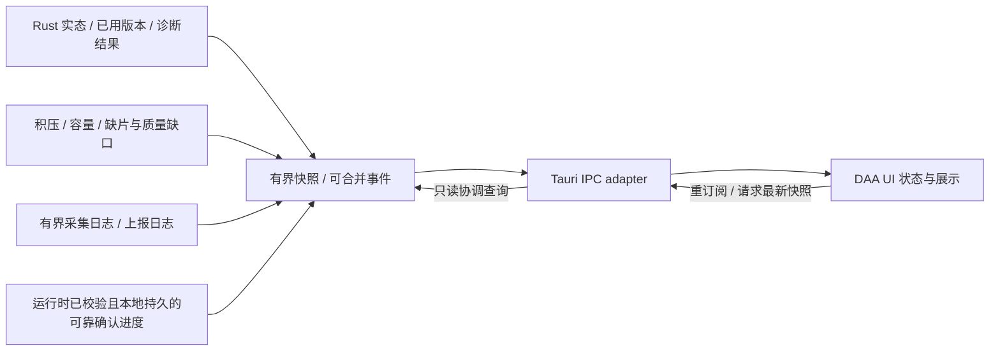

# DAA 多 PLC 采集与持久补传详细设计

**内容修订：2026-10-17 · ARCH-AW-003 r3**
**效力：目标设计与接口语义草案；不代表能力已实现或协议已冻结。**

本文承接 [AW 白皮书](AIIS_AW_Whitepaper_Roadmap_v0.4.md)和 [AW 运行原理设计](AIIS_AW_Runtime_Design.md)，与 [SMA 详细设计](AIIS_SMA_Detailed_Design.md)配套，当前范围由 [ARCH-AW-003 r3 spec](../plans/ARCH-AW-003-daa-detailed-design/spec.md)管理。r3 沿用 r1/r2 的总体组件、多 PLC、双库激活、全样本、容量、冻结批次与顺序机制，仅补充 CU 接入、页面与操作、组件数据流、三包上传例子及分阶段实施。r2 已细化自描述事实、派生目录、三自然月窗口和定义漂移，本版不改变这些机制。

r1/r2 精确批准、Development 交付与独立文档 QA 均属各自旧快照历史，Human Owner 尚未终验；r3 范围已批准，仍须本版 Development、全新 fresh-context 文档 Verification 和 Human Owner 最终验收，不能继承旧 QA。任务 bundle 保存实际 gate 和指纹，本文不预记结果。SMA 与 AW Runtime 正文保持原修订效力及字节；其中同一 bundle 的 r2 spec 链接是历史引用，原批准指纹及历史由当前 spec/tasks/checklist 保留，不表示其正文已随 r3 重交付。

## 阅读导航

| 阅读目标                     | 入口                                                                         |
| ---------------------------- | ---------------------------------------------------------------------------- |
| 理解设计效力、现状与职责     | [1. 定位](#position)、[2. 总体结构](#overview)                                 |
| 配置 PLC、导入点位与采集组   | [3. 配置](#configuration)、[4. 连接与调度](#collection)                        |
| 审阅双库事务、激活和本地确认 | [5. 双库](#storage)、[6. 上传状态](#delivery)                                  |
| 审阅满额停采与补传           | [7. 容量](#capacity)、[8. 上传调度](#upload)                                   |
| 审阅身份、连续边界和各端合同 | [9. 顺序](#ordering)、[10. Backend](#backend)、[11. SMA](#sma)                  |
| 审阅 CU、页面流程、兼容与故障 | [12. 页面与诊断](#diagnostics)、[13. 兼容](#compatibility)、[14. 场景矩阵](#failures) |
| 确认后续责任与实施 gate      | [15. 待决参数](#open-decisions)、[16. 分会话 handoff](#handoff)                |

<a id="position"></a>

## 1. 定位、已决定方向与现状

DAA（Data Acquisition Agent）是现场侧固定 S7 采集程序：管理 PLC 与点位配置，读取、解码并记录来源、时间、质量，先本地持久保存，再通过 Backend 的一个公开接收 API 交付事实。DAA 不承担业务映射、业务表写入、设备控制或低代码业务流程编排。

| 效力层次     | 本文内容                                                                                                                                                                   |
| ------------ | -------------------------------------------------------------------------------------------------------------------------------------------------------------------------- |
| 已确认目标   | 一个实例支持多 PLC；每 PLC 长连接；单 PLC 内跨 DB 采集组、单点单组、组独立周期；全部实际样本本地保存；配置库/采样库分开；有界保留；最新优先、历史补传；旧数据不覆盖 latest |
| 推荐机制     | 本文的概念实体、短事务、配置激活协议、采集事实单位、样本确认和冻结批次、容量状态、完整边界与 SMA 持久进度方案                                                              |
| 待定实施合同 | endpoint、鉴权、正式字段/单位/编码、DDL/索引、整体或部分确认、库/驱动版本、支持矩阵及所有限额数值；由 owning task 另行批准                                                 |
| 当前工程事实 | 继承旧 CA 的 YAML 和 raw/latest 直库兼容路径，不证明目标双库、长连接、接收 API 或持久补传已实现                                                                            |

2026-10-17 重新只读核对的源码依据如下。后续实现以届时工作树重新核对，不把这些锚点当作新机制已存在的证据：

| 当前入口                                                                                                   | 核对到的事实                                                                                             |
| ---------------------------------------------------------------------------------------------------------- | -------------------------------------------------------------------------------------------------------- |
| [DAA README](../automation-world/data-acquisition-agent/README.zh-CN.md)                                    | 保留旧快照实现，新 AW API 尚未接通                                                                       |
| [PLC domain](../automation-world/data-acquisition-agent/src-tauri/src/domain/plc.rs)                        | `PlcRuntimeGroup` 绑定一个 `db_number/start/size`                                                    |
| [采集 Service](../automation-world/data-acquisition-agent/src-tauri/src/services/plc_collection.rs)         | 已有按 PLC 管理任务的基础；`collection_interval_ms` 统一取周期，`write_snapshot` 使用旧数据库 writer |
| [S7 adapter](../automation-world/data-acquisition-agent/src-tauri/src/infrastructure/rust_snap7_adapter.rs) | `read_db_block` 每次创建、连接、读取、断开，不是本文目标长连接                                         |
| [SMA runtime](../automation-world/semantic-mapping-agent/src-tauri/src/domain/runtime/mod.rs)               | managed runtime 中的 `record_success` 更新内存 cursor，不证明持久接收/处理/outbox                      |

当前 [DAA App](../automation-world/data-acquisition-agent/src/App.vue)仍导入自身[旧壳层](../automation-world/data-acquisition-agent/src/layouts/AgentLayout.vue)，尚未接入 CU 公共出口。CU 已有公共壳/样式，当前侧栏仍是平铺一级；目标两级导航的独立能力依赖见 §12.1。

已有 raw/latest 表或查询 API 不证明新幂等接收、条件推进和安全增量 feed 已具备。[Projection 输入解析](../backend/projection/input_resolver.py)当前直接读取 `decoded_payload[point_name]` 标量；嵌套自描述体并不天然兼容。其版本适配/迁移留 Backend 任务。本设计不批准 Backend/SMA 代码、数据库、依赖或现场动作，也不引入 Celery、Redis、AWB、中央配置或共享可写库。

<a id="overview"></a>

## 2. 总体组件与数据流

以下是沿用原组件、补齐 UI/IPC 边界的目标图；不冻结命令名、事件名、文件拆分或正式 schema。

```mermaid
flowchart LR
    UI[CU 组件承载的 DAA UI] -->|控制意图 / 草稿 / 诊断请求| IPC[Tauri IPC adapter]
    subgraph RUST[DAA Rust 长运行时]
      IPC --> C[配置与诊断服务]
      IPC --> M[多 PLC 运行管理]
      C -->|校验与持久草稿 / active| CFG[(config.sqlite)]
      CFG -->|选中版本 / 激活令牌| C
      C -->|可恢复版本激活屏障| M
      C -->|不可变解释摘要 / 运行应用记录| R[(runtime.sqlite)]
      M -->|共享串行会话 / 各组时钟| P[每 PLC 唯一受管理连接]
      P -->|读取解码 / 原时间 / 质量| W[采样写入协调器]
      W -->|事实 / 成员 / 源序号短事务提交| R
      R -->|只取已提交事实| U[上传器 / 冻结批次]
      U -->|可靠回执校验 / 本地 ack 短事务| R
      K[容量管理器] -->|采样准入 / 暂停与恢复| M
      K -->|引用安全清理 / 空间核算| R
    end
    U -->|独立上传周期 / 最新优先与公平历史补传| API[Backend 一个固定事实 API]
    API -->|可靠持久回执| U
    API --> RAW[raw 去重追加]
    API --> L[latest 条件推进]
    RAW --> F[安全 feed / 完整性信息]
    L --> D[查询时派生目录]
    F --> S[SMA 独立运行时]
    D --> S
    L --> S
    S --> O[SMA 持久处理 / outbox]
    O --> T[业务或第三方 API]
```



配置流按 §5 分库短事务推进：草稿校验 → config.sqlite 的版本/意图 → runtime.sqlite 解释摘要 → 持久 active → 运行加载核对 → 解开采样屏障。图中连接不表示两个 WAL 库整体原子；任一步失败保持可辨、可恢复和停止准入。事实流必须先完成 runtime.sqlite 本地提交，再组批上传；容量服务可以阻止下一轮，不能靠 UI 队列绕过保护。



反馈不是确认事实的写入路径。回执先由 Rust 校验并持久 ack，随后报告 UI；UI 看到了响应或日志不能替代提交。事件允许丢失/合并，重订阅后用快照收敛显示；显示缺失不得倒退持久 ack/序号。订阅数、快照载荷、日志级别/条数/保留均有界，不把每轮完整点表无限推到 WebView；凭据和敏感载荷脱敏。

图中 raw/latest 是 Backend 的存储职责，不是 DAA 可直连的表。箭头表示目标语义，不是已存在模块、API 路径或新增目录承诺。

| 组件           | 负责                                            | 不承担                           |
| -------------- | ----------------------------------------------- | -------------------------------- |
| DAA UI / CU 展示 | 宿主页面组合、本地化、编辑草稿与发出明确意图、显示运行反馈 | 直连 PLC/SQLite/Backend 事实写入口、成为事实权威 |
| Tauri IPC adapter | 命令/查询/订阅边界适配，将请求交 Rust 服务校验准入 | 在 UI 中复制调度器或确认账本 |
| 配置服务       | 校验、草稿、版本应用、解释摘要和凭据引用        | 采样数据清理时删除配置           |
| PLC 运行管理   | 独立连接、组调度、超时、重连与运行意图          | 用一个 PLC 的失败拖住全部设备    |
| 采样写入协调器 | 有界接收读取结果，分配源顺序，短事务持久保存    | 用无限内存队列掩盖磁盘写入跟不上 |
| 上传器         | 读取已提交样本、组批、回执、重试及公平补传      | 等待 HTTP 时持有数据库写事务     |
| 容量管理器     | 容量核算、引用安全清理、准入与恢复              | 丢弃未确认样本以维持表面运行     |
| Backend        | 身份接入、raw/latest、可靠回执、feed 与保留合同 | 运行现场 PLC 轮询                |
| SMA            | 独立接收/处理进度、语义规则和外部投递           | 将 DAA 的最新优先等同历史已完整  |

Rust 长运行时拥有连接、组采样时钟、持久队列、上传/容量与恢复。UI 切页/挂载不控制采样寿命，不作为 queue owner；IPC 请求仍须服务端校验配置、权限/gate 与实际准入。切页不中断不等于退出后继续运行，关闭窗口/退出/后台托管仍由 §4.1/§15 的独立 gate 决定。

实例之间使用独立身份、数据目录和库；禁止多个实例共享打开的可写库。一个实例可以只配置一个 PLC；需要按主机、网络区域、升级或故障隔离拆分时，显式划分采集范围和来源交接。

<a id="configuration"></a>

## 3. 配置对象、导入和采集组

### 3.1 关系与约束

```text
DAA 实例
 ├─ PLC：稳定 plcId，名称、IP/端口/rack/slot、连接设置
 │   ├─ DB：DB号、完整结构、来源文件及 UDT 引用
 │   │   └─ 点位：稳定 pointId，原始路径、类型、地址、说明、enabled
 │   └─ 采集组：稳定 groupId，点位引用集合、enabled、采集周期
 └─ 上报目标与策略：API、凭据引用、上传周期、批次/速率和存储策略
```

IP 是可修改连接属性，不作为历史身份。完整结构与采集选择分开：500 个字段只启用 30 个，仍保留全部字段供地址推算和重新导入对照。点位改名或移组保留 `pointId`；删除后新建是否继承身份必须显式判断，不能按同名自动复用。

每个组只属于一个 PLC，可引用该 PLC 多个 DB 中的部分点位；同一点最多归一个组。提供“按整个 DB 创建组”的快捷选择，但 DB 不是强制分组边界。PLC、组、点位均启用且点位已分组才采集；未分组明确显示“未分组，未采集”。关闭点位保留结构、分组和历史身份。**采集即进入上报链路**，只有上传暂停/故障会延迟投递，不设第二套“是否上报”点选；从未采集/上报的完整结构字段不会自动出现在 Backend 目录。

组的采集周期独立；上传周期属于实例上传策略。周期示例只帮助理解：快速组引用 DB10 速度和 DB11 电流，100 ms；温度组引用 DB12/DB20，500 ms；状态组引用 DB30，1 s。这些数值不是默认、最低支持值或现场承诺。

### 3.2 导入和人工校核

`选择 PLC 与 DB 号 -> 导入 .db/.udt -> 解析完整结构/引用 -> 保存草稿 -> 手动触发偏移推算 -> 差异预览/人工修正 -> 校验并应用`。

`.db` 在这里指 PLC 文本源，SQLite 文件使用独立名称。保存来源和结构摘要；缺少 UDT、字段顺序或不支持类型时，定位错误并停止推算，不猜地址。只对明确支持的标准、非优化 DB 绝对地址布局推算；优化块不得冒充固定偏移结构。[Siemens 块访问说明](https://docs.tia.siemens.cloud/r/en-us/v20/programming-basics/blocks-in-the-user-program/blocks-with-optimized-access/basics-of-block-access)

推算结果先列旧/新偏移、受影响点及来源，经确认写草稿。手工值与推算值分别记录来源，重算不能静默覆盖手工修改。结构、类型、数组长度变化使受影响地址进入待复核；重新导入先匹配身份、展示增删改和人工覆盖差异，不直接替换 active。BOOL 打包、对齐、数组/字符串、Struct/UDT 的支持矩阵和算法另由点位任务确定。

可解析和读取成功均不能证明地址与目标 PLC 当前程序一致，需后续获授权与 TIA 实际偏移/实点核对。导入、预览、推算和草稿保存均不启动 PLC I/O。

### 3.3 配置生命周期

| 状态     | 含义                                     | 与采集的关系                       |
| -------- | ---------------------------------------- | ---------------------------------- |
| draft    | 编辑、导入、推算中的完整候选             | 不驱动外部 I/O                     |
| prepared | 校验通过、生成不可变 revision 和应用令牌 | 尚未宣告已生效                     |
| active   | 配置库持久选中的完整版本                 | 内存运行是否已应用另报，不混为一项 |
| previous | 上一次切出的有效版本                     | 显式回退也走激活协议               |

`prepared` 是推荐内部应用状态，不冻结表/状态编码。每轮读取固定一个 revision；变更不改写正在执行的轮次。draft 保留量、凭据安全存储、版本 schema 和具体操作文案由实施任务确定。凭据仅描述引用和存储责任，不建议把明文口令与一般配置导出混存。

<a id="collection"></a>

## 4. 多 PLC 长连接与采集调度

### 4.1 连接、采集与上传独立控制

| 维度           | 目标状态/转换                            | 行为                                                 |
| -------------- | ---------------------------------------- | ---------------------------------------------------- |
| 连接意图与实态 | 人工断开、连接中、已连接、退避重连       | 人工断开取消自动重连；意外断线仅重连该 PLC           |
| 采集运行意图   | 希望运行、人工停止、组停用               | 组停止不自动等于主动断开连接                         |
| 运行准入       | 可采集、配置切换中、容量暂停、持久化故障 | 阻止新轮次但保留人工意图；恢复只作用于仍希望运行对象 |

正常工作每 PLC 只有一个受管理的长连接，采集与单点诊断共享该客户端及串行调度，不为诊断另开连接，不每轮重新建连。不同 PLC 独立执行；每次操作有有界超时，诊断有队列/频率限额，优先让到期采集取得公平机会，不能长时间占住连接或全实例锁。修改 IP 等参数时在轮次边界有序关闭旧连接，再按新配置建立；显式退出停止新工作并释放连接。驱动线程安全/取消能力/CPU 支持仍需验证。


| 控制操作 | PLC 连接/采集影响 | 上传影响 |
| --- | --- | --- |
| 暂停采集 | 保留连接，停止新采集轮次，人工意图和容量暂停分开 | 继续发送历史积压 |
| 暂停上传 | 连接/采集可在容量内继续，样本照常持久保存 | 不启动新请求；在途请求有界结束并记录结果 |
| 人工断开 PLC | 串行释放连接并取消自动重连，未完成轮次如实记录 | 已保存事实仍可上传 |
| 意外断线 | 仅该 PLC 退避重连，其他 PLC 不被阻塞 | 已保存事实仍可上传 |
| 批量连接/采集/上传控制 | 单台、勾选、全选逐对象回报，保留部分成功与失败 | 实例只有一个上传器，各 PLC 上传准入单独记录 |

上传器单独保存期望/实际状态，和连接、采集、容量准入一起展示；暂停/恢复任一维度不暗改另一维度的人工意图。控制执行在安全边界完成后才报告实际状态，不把点击按钮等同已停止。

窗口关闭是否退出、后台运行、开机托管、headless 与目标平台另定，不能从 Tauri 名称推断。连接长期存在也不代表永久可用，仍需识别半开、异常与 PLC 重启。

### 4.2 调度与读取计划

每组维护下一到期时间，建议使用单调时钟调度，采样记录另保存可解释的实际时间。同 PLC 多组到期时按有界公平策略串行读取，不能用快组无限压住慢组；每组不重入，不无限排队过去的 tick。上一轮超过周期，记录读取耗时、延迟、实际间隔和错过次数，跳到后续有效调度时刻，不连续补读伪造过去样本。

读取计划按“PLC + DB + 本轮点位 + 地址范围”生成。相邻地址可合并后本地解码启用点；关闭点恰好位于读取区间中间时，其字节可能随区间传回，但不形成该点成功样本。

| 方式         | 适用倾向              | 权衡                                   |
| ------------ | --------------------- | -------------------------------------- |
| 整 DB        | DB 较小、启用点密集   | 请求可能少，但传输无关字节             |
| 逐点         | 极少、分散点          | 读量小，但往返次数多                   |
| 合并连续区间 | 常规稀疏/密集混合点表 | 平衡请求次数与字节，需要计划和边界校验 |

具体合并阈值/PDU/并发由驱动任务测量。一次驱动调用超过协商 PDU 时可能拆成后续传输；整 DB 调用不能直接视为一次网络操作。[Snap7 Client](https://snap7.sourceforge.net/snap7_client.html)

跨 DB/分段结果各有实际采集时间、耗时、质量和错误；同组只表示同一次调度，不保证 PLC 同一瞬间快照。严格一致数据需 PLC 侧快照/序号等独立配合合同。失败返回缺值与失败质量，不沿用旧值或 0 作为新成功；轮询不能保证捕获两次采样之间的短脉冲，完整事件需 PLC 计数、锁存或事件缓冲另立项。

### 4.3 本地完整事实单位建议

推荐将“一次组触发的有界读取结束”作为完整事实单位 `cycleId`：固定组、revision 和本轮应读成员，保留所有成功值及明确失败结果，并分配一个 PLC 内 sourceSeq。r2 推荐按 DB 逻辑包表达样本，每个包有稳定 sampleId，包内 `points` 以 pointId 为键；跨 DB/超大 DB 可有多个固定片段，属于同一 cycleId/sourceSeq。点结果身份由 `(sampleId, pointId)` 解释，不再将包身份、点身份和 HTTP 批次混用。样本 ack 是包内容的可靠确认，完整轮次还需全部包/片齐全；具体粒度/编码仍需正式合同。部分 DB 失败不丢其他成功值，失败点保留定义、缺值及质量，全失败轮次也可形成结果事实。

先在有界内存收集本轮结果，结束后一次短事务写入事实单位、全部成员、配置摘要引用及 PLC 序号。超过内存/轮次上限应在配置准入或读取计划时拒绝，不把未提交结果无限积压。此建议的持久保证从该事务成功提交开始：读取后、提交前崩溃的值不受保证，不能事后复造。更细的本地分段提交若确有必要，需 DAA/Backend 共同定义未完成轮次恢复，不能绕过完整性合同。

<a id="storage"></a>

## 5. 双 SQLite、事务和配置激活

### 5.1 每实例一对库

| 库                 | 概念内容                                                                                                 | 生命周期                              |
| ------------------ | -------------------------------------------------------------------------------------------------------- | ------------------------------------- |
| `config.sqlite`  | PLC/完整结构/点位/采集组/端点/策略、draft/active/previous、应用意图与凭据引用                            | 低频修改，单独备份/恢复；不随样本清理 |
| `runtime.sqlite` | 不可变事实单位和点样本、源顺序、样本级 ack、冻结批次及多对多成员引用、重试/拒绝、配置摘要、停采/恢复记录 | 高频保存与清理；配置回退不重置        |

不可变摘要保存解释历史所需的点位身份、类型/地址、组成员、revision 与内容摘要；它由配置生成，不是第二套可编辑配置权威。样本存在期间保留解释引用；旧配置被回退或点位移组，也不改变历史含义。

每库由本机服务协调写入，使用短事务；多 PLC 可并行读，采样库写入通过单写协调串行办理。上传/历史查询用有界分页和短读事务。推荐以 WAL + `synchronous=FULL` 为待吞吐/崩溃验证的提交基线，不在此固定库、版本和参数；FULL 的同步仍依赖操作系统/文件系统与硬件兑现写入语义。[SQLite synchronous](https://sqlite.org/pragma.html#pragma_synchronous)

WAL 允许读写并行但只有一个写入者，多个库不具有整体原子事务；库应放本机合适文件系统。[SQLite WAL](https://sqlite.org/wal.html) 后续选型必须核对实际链接/打包 SQLite 版本、官方已知缺陷及修复（含 WAL-reset 说明），不能仅因版本号较新或有应用单写协调就宣称安全。[SQLite WAL 已知问题](https://sqlite.org/wal.html#the_wal_reset_bug)

### 5.2 推荐的跨库激活协议

配置持久选中、内存已加载、采集已首次使用分别报告。建议首版以实例级轮次屏障简化激活：暂停新增轮次，等待当前轮次有界结束并提交，上传器继续；不能一部分对象换版、另一部分仍旧版却报告整实例完成。

1. 在配置库事务保存完整不可变 revision R、摘要和应用意图令牌 A，记录预期旧版本；active 尚未改变。
2. 在采样库事务按 A 幂等保存 R 的解释摘要与“准备应用”记录。失败则保持旧 active，不启用 R。
3. 在配置库事务校验 A/旧 active 未变，再切换 active=R、previous=旧版本；状态显示“持久选中，运行待应用”。
4. 内存加载并校验 R，保持屏障；在采样库提交 A 的运行应用记录，记录后续轮次将使用 R。失败进入待恢复停止，不用旧内存继续采集并宣称 R 生效。
5. 确认内存、配置 active 与采样库摘要/令牌相符后解除屏障。首轮样本原子引用 R；诊断可区别“已加载、尚无新样本”和“已被采样使用”。

运行应用记录只证明当时完成安装，不证明崩溃后内存仍在；每次启动先保持采集关闭，重新执行一致性核对与加载。

| 崩溃位置                | 重启时持久状态                | 恢复目标                                               |
| ----------------------- | ----------------------------- | ------------------------------------------------------ |
| 第 1 步前/事务失败      | 旧 active                     | 使用已核验旧配置；草稿可继续                           |
| 第 1 步后、第 2 步前    | 新 prepared，旧 active        | 可幂等继续准备或显式取消，不直接使用新配置             |
| 第 2 步后、第 3 步前    | 采样库有准备摘要，旧 active   | 继续/取消应用；无引用摘要后续可回收，不倒退样本        |
| 第 3 步后、第 4–5 步前 | 新 active，可能未安装内存     | 先重建 R 摘要/校验并加载；成功才恢复，失败保持诊断停止 |
| 第 5 步后、首轮提交前   | 新 active、运行记录、无新样本 | 重载 R 后按意图恢复，不虚构首轮                        |
| 新样本提交后            | 新样本固定 R                  | 保留身份/进度，任何回退另走激活协议                    |

不是用跨库事务“同时成功”；每一步幂等、可辨识、可重试，采样准入屏障是关键。若数据库损坏或 active 内容与摘要不一致，停止新采集并要求恢复处理，不自动拼接两个来源的配置。

### 5.3 备份、回退和实例恢复

配置备份应含版本/内容摘要、实例及来源绑定信息；采用 SQLite 支持的一致备份方式，不能把运行中的主文件单独复制当成完整备份。[SQLite 在线备份](https://sqlite.org/backup.html) 具体备份工具、周期、加密和恢复 UI 留后续任务。

恢复旧配置前核对采样库现有引用与版本冲突，必要时为恢复操作生成新应用记录。配置回退或备份恢复不删除样本、不倒退 sourceSeq/ack/上传进度，也不能恢复一份旧 runtime 备份后伪称从未丢数据。采样库重建、丢失或实例替换需新来源代次和 Backend 受控交接；旧库历史补传的资格单独保留/撤销（见第 9–10 节）。双库分离不是同磁盘故障容灾。

<a id="delivery"></a>

## 6. 样本确认、冻结批次和重试

### 6.1 概念模型与不变量

样本事实只保存一份不可变自描述载荷，样本级 ack 单调由未确认到已确认。批次是投递尝试的持久容器，保存稳定 `batchId`、固定包/片成员、内容摘要、重试状态和结果；样本与批次为多对多引用。优先批次可携带历史批次中同一 sampleId。DB 逻辑包和片段保留定义/值/质量与完整轮次关联，HTTP 组批不重新制造样本身份。

同一 `batchId` 重试必须使用相同成员和语义内容；传输层重试时间等不能改写样本时间或参与事实内容。推荐从不可变样本和冻结投递格式重建请求，并保持必要版本信息；具体字节编码及摘要算法待 Backend 合同确认。

| 样本状态 | 含义                                            | 清理资格                                     |
| -------- | ----------------------------------------------- | -------------------------------------------- |
| 未确认   | 无可靠 Backend 回执，包括等待、在途、重试和拒绝 | 保护，不按天数删除                           |
| 已确认   | 可靠回执明确覆盖该 sampleId，确认单调保存       | 还需该事实单位可靠完成证据、保留期和冻结引用 |

| 批次展示状态 | 转换与归属                                                       |
| ------------ | ---------------------------------------------------------------- |
| 待上传       | 已冻结提交，等待调度；未分批样本也可汇总显示待上传               |
| 上传中       | 发送前记尝试标识，等待回执；不代表样本已确认                     |
| 等待重试     | 可重试失败，保存下次时间/次数/原因；重启的无回执在途批次回到这里 |
| 已确认       | 回执覆盖约定整批内容并已在本地提交，成员样本各自记 ack           |
| 需处理       | 鉴权/合同/身份冲突等阻塞或隔离；不自动丢弃                       |

展示样本时：已有任一可靠 ack 就显示已确认，不因另一个批次超时倒退；未确认者再聚合其投递状态。整批确认是首版推荐，不冻结响应 schema；若 Backend 选择部分接收，必须明确逐成员结果、原批次重放响应和完整事实完成判定，之后 DAA 才能实现。

### 6.2 事务与网络边界

```text
采集事务：事实单位 + 全部成员样本 + 源序号 + revision引用 → COMMIT
组批事务：固定batchId/成员/内容摘要 → COMMIT
发送记录事务：尝试身份/在途状态 → COMMIT
HTTP发送与等待：事务之外
回执事务：校验回执身份/范围 → 样本ack单调更新 + 批次结果 → COMMIT
```

API 超时、断线或本地回执提交失败，均保留原样本/批次重试。后端已保存但回执丢失时，DAA 仍未确认，不能提前清理；重传获得等价可靠回执后再更新。稳定调用身份与服务端原子去重是设计依据。[AWS 幂等 API 设计](https://aws.amazon.com/builders-library/making-retries-safe-with-idempotent-APIs/)

断网/服务暂不可用使用有界退避、抖动和速率限制；到期后再试，不形成紧循环。鉴权失败可暂停该上传目标全部请求并提示修复；同 ID 异内容、数据合同拒绝隔离问题批次，不让它永久阻塞合法批次。隔离不会使缺口变完整，不修改原样本伪装成新事实；数据修正/重提需显式合同和审计。

### 6.3 优先确认与旧批次引用清理

例：历史批次 H 冻结了样本 X、Y，发送结果未知；恢复优先批次 P 携带 X，并可靠确认 X。此时 H 仍以原内容重试，X 的 ack 不倒退，Backend 对 X 去重而接收 Y。

**X 已确认也不能立即删除。**默认规则是只要非终结冻结批次仍引用 X，就保留重建请求所需内容；直到 H 可靠终结并清理成员引用，X 才可能具备回收资格。分片场景还需 Backend 可靠确认所属事实单位完成，不能只因若干包/片已确认就删掉缺片补传或完成核实所需的材料。摘要、事实 manifest 和回执证据也按各自引用保留；完整单位确认后可压缩为足以恢复本地连续前缀的有限确认记录，具体保留/压缩合同由后续任务确定。

若 H 全部成员已通过其他批次确认，也不能擅自改写 H 内容；只有 Backend 合同明确“批次无独立副作用、全部成员及完成证据已确认，可在本地退休”时，才允许持久标记 H 退休并释放引用。未收到窗口到期等不可重试拒绝时，首版可继续原 H 有界退避重试至确认，避免新增退休语义；不可重试情况按 §6.4 进入需处理。不可处理批次可能长期钉住已确认数据，容量统计必须计入；需要处理而非自动删除。终结批次/回执元数据采用有限保留与压缩摘要策略，期限需覆盖回执核实和幂等窗口，不能无限增长或随样本过早删光。

### 6.4 后端窗口到期拒绝

过期补传收到明确不可重试的拒绝与范围后，转“需处理”，停止对该拒绝无限重试；拒绝不是可靠持久接收 ack，不自动删本地样本。原冻结批次保持原成员/内容。混合有效/过期批次需要 Backend 明确整批拒绝或逐成员结果；若允许重组合法成员，应新建批次引用原合法样本，保留旧批次结果，不修改旧内容。历史已接收的重复回执、批次退休与人工缺口接受语义须另行定稿；不能用再次成功响应复活已过期事实。长期拒绝仍钉住空间，最终可能容量停采，需 Human Owner 按后续处置合同显式决定，不静默删除或假确认。

<a id="capacity"></a>

## 7. 保留天数、容量额度与停采恢复

### 7.1 配额语义

已确认样本保留天数建议从本地成功保存时间计算；实际采集时间独立用于曲线/窗口。时钟回拨或大幅校时时保守处理到期判断并诊断，不能因此批量提前清除。未确认及需处理数据超期仍受保护。

| 配置/计量                      | 语义                                                                         |
| ------------------------------ | ---------------------------------------------------------------------------- |
| 已确认样本保留天数             | 正常情况下的最长本地历史保留期；不是 Backend 保留期                          |
| 采样存储额度                   | runtime 主文件、WAL/SHM 等附属文件及批次/确认/摘要元数据的预算               |
| 系统磁盘最低余量               | 防止其他程序挤占后仍盲目写入；配置库、日志和备份另计并占用系统余量           |
| 安全预留与高低水位             | 给在途事务、ack、清理、checkpoint 和必要状态记录留空间；低于恢复线才重新准入 |
| 有效数据/可复用页/文件实际占用 | 分别观察未确认、已确认且钉住、可清理数据，以及文件系统占用                   |

“7 天、5 GB”仅为语义示例：已确认最多保留 7 天，容量紧张可更早删；未确认不按天数删。额度不是操作系统硬隔离，事务/WAL 可能有瞬时增长，需在硬边界之前停止准入；具体余量、增长估算与超出处理后续实测。

### 7.2 容量状态机

| 状态      | 条件/动作                                                      | 退出条件                                      |
| --------- | -------------------------------------------------------------- | --------------------------------------------- |
| 正常      | 按期分批清理过期且无引用的已确认样本                           | 达预警线或磁盘余量逼近边界                    |
| 预警/清理 | 优先释放最旧可清理已确认数据；协调 checkpoint/回收             | 回到安全范围，或已无足够可释放空间            |
| 容量暂停  | 不再启动全实例新采集轮次；保留连接意图，上传/诊断/安全清理继续 | 满足低水位、磁盘余量与写入健康检查            |
| 存储故障  | 提交失败/库损坏，停止新增采集，报告未持久结果与时间缺口        | 明确恢复并重新核验身份/配置/库一致性          |
| 恢复      | 记录暂停区间，重新加载准入状态                                 | 只恢复仍希望运行的 PLC/组，不启动人工停止对象 |

启动下一轮前检查保守的写入预算，暂停时妥善结束已开始的有界轮次，使用预留提交；若仍失败，不能声称读到的值已保存。状态记录也写不下时，以可用诊断途径报告，恢复后记录可证实的未知区间，不虚构精确停采时刻。

暂停不删除积压、不自动断开所有 PLC，也不把原人工运行意图改成“停止”。恢复需留滞回，避免每上传一批就启动、随后立刻再次停采。有限磁盘、无限断网、持续全样本采集不能同时保证；磁盘损坏、落盘前崩溃和暂停期间未采到的数据均不能靠补传恢复。

### 7.3 清理与空间回收

清理顺序建议为：终结批次按保留策略释放引用 → 删除到期/压力淘汰、所属单位已可靠完成且无钉住引用的已确认样本 → 回收无样本引用的事实/摘要元数据；未完成单位的 manifest/确认摘要仍需保留以证明完整性。全部采用小批事务，避免大删除挤占采样和确认。

DELETE 释放页供重用，通常不立即缩小主文件；可复用页足够时无需反复缩库，但仍受 WAL 和磁盘最低余量约束。增量回收需要相应建库设置，低负载时受控执行；整库 VACUUM 不放在每轮热路径，也不能在没有维护空间时强行运行。[SQLite auto_vacuum](https://sqlite.org/pragma.html#pragma_auto_vacuum)

定期观察 WAL/checkpoint 进度，历史查询分页后结束读事务，上传拷出有限请求后释放读取；长读可能阻碍 WAL 重置，checkpoint 完成也不必然缩文件。[SQLite WAL 管理](https://sqlite.org/wal.html#avoiding_excessively_large_wal_files) 额度覆盖文件实际占用，不能只用记录数估计。确认和清理本身会写 WAL，需要持续保留维护预算。

容量评估以**实际自描述包字节量**乘各组采样速率/PLC 数测算，再计 SQLite 索引、批次/ack/解释摘要、碎片/WAL 峰值、日志预算和维护预留。单份 points 消除了同一事实内“带值体+无值 pointCatalog”双写，并未消除定义在不同历史样本中重复；不假设压缩收益。例：若实测每轮自描述包最终占 10 KB、每秒 10 轮，约 8.64 GB/天（十进制，其他开销另加）；这不是支持能力或默认推荐，Backend 最多三个月也不等于容量足够。本地保留按本地保存时间及保护/引用规则，后端窗口不使拒绝样本可自动清理。

<a id="upload"></a>

## 8. 最新优先、历史补传与公平预算

恢复检测不能只看网络可达，需确认上传目标可服务、鉴权/合同有效。恢复阶段先给每个启用组最近实际采到的原事实单位优先机会；保留 sampleId、sourceSeq、采集时间、质量和 revision。若对象停采/离线，展示旧时间与陈旧状态，不能重新打时间冒充当前测量。

优先的是最近轮次及其真实成员，多个组不拼成虚构同步帧；超出请求限额按第 9 节分片，完整性仍独立判断。某些成员失败时如实上传失败结果，不用更旧成功值顶替“新成功”；Backend 的 latest 质量显示政策另定。

```text
断网：采集 → 本地提交，批次等待重试
恢复：受控重试探测成功 → 各组最近事实单位获得有限优先额度
追赶：新样本额度 ↔ 历史补传额度，PLC/组轮转
收敛：积压下降 → 正常上传周期，历史清理仍独立
```

上传周期决定常规扫描/组批节奏；每批样本数、请求字节、速率、最新/历史预算分别限制。首版建议全实例只有一个 HTTP 请求在途（具体限额待实施确认），等待有界；超时/失败结束客户端本次等待、记录结果并退避后，释放调度机会给其他 PLC/组/批次，不能在重试循环中霸占上传器。客户端等待结束不证明服务端工作已取消；未知结果仍按原身份核实/重试。恢复优先可旁路旧批次等待，但仍受单在途、引用和容量上限约束。上传暂停不改变未确认状态，恢复只恢复原上传意图。

历史默认各 PLC 内按完整事实序号先旧后新，再在 PLC/组之间公平分配。某个坏批次隔离后不挡住全部合法数据，但其缺口仍可见。有界调度不能保证任意过载下的时效；持续新增速率超过上传能力，需容量预警和停采。只有实际补传吞吐高于新增速率，积压才可能消减，不承诺固定恢复时长。

在有效接收窗口内，最新优先只改变发送顺序，不合并丢弃中间样本、不改变应接收的 raw 集合、不降低可靠回执。已经确认的新样本不需再主动组新批次，旧冻结批次重试仍可再次携带它；超窗口后适用到期拒绝，不承诺所有本地样本最终都能进入 Backend。

<a id="ordering"></a>

## 9. 稳定身份、源顺序和完整接收边界

### 9.1 信息语义草案

以下名字是便于讨论的语义标签，不是正式 JSON/schema、索引或响应包装。正式命名与编码由 Backend 会话确认。

| 信息                      | 含义/稳定性                                                      |
| ------------------------- | ---------------------------------------------------------------- |
| `sampleId`              | 首次保存确定的 DB 逻辑包/固定片样本身份，重传不变；包内 pointId 标识点结果 |
| `batchId`               | 一次冻结投递内容的身份，重试不变，不等于采集轮次                 |
| 实例/PLC/组/点位 ID       | 来源和选择关系；IP、显示名不替代稳定 ID                          |
| `configRevision`/摘要   | 当时解释规则，不随配置回退改写                                   |
| `sourceGeneration`      | 受控来源代次，不用随机 ID/本机时钟比较新旧                       |
| `sourceSeq`/事实单位 ID | 同代次同 PLC 内持久递增的一轮组采集事实顺序，cycleId 关联跨 DB 包                      |
| 成员/分片 manifest        | 应有成员、结果/片段身份、完整内容摘要与完成证据                  |
| 值/类型/质量/错误         | 成功值与失败缺值分清；单位与类型矩阵需正式合同                   |
| 采集时间/本地保存时间     | 原始测量时间与本地保留起点分开；各片段实际时间可不同             |
| 确认范围/重试性           | 确认哪些成员/单位/批次，持久级别与拒绝是否可重试                 |

### 9.2 序号粒度和代次

推荐每次完整组读取结果落盘时分配同 PLC 下一个 `sourceSeq`，同轮 DB 包/片共享它，各有稳定 sampleId/片身份，包内 pointId 保持点身份。计数器、cycleId、完整成员和包/片同一本地事务提交；回滚不留“已分配无事实”的假空洞。不同组经同一 PLC 顺序可比较，HTTP 拆批不重新编号，正常重启、换周期、移组、配置回退均不清零。

PLC A 的 1005 与 PLC B 的 1005 无大小关系。也不宣称 PLC 内序号是现场严格全局时间：它代表 DAA 持久事实顺序，各点实际读取时间另存。组过滤后可能只看到 1001、1004、1008，因为中间属于其他组；这种自然跳号不能判断丢失。SMA 要么获得 PLC 完整前缀及过滤覆盖证明，要么使用 Backend 正式提供的过滤流完整性合同，不能自行要求每个组裸序号连续。

采样库重建/实例替换产生新代次。Backend 需受控登记唯一有效实时来源、旧代次截止/新代次起点及交接证据，防止旧实例重新上线推进 latest。旧代次历史在允许窗口内仍可补 raw，但不重获 latest 权限；代次间有状态连续处理需显式连续证明，否则标缺口/新基线。一个 UUID 只能区分代次，不能证明谁较新、谁有权接管。

### 9.3 跨 DB 和分片完成条件

本地推荐整轮事务，所以全部应读点都有成功值或明确失败质量。每个 DB 逻辑包保留 PLC、DB、groupId、cycleId/sourceSeq/revision；若再分片，固定包/片身份、预期集合与完整内容摘要。Backend 只有在 manifest 与所有预期包/片结果可靠持久并核对一致后，才标该序号完整。DB 读取失败的包仍带点定义及失败结果，不能因缺值省掉成员。HTTP 可组多个 DB/PLC 的包，但请求完成不自动证明它们所属轮次都完整。

数据本身失败但失败结果齐全，可标“接收完整、采集质量有缺陷”；少了一个片段则是“接收不完整”，两者不同。分片先到的有效点可按合同更新 latest，但不能使整个单位完成或提前推进历史完整边界。整批回执可确认本批片段，仍须区分完整事实单位确认。manifest 的传输格式、是否单独事件、重复片段校验等由 Backend 合同冻结。

### 9.4 连续前缀与示例

每个 `(PLC, sourceGeneration)` 的完整接收边界 B 表示从约定起点到 B 的全部事实单位已可靠完整接收；最大见过序号 M 只表示已见范围。B 不由 M 直接赋值。

B 是接收历史证明，不代表其中原始载荷永久可读。窗口到期后 feed 必须另报可恢复起点/过期缺口，SMA 不能用 B 已推进来证明尚未处理的旧输入仍可取回。

假设同一点在相关轮次有新结果，初始 B=M=1000：

| 到达事实          | raw/接收记录                     | 该点 latest | B / M       |
| ----------------- | -------------------------------- | ----------- | ----------- |
| 1005 优先完整到达 | 保存成员，1001–1004 仍缺        | 推进至 1005 | 1000 / 1005 |
| 1001、1002 补齐   | 去重追加，前缀连续到 1002        | 保持 1005   | 1002 / 1005 |
| 1003、1004 补齐   | 已有 1005，前缀连通              | 保持 1005   | 1005 / 1005 |
| 再次收到 1005     | 同身份同内容返回确认，不新增事实 | 保持 1005   | 1005 / 1005 |

若 1005 只有一片，M 可为 1005，B 不能越过该未完成单位；其中点的最新值也不能替其他成员证明完整。

前缀连续只证明已生成事实都接收，不证明采集时间无缺口。读取失败、错过调度、容量暂停、进程退出区间另报。永久不可补齐的单位需明确 gap 接受/跳过策略、批准责任和结果标记；推进后的“策略接受边界”必须与严格完整前缀分开命名，不能静默超时跳过后仍称完整。

<a id="backend"></a>

## 10. Backend 接收、latest 与增量读取配合合同

DAA 使用一个公开事实接收 API，无需知道 Backend 是两个表还是其他存储。一个 API 可以同时完成 raw 追加和 latest 条件更新；也要提供重复请求仍可获得的可靠确认。以下是配合要求，不是对方已承诺或本轮新增的可执行合同。

### 10.1 推荐接收事务

`鉴权/来源资格/合同校验 -> 幂等身份与内容检查 -> raw新增或确认已存在 -> latest原子条件推进 -> 接收/完整性/feed发布记录 -> 持久提交 -> 回执`。

| 要求            | 确认/拒绝语义                                                                                            |
| --------------- | -------------------------------------------------------------------------------------------------------- |
| raw 去重        | 稳定 sampleId 唯一；有效窗口内同 ID 同内容重复返回可靠确认，同 ID 异内容拒绝冲突；超窗历史回执按 §10.5 定稿，不复活原事实 |
| latest 原子推进 | 同一点比较有效来源代次、有效定义版本/成员声明与更高 sourceSeq，并检查未到期；数据库条件更新/等效并发控制，先查后无条件写不满足 |
| 代次隔离        | 新来源必须受控交接；旧来源允许历史接收与是否能推进 latest 分别判断                                       |
| 回执范围        | 明确样本、片段、完整单位与批次；回执覆盖的是可靠提交结果，不将 HTTP 已接收或仅易失入队称为持久保存       |
| 事务失败        | 不返回超出实际持久边界的成功；若 raw/latest 跨存储，应另定可靠接收账本和收敛语义，不能暗示已经同事务完成 |
| 输入拒绝        | 稳定原因和可重试性，区分鉴权、内容冲突、类型/版本不兼容、超限与暂不可用                                  |

latest 比较采用源顺序，不能按 HTTP 到达时间、接收时间或仅依赖可回拨的 collectedAt。1005 到达后补 1001 不倒退；不同点各自保有最新结果，不能用某点较大序号跳过另一点的合法结果。配置变更、失败质量是否更新 latest、停用点陈旧显示、点位身份退役均由 Backend owning task 明确，不能让消费者误认旧成功值仍新鲜。

整批原子接收是首版建议，单请求内重复样本可以确认已存在而不重增。部分接收与超大事实分片必须分别定义，不能让 DAA 根据一个 HTTP 200 猜哪些样本已确认。

### 10.1.1 HTTP 响应、持久回执与本地确认

| 客户端观察 | 可靠持久确认含义 | DAA 本地动作/状态 |
| --- | --- | --- |
| 请求发出/发送完成，或只有 HTTP 200/202 | 状态码本身不说明持久范围；易失排队也不算接收确认 | 保持未确认，记录尝试；按正式合同有界等待/核实 |
| 回执明确 Backend 已可靠提交，身份/内容摘要/覆盖范围与冻结批次一致 | 仅覆盖合同所指包/片；cycle 完成还需全部 manifest 成员的证明 | 短事务单调更新成员 ack、批次结果/完整性证据；提交成功才反馈已确认 |
| Backend 已存，响应丢失/超时，或本地 ack 事务失败 | 服务端可能已成功，DAA 尚无可靠本地确认 | 保原 batchId/sampleId/原内容重试或核实，不提前清理；重复由 Backend 去重 |
| 明确冲突/鉴权/到期等拒绝 | 拒绝不是持久接收 ack；可重试性与范围必须明确 | 分类退避/暂停/隔离需处理；保原冻结材料，按 §6.4 处置，不自动删保护 |
| 混合成功/重复/拒绝/过期或仅部分成员结果 | 首版仍推荐整批原子接收/确认；不能从单一状态码推测部分成功 | 逐成员 ACK、历史回执与批次退休矩阵须正式合同先定；不得改旧冻结批次猜测重发 |

Backend 必须保证 raw 去重/异内容冲突和 latest 来源/定义条件推进。客户端单在途与发送先后顺序只是调度建议，不能替代服务端并发原子性或阻止旧包覆盖 latest。

### 10.2 安全 feed 和保留窗口

SMA 接收游标应表示“这个位置之前的可交付提交都不会再晚出现”。并发事务中，较小自增 ID 可能先分配后提交，不能未经证明就用最大 raw ID 扫描推进；最大 sourceSeq 更不能跳过迟来的历史。

Backend 需选择并验证提交有序发布日志、缺口感知扫描或等效安全机制，分页返回稳定 nextCursor、来源/样本身份及完整性信息；SMA 可以重复取得同一页，但不能漏掉并发晚提交。游标的实现、过期及重同步协议由 Backend 任务确定，本设计不选择数据库机制。

raw/latest 事实受 §10.5 的最大三自然月窗口限制；去重摘要、feed 完整性证据和 SMA 滞后需在此可恢复范围内对齐。raw 到期不能让重传重新成为新事实；必要回执/去重摘要可按独立有限政策保留，但不是延长原始值可读窗口。feed 过期明确返回缺口及可恢复范围，不能把 cursor 跳到末尾称未漏读。SMA 超窗口停机时不能承诺全量业务回填。

API 路径/版本/鉴权、正式字段/单位、响应包装、DDL/索引、整体/部分确认、代次交接和 feed 留 Backend 专属会话；最大三自然月语义已在 r2 选定，具体更短设置/清理与回执保留参数另定。本轮不修改 `contracts/`、Backend 代码或数据库。

### 10.3 自描述点位载荷：一份 points

每条 raw 事实及其对应 latest 存储职责各自只保存一份自描述点位体，不同时持久第二份无值 `pointCatalog`。两种存储角色仍分别存在；这不是把历史与当前状态合为一条，也不规定最终列名。`points`/`pointsPayload` 名称、正式类型/单位、精确 payload/片段 schema 留 Backend。

下例展示三个 DB 逻辑包合为一个冻结 HTTP 批次。字段/包装、摘要文本、ID、时间、数值仅作语义占位，JSON 可解析，**不是可执行 schema、API 路径、正式摘要算法或限额承诺**；不能直接据此调用生产 API。为便于阅读，每包只示一枚已启用点，其原观察时间在点内保留。

```json
{
  "batchId": "batch-demo-1",
  "instanceId": "daa-demo",
  "contentDigest": "illustrative-batch-digest",
  "cycles": [
    {
      "plcId": "PLC_A", "groupId": "A1", "cycleId": "cycle-A",
      "sourceGeneration": "generation-A", "sourceSeq": 1005,
      "manifest": [
        { "db": 10, "sampleId": "sample-A10", "part": 1, "parts": 1, "contentDigest": "illustrative-A10-digest" },
        { "db": 20, "sampleId": "sample-A20", "part": 1, "parts": 1, "contentDigest": "illustrative-A20-digest" }
      ]
    },
    {
      "plcId": "PLC_B", "groupId": "B1", "cycleId": "cycle-B",
      "sourceGeneration": "generation-B", "sourceSeq": 42,
      "manifest": [
        { "db": 10, "sampleId": "sample-B10", "part": 1, "parts": 1, "contentDigest": "illustrative-B10-digest" }
      ]
    }
  ],
  "samples": [
    {
      "plcId": "PLC_A", "db": 10, "groupId": "A1", "cycleId": "cycle-A",
      "sourceGeneration": "generation-A", "sourceSeq": 1005,
      "configRevision": "cfg-A", "sampleId": "sample-A10",
      "collectedAt": "2026-10-17T00:00:00.010Z", "quality": "good",
      "completeness": { "part": 1, "parts": 1 },
      "points": {
        "point-A10-temperature": {
          "name": "temperature", "address": { "byte": 0, "bit": null, "len": 4 },
          "plcType": "REAL", "dataType": "number", "value": 22.5,
          "collectedAt": "2026-10-17T00:00:00.010Z", "quality": "good"
        }
      }
    },
    {
      "plcId": "PLC_A", "db": 20, "groupId": "A1", "cycleId": "cycle-A",
      "sourceGeneration": "generation-A", "sourceSeq": 1005,
      "configRevision": "cfg-A", "sampleId": "sample-A20",
      "collectedAt": "2026-10-17T00:00:00.035Z", "quality": "good",
      "completeness": { "part": 1, "parts": 1 },
      "points": {
        "point-A20-count": {
          "name": "count", "address": { "byte": 0, "bit": null, "len": 2 },
          "plcType": "INT", "dataType": "integer", "value": 7,
          "collectedAt": "2026-10-17T00:00:00.035Z", "quality": "good"
        }
      }
    },
    {
      "plcId": "PLC_B", "db": 10, "groupId": "B1", "cycleId": "cycle-B",
      "sourceGeneration": "generation-B", "sourceSeq": 42,
      "configRevision": "cfg-B", "sampleId": "sample-B10",
      "collectedAt": "2026-10-17T00:00:00.022Z", "quality": "good",
      "completeness": { "part": 1, "parts": 1 },
      "points": {
        "point-B10-running": {
          "name": "running", "address": { "byte": 0, "bit": 0, "len": 1 },
          "plcType": "BOOL", "dataType": "boolean", "value": true,
          "collectedAt": "2026-10-17T00:00:00.022Z", "quality": "good"
        }
      }
    }
  ]
}
```

| 层次 | 本例身份与完成条件 |
| --- | --- |
| 组轮次 cycle | A1 的 cycle-A 固定 generation-A/1005，manifest 要求 A10、A20 两包；确认 A10 不能宣称 A 轮次完整。B1 的 cycle-B 固定 generation-B/42，单独判完整。 |
| DB 包/固定片 sample | sample-A10、sample-A20、sample-B10 是三个稳定样本；片段 part/parts 只说明各包本身，本轮包集合另看 manifest。相同 DB10 通过 PLC/来源及稳定身份区分。 |
| 点结果 | `(sample-A10, point-A10-temperature)` 等定位原结果；pointId 键在响应/目录/签名中原样保留。 |
| HTTP 批次 batch | batch-demo-1 是三个样本引用的冻结投递容器，不是新轮次；其成员、原样本/片身份、时间、revision 与内容均不因预览/重试改变。 |

计数/字节限额允许时三包可同批；超限则在**冻结前**拆为多个顺序调度批次。例如第一批 A10+B10、第二批 A20：A10 已确认仍要等 A20 的可靠完成证据才能标 A 轮次完整。各批须保留相应完整轮次 manifest/可核验引用，不能把当批成员误当全部预期成员；成员声明正式传输方式留合同。若早已冻结的批次被拒超限，不原地改成员，按正式重组/退休合同处置。

单个逻辑包本身超限时，按正式合同预先确定固定分片、稳定片身份、预期集合与完整内容摘要；不能临时截断 JSON、改 sampleId、按每次 HTTP 重试重新编号。示例是单片，不预定未来片编码。HTTP 拆批/优先与历史交叠不合并丢弃中间样本；A/B 裸 sourceSeq 不比较。原观察时间不同，三包不代表同一 PLC 物理瞬时帧，更不代表跨 PLC 同步帧。

字典键是稳定 pointId，name 是源定义的一部分，不作绑定主键。每点有 name、byte/bit/len 地址、PLC 类型、JSON 类型、值和质量；缺值/无效数值使用明确缺值及质量合同，null 的具体合法性需正式类型矩阵，不用 0/旧值代替，不删定义。各点/读取片若时间不同，须保留原观察时间与来源关联；不能用包时间或聚合时间覆盖原时间。跨 DB 两包可共享同一 cycleId/sourceSeq，但各有 sampleId 和自身片信息，完整前缀仍等 manifest 全部成员到齐。目录投影不改变这些身份。

pointId 字典键是数据身份，不是可做 snake/camel 转换的字段名；传输/响应/目录/签名必须原样保留键。[当前 common 响应序列化](../backend/common/response.py)会递归对 dict 字符串键调用 `to_camel`，新合同适配必须明确保留这类 mapping keys，避免键被改写而错绑。这是 Backend 后续兼容要求，本轮不改 common 或正式 schema。

### 10.4 查询派生目录、版本聚合与定义漂移

Backend 查询时从已上报事实的有效最新定义投影目录，返回 pointId、name、地址/类型/有效性、来源与定义版本；不重复持久化无值目录，不提供第二个可编辑点位源。目录只发现已上报点，不包含 DAA 全部 TIA 结构或未采点。

同 PLC/DB 的组 A 包含 point-1，组 B 包含 point-2：查询应合并出两个点，不能用组 B 的一条 latest 覆盖整个 DB。一次包缺点、读取失败或质量坏不等于删除；显式停用/删除需有效配置成员声明或状态，其表达/持久化归 Backend 合同。无后续事实/声明时，不能承诺立即发现停用，只能按到期/陈旧规则处理。

当前定义选择依据受控来源和有效定义版本，不按 cfg 字符串排序或到达顺序；旧 revision 补传只解释历史，不倒灌旧地址/类型或复活已停点。移组保持 pointId，不同时变成两个当前点。成员声明应与事实一起按受限语义保存，不借元数据制造永久目录；没有有效 latest 后，目录不再可用。

SMA 逐绑定保存已确认定义签名：涵盖 name、地址 byte/bit/len、PLC/JSON 类型与有效性合同，排除 value、quality、采集时间、sampleId/sourceSeq 等采样内容。仅 configRevision 或其他点变化不暂停本点映射；名字/地址/类型变化或显式停用/删除只暂停受影响绑定并报 `schema_mismatch`，需人工核对后确认新签名。SMA 可改绑定/转换，真实 PLC 地址/类型只能由 DAA 修正。历史按当时定义/映射版本处理，旧历史不撤销当前定义；兼容/暂停策略另明示。

如果 PLC 实际程序变了而 DAA 仍报告旧定义，schema_mismatch 无法仅凭数值自动发现读错地址；仍要 DAA/TIA 人工复核，不能承诺自动检测全部漂移。签名规范化/哈希算法、定义顺序和成员声明正式编码留专项确认。

### 10.5 Backend 最大三自然月窗口

沿用 r2 的设计选择：**以 UTC 原采集时刻加三个自然月为最大截止，目标月没有对应日期时取该月末同一 UTC 时刻；到达截止即不可作为可用事实读取。**可设置更短，不能更长；不是 90 天，不按上传/接收时间续期。示例：2026-01-31 12:00Z → 2026-04-30 12:00Z；2023-11-30 06:00Z → 2024-02-29 06:00Z；2024-11-30 06:00Z → 2025-02-28 06:00Z。这是已批准文档目标规则，正式实现/日期精度/清理 SLA 另由 Backend 任务确定。

raw 和 latest 都执行窗口。聚合内每点按自身原采集时间到期，其他点/组更新不刷新它的期限；长期没有新事实的 latest 到期后相关当前目录也消失。SMA 已保存绑定/定义缓存可显示“来源过期”，不能伪称 Backend 当前目录；DAA 只有新的有效实际事实才重新发布，不能重打旧时间续期。尚在三个月内也不等于实时新鲜，SMA 仍按业务最大年龄/质量检查。

未来时间、时钟跃变不能逃避上限：Backend 依据允许时钟偏差校验、拒绝/隔离异常，不能自动把原时间改成接收时间。逻辑到期不可读与分批物理删除分开；清理 SLA、备份介质及副本处理另定，不能声称截止瞬间销毁全部磁盘副本。

到期未接收数据返回明确不可重试拒绝及范围，DAA 按 §6.4 保护而不假 ack。已接收请求的历史回执是否可重放、混合有效/过期冻结批次如何确认/拆分，需正式 Backend 合同；重放历史回执不能恢复过期 raw/latest。期限/定义异常与暂时网络失败分别诊断。

### 10.6 短期事实与长期业务数据

只有经目标业务 API 校验并**可靠持久化确认**的数据，才按业务 Owner 策略长期/永久保存；发出 HTTP、收到易失入队/未完成受理不等于业务入库，也不保证每个采样都生成业务记录。SMA 负责语义映射/投递，API/Service 负责业务校验、事务、幂等回执和存储。

raw/latest 到期不级联删除业务记录、未完成 SMA outbox 或仍有效的最小幂等/处理追溯摘要。业务记录自带所需业务值及来源/定义/映射版本摘要，不依赖将来查询已过期 raw 才能解释；摘要与待发业务请求不是无限永久原始镜像。SMA 本地输入也有容量/保留限额，不能变成无限原始备份。

业务确认前 raw 到期时：若 SMA 已可靠保存足够输入/输出，且其独立保留/目标期限允许，可继续投递；若所需输入尚未保存或缺片已不可取得，则报真实缺口、暂停受影响任务并显式重同步。业务永久保存不能补救从未成功入库的数据。[SMA 持久处理与过期设计](AIIS_SMA_Detailed_Design.md#retention)展开这些过程。

<a id="sma"></a>

## 11. SMA 配合合同与独立设计

SMA 首版通过 HTTP 目录/latest/安全 raw feed 取事实，以本地 SQLite 保存绑定、API 材料选择、目标、转换与调度配置；现有 Backend-held TSS 配置是待显式迁移旧基线。首版采用表单规则、JSON 预览与可靠 API 投递，不以通用画布/共享 Flow Core 为前置。[SMA 详细设计](AIIS_SMA_Detailed_Design.md)是该角色的机制正文，本文保留共同接口边界。

| SMA 输入用途 | 必须维持的语义 |
| --- | --- |
| 实时 latest | 可以跳最新；检查最大年龄/质量，恢复首帧重建基线，不推断刚发生上升沿 |
| 无状态逐样本 | raw 按稳定处理身份去重，允许乱序 |
| 有状态 | 按源顺序及完整性证明推进，等待缺口；组过滤自然跳号不作缺口 |
| 时间窗口 | 按原采集时间，暂定/迟到修正使用稳定窗口身份；跨 PLC 时钟策略另定 |

输入与接收 cursor 原子持久，处理去重/状态/checkpoint/outbox 原子，HTTP 在事务外；接收与每映射处理进度分开，最大 sourceSeq/raw ID 不能替代安全 cursor。输出按目标独立确认/重试，对端幂等或可靠结果核实才约束重复业务效果。三自然月/目录过期、定义漂移、来源代次和 feed 过期分别诊断，显式缺口接受不冒充严格完整前缀。DAA 的 DB 包是事实传输单位，SMA 业务请求按目标API/规则组织，可绑定跨DB输入但须声明质量、年龄与多源时间差政策；不强制一个DB生成一次业务API请求。具体 SMA 代码、schema、节点、转换矩阵与后台托管仍另立任务。

<a id="diagnostics"></a>

## 12. 配置中心与运行工作台

本节定义目标页面与操作职责，不制作 UI、冻结 props/IPC 名称或 i18n key。页面文案在未来 UI 实施时进入 DAA 自有中英 locale，不从 CU 私有 locale 复制业务文案。

### 12.1 CU 公共消费与宿主边界

编译期只经 [CU 公共代码入口](../automation-world/console-ui/src/ui/index.ts)和[公共样式入口](../automation-world/console-ui/src/ui/styles/index.css)消费：

| 公共组件/展示类型 | DAA 中的职责 |
| --- | --- |
| AgentLayout / AgentTopbar / AgentSidebar | 壳层、顶栏和侧栏展示；DAA 决定页面组合、当前选项与业务状态 |
| ConsoleCard / ConsoleActionButton / StatusCapsule | 页面分区、动作展示及运行反馈；动作意图交宿主，再由 Rust 校验执行 |
| ThemeToggle / LanguageSwitch | 显示目标动作与发出切换事件；宿主更新主题/语言及自己的偏好 |
| UiTheme / UiTone / ActionTone / NavigationItem | 仅展示类型，不承载 PLC、SQLite、队列或业务模型 |

DAA 自己创建/挂载 app，提供本地化 props/slots、事件处理、状态/IPC、主题语言偏好与生命周期。表格/表单/弹窗由宿主兼容 Element Plus 依赖组合：先 Element Plus 基础 CSS，再 CU 公共样式；按 `.aw-ui`/主题属性及公开样式约定组合，脱离壳层的弹层也应处于宿主主题作用域。body reset、页面布局/业务样式归宿主并沿用公共 tokens，不靠覆盖公共组件制造第二套设计源。具体可消费方式见 [CU 消费说明](../automation-world/console-ui/README.zh-CN.md#消费公共源码)与[页面组合说明](../automation-world/console-ui/README.zh-CN.md#element-plus-页面组合)。

不导入 CU 私有 workbench、locales/i18n 实例、草稿/localStorage 或共享样式写入通道；DAA 不读写 CU 草稿，不复制一套公共主题。编译需可访问明确版本的公共源码及宿主自有兼容依赖，公共源变更经显式同步/版本选择和宿主开发刷新或重构建生效。已构建 DAA 只运行自身 dist/安装产物，无需 CU 进程、源码或 CU node_modules 在线。当前 [design-profile.json](../automation-world/console-ui/src/ui/styles/design-profile.json) 的 cardPaddingPx=18 仅为本轮快照，不是永久设计常量或 DAA 私有默认。

**当前能力与依赖：**[NavigationItem](../automation-world/console-ui/src/ui/types.ts)只有 id/label/icon，[AgentSidebar](../automation-world/console-ui/src/ui/components/AgentSidebar.vue)只循环平铺 ElMenuItem；尚无公共二级/折叠菜单。下面的目标导航须先由 CU 独立获批任务补齐公共层级/折叠/选中展示，再由 DAA 独立迁移任务消费；本 r3 不修改 CU、不冻结新 children/props/type API，也不把当前组件宣称为已支持目标。能力待补不阻塞本文或阶段 A 的旧界面基线准备。

### 12.2 固定导航与页面分工

```text
工作台
配置中心（可折叠展开）
 ├─ PLC 配置
 ├─ 点位与采集组配置
 └─ 上报与存储
```

工作台一级直达；配置中心展开后，各子项在右侧打开独立页面，选中项和当前标题清楚对应。不能用配置页内部横向一级 tabs 代替这三个侧栏子项。顶部复用 CU 顶栏、主题/语言与必要运行状态；窄窗仍能到达每个子页、控制和日志，不在此规定像素/断点。必要页内分区不新增主菜单。旧诊断、授权/gate 等功能在适合页或附属面板保持可达；未来迁移 spec 据旧基线列旧→新入口/接口映射，不能因收敛导航而删功能。

| 右侧页面 | 对象与可编辑内容 | 操作/反馈与准入边界 |
| --- | --- | --- |
| 工作台 | PLC 列表、连接/采集/上报实态，积压/容量摘要；日常不需重复进配置页 | 逐台/勾选/全选连接及采集；实例级启动/暂停上报。显示各对象期望/实际/准入、待执行/已完成/失败、批量部分成功；不把单PLC失败显示为整批成功。采集日志与上报日志同屏并列，窄窗上下排列；可选已持久原样本测试入口沿用同一测试服务，不强制来回切页。 |
| PLC 配置 | 稳定 plcId/显示名、IP/端口/rack/slot 等连接参数 | 保存草稿→校验→应用；逐台连接测试复用唯一受管理会话及有界串行调度。参数按版本/轮次边界应用，编辑/保存不自动连接/采集；人工断开取消自动重连，测试不另建第二连接。 |
| 点位与采集组配置 | 先选PLC，完整 DB/UDT/来源、点名/地址/类型/人工来源、唯一点位 enabled/所属组，组启用/周期 | 导入→手动辅助推算→差异预览/人工修正→校验应用；可单点诊断。完整结构与采集选择分开；组只属一个PLC可跨DB，点最多一组，未分组不采。支持/推算限制见§3，诊断不生产化，关闭点不删已保存历史待传。 |
| 上报与存储 | 全实例一个固定事实API、凭据引用、独立上传周期，采样保留天数/容量/最低余量/预留；高级批次预算可收起 | 校验/保存应用、自动只读JSON/批次预览、可选原样本上报测试。被采即进上报链路，无第二套上报点勾选/逐点URL或任意事实JSON编辑；用户不逐包排程。天数不清配置，未确认/需处理/冻结引用/未完整材料受保护；配置备份独立管理。 |

各页分别显示“草稿已保存”“持久 active=R”“运行已加载R/首样本已使用R”，遵循 §3/§5；按钮点击、UI 缓存与持久选中都不能冒充运行已使用。运行准入由 Rust 返回原因和可行下一动作，例如未连PLC、未应用配置、无启用分组点或容量暂停；并非统一要求 API 在线。

### 12.3 首次配置与日常操作

首次推荐路径如下，真实动作仍遵守届时已批准实现与外部 I/O gate：

1. **PLC 配置**：保存/校验/应用连接信息，明确连接意图并逐台测试；未满足准入时展示原因，不隐式启采。
2. **点位与采集组配置**：选PLC、导入完整结构、手动推算/修正、启用并分组、设置周期、应用版本；按需单点诊断，诊断不进入生产事实。
3. **上报与存储**：配置固定API/凭据引用/上传周期与有界存储，做配置校验和只读载荷预览。全新实例尚无已持久样本时，提示“先采样后可做真实上报测试”及原因，保存配置和启动采集均不要求先测试API，也不新增健康检查/测试endpoint。
4. **工作台**：连接准入满足后启动所选PLC本地采集；产生真实持久样本后，可选该原样本测试，也可直接启动正式上报。测试不是必经步骤，不强制为测试反复往返配置页。

也允许先配置/启动本地采集缓冲，再配置或启用上报；不能把API可用性作为本地采集统一前置。若未来提供“连接并采集”等组合操作，必须写清所请求的各个意图，并逐项反馈，不能暗中绑定连接/采集/上报。首版采用表单与列表，不引入画布、业务JSON编辑前置或逐步审批向导。

日常停留工作台即可：暂停采集保留PLC连接，历史上传继续；暂停上报后本地采集继续至容量上限；人工断开只影响该PLC后续读取，已保存队列仍可上传。容量暂停只阻止新轮次，恢复只恢复原运行意图，不能启动人工已停止对象。所有控制等待安全边界实际完成才更新实态，在途未结束时显示待执行；批量操作保留逐PLC成功/失败，不用一条总成功覆盖。

### 12.4 预览、真实测试与运行诊断

自动 JSON 预览来自计划（标明尚无真实值）或已持久事实，只读展示 PLC/DB/组、原身份/时间/质量/定义、轮次manifest和请求批次，见§10.3。单点诊断默认仅诊断；真实样本上报测试仅使用**已持久**原 sampleId/时间/revision/内容，走同一事实API、冻结投递与幂等可靠确认链路，不因测试随机换ID。合成或编辑示例只可隔离预览且明确标示，不外发生产事实。本轮不执行任何PLC/HTTP测试。

| 反馈分区 | 必须能解释的信息 |
| --- | --- |
| 采集日志/诊断 | 每PLC连接/退避/诊断排队；组实际间隔/耗时/延迟/错过次数，值原时间/质量与版本，采样准入和故障 |
| 上报日志/积压 | 未确认数量/字节/最旧时间、批次/原身份、最新和历史预算、可靠确认、拒绝/到期/重试；HTTP可达不等于可靠保存 |
| 存储/完整性 | 主库/WAL/日志/可复用页/实际余量、钉住材料、停采/低水位、PLC代次 B/M、缺片/质量/未采时段；需要时对照SMA独立双进度 |

最近可靠确认不等于数据新鲜或历史完整，SMA进度也不等于DAA上传完成。日志记录必要启动/状态变化、配置恢复、容量暂停/恢复、拒绝/重试结局与关联身份，凭据/敏感载荷脱敏；每轮明细受级别/额度/保留预算约束，订阅/快照有界，按§2反馈流重取快照收敛。

<a id="compatibility"></a>

## 13. 旧链路兼容与切换原则

当前 YAML、旧数据库 writer 和 HTTP 基线继续按其现行工程合同运行；本设计不让启动时静默迁移用户 profile。未来迁移必须显式导入旧点表，预览完整结构/身份/组/周期差异，经确认保存 SQLite 草稿；仅有已选点的旧 YAML 不等于完整 DB/UDT，不能据此推算全块偏移。

业务配置最终以 SQLite 为权威，env 只保留确有必要的启动/定位职责；不能长期允许 YAML/env/UI 同时修改同一业务事实。旧直库与新 API 写入不得对同一来源同时成为有效生产写入方；先确定身份映射、历史保留、新旧比对、切换与回退，具体 gate 由实施任务批准。

新自描述嵌套体与旧 `decoded_payload[point_name]` 标量消费者不兼容，Backend 必须明确版本、解析适配、老数据/新数据并存与切换。SMA 只读对比阶段不写目标；原 Projection 与 SMA 对同一业务目标正式投递时只有一个有效 writer，切换/回退须处理原进度、outbox 和对端幂等，不能靠复制离线 projection-mapping 文件代替迁移。[SMA 兼容设计](AIIS_SMA_Detailed_Design.md#migration)说明具体 gate。

配置回退不撤销已上传事实、不重置来源顺序、不恢复已退休来源的实时权限。回退到旧二进制还涉及采样库 schema/投递格式兼容，不能仅切配置指针。CA 冻结基线、Backend 迁移和 SMA 流程切换均由各自 owning task 管理。

<a id="failures"></a>

## 14. 共同故障场景与未来验证矩阵

以下 F01–F30 为 r2 三方共同验证输入，保留 r1 的连接/激活/冻结批次/完整性/容量/outbox 等有效机制，并增加目录/漂移/到期/操作场景。这里只做设计推演，没有执行故障实验。[SMA 场景展开](AIIS_SMA_Detailed_Design.md#failures)补充其接收、处理和目标确认。

| 编号 / 场景 | 预期行为 | 持久/确认边界 | 责任方 | 后续实施证据 |
| --- | --- | --- | --- | --- |
| F01 PLC断线/人工断开/退出 | 意外仅该PLC退避，人工停连不自动重连；其他PLC及已保存历史可继续 | 本地已提交事实不因连接变化删除 | DAA | 双PLC与退出/人工意图轨迹 |
| F02 诊断与两组读取同时到期 | 唯一连接串行、有界诊断和公平采集；超期不补造样本 | 组轮次提交才持久，诊断不注入事实 | DAA | 并发到期/慢读取/连接数与采集间隔 |
| F03 采集/上传暂停及批量部分成功 | 两个控制独立；逐对象报告部分失败，保留期望状态 | 实际执行完成后才报告停止，ack不受点击影响 | DAA | 勾选/全选控制与在途结束日志 |
| F04 UDT缺失/不支持/手改/重导入 | 拒绝猜测，保完整结构、人工来源和差异草稿 | 未应用不改变active | DAA | 结构夹具、TIA偏移与误应用防护 |
| F05 跨DB失败/缺片/组过滤 | 保失败定义/质量，全部片齐才完整；自然跳号不作缺口 | sampleId包确认与cycle完整确认分开 | DAA/Backend/SMA | 缺片/重复片、成员清单和过滤覆盖证明 |
| F06 激活崩溃/读后未落盘 | 按令牌/摘要重载；未提交读数不报已保存 | 两库分步提交，采样单库原子 | DAA | 逐断点重启及版本/seq核对 |
| F07 Backend已存丢回执 | 原身份内容重试，raw去重，可靠回执才ack | Backend提交与本地ack分开 | DAA/Backend | 重复响应、raw计数与本地确认 |
| F08 优先确认后旧批次重试 | ack不倒退，冻结内容/引用不早删，元数据有限保留 | 未终结批次/未完整事实仍钉住材料 | DAA/Backend | H/P交叠及清理压力下请求重建 |
| F09 1005先到/补齐/重复 | latest不倒退，B从1000到1005，重复不新增 | 完整前缀不取最大见过序号 | Backend/SMA | 到达序、B/M、去重与处理顺序 |
| F10 持续新数据/失败请求 | 建议单在途，失败退避放机会，最新/历史预算轮转 | 原批次不变，暂停上传仍保样本 | DAA | 失败与多PLC补传吞吐/公平轨迹 |
| F11 本地超期/满额/WAL/磁盘不足 | 只安全清已确认；保护满额停采，低水位恢复原意图 | 拒绝/未确认不自动删；维护预留 | DAA | 页复用/文件峰值、暂停缺口与恢复 |
| F12 同DB两组部分点 | 按pointId及有效定义合并，部分失败/缺点不当删除 | raw/latest一份自描述体，无持久无值目录 | Backend | 两组目录合并/失败结果/成员声明 |
| F13 值/质量/时间/无关revision变化 | 逐绑定定义签名不变，不误暂停 | 签名排除采样内容与无关配置 | SMA | 签名对照、处理/新鲜度状态分开 |
| F14 源名/地址/类型/显式停用变化 | 仅受影响绑定schema_mismatch，人工确认；物理修正归DAA | 保存旧确认签名与新差异，不按同名自动重绑 | DAA/Backend/SMA | 局部暂停、确认版本与其他映射继续 |
| F15 旧revision补传/移组/旧源恢复 | 只入合法历史，不倒灌当前定义/已停点 | 来源/定义条件推进与历史解释独立 | Backend/SMA | 新旧交错目录与绑定/历史版本核对 |
| F16 PLC程序变但DAA定义未变 | 不能由SMA数值自动证明地址读错，须TIA校核 | 自描述不等于物理程序一致证明 | DAA/Human Owner | 人工程序/点位比对与限制告知 |
| F17 latest无更新直至到期 | 每点到期不可读，相关目录消失；缓存标来源过期 | 无永久目录，无旧样本重打时间续期 | Backend/SMA | 时间推进、目录空/缓存过期与新事实发布 |
| F18 月末/闰月/UTC/未来时间 | 原采集UTC加三自然月/月末截断；校验异常时钟 | 截止不由接收时间延长；物理清理SLA另定 | Backend | 月末闰年示例、边界与时钟容差 |
| F19 超窗断网/混合冻结批次 | 过期拒绝不重试无限/不假ack；合法成员重组须合同 | 旧批次不可变、本地未确认仍保护 | DAA/Backend | 分类回执、重组/隔离及人工缺口处置 |
| F20 SMA停机超三个月/feed过期 | 暂停受影响规则报警；显式缺口接受/重同步，不保证全回填 | 接收cursor不静默跳最新 | Backend/SMA | 过期返回、可恢复范围/新基线记录 |
| F21 业务确认前raw到期 | 已有完整持久输入/outbox且目标允许可续投；否则报缺口 | 源TTL不级联删输出，业务确认另判 | SMA/目标API | 到期前后输入完整度/outbox/目标期限 |
| F22 清理raw/latest有业务/outbox/摘要 | 业务长期记录及必要未完成输出/摘要独立保留 | 不保永久全原始镜像，不级联清除 | Backend/SMA/业务Owner | 清理前后业务值/追溯/输出与容量 |
| F23 OpenAPI缺参数/引用/目标改版 | 定位不支持，手工补足校验与再确认，不假定全可执行 | 材料快照/目标修订与执行权限分开 | SMA/目标API | 支持矩阵、预览错误和版本差异 |
| F24 SMA最新先历史后 | 实时重同步；无状态去重；有状态等齐；窗口稳定修正 | 双进度不以最大seq代替cursor | SMA | 四类时序轨迹与无伪上升沿 |
| F25 SMA输入/处理/输出边界崩溃 | 输入+cursor、状态+checkpoint+outbox原子；原输出恢复 | 处理完成不等于业务已可靠入库 | SMA | 逐断点重启、outbox身份与目标确认对账 |
| F26 目标部分失败/丢回执/无幂等 | 目标独立重试/核实，不重发成功目标；无能力保unknown | 对端可靠效果与本地ack分开 | SMA/目标API | 幂等窗口/查询、未知结果和多目标对账 |
| F27 晚提交/同ID异内容/代次切换 | 安全feed不漏；冲突拒绝；旧代次不推进latest | 回执与有效来源持久，代次不按UUID排序 | Backend/SMA | 交错分页/冲突/双源切换与缺口 |
| F28 新嵌套体/旧Projection并行 | 显式解析适配与迁移，同目标一个有效writer | 只读比对不发写，切换保旧进度与回退 | Backend/DAA/SMA | 标量/嵌套兼容、切换与双写防护 |
| F29 诊断/编辑预览/样本测试 | 诊断不生产化；预览不外发；测试原身份时间不污染 | 真实样本先本地提交；业务测试也走幂等确认 | DAA/SMA | 预览无副作用、同ID测试/运行去重 |
| F30 自描述点/PLC/频率增长 | 计定义重复、索引/日志/WAL/预留，超限有界停止 | 三个月上限不证明空间够，不假设压缩 | DAA/Backend/SMA | 实包字节/落盘速率/峰值/限额 |

<a id="open-decisions"></a>

## 15. 开放参数、证据和实施 gate

目标行为已确定；下列数值、选型和正式 schema 没有因此定案。决定前需要对应证据，之后由各会话精确 spec 批准，不因本设计一次批准全部实施。

| 待决事项                                      | 决定责任                    | 前置证据                                   | 实施 gate                      |
| --------------------------------------------- | --------------------------- | ------------------------------------------ | ------------------------------ |
| 最大 PLC 数、CPU/驱动/访问模式/类型矩阵       | DAA                         | 驱动文档、目标 PLC/类型样例、连接/解码验证 | DAA 技术范围批准，现场动作另批 |
| 最低周期、超时、合并阈值、各组公平策略        | DAA                         | 请求数/字节/耗时/PLC负载测量               | 调度与驱动窄任务               |
| 事实粒度、manifest/分片、失败质量编码         | DAA + Backend，SMA 消费核对 | 跨 DB/部分失败/请求限额推演                | 正式接收与完整性合同先稳定     |
| SQLite 库/实际版本、schema/索引、同步参数     | DAA                         | 已知缺陷/修复、目标平台崩溃与吞吐证据      | 存储任务批准，不本轮安装依赖   |
| 天数/额度/余量/高低水位/WAL/回收              | DAA                         | 真实落盘速率、维护峰值、断网窗口           | 有界容量与恢复验证任务         |
| 上传周期、批次/队列/并发/速率、公平预算、退避 | DAA + Backend               | API 限额、新增/补传吞吐与长断网评估        | 上传器任务批准                 |
| 配置摘要、激活/备份恢复、凭据安全             | DAA                         | 跨库断点、身份恢复、平台凭据能力           | 配置/安全/恢复窄任务           |
| API 路径/版本/鉴权/包装、整体或部分确认       | Backend                     | 现有合同/权限、重试和拒绝场景              | Backend 专属 spec 与合同批准   |
| 代次唯一来源、latest 质量/退役政策            | Backend + DAA，SMA 核对     | 双源交接、旧源补传、配置变更推演           | 接收/来源交接合同              |
| feed 并发安全、三自然月实施/清理及去重/feed 保留             | Backend + SMA               | 晚提交/分页/过期、最长补传与滞后           | feed 与保留任务                |
| SMA 等缺口、流程版本/重算、窗口/多源时钟      | SMA                         | 四类流程真实输入、迟到/缺失策略            | SMA 专属语义 spec              |
| SMA checkpoint/outbox、目标幂等与保留         | SMA + 目标 owning方         | 重启/丢回执/多目标部分失败                 | 持久处理与投递任务             |
| 关闭窗口/显式退出、后台托管、平台与安装升级   | DAA/系统                    | 平台生命周期、二进制/库兼容与资源测试      | 独立桌面/运行交付任务          |
| 旧 YAML/直库到新 SQLite/API 切换              | DAA + Backend + Human Owner | 显式导入、新旧比对、唯一来源与回退演练     | 单独迁移/现场切换批准          |

<a id="handoff"></a>

## 16. 分会话 handoff 与候选阶段

| 归属 | 设计责任 | 实施前确认/禁止越界 |
| --- | --- | --- |
| DAA | 唯一PLC连接与组调度、完整结构/点位、双库/容量、自描述事实/固定API、稳定身份/补传 | 驱动/类型/限额/成员声明；不写业务表，不替SMA转换 |
| Backend | 事实去重/latest条件推进、派生目录、三自然月/拒绝、安全feed/来源、旧标量适配；业务API校验/事务/长期持久 | 正式字段/鉴权/DDL/回执/清理SLA；不在请求内轮询PLC |
| SMA | 本地绑定/API材料/目标/转换/调度、定义确认、四类时序、持久输入/双进度/outbox及目标投递 | 签名/转换/目标幂等/缺口/容量；不连接PLC或业务SQL |

已批准的目标包括单份自描述体、查询派生目录、UTC原采集时间加最多三自然月和逐绑定定义确认；字段/单位/签名算法/成员声明/错误回执、SQLite选型/数值、时钟容差/物理清理SLA、目标幂等及后台托管仍待各端任务。正式合同先明确新旧标量兼容，再各自立项，不把本设计当代码或运行授权。

这是供 Human Owner 转交的材料，不表示已消息其他会话或对方接受联动任务。以下三阶段是未来各自需精确 spec、范围批准、Development、自检、独立验证及 Human Owner 验收的**候选顺序**；本 r3 只补设计，不自动执行。

| 阶段 | 候选范围及依赖 | 未来完成证据 | 回退边界 |
| --- | --- | --- | --- |
| A：CU 接入与既有界面迁移 | 先记录现有DAA构建/启动、功能入口、IPC/接口与外部I/O gate基线；CU独立任务先补公共二级导航，DAA另项消费公共壳/八组件/样式，按§12归位旧功能。Backend正式事实/回执合同讨论可并行。 | DAA自身构建/启动、主/子导航/选中标题、主题/语言、窄窗及旧功能/gate的定向证据；缺失的新保存/采集/上传功能明确标示，不能假保存/假成功。 | 仅恢复获批UI差异和既有接口映射，不静默迁移/重置用户配置、队列或采集语义；不趁UI迁移引入新SQLite/采集/上传机制。 |
| B：本地采集闭环 | SQLite配置权威/草稿激活，完整DB/UDT与受限地址支持，多PLC唯一会话/跨DB组、全结果本地事务、容量/重启恢复；驱动/类型/规模/最低周期与SQLite参数由本阶段技术spec定稿。 | 用获批脱敏/受控夹具证明界面配置真实保存/生效、独立周期采集、持久历史/待传队列及激活/断点/容量恢复；不要求Backend或SMA实现完成。 | 新旧配置/库不静默互写；配置回退不删样本/倒退seq/ack，二进制/schema回退须兼容证据。 |
| C：可靠事实上传闭环 | Backend正式请求/身份/manifest/回执/拒绝/限额合同先稳定；DAA上传器与Backend新事实API分别获批实现，再联调最新优先/公平补传、去重/latest、到期/缺口。 | 受控断网恢复、重启、丢回执、本地ack失败、乱序、混合拒绝和公平补传对账；双方接口/持久边界核对，覆盖适用F05–F22/F27–F30。 | 旧直库/新API不能对同来源同时有效写入；切换/回退另批并核实在途/进度/身份，不能靠UI开关静默替换生产链路。 |

CU公共能力未补齐不阻塞本文或A阶段基线/入口映射准备，但不能宣称最终二级导航已交付。正式Backend合同可在A/B期间并行收敛，C的可靠上传实施前必须稳定。SMA具体开发仍归其专属会话，**不是DAA首版本地/事实上报闭环的前置**；其表单绑定/持久输入/outbox等按未改SMA设计另立任务，不强制跟随DAA的DB包组织业务请求。

真实PLC/TIA核对、吞吐/磁盘/长时间资源证据、原生打包/分发、后台托管、生产数据库迁移与旧链路切换均仍需独立批准，不由阶段A的构建/界面通过推定。

各阶段只是候选，不是本任务后续自动执行命令。DAA 实施按 `rust-runtime`/`desktop-tauri`，点位算法加 `plc-point-mapping`，UI/文案加 `frontend-ui`/`i18n-workflow`；Backend 用 `backend-arch`；SMA 按 Rust/UI/API 实际表面加载适用 skill。不因本地队列、重试和 outbox 恢复 Celery/Redis。

本文仅形成设计与接口配合要求；文档 QA 不代表运行、数据库、API、PLC、SMA 或端到端可靠性已通过，不授权代码、迁移、发布或现场操作。精确任务批准、Development、fresh-context Verification 和 Human Owner 最终验收继续分层记录。
