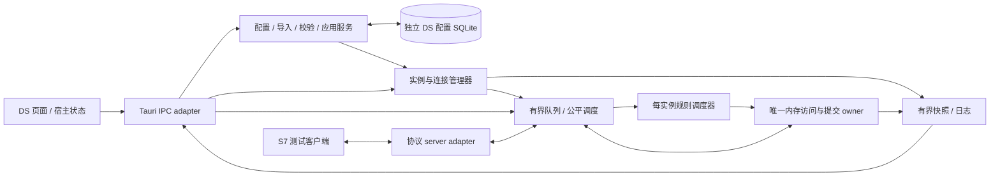

# DS 设备模拟器详细设计

内容修订：2026-10-27（Asia/Shanghai）· Human Owner已最终接受`DS-001 r1`、`ARCH-AW-005 r5`及DS当前版本（旧技术QA保持精确候选；初值/纯文字手册由DS-001接续，新增截图及DS-001独立QA已按Owner指令取消，当前真实验收见各自记录）；原`ARCH-AW-004 r2`已验收快照SHA `0eb3c149bf7093bbdce2f0b7a07af71e769fe24cb04a542c7f4dc43e6979eecb`保持历史效力。005范围与实现/验证归[005 spec](../plans/ARCH-AW-005-ds-g0-prototype-validation/spec.md)及[005 tasks](../plans/ARCH-AW-005-ds-g0-prototype-validation/tasks.md)，不倒记为004旧QA。本文件交付首版目标设计；范围批准见 [spec](../plans/ARCH-AW-004-ds-detailed-design/spec.md)，实施核对与文档自检见 [Development 记录](../plans/ARCH-AW-004-ds-detailed-design/tasks.md)。本文不记录本r2独立QA verdict或Human Owner最终验收。r1原正文367行SHA-256为`77216e4233c0b3c0a06fe624d93fee7f826a1a26e5f0bf497f58498aff4bd94c`，其交付/独立文档qa_passed与终验pending保留在任务角色历史；r2重新核验整版R1–R23/AC1–AC29，不继承r1结论。此次已采纳一次性hold维护写和preserve_compatible_hold推荐，所有连接/负载/时延/资源数值都是已批准设计目标，尚非实测能力。

## 1. 定位、依据与效力

DS（Device Simulator）定位独立S7 PLC模拟器，AW仅工程归属，运行不依赖DAA/SMA/Backend；可供经有限profile实证的其它兼容S7程序使用。完整产品推荐Tauri管理，r4曾从DAA固定白名单派生最小Tauri/Vue骨架；r5已批准从196份冻结DAA输入复用适用壳、控件与五枚图标，实现六页产品MVP，桌面与非默认测试宿主共用同一Rust runtime。DS是本地开发、测试、联调工具，首版只模拟多个独立 S7 设备实例。DAA 可以读取模拟值，测试客户端可以向明确允许的字段写入；这些结果只证明模拟链路，不代表真实 PLC、联锁、生产控制或物理动作。DS 不成为 DAA/SMA/CA 的生产依赖，不引入中央 Backend、账号权限服务、流程 runtime 或低代码画布。

本设计承接已验收的 [AW 白皮书](AIIS_AW_Whitepaper_Roadmap_v0.4.md)、[AW Runtime DS 章节](AIIS_AW_Runtime_Design.md#ds) 和 [DAA 详细设计](AIIS_DAA_Detailed_Design.md)。这些正文保持原样；本任务不重开 ARCH-AW-002/003。DB 编号、DB 数量、名称、地址与区域均由用户编辑；示例编号只是说明，不构成 DB10/DB11 或固定两个 DB 的拓扑。

| 本文标记 | 含义 |
| --- | --- |
| 当前事实 | 004的2026-10-18历史快照、005 r4的2026-10-20冻结输入和§14 r5的2026-10-21冻结输入分层；新候选实际状态/指纹以005 tasks为准。 |
| 首版决定 | 本版具体行为合同；r5仅实现其批准的产品MVP子集，实际未测项仍保留gate。 |
| 推荐机制 | 满足行为合同的最小工程方案；可在实施规格中确定代码组织。 |
| 原型 gate | 库、协议或原生行为尚无充分证明；必须先出运行证据，不能由本次文档检查替代。 |
| 后续范围 | Modbus、响应/握手/状态机/延迟响应、持久运行值、后台守护、生产托管；不预建空壳。 |

首版决定包括：配置保存与运行应用分开；每实例只有一个内存提交 owner；所有写来源（含显式一次性维护）在提交前做权限和地址检查；同进程停止保留值，跨进程重开初始化且停机；持续规则与可写字段不得争抢所有权。一次性hold维护默认关闭且不接管持续owner；日志介质故障只降级可观察性，apply用单SQLite选择事务而无持久分阶段journal。004当时把服务核心语言留给首个原型gate；005 r4已固定Rust业务runtime与native Snap7协议适配，具体候选证据见§13，不改变上述行为。

## 2. 当前 DAA/CU 证据与复用分工

### 2.1 检查时状态

本节005 r4固定输入为2026-10-20已Owner接受的DAA-006 r3，清单[accepted-source-manifest](../automation-world/data-acquisition-agent/plans/DAA-006-point-naming-and-import-reuse/evidence/accepted-source-manifest.json) SHA `8d9d62457baa32aac8134df77773ea5cae23a0401e403ef1d4c267cdafc02ee7`，60/61文件按工作树字节校验，CODE_INDEX为允许的DS导航差异，其余技术输入固定；不是仅凭HEAD/tag。DAA-006独立AC01–AC20、另行DIRECT UI与Owner接受分层；旧004读时DAA-002在研/QA失败快照是历史，不作当前共享能力依据。CU既有公共出口仍按其接受范围消费。

共享`aiis-tia-import-core`0.1.0/std-only/Rust2021/publish=false已成为可直接path消费纯能力：scan_sources、expand_db、layout_standard、plan_names、validate_manual_name、type_suffix；profiles/fixtures v1固定。它不拥有DS稳定ID、来源版本、确认地址、初值/encode/存储/runtime。r4 G0仅因真实DAA domain闭包编译消费core，不是当时的DS产品导入实现。r5已单独批准D1产品消费者：正式source_import/layout/naming服务直接消费六API，以固定v1样例/oracle验证；不fork命名/parser/expected。

### 2.2 可复查矩阵

表中路径均相对仓根；链接进入实际源码。下文简称 DAA=`automation-world/data-acquisition-agent/`，CU=`automation-world/console-ui/`。CU公共出口和已验收共享core纯API可直接消费；“适配”指以后独立任务复制最小模式或先抽取纯能力，不在本任务改 DAA。

| 主题与实际路径/符号 | 当前事实、限制 | DS 复用等级与后续 gate |
| --- | --- | --- |
| [shared/tia-import-core/src/lib.rs](../automation-world/shared/tia-import-core/src/lib.rs)：`scan_sources/expand_db/layout_standard/plan_names/validate_manual_name/type_suffix` | DAA-006已接受0.1.0、std-only、profiles/fixtures v1；受限完整声明树、无环UDT/一维数组；含STRING整DB拒推，无初值/encode/稳定ID/存储。 | **直接消费**固定path crate与v1样例/oracle；DS在D1另验消费者身份、确认/CAS、完整namespace及重导入，不fork parser/命名/expected。 |
| [CU src/ui/index.ts](../automation-world/console-ui/src/ui/index.ts)：`AgentLayout`、`AgentSidebar`、`AgentTopbar`、`ConsoleCard`、`ConsoleActionButton`、`StatusCapsule`、`ThemeToggle`、`LanguageSwitch`、`NavigationItem/NavigationChildItem` | 唯一公共源码出口；CU-008 已验收一级分组/二级叶导航；无业务/IPC/偏好启动副作用。 | **直接消费**公共出口及 [styles/index.css](../automation-world/console-ui/src/ui/styles/index.css)，编译期固定 Git ref 或工作树完整 manifest；未来做 DS 构建和主题/语言/导航核验。无需 CU 在线。 |
| [DAA vite.config.ts](../automation-world/data-acquisition-agent/vite.config.ts)、[App.vue](../automation-world/data-acquisition-agent/src/App.vue)、[ConsoleCard.vue](../automation-world/data-acquisition-agent/src/components/console/ConsoleCard.vue) | `@aw-ui`/`@aw-ui-styles` 指向公共源，Vue/Element Plus 等 dedupe；宿主负责翻译、theme scope、dialog 挂载、状态。DAA-001 只接受其集成。 | **适配**消费模式；DS 用自身依赖/locale/偏好 `ds.theme`、`ds.locale`，不复制 CU 私有 workbench 或开发写入通道。 |
| [DAA src/app/plc/views/points/index.vue](../automation-world/data-acquisition-agent/src/app/plc/views/points/index.vue)：`confirmImport`、`confirmOffsets`、`editLocalPoint`；[diagnostics/index.vue](../automation-world/data-acquisition-agent/src/app/plc/views/diagnostics/index.vue) | 当前私有页面有导入差异、完整树、人工地址与单点弹窗、PLC 编辑；该页面模式原取自004的2026-10-18 DAA-002 QA失败返工快照；005当前共享依据为已接受DAA-006固定清单，页面仍是DAA私有适配参考。其采集组、诊断读取与只读 DB 结构假设不适合直接照搬 DS。 | **适配**页面流程和确认反馈；DS 独立支持手工增删 DB/点位、策略/内存操作，不能只复用 DAA 页就宣称满足。未来逐页 UI/native gate。 |
| [DAA src/services/localAcquisition.ts](../automation-world/data-acquisition-agent/src/services/localAcquisition.ts)：`localCall`、DTO、`LocalCommandError`；[useLocalAcquisitionConsole.ts](../automation-world/data-acquisition-agent/src/console/composables/useLocalAcquisitionConsole.ts)：`saveCandidate/importSources/infer/activate` | 页面注入 `localConsoleKey`，调用 `localCall` → `invoke(command,{request})`；本地模式 gate、CAS 错误、单 owner 与最多 1Hz 刷新。 | **适配**IPC facade/错误/页面 owner 模式，定义 DS 命令与 DTO；不直接调用 `daa_*`，不依赖 DAA 进程。 |
| [DAA commands/local_acquisition.rs](../automation-world/data-acquisition-agent/src-tauri/src/commands/local_acquisition.rs)：`dispatch` → [services/local_configuration.rs](../automation-world/data-acquisition-agent/src-tauri/src/services/local_configuration.rs) `LocalEngine::{save,import,offsets,confirm_offsets}` | 薄 command、严格 DTO；服务缓存与 ETag/源摘要绑定的预览再确认，`protect_derived` 阻止普通保存伪造来源树/哈希。 | **适配**服务边界和两步导入；DS 编辑操作产生独立“手工结构”来源，不能放宽 DAA 派生字段保护或冒充 TIA 证明。 |
| [DAA infrastructure/tia_source.rs](../automation-world/data-acquisition-agent/src-tauri/src/infrastructure/tia_source.rs)：`Parser::{kind,fields,blocks}`、`expand/expand_kind`、`import` | 受限声明树、内联 Struct、无环 UDT、一维常量数组；未知 header/类型定位报错；非完整 TIA 编译器。`fields` 跳过声明 `:=`，`blocks` 跳过 `BEGIN` 至 `END_DATA_BLOCK`，均不产生初值模型。 | **历史适配参考**；005已接受path core0.1.0（publish=false）是当前直接消费面，不等待再次公共抽取；旧私有parser不作共享出口。必须保留初值未导入提示，初值解析另做明确能力。 |
| [DAA infrastructure/plc_layout.rs](../automation-world/data-acquisition-agent/src-tauri/src/infrastructure/plc_layout.rs)：`preview/confirm` | 旧DAA私有plc_layout的flat-only快照；005转用已接受共享layout_standard，需完整非优化受限标准树；按树顺序分配标量、BOOL 位、字对齐；共享core现可推受限UDT/一维数组，含STRING整DB仍拒推；人工地址受保护。 | **历史适配参考**；当前直接消费共享layout_standard，不等待抽取；不得由选中叶点猜完整布局；DS 自身增加地址/策略 bit coverage 校验。需 TIA 标准布局黄金夹具。 |
| [DAA domain/local_configuration.rs](../automation-world/data-acquisition-agent/src-tauri/src/domain/local_configuration.rs)：`Configuration/SourceDocument/FieldNode/Db/Point/Address/width/validate` | 稳定 ID、完整来源、类型宽度/地址检查；其中采集组、限额、PLC 客户端字段是 DAA 专用。 | **适配**值对象/校验模式，重建 DS instance/region/policy/initial 配置；不把 DAA schema 当公共 DS schema。 |
| [DAA infrastructure/local_decode.rs](../automation-world/data-acquisition-agent/src-tauri/src/infrastructure/local_decode.rs)：`decode` | 已有有限 REAL、大端数、BOOL、ASCII CHAR/STRING 解码；没有服务端 encode/准入合同；其失败 null/quality 为采集事实。 | **需抽取/适配**类型宽度/解码，独立实现编码、范围校验和往返黄金字节；DAA decode 不是 DS server encode 或协议写入证明。 |
| [DAA infrastructure/local_store/README.md](../automation-world/data-acquisition-agent/src-tauri/src/infrastructure/local_store/README.md)、[configuration.rs](../automation-world/data-acquisition-agent/src-tauri/src/infrastructure/local_store/configuration.rs)、[services/local_activation.rs](../automation-world/data-acquisition-agent/src-tauri/src/services/local_activation.rs)：`LocalEngine::activate` | 双库配置revision/ETag、prepare/select/install/finish、停止意图恢复；004的2026-10-18记录为QA失败返工快照，不能作为2026-10-20当前状态；这些存储模式强耦合样本上下文与维护容量。 | **适配模式**，DS用自身单配置库、selection事务与进程内loaded事实，不引入持久apply journal，不复制双库、既定SQLite版本或DAA容量合同；DS 依赖版本与故障恢复需独立审查。 |
| [DAA services/local_queries.rs](../automation-world/data-acquisition-agent/src-tauri/src/services/local_queries.rs)：`snapshot/logs`；[infrastructure/local_logging.rs](../automation-world/data-acquisition-agent/src-tauri/src/infrastructure/local_logging.rs)：`LocalLog` | 快照缓存 1 秒，有界查询和 JSON Lines 轮转；当前私有审计字段不覆盖 DS 协议写入。 | **适配**快照节流/分页/轮转模式，补 DS instance/epoch/item result；不复制采样历史/outbox。 |
| [DAA infrastructure/managed_s7.rs](../automation-world/data-acquisition-agent/src-tauri/src/infrastructure/managed_s7.rs)：`Transport`、`ManagedS7::{connect,read,read_bounded}` | 客户端明确设置 `RemotePort`、rack/slot 和超时；源码有 owned loopback 测试，但本任务没有重跑。 | **不作服务端复用**；未来作为 DS 联调客户端，验证非102端口/TSAP/长连接/错误返回。客户端不是 server，也不证明 DS 兼容所有驱动。 |
| [DAA services/local_scheduler.rs](../automation-world/data-acquisition-agent/src-tauri/src/services/local_scheduler.rs)、[local_storage.rs](../automation-world/data-acquisition-agent/src-tauri/src/services/local_storage.rs)、[local_store/runtime.rs](../automation-world/data-acquisition-agent/src-tauri/src/infrastructure/local_store/runtime.rs) | 采集、DB 包/样本、source sequence、pending/历史为 DAA 领域；Stage C 上传尚未纳入本地闭环。 | **不适用**DS；规则调度、内存、日志独立设计，不增加采样库/补传器/业务 API。 |

004在2026-10-18曾将公共提取列为后续独立评估；该历史建议已由005固定的DAA-006共享core接受事实推进，不再作为当前DS消费的前置。当前直接消费已固定的path core，DS只适配消费者身份/存储/确认职责，明确来源和差异，不把 DAA 工作阻塞在共享发布上。

## 3. 组件与配置、控制、内存数据流

推荐保持 interaction adapter → service → domain → infrastructure 分层。Tauri commands 只解析意图/DTO 并调用服务；若核心选 sidecar，IPC transport 仍只做相同的薄适配，配置和内存 owner 留在核心进程。CU 不参与配置保存或模拟值计算。

| 组件 | 输入、输出与责任 |
| --- | --- |
| 页面与宿主状态 | 连接面板、维护确认、兼容保留影响清单；编辑草稿、展示实际 revision/监听/错误；发出显式操作；不直接修改 buffer、不用页面计时器生成模拟值。 |
| 配置/导入/校验服务 | 读取用户选择的 `.db/.udt` 内容，生成预览 token、声明树、诊断、地址覆盖与策略；保存revision与selected引用，loaded仅进程事实；不监听端口。 |
| 实例与连接管理器 | 计数TCP/H/C/closing、超时与幂等释放；为每instance 持有单一控制序列、generation/epoch、listener 句柄、规则时钟与内存 owner；隔离失败；处理start/pause/stop/reset/apply与单连接关闭，不在owner临界区等待网络/SQL/日志。 |
| 有界队列/公平调度 | 协议/规则/UI三类轮转，协议内按连接每次一个item；输出预留与全局字节计量，stop及时控制通道。规则按monotonic 模拟时间计算确定的候选值与预期 epoch；只生成 mutation，不能持有协议共享 buffer 并自行写。 |
| 唯一内存入口 | `read`、`commit`、`initialize/reset`、`replace_image` 的概念职责；校验来源/epoch/触达 bit set/类型后一次提交，生成 seq 与结果。此处不是已发布 API。 |
| server adapter | 处理连接/PDU、把原始 area/DB/address/transport-size/payload 归一成受控读写；等待内存结果后编码真实协议回执；库默认写共享区必须禁用或被可靠替代。 |
| 配置 SQLite | 草稿、不可变revision、来源及单事务selected引用；无持久apply journal，不逐tick保存运行值。 |
| 快照/日志 | 返回连接/队列/规则/资源与有界审计、陈旧及日志降级标志；成功提交和拒绝返回同一 result ID。观察不能触发 start/connect/reset。 |

配置流为：页面草稿 → 服务结构校验 → CAS 保存 → 新 `saved_revision` → 用户选择实例并显式 apply → 完整校验、兼容影响清单及确认 → 预构建image → 单事务selected → 安装与`loaded_revision` → 用户独立 start 才 bind。客户端读写、规则tick、普通UI手改/一次性维护、初始化/重置都经各自有界工作/控制通道到统一入口，返回 `operation_id/instance_id/epoch/seq/result/error_code`；页面刷新与 S7 回执消费同一结果事实。

## 4. 概念配置、SQLite 与版本应用

### 4.1 概念对象与约束

以下是职责模型，不是 DDL、schema 文件或跨运行时公开 contract。实际包标识、开发端口、schema 迁移和精确依赖由后续工程任务确认。持久目录使用 DS 专用应用数据命名空间，逻辑子目录建议 `device-simulator-v1/`，不得复用 `daa` profile/config/runtime 库或任何消费项目真实配置。首版只允许一个进程拥有同一 DS profile，采用 OS profile 锁；不把该锁解释为跨机器设备排他。

| 对象 | 概念字段与约束 |
| --- | --- |
| Workspace metadata | `ds_profile_id`、format version、最后 clean shutdown；身份/version不符或损坏时停止加载并报告，不自动覆盖/迁移。 |
| Instance | 稳定 UUID、显示名、enabled、bind address/port、connection type 与 rack/slot/called-TSAP 配置、C/H/超时/队列限额、默认策略及allow_ui_maintenance；UUID 与改名/端点分离。 |
| Source document / UDT | 独立 ID、instance ID、文件名/完整 UTF-8 源/摘要/来源种类、导入器版本、诊断、声明树及引用；不保留任意服务器文件路径作为读取指令。 |
| DB / point / layout | DB ID、用户 DB 号/名称/长度、来源映射、结构树/叶 ID/原始路径/类型、手工或推算地址、确认者依据/确认结构摘要；手工结构标记为手工。 |
| Region / policy | DB 内 bit 范围、继承层级、client_read、writer_owner、UI/客户端写开关、mode、初值、固定/波形参数、默认关闭的allow_ui_maintenance；编译为无歧义 coverage map。 |
| Revision | workspace `saved_revision`、内容摘要、不可变内容；实例 apply 固定其中一个实例切片及其摘要，不引用可变草稿。 |
| Apply selection与进程状态 | 持久selected/previous不可变revision引用；expected selection CAS。operation ID、prepared image、loaded/selection_unknown/load_failed与保留清单是本进程有界状态，不写持久命令或分阶段journal。保存成功不等于loaded/listening。 |
| 运行 image（仅内存） | DB bytes、值更新时间/来源、commit_seq、epoch、模拟时钟/seed、连接与统计；不进入配置初值列，也无样本/outbox。 |

概念初始容量建议为最多 8 个实例、每实例 32 个 DB/4096 叶、DB 长 1–65536 字节；每实例已建立S7默认C=16、有效域1–64（>16未验证）；DB 号 1–65535 内用户选定且实例内唯一。它们是可调工程上限建议，不是固定数量/业务拓扑；实施规格需以原型内存和连接预算确认。导入单文件最多 1MiB、批次最多 4MiB，深度≤8、单数组≤1024 元素，超限明确拒绝，不截断后称完整。

### 4.2 保存与冲突

编辑是本地草稿；服务检查身份、字段和大小后以 `expected_etag` CAS 保存完整 workspace 草稿及不可变 `saved_revision`。允许保存仍有未确认地址/缺失 UDT 的草稿，但列明 issue，不能应用；格式损坏、重复身份等硬错误拒绝保存。确定失败/回滚不改变已保存版本；保存commit或ack未知时查询saved revision/ETag核实，查询也失败则明示未知、禁自动重试，不能声称已回滚；冲突返回当前ETag，保留用户草稿供对比，禁止自动覆盖。导入确认使用源摘要、ETag 与一次性 preview token，过期预览必须重做。

普通保存不能提交伪造的 source hash、完整性或推算证明；服务拥有派生字段。手工新增 DB/点位/修改类型属于明确 editor 操作，产生新的手工结构 revision，并取消相关来源证明；不把用户 `confirmed=true` 视为完整布局证明。

### 4.3 单选择事务、显式应用与幂等

首版只对**完全stopped且资源已释放的单实例**应用全部配置变化（含连接限额/规则/权限），不做热更新。运行中可编辑保存，apply明确提示先stop及保留/初始化影响；其它实例继续。删除先停机、列引用并确认，不重用UUID。`saved`是持久候选，`selected`是单SQLite事务选中引用，`loaded`是本进程已装入image事实，`last_served_revision`只在本进程真实服务后出现；分别展示，不宣称SQLite和RAM跨介质原子。

最小流程：验证stopped/expected selected与epoch → 通过统一内存入口在owner内复制有界旧typed快照（image身份/commit_seq/epoch、控制代次及模拟时间基准） → 在owner锁外校验不可变candidate revision、预构建image和§4.4逐点保留清单 → 用户确认包含值版本/影响的清单摘要 → 取得实例控制序列复核stopped/epoch/revision、旧image身份/commit_seq、控制代次与清单摘要 → 在owner临界区外执行**单SQLite事务CAS更新selected引用** → 安装预构建image、换epoch并标loaded → 回成功。控制序列阻止同时start/reset/apply，但不持有内存owner等待构建/确认/SQL/网络/磁盘。快照后曾start/stop/pause/resume即使回到同epoch/stopped也递增控制代次；规则时间基准或任一点commit改变也使复核失效，返回conflict、重取快照/重建清单并由用户重确认，不能安装陈旧保留值。安装前start不可用；无持久apply journal、命令系统或恢复daemon。

| 时点/重试 | 持久选择、内存与操作反馈 |
| --- | --- |
| 预校验/构建失败，或selection事务确定回滚 | selected不变，旧image/值保留且stopped；保留候选供修改，不提示已应用。 |
| SQLite commit结果未知 | 查询selected确认，查询也失败则selection_unknown、stopped并禁start；未装RAM不能推断事务已回滚。结果不明不自动重复选择。 |
| selected已提交、安装前失败 | 新selected是真实事实；旧loaded/image仅可只读诊断、不得服务。显示selected/loaded不一致与load_failed，用户重试加载selected或显式回旧revision。 |
| 安装成功、ack丢失 | selected/loaded/值已生效且stopped，调用方结果未知；刷新。相同selected且loaded revision和内容摘要一致的apply幂等already_loaded，不换epoch、不重新初始化或丢保留值。 |
| selected相同但未loaded | 只走加载当前selected，不重复改selection；本进程有旧image时重新证明兼容并确认清单后构建。无兼容证明需用户确认初始化，禁止盲拷bytes。成功后再试即幂等。 |
| 崩溃/进程重开 | 只按已提交selected完整revision重新校验并**全部初始化、stopped**；事务前取旧selected，事务后取新selected。selected缺失/损坏/不兼容则停机报错，不猜latest saved或自动旧版。 |

不同revision即便内容相似也先核对兼容影响；重复同loaded apply绝不是reset，用户选择“全部初始化”也不能令幂等重试暗中丢值，须独立reset确认。单实例切片可来自不同workspace saved revision；批量apply逐项结果，不承诺全实例原子。新profile无自动监听，默认loopback，改非loopback要显式编辑确认；不自动恢复运行意图。具体SQLite版本、schema/迁移和应用包标识另由工程任务审查。

### 4.4 preserve_compatible_hold与逐场景保留

已采纳的默认策略`preserve_compatible_hold`只保留**本进程仍持有且能证明兼容**的typed值。兼容条件同时要求：稳定点ID，DB身份/号/长度，offset/bit/width，类型/编码，已确认布局摘要，以及相关effective mode/持续owner/client_read/write/ui_write/维护开关/初值一致。这里的名称变化指显示名；声明结构/叶路径改名须重新核布局，不能当作纯显示变更。来源只有注释变化也必须核摘要/确认，不因“看起来一样”自动通过。读取旧typed值再用新编码器构建，禁止按旧offset拷DB bytes至新布局。

apply前逐点列“保留/初始化/删除”及原因、规则时钟影响，用户确认影响清单摘要才选择/加载；可另选“全部初始化”，但已loaded同版重试只返回already_loaded。保留被选中却有兼容证明或typed编码失败时，应用前失败、selected不变；用户可修改或明确改选初始化重试，不能静默降级丢值。

| 场景 | 默认值/时钟处理与可见影响 |
| --- | --- |
| 同进程stop→start，无apply/reset | 所有当前值和规则模拟时间保留；断连不影响hold。 |
| 同布局、仅名称/显示/连接限额等非值语义变化 | 停机apply换epoch；检查通过的兼容点**包括规则点**全部值和规则时间可保留。连接不恢复，start独立。 |
| 规则参数/seed/周期变化 | 兼容hold保留；**全部规则点及统一规则时钟**初始化为新revision t=0，明确未改参数规则也重置。 |
| 初值改变 | 受影响点按新初值/默认初始化，其它兼容hold保留；全部规则统一t=0，不以保留掩盖新初值未生效。 |
| mode/owner/读写/维护权限改变 | 受影响点初始化，其它兼容hold保留，全部规则统一t=0；旧epoch积压取消，暂停不让权。 |
| DB结构/号/长度、地址/类型变化、增删点 | 受影响DB整体初始化；未受影响DB仅保留满足全部条件的hold；新增初始化、删除丢弃，全部规则统一t=0。不拼旧bytes。 |
| 显式reset | 当前loaded所有点初始化、规则t=0、新epoch，确认丢弃所有运行值，保持stopped。 |
| 跨进程正常/非正常重开 | 从selected全部初始化、规则t=0、stopped；不恢复值/连接/运行意图或临时接管。 |
| 显式回旧revision | 默认全部初始化并确认，再独立start；不从日志/旧bytes复活历史运行值。 |

多个变更同时出现，先判回旧版/全部初始化，再以DB结构变化扩大到受影响DB，再合并逐点初值/权限变化；只要存在规则/值语义变化，全部规则统一t=0。纯非值语义变化才可保留规则值/时间。selection后失败按§4.3处理：旧image仅诊断，恢复先重证并确认保留清单；安装后回执未知不回滚、不因重复apply再初始化。所有保留都只在同进程内，不新增持久运行快照。

## 5. 多实例身份、生命周期与屏障

### 5.1 endpoint 与隔离

实例 A 与 B 可在同一 loopback 地址使用用户指定的不同高位端口；每实例独立DB映射、image、epoch、规则时钟、连接/队列限额、统计、日志标签和状态；本文件中一个PLC就是一个DS S7实例，不是程序数、IP数或真实CPU。rack/slot 与 connection type 是客户端连接身份映射提示；实际 called TSAP 校验由适配器能力决定并由原型确定，不能把配置 rack/slot 等同真实 CPU 身份。每实例固定允许的身份参数，不以不同 TSAP 在同一端口隐式复用多个实例。

保存时检查绑定元组和 wildcard 重叠，start 时仍以实际 bind 返回为准；同端口冲突只使请求启动的实例 failed，禁止抢占、随机换端口或停止占用者。同一 instance start 重复请求幂等返回当前 listener，控制锁防止第二 listener。B 失败不自动停 A；若选 sidecar，推荐每实例独立受管理进程隔离崩溃，父管理器对其退出只封闭该实例。进程内原生库崩溃可能影响全进程，应在选型时列为风险并用进程隔离解决，不能把逻辑隔离写成已证明的崩溃隔离。

非102端口要求客户端明确支持配置远端端口。DAA `ManagedS7::connect` 有 `RemotePort` 代码证据，但 DS 尚须实际联调；仅支持固定102的客户端不属于“同地址多端口”首版保证，不能无提示宣称兼容。

### 5.2 连接计数、容量与管理

每实例默认目标 **C=16已建立S7会话**，可配整数1–64（>16标未验证）；H=4握手名额，可配1–16；accepted TCP硬预算C+H，默认20。全局C/H/TCP名额分别128/32/160，启用实例的ΣC、ΣH、Σ(C+H)须各不超；不接受0/负数/小数/无限或静默截断。8×16只是未来另批扩展组合，不证明128负载已成立。

| 状态/转换 | 名额与可见计数 |
| --- | --- |
| OS listener backlog | 有界待accept，由G0冻结有限backlog；不是额外已接入名额，不算已建立S7。 |
| accepted TCP → TCP/COTP/S7握手中 | 一个transport对象占TCP和H；阶段只改变标签，不为同socket重复计数。accept门禁先核实例/全局H、TCP及OS资源；竞态下超额socket立即关闭，不保留会话/buffer，短命句柄直到实际close仍计资源。 |
| 握手 → established S7 | 同计数锁内先确认可得C再原子晋升、释放H，仍只有一个TCP；C满则关闭后来者，不抢占旧连接。 |
| closing | 关闭准入但直到socket/adapter/callback真正释放，仍占TCP与此前C或H名额；分别显示“实际established”“closing”“占用C/H/TCP”，不把保留名额当在服务数。 |
| released | 清理完成一次性释放buffer/socket/注册/预算；重复断连/超时通知幂等，不负计数。 |

限额改动先stop再apply，展示saved/selected/loaded限额，不在线降C强退旧会话。全DS含sidecar目标≤64线程、≤1024句柄，库自有线程/child process/socket/task都计；不能每报文/tick无界起线程。128会话×每连接一线程会先超过64线程，因而这种候选不能在默认profile宣称L3同时满足；必须换候选或另回PM/Owner批准扩展资源profile，不接入后静默降连接目标。名额预算不是保证所有资源目标能同时打满。

满C/H/TCP/全局资源时拒后来者，不替换空闲老连接、不抢端口。握手阶段能真实协议拒绝则回失败，否则立即关新socket；transport拒绝和已建立后的S7 item失败分开，不伪造握手前S7回执。候选达不到16或有效域必须缩小时，记录证据回PM，不偷偷改数。

| 期限策略 | 默认目标 / 有效域 / 起算与结果 |
| --- | --- |
| 握手绝对期限 | 5s / 1–30s；从accept起算，跨TCP/COTP/S7不重置，未建立则关闭并按原H清理。 |
| 半报文组装 | 2s / 0.5–30s；从本帧首byte起算，滴流不能续命；frame/声明长度/PDU先验有界，未收全buffer也计§8.4。 |
| 待提交请求 | 2s / 0.1–30s；从完整PDU进入准入/等待起算，在commit边界复核；确定未提交过期不改内存。 |
| 网络发送 | 2s / 0.1–30s；从该响应进入发送阶段起算，慢读只关闭该连接，不拖住owner/规则/stop。 |
| 仅业务idle踢出 | 默认开关false；显式开启可选60–3600s，开关与期限分开，不能用0表示无限。正常低频采样/连接年龄/UI隐藏均非死亡证据；只按已启用策略或真实transport/经验证liveness失败处理。 |

重连是新connection ID、重新竞争实际名额，不继承旧队列/未知写；旧closing未释放不能虚减为重连腾位。保持值独立于连接，清理/重连均不reset。连接面板逐条展示instance、connection/session临时ID、peer地址端口、握手阶段/established/closing、建立时间、最后接收/完成请求时间、执行/排队数量及bytes、收发/拒绝/超时计数、最近关闭原因；peer不是认证身份。

用户确认后可**关闭单连接**：原子关其准入 → 取消未进入提交段的积压 → 让已进入不可取消段item完成一次 → bounded transport/callback清理 → 幂等释放C/H/TCP。其它连接/实例继续。已提交但回执随close丢失要标未知，不承诺该连接所有请求都失败。关闭超时保持closing且占资源，不能只改UI计数伪装释放。

### 5.3 状态与值语义

| 状态/动作 | listener、规则、内存与合法后续操作 |
| --- | --- |
| unconfigured | 没有有效 loaded revision；可编辑/保存/应用，不能 start 或写运行值。 |
| stopped | 无 listener/连接/在途工作；已有 image 可只读观察，不能客户端/UI写。可 start、reset、apply、删除。首次apply/进程重开初始化；后续apply按§4.4清单。 |
| starting → running | 固定 loaded revision，bind成功且adapter准备好接受握手后启规则；失败清理本次资源→failed。若 image 同epoch已存在，start不初始化。 |
| running | 接受获准客户端读写；规则运行；普通手改仅ui owner；一次性hold维护须§7.3显式允许与CAS。可 pause rules、stop；不能直接 reset/apply。 |
| pausing → rules_paused | 关闭新 tick 并等在途规则提交完成；模拟 monotonic 时钟冻结，**所有规则含持续 fixed**停止写。listener/client/UI按原权限继续，owner不改变。 |
| resume → running | 继续冻结后的模拟时间，不补跑错过tick；fixed仍由规则owner维护，暂停期间没有隐式让权。 |
| stopping → stopped | 先封闭新准入/停止accept，取消未进入提交段积压，完成已进入提交段的单item后关闭连接与listener；确认所有adapter/callback/tick退出才完成。保留本进程 image、值和模拟时间，停止期间不更新。 |
| reset（仅stopped） | 屏障后重建当前 loaded revision 的初值/规则t=0，epoch加一、seq归零、清规则时间和写入保持值；保持 stopped。failed 需先完成资源清理，才能恢复 stopped 后reset。 |
| failed / selection_unknown / load_failed | 记录原因，读快照可见；不能成功回报start/reset/apply。先完成有界清理/恢复，确认旧adapter已退出，方回stopped重试；不并行建第二owner。 |

**同进程 stop → start 保留运行值**与规则暂停的模拟时间；它不是reset。首次apply、显式reset、跨进程重开会从配置初始化；后续停机revision apply遵§4.4兼容保留，不一律丢值。**首版不跨进程持久保存当前运行值**：重开只恢复配置 selection，运行值清零/初值/规则t=0，全部 stopped，不恢复客户端会话、运行意图或模拟时间。理由是可重复测试且配置/瞬时值无歧义；未来持久运行值必须另定快照一致性、恢复和用户选择。

### 5.4 在途屏障、取消与关闭

每实例有admission gate与epoch，queued → executing/precommit → 不可取消提交段 → committed → response_sent分界明确。stop通过及时控制通道先原子关闭新准入/accept，再取消**所有未提交且未进入不可取消段**的积压，不等待长队逐项提交；已进入段的有界单item完成一次后才退出callback/关闭transport/listener。pause只关闭规则准入、取消未进入段tick并等待正在提交的规则，客户端原权限继续；reset/apply要求完整stop。

期限与提交准入在同一个owner边界裁决：确定未提交的过期/取消结果为拒绝、image/seq不变；已经提交但ack丢失或调用超时为结果未知，绝不当拒绝自动重试。读回仅证当前值/seq，若后来有并发写，不能反推出原item成功与否；不承诺exactly-once。多item前项成功保留、后项取消逐item反馈；连接关闭导致完整回执不可达，则标部分结果未知，不伪造整PDU全失败/成功。

旧epoch排队/回调不可进入新image。stop/单连接close超时保留stopping/closing或failed和gate关闭，直到回调/线程/句柄真退出才释放image与名额；不能强行取消已经承诺进入提交段的item。候选无有界中断/退出能力时须原型验证进程隔离或替代，不把退出超时写成stopped。所有网络收发/解析/编码、SQLite与日志I/O在owner外；owner只做有限coverage/typed stage/commit或bounded read copy。

应用关闭首版采用**关闭窗口即请求所有实例停止并退出**，不最小化托盘继续服务。未保存草稿先明确保存/丢弃/取消；随后禁新操作、逐实例stop、限时flush有界日志（sink失败只记录降级/缺口，不无限阻塞退出）、关闭SQLite/释放profile锁。任一实例未确认停止则保持关闭中并显示原因，不报告正常退出；操作系统强退按unclean重开恢复，仍全部stopped。此策略需后续Tauri原生退出、sidecar父进程退出和端口释放验证，不在本轮运行。

## 6. DB/UDT 导入、手工编辑与布局确认

### 6.1 用户流程

1. 选择实例，新增任意数量（上限内）的 DB，编辑唯一 DB 号、名称、长度；也可多选 `.db` TIA 文本与其全部 `.udt`。`.db` 不是 SQLite 数据文件，UI 必须显式区分。
2. 服务保存源完整内容、来源摘要、导入器版本、声明树、UDT引用及行号诊断；给新增/删除/类型/树/地址/初值确认失效差异。先预览，用户确认后才保存候选；不自动应用或开始监听。
3. 展示完整树及叶点，用户可新增手工DB/点、改DB号/名称/点显示名、offset/bit、类型和来源说明。导入结构只经重导入或显式“转为手工编辑”修改；后者保留原源但派生结构不再声称源一致。
4. 地址辅助必须手动触发并针对完整DB；显示原值、建议值、长度与人工保护，再逐项确认。只支持完整非优化标准树（含受限STRUCT/UDT/一维数组，STRING整DB拒推）。复杂结构需用户依据TIA标准非优化绝对地址逐叶手工确认，并附依据；确认是人工审核，不是布局引擎证明。
5. 全部启用点地址确认、边界/重叠、初值与策略校验通过，再保存并在stopped显式apply。运行中结构修改只形成草稿/新revision，旧loaded image保持，不能原地改DB内存大小。

### 6.2 首版支持矩阵

| 形态 | 当前DAA证据 | DS首版处理决定 |
| --- | --- | --- |
| 标准非优化DB，完整平铺BOOL、BYTE/USINT/CHAR、INT/UINT/WORD、DINT/UDINT/DWORD、REAL | parser/width/受限layout支持；REAL解码有限，CHAR ASCII。 | 接受完整声明与手工编辑；辅助推算需完整树与用户确认，编码黄金夹具待做。SINT/时间类不默认为支持。 |
| 内联Struct、已提供且无环UDT、单维常量数组（包括展开后的支持叶） | parser保存父节点/引用/边界，缺定义/循环/嵌套数组拒绝；有深度/叶上限。 | 接受受限结构树，可手动调用共享layout_standard获得理论叶地址/长度预览，显式确认后才应用；STRING叶存在则整个DB拒推。stride只据返回叶展示，不另造规则。不能把UDT名当连续字节编码。 |
| STRING[n]，1≤n≤254 | DAA width=n+2、ASCII与S7双字节长度头解码；layout不推算。 | 可接受声明，人工确认全包地址/长度；typed初值/规则encode需独立gate。首版拒WSTRING/Unicode扩展，不截断后称成功。 |
| 缺UDT、循环UDT、未知语法、动态/多维/嵌套数组、FB/实例DB、AT/指针/ANY/VARIANT、LREAL/LINT/ULINT、TIME/DATE/WCHAR/S5TIME等 | 当前受限parser拒绝或无法建立完整布局。 | 诊断到文件/行/路径，拒绝相应DB应用；不能忽略字段后称完整。可另建明确手工测试DB，但不继承导入完整证明。 |
| 优化DB或优化标记未知 | parser拒绝optimized或unknown标准性；绝对布局无据。 | 拒绝导入为可应用DB；要求提供标准非优化完整资料。不得仅手填几个offset绕过优化DB拒绝。 |
| 手工DB/点，或用户提供的复杂叶地址 | 无自动结构证明。 | 标记manual结构/地址，按已声明全部字段校验；保留依据与确认摘要，可模拟该人工地址模型，不宣称还原真实TIA布局。 |
| 源内声明 `:=`、BEGIN赋值/运行初值 | 当前parser消费后跳过，不解析成值。 | 首版**不导入TIA初值**。始终显示“仅导入结构；TIA声明/BEGIN初值未导入，当前使用类型默认或DS显式初值”。源中无赋值也不假定解析器已验证初值。 |

DS类型默认：BOOL=false，数值=0，CHAR=ASCII NUL，STRING为空串且长度头为n/0。DS显式类型化初值优先于类型默认，必须经范围、有限REAL、ASCII/STRING长度等校验并确认。自动fixed的首个规则值随后按t=0覆盖其初始值（见§7），二者分别展示。

重导入相同结构/类型/地址摘要仅注释变化，可保留DS初值与确认；源摘要变化仍刷新来源记录并显著提示TIA初值未导入。结构、类型、DB号/长度或地址变化，取消受影响地址、初值与策略确认；旧DS初值只保留为待比较候选，不转换/截断、不默认为新类型已确认。新增点使用未确认类型默认；删除点列影响清单并移除其规则/策略引用，用户确认前不保存替换。

### 6.3 地址覆盖与证明

每DB建立 bit coverage：BOOL占一个bit，普通标量/STRING占完整字节范围，Struct/Array父节点不额外占位。DB内重复叶身份/重复DB号、同bit重叠、标量与BOOL/STRING别名重叠一律拒绝；同字节不同BOOL位合法。标准对齐padding显式列为reserved，不悄悄归属邻点。地址非负、bit仅BOOL且0–7、长度运算防溢出、末端≤DB长度；DB外地址拒绝。

reserved/padding默认读零、禁止全部写来源，读取权限可收紧；它是明确coverage条目，不是“未匹配就放行”。要允许整字节写入，整个触达字节的每bit都必须为已确认客户端可写字段；不能靠padding自动放行。可改为无重叠BYTE字段占满空字节，再配置其owner；含BOOL的同一字节不能再加BYTE别名。协议byte访问与业务类型不必相同，准入使用该coverage与完整触达范围，详见§8。

## 7. 策略、所有权、初值与保持

### 7.1 层级和编译规则

策略从实例默认 → DB默认 → 同DB内显式region → point override 逐属性继承。region使用bit半开区间，同层不得相互重叠；点覆盖region的属性必须显式显示effective值/来源。默认未配置字段为hold、client_read=true、owner=none、所有普通实时写及一次性维护默认关闭；reserved例外按§6.3。系统硬约束（布局确认、状态/epoch、唯一owner、类型和地址、adapter能力）高于任何用户覆盖，UI也无法绕过。

权限和模拟模式编译为完整effective policy，而非各层分别运行。原子字段不得被两个region分割成不同owner；BOOL可逐bit归不同region。每point恰有一个持续写owner：`rule`、`client`、`ui`或`none`。client_write/ui_write只是与持续owner一致的普通写授权声明；另设allow_ui_maintenance（默认false）作为一次性hold操作能力，不新增持续owner。普通开关组合矛盾拒绝应用，不能“最后写者获胜”。初次初始化和显式reset为服务专用maintenance来源（不同于一次性ui_maintenance），只在封闭gate下工作，不计为持续owner。

| 模式 | 初始化/重置 | 持续行为 | 客户端读/写、UI手改与所有权 |
| --- | --- | --- | --- |
| automatic（自动模拟） | 类型默认或DS初值，然后执行规则t=0 | rule owner按周期更新；可选fixed、数值ramp/sine/有seed的random、BOOL toggle，参数须匹配类型/范围。首版无任意脚本/响应触发。 | client_read可配置且默认true；client_write=false、ui_write=false、allow_ui_maintenance=false；暂停规则不改权限。 |
| write_hold（写入保持） | 仅首次image/reset/重开用初值，后续apply按§4.4逐场景 | 不注册持续规则；保持最后提交值，tick与连接重连均不改它 | owner=client时允许配置的客户端写且普通UI写禁止；owner=ui时客户端禁止而UI可手改；owner=none普通实时写关闭；client/none的hold可另显式开一次性维护，见§7.3。read独立配置。 |
| automatic + fixed（持续固定） | 可先有不同初值，但监听前rule t=0设为fixed值 | running持续维护fixed；目标未变不做重复mutation/seq/值时间更新，仍检查有效epoch/状态/owner与健康；rules_paused冻结且不让权 | 始终rule owner，客户端/UI实时写（含维护）拒绝；不是“只设一次的初值”。 |

规则参数与数值决定：fixed提供一个合法typed值；ramp用min/max与period作线性锯齿、周期末回到min；sine用同范围与period、phase定义相位；random用min/max、seed和hold period，每桶保持一次结果；toggle仅BOOL，每half-period翻转。所有周期为正且参数在类型范围内；整数取整规则须固定并进黄金夹具。规则参数建议最小周期100ms，UI刷新仍最多1Hz；random以instance/point/配置seed与模拟时间桶计算可复现值，整数生成在范围内，REAL拒NaN/Inf，失败不写该点并记录规则故障。tick过载不堆积补跑：同规则最多一个待处理tick，使用当前模拟时间计算下一值，累加missed计数。停止/暂停冻结monotonic模拟时间，resume继续，不按墙钟跳变；规则无权更新hold区域。

### 7.2 来源权限与操作反馈

| 写/读来源 | 准入与拒绝 |
| --- | --- |
| 客户端read | running/rules_paused、布局/DB/完整触达可读；无权限则整read item失败，不返回部分秘密字段。padding按其独立read权限。 |
| 客户端write | running/rules_paused且所有触达bit client owner、client_write开启；原始payload/staged值校验通过才提交。不能只凭客户端请求“类型”授权。 |
| 内部规则 | running且rule owner、expected epoch相同；hold、paused、stopping或旧revision拒绝，不走裸buffer。 |
| UI在线手改 | running/rules_paused且ui owner及ui_write开启；输入按点类型编码，提交携带expected loaded revision、epoch和点最后seq防止陈旧覆盖；client/none owner普通手改禁用；仅write_hold且显式维护允许时可走§7.3；rule即使暂停也拒绝。 |
| UI修改配置初值 | 只改草稿，保存不改变当前值；明确显示“下次reset/apply/跨进程重开生效”。 |
| 初始化/reset/apply | 服务专用初始化来源，不从UI任意raw写入口调用；停止屏障/完整image校验成功后整体安装。所有已确认点都可被reset，与client_read无关；apply按兼容计划。 |

这是一套本地模拟访问策略，不建立生产账号权限服务。S7连接session用于审计关联，不提供可靠的业务用户身份；client owner表示该端点所有获连接的测试客户端，共享权限。后续按客户端身份授权属于独立范围。

示例：用户自选DB号 `n`，在其中建立一个INT点P，策略write_hold/client owner、初值12。首次apply image得12；start后客户端写47成功；后续100个tick、断开再重连读回仍为47；stop/start同进程仍47；明确stop→reset后值12且保持stopped；start再读12。若关闭DS进程再打开，也为12且stopped。对比自动fixed=7的点Q，t=0已为7，每tick保持7，客户端写47在提交前失败；pause后仍7，不能借暂停写入。P/Q可以同DB不同区域，或分散在任意多个DB，不要求两个DB。

### 7.3 一次性hold在线维护与CAS

比较三方案：严格持续owner最简单但client-hold手调须停机改配置；临时接管/租约会增加超时恢复/崩溃/取消状态，首版不采用；**采纳显式一次性UI维护**，保留普通ui-owner路径。client/none的write_hold点仅在effective `allow_ui_maintenance=true`且running/rules_paused时可发起，实例→DB→region→point继承并展示来源，默认false。rule点、未确认/未允许点即使pause也拒绝；ui-owner继续普通typed手改，不叠加持续写入口。

界面先展示typed新旧值、loaded revision/epoch/point last_seq、权限来源及日志是否降级，确认“只改当前值、不改持久初值、不锁住客户端，下一次合法客户端写可覆盖”。提交携带expected loaded revision、epoch、point last_seq和operation ID，经同一有界UI队列、统一coverage/type/state/维护权限入口；CAS在owner提交边界复核，不符返回conflict→刷新→用户重确认，禁止静默覆盖。成功递增seq、source=ui_maintenance，owner与client_write不变；随后客户端按原权限继续，顺序以实际seq为准。

维护不是持续双owner/租约、不暗含暂停恢复规则。fixed目标须改配置停机apply；维护不改初值、不持久保存运行值、不升级真实设备权限。排队过期/stop/回执未知沿§5.4/§8：确定未提交失败不变；提交后未知不自动重试。读回仅见当前值/seq，后续并发写存在时无法据此证明原维护操作是否成功。日志降级如实显示有界内存记录与缺口，不伪造持久审计成功。

## 8. S7 协议准入、统一内存与并发

### 8.1 首版协议目标与兼容界限

| 操作/形态 | 首版目标决定 | 待原型证据 |
| --- | --- | --- |
| 连接、PDU协商、DB Read Var | classic S7绝对DB地址；支持单item与多item，raw byte range及合法BOOL bit；单item限协商PDU与配置预算 | DAA/另一参考客户端，自定义端口与TSAP正确/错误，超长和截断报文。 |
| DB Write Var | 仅已确认coverage支持的bit/byte传输；每item独立结果；写禁/地址/载荷错误内存不变 | 库必须在写前可拒并向客户端回真实失败，成功后读回字节一致（并发下只证读时当前值）。 |
| typed值 | BOOL、受支持整数/REAL/CHAR/STRING[n]；UI和规则编为canonical S7 bytes | 大端/符号/有限float/STRING头与ASCII黄金向量、encode→decode往返；DAA decode只能作为对读。 |
| 原始byte写含部分标量 | 首版拒绝切断多字节标量或STRING包，要求完整字段覆盖；BOOL只改指定bit，整byte覆盖须8bit全部获权 | 0长度、地址溢出、bit长度与payload长度/单位换算、跨字段、不同transport-size等。 |
| 非DB区、块上传下载、CPU start/stop、clock、任意SZL/系统命令 | 不作为首版功能；adapter应明确拒绝未列操作，必要握手只白名单最小元数据 | 库默认系统命令是否绕过入口、能否关掉/拦截；不得映射成DS运行控制。 |
| CPU系列/优化寻址/客户端软件 | 不承诺S7-1200/1500全部能力或完整PLC仿真 | 只发布实际验证的客户端/操作/库版本组合；其他明确不支持或未验证。 |

协议没有义务携带业务point类型。适配器解析原始area、DB号、位地址、transport size、element count和payload，规范化为bit触达集合及候选字节。长度单位（bit/byte）、最大PDU、count乘法和bit跨字节转换必须从冻结版本实现验证，禁止假设一个count总是一个byte。

### 8.2 单item提交步骤

1. 先预留整个PDU输入/描述符/最大输出预算，准入失败不执行任何item；限流并校验PDU结构与payload长度；分配request/item ID，不引用越界指针或先写库buffer。
2. 校验instance状态/epoch/待提交期限、DB存在、offset/length/bit无溢出且在边界内；按所有触达bit找coverage。未知区、未确认点、padding写、跨权限区均失败，即便payload刚好等于旧值也不豁免。
3. 逐bit验证来源持续owner和普通读写开关；一次性ui_maintenance仅按§7.3显式hold开关与CAS例外准入（仍无持续接管）；检查完整字段覆盖规则。对BOOL bit写只带目标mask；byte写审查整8bit，跨字节/字段写审查全部范围。
4. 在同一实例串行owner内，以最新image建立staged候选，对每触达字段做type/encoding/range验证；STRING校验最大/实际长度头、ASCII和全包，REAL须有限。失败丢弃stage，image、seq、更新时间不变。
5. 跨过不可取消边界后一次安装该item修改并递增commit_seq，原子更新受影响点来源/时间，生成同一提交结果；adapter只能据结果发成功。权限错误发真实协议失败，详细内部error_code留本地日志，不用“成功后报警/下tick写回旧值”替代。

所有写入（client/rule/普通UI/一次性ui_maintenance/init/reset）由此owner或其同锁maintenance模式提交。不得将可被S7库独立修改的共享指针作为第二owner；若库默认register_area直写，须改为无资源回调或可验证的写前adapter，否则候选不满足本设计。

### 8.3 原子粒度与并发时序

| 情况 | 明确的观察与结果边界 |
| --- | --- |
| 一个read item | 在owner中复制一份该范围bytes，来自一个epoch/seq；即使含多个字段不读到中途修改。释放后再发网络回执。 |
| 一个write item | 所有检查完成后一次提交，失败全item不变；可含多个完整获权字段。单item不跨DB，不能扩展为全PLC事务。 |
| 一个PDU多个items | 在该PDU内部按原顺序逐item检查/提交并返回对应成功/失败；每item后让出owner，按§8.5轮转，不能独占整PDU，可部分成功；前项成功不因后项失败回滚。不同item间可有tick/其他连接/stop；不承诺PDU整体快照。 |
| 多item遇stop | 已经进入提交段的item完成一次，已提交item保留；尚未进入段的后项取消/返回状态失败或连接关闭；若无法发完整回执，记回执不确定，绝不事后伪造全部成功。库无法呈现逐item失败则必须评审替代，不能宣称实现此合同。 |
| 同点两客户端 | owner实际准入顺序决定后写覆盖，seq可追踪；这属于同一client owner内部共享写，不能提供CAS业务事务。 |
| 同byte不同BOOL位 | 在owner内按最新字节做 `new=(old & ~mask) \| (value & mask)`；不让各线程各读旧字节再回写，两个合法bit提交均保留。 |
| bit可写、邻bit只读，整byte写 | 整item拒绝，即使邻bit值未改变；不能用“只看变化bit”绕过权限。规则对其他bit写也用mask，避免覆盖合法client位。 |
| UI/维护读后写陈旧 | expected loaded revision/epoch/point seq不符返回conflict，UI刷新再确认；不静默覆盖后来值。 |
| rule tick与stop/reset/apply | tick携带epoch且仅running可提交；屏障前可完成，屏障后拒绝。reset/apply先stop并换epoch，旧callback不可写新image。 |

初始化/reset是单实例image引用切换，规则tick推荐按point独立commit；一个tick的多个点不保证同时变化。跨请求、跨DB、跨实例以及页面所有分页没有全局原子快照。页面快照标出instance epoch/seq和生成时间；分页期间变化可导致页间不同seq，明示观察边界。

拒绝结果、成功commit与网络回执共享item/result ID、epoch/seq；最小结果状态由owner保留在有界操作状态直到送出/过期，不依赖日志落盘。**纯日志介质/轮转/sink失败只标observability_degraded**，不封模拟写、不改变成功结果、不回滚或重放以补审计；磁盘队列不可阻塞owner。配置事务失败单独按§4.3处理；内存owner/准入/结果正确性本身失效才封闭该实例为runtime_fault。共享磁盘错误不推断三者同时失败。

### 8.4 分层队列与字节/输出预算

以下都是未来应验证的设计上限，不是库已实现控制点。byte按**实际输入frame、PDU payload、解析item描述符、stage/copy以及预留的最大响应**核算，执行/等待/未完整frame/待发送各阶段都占用；同一buffer转阶段不重复计、复制则计新增分配。完整PDU在执行任何item前原子预留最坏输出和描述符，不能边执行前项边发现后项无预算。阶段结束/取消/发送/close按持有引用幂等归还，closing仍占未释放字节；预留转实际响应不加两次。全局和实例计数同一次准入裁决，无只数队列长度漏大字节。

| 层级 | 目标预算 | 满额/超时处理 |
| --- | --- | --- |
| 单连接 | ≤1执行中PDU、≤2等待PDU；执行/等待/未完frame/待发送输入加预留响应总计≤64KiB | in-flight协商不高于实现预算；完整可回执请求在提交前回真实资源/状态失败，否则关该连接。未准入整PDU不得执行其中任何item。 |
| 实例协议 | 等待≤64 PDU且≤1024 items；所有协议阶段buffer+预留输出≤1MiB | 数量或bytes任一先到即满；按整个待接入请求核算，区分实例限额失败。执行不计等待数量，但仍计bytes及单连接执行槽。 |
| 全局协议 | 等待≤256 PDU；所有实例协议阶段buffer+输出预留≤4MiB | 不能借其它实例绕过，区分全局限额；执行仍计bytes。 |
| UI/普通控制/规则 | UI等待≤4/实例，普通控制等待≤8/实例；每规则≤1待tick | UI为单点typed值（当前最大STRING[254]编码256B），描述符由固定DTO有界；控制目标列表不超8实例及命令白名单，合计纳入实例常驻预算，非协议4MiB口径；规则索引/参数计常驻内存。同规则合并为最新时间、累加missed/coalesced；stop不排普通积压后。 |

最大item/frame/协商PDU需在G0固定可验证的有限值，并落在以上字节额度内，拒绝超声明、count乘法溢出和超deadline；不能仅在UI显示无效限额。响应最坏长度须由冻结adapter/编码计算，包括各item返回头及错误响应，尚未建立的连接不伪造item拒绝。发送慢的连接占自己的待发送额度至完成/超时，不能占owner锁或阻碍其它连接。库隐藏in-flight/内部无限队列/线程/输出buffer不可控，则资源gate阻塞，须换适配或候选。

### 8.5 工作类、连接公平与洪峰时序

最小调度是每实例**协议→规则→UI三个非空类轮转**，空类跳过；协议类内活跃连接round-robin，每次最多一个item；同连接仅一个执行PDU且item顺序固定，待PDU也保序。规则类按到期point轮转、每次一个点，tick合并不追历史；UI每次一个命令，维护使用相同类。不同item字节数可不同，但都有单item上限/预留；必要时补byte credit控制大item，不能大PDU独占全部item。普通控制由串行有界控制序列处理，每个有界操作后回让正常类，禁止无限控制请求饿死业务；stop/关闭准入走及时控制通道，在当前不可取消单item之后生效。

具体可推演时序：连接F持续洪峰大多item PDU，低频A/B各来一个read，规则R已到期，UI U提交维护。一次轮转可为P:F.item1 → R.point1 → U（CAS到边界才判） → P:A.item1 → R.point2 → P:B.item1 → P:F.item2。F内部item次序不乱；不同连接/类按实际准入和seq，不承诺全局到达顺序。如果实例等待/bytes已满，F的新整PDU在执行前拒绝/关连接，已预留的A/B仍获轮转；未获预算的A/B也可能明确拒绝，公平不是超额保证。大item即便吃更多时间也须在上限内完成再让出；bytecredit若用须记录参数和效果。

若上述过程中stop到达，先关accept/gate，取消F未进入提交段的后项、A/B/U/R尚未提交积压；当前已进提交段者完成一次，不让整个F PDU或64项长队排在stop前。先前成功seq保持，网络回执未知单独标记；有界释放计时。future L5须分别量化F/A/B完成、等待p99、拒绝/超时、规则missed，不能只用总吞吐掩盖A/B饥饿。有余量基准下各连接与规则持续服务；过载允许明确拒绝但队列有界、控制可达，恢复后回落。

## 9. 页面、操作与有界可观察性

首版复用CU公共组件和设计profile，DS宿主提供Element Plus与双语locale、导航active状态、`ds.theme/ds.locale`、弹窗/下拉theme scope。不得依赖CU私有示例数据或preferences；所有用户文案在后续实施按i18n键中英对称维护。布局沿用工作台与“配置中心”分组，筛选改视图不自动执行任何运行操作；编辑使用有独立副本的弹窗，失败保留输入，取消不写配置。

| 页面/导航 | 对象、字段与操作 | 反馈与权限 |
| --- | --- | --- |
| 工作台 | 实例卡/表；稳定ID/名、endpoint、selected/loaded/saved revision、状态、listener、established/closing及C/H/TCP占额、规则启停、队列bytes/等待、最近错误；逐实例start/pause/resume/stop/reset | reset只stopped并确认“将丢弃运行值”；start显示绑定失败详情。批量操作逐项结果，不默认原子或全成功；不把连接成功解释为设备动作。 |
| 配置中心 → 实例 | 新增/改名/删除、enabled、loopback/显式地址、端口、rack/slot/TSAP、C/H/期限及队列预算；保存、重载、版本对比与逐实例apply | 保存后明确“已保存/未应用”；运行中apply禁用并指出先stop；apply弹窗展示逐点保留/初始化/删除、规则时钟及兼容原因，用户确认；同版already_loaded显示不重置；selection_unknown/load_failed提供查询/加载selected，不能以笼统失败遮蔽持久选择；删除列引用/当前运行影响；同端口冲突不改用户端口。 |
| 配置中心 → DB与点位 | instance/DB筛选、DB号/名/长度、源/UDT多文件导入、预览差异、完整树、叶类型/地址/来源/确认、手工增删与弹窗编辑、辅助偏移预览确认 | 缺失/循环/未知语法定位到文件行/路径；初值未导入提示常驻；重导入失效字段突出；不能把手工确认显示成自动布局已证明。 |
| 配置中心 → 模拟与读写策略 | instance→DB→region→point effective policy，所有权、client_read/write、ui_write、allow_ui_maintenance及来源、初值、rule mode/period/seed/参数；冲突预览 | rule与client/UI重叠拒绝并列覆盖bit；持续fixed与初值分栏解释；保存只改配置，显式apply有保留/初始化清单而非一律丢值提示。 |
| 在线值 | 按实例/DB/点分页；raw地址、类型、value、last update/source、epoch/seq、权限；ui owner普通手改，client/none hold仅在显式维护开关开启时显示一次性维护入口 | 显示读到的是DS模拟内存；stopped只观察；rule及未允许字段禁用；维护弹窗展示新旧值/revision/epoch/seq与客户端可随后覆盖的确认；冲突/类型失败不改值，不为获取最新值另建连接。 |
| 工作台 → 连接面板 | instance/connection ID、peer、握手/established/closing、建立/最近收发完成时间、执行/等待数及bytes、峰值/拒绝/超时/关闭原因，实际服务数与占额分列 | 确认关闭单条，只取消该连接未进提交段积压；显示closing直到真实释放；不自动关闭其它连接或以peer当业务身份。 |
| 日志与存储设置 | instance/action/result/time过滤，连接/拒写计数与原因、操作详情、日志限额/保留、配置路径状态、observability_degraded/丢弃数量与首末时间 | 只读分页，不复制DAA采样库/pending/ACK；无真实数据上传或清库入口。日志sink故障仅告警/内存降级，配置SQLite确定失败才报告保存失败；commit未知查selected，不提示已保存或回滚。 |

推荐一个宿主状态owner统一刷新：可见窗口最多每秒一个快照请求，隐藏时暂停轮询；失败保留上次快照并标stale/生成时间。单页最多100点/日志条，日志游标翻页，不开跨调用长事务；在线值快照返回受限页，不一次推送全部内存。每实例保留最近500条事件和聚合计数，持久JSON Lines日志建议总限32MiB、轮转4份；数值预算后续负载gate确认。

日志stdout/文件正常时保留有界JSON Lines、轮转与内存事件；纯介质/sink/轮转失败时告警为observability_degraded，降级到有界内存环。环满允许丢最旧事件，累计丢弃数/首末时间，恢复后记录缺口，不重放已提交写来补审计。日志队列与磁盘I/O在owner/网络外，不能反压无限积压；不承诺无限逐item持久审计或断电后完整记录。最小result ID/epoch/seq与真实回执独立于可丢弃事件，日志降级不改变操作结果。配置SQLite失败/commit未知按§4.3处理，内存提交正确性本身失效才封实例为runtime_fault；三类不得混称“存储故障全部停写”。

生命周期、配置保存/冲突/apply、listener/连接变化、普通UI/一次性维护、client写成功/拒绝与adapter故障是事件触发点。正常可用的有界写事件至少含上海日历时间（RFC3339，显式`+08:00`）与独立`monotonic_ns`、instance、session/request/item、epoch/revision、触达地址/长度、来源、seq/result/error；payload用摘要/有界长度，不全量转储配置源。高频相同拒绝/成功可按instance/session/范围/原因聚合短时间计数并保留首末ID；不得伪称无限逐item持久审计。规则tick只记状态变化、错误与周期汇总，不逐tick无限写日志。日志无令牌、真实环境地址或密钥；本工具不加载DAA真实env。

当前日期显示与新日志使用Asia/Shanghai（UTC+08:00），不跟随宿主时区；界面显示到秒，原始毫秒保留，日历时间不参与规则调度。在线值IPC新增`updatedAt`，由初始化/重置或成功提交时记录的日历时间生成，不随刷新改变；原`updatedNs`及协议/测试用单调计数保留。规则值未变的无提交路径不推进更新时间。版本界面以真实保存序号及一致/待加载状态显示，完整UUID、saved/selected/loaded三类事实及字段说明收在问号悬停/聚焦提示中；不改变保存、选择、加载和启动语义。旧日志没有日历字段时明确显示未记录，不由单调计数倒推日期。既有SQLite `*_utc`字段及版本内容仍保留原UTC格式，显示时只转换一次；存储格式及历史迁移须另按显式schema-maintenance范围处理，本次时间修复不修改真实配置库或历史日志。

## 10. 服务核心候选与首个原型 gate

### 10.1 已有证据与不足

本节保留004于2026-10-18的候选比较与原型要求；其中语言待选、wrapper/FFI待核是该时点的状态。当前005 r4的获批路线已固定为Rust唯一业务runtime与受控native Snap7，实际B0/协议/原生结果只归005 tasks与后续checklist，不能从本历史表推定当前仍待选语言或已通过。

2026-10-18只读参考外部工程 `/Users/jason/Desktop/DreamCode/vibe-l2-front-end/tools/plc/s7-virtual-plc/src-python/core/runtime.py`：`refresh_areas`逐tick调用`simulated_value`和`write_value`，可借鉴fixed/random/wave等规则和类型写入，不证明写入保持或服务端写保护。其同目录 `strict_server.py` 的 `StrictServerISOConnection._parse_cotp_cr`检查called TSAP，`StrictTsapServer._handle_client`随后使用继承的`_process_request`；“strict”指连接协商，不是写前权限。外部 `tools/pyproject.toml`声明`python-snap7>=3.0,<4`及Python范围，不是DS精确锁定版本，也不证明本地安装版本/行为。本任务未导入该库或运行工具。 本仓库也有同路径 [runtime.py](../tools/plc/s7-virtual-plc/src-python/core/runtime.py) 与 [strict_server.py](../tools/plc/s7-virtual-plc/src-python/core/strict_server.py)，本次逐字节比较与上述外部两文件相同；这里只作为可定位参考，不把它们的行为写成DS实现。

官方 [python-snap7 3.2.1 Server API](https://python-snap7.readthedocs.io/en/3.2.1/API/server.html#snap7.server.Server.set_rw_area_callback) 将 `set_rw_area_callback`注明为兼容C API的stub；该版本页面证据不足以证明本地任意3.x可拦写。官方 [native Snap7 resourceless servers](https://snap7.sourceforge.net/res_servers.html) 描述自1.4.0的按请求回调及地址/大小/WordLen；它与Python同名API不能等同，回调失败码、真实PDU回执与同步内存边界仍须核冻结实现和原型。上述资料于2026-10-18读取，不能由理论接口名推导保护已有效。

| 候选 | 收益与实际依据 | 不足、决策与责任 |
| --- | --- | --- |
| Rust核心 + 适配native Snap7 | 与Tauri本地服务组织接近；官方native有resourceless方向，DAA已有Rust S7客户端模式可供联调 | 未证实Rust wrapper暴露server写前callback；FFI生命周期、ABI、native分发/许可和崩溃隔离待核。Runtime/协议负责人先做G0，不能因Tauri强制选它。 |
| Python sidecar + 受控server adapter | 外部现有Python工具可借鉴规则/strict TSAP处理；语言与Tauri可分离 | 3.2.1同名callback为stub，现有strict适配不拦写；必须证明可在request处理前接管全部写或采用另一真正native绑定。sidecar需单owner、受控消息、父子退出/打包证明；不默认恢复Python采集Worker/Celery。 |
| 另一可维护Rust S7 server实现/受控协议实现 | 可保持统一内存入口与Rust类型模型；本轮未确认满足要求的现成库 | 只有候选方向，没有已支持声明；维护成本、协议覆盖、真实失败回执、资源边界均需G0评审。不可为绕过gate悄悄自写完整PLC协议栈。 |

推荐先验证**最小server可拒写**再选语言。G0在独立获批实施任务内、仅owned loopback非生产端口，固定源版本/库二进制/OS/客户端版本，出以下证据：

- 一次合法写成功与内存逐字节读回；一次拒写真实失败且前/后全范围hash相同；全部client/rule/普通UI/一次性维护/init/reset路径，BOOL邻位/整byte越权/跨范围/STRING全包/多item部分成功都经同一入口。
- callback执行时机、返回值到协议item错误的映射、读/写缓冲生命周期、系统操作白名单；证明没有第二裸buffer写路径。
- 两客户端并发、stop后callback屏障、多个端口绑定与释放、DAA `RemotePort`/TSAP连接；跨平台native/sidecar生命周期和许可/包分发可行性清单。
- 先证明C/H/accepted/closing计数与幂等释放，C=16目标/1–64有效域、H=4/1–16、backlog/in-flight、队列/items/输入+输出预留、线程句柄的控制点；公平轮转、期限/不可取消段、stop/单连接close及慢接收不阻塞owner。库不暴露可控点则列阻塞与替代，不先用UI参数宣称有效。G0不等于L1/L2/L3容量通过。

责任是DS runtime/协议实现者，Verification独立核协议回执和内存，不用UI截图替代。任一候选只能写后通知、不能拒绝、无法隔离直接写或不能遵守item结果语义，就判该候选**技术不满足并停止采用**，返回适配/替代评审；不是把需求改成tick回写。G0之前其余配置/生命周期/页面设计仍按本文成立，代码实施不得被语言争论替代。

## 11. 后续验证矩阵、负载目标与实施阶段

本节全部是未来实施应取得的证据，本轮没有执行协议、数据库、应用构建、原生启动或设备实验。DEV负责编写实现与自检夹具，fresh-context Verification独立观察；最终Owner决定验收与后续实施授权。

### 11.1 功能、故障与兼容矩阵

| 场景 | 预期与证据类型 | 责任/阶段 |
| --- | --- | --- |
| 两实例不同端口/任意DB拓扑 | A写/停/reset不改变B bytes/seq/连接，A故障B继续；记录双端点协议读回、hash与状态 | Runtime + QA，G0/D2 |
| 同端口或wildcard冲突/重复start | 后启动者明确failed，无抢占/改端口/第二listener，原实例可读；OS listener与操作日志 | Runtime + QA，D2 |
| 完整DB/无环UDT/一维数组 | 完整树/叶数/来源摘要与黄金夹具相符；复杂地址须逐叶确认 | Parser + QA，D1 |
| 缺UDT/循环/未知/优化或不支持类型 | 定位诊断、不可apply，不出现partial“完整”标记；失败夹具与服务响应 | Parser + QA，D1 |
| 完整受限标准树推算/手工复杂地址 | 完整顺序/对齐向量、手工地址不被覆盖；只选叶不能推完整布局 | Parser + QA，D1 |
| 重导入/类型/DB号/地址改变 | 受影响地址/初值/策略确认失效，旧值仅候选；新点默认、删点引用可见 | 配置/UI + QA，D1/D3 |
| TIA声明/BEGIN初值 | 页面警示未导入；无DS初值用类型默认，有明确初值优先，绝不误用跳过文本 | Parser/UI + QA，D1/D3 |
| 自动数值变化/自动区拒写 | 多时刻变化，client write真实失败且image不变；raw协议/字节/hash | Runtime/协议 + QA，G0/D2 |
| write_hold跨tick/断连/同进程stop-start | 初值→合法写→多tick/重连/stop-start仍最后值，显式reset恢复初值且停止 | Runtime + QA，D2 |
| 初值与持续fixed、pause/resume | t=0与连续fixed正确，pause冻结且不让权，resume无补跑；不同来源越权均拒绝 | Runtime + QA，D2 |
| raw地址/长度/bit/载荷、padding | 超界、溢出、截断、部分标量/STRING、不支持区域失败；失败item前后内存/seq不变 | 协议 + QA，G0/D2 |
| BOOL同byte/整byte越权/跨字段 | 合法不同bit无丢更新，整byte含只读/空位拒绝，同bit重叠配置拒绝；并发屏障与读回 | Runtime/协议 + QA，G0/D2 |
| 多客户端同点、多item混合 | seq顺序可解释；合法items成功、非法item不变；不声称PDU全原子 | Runtime/协议 + QA，G0/D2 |
| stop/reset/apply竞态 | 仅已进入不可取消段item完成一次；queued/precommit积压取消，barrier后旧epoch拒绝；reset/apply仅stopped，无旧callback污染 | Runtime + QA，D2 |
| 保存冲突/保存失败/应用各阶段故障 | CAS保留旧版；六种selection/加载故障按§4.3，无journal；确定回滚与commit未知分开，selected已变未loaded禁start，同版重试already_loaded不丢值 | 配置/存储 + QA，D1/D2 |
| 进程重开/未清洁退出/旧revision恢复 | 配置和ID保留；image按选中revision初始值重建、连接全停、不自动用草稿；恢复日志 | 存储/原生 + QA，D2/D3 |
| 窗口关闭/sidecar崩溃/退出超时 | 不假报clean，正常退出释放listener/线程/锁；单子实例故障隔离，unclean重开停止 | 原生/Runtime + QA，D2/D3 |
| 有界快照/日志、磁盘或审计故障 | ≤1Hz、分页/轮转与stale准确，纯日志故障不封写、丢弃/缺口可见；SQL失败/未知与runtime_fault分别处理，成功不重放 | Runtime/UI + QA，D2/D3 |
| DS逐页、中英/明暗/弹窗/窄窗 | 全操作回执与effective policy、saved/loaded状态一致，禁用原因可见；native IPC证据配截图 | UI/原生 + QA，D3 |
| DAA自定义端口读取 | 已固定DAA版本经真实客户端读取DS多个DB/实例，TSAP错误失败；非真实PLC | DAA联调/DS协议 + QA，G0/D4 |
| 维护关闭/开启/竞争/stop | 默认拒绝，client/none hold显式开启后typed确认与CAS可写；rule暂停仍拒绝；客户端随后可覆盖，冲突重确认，未知不自动重试 | UI/Runtime + QA，D2/D3 |
| 兼容保留全部场景与失败 | 逐项复查§4.4九行及混合变更，typed重编码、布局/策略证明，保留失败先拒绝；用户另选初始化，无默丢/热应用/持久值 | 配置/Runtime + QA，D1/D2/D3 |
| fixed无变化与日志降级 | fixed仍rule owner且健康可见，值未变不增加seq/更新时间；sink/轮转/环满恢复不改变已提交结果、不回放 | Runtime + QA，D2 |
| 连接计数与名额 | C/H/TCP/closing每状态互转、晋升/异常/重复close释放一次；满额不抢占，重连无虚减，保留值不重置 | 协议/Runtime + QA，G0/D2/L4 |
| 分层队列/输出/公平/期限 | 数量与bytes任一先满，整PDU未准入无item执行；F/A/B/规则/UI轮转、预commit超时与commit未知分开，slow发送/半帧不耗无限buffer | Runtime/协议 + QA，G0/D2/L5 |

### 11.2 L1–L5容量与负载验收目标

**本轮未执行负载，所有数值为设计目标。** 后续独立获批实施/压测任务必须冻结OS/build、CPU物理核心/逻辑线程/架构、RAM、客户端/库/编译选项与版本、native/sidecar完整进程树、协商PDU、loopback/网络拓扑及背景负载。参考主机至少4物理核心、16GiB RAM、SSD；不同OS/硬件分别报告，不能外推工控实时能力。默认profile最多8实例且受ΣC/H/TCP与≤64线程/≤1024句柄等联合限制，不把名额上限当吞吐保证。

| 场景 | 冻结的负载与时长 | 预期与证据 |
| --- | --- | --- |
| L1 单实例16连接基准 | 预热5min后持续60min；各连接10轮/s，每轮2请求，每请求1item、read200B；独立hold写区每10轮将第2读替换为write8B。每实例128规则=96动态+32fixed，100ms tick。 | 320请求/s=304读+16写；应用payload **60928B/s**=304×200+16×8，不含协议头。按每连接/实例/全局记录latency、errors、bytes与规则。DB号/数量自由构造，fixture非产品拓扑。 |
| L2 多实例必测 | 2×16，每实例完整L1，5min预热后60min；A过载/stop/故障时B仍独立测量 | 合计640请求/s=608读+32写、121856B/s应用payload，256规则；各实例及全局资源分别报告，不用平均数掩盖隔离失败。 |
| L3 另批扩展探索 | 8×16，每实例完整L1，5min预热后30min；只有独立扩展profile经PM范围审阅和Owner批准才开展 | 理论2560请求/s=2432读+128写、487424B/s、1024规则；**未验证128会话负载**。每连接一线程候选已与默认≤64线程不相容，须先替代候选或另批准扩展资源目标。L3未批准/未通过不转成L1/L2结论。 |
| L4 满额/握手/重连 | C=16时第17连接，H=4时第5未完成握手；各连接至少100次断开重连，含半关闭/异常，轮转+100–1000ms抖动 | 原会话不抢占，closing占额到真实释放；连接/socket/线程/句柄回可解释基线，无单调增长，hold值不被重连重置。 |
| L5 公平/过载/慢连接 | L1基准上单连接4倍请求频率15min，再全部2倍15min；另握手未完成、半报文滴流、只发不读各5min | 单连接洪峰时低频连接持续完成、正常低频p99≤250ms；全体过载允许明确拒绝但不越权/错写、stop可达，恢复基准队列回落。各段分别固定/报告，不把故意超时算非故意错误。 |

算术核对：单连接20请求/s（19读+1写），16连接合计320；304×200+16×8=60800+128=60928B/s。L2/L3是L1的2倍/8倍。规则每实例每秒1280次到期机会（动态960、fixed320），fixed无变化只计健康/到期，不据此虚增commit throughput。L5单连接4倍替代原频率时，15×20+80=380请求/s=361读+19写，72352B/s；全体2倍为640请求/s与121856B/s（单实例）。这些是offered负载算术，实际完成/拒绝/超时须分别测得，不能用目标代结果。

| 后续L1/L2通过目标 | 统计口径与必须保存的原始证据 |
| --- | --- |
| 正常已准入端到端p95≤50ms、p99≤100ms；排队p99≤50ms | 排除预热，按连接/实例/全局分别保存p50/p95/p99/max。端到端=客户端该请求首发送至完整响应，排队=完整PDU准入到各item进入owner的等待（另列PDU总等待/多item资格时间）；失败/拒绝/超时单独计数和比例，不能从offered分母消失。报告排队p95/p99与网络/处理/发送分解。 |
| 规则missed≤1%，非故意错误/越权写/BOOL丢更新=0 | missed分母为活跃规则本应到期次数，missed/coalesced分列，动态/fixed分组；暂停/stop不生成到期。保存规则延迟/计数与真实commit seq，不将fixed无变化当丢tick。每连接完成/拒绝/超时、offered/accepted/completed rates与读写payload/wire bytes都记录。 |
| 基准stop≤2s、过载stop≤5s | 从控制意图到gate关闭、取消、当前item提交、callback退出、socket/listener释放、stopped各阶段打点；超时真实失败，closing名额不能提前释放。 |
| 全DS含sidecar平均CPU≤单逻辑核100%；预热后RSS≤512MiB、60min净增≤32MiB | 合计进程CPU时间/测量墙钟时间×100%，100%即一个逻辑核；不除主机核数。RSS对DS/Tauri/实际核心及全部sidecar同时采样求和，不漏WebView/子进程，平台计数工具与共享页重复口径说明；预热末作起点，结束相同状态对比，峰值另记。 |
| 默认≤64线程、≤1024句柄，连接/queue bytes均不超§5.2/§8.4 | 整进程树含库自有线程/子进程、socket/文件/平台句柄分类；记录TCP/H/S7/closing峰值、PDU/item深度、输入/描述符/输出预留与各阶段bytes、等待、UI/控制/规则队列、规则missed/coalesced。反复重连后不持续增长。 |

L4/L5的预期失败与吞吐下降也要保留逐连接分母、原因、trace/result ID与bytes/seq，不能只展示16条“连接成功”或总吞吐。低频公平、满额拒绝、超时清理、资源回落、日志降级及selected/loaded故障分别关联原始证据。大PDU、多item、BOOL/STRING、布局/点数/DB上限另列兼容边界负载，不由200B基准替代；不满足必须真实失败/说明，不静默降频、缩样本、抬预算或改分母。

### 11.3 实施拆分与退出gate

| 阶段 | 后续独立实施范围与退出gate |
| --- | --- |
| G0 技术原型 | 先证明server写前拒绝、单owner内存/item回执与DAA自定义端口；005 r4已固定Rust业务核心/native Snap7与进程内边界，实际适用性仍由该任务证据核验。失败先换候选评审，不开展宣称保护成立的产品实现。 |
| D1 配置与纯能力 | DS身份/profile、单配置SQLite/CAS/revision/selection事务和兼容清单、共享core六API的DS消费者适配、手工编辑/确认与policy编译；用纯夹具与故障注入核对，不扰动DAA。不等待新的公共抽取。 |
| D2 最小运行核心 | 多实例连接生命周期/C/H/TCP计数、有限队列/输出预留/公平/期限/单item屏障、普通与维护CAS、fixed无变化、兼容保留/幂等、日志降级；协议和并发矩阵独立验证。 |
| D3 管理UI与原生闭环 | CU公共消费、各配置页/连接面板/在线维护/日志降级、保留影响确认与explicit apply、Tauri退出及sidecar如选；中英/主题/原生保存重开，不以浏览器fallback作证明。 |
| D4 有界联调与交付核验 | 固定DAA/测试客户端版本跑模拟链路、类型/PDU、L1/L2必测与L4/L5；L3仅独立扩展profile批准后探索；记录支持矩阵、限制和退出资源。发布/部署/真实设备验证另批准。 |

以上阶段名是后续拆分建议，不创建任务ID、不授予实施批准，不把阶段完成预写成事实。Modbus地址模型、命令响应/握手/状态机与持久运行值另立spec，不扩展为流程画布；是否提取公共parser由DAA稳定状态与复用收益决定。

## 12. 审阅导航与交付边界

| 本版需求/验收 | 主要定位 |
| --- | --- |
| R1/R12/R23，AC1/AC14/AC15/AC28/AC29 | §1、§12及任务spec/tasks/checklist各角色历史；r2图/页面/策略/时序/G0贯通，r1原文与指纹保留 |
| R2，AC2 | §2固定读时状态与路径/符号/复用矩阵 |
| R3，AC3/AC13 | §3组件与流、§10候选和G0 |
| R4，AC4/AC5 | §5实例/连接/状态/屏障/关闭；§4.3加载恢复 |
| R5，AC6 | §6受限导入/初值提示/重导入/地址确认 |
| R6/R20，AC7/AC25 | §4对象、CAS/单事务选择/六行故障/幂等与§5.3跨进程值策略 |
| R7/R21，AC8/AC26 | §7层级/持续owner/来源权限/三方案/一次性维护默认关/CAS/保持示例 |
| R8/R9，AC9/AC10 | §8协议raw/BOOL/STRING/单item/确定拒绝与未知 |
| R10，AC11 | §9逐页、连接面板/维护确认/日志降级与有界快照 |
| R11，AC12 | §11.1功能故障矩阵与§11.3分工 |
| R13，AC16 | §5.2逐状态C/H/TCP/closing、全局/线程/句柄及停机应用 |
| R14，AC17/AC18 | §5.2超时/低频idle/重连/连接列表与单条close |
| R15，AC19 | §8.4所有队列、阶段bytes/描述符/输出预留与整PDU准入 |
| R16/R17，AC20/AC21 | §8.5洪峰/低频/规则/UI/stop时序、§5.4提交/期限/取消边界 |
| R18，AC22/AC23 | §11.2 L1–L5算术/时长/阈值/资源统计和未实测声明 |
| R19，AC24 | §7 fixed无变化、§8提交结果与§9日志降级/故障分类 |
| R22，AC27 | §4.4九场景保留/影响清单/确认/typed重编码/失败；§4.3重试与恢复 |

本文是详细设计，不替代`contracts/`公开合同、获批任务spec或真实运行手册。004文档任务在其交付时只交文档与只读证据，004交付时未创建DS工程/数据库/配置，未改DAA/CU/SMA/CA/Backend，未安装/构建/启动或连接。协议拒写/维护CAS、编码、连接/队列公平/输出预算、L1–L5容量、native/sidecar可用性、退出资源与跨平台行为均保留后续原型/实施gate。设计文档核验也不代表软件通过或最终Owner验收。

## 13. 005 r4共享消费、身份、编码和实施边界增补

本节及§2/§6刷新依据005 r4独立批准，保持004所有权/维护CAS/配置与值语义，更新已过时flat-only复用限制；产品D1–D4仍另批。004原497行/原接受记录不倒写。

本节具体补全§2复用、§6导入、§4配置/保值及§9动作/§10–11实施分层。本次同步同一canonical设计正文：以005 r4标识新依据，保持004已验收行为与历史，不伪称旧004 QA验证了新增部分；docs索引只改DS行，CODE_INDEX只增真实G0结构。无新设计正文副本、无004 bundle修改。

**多文件/多DB和身份流程**：选择目标instance -> 读所选公开或用户授权的.db/.udt原UTF-8字节并建source lineage/version/hash -> scan_sources一次catalog枚举多个DATA_BLOCK/TYPE及诊断 -> 用户逐DB明确UDT DeclarationRef闭包 -> expand_db -> 每DB显式绑定(instance_id, memory_region_id, db_id, db_number, length) -> 地址/命名/初值/策略预览 -> 用户确认后仅保存候选revision -> stopped显式apply，start独立。memory_region为该DB唯一image区域，area=DB；policy_region是该DB内bit子区间，二者身份分开，不把一份DB隐式拆成别的端口/DB。

DeclarationRef(input_id,declaration_index)只在本catalog定位，**不是跨重导稳定ID**。DS持有稳定source_lineage_id、不可变source_version_id、DB lineage/db_id、point_id及结构化Field/Index叶身份，DB号/端口/文件名/文件序号均非主键。一个文件可有多DB，每DB独立目标/编号；同instance DB号唯一，UDT可被多个DB引用但各DB固定其source version闭包。重复原字节在同lineage/映射/闭包下为unchanged预览，不生成第二组ID或重复DB；相同内容但新lineage/同名声明有歧义时须显式选择，不能按序号、同名或hash自动合并。

重导入先preview/CAS（expected saved etag+输入hash/闭包+一次性token），显示新增/删除/类型/结构/地址/DB号和引用影响，confirm前不写。仅注释/显示变化且结构/类型/地址/effective policy一致可保留ID/DS初值和确认依据；结构化路径/类型/DB号/长度/地址改变取消受影响地址/初值/策略确认，旧初值仅候选，不强转/截断。移除项列受影响规则/策略，确认前不删；同名UDT新版本不污染仍绑定旧版的DB。运行中仅产生saved候选，禁止直接改变loaded布局，停止/资源释放后才能apply。

**地址与命名**：将004“flat-only、UDT/数组不推算”刷新为core当前支持的**完整非优化标准树**，可对受限嵌套STRUCT、无环UDT、一维常量数组（负/非零下界）调用layout_standard提供理论预览；优化/未知标准性、不完整/缺失/循环UDT/未知类型/多维或嵌套数组拒绝。STRING叶可解析，含STRING的**整个DB不推算**，全部地址需有明确人工依据，不跳过STRING猜其后地址。只选若干叶不能推整DB。实际LayoutPlan只返回leaves{path,byte,bit}与length；padding由DS完整coverage列为reserved，数组stride只能据已返回叶布局展示，不另造推算规则或声称API返回stride。始终由DS校边界/全bit coverage、保护人工地址并让用户显式确认模型/摘要/依据；ConfirmedAddress由消费者负责，不能把oracle或建议写成已确认/实际PLC地址。

core扫描预算≤128输入、单文件1MiB/批次4MiB、展开深度8/数组1024/4096叶；DS另外聚合检查既有每instance≤32DB/4096叶及最多8instance目标，不能每DB各4096累乘。DB长度1–65536、编号1–65535，BOOL位0–7、标量不得带bit、checked算术及末端边界，BOOL不同bit合法，任何同bit/标量别名重叠拒绝，padding reserved默认读零/禁写。

技术名统一调用plan_names，**每个instance一次完整NameBatch**，包含全部DB、未选/停用/legacy/手工保留名；只对可变选中项应用结果，不能逐DB分批逃过碰撞。用真实结构化segments，不拆sourcePath字符串；type_suffix/validate_manual_name保持core规则及1–100 ASCII bytes，名称冲突按core原字符串比较，不自行casefold。数组/非ASCII/扁平碰撞无法命名可pending，地址经DS确认后再由同core一次地址兜底，不造另一套拼名规则；pending不能作为可应用启用点。DS消费者要在D1用原v1样例/oracle及完整namespace碰撞、重导/身份case独立验收，不改expected来迎合实现。

**初值/编码**：core跳过:=和BEGIN赋值；常驻提示“仅结构，TIA初值未导入”。DS typed初值缺省BOOL=false、整数/REAL=0、CHAR=NUL、STRING空串（max=n/actual=0，其余零）；显式DS输入优先，未经类型/范围/用户确认不能apply。BYTE/USINT 0..255、WORD/UINT 0..65535、DWORD/UDINT 0..4294967295，INT -32768..32767、DINT -2147483648..2147483647；多字节大端，REAL为有限IEEE754 f32、转换溢出拒绝，BOOL只更新对应mask不写邻位。CHAR限ASCII单byte（NUL默认合法），STRING[1..254]全n+2包/max头/actual≤n/ASCII/确定零填充，拒WSTRING、非ASCII、截断/超长、部分包与部分多字节标量。类型黄金字节/roundtrip和错误路径由DS自己验证，DAA decode可作对读，sharedcore不含encode，Python参考不是已完成Rust/C++编解码。

**配置/值及恢复**：沿用004单DS SQLite配置、不可变saved revision、单事务CAS selected、进程内loaded和唯一image owner；保存不运行、不逐tick存运行值，无持久apply journal/样本库/outbox。core接受RETAIN/NON_RETAIN语法不等于DS跨进程保值，不能据TIA保留标记改变本节恢复合同。apply仅stopped且旧callback/连接释放：有界typed旧值快照 -> owner外构建/兼容影响清单 -> 用户确认 -> 控制代次/epoch/seq/CAS复核 -> SQLite选中 -> 安装新epoch -> 独立start。selected已提交但安装失败不能报事务回滚；selected/loaded不一致禁start；commit/ack未知查询事实不自动重试。同版selected+loaded内容一致重复apply为already_loaded，不换epoch/重初始化；reset独立。

| 场景 | 推荐默认及确认边界（承接004，非本G0实施） |
| --- | --- |
| 同进程stop→start | 保留所有当前值/规则模拟时间，连接重建；stop不是reset。 |
| 同布局仅显示/连接限额 | 停机apply；稳定点ID、DB/地址/类型/确认摘要/effective值语义全部兼容者可保留typed值，含规则值/时间；不恢复连接。 |
| 规则参数/seed/周期 | 兼容hold保留，全部规则点/统一时钟初始化t=0。 |
| 初值改变 | 受影响点按新初值，其它兼容hold保留，全部规则统一t=0。 |
| mode/owner/读写/维护权限改变 | 受影响点初始化，其它兼容hold保留，全部规则t=0，取消旧epoch积压。 |
| DB结构/号/长度/地址/类型/增删点 | 受影响DB整体初始化；其它DB仅严格兼容hold保留，新增初始化、删除丢弃，规则t=0；绝不旧bytes拷新布局。 |
| 显式reset | stopped确认丢值；当前loaded全部初始化、新epoch/规则t=0。 |
| 跨进程重开/崩溃恢复 | 按真实selected重新校验并全部初始化、stopped，无值/连接/运行意图持久恢复。 |
| 回旧revision | 默认全部初始化并确认；不从日志复活历史运行值。 |

混合变更按更严格影响合并，保留需稳定ID/确认布局/owner/类型/初值/权限一致；保留证明或typed编码失败则选中事务前失败，旧版/值保留，用户可明确改选初始化，不能静默丢值。单一配置DB保存失败仍保旧/明示失败；可选日志sink故障只告警+有界环/丢弃计数，不封全部模拟写、不将已提交成功改失败/回放。

**页面到服务的实际责任**：D3工作台显式start/pause/resume/stop/reset与连接单close；配置中心的实例、DB/点位、多源预览/重导、地址确认、全instance命名、typed初值/owner/规则、saved/selected/loaded及保留清单；在线值只显示当前image，普通UI仅ui-owner，client/none hold维护须显式默认关开关+revision/epoch/point seq CAS确认，规则暂停不让权，维护后client可覆盖。页面刷新/筛选/导入预览不bind或写运行值；保存只持久草稿，apply后仍stopped。Tauri commands只解析DTO/意图并调用Rust应用服务；共享core负责纯导入/布局/名，存储/实例控制/策略编译由DS服务负责。协议adapter、规则/UI/init/reset必须进入同一个runtime image owner，不能Rust一份image+C++裸共享区另一份。

005 r4固定业务runtime为Rust。`device-simulator/runtime`唯一持有image、policy/CAS、六写来源、epoch/seq、规则时钟、协议/规则/UI轮转与逐连接item公平、C/H/TCP/bytes准入、取消/stop和资源状态；Tauri两个只读commands及独立Rust G0入口消费同库。native Snap7只承担协议/IO与有限线程生命周期hooks，经版本化int C ABI回调Rust，不保留C++业务owner/第二image。Tag/data只在同步callback内借用，读快照回填stage，写请求在整PDU预算内复制；Rust panic与C++ exception不越FFI。先封准入/取消未入段，当前单item结束后真实pthread_join/Rust join，完成前上下文/名额仍保留。r3六个未采用C++业务源先原字节持久归档后退役，旧编译/ABI不计r4通过。G0仍同进程A/B，native硬崩可同时影响两者；X02条件N/A不能证明进程隔离。

开工顺序：r4批准→r3原件持久归档→设计同步/DAA精简骨架/Rust库→有限native桥B0/统一时钟→骨架build及三次native启动/两个只读IPC/退出→原G0 P1/P2/P3→fresh QA/Owner；core前置已可供D1**另立精确spec**，纯导入/配置设计可并行，产品实现仍需其批准；D2真实server保护路径须等G0 go，D3依赖D1/D2稳定合同，D4 L1/L2/L4/L5另批，L3扩展再另批。若有限原生控制点失败，研究no_go可接受但没有可交接server，必须回PM；不继续产品功能掩盖保护缺口。

G0正式源码位于`automation-world/device-simulator/g0/`，仅ds-g0-s7-v1合成DB41/57、Rust单进程A/B与模块级真实ManagedS7；独立服务端无DAA运行依赖。B0/全部适用case/新fresh QA/Owner接受前仍candidate，不把设计、源码或no_go研究说成已有可联调server。G0不关闭DAA整体B；真实DAA应用S7→SQLite另批准、独立核验和接受，C排除。

本§13及§13.1为r4范围/顺序的历史记录；r5新增产品与自动化范围以§14及已批准005 r5 spec为准，不沿用“产品另批/只有两只读IPC/需人工三窗”的旧限制。

### 13.1 r4最小骨架与时钟 gate

DAA固定37源白名单派生，只保留Tauri/Vue构建基础、CU公共壳、主题/语言及单一停止态概览；剔除采集/配置库/历史/上传/授权/旧IPC，五个ManagedS7模块仅供独立client。DS身份com.aiis.aw.devicesimulator、ds.theme/ds.locale、独立owned profile，不读取DAA数据。ds_get_bootstrap/ds_get_runtime_snapshot只读；默认stopped/零listener，UI不跑规则。共享core直接path固定0.1.0，六API消费者/配置SQLite/D1–D4另批。

Rust/native统一clock_gettime(CLOCK_MONOTONIC)纳秒，B0做100次Rust→native→Rust夹点；Python只用自身elapsed，以request/phase ID及ping区间校准，不直接比较旧steady_clock/monotonic绝对原点。measurement_begin/end由Rust同源事件划C01窗口；不确定区间跨阈值不得判通过。新Rust请求/FFI节点、copy和队列容量另计实际预算，不套旧C++sizeof。骨架/WebView资源单列，G0独立Rust server全树保留原19case/16会话/公平/释放阈值。所有结果见005 tasks/checklist，设计同步不表示已通过或可联调baseline。

## 14. r5产品MVP：同一Rust runtime、完整配置闭环与自动化取证

依据为唯一已批准[ARCH-AW-005 r5 spec](../plans/ARCH-AW-005-ds-g0-prototype-validation/spec.md) SHA `67155fe4fca3068ef8e616dcf0ade69a5cdc614e7175a2f1ef4c6bf98f935419`；004与r4历史验收/失败原件不倒写。r5交付目标是从DAA派生的可操作独立S7模拟器，保留Rust业务owner，Snap7只协议/IO/join；原19协议case加K01–K10/N1–N3与fresh Verification共同建立有限baseline。DAA真实应用读取到SQLite联调仍另批，Stage C、现场设备、完整PLC/三平台与L1–L5长负载不纳入本次。

| 层与正式路径 | r5行为与边界 |
| --- | --- |
| `device-simulator/src` + CU公共出口 | 保留DAA壳/主题/中EN/overlay及五枚原图标；工作台、实例、DB点位、模拟与策略、在线值、日志六页。一个宿主状态owner、可见≤1Hz快照、隐藏暂停；草稿dirty不被快照覆盖，过期实例/页响应丢弃，失败保留stale值。 |
| `src-tauri/src/commands` | 16项固定IPC：bootstrap/snapshot/configuration/save、import/layout/names三组preview/confirm、apply preview/confirm、control/write/close/logs；严格camelCase DTO/deny_unknown_fields，operation UUID与相应ETag/loadedRevision/epoch/pointSeq复核，u64字符串。命令只适配服务。 |
| `runtime/src/domain`、`services/owner.rs` | UUID实例（最多8）/DB稳定身份与DB号分离，用户编辑DB数、号、长度与地址；稀疏bit coverage与逐点seq/source/time，一实例唯一image。完整typed BE编码、BOOL RMW、STRING整包校验，原始byte/bit全触达权限检查；single-item原子、多项顺序部分成功，回执未知不自动重试。 |
| `services/source_import.rs`、`layout.rs`、`naming.rs` | 固定core0.1.0/std-only六API真实消费者。每批scan一次，显式声明与UDT闭包、来源lineage/version UUID、结构化段保点ID；原bytes/hash不可变，BEGIN/:=初值均提示不导入。标准布局仅完整非优化树，STRING整DB拒推；人工理由不被批量覆盖；完整instance一次NameBatch含未选/停用/legacy保留名，命名/布局/初值/策略由服务生成确认。 |
| `infrastructure/config_store` | DS单配置SQLite v1、七表、DELETE/EXTRA/FK/普通索引，不复制DAA双库或采样表。profile OS锁保持到DB关闭，未知身份/版本/坏库/WAL/SHM/symlink/引用错误失败且保留原件；source+draft CAS+immutable revision同短事务，1执行+4等待有限worker，查询≤100条/1s预算，owner不等SQL。保存不应用、不启动。 |
| `services/apply.rs`、`lifecycle.rs` | 完全stopped/transport释放才apply：owner有界typed快照（含generation/epoch/seq/值摘要）→锁外编译与保值清单→控制序列复核→owner外selected CAS→同owner新epoch安装、仍stopped。stop独立封gate不排SQL之后；已提交selected但安装失败承认load_failed，新selected真实存在、旧image仅诊断禁start。 |
| `native`与`runtime/build.rs` | 正式自动CMake构建有限八文件controlled hooks+二文件C ABI bridge；无C++业务owner/第二image。native-s7由tauri.conf build.features显式传入，Cargo links/DEP metadata给桌面rpath，无必需DS_G0键或手工预构建。端点仅IPv4 loopback，用户可编辑端口；实验只30102/30103与负例30104。 |

配置为`<profile>/device-simulator-v1/config.sqlite`，默认Tauri独立app_local_data_dir，可选绝对DS_PROFILE_DIR，不找父.env/DAA目录。默认真实empty/unconfigured/stopped，无自动绑定。跨进程仅恢复selected配置并初始化运行值/规则时间，绝不恢复运行意图/连接/值。macOS WebKit另按同profile持久UUID选非零data_store_identifier，在创建WebView前指定；测试identifier为独立validation，实际新建路径/归属必须运行观察，不能仅凭DS_PROFILE_DIR宣称WebKit隔离。

保值沿§13九场景而成为产品服务：同进程stop/start保全部值与时间；同布局显示/命名/限额变保兼容值含规则时间；规则参数/初值/权限变化按影响初始化、兼容hold保留、全部规则t=0；结构/号/长度/地址/类型/增删点使受影响DB整体初始化；显式reset与重开/rollback默认初始化。typed重编码或兼容证明失败在selection前拒绝并保旧，用户可显式initialize_all，不能静默丢值。相同selected/loaded重试already_loaded不改epoch，unchanged保存不改ETag/revision；外层committed/receiptState须反映实际分段，不能把load_failed误报零持久副作用。

线程/内存准入由实际通用装配重算，不能继承r4两个实例的53-worker常量。headless固定预留12线程，desktop固定预留40线程；两者是不同组合根的替代基数，包含本进程宿主、SQL、日志、采样和控制，不能相加或再重复计入这些线程。再加实际owner数、每个active listener及其stop reaper的2个名额和TCP worker，合计≤64；C16/H4与global128/32/160及协议字节预算同时满足，额度不足真实拒绝，不外推8×16容量。desktop预留以本轮空壳约28线程、单owner/listener/worker场景峰36线程的实际采样校准：扣除另计线程后留保守余量；这是候选准入预算，不是所有OS负载下的硬实时证明。WebKit/XPC费用单列，未归属服务保持unknown，不能用40常数覆盖或记零。

候选配置、typed快照、preview（≤8/300s且有总字节预算）、SQL排队副本、image/metadata与网络/日志内存联合计入512MiB设计上限，运行资源由独立产品R测试宿主全树实测。完整日志event heap上限256KiB，pending/history/drain各8MiB、file队列16MiB且最多8192条、序列化及解析临时副本4MiB、active worker message256KiB；另为channel槽位/消息头、VecDeque/Vec未用容量和控制结构保守预留2MiB，共46MiB+256KiB，纳入配置/SQL/preview/log的288MiB预留，不截断必要快照。数量与bytes任一满均真实计数降级，owner不等文件IO。无端口回归实际构建C16/H4连接元数据、完整63点/两DB和长ID/seq，检查递归heap上界、真实序列化与两个sink完整一致；另对真实sink突发/持续输入和确定性channel饱和、归还及关闭取证。这些probe不替代真实16会话协议证据。全体关闭先封准入/并发请求stop、共用绝对期限、真实native/Rust join后再SQL/锁/日志释放，正常确认关闭≤5s；dirty取消不能触shutdown。

自动验证不再请Owner反复关窗。非默认test-automation加显式owned manifest才编入固定WebView DOM driver与唯一有界ds_test_report；普通产品无测试CLI/stdio/barrier/eval命令。driver通过真实DOM输入/点击/File导入调用正常16IPC，结束用Window.close走真实CloseRequested→dirty保存/丢弃/取消→join/DB/锁/日志正常关闭。N1保存导入、N2重开初始化/显式启动/值与真实client、N3再重开初值/dirty取消丢弃/单close，分别保留实际资源/退出证据。普通pnpm tauri dev的feature/native/SQLite/Vite入口另外实证，watcher清理不冒充正常关闭；B0先于S7监听，原19项次数/时长/负载分母保持。已执行与未执行事实见[005 tasks](../plans/ARCH-AW-005-ds-g0-prototype-validation/tasks.md#9-r5实施起点来源保护与执行计划)，最新独立核验与Owner状态见[owning checklist](../plans/ARCH-AW-005-ds-g0-prototype-validation/checklist.md)；设计文本不授QA或Owner验收。

旧G0按逐文件keep/migrate/retire map处理：第一次源码改动前已持久r4原件，必要产品验证通过、引用/证据迁移后才清废弃G0，再重建与复核受影响项；P5恰五类紧凑JSON，raw逐成员SHA保存在A5，保留QA/后续另批联调所需缓存和原件，不删除未知WebView数据或其它任务资源。

r5 DEV已在原件逐SHA持久保存与产品门汇总后，按102成员闭集退役废弃G0入口；runtime唯一owner及正式native/tests服务保留，历史§13路径只表当时事实。逐文件map区分68项同字节迁入与34项适配/合并，并列具体consumer/验证；清后构建与受影响检查事实及独立结论仍分别见tasks/checklist。N场景额外报告desktop、已观察POSIX children及当前WebView关联XPC的逐PID资源，不套headless阈值：test-only macOS probe通过Tauri主线程with_webview即时借用当前WKWebView，运行时检查固定只读Private SPI进程ID getter；与精确owned store句柄及children按PID/时段去重。该SPI仅本机取证，不是公开稳定API/产品依赖，普通构建不包含它；不支持、无法归属或缺样本保持unknown，不造零费用，不扫描其它应用或杀系统XPC。正常关闭后的ESRCH只有实际正常close/exit、host code0及精确已关联PID不存在证据才分类终止null样本；运行中异常消失仍报错。跨进程Mach port数未请求task权限时null，采样峰不宣称全寿命/同时峰。

#### r5 六页面布局收口

DS 自有 ConsoleCard 为内容提供统一 token 间距，选择栏采用自适应网格；运行值/连接技术列保持完整字段并在表内横滚。日志筛选同行、事实分组自适应，空态使用紧凑图示；指标卡采用相同密度以对齐数字。弹窗在视口内保留可滚动表体与有间距的可换行按钮区，表单不叠加默认项间距。切换页面后只重置 `.agent-workspace`，同页手动滚动保留。提示色消费 CU 主题 token，兼容深浅色。实际原生 DOM 几何/IPC/正常关闭与浏览器像素分别记录，来源和最终 DEV/独立核验状态见 owning tasks/checklist。

## 15. DS-001操作手册入口与当前前端编辑面

当前步骤见[中文纯文字手册](../automation-world/device-simulator/USER_GUIDE.zh-CN.md)和[English text guide](../automation-world/device-simulator/USER_GUIDE.md)。本节依据本地[DS-001 r1 spec](../automation-world/device-simulator/plans/DS-001-policy-table-and-usability/spec.md)同步操作入口；实施、自检和Owner反馈归[DS-001 tasks](../automation-world/device-simulator/plans/DS-001-policy-table-and-usability/tasks.md)。不改变004/005历史设计或原技术验证；本任务独立QA由Owner明确豁免，前端编译/纯函数不能替代真人输入和运行核对。

| 顺序/页面 | 操作与预期结果 |
| --- | --- |
| 源码启动 | pnpm tauri dev、独立合成profile；浏览器pnpm dev没有桌面bridge。按手册核store/端口，不操作未知用户库。 |
| 实例/手工DB | PLC_Test回环30102；DB31长度8，BOOL0.0、INT2、REAL4，逐点理由。保存后完整人工预览显示目标DB/长度/三行地址，再确认真实命名行。 |
| 草稿策略表 | 先PLC再多选DB；未筛DB显示本PLC全部点。模式/初值/owner/规则摘要为主列，逐属性权限/来源按行展开。表头选择全部筛选页，翻页保留，换PLC/DB筛选清零。 |
| 副本及三态批量 | 单点先编辑副本；批量默认不修改，可统一设置或恢复继承，显示逐点前后值和来源/必要联动，全量预校验后一次性保留草稿。混合类型任一点失败整批不改，基线过期拒交。 |
| 初值与fixed | 独立文本缓冲处理input更新，合法非零7/20.5/fixed12及false/0可提交；非法/未完成文本保留并阻断。普通键入/失焦/保存重选按手册操作；Owner已接受当前版本，不补造逐项执行原件。 |
| 保存/版本/加载 | 保存只产生不可变候选。未手选旧版时待加载选择跟最新；手选历史后保留并提示，显式选最新恢复跟随。核实际revision后停机预览/确认加载，另行启动。 |
| 只读导入 | 固定multi.db/types.udt仅Alpha→DB71（无UDT）、Beta→DB88（仅Measure闭包）；不改源。各DB地址/命名/DS初值策略确认后选最新版停机加载。:=/BEGIN初值不导入、RETAIN不代表DS保值。 |

共享标准word布局示例仍为Alpha长度4（ready0.0/count2），Beta长度8（unit.running0.0/unit.value2/bytes[3]6/bytes[4]7）；REAL不强制4字节对齐。DS初值是主动配置或类型默认，运行值按既有加载/重置/保留合同处理。手册提供混合类型失败、继承恢复、保存旧版选择和正常重开步骤；当前版本已获Owner最终接受；本节仍是操作说明，不新增逐项执行、协议或容量证据。

2026-10-22真实键入后回退问题及旧同步input/change驱动的证据边界保留在[005 tasks](../plans/ARCH-AW-005-ds-g0-prototype-validation/tasks.md)，旧[owning checklist](../plans/ARCH-AW-005-ds-g0-prototype-validation/checklist.md)保持原时间与候选身份。本次前端实现修复事件绑定并补缓冲，开发自检和手册不追认旧真人输入通过；2026-10-27真实Owner最终接受见[DS-001记录](../automation-world/device-simulator/plans/DS-001-policy-table-and-usability/spec.md#owner-acceptance-ds001)及[005记录](../plans/ARCH-AW-005-ds-g0-prototype-validation/checklist.md#owner-acceptance-r5)。[七张旧原生图及来源](../automation-world/device-simulator/docs/user-guide/images/README.zh-CN.md)保留为历史，不要求新增截图；DAA–DS读取至SQLite联调另批，阶段C暂不开展。
