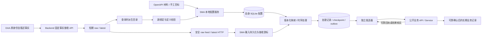

# SMA 语义映射与可靠 API 投递详细设计

**内容修订：2026-10-17 · ARCH-AW-003 r2**  
**效力：目标设计、推荐机制与接口语义草案；不表示已实现或正式协议冻结。**

> **方向更新（ARCH-AW-007 r2）：** 新路线保留 DAA、SMA、CA 三应用：DAA 负责大量持续采集，SMA 沿已过滤 TSS 基线精简表格化批量 HTTP 映射与工作台，CA 承担通用节点编排及内部多协议连接器。AWB/AWC 未来统一管理三类实例，先登记/心跳与只读健康，再配置/远程操作。全项目 [中文 ROADMAP](../ROADMAP.zh-CN.md)、[English ROADMAP](../ROADMAP.md) 与 [007 r2](../plans/ARCH-AW-007-general-agent-fleet-roadmap/spec.md#r2-design)、[006 r2](../plans/ARCH-AW-006-unified-flow-agent-design/spec.md#r2-design) 提供当前方向；精确批准、交付、独立 QA 与最终验收状态归所属 bundle，原设计正文/来源及 r1 验证历史保留。DAA 当前 SQLite 本地采集且新上传未接入；SMA 当前 Backend-held TSS/Facts→POST 与逐项 await 调度，子集/逐行常驻、任意 HTTP 源、本地 SQLite/可靠 outbox 和容量优化分期，不强制近期迁库；CA 自身版本化存储仍为目标。本文旧表单/共享 Core/角色节点限制等按当时范围解释，不构成三 App 统一迁移或 CA 能力总界限；CAF/旧 CA 保持冻结。CA 首版 HTTP GET/POST、明确受支持 S7 与无登录前提依 006 r2；原可靠投递、PW Service/API owner、版本固定及 unknown 核实原则仍为适用参考，后续实施 spec 明确采用/替代条款。本提示不宣称软件、QA、设备或部署许可。

本文与 [DAA 详细设计](AIIS_DAA_Detailed_Design.md)配套，承接 [AW 运行原理设计](AIIS_AW_Runtime_Design.md)和 [AW 白皮书](AIIS_AW_Whitepaper_Roadmap_v0.4.md)，范围由 [ARCH-AW-003 r2 spec](../plans/ARCH-AW-003-daa-detailed-design/spec.md)管理。DAA 正文解释现场事实、自描述载荷、来源顺序与 Backend 事实窗口；本文解释 SMA 如何绑定、转换、持久处理及向业务 API 投递。首版推荐表单/规则式工作流，通用画布与共享 Flow Core 是后续方向。

## 阅读导航

| 目的 | 入口 |
| --- | --- |
| 理解现状、职责与总体链路 | [1. 定位](#position)、[2. 组件](#overview) |
| 配置与源目录/绑定 | [3. 本地权威](#configuration)、[4. 输入](#sources)、[5. 定义确认](#bindings) |
| 配置目标与转换/预览 | [6. API 材料](#materials)、[7. 映射](#mapping)、[8. 预览与测试](#preview) |
| 审阅处理与可靠投递 | [9. 时序](#timing)、[10. 持久事务](#persistence)、[11. 输出](#delivery) |
| 审阅期限、界面和兼容 | [12. 三个月/业务保存](#retention)、[13. GUI](#workbench)、[14. 迁移](#migration) |
| 确认故障、责任和后续任务 | [15. 场景](#failures)、[16. handoff](#handoff) |

<a id="position"></a>
## 1. 定位、首版范围和现状证据

SMA（Semantic Mapping Agent）将现场事实转换为有业务含义的对象/记录，通过公开业务 API 投递；API/Service 拥有业务校验、事务和存储。SMA 不连接 PLC，不持有 Backend/目标业务库凭据，不对这些业务库直接执行 SQL、CRUD、DDL，也不控制设备；自身本地 SQLite 持久化属于 SMA 职责。独立 Agent 化是映射责任的演进，不是把 Backend Service 搬进桌面进程。

| 层次 | 本文采用的依据 |
| --- | --- |
| 已确认目标 | HTTP 目录/latest/raw feed、本地 SQLite 配置权威、点位定义确认、API 材料与手工目标、表单规则/转换/预览、独立调度、可靠业务确认 |
| 推荐机制 | 草稿/生效版本、逐绑定签名、四类输入时序、持久双进度、处理去重/checkpoint/outbox 原子及独立目标恢复 |
| 待确认实施细节 | endpoint/字段/单位/权限/schema/签名算法、转换与 OpenAPI 支持矩阵、容量/保留/并发数值、目标幂等与后台托管 |
| 未来方向 | 通用节点平台、业务画布、共享 Rust Flow Core、中央配置；不作为首版前置 |

2026-10-17 只读核对的当前工程：

| 当前入口 | 事实及限制 |
| --- | --- |
| [SMA README](../automation-world/semantic-mapping-agent/README.zh-CN.md) | 过滤复用 TSS HTTP facts/materials/targets/映射 UI，既有 `/api/tss/v1` 与 collection-facts 合同仍保留，不打包 Backend |
| [API 材料 store](../automation-world/semantic-mapping-agent/src/app/twin-facts/store/apiMaterials.ts) | OpenAPI catalog 与 Backend-owned selected materials 合并，`listApiMaterialsFromBackend`/`syncApiMaterialSelectionInBackend` 保存选择；不是本地 SQLite 权威 |
| [managed runtime](../automation-world/semantic-mapping-agent/src-tauri/src/domain/runtime/mod.rs) | `record_success` 更新内存 cursor，尚不能证明持久 feed/checkpoint/outbox 恢复 |
| [Projection 输入解析](../backend/projection/input_resolver.py) | 按 `decoded_payload[point_name]` 直接取标量，不能直接消费新嵌套 points；适配归 Backend |
| [projection-mapping README](../tools/plc/projection-mapping/README.zh-CN.md) / [PLAN](../tools/plc/projection-mapping/PLAN.zh-CN.md) | 工程准备/显式复核映射材料，不推断业务表、不写业务库、不接 PLC runtime；另有显式只读导出数据库 schema 能力，不是运行时 SMA |

TSS 提供交互参考，Projection 提供已有职责/迁移参照，工具提供离线材料；它们的存在不证明本文新闭环已接通。本轮只交付文档，不取实际 OpenAPI、不调用任何项目 HTTP API、不迁移或退役旧实现。

<a id="overview"></a>
## 2. 总体链路与模块职责



| 组件 | 负责 | 边界 |
| --- | --- | --- |
| 本地配置服务 | 材料快照/目标/源绑定/转换/调度、草稿与生效版本 | 不与 Backend 同时编辑同一映射配置 |
| 事实接收器 | HTTP 读取、身份去重、完整性/定义信息、持久接收 cursor | 不把最大 sourceSeq 当安全 feed cursor |
| 映射处理器 | 固定规则版本、时效/质量/定义校验、转换/状态/窗口、生成业务请求 | 不直接执行网络副作用 |
| 输出发送器 | 有界请求、稳定输出身份、目标独立回执/重试/核实 | 发送成功不等于业务可靠入库 |
| 存储/诊断 | 本地配额、引用安全清理、缺口/漂移/目标积压和审计 | 不建立无限原始历史备份 |

实例有独立身份/数据目录/可写库，不与 DAA 或其他 SMA 实例共用打开的 SQLite。首版可同机部署，生命周期仍独立；窗口关闭是否退出、headless、开机托管和平台支持另定。

<a id="configuration"></a>
## 3. 本地配置权威、版本和激活

近期自身 SQLite 为唯一可编辑业务配置权威，保存 Backend 连接/凭据引用、API 材料选择/快照、手工目标、映射/源签名、转换/质量/时序策略与调度。材料快照帮助审阅和重现，不能替代上游 API 当前权限/合同。运行数据逻辑独立：输入/接收 cursor、处理状态/checkpoint、outbox/目标回执和必要审计；物理分表/分库由 SMA 任务确认，不直接照搬 DAA 两文件决定。

| 状态 | 推荐动作 | 对执行的影响 |
| --- | --- | --- |
| draft | 导入材料、编辑绑定/转换/目标，离线预览校验 | 不触发真实写入 |
| validated | 所需源定义确认、目标参数/类型/权限与幂等能力声明齐全 | 尚未替换当前版本 |
| active | 显式应用完整规则版本，记录内容摘要与生效指针 | 每轮处理固定其版本，不半途换规则 |
| previous | 上次切出的规则版本 | 显式兼容回退，不撤销输出/业务效果 |

建议激活时停止受影响映射新处理，等在途本地事务结束，持久版本/active 后重建内存计划，核对成功再恢复；已生成 outbox 按冻结版本继续或进入明确待处理，不用新规则重渲染。若分两库，先幂等准备解释摘要，再切持久指针/安装内存，采用可恢复令牌及屏障，不能假设跨库整体原子。失败保持受影响规则停止，启动先核验持久版本与运行记录，不旧内存运行却报告新 active。

配置恢复/回退不倒退接收 cursor、处理 checkpoint、输出确认或处理幂等身份。材料/规则改动仅给受影响映射增加自己的版本；全局 configRevision 变化不让无关映射重处理全部历史。凭据用引用，具体安全存储/备份恢复/schema/SQLite 版本另定。

现有 TSS Backend-held 材料/映射配置需显式导出/审核/导入本地草稿和决定停用哪一写入口；没有静默双向同步。首版可引用既有适用 UI，不能因此继续把两个存储当成同时可编辑的权威。

<a id="sources"></a>
## 4. 通过 HTTP 发现目录与读取事实

### 4.1 三种读取职责

| 输入 | 作用 | 必须携带/检查 |
| --- | --- | --- |
| 派生目录 | 选择 PLC/DB/pointId、审阅当前有效定义 | name、地址 byte/bit/len、PLC/JSON 类型/有效性、来源/定义版本；只含已上报可用点 |
| latest | 实时状态映射、预览取样 | 原 sampleId/pointId、采集时间/质量、当前来源/定义，映射最大年龄 |
| 安全 raw feed | 完整历史、逐样本/有状态/窗口处理 | 稳定输入身份、原定义/值/时间/质量、nextCursor、cycle/分片及完整前缀/缺口 |

正式路径/鉴权/分页和字段由 Backend 任务确认，SMA 不依赖内部表名。raw/latest 每条只有一份自描述 points 字典，点按 pointId 身份；DB 包含 PLC/DB/组/cycle/sourceSeq/revision/sampleId，组跨 DB 完整性仍由 manifest/全部片决定。点结果可由 `(sampleId, pointId)` 定位；部分读取失败保留定义与缺值/质量，不能把未读值补 0。

points 的 pointId 键是身份数据，snake/camel 字段转换不能改写它；Backend 当前 [common serializer](../backend/common/response.py)递归转换字典键，新接口须明确 preserve mapping keys。SMA 不能再自行转换这些键或按改写后名称绑定；适配实现留 Backend。

Backend 在查询时投影/合并目录，不另持久无值 pointCatalog。同 PLC/DB 的组 A 上传 point-1、组 B 上传 point-2，目录应合并两个；读取失败/包缺点不是删除，明确停用/删除依有效成员声明。目录不保证发现未采集或未上报的 TIA 字段，SMA 不请求 DAA 全结构来暗建另一个永久目录。

### 4.2 有界接收与安全游标

接收器分页读取、在有界事务中将输入和返回 cursor 一起落盘；失败不推进 cursor。重取同页按身份去重，同身份异内容拒绝/隔离；连接失败保持原进度退避。Backend 的 cursor 必须不漏并发晚提交，不能用最大 raw ID 或最大见过 sourceSeq 自行生成。

只保存映射所需输入时，也必须持久“这个 feed 区间已检查、其他项不适用”的覆盖证据，并与 cursor 原子提交；无意跳过的关键输入不能当成过滤项。有状态规则依赖 PLC 连续前缀或 Backend 过滤流完整性证明，组内裸序号自然跳号不是丢失。缺片/真实缺口仍等待，不能因看见 1005 就跳过后来补传的 1001–1004。

本地接收队列/容量不足时停止拉新页而非推进游标丢输入，发送器可继续释放 outbox。超出源可恢复窗口时再恢复无法保证完整，需 §12 的缺口处置；不能拿无限本地缓冲掩盖过载。

<a id="bindings"></a>
## 5. 逐绑定定义签名、漂移和历史版本

### 5.1 保存什么，如何比较

每个源绑定保存稳定 PLC/pointId、确认的定义快照/签名及适用定义版本；name 是定义内容，不作自动重绑键。推荐签名输入为规范化的 name、地址 byte/bit/len、plcType、JSON dataType、有效性合同；排除 value、quality、collectedAt、sampleId、sourceSeq、batchId 和全局 configRevision。签名算法/规范化格式另定，不把任意 JSON 字节序视为定义差异。

| 变化 | 判断与动作 |
| --- | --- |
| 值 22.5→23、good→bad、时间/轮次改变 | 定义不变；质量/新鲜度可能阻止该次输出，但不是 schema_mismatch |
| configRevision 变化，所绑定点定义不变 | 不暂停该绑定，不因为别点编辑而全停 |
| name/地址/类型变化，或明确停用/删除 | 暂停受影响绑定，记录 schema_mismatch 和旧/新差异；其他规则继续 |
| 目录暂时读失败/事实到期消失 | 分别显示连接异常/source_expired，不能自动当定义删除或按同名找替代 |
| 旧 revision 历史补传 | 按当时定义与获准映射版本解释，不覆盖当前确认定义 |

例：point-1 的地址 byte=0 变为 byte=8，其两个消费者暂停；只依赖 point-2 的映射继续。只修改 point-3 或组周期，不改变 point-1 签名。pointId 不变但 name 改名，默认仍要求人工确认；目标字段名可不同，不能因此忽略源定义变化。

### 5.2 确认流程和权责

`发现有效当前定义变化 -> 持久记录差异/暂停受影响绑定 -> 展示旧/新定义与受影响目标 -> 人工确认点身份/转换 -> 保存新映射版本 -> 校验预览 -> 显式恢复`。

SMA 能改源绑定、业务字段和转换，不能修改真实 PLC 地址/类型；发现源错由 DAA 修正并发布有效 revision。DAA 仍可正常编辑配置，并不是“平时固定”而禁止改动。PLC/TIA 实际程序变了而 DAA 仍上报旧定义时，SMA 不能仅凭数值自动证明读错，须现场/TIA 核对或未来另立程序一致性校验。

当前定义来自 Backend 有效来源/定义顺序；不能用旧历史包到达顺序触发当前目录回退。历史可选择仍获准旧映射版本处理，或局部暂停等待兼容策略；不得默认用当前转换解释所有旧定义。已生成 outbox 内容和输入版本不可变，修绑定不自动重发旧输出。显式历史重算另给范围/重算身份，不能当正常补传自动全重跑。

<a id="materials"></a>
## 6. API 材料、手工目标及参数合同

支持从当前 Backend OpenAPI 取得可选操作材料，也允许手工配置目标；本轮未发起实际材料读取。OpenAPI 描述操作、参数、requestBody、schema/ref 和安全要求，但不保证运行权限、业务幂等或持久化语义；这些仍需目标确认。[OpenAPI 官方规范](https://spec.openapis.org/oas/v3.1.1.html)

| 材料/目标信息 | 推荐保存与校验 |
| --- | --- |
| 材料来源 | 来源定位/版本/内容摘要、操作快照、获取时间、解析状态，不直接保存口令 |
| HTTP 操作 | 显式 method、base URL 引用、path 模板、允许执行范围；GET 只读材料与写入目标分清 |
| path/query/header | 名称、位置、类型、必填、编码规则、来源绑定/常量；凭据 header 使用引用，不写入日志 |
| body | 受支持 JSON 对象/数组/嵌套字段、类型/必填/空值、模板及字段组 |
| 目标确认 | 业务成功/持久级别、幂等键位置/作用域/保留、结果查询、错误可重试性/目标期限 |

首版建议先支持明确的标量参数和有限嵌套 JSON body、可解析本地引用；版本、schema组合、数组、多态/递归/远程引用、特殊编码/非 JSON 体等须在支持矩阵中逐项列明。遇到未解析 `$ref`、oneOf 等复杂结构、缺类型/必填或不支持媒体类型时，定位操作/参数并标不可运行，不吞掉参数假装解析成功。

手工补足路径是建立经审核的显式目标合同/参数定义，不是绕过原业务校验；标明手工覆盖来源和差异，材料更新后重新对比。材料可选不扩大权限；认证引用由运行时受控使用。目标 API 方法/path/必填类型改变，只暂停受影响目标/映射并报 target_contract_mismatch；无关材料变化不全停。既有 outbox 保持原请求，是否仍可投递需目标兼容合同，不用新模板静默重渲染。

<a id="mapping"></a>
## 7. 表单映射、转换与业务 JSON

### 7.1 推荐规则模型

每条映射保存自身 ID/版本、源绑定集合、输入模式/时序、目标操作/字段组、常量、有限转换、质量/缺值/最大年龄政策、启用与调度。规则版本只随该映射有效定义/转换/目标等实质变化递增，不直接等同整个应用 configRevision。

推荐逐目标参数表配置“来源点/常量/受控转换 → path/query/header/body 字段路径”。转换包含显式类型转换、单位比例/偏置、有限枚举映射和格式化；支持矩阵、舍入/溢出/范围/数组语义须专项确认，不默认任意脚本/eval 或动态插件。

| 校验 | 行为建议 |
| --- | --- |
| 必填来源缺值/坏质量 | 默认阻止该目标新输出并报原因；可选字段省略/null 仅在目标合同允许时显式配置 |
| 超过映射最大年龄 | 显示 stale；按声明暂停/缺值策略，不将尚在三个月内视为实时可用 |
| 类型不兼容/转换失败/越界 | 保留输入与局部错误，不自动截断、补0或用旧值当新成功 |
| 多源拼对象 | 记录每个输入身份/时间/质量；设置时间差/最大年龄，不虚称同步 PLC 快照 |
| 常量/单位转换 | 保存显式值、源/目标单位和转换版本，预览前后结果 |

例：源 point-1 为 °C 数值，映射到 body.measurement.temperature；若目标合同要求其他单位，显式配置比例/偏置，不能仅改字段名。例中温度值仅示意，不承诺实际 PLC 数据或目标 schema。

```json
{
  "deviceCode": "device-a",
  "measurement": { "temperature": 22.5, "unit": "degC" },
  "observedAt": "2026-10-17T00:00:00Z",
  "provenance": { "sampleId": "sample-1005-db10", "pointId": "point-1", "mappingVersion": "map-v1" }
}
```

### 7.2 一次处理的固定输入

从接收库挑选符合模式的输入，固定映射版本/确认定义/目标模板/输入身份后，再生成业务对象。单输入处理键至少是映射 ID+映射版本+sampleId，包内多个独立点输出还包含 pointId/字段组；多输入对象使用稳定输入身份集合/触发身份，窗口使用窗口身份。字段组/目标分清，不能一份包中两个合法输出互相去重。

同一已处理输入在下一调度周期再看到，默认不重复生成输出；调度轮次不重新制造采样身份。确需周期心跳或重复上送最新状态时，先独立声明业务触发身份和幂等语义，不能用随机 ID 绕过去重。显式改版重算和窗口修正采用各自可追溯修订身份，不默认为源重传产生新业务记录。

<a id="preview"></a>
## 8. JSON 预览与真实投递测试

预览使用已读事实或明确标记的隔离示例，展示来源定义/采集时间/质量、转换前后、缺字段/类型错误、请求 method/path/query/header/body 和目标版本；敏感字段脱敏。默认只读计算，不生成生产 outbox、不发送 HTTP。编辑预览不等于修改事实，也不能把合成值注入 raw/latest。

真实投递测试必须是显式操作，选择获准目标/测试上下文，固定原输入和输出身份，走同一持久 outbox/幂等/可靠确认链路；测试与正常运行若指同一业务效果，重用同一幂等身份，不能随机换键重复写。需要隔离测试目标时由目标合同明确命名空间/业务影响，测试记录单独标记，不能据此认证生产验收。本轮只设计流程，未实际调用 API。

<a id="timing"></a>
## 9. 独立调度与四类时序

SMA 接收、处理、发送周期分别配置，独立于 DAA 采集和上报周期。接收器公平拉取有界页；每映射非重入，超期记录延迟不无限堆 tick；发送器对目标限并发/速率并退避。某个映射等待缺口或目标阻塞，不让其他无关映射停止。首版具体线程/任务模型和限额留实现，不在本文指定依赖。

| 模式 | 输入/推进 | 恢复与乱序语义 |
| --- | --- | --- |
| 实时 latest | 新有效版本，校验最大年龄/质量 | 可跳最新；断网恢复首帧重建基线，不把 false→true 跨断网当刚上升 |
| 无状态逐样本 | raw 每样本/字段组按处理身份去重 | 可乱序；同输入重放无新增输出 |
| 有状态 | 按 PLC/来源代次的源序与完整性覆盖 | 1005先存，等1001–1004补齐再推进；自然过滤跳号不作缺口 |
| 时间窗口 | 原采集时间、多源时钟/迟到政策 | 未齐为暂定，迟到修正同一窗口，输出修订需目标支持 |

跨 PLC 没有共同 sourceSeq，窗口要显式时钟偏差/时间差、等待界限和缺失结果。严格完整前缀 B 与最大见过 M 分开；B 高也不证明较旧 raw 仍在可读窗口。来源代次切换需要受控交接/连续性证明，否则重新建立状态基线并标缺口，不能比较 UUID 排新旧。

正常恢复例：初始完整到1000，先收到1005，实时状态可更新但需新鲜度校验；无状态可处理1005；有状态先缓存。1001–1004补齐且对应定义获准后，有状态按1001→1002→1003→1004→1005执行；重复1005不重复产生同版本输出。窗口按原时间修正，不能把补传到达时间当事件发生时间。历史事件触发实时副作用需要规则明示，不默认全量补做旧业务动作。

<a id="persistence"></a>
## 10. 持久输入、双进度、checkpoint 与 outbox

### 10.1 概念实体与事务边界

| 实体 | 保存内容 | 与其他记录的关系 |
| --- | --- | --- |
| 输入 inbox | 稳定样本/点身份、所需自描述值/定义/时间/质量、来源/完整性 | 去重一次保存，可供多个获准映射引用，保留有限 |
| 接收进度 | Backend 安全 cursor、页覆盖/完整前缀与过期信息 | 表示已可靠接收/检查，不能代表已处理 |
| 映射处理进度 | 每映射版本/来源的 checkpoint、状态/窗口和处理幂等身份 | 等缺口/定义确认时可落后于接收 |
| 输出 outbox | 稳定 outputId、输入/映射/目标版本、冻结业务请求、目标确认/重试/未知 | 业务发送独立，不依赖过期 raw 才能重建 |
| 最小追溯摘要 | 来源身份/定义与映射版本、处理/输出确认 | 有界保留，不等于永久原始副本 |

推荐原子边界如下；逻辑上的多个表不意味着可以跨物理库假定同事务：

| 事务 | 同一可靠本地事务内操作 | 失败后行为 |
| --- | --- | --- |
| 接收 T1 | 验证/去重输入、保存必要完整性与覆盖、推进 nextCursor | 全部回滚，重取原页；不漏输入 |
| 处理 T2 | 去重检查、固定版本/输入、更新状态、checkpoint、写冻结 outbox、处理完成记录 | 全部回滚，重新处理仍用同一身份 |
| 尝试 T3 | 有界领取 outbox、记录发送尝试/在途 | 重启无回执者进入核实/重试 |
| 回执 T4 | 核对目标/输出身份/持久级别，更新该目标确认与必要摘要 | 未提交继续按原身份核实，不能仅内存标成功 |

HTTP 在 T3 与 T4 之间、事务之外。每个写入协调器使用短事务，读取有限请求后释放读锁；WAL/FULL 是可评估建议，SQLite 实际版本/已知缺陷/参数、崩溃/吞吐与备份安全由专项验证。[SQLite WAL](https://sqlite.org/wal.html)、[同步参数](https://sqlite.org/pragma.html#pragma_synchronous)

### 10.2 崩溃恢复时序

```text
取feed页 → T1提交输入+cursor → T2提交状态+checkpoint+outbox
        → T3记录尝试 → HTTP → 目标可靠持久/返回回执 → T4提交确认
```

T1 前退出可重取；T1 后/T2 前退出从持久输入处理；T2 后退出恢复原 outbox，不重复计算新输出；目标已处理/T4 前退出以原 outputId 幂等重试或查结果。重复输入不能再产生同处理身份输出。双进度/幂等状态保留需覆盖正常重放，源 raw 清理不能清掉仍用于重试的必要摘要。

首版可单实例协调，不默认多进程并发消费；未来多执行者必须定义原子领取/租约和输出所有权，不能仅靠 UI 禁按钮。输入本地写失败时暂停拉取/处理并报警，不能推进 cursor。处理失败保存局部错误和可恢复输入引用，目标失败仅影响自己的 outbox。

<a id="delivery"></a>
## 11. 目标 API 可靠确认、部分失败与未知

### 11.1 输出状态

| 状态 | 含义/转换 |
| --- | --- |
| pending | 冻结请求已本地提交，等待目标调度 |
| sending | 有界发送尝试在途，不是业务成功 |
| accepted_pending | 目标仅确认持久受理/排队；按合同查询最终结果，尚未声明业务长期入库 |
| retry_wait | 可重试错误，保存下次时间/次数，释放目标调度机会 |
| persisted | 目标明确可靠业务持久化，回执经核对并本地提交 |
| rejected | 不可重试业务/合同拒绝，保留原因和必要请求引用待处理 |
| unknown | 超时可能已经产生效果，又无足够幂等/结果核实证据；不盲目换键重发 |

正式状态码由目标合同定稿，不能仅按 HTTP 200/202 推断持久级别。业务 API 应提供稳定输出幂等键、确认身份/范围、业务记录/结果引用、可重试原因；若先入队，须有最终业务持久确认或可靠结果查询，才计入“已入库”。

### 11.2 多目标与副作用边界

输出身份区分映射版本、稳定输入/窗口身份、输出字段组/目标；相同身份不同请求内容拒绝冲突。每目标独立确认，A 成功、B 失败只重试 B；一个响应部分成功时按合同逐输出记录，未明示范围不能全标成功。处理事务完成可以意味着 outbox 已排好，不等于全部目标成功。

对端已写业务但回执丢失，以原键重试返回等价结果或查结果；幂等作用域/保留期需覆盖最大重试。没有幂等/核实能力则进入 unknown 和显式处置策略，不能承诺外部效果不重复，更不能承诺无条件端到端恰好一次。

修转换、改目标或重算不能随意改已发送请求内容/身份。目标合同变化可能暂停该目标新输出与存量核实，其他目标继续；已确认业务记录需要更新/修正时走明确业务更新语义，不能重发旧“创建”并假装覆盖。

<a id="retention"></a>
## 12. 三自然月窗口、业务长期保存与本地容量

### 12.1 最大事实窗口及目录消失

Backend raw/latest 最大可用窗口为 **UTC 原采集时刻加三个自然月；目标月无对应日期取月末同一 UTC 时刻，到达截止即不可读/不可作当前事实**。可更短不能更长，不是90天、不从接收时间续期。例：2026-01-31 12:00Z→2026-04-30 12:00Z；2023-11-30 06:00Z→2024-02-29 06:00Z；2024-11-30 06:00Z→2025-02-28 06:00Z。此为 r2 设计选择，时钟容差/精度、清理 SLA/备份介质另由 Backend 确认。

latest 聚合每点用自身原时间，其他组新上报不能刷新旧点。全部相关 latest 到期，Backend 当前目录消失；SMA 可显示已保存绑定/最小定义缓存并标“来源过期”，不能把缓存当在线可用目录，不暗加永久无值目录或无限原始副本。只有 DAA 新有效实际事实到达才重新发布，旧包重打时间不得续期。异常未来时间需校验/拒绝/隔离。

三个月是存储/回放上限，不是实时值新鲜期。实时映射另有最大年龄/质量/多源时间差，值在窗口内仍可为 stale。目录缺失/定义变化/值陈旧/质量坏分别显示，不能一个错误覆盖全部原因。逻辑到期过滤与物理分批删除分开，不声称立即销毁所有副本。

新有效事实使目录重新出现时，先复核原 pointId/已确认签名、当前来源与新鲜度；一致且仍希望运行的规则可按已声明恢复策略继续，定义不同则保留 schema_mismatch 等待确认。恢复可用性不能补回已经超期丢失的输入或自动抹去历史缺口。

### 12.2 到期与业务确认四种情况

| 到期时的位置 | 处理要求 | 保证范围 |
| --- | --- | --- |
| SMA 尚未接收所需输入/缺片 | 暂停受影响规则、报警，明确可恢复范围，显式缺口接受/重同步 | 不能保证全业务回填，不能 cursor 跳最新假完整 |
| 已可靠接收完整输入、未处理 | 在本地独立保留/容量/定义与目标期限允许时处理 | 不要求已过期 raw 重新可读；本地也不是无限备份 |
| outbox 已冻结，尚未业务确认 | 依据目标合同继续原请求重试/核实，源 TTL 不级联删除 | 冻结请求自足且目标仍允许才可续投 |
| 目标业务已可靠持久确认 | 按业务 Owner 长期/永久政策保留业务记录 | 不随 raw/latest 删除，不承诺未入库样本也有业务记录 |

SMA 停机超过三个月、feed/cursor 过期不一定能从 raw 补齐，必须记录缺口，暂停受影响任务。显式接受缺失后建立新基线/重同步，策略处理边界与严格完整前缀分开。原已保存合法 outbox 可独立恢复，不因为接收游标过期而全部删除/重建。

业务记录应有业务值和最小来源/定义/映射版本追溯，不能依赖将来 raw 查询才能解释。必要输出请求/去重/处理摘要按各自期限保留，不等于永久全原始载荷。raw/latest 到期不级联删除业务、未完成 outbox 和仍有效幂等摘要；本地/目标业务保留政策也不能反过来延长 Backend 事实窗口。

DAA 到期补传明确拒绝不假 ack，本地未确认仍保护且满额可停采；SMA 不代 DAA 收走这些过期事实当永久仓库。已接收历史回执与混合新/过期批次策略由 Backend 定稿，不能据此恢复已到期 raw/latest。

### 12.3 SMA 本地有界保留

输入仅在被所需处理/窗口/outbox 引用期间及有限审计期保留；已确认且无引用的输入/终结输出分批清理，压缩最小追溯摘要。未处理输入/待投 outbox 保护，但必须有总容量、最低磁盘余量、日志/WAL/索引/维护预留及高低水位；保护数据满额先暂停新接收/新处理，发送/诊断继续，并显示源窗口流逝风险。无法继续安全保存时报告缺口风险，不能推进 cursor 丢输入来维持运行。

源保留、输入保留、窗口状态、业务目标有效期和幂等窗口分别配置/核对；默认不能等同三个月，也不能无限延长。DELETE 页可重用不等于主文件立即变小，查询分页/短事务、checkpoint/低负载回收与实际文件余量一起管理。[SQLite 空间回收说明](https://sqlite.org/pragma.html#pragma_auto_vacuum) 具体 schema/数值/低水位与备份由 SMA 存储任务确认。

<a id="workbench"></a>
## 13. GUI 工作区、状态与审计

| 工作区 | 首版信息/操作 |
| --- | --- |
| 连接与源目录 | Backend 连接、HTTP状态、PLC/DB/pointId目录、定义/原时间/质量/可用期；缓存来源过期，不误作实时值 |
| API材料/目标 | 获取/导入操作材料、手工method/path/参数/认证引用、解析支持错误、材料变化和幂等/可靠回执合同 |
| 映射规则 | 源字段/常量/转换→目标参数，逐绑定签名/漂移差异、草稿/版本/预览及质量/缺值/最大年龄/时序 |
| 运行工作台 | 单条/勾选/全部启停与部分成功，接收/处理/发送独立控制；规则等待缺口/定义/目标的局部状态 |
| 投递/错误日志 | outbox按目标状态、最近可靠业务确认、retry/rejected/unknown、接收cursor与各规则checkpoint、缺口/窗口修正 |
| 存储/诊断 | 队列/输入/输出占用与最旧时间、源到期风险、日志/WAL/余量和容量暂停/恢复 |

暂停接收不删除已收输入，暂停处理可继续发送既有 outbox，暂停发送可在限额内接收/处理；各维度显示期望/实态/准入，不能“停止规则”就声称已撤销在途 HTTP 或业务效果。恢复只恢复原运行意图，不启动人工停止对象。

审计关联映射/版本/绑定签名/输入/输出/目标身份、采集/处理/发送/可靠确认时间与结果；日志脱敏、有级别/额度/有限保留。值变化不是定义漂移，暂定窗口不标最终业务成功，处理进度不是业务确认进度。UI/i18n/组件实现另立任务，不在本轮写用户界面。

<a id="migration"></a>
## 14. 兼容、单 writer 切换与回退

现有 TSS 配置/HTTP UI 只是可复用起点，迁移先列 Backend-held 旧配置与本地配置差异、身份/定义/目标/材料映射，经审核显式导入 SQLite 草稿；不双向自动同步，不在启动时静默迁移用户 profile。projection-mapping 是工程准备/审核工具，可由显式 `export-schema` 子命令只读导出数据库 schema；[现有数据库模块](../tools/plc/projection-mapping/src-python/core/database.py)读取 information_schema 元数据，[CLI](../tools/plc/projection-mapping/src-python/cli/commands.py)注册该操作。它不承担常驻事实消费、业务写库或 PLC runtime，也不自动推断业务表；这类数据库元数据读取不搬入 SMA 运行时，SMA 对 Backend/目标仍只走公开 HTTP。本轮没有运行该工具。

Backend 的旧 `decoded_payload[point_name]` 标量字典需显式适配新嵌套 points，定版本/兼容读取/历史数据语义后才联调。不能把新包塞给旧 Projection 并声称兼容。DAA 事实接口只写事实，SMA 业务目标另经公开 API/Service，不能让事实 API 顺便写业务表。

推荐切换顺序：配置审核/身份确认 → SMA 无写入预览/只读对比 → 核对目标语义/幂等和起始 checkpoint → 停止旧 Projection 对该目标的新写入并核实在途 → 显式授权 SMA 成为唯一有效 writer → 观察对账/再决退役。原 Projection 与 SMA 不同时正式写同一业务目标；回退也先核实 SMA 在途/outbox/已入库效果及旧进度，不能两个运行时一起重放旧数据。

配置回退不撤销业务、不倒退 cursor/处理/输出确认；二进制/schema 回退需兼容证据。真实数据库迁移、现场链路切换、部署/后台托管与旧链路退役均另批。

<a id="failures"></a>
## 15. 共同故障矩阵与 SMA 时序展开

F01–F30 的三方共同编号、预期/持久边界/责任/未来证据以 [DAA 共同矩阵](AIIS_DAA_Detailed_Design.md#failures)为一处完整索引。以下展开 SMA 所属关键行，作为后续实施输入；本轮未执行运行故障实验。

| 对应编号 | 具体恢复/局部行为 | 持久/确认边界 | 责任与未来证据 |
| --- | --- | --- | --- |
| F05/F09/F24 | 1005先入inbox；实时新鲜度合格可映射，有状态等补齐；分片/自然跳号分清 | T1接收不代表T2有序处理，重复不新建outbox | Backend/SMA；序号/片段轨迹与四类输出 |
| F12/F17 | 同DB多组合并目录；全部到期只显示本地缓存过期，不当在线目录 | 目录投影/缓存不生成新事实或延长TTL | Backend/SMA；目录成员/时间推进核对 |
| F13/F14 | 值/质量/无关revision不改签名；源定义真变只暂停受影响绑定 | 旧确认/新差异持久，人工确认新版本 | DAA/SMA；多绑定局部状态与签名对照 |
| F15/F16 | 历史用原定义，不倒灌当前；未上报物理变更不可自动发现 | 已有outbox原请求不随新定义重渲染 | DAA/Backend/SMA；交错历史、TIA人工证据 |
| F18/F20 | 月末UTC到期/feed过期明确缺口，暂停受影响规则 | cursor不跳末尾假完整；重同步有审计 | Backend/SMA；边界日期/过期响应/新基线 |
| F19/F21 | 到期拒绝不当ack；已有完整输入/outbox按独立期限续投，缺输入报缺口 | 源TTL不级联outbox；最终业务确认另判 | DAA/Backend/SMA；到期前后保留/目标期限 |
| F22/F30 | 清raw不删业务/未完成输出；输入/日志/WAL有界，满额停拉取 | 最小摘要保留不变无限原始镜像 | SMA/业务Owner；容量与引用清理审计 |
| F23/F29 | 材料不支持/改版定位并手工补足；预览只读，测试原身份 | 未校验不启用；真实投递走outbox | SMA/目标API；解析/预览/测试去重 |
| F25 | T1前后/T2后/目标已写T4前崩溃分别恢复 | 双进度+状态/checkpoint/outbox原子 | SMA；断点重启及处理/确认对账 |
| F26 | A成功B失败只重试B；无幂等丢回执保unknown | 目标效果不由本地发送结果代替 | SMA/目标API；幂等/查询与局部恢复 |
| F27 | 并发晚提交不漏，同ID异内容拒绝；新代次显式交接 | 安全feed与唯一有效来源，状态连续需证明 | Backend/SMA；交错分页/双源/冲突 |
| F28 | 新体需标量适配；迁移先停旧writer再启新 | 旧进度/在途/outbox保留并对账 | Backend/SMA；只读比对/单写/回退演练 |

<a id="handoff"></a>
## 16. 责任、未决参数与候选实施阶段

共同三方责任如下，与 DAA 正文一致；这是供 Human Owner 转交的设计材料，不表示已消息其他会话或对方承诺开发。

| 归属 | 设计责任 | 实施前确认/禁止越界 |
| --- | --- | --- |
| DAA | 唯一PLC连接与组调度、完整结构/点位、双库/容量、自描述事实/固定API、稳定身份/补传 | 驱动/类型/限额/成员声明；不写业务表，不替SMA转换 |
| Backend | 事实去重/latest条件推进、派生目录、三自然月/拒绝、安全feed/来源、旧标量适配；业务API校验/事务/长期持久 | 正式字段/鉴权/DDL/回执/清理SLA；不在请求内轮询PLC |
| SMA | 本地绑定/API材料/目标/转换/调度、定义确认、四类时序、持久输入/双进度/outbox及目标投递 | 签名/转换/目标幂等/缺口/容量；不连接PLC或业务SQL |

| 待确认项 | 责任 | 决定前证据/进入实施 gate |
| --- | --- | --- |
| points/目录/成员声明/定义有效版本、来源交接/可靠回执 | Backend + DAA，SMA消费核对 | 跨DB/移组/旧定义/拒绝推演；先正式合同再实现 |
| 最大三自然月的精度/时钟容差/清理SLA、feed/去重/回执窗口 | Backend | 月末/未来时钟/晚提交/过期与最长滞后证据；不改已批准上限语义 |
| 本地配置/运行物理布局、SQLite版本/schema/备份、容量/水位/日志 | SMA | 崩溃/写入/维护峰值/恢复证据；独立存储任务 |
| 签名规范化、转换/质量/缺值/最大年龄、多源时差/窗口 | SMA +业务Owner | 绑定漂移与真实业务字段/边界样本；窄映射任务 |
| OpenAPI版本/解析矩阵、手工目标、权限/凭据引用 | SMA +目标Owner | 不支持结构定位/必填编码/版本兼容审阅；材料任务 |
| 输出幂等/业务持久回执/结果查询、部分成功/修正/期限 | 目标API Owner + SMA | 丢回执、多目标、入队后最终确认与重算证据；业务API合同先稳定 |
| 接收/处理/发送周期、并发/预算/退避、公平与unknown处置 | SMA | 吞吐/积压/超期/目标失败推演；运行任务 |
| 旧配置导入/标量适配/唯一writer、平台/后台/打包 | Backend/DAA/SMA/Human Owner | 只读比对、在途核实、回退/生命周期证据；另行批准切换 |

候选顺序：先确定事实目录/feed/业务目标合同；再分别立项 SMA 本地配置、有限绑定/转换/预览；随后持久输入/双进度/outbox 的离线夹具与单目标闭环；再多目标/迟到窗口/过期/容量与兼容联调；最后独立批准原生运行、现场和旧writer切换。画布/共享 Flow Core/中央配置等后续按收益另立，不阻塞表单式首版。

后续 SMA 按 `rust-runtime`、涉及壳用 `desktop-tauri`，UI/文案用 `frontend-ui`/`i18n-workflow`；Backend 正式 API/数据库用 `backend-arch`，DAA 点位算法用 `plc-point-mapping`。本次只用适用文档/架构治理，不恢复 Celery/Redis，不修改技能/角色配置。

文档 QA 只核验本 r2 文档，不证明 API、SQLite 恢复、业务永久保存或端到端可靠性已运行通过。r1 QA、r2 独立 QA、Human Owner 最终验收和未来功能/现场 gate 分别记录；本文不授权代码、正式schema、数据库迁移、发布或实际测试。
