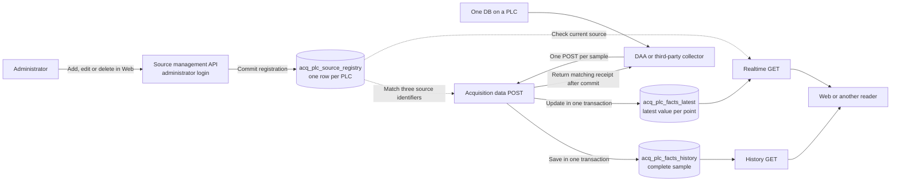

# Acquisition Data: Principles and Usage

[中文](acquisition-data-guide.zh-CN.md)

This guide follows PLC data from source registration and acquisition through reporting and reads. It is for DAA, third-party collectors and applications that consume raw values. The [acquisition data contract](../contracts/published/http-api/plc-facts-v2/README.md) and [source management API contract](../contracts/published/http-api/plc-facts-v2/openapi-acquisition-sources-r4.json) define the exact fields and errors.

The description includes ARCH-ACQ-005 r1 source deletion and history reads independent of registration. An actual environment must adopt the corresponding source; existing environments continue to use their own version. [Target migration and recovery](../backend/scripts/plc_facts_maintenance/README.md#r3-single-table-migration-and-recovery)

## 1. How one sample travels



1. An administrator signs in to Web, opens **Acquisition Data → Source Configuration**, and creates a DAA or third-party source with source type, instance ID, logical PLC ID and source generation. DBs are not configured in the registration. Web uses administrator-only `GET/POST/PATCH /api/v1/admin/acquisition-sources` to manage registrations.
2. The backend commits the registration in a database transaction. Once committed, backend processes connected to the same adopted target use it immediately; routine additions and edits do not require a restart.
3. On the saved row, the administrator opens **Connection parameters** and chooses **Copy parameters** to give the three identifiers to the sender. The sender uses the target address and contract for that environment; see the [DAA per-PLC setup](../automation-world/data-acquisition-agent/USER_GUIDE.md#3-register-the-source-and-configure-reporting).
4. A collector reads one DB on one PLC and creates a sample containing that DB's complete point set for the cycle. If it reads two DBs, it sends two separate `POST /api/v1/integration/plc-facts/samples` requests and confirms each. Live delivery and backlog use the same endpoint. Starting or resuming reporting processes the eligible queue one sample at a time and may send more than one sample.
5. The backend checks registration, writes the complete sample to history and updates latest values per point. Both tables commit in one transaction before a corresponding receipt is returned. The sender confirms only after checking a `committed` receipt matching the original sample. Realtime GET uses current registration; history GET reads unexpired facts independently of registration.

In the current development contract, sample POST and the five acquisition GETs require no Bearer token; the source management API requires a logged-in active admin. Source registration controls admission; it is not device authentication. Network and authentication policy for an actual deployment must be confirmed separately.

### 1.1 Switching an existing environment

Confirm that the target has adopted the corresponding backend source and contract. Before migrating an existing registration, pause registration, reporting and cleanup, and preserve a backup. Follow [migration and recovery](../backend/scripts/plc_facts_maintenance/README.md#r3-single-table-migration-and-recovery) for the predecessor JSON import and migration steps. Adoption, migration and operation in an actual environment follow their own authorizations.

The acquisition data module records raw PLC values. Equipment status and process monitoring are handled by the respective business modules under their own rules.

## 2. Sources and three fields

After the ARCH-ACQ-007 table-name cutover, each PLC has one row in `acq_plc_source_registry`. Source admission matches that row's `plcId`, `instanceId` and `sourceGeneration`; `sourceType` is a display label. `dbNumber` is required sample content, not a registered DB list. These three identifiers govern source admission, not all request validation: the remaining fields, types, limits and sample rules are also checked. [Source management](../backend/app/plc_facts/README.md#arch-acq-004-r3-source-management)

| Field | Meaning | When it changes |
| --- | --- | --- |
| `sourceGeneration` | The current generation of this PLC's source, registered in the backend. | Remains stable during continuous sampling by the same source. Register a new generation when taking over the source or when sampling sequence numbers must be restarted. |
| `sampleId` | The unique ID of one PLC/DB sample. | Use a new ID for every new sample. It must be unique within one `instanceId`, including across PLCs, DBs and generations. Reuse the original ID for a retry. |
| `sourceSeq` | Sampling order as a decimal string. | For a given `instanceId`, `plcId`, `dbNumber` and `sourceGeneration`, increase it in sampling order. Backfill or retry retains the original sequence. |

For example, one instance collects `PLC-A` / `DB21`, with current generation `gen-a`.

| Event | `sourceGeneration` | `sampleId` | `sourceSeq` |
| --- | --- | --- | --- |
| First sample | `gen-a` | `sample-001` | `"1"` |
| Second sample | `gen-a` | `sample-002` | `"2"` |
| Backfill or retry the first sample | `gen-a` | `sample-001` | `"1"` |
| Register a new generation and collect a new sample | `gen-b` | `sample-003` | `"1"` |

The sender allocates sequences in the original sampling order and retains them for backfill. Even if the second sample arrives first, the first keeps `"1"`. The backend can save a late sample to history while retaining a larger sequence as the latest value for existing points. A point in the late sample with no previous latest value can still be added.

For example, the same source submits a point observed at 10:00, then backfills its 09:55 value:

| Original `observedAt` | `sourceSeq` | Value | Backend receive time |
| --- | --- | --- | --- |
| 10:00 | `"100"` | 50 | 10:00 |
| 09:55 | `"99"` | 40 | 10:05, backfill |

After backfill, history has both samples; the point's latest value is still 50 with `observedAt` 10:00. The backend orders latest values by `sourceSeq`; `observedAt` remains the original observation time, while history `storedAt` is the backend save time. If the 09:55 sample were incorrectly assigned `"101"`, the backend would treat it as the higher-sequence sample.

After a switch to a new generation, the backend admits the current registration. An unconfirmed old-generation sample can receive `403` on a later attempt, so resolve the old queue as part of a source switch.

## 3. One registration table and two fact tables

### 3.1 PLC source registration

`acq_plc_source_registry` has one row per PLC, containing `plcId`, `instanceId`, `sourceGeneration` and the display label `sourceType`. The system also stores the registration version, creation and modification times, and retired generations for concurrent editing and takeover protection. The label can change independently. Changing the instance or generation requires confirmation of takeover and a generation never used for that PLC.

An administrator may confirm deletion of a source row. That source can no longer report, but its unexpired history remains queryable; a sender must retain the original identity and body of frozen samples. Deletion also removes the row's retired-generation records. If related facts and latest values no longer exist, the system may not recognize a previously used generation. Use a never-used generation when re-registering the same PLC.

For example, `PLC-A` may use instance `collector-a` and generation `gen-a`, while `PLC-B` may use the same or another instance and its own generation; the backend matches each PLC row. `PLC-A` may report DB21 and DB22 as separate samples. Query an admitted PLC's valid latest values and unexpired history by the actual DB. Web **Connection parameters** copies the three identifiers from the committed row for DAA or third parties.

### 3.2 Acquisition fact tables

| Table | What one row represents | Main use |
| --- | --- | --- |
| `acq_plc_facts_history` | One complete PLC/DB sample, with points in `points_json`. | Inspect the complete point set and source of a past acquisition. |
| `acq_plc_facts_latest` | The latest value of one PLC/DB/point. | Read a current point quickly or browse all latest points in a DB. |

For a DB21 sample containing temperature and run status, history gains one row with both points; latest updates one row for each point.

Corresponding source fields map between the tables and the request. Database names use underscores and HTTP uses camelCase; for example, database `sample_id` corresponds to API `sampleId`.

| Database field | Table | Purpose |
| --- | --- | --- |
| `id` | History | Backend-generated history ID used to read this sample's detail. |
| `instance_id`, `sample_id` | Both | Source instance and sample ID for tracing a value to a sample. |
| `plc_id`, `db_number` | Both | PLC and DB. |
| `group_id`, `config_revision` | History | Sampling group and configuration revision; optional for every sender. |
| `source_generation`, `source_seq` | Both | Source generation and sampling order. |
| `source_type` | History | Source label registered at write time: `daa`, `external`, or `null` for older data. Realtime source type comes from current registration. |
| `points_json` | History | Complete point set of the sample. |
| `content_hash` | History | Digest of the submitted body used to compare retries. |
| `sampled_at` | History | Sample time, taken from the latest point observation in the sample. |
| `stored_at` | History | Time the backend saved the sample. |
| `point_id`, `point_name` | Latest | Point ID and optional name; `point_id` with PLC and DB identifies a row. |
| `data_type`, `value_json`, `quality`, `reason`, `observed_at` | Latest | Point type, value, quality, failure reason and original observation time. |
| `expires_at` | Both | Raw-value query cutoff used by reads and cleanup. |

Raw values are retained for at most three Shanghai calendar months; their query cutoff is 24 hours before that limit. Each point's cutoff is calculated from its own `observedAt`; a complete history sample uses its earliest point cutoff. For example, a point observed at `2026-11-11 10:00:00` has a cutoff of `2027-02-10 10:00:00`. [Cleanup](../backend/scripts/plc_facts_maintenance/README.md)

## 4. Reporting JSON fields

These tables explain the fields. The [API contract](../contracts/published/http-api/plc-facts-v2/README.md#request-fields-and-purpose) defines exact required conditions, types and limits.

### Sample fields

| Field | Use |
| --- | --- |
| `contractVersion` | Set to `plc-facts/v2` to identify the contract. |
| `instanceId` | Collector instance ID, as registered in the backend. |
| `sampleId` | ID of this DB sample; create a new one for a new sample and retain it for retry. |
| `plcId` | PLC ID, as registered in the backend. |
| `dbNumber` | DB number as a JSON integer, for example `21`. |
| `sourceGeneration` | Current source generation, as registered in the backend. |
| `sourceSeq` | Sequence within the sampling stream, as a string such as `"1"` or `"2"`. |
| `points` | Complete point set acquired in this sample, as a JSON array. |
| `groupId` | Original sampling group. Any sender may omit it, use `null` or provide a valid identifier. |
| `configRevision` | Configuration revision used when sampling. Any sender may omit it, use `null` or provide a valid identifier. |

`groupId` and `configRevision` are optional context. The backend derives `sourceType` from registration; it is a label, not a sample-body field.

### Point fields

| Field | Use |
| --- | --- |
| `pointId` | Stable point ID, unique within a sample; used for exact single-point reads. |
| `dataType` | Raw PLC type such as `INT`, `BOOL` or `REAL`, used to validate the value. |
| `value` | Acquired value, such as integer `42` or boolean `true`; use `null` when quality is `bad`. |
| `quality` | `good` for a valid value; `bad` for failed or missing acquisition. |
| `observedAt` | Original observation time, for example `2026-11-11T17:00:00+08:00`; retain it during backfill. |
| `name` | Point name for display. |
| `reason` | Reason for failure or missing data, such as `missing`; omit or use `null` when `good`. |

Both `0` and `false` can be valid `good` values. The request body is UTF-8 JSON. [Complete field limits and errors](../contracts/published/http-api/plc-facts-v2/README.md#request-fields-and-purpose)

## 5. DAA entry point

DAA produces samples from its active local acquisition configuration, saves local records and reports eligible samples individually using the selected sources. For profile selection, PLC/DB configuration, connection parameters, queue and reliable receipt checks, the two manual checks and recovery, see the [DAA user guide](../automation-world/data-acquisition-agent/USER_GUIDE.md). Actual environments must adopt the corresponding DAA and backend versions.

## 6. Reporting from a third party

An administrator first registers the third-party source in Web as `external` and supplies its instance, PLC and generation. The collector then sends raw PLC values to the same POST. The following values are synthetic and illustrate the field relationships, assuming the DB has one enabled reporting point. Replace them with values registered in the target environment.

```json
{
  "contractVersion": "plc-facts/v2",
  "instanceId": "external-a",
  "sampleId": "external-sample-001",
  "plcId": "PLC-A",
  "dbNumber": 21,
  "sourceGeneration": "gen-a",
  "sourceSeq": "1",
  "points": [
    {
      "pointId": "demo_counter",
      "dataType": "INT",
      "value": 42,
      "quality": "good",
      "observedAt": "2026-11-11T17:00:00+08:00"
    }
  ]
}
```

This example omits optional `groupId` and `configRevision`; a third party may provide valid values or `null` for each. Use a new `sampleId` and an increasing `sourceSeq` for each new sample. For reliable backfill, retain the original observation time and request body for retries of that sample.

The first successful commit returns the receipt below. `created` means this attempt created it. If the source identity still matches current registration, the sample remains valid and was already committed, retrying the same body bytes returns `duplicate`. Both outcomes have `status=committed`.

```json
{
  "code": 200,
  "message": "success",
  "data": {
    "contractVersion": "plc-facts/v2",
    "instanceId": "external-a",
    "sampleId": "external-sample-001",
    "status": "committed",
    "outcome": "created"
  }
}
```

The backend compares the actual JSON body bytes for a sample. Retain the original body on retry, including field order, whitespace and whether optional fields were omitted or set to `null`. While the source is still admitted and the sample is unexpired, the same ID with different bytes or a different sample using the same stream sequence returns `409`. A superseded identity can return `403`, and a sample past its cutoff can return `410`. [Receipts and errors](../contracts/published/http-api/plc-facts-v2/README.md#commit-and-retry)

## 7. Reconcile one sample

1. Register a source on the adopted target and check the sender's `instanceId`, `plcId` and `sourceGeneration`. DB is sample content and a query filter.
2. Record one sample's instance, `sampleId`, PLC, DB, observation time, point values and quality. After sending, check a `committed` / `created` or `duplicate` receipt with the matching instance and sample. HTTP status or a GET result cannot substitute for a reliable receipt.
3. In Web **Acquisition Data → Acquisition History**, query by PLC, DB and a time range covering the observation. Open the same `sampleId` and compare values and quality. Latest values can belong to a different sample. If needed, use the history list and detail APIs in the next section to check the complete sample.

The [DAA manual check](../automation-world/data-acquisition-agent/USER_GUIDE.md#4-manual-check-one-send-backlog-with-collection-paused) describes the local backlog and operation order; third parties can use the example in section 6. Retain the original identity and body for an unknown outcome; never fabricate a receipt.

| Result | What to check or do |
| --- | --- |
| Management API `401` / `403` | Check login and administrator permissions; source management requires an active admin. |
| Sample POST or realtime read `403` | For reporting, compare instance, PLC and generation with current registration; for realtime reads, check that the PLC is registered. If takeover or deletion rejected an old source, preserve and inspect its queue; do not rewrite sample identity. |
| History detail `404 plc_facts_v2.not_found` | The sample is absent or expired; check detail ID and cutoff. |
| `409` | While the source is admitted and the sample unexpired, check sample ID, sequence and original bytes. For a management conflict, check the active identity, generation or registration version as indicated. |
| `410 plc_facts_v2.expired_unconfirmed` | The sample reached its cutoff. Retain the original record for retention and reconciliation; do not invent a receipt or change its observation time. |
| `422` | Check required fields, value types and observation time. |
| `503 acquisition_sources.not_ready` | The source management target is unavailable or does not match; check service and database. This differs from a `403` for an unregistered source. |
| `503 plc_facts_v2.not_ready` | Acquisition data service or target database is not ready; check the target and retain local samples. |
| Management commit outcome unknown | On `acquisition_sources.commit_outcome_unknown`, GET the registration list before deciding whether to retry unchanged; do not assume success. |
| Missing sample receipt or `503 plc_facts_v2.commit_outcome_unknown` | Retain the local record and frozen original body, check the target and current source, then retry under the original identity and bytes as appropriate. Do not rewrite the sample or fabricate a receipt. |

## 8. Reading values from SMA, CA, FF or another application

For a single point, call `GET /api/v1/acquisition-data/latest` with `plcId`, `dbNumber` and `pointId`. This example uses the synthetic identifiers above; before use, replace the PLC with one registered and readable in the current environment.

```bash
curl --get 'http://127.0.0.1:8000/api/v1/acquisition-data/latest' \
  --data-urlencode 'plcId=PLC-A' \
  --data-urlencode 'dbNumber=21' \
  --data-urlencode 'pointId=demo_counter'
```

`data.items` is an array. When it contains a match, read `value`, `quality` and `observedAt` from the item. These are the latest point values received by the backend; the reader can judge suitability from `observedAt` and `quality`. With no valid matching point, the array is empty.

Omit `pointId` to obtain all valid latest points in that DB. The list is ordered by point ID, and points may come from different sampling cycles. To read one complete latest DB sample, query `history` over the desired time range. The list is ordered by `sampledAt` descending; use the first row's `id` for history detail. `sampledAt` is the latest observation time among that sample's points.

For example, query one day of synthetic PLC history, then use an `id` returned by the list to fetch the complete point set. Replace the target, identifiers, times and detail ID for actual use:

```bash
curl --get 'http://127.0.0.1:8000/api/v1/acquisition-data/history' \
  --data-urlencode 'plcId=PLC-A' \
  --data-urlencode 'dbNumber=21' \
  --data-urlencode 'from=2026-11-11T00:00:00+08:00' \
  --data-urlencode 'to=2026-11-12T00:00:00+08:00'
curl 'http://127.0.0.1:8000/api/v1/acquisition-data/history/123'
```

| Task | Endpoint |
| --- | --- |
| Realtime PLC/DB options; history options | `GET /api/v1/acquisition-data/options`; `GET /api/v1/acquisition-data/options?view=history` |
| Latest value for one point or one DB | `GET /api/v1/acquisition-data/latest` |
| Browse latest values by page, optionally search points | `GET /api/v1/acquisition-data/latest/browse` |
| Find up to 50 recent unexpired samples or query a time range | `GET /api/v1/acquisition-data/history`; supply both `from` and `to` for a time range |
| Read a complete sample using a history list `id` | `GET /api/v1/acquisition-data/history/{id}` |

In a history summary, `id` identifies detail, `sampledAt` is sample time, `storedAt` is save time and `pointCount` is the number of points. To inspect provenance, use `instanceId`, `sourceType`, `sourceGeneration` and `sourceSeq`. [Complete read API](../contracts/published/http-api/plc-facts-v2/README.md#read-operations)
