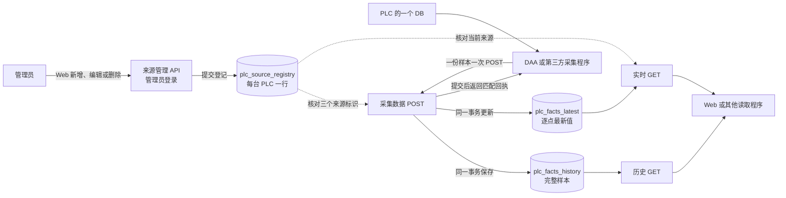

# 采集数据模块原理与使用

本文介绍 PLC 数据从来源登记、采集、上报到查询的流程，适合 DAA、第三方采集程序及读取原值的程序使用。具体字段和错误码以[采集数据接口合同](../contracts/published/http-api/plc-facts-v2/README.zh-CN.md)及[来源管理 API 合同](../contracts/published/http-api/plc-facts-v2/openapi-acquisition-sources-r4.json)为准。

以下说明包含 ARCH-ACQ-005 r1 的来源删除和独立历史查询；实际环境须采用对应源码，既有环境仍按原版本运行。 [目标迁移与恢复](../backend/scripts/plc_facts_maintenance/README.zh-CN.md#r3-单表迁移与恢复)

## 1. 一份数据怎么走



1. 管理员登录 Web，进入「采集数据 → 来源配置」，新建 DAA 或第三方来源，填写来源类型、实例 ID、逻辑 PLC ID 和来源代次。DB 不在登记中配置。Web 使用需要管理员权限的 `GET/POST/PATCH /api/v1/admin/acquisition-sources` 管理登记。
2. 后端把本次登记在一个数据库事务中提交。成功后，连接同一已采用目标的后端进程立即使用新登记，日常新增或编辑来源不需要重启。
3. 管理员在列表点「接入参数」并复制三项标识，交给对应发送方。发送方按该环境的目标地址与合同填写；DAA 的逐台配置见[使用手册](../automation-world/data-acquisition-agent/USER_GUIDE.zh-CN.md#3-登记来源并配置上报)。
4. 采集程序读取一个 PLC 的一个 DB，形成一份包含该 DB 本次完整点集的样本。一次采了两个 DB，就分别发送两次 `POST /api/v1/integration/plc-facts/samples` 并分别确认。实时上报和补传使用同一个接口；开始或继续上报会处理当前可发送的队列，队列中的样本逐份发送，并非只发送一条。
5. 后端核对登记，将一份样本写入历史表，并按点更新最新值表；两表在同一事务提交后才返回对应回执。发送方收到并核对与原样本匹配的 `committed` 回执后，才能标记确认。实时 GET 按当前登记读取，历史 GET 独立于登记读取未过期事实。

当前开发合同中，样本 POST 和五个采集 GET 不要求 Bearer；来源管理 API 则要求登录且为 active admin。来源登记控制准入，不等同于设备身份认证。实际部署的网络与认证策略应另行确认。

### 1.1 已有环境如何切换

确认目标已采用相应后端源码和合同。已有登记迁移前先暂停登记、上报和清理并保留备份；旧 JSON 的前驱导入和迁移步骤以[迁移与恢复](../backend/scripts/plc_facts_maintenance/README.zh-CN.md#r3-单表迁移与恢复)为准。采用、迁移和真实环境运行按各自授权执行。

采集数据模块记录 PLC 原值；设备状态和过程监控由相应业务模块按自己的规则使用所需数据。

## 2. 先理解来源和这三个字段

在已采用 r3 的后端，每台 PLC 在 `plc_source_registry` 中有一行。上报只匹配该行的 `plcId`、`instanceId` 和 `sourceGeneration`，`sourceType` 仅用于标注和展示。`dbNumber` 是样本必填字段，不与登记校对。 [来源管理说明](../backend/app/plc_facts/README.zh-CN.md#arch-acq-004-r3-来源管理)

| 字段 | 含义 | 什么时候变化 |
| --- | --- | --- |
| `sourceGeneration` | 这台 PLC 的当前来源代次，由后端登记。 | 同一来源正常连续采样时保持不变。来源接管或需要重新建立采样序号时，按安排在后端登记新的代次。 |
| `sampleId` | 一次 PLC/DB 样本的唯一 ID。 | 每次产生新样本都使用新 ID。它在同一个 `instanceId` 内必须唯一，跨 PLC、DB 和代次也要区分。重试同一份样本时沿用原 ID。 |
| `sourceSeq` | 采样顺序号，使用十进制字符串。 | 同一 `instanceId`、`plcId`、`dbNumber` 和 `sourceGeneration` 内，新采样的序号按采样顺序递增。补传或重试原样本时沿用原序号。 |

例如同一个实例采集 `PLC-A` 的 `DB21`，当前代次为 `gen-a`。

| 发生的事 | `sourceGeneration` | `sampleId` | `sourceSeq` |
| --- | --- | --- | --- |
| 采到第一份样本 | `gen-a` | `sample-001` | `"1"` |
| 采到第二份样本 | `gen-a` | `sample-002` | `"2"` |
| 第一份样本需要补传或重试 | `gen-a` | `sample-001` | `"1"` |
| 登记切换到新的来源代次，采到新样本 | `gen-b` | `sample-003` | `"1"` |

发送方按原采样顺序分配序号，补传沿用原号。即使第二份先到、第一份后到，第一份仍用 `"1"`。后端可以把迟到样本写入历史，已存在点的最新值继续保留较大的序号。迟到样本中的点如果此前还没有最新值，也可以补入该点的最新值。

例如同一来源的一个点先提交 10:00 的值，再补传 09:55 的值。

| 原采集时间 `observedAt` | `sourceSeq` | 值 | 后端收到时间 |
| --- | --- | --- | --- |
| 10:00 | `"100"` | 50 | 10:00 |
| 09:55 | `"99"` | 40 | 10:05，补传 |

补传成功后，历史中有两份样本，这个点的最新值仍为 50，其 `observedAt` 是 10:00。后端按 `sourceSeq` 判断最新值的先后，返回的 `observedAt` 记录原采集时间，历史中的 `storedAt` 记录后端保存时间。因此发送方应按原采样顺序分配序号，补传保持原号。如果把 09:55 的旧样本误编为 `"101"`，后端会把它视为更高序号的样本。

切换到新代次后，后端按当前登记准入。旧代次尚未确认的样本再次上报会收到 `403`，来源切换时需要安排这些待处理样本。

## 3. 后端一张登记表与两张事实表

### 3.1 PLC 来源登记表

`plc_source_registry` 每台 PLC 一行，登记 `plcId`、`instanceId`、`sourceGeneration` 和展示标签 `sourceType`。系统还保存登记版本、创建及修改时间和已退役代次，用于并发编辑与接管防重。标签可单独修改；改变实例或代次须确认接管并使用该 PLC 从未使用的新代次。

管理员可在来源列表确认删除一条登记。删除后该来源不能继续上报，原历史仍按有效期可查；发送方已冻结的样本应保留原身份和正文。登记行内的退役代次记录也随删除移除：若相关事实和最新值均已不存在，系统可能无法识别过去用过的代次。重新登记同一 PLC 应使用从未使用的新代次。

例如 `PLC-A` 登记为实例 `collector-a`、代次 `gen-a`，`PLC-B` 可以使用相同或不同的实例及自己的代次，后端始终逐行匹配。`PLC-A` 可分别上报 DB21 和 DB22，各提交一份样本；已登记 PLC 的有效最新值和未过期历史按实际 DB 查询。Web 的「接入参数」复制已提交行的三个标识，DAA 与第三方都可使用。

### 3.2 两张采集事实表

| 表 | 一行代表什么 | 主要用途 |
| --- | --- | --- |
| `plc_facts_history` | 一次完整的 PLC/DB 样本，点集保存在 `points_json`。 | 查看过去某次采集的完整点集和来源信息。 |
| `plc_facts_latest` | 一个 PLC、DB、点位的最新值。 | 按点快速读取当前值，也可查看一个 DB 的所有最新点位。 |

例如一次 `DB21` 样本里有温度和运行状态两个点。历史表增加一行，这一行包含两个点。最新值表分别更新温度行和运行状态行。

两表中同名的来源字段与上报字段对应。数据库使用下划线字段名，HTTP 使用驼峰字段名，例如数据库的 `sample_id` 对应接口的 `sampleId`。

| 数据库字段 | 所在表 | 作用 |
| --- | --- | --- |
| `id` | 历史 | 后端生成的历史记录 ID，用于查询这份样本的详情。 |
| `instance_id`、`sample_id` | 两表 | 记录来源实例和样本 ID，便于追溯点值属于哪份采样。 |
| `plc_id`、`db_number` | 两表 | 标识所属 PLC 和 DB。 |
| `group_id`、`config_revision` | 历史 | 保存采样时的采集组和配置版本，所有发送方可以不提供。 |
| `source_generation`、`source_seq` | 两表 | 记录来源代次和采样顺序。 |
| `source_type` | 历史 | 保存写入时登记的来源类型，值为 `daa`、`external` 或旧数据的 `null`。实时查询的来源类型来自当前来源登记。 |
| `points_json` | 历史 | 保存本次样本的完整点集。 |
| `content_hash` | 历史 | 保存上报正文的摘要，后端用它判断重试正文是否相同。 |
| `sampled_at` | 历史 | 这份样本的采集时间，取其中最晚的点位采集时间。 |
| `stored_at` | 历史 | 后端保存样本的时间。 |
| `point_id`、`point_name` | 最新值 | 点位 ID 和可选名称，`point_id` 与 PLC、DB 一起定位一行。 |
| `data_type`、`value_json`、`quality`、`reason`、`observed_at` | 最新值 | 点位的类型、值、质量、失败原因和原采集时间。 |
| `expires_at` | 两表 | 原值的查询有效截止时间，供查询和清理使用。 |

原值最多保留三个上海自然月，查询有效截止比这个上限提前 24 小时。每个点按自己的 `observedAt` 计算，整份历史样本按最早截止的点计算。例如点位在 `2026-11-11 10:00:00` 采集，有效截止为 `2027-02-10 10:00:00`。 [清理说明](../backend/scripts/plc_facts_maintenance/README.zh-CN.md)

## 4. 上报 JSON 的字段

下表帮助理解字段含义，精确的必填条件、类型及限制以[接口合同](../contracts/published/http-api/plc-facts-v2/README.zh-CN.md#上报字段及用途)为准。

### 样本字段

| 字段 | 怎么用 |
| --- | --- |
| `contractVersion` | 固定填 `plc-facts/v2`，标明请求使用的合同版本。 |
| `instanceId` | 采集程序实例 ID，填写后端登记的值。 |
| `sampleId` | 本次 DB 样本 ID，每份新样本产生一个，重试沿用。 |
| `plcId` | 采集来源的 PLC ID，填写后端登记的值。 |
| `dbNumber` | DB 编号，填 JSON 整数，例如 `21`。 |
| `sourceGeneration` | 当前来源代次，填写后端登记的值。 |
| `sourceSeq` | 该采样流中的顺序号，填字符串，例如 `"1"`、`"2"`。 |
| `points` | 本次采集的完整点集，使用 JSON 数组。 |
| `groupId` | 记录原采样所属的采集组。所有发送方均可省略、填 `null` 或填写有效标识。 |
| `configRevision` | 记录采样时使用的配置版本。所有发送方均可省略、填 `null` 或填写有效标识。 |

`groupId` 和 `configRevision` 是可选上下文字段。`sourceType` 由后端根据登记生成，发送方按登记填写 `instanceId` 即可。

### 每个点的字段

| 字段 | 怎么用 |
| --- | --- |
| `pointId` | 点位的稳定 ID，同一份样本内不能重复。读取单点时用它定位。 |
| `dataType` | PLC 原值类型，例如 `INT`、`BOOL`、`REAL`，后端按类型校验。 |
| `value` | 采集值，例如整数 `42` 或布尔值 `true`。质量为 `bad` 时填 `null`。 |
| `quality` | `good` 表示本次值有效，`bad` 表示采集失败或缺测。 |
| `observedAt` | 点位的原采集时间，例如 `2026-11-11T17:00:00+08:00`。补传沿用原时间。 |
| `name` | 用于显示的点位名称。 |
| `reason` | 失败或缺测原因，例如 `missing`。`good` 时可省略或填 `null`。 |

`0` 和 `false` 都可以是 `good` 的有效值。请求正文使用 UTF-8 JSON。 [完整字段限制与错误码](../contracts/published/http-api/plc-facts-v2/README.zh-CN.md#上报字段及用途)

## 5. DAA 入口

DAA 从已生效的本机采集配置生成样本，保存本机记录并按所选来源逐份上报。选择 profile、配置 PLC/DB、粘贴接入参数、检查队列与可靠回执、两种手测及恢复方式见 [DAA 使用手册](../automation-world/data-acquisition-agent/USER_GUIDE.zh-CN.md)。实际环境须采用相应 DAA 和后端版本。

## 6. 第三方如何上报

第三方先由管理员在 Web 登记类型 `external`，取得该行的实例、PLC 和来源代次；程序采集 PLC 原值后使用同一个 POST。下面的值仅为说明字段关系的合成示例，假设 DB 只有一个启用的上报点；实际使用时替换为目标环境中已登记的值。

```json
{
  "contractVersion": "plc-facts/v2",
  "instanceId": "external-a",
  "sampleId": "external-sample-001",
  "plcId": "PLC-A",
  "dbNumber": 21,
  "sourceGeneration": "gen-a",
  "sourceSeq": "1",
  "points": [
    {
      "pointId": "demo_counter",
      "dataType": "INT",
      "value": 42,
      "quality": "good",
      "observedAt": "2026-11-11T17:00:00+08:00"
    }
  ]
}
```

这份示例省略了可选的 `groupId` 和 `configRevision`，第三方也可以提供有效值或分别填 `null`。每次产生新样本时生成新 `sampleId` 和递增的 `sourceSeq`。需要可靠补传的程序保存原采集时间和原始请求正文，以便重试同一份样本。

首次提交成功返回以下回执。`created` 表示本次创建；当来源身份仍符合当前登记、样本仍在有效期内且已提交时，相同正文字节重试的 `outcome` 为 `duplicate`。两者的 `status` 都是 `committed`。

```json
{
  "code": 200,
  "message": "success",
  "data": {
    "contractVersion": "plc-facts/v2",
    "instanceId": "external-a",
    "sampleId": "external-sample-001",
    "status": "committed",
    "outcome": "created"
  }
}
```

后端按实际 JSON 正文字节判断同一份样本。重试时保留原正文，字段顺序、空格、可选字段的省略与 `null` 都沿用第一次发送的内容。在来源仍被准入且样本未过期时，相同 ID 使用不同正文或不同样本占用同一流序号会返回 `409`；旧身份已被接管可返回 `403`，已到有效截止可返回 `410`。 [回执与错误码](../contracts/published/http-api/plc-facts-v2/README.zh-CN.md#提交与补传)

## 7. 核对一份样本

1. 按已采用目标登记来源，核对发送方的 `instanceId`、`plcId` 和 `sourceGeneration`。DB 属于样本及查询条件。
2. 记录一份样本的实例、`sampleId`、PLC、DB、采集时间、点值和质量。发送后核对匹配实例和样本的 `committed` / `created` 或 `duplicate` 回执；HTTP 状态或 GET 读回不能代替可靠回执。
3. 在 Web「采集数据 → 采集历史」按 PLC、DB 和覆盖采样时刻的时间范围查询，打开同一 `sampleId`，比较点值和质量。最新值可能来自另一份样本。需要时也可按下一节的历史 API 列表及详情核对完整样本。

[DAA 手测步骤](../automation-world/data-acquisition-agent/USER_GUIDE.zh-CN.md#4-手测一停采后发送积压)说明本机积压及操作顺序；第三方可使用第 6 节示例。发送方对结果未知保留原身份和正文，不得伪造回执。

| 常见结果 | 检查与处理 |
| --- | --- |
| 管理接口 `401` / `403` | 核对登录状态和管理员权限；管理来源需要 active admin。 |
| 样本 POST 或实时读取 `403` | 上报时核对实例、PLC 和来源代次是否匹配当前登记；实时读取时核对 PLC 是否已登记。接管或删除后旧来源被拒绝时，保留原队列并核对，不改写旧样本身份。 |
| 历史详情 `404 plc_facts_v2.not_found` | 样本不存在或已过期；核对详情 ID 和有效期。 |
| `409` | 来源仍被准入且样本未过期时，核对样本 ID、采样序号和原始正文；来源管理的冲突则按提示核对活跃身份、代次或登记版本。 |
| `410 plc_facts_v2.expired_unconfirmed` | 样本已到有效截止，发送方应保留原记录，按实际保留和对账流程处理，不伪造回执或改采集时间重新冒充原样本。 |
| `422` | 核对必填字段、值类型和采集时间。 |
| `503 acquisition_sources.not_ready` | 来源管理的目标不可用或目标不匹配；先核对服务和库。它与来源未登记导致的 `403` 是不同问题。 |
| `503 plc_facts_v2.not_ready` | 采集数据服务或目标库未就绪；先检查目标状态，保留本地样本。 |
| 管理提交结果未知 | 若返回 `acquisition_sources.commit_outcome_unknown`，先 GET 来源列表核对登记，再决定是否原样重试，不直接当成成功。 |
| 样本回执缺失或 `503 plc_facts_v2.commit_outcome_unknown` | 保留本机记录和原冻结正文，先核对目标与当前来源，再按原身份和原字节处理重试；不要改写原样本或伪造回执。 |

## 8. SMA、CA、FF 或其他程序如何取值

程序读取单点时，调用 `GET /api/v1/acquisition-data/latest` 并传入 `plcId`、`dbNumber` 和 `pointId`。这条命令使用上面的合成标识，运行前将 PLC 改为当前环境已登记且允许读取的值。

```bash
curl --get 'http://127.0.0.1:8000/api/v1/acquisition-data/latest' \
  --data-urlencode 'plcId=PLC-A' \
  --data-urlencode 'dbNumber=21' \
  --data-urlencode 'pointId=demo_counter'
```

返回的 `data.items` 是数组。找到一项时，从该项读取 `value`、`quality` 和 `observedAt`。这些是后端已收到的最新点值，调用方可按 `observedAt` 和 `quality` 判断是否满足业务需要。没有有效匹配点时，数组为空。

省略 `pointId` 可以获取该 DB 的所有有效最新点位。列表按点位 ID 排序，各点可能来自不同采样轮次。如果要取一份完整的最新 DB 样本，可用 `history` 在所需时间范围内查询。列表按 `sampledAt` 倒序，再用首条的 `id` 查询历史详情。`sampledAt` 取该样本中最晚的点位采集时间。

例如查询合成 PLC 的一天历史，再用列表返回的 `id` 查询完整点集；实际使用时替换目标、标识、时间及详情 ID：

```bash
curl --get 'http://127.0.0.1:8000/api/v1/acquisition-data/history' \
  --data-urlencode 'plcId=PLC-A' \
  --data-urlencode 'dbNumber=21' \
  --data-urlencode 'from=2026-11-11T00:00:00+08:00' \
  --data-urlencode 'to=2026-11-12T00:00:00+08:00'
curl 'http://127.0.0.1:8000/api/v1/acquisition-data/history/123'
```

| 想做什么 | 接口 |
| --- | --- |
| 查看实时 PLC/DB 选项；查看历史选项 | `GET /api/v1/acquisition-data/options`；`GET /api/v1/acquisition-data/options?view=history` |
| 获取一个点或一个 DB 的最新值 | `GET /api/v1/acquisition-data/latest` |
| 分页浏览最新值，可按点位搜索 | `GET /api/v1/acquisition-data/latest/browse` |
| 按采集时间查历史样本摘要 | `GET /api/v1/acquisition-data/history` |
| 用历史列表的 `id` 取完整样本 | `GET /api/v1/acquisition-data/history/{id}` |

历史摘要中，`id` 是详情查询 ID，`sampledAt` 是样本采集时间，`storedAt` 是保存时间，`pointCount` 是样本点数。读取程序需要知道来源时，可查看 `instanceId`、`sourceType`、`sourceGeneration` 和 `sourceSeq`。 [完整读接口](../contracts/published/http-api/plc-facts-v2/README.zh-CN.md#读取接口)
