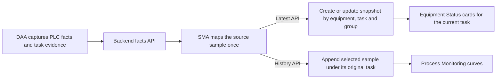

# Equipment Status and Process Monitoring Discussion

[中文](equipment-status-process-monitoring.zh-CN.md) · [Project documentation](README.md) · [ARCH-OBS-001 r6 specification](../plans/ARCH-OBS-001-configuration-driven-equipment-monitoring/spec.md)

2026-11-11 (Asia/Shanghai). This r6 review draft covers display, collection, storage and interfaces for a new project. The first version uses one deployment per project and starts with configuration and an empty database. D-06 adds third-party and SMA integration guidance under a documentation-only scope. The software design remains a draft. DDL, OpenAPI publication, implementation and first site enablement each require approval for their scope. [r6 §7.4 reading guide](../plans/ARCH-OBS-001-configuration-driven-equipment-monitoring/spec.md#74-长期阅读指南) · [D-06 delivery scope](../plans/ARCH-OBS-001-configuration-driven-equipment-monitoring/spec.md#r6-d-06-第三方与-sma-接入说明) · [D-05 delivery scope](../plans/ARCH-OBS-001-configuration-driven-equipment-monitoring/spec.md#r6-d-05-完整方案审阅稿)

## Reading guide

- [Register the two furnace zone 1 metrics](#metric-registry)
- [Configure an Equipment Status card](#latest-cards)
- [Configure Process Monitoring curves](#history-curves)
- [Follow the facts into snapshots and history](#data-flow)
- [How the two value tables store metrics](#local-slots)
- [Interface overview](#api-overview)
- [Direct third-party writes: omitted and null fields](#third-party-ingest)
- [First enablement and implementation sequence](#adoption)
- [Manage latest snapshots and process history](#admin-lists)

## 1. Register the two furnace zone 1 metrics

Use a synthetic furnace zone 1 sample to verify the first version. An administrator registers actual and setpoint temperature in the temperature sampling group and can register heating readiness for latest snapshots only.

The metric definition stores the Chinese and English names separately from one optional `unit` shared by both languages.

| Metric key | Chinese / English name | Type | Unit | Synthetic value |
| --- | --- | --- | --- | --- |
| `furnaceZone1Actual` | 实际温度 / Actual temperature | Number | °C | `810.2` |
| `furnaceZone1Set` | 设定温度 / Setpoint temperature | Number | °C | `815.0` |
| `furnaceHeatingReady` | 加热就绪 / Heating ready | Boolean | Blank | `true` |

Metric keys are unique within the project and stable once enabled. Cards, curves and SMA mappings use the registered keys, types and units. Administrators can edit metric names, display precision, and bilingual card and curve-group titles separately. SMA identifies the metric by `metricKey`. A change in physical meaning calls for a new key. Plan and Performance manage their own domain settings. [r6 §3 metric definitions](../plans/ARCH-OBS-001-configuration-driven-equipment-monitoring/spec.md#3-指标定义实时快照与过程历史) · [Plan and Performance field settings](generic-task-workflow-discussion.md#field-config-alignment)

## 2. Configure an Equipment Status card

All four pages share a metric registry, latest snapshot query and card component. Assemble these first-version presets for the verified stations, furnace zones and drive positions.

| Equipment Status page | Suggested Chinese / English card titles and values |
| --- | --- |
| Production Parameters | Single-metric cards 卷号 / Coil No., 已生产长度 / Produced length and 产线状态 / Line state bind the optional string `coilNo`, `producedLength` and `lineState` respectively. Verified specifications, line entry time and process step can each have a card. 实际线速度 / Actual line speed can reference `lineSpeedAct` from the drive group. |
| Cleaning | Configure one card per station, such as 清洗工位 1 / Cleaning Station 1. Use `cleaning` for measured temperature, available setpoint temperature and measured liquid level. Use `cleaningMotion` for available brush roller or readiness states. Alkaline cleaning stations reuse this structure. |
| Temperature | Configure a temperature card per verified furnace zone. 加热区 1 / Heating Zone 1 binds the zone’s actual and setpoint temperatures. |
| Drive | 线速度 / Line speed binds `lineSpeedAct` and `lineSpeedSet`. 开卷张力 / Uncoiler tension and 收卷张力 / Recoiler tension each bind measured tension and the verified setpoint for that position. Other positions can reuse this structure, with separate torque cards as needed. |

The production group reports the coil number as a string in `values.coilNo`, preserving leading zeros. Coil state is also an optional string metric, `values.coilState`, independent of the task number and line operating state. A confirmed coil can carry both metrics when the number is available. An absent or unconfirmed coil leaves the coil number out. The production group writes to latest snapshots only. [Production-group request example](../plans/ARCH-OBS-001-configuration-driven-equipment-monitoring/spec.md#生产组上报示例)

1. The administrator sets the card’s Chinese and English titles, visibility and order.
2. Add the two furnace metrics in display order and enable each item as needed. Each card references a metric at most once and can display one item or up to 10 enabled metrics.
3. Users with view permission see latest values only for the confirmed current task on the selected equipment. When a group snapshot or an individual value is missing, the affected enabled, visible items keep their places and show `—`. Each item’s freshness comes from its capture time. The card marks known older values as stale and displays `0` and `false` as valid values. Confirmed idle equipment and equipment with an unconfirmed task have distinct empty states. The page also shows an empty state when no cards are visible.

The response provides the localized name (`label`) and optional `unit` separately. When a unit is set, the frontend combines them in the item title, for example `实际温度（°C）` in Chinese and `Actual temperature (°C)` in English. When the unit is blank or omitted, the title shows only the name, without parentheses. The value area shows only the formatted value, such as `810.2`.

[r6 §2 four-page design](../plans/ARCH-OBS-001-configuration-driven-equipment-monitoring/spec.md#2-设备状态四页) · [r6 §4.1 card configuration and response examples](../plans/ARCH-OBS-001-configuration-driven-equipment-monitoring/spec.md#41-卡片配置和响应)

## 3. Configure Process Monitoring curves

| Process Monitoring page | Suggested Chinese / English curve-group titles and stored series |
| --- | --- |
| Temperature curves | 加热区 1 温度曲线 / Heating Zone 1 temperature history compares actual and setpoint temperatures. Each verified furnace zone can reuse this structure. |
| Drive monitoring | 线速度曲线 / Line speed history reads actual and setpoint line speed. Pair actual and setpoint tension in a separate group for each position, such as 开卷张力曲线 / Uncoiler tension history. |
| Cleaning monitoring | 清洗工位 1 温度曲线 / Cleaning Station 1 temperature history reads measured and available setpoint temperatures for that station. Put measured liquid levels in separate groups per station, such as 清洗工位 1 液位曲线 / Cleaning Station 1 level history. |

1. The administrator sets the group’s Chinese and English titles, visibility and order, then binds ordered series with individual enable switches.
2. Series in a group share a physical quantity and unit. Furnace zone 1 reuses the stable actual and setpoint temperature keys, with both curves on a common °C y-axis. Label the shared unit once on the axis and omit the label when the unit is blank.
3. Users with view permission read stored samples for the selected equipment and time range and can filter by the task recorded at capture. Curves use the original capture time and show gaps where samples or values are missing. Enabling, hiding or editing a curve group changes only what users see.

[r6 §4 query and configuration interfaces](../plans/ARCH-OBS-001-configuration-driven-equipment-monitoring/spec.md#4-前端查询和管理接口) · [r6 §4.2 curve group example](../plans/ARCH-OBS-001-configuration-driven-equipment-monitoring/spec.md#42-过程监控曲线组)

## 4. Follow the facts into snapshots and history

The PLC updates `activeTaskNo` when production actually starts or switches tasks. DAA captures verifiable task evidence with the sample and keeps it with the original facts. Normalize business task numbers by trimming leading and trailing spaces and uppercasing English letters. The normalized task number is unique within the project. The fixed database column is `task_no`, and the API uses `taskNo`. When task attribution is unclear, the source facts stay available for review. Both task-based destinations accept samples with confirmed attribution only. A project that uses one task per coil can assign the same text to both, for example task `000042` and coil string `"000042"`. Reworking the same coil uses a new task number, and history is queried separately by task. [r6 §3.2 task attribution and changeover](../plans/ARCH-OBS-001-configuration-driven-equipment-monitoring/spec.md#32-任务归属和换单)

1. SMA maps the source sample once and builds separate latest snapshot and history append requests in the same JSON envelope format. Each has its own delivery cadence and metric set. Both carry the task confirmed at capture and the original capture time. SMA reports each value by `metricKey` in its original JSON scalar type, such as number, boolean or string. Both destinations use the metric’s registered business unit when set. Business time follows Asia/Shanghai.
2. The latest API creates the first snapshot for a piece of equipment, a task and a sampling group, then replaces the collected fields together for that same key. When an older sample for the same key arrives late, the backend keeps the snapshot with the newer source capture time. It treats omitted metrics as missing. When the site confirms a switch from task A to task B, a late A sample can affect only A’s snapshot. Cards read B’s snapshots and show missing values for any group B lacks. The equipment’s current task comes from field evidence and the sequence at the source.
3. SMA selects history samples using the whitelist and sampling interval for each line and sampling group. Both settings are independent of page visibility and display order. In the synthetic furnace zone 1 example, actual and setpoint temperature can enter history with a qualifying sample. Heating readiness goes to latest snapshots only, as do the production parameters and cleaning motion groups. Intervals without a qualifying sample stay empty. An eligible late sample for task A is appended under A at its original capture time. The backend retains accepted history indefinitely without automatic expiration.
4. Each destination uses its own stable delivery identity and durable receipt. SMA checks confirmation separately and reuses that destination’s original identity when retrying. The backend deduplicates history using source sample identity and durable receipts.

[r6 §3.1 sampling policy and history whitelist](../plans/ARCH-OBS-001-configuration-driven-equipment-monitoring/spec.md#31-首版采样组与历史指标) · [r6 §5 write endpoints, fields and JSON examples](../plans/ARCH-OBS-001-configuration-driven-equipment-monitoring/spec.md#5-sma-指标发现和写入接口)

### 4.1 How the two value tables store metrics

The tables share fixed columns. Each table generates `id` as its row primary key. The business task number is stored in `task_no`, and one task can have several records. Other fixed columns include the production line `equipment_id`, sampling group `group_key`, original capture time `sampled_at`, source quality, sample identity, receipt reference and administrator remark.

| Value table | Writes and queries |
| --- | --- |
| `equipment_latest_snapshots` | Keeps one row per line, task and group. A newer sample replaces the collected fields and preserves the row `id` and remark. |
| `monitor_history_samples` | Gives each valid append its own `id` and deduplicates by line, original task, group, capture time and source identity. Query by task number and paginate in capture-time and row-`id` order. |

Both tables share the metric registry `equipment_metric_configs`. The binding table `equipment_metric_slot_bindings` assigns slots `01`–`100` separately for each write destination and sampling group. Each value table stores slot keys and original JSON value types in its own `local_values` column. Missing items are omitted, while `0`, `false` and leading zeros in strings are preserved. A slot binding becomes fixed on first successful use. Once either destination stores a metric, its key, type and business unit are fixed for both. Disabling a binding stops new writes for that destination. The slot stays reserved and old values remain readable. Re-enabling uses the original binding.

For one furnace zone 1 sample, the latest table stores actual temperature, setpoint temperature and heating readiness in `01/02/03`, for example `{"01":810.2,"02":815.0,"03":true}`. History stores only the two temperatures in `07/08`, as `{"07":810.2,"08":815.0}`. On reads, the backend maps each slot back to its `metricKey`, and cards and curves use the current names, units and display settings. Each write destination has durable receipts that preserve source and mapping traceability. [r6 §3.3 tables, column types, keys and indexes](../plans/ARCH-OBS-001-configuration-driven-equipment-monitoring/spec.md#33-本地槽位与物理表) · [Storage results for one source sample](../plans/ARCH-OBS-001-configuration-driven-equipment-monitoring/spec.md#同源样本的落库结果)

### 4.2 Interface overview

| Consumer | Proposed interface and purpose |
| --- | --- |
| SMA / third-party field discovery | `GET /api/v1/integration/metric-definitions` requires `equipmentId`, `groupKey` and `target`, and returns admitted and enabled metric keys, types and optional units. History is also filtered by the equipment and group allowlist. |
| SMA / third-party writes | `POST /api/v1/integration/equipment/latest-snapshots` writes latest snapshots; `POST /api/v1/integration/monitor/history-samples` appends history. Both use the same JSON envelope. The path selects the destination, and the backend validates the whole payload and resolves slots by target and group. |
| Business readers | Use `GET` to query current-task cards, stored samples and curves. History supports task filtering and returns decoded metric keys and values. |
| Administrators | Register metrics, bind slots and configure cards and curve groups. Separate latest and history resources use `GET` for lists and details, and `PATCH` for allowed management fields. |

The specification maintains the request and response details and complete JSON examples. [Field discovery example](../plans/ARCH-OBS-001-configuration-driven-equipment-monitoring/spec.md#指标发现示例) · [Write examples and receipts](../plans/ARCH-OBS-001-configuration-driven-equipment-monitoring/spec.md#5-sma-指标发现和写入接口) · [Read and configuration interfaces](../plans/ARCH-OBS-001-configuration-driven-equipment-monitoring/spec.md#4-前端查询和管理接口)

### 4.3 Direct third-party writes: omitted and null fields

SMA sends the complete envelope each time, including the version, producer, delivery event, mapping and revision, source references and `data`. Fixed version, producer, mapping, equipment and group settings can be configured once in SMA and included automatically in each request. PLC sources retain the actual `plc_fact` references.

A direct third party uses the same two POST endpoints. Each request must include one `external_event` source reference with its stable `sourceEventId`. Its `data` must include the `taskNo` confirmed at capture, the original time with offset in `sampledAt`, and at least one scalar in `values` keyed by `metricKey`. Both destinations and retries use the same source event ID for the same source sample. History also requires the actual source quality `quality: "good"` and must satisfy the history allowlist and sampling rules.

At onboarding, configure the machine identity, source, authorized equipment, sampling groups, targets, metric scope, and integration configuration ID and revision. The third-party request may omit `producerId`, `sourceRefs[0].sourceId`, the `mappingId` / `mappingRevision` pair and `contractVersion`. The backend fills these from the authenticated integration configuration and defaults the protocol version to `aiis.metric-ingest/v1`. An identity bound to one fixed equipment and group may omit `data.equipmentId` and `data.groupKey`; an identity with multiple devices or groups must include both in every request. Explicit values must match the binding and admission. The system manages row IDs, slots, remarks, review flags, display names and units; the write request does not accept those fields.

The backend can generate an omitted `eventId` deterministically from the producer, equipment, group, source, original source event and target. Latest and history each have their own receipt. A retry for the same target must consistently reuse the same `eventId` or keep omitting `eventId`; the required `sourceEventId` and sample content must stay the same. Different content under the same event conflicts. An existing receipt is checked against its original mapping information, so a later integration configuration revision does not change the original result.

“Omitted” means the key is absent from the JSON. For third-party latest writes, `quality` may be omitted or set to `null`; the backend records `unknown`. History requires an explicit `good`: omission, `null`, `bad` and `unknown` do not append a sample. The backend rejects explicit `null` for the other fields in the field rules. Omit a missing metric from `values`; a metric value of `null` rejects the whole request, while `0` and `false` are valid. [Field rules and backend handling](../plans/ARCH-OBS-001-configuration-driven-equipment-monitoring/spec.md#third-party-ingest-fields) · [Minimal third-party latest JSON](../plans/ARCH-OBS-001-configuration-driven-equipment-monitoring/spec.md#third-party-latest-example) · [Minimal third-party history JSON](../plans/ARCH-OBS-001-configuration-driven-equipment-monitoring/spec.md#third-party-history-example)

Discovery GET requires an authenticated, enabled integration identity with write admission for the requested equipment, group and target. Unauthenticated requests return `401`; disabled or unauthorized callers receive `403`; an admitted scope with no writable metrics returns an empty list. The endpoint returns writable metric definitions only, without stored latest values, history values or internal slots. Business-value reads and administrative actions have separate permission checks, and each POST checks admission again. The credential mechanism is determined by the implementation contract. [GET parameters and response](../plans/ARCH-OBS-001-configuration-driven-equipment-monitoring/spec.md#指标发现示例)

## 5. First enablement and implementation sequence

Prepare each line’s metrics, slot bindings, cards, curve groups, DAA points and SMA mappings. Latest snapshots and process history start from an empty database. Write admission stays closed until first approved enablement. After enablement, the first validated sample with a confirmed task creates its group’s latest snapshot. History starts with the first sample that also meets the whitelist and sampling policy. Without a qualifying sample, cards show an empty or missing-data state and history queries return empty series. [r6 §7.1 first enablement and data start](../plans/ARCH-OBS-001-configuration-driven-equipment-monitoring/spec.md#71-首次启用与数据起点)

1. Finalize the interfaces, write admission, receipts, error codes, tables, slot bindings and project presets. Use the synthetic furnace zone 1 sample to cover actual temperature, setpoint temperature, optional readiness and a task changeover.
2. Build the backend configuration, snapshots, history and durable receipts, with business reads and writes, admin lists and permission checks.
3. Develop the frontend and SMA in parallel under the same approved contract. The frontend implements dashboards, history and admin entries. SMA connects to DAA and implements one mapping, two deliveries and independent retries.
4. Start with an empty database in an isolated environment. Send one sample eligible for both destinations and check for one snapshot, one history record and a receipt for each. Then verify slot limits, task changeover, duplicate delivery and protection of management fields. First site validation and enablement require separate approval for the real line. Before enabling it, verify the point list, task evidence, sample framing, units, cadence, whitelist and capacity. [r6 §7.2 implementation and verification sequence](../plans/ARCH-OBS-001-configuration-driven-equipment-monitoring/spec.md#72-首版实施与验证顺序)

Energy statistics and captured-value corrections have their own scopes. Measure capture-to-display latency first and evaluate Redis if repeated reads of hot data become a bottleneck. [r6 §7.3 site prerequisites and later optimization](../plans/ARCH-OBS-001-configuration-driven-equipment-monitoring/spec.md#73-现场确认与后续优化)

## 6. Manage latest snapshots and process history

Equipment Status provides metric registration, slot binding and card configuration. Process Monitoring provides curve-group configuration. Only admins see the configuration entries, and the backend verifies login and admin permission. Slot settings show occupied and remaining capacity by target and group. Admins can add bindings, disable them or restore the original bindings. Display settings and slot enablement are configured separately. The two lists below let admins query collected records, add remarks and apply flags as permitted. [r6 §4.4 slot configuration](../plans/ARCH-OBS-001-configuration-driven-equipment-monitoring/spec.md#44-槽位配置管理)

The latest snapshot list sits under Equipment Status, and the process history list sits under Process Monitoring. Only admins see the management entries. Both lists support filtering by task number, equipment or production line, and sampling group. The backend paginates both lists. Process history also supports filtering by capture time range. The fixed columns are task number, equipment, sampling group, capture time and data status. Details show the configured name, unit and captured value for each metric, along with its key, source, capture quality and management metadata.

| List | First-version editable fields |
| --- | --- |
| Latest snapshots | Remark only. An SMA update of the collected fields for the same equipment, task and group retains the administrator’s remark. |
| Process history | Remark and management flags for marking a record abnormal or reviewed. These flags are stored and shown separately from source capture quality. |

The backend checks login, admin permission and device access for list queries, detail views and edits. It rejects fields outside the editable set. Standard cards and curves use the usual business read permissions. Corrections to captured values are deferred. [r6 §4.3 management APIs and editable fields](../plans/ARCH-OBS-001-configuration-driven-equipment-monitoring/spec.md#43-实时快照与过程历史管理)
