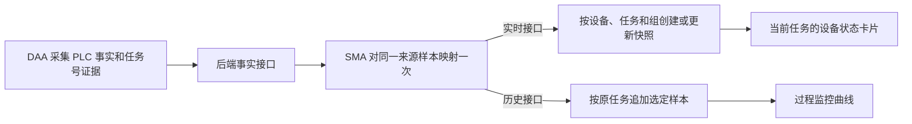

# 设备状态与过程监控讨论稿

[English](equipment-status-process-monitoring.md) · [项目文档目录](README.zh-CN.md) · [ARCH-OBS-001 规格](../plans/ARCH-OBS-001-configuration-driven-equipment-monitoring/spec.md)

当前设备、过程和能耗由 `equipment_observation` 注册，分别使用 `equipment_status_main`、`process_monitor_main` 和 `energy_consumption_main`。清退后的观测源码要求目标 revision `c9e1a3b5d720`，两条设备观测写入仅接受 v2，旧 collector 状态、常规旧设备／过程／能耗路由和 r8 归档查询已退出源码。真实目标采用状态由任务记录维护。 过程监控的能耗统计页面地址为 `/monitor/consumption`，唯一页面授权键为 `monitor.energy`。旧直链 `/monitor/energy` 已退出。已有 `monitor.consumption` 的部署须由负责人审查并显式处理，页面权限不会增加 `energy-consumption-read`、表计范围或管理权限。 [清退规格](../plans/ARCH-OBS-002-legacy-observation-retirement/spec.md)

2026-11-17（Asia/Shanghai）。当前合同为 r10；既往章节作为历史保留。独立核验、Human Owner 最终验收、现场联调及生产部署分别记录。

<a id="r10-guide"></a>

## r10 当前方案与操作

r10 是来源无关的多区域整包：机器按稳定 `metricKey` 报单值，设备两路使用相同数据结构、各自确认；能耗按表计独立上报，不关联 `taskNo`。下方原 r6–r8 内容保留为历史讨论，其中按组快照、任务点证据、`sampledAt` 和 SMA 必须携带来源的表述不适用于 r10。r10 [机器合同、字段和示例](../contracts/published/http-api/equipment-observation-v2/README.zh-CN.md) 与 [spec §12](../plans/ARCH-OBS-001-configuration-driven-equipment-monitoring/spec.md#r10-source-independent-energy) 是本节的细节依据；代码或合成测试不代表 SMA 产品、真实 PLC、生产部署或 Human Owner 最终验收。

| 数据 | 持久表与含义 | 前端 |
| --- | --- | --- |
| 设备快照 | `equipment_status_main`：每 `(equipment_id, task_no)` 一行，较新整包替换 `local_values`；保留采集时间 `observed_at`。 | 生产、清洗、温控、传动四页共用卡片配置；默认显示最近采样任务，可手选或恢复跟随，不推断设备正在生产。 |
| 过程历史 | `process_monitor_main`：一个合格整包一行，按原 `observed_at` 查询；空缺测事件可形成断点。 | 温度、传动、清洗页按单位显示配置的曲线、区域多选；选择不改变历史留存。 |
| 能耗 | `energy_consumption_main`：每表计、每组、每事件独立行，不关联任务；每个指标使用自己的累计、增量或瞬时口径。 | 过程监控的能耗统计页、表计配置和能耗数据列表；旧能耗及价格入口仍使用原权限。 |

设备值的 JSON 第一层为区域键、第二层为目标／区域独立的 `01`–`100` 槽号；`equipment_metric_groups`、`equipment_metric_configs`、`equipment_metric_slot_bindings` 定义稳定语义，卡片与曲线表单独控制显示。已用槽位和物理含义不能改绑；停用区域只影响显示，历史留存由历史槽位开关决定。单位可空，有单位时显示在指标标题旁；同单位曲线纵轴标一次。`0`、`false`、空字符串保留，缺测不补零。

### 管理员配置

1. 使用具有设备状态／过程读权限的 admin 登录。`设备状态 → 配置管理` 依次建立启用的**区域配置**（类别、稳定键、中英文名称、排序）、**指标设置**（稳定键、中英文名、类型、可选单位），再在**槽位设置**分别为 `latest` 和 `history` 绑定并启用需要的项。一个区域在每个目标各有 100 个槽；仅实时值可只启用实时。可在设备状态或过程的**数据管理**中设置指标列的显示与排序。
2. 在**卡片设置**选择页面与指标，填写中英文卡片标题；每卡最多 10 项。过期值同时显示该值的真实采集时间。在`过程监控 → 配置管理 → 曲线设置`选择温度／传动／清洗类别，给同单位的实际、设定等指标配置同一图框，可包含多个区域。区域选择使用当前语言的区域名称，图例和提示结合区域名与指标名区分曲线；名称相同时显示稳定键辅助区分，`groupKey` 保持不变。图表提示可查看原始采集时间；如果提示时间范围过大而坐标无法区分部分时刻，应缩小范围。区域及曲线显示的启停只影响显示；需要历史必须单独启用历史槽。
3. 如果需要能耗，先由运行环境负责人在私有 profile 登记表计及读范围，再在`过程监控 → 配置管理 → 表计指标配置`按表计／组／指标设置名称、单位、物理量、`cumulative`（累计）、`interval`（区间增量）或 `instantaneous`（瞬时）和适用规则。指标的列表显示开关与列顺序在此配置，独立于写入启停。累计用量需要真实边界和已确认连续性／最大采样间隔；缺边界、重置、间隔不明、不同值同刻等显示不完整或冲突，不猜测为零。相同消耗的累计与增量不相加，瞬时值不能直接求和。
4. 人类读取分别需要 `equipment-observation-read`、`monitor-observation-read`、`energy-consumption-read` 和相应设备／表计范围；管理入口要求 admin，记录仍受范围约束。机器只可发现其授权定义，不能凭机器 token 读取管理列表或样本。

### 可重复手工验收

以下只用于本机授权 dev 或明确归属的测试环境。迁移和用户侧配置就绪后，本机前端入口通常为 `http://127.0.0.1:5190`、API 为 `http://127.0.0.1:8000/api/v1`；实际启动和端口由环境负责人确认。清理过合成样本且私有 profile 没有设备／表计时，页面先显示空态是正常的。准备一个**本轮独有**设备、表计（可选）、区域、两个指标、卡片、曲线、producer、任务号和事件号，先确认均与现有对象无冲突，并记录精确键。管理员按上面步骤配置温度区域、`number` 类型的实际／设定值、两路槽位、卡片和同单位曲线；在服务端的私有 profile 为本轮设备与机器配置读范围及两路全部可能被替换的区域／指标权限。不得把模板的占位 token 摘要或示例 UUID 当作真实值；使用新的随机机器 token，只把摘要写入私有 profile，重载由服务负责人协调。

下面是同一份事件发送两路的示例。先将占位变量替换为已配置且专属于本次验收的键；机器 token 从安全渠道放进当前 shell 的 `OBS_MACHINE_TOKEN` 环境变量，勿粘贴进代码库、文档或 shell 历史。真实采样时应使用发送方实际采集时间；本示例取执行时刻来模拟一次新采样。

```bash
export OBS_API='http://127.0.0.1:8000/api/v1'
export OBS_LINE='替换为本轮设备键' OBS_GROUP='替换为本轮区域键'
export OBS_ACTUAL='替换为本轮实际值指标键' OBS_SET='替换为本轮设定值指标键'
export OBS_TASK='OBS-TEST-UNIQUE-001' OBS_EVENT='替换为本轮唯一事件号'
OBS_BODY="$(mktemp -t obs-r10)"
python3 - <<'PY' > "$OBS_BODY"
import json, os
from datetime import datetime, timedelta, timezone
print(json.dumps({'eventId': os.environ['OBS_EVENT'], 'data': {
    'equipmentId': os.environ['OBS_LINE'], 'taskNo': os.environ['OBS_TASK'],
    'observedAt': datetime.now(timezone(timedelta(hours=8))).isoformat(timespec='microseconds'),
    'quality': 'good', 'groups': {os.environ['OBS_GROUP']: {
        os.environ['OBS_ACTUAL']: 810.2, os.environ['OBS_SET']: 815.0}}}}, ensure_ascii=False))
PY
printf 'Authorization: Bearer %s\n' "$OBS_MACHINE_TOKEN" | curl --fail-with-body -sS -H @- -H 'Content-Type: application/json' --data-binary @"$OBS_BODY" "$OBS_API/integration/equipment/latest-snapshots"
printf 'Authorization: Bearer %s\n' "$OBS_MACHINE_TOKEN" | curl --fail-with-body -sS -H @- -H 'Content-Type: application/json' --data-binary @"$OBS_BODY" "$OBS_API/integration/monitor/history-samples"
rm -f "$OBS_BODY"
```

在每路回执核对 `outcome`、`recordId`、`stored`／`skipped`。从机器 GET `integration/metric-definitions?equipmentId=...` 核对授权与两路启用状态。前端选择该设备和任务：温控卡显示两值；选择含采样时刻的时间范围，温度曲线显示两条线；设备状态数据管理和过程数据管理分别按任务筛选并开启两指标列。实时列表仅可编辑备注；过程列表只允许备注及异常／已复核。曲线存在配置但选定范围内无样本时显示真实空轴和单位，不能出现虚构的零值；表计数据需分别调用能耗接口，详情见机器合同。

验收清理前先停用本轮 producer／确认无其他写入，并按 producer、目标、事件、设备、任务、记录 ID 逐项查明两路回执及业务行的归属。只按这些精确主键删除本轮业务行后再删除对应回执；使用了能耗时也按表计、目标、事件及记录 ID 清理该轮能耗行。再核对没有其他数据、卡片或曲线引用本轮专用指标／区域，按具体配置键逆依赖清理本轮卡片、曲线、槽、指标和区域；恢复或移除本轮私有 profile 中的设备、表计和 producer，保留期间其他人的配置。没有确认归属或存在其他引用时停止清理，不能 `TRUNCATE`、整表删除或清理共享设备的数据。记录完成前后的精确 ID 与行数；永久归档、价格表和其他业务数据均不得当作测试数据清除。

### 迁移与受控恢复

r8 旧实时和四张配置原表原样保留在 `_r8_archive`，旧过程原表也归档；新过程按旧行原时刻各自转成单区域事件，不把不同批次拼包。旧回执的 v1 指纹和结果位置保留，新实时等待真实整包。迁移前必须核验数据库目标／revision、旧时间语义、备份与写入方静默；不能以离线 SQL 绕过这些条件。MySQL DDL 会隐式提交：任何一步失败都先停止写入和自动重试，记录 Alembic 版本、现有表及约束、行数和归档清单，对照迁移逐项判定已执行步骤，未经人工对账不得盲目 `stamp`、降级、删除或覆盖表。完整升级后的受控恢复需先静默写入、保全 r10 写入、核对全部原表和 `_r10_preserved` 无冲突，再按迁移 guard 执行恢复；恢复后 r10 行与配置留在保全表，需人工对账才能再切换。profile 目标 revision、DB revision 与后端加载版本须一致，切换和恢复窗口内由运行负责人协调后端，不能让业务长期指向不匹配的库。

---

## 历史讨论（r6–r8）

以下内容保留当时的设计与采集假设；与上方 r10 冲突时以上方和当前规格为准。

## 阅读入口

- [登记炉区 1 的两个指标](#metric-registry)
- [配置设备状态卡片](#latest-cards)
- [配置过程监控曲线](#history-curves)
- [从采集事实到实时和历史](#data-flow)
- [两张值表如何保存指标](#local-slots)
- [接口概览](#api-overview)
- [第三方直接上报：字段能否省略](#third-party-ingest)
- [首次启用与实施顺序](#adoption)
- [管理实时快照和过程历史](#admin-lists)
- [r7：从配置到任务 000042 的端到端走读](#r7-walkthrough)

<a id="metric-registry"></a>

## 1. 登记炉区 1 的两个指标

以合成炉区 1 样本验证首版。管理员在温控采样组登记实际温度和设定温度，按需登记只用于实时快照的加热就绪。

指标定义将中英文名称与单位分开保存。两种语言共用一个可留空的 `unit`。

| 指标键 | 中文名 / English name | 类型 | 单位 | 合成值 |
| --- | --- | --- | --- | --- |
| `furnaceZone1Actual` | 实际温度 / Actual temperature | 数字 | °C | `810.2` |
| `furnaceZone1Set` | 设定温度 / Setpoint temperature | 数字 | °C | `815.0` |
| `furnaceHeatingReady` | 加热就绪 / Heating ready | 布尔值 | 留空 | `true` |

指标键在项目内唯一，启用后保持稳定。卡片、曲线和 SMA 映射沿用登记的键、类型和单位。指标名称、显示小数位及卡片和曲线组的中英文标题可分别调整，上报仍按 `metricKey` 识别指标。物理含义变化时登记新键。计划／实绩各自管理本域业务配置。 [r6 §3 指标定义](../plans/ARCH-OBS-001-configuration-driven-equipment-monitoring/spec.md#3-指标定义实时快照与过程历史) · [计划与实绩的字段设置衔接](generic-task-workflow-discussion.zh-CN.md#field-config-alignment)

<a id="latest-cards"></a>

## 2. 配置设备状态卡片

四页共用指标登记、实时查询和卡片组件。按已核实的工位、炉区和传动位置装配下列首版预设。

| 设备状态页 | 建议卡片中英文标题与指标值 |
| --- | --- |
| 生产参数 | 单指标卡片「卷号 / Coil No.」绑定可选字符串 `coilNo`，「已生产长度 / Produced length」绑定 `producedLength`，「产线状态 / Line state」绑定 `lineState`。已确认的规格、进线时间及工序可各配一张卡。「实际线速度 / Actual line speed」可引用传动组的 `lineSpeedAct`。 |
| 清洗工艺 | 按工位配卡，如「清洗工位 1 / Cleaning Station 1」。从 `cleaning` 取实测温度、可取得的设定温度及实测液位，从 `cleaningMotion` 取可取得的刷辊或就绪状态。碱洗工位复用此结构。 |
| 温控工艺 | 每个已确认炉区配一张温度卡，如「加热区 1 / Heating Zone 1」绑定炉区 1 的实际温度与设定温度。 |
| 传动工艺 | 「线速度 / Line speed」绑定 `lineSpeedAct` 与 `lineSpeedSet`。「开卷张力 / Uncoiler tension」和「收卷张力 / Recoiler tension」各绑对应位置的实测张力与已确认设定张力。其他位置可复用，转矩按需另配卡。 |

生产组通过 `values.coilNo` 上报卷号字符串，前导零原样保存。卷状态也是可选字符串指标 `values.coilState`，独立于任务号和产线运行状态。确认有卷且取到卷号时可同时上报两项，确认无卷或卷状态不明时省略卷号。生产组只走实时投递。 [生产组上报示例](../plans/ARCH-OBS-001-configuration-driven-equipment-monitoring/spec.md#生产组上报示例)

1. 管理员设置卡片中英文标题、启用状态与排序。
2. 按展示顺序绑定两个炉区指标，分别设置启用状态。同一卡片内的指标引用须唯一，每卡最多启用 10 项，也可以只显示一项。
3. 有查看权限的用户只读取所选设备已确认的当前任务的实时值。当前任务缺少某组快照或某项值时，启用且可查看的缺测指标保留位置并显示 `—`。每项按实际采集时间判断新鲜度，已知旧值标注陈旧，`0` 和 `false` 按有效值显示。现场确认无在制任务时显示空闲，任务未确认时显示归属不明的空态。页面没有可显示的卡片时也呈现空态。

响应分别提供当前语言的名称 `label` 和可选的 `unit`。有单位时，前端按当前语言组合指标项标题，例如中文的「实际温度（°C）」与英文的「Actual temperature (°C)」。单位留空或省略时，标题只显示名称，省去括号。值区只显示格式化后的值，例如 `810.2`。

[r6 §2 四页设计](../plans/ARCH-OBS-001-configuration-driven-equipment-monitoring/spec.md#2-设备状态四页) · [r6 §4.1 卡片配置和响应示例](../plans/ARCH-OBS-001-configuration-driven-equipment-monitoring/spec.md#41-卡片配置和响应)

<a id="history-curves"></a>

## 3. 配置过程监控曲线

| 过程监控页 | 建议曲线组中英文标题与已存序列 |
| --- | --- |
| 温度曲线 | 「加热区 1 温度曲线 / Heating Zone 1 temperature history」对照实际温度和设定温度，每个已核实炉区复用此结构。 |
| 传动监控 | 「线速度曲线 / Line speed history」读取实际与设定线速度。各位置的实测与设定张力独立成组，如「开卷张力曲线 / Uncoiler tension history」。 |
| 清洗监控 | 「清洗工位 1 温度曲线 / Cleaning Station 1 temperature history」读取该工位实测温度和可取得的设定温度。实测液位按工位另成组，如「清洗工位 1 液位曲线 / Cleaning Station 1 level history」。 |

1. 管理员设置曲线组中英文标题、启用状态和排序，再按顺序绑定可独立启用的序列。
2. 组内指标使用同一物理量和单位。炉区 1 复用实际温度和设定温度的稳定键，两条曲线共用 °C 纵轴。共用纵轴只标注一次单位，单位留空时省去标注。
3. 有查看权限的用户按设备和时间范围查看已保存的样本，也可按原采样任务筛选。曲线使用原采集时间，缺样或缺值的时段留空或断线。管理员启用、隐藏或编辑曲线组，只改变展示。

[r6 §4 查询和配置接口](../plans/ARCH-OBS-001-configuration-driven-equipment-monitoring/spec.md#4-前端查询和管理接口) · [r6 §4.2 曲线组示例](../plans/ARCH-OBS-001-configuration-driven-equipment-monitoring/spec.md#42-过程监控曲线组)

<a id="data-flow"></a>

## 4. 从采集事实到实时和历史

PLC 在实际开工或换单时更新 `activeTaskNo`。DAA 在采样时取得可核验的任务号证据，并随原事实保存。业务任务号去除首尾空格，英文字母统一为大写，规范化后在项目内唯一。数据库固定列为 `task_no`，接口用 `taskNo`。无法确认任务归属时，原始事实留待核对。两路任务型写入只接收归属可确认的样本。一个任务对应一卷时，两者可按项目约定取同一文本，例如任务号 `000042`、卷号字符串 `"000042"`。同卷返工使用新任务号，历史按任务号分别查询。 [r6 §3.2 任务归属和换单](../plans/ARCH-OBS-001-configuration-driven-equipment-monitoring/spec.md#32-任务归属和换单)



1. SMA 对同一来源样本执行一次指标映射，再按各自的投递周期和指标集合，以同一 JSON 信封格式分别组装实时快照与历史追加请求。两路沿用采样时确认的任务号和原采集时间，按 `metricKey` 上报原类型的 JSON 标量，如数字、布尔值或字符串。配置了单位时，两路共用指标登记的业务单位。业务时间采用 Asia/Shanghai 口径。
2. 实时接口为设备、任务和采样组首次创建快照，随后整份替换同一身份的采集字段。同一身份的旧包晚到时，保留来源采集时间较新的快照。省略的指标在新快照中为缺测。现场确认由 A 单切到 B 单后，迟到的 A 单样本只归 A 单。卡片只读 B 单快照，B 单缺组时显示缺测。设备当前任务由现场证据和来源时序判定。
3. SMA 按产线及采样组的历史白名单和采样间隔独立选样，两项配置独立于页面的展示开关和排序。合成炉区 1 的实际温度和设定温度可随合格样本进入历史，加热就绪仅走实时。生产参数和清洗动作组也仅走实时。缺少合格样本的间隔留空。满足规则的迟到 A 单样本仍按 A 单和原采集时间追加。后端永久保留已接收的历史，无自动过期清理。
4. 两路各有稳定的投递身份和持久回执。SMA 分别核对确认，按各路原身份重试。后端结合来源样本身份与持久回执对历史上报去重。

[r6 §3.1 采样策略与历史白名单](../plans/ARCH-OBS-001-configuration-driven-equipment-monitoring/spec.md#31-首版采样组与历史指标) · [r6 §5 写入接口、字段及 JSON 示例](../plans/ARCH-OBS-001-configuration-driven-equipment-monitoring/spec.md#5-sma-指标发现和写入接口)

<a id="local-slots"></a>

### 4.1 两张值表如何保存指标

两表共用固定列。各表生成的 `id` 是行主键，`task_no` 是业务任务号。同一任务可有多条记录。其余固定列包括产线 `equipment_id`、采样组 `group_key`、原采集时间 `sampled_at`、来源质量、样本身份、回执引用和管理员备注。

| 值表 | 写入和查询 |
| --- | --- |
| `equipment_status_main` | 同一产线、任务和组只保留一行。较新样本替换采集字段并保留行 `id` 和备注。 |
| `process_monitor_main` | 每次有效追加生成独立 `id`，按产线、原任务、组、原采集时间和来源身份去重，可按任务号查询并按采集时间和行 `id` 稳定分页。 |

两表共用指标登记表 `equipment_metric_configs`。槽位绑定表 `equipment_metric_slot_bindings` 按写入目标和采样组各分配 `01`–`100`，各自的值表在 `local_values` 中保存槽位与原类型 JSON 值。缺测项省略，`0`、`false` 和字符串前导零保留。首次成功存值后绑定固定。任一路开始存值后，该指标的键、类型和单位口径在两路固定。停用只关闭该目标的新写入，原槽位仍占用，已存值可解读。恢复沿用原绑定。

同一炉区 1 样本中，实时将实际温度、设定温度、加热就绪依次存入 `01/02/03`，例如 `{"01":810.2,"02":815.0,"03":true}`。历史只把两个温度存入 `07/08`，即 `{"07":810.2,"08":815.0}`。读回时，后端按各自绑定还原 `metricKey`，卡片和曲线再按当前名称、单位和展示配置渲染。两路写入各有持久回执，来源和映射可追溯。 [r6 §3.3 表、列型、键和索引](../plans/ARCH-OBS-001-configuration-driven-equipment-monitoring/spec.md#33-本地槽位与物理表) · [同源样本的落库结果](../plans/ARCH-OBS-001-configuration-driven-equipment-monitoring/spec.md#同源样本的落库结果)

<a id="api-overview"></a>

### 4.2 接口概览

| 使用方 | 候选接口与用途 |
| --- | --- |
| SMA／第三方发现字段 | `GET /api/v1/integration/metric-definitions` 必须指定设备 `equipmentId`、采样组 `groupKey` 和目标 `target`，返回已获准且启用的指标键、类型和可选单位；历史再按设备和组的白名单过滤。 |
| SMA／第三方两路写入 | `POST /api/v1/integration/equipment/latest-snapshots` 写实时快照；`POST /api/v1/integration/monitor/history-samples` 追加历史。两路共用 JSON 信封，以路径区分目标，后端整包校验并按目标和组落槽。 |
| 业务读用户 | 用 `GET` 查询当前任务卡片、历史样本和曲线。历史支持按任务号筛选，返回还原后的指标和值。 |
| 管理员 | 登记指标、绑定槽位、配置卡片和曲线组。两类采集记录各用 `GET` 读列表和详情，用 `PATCH` 编辑白名单内的管理字段。 |

请求、响应及完整 JSON 由规格维护。 [指标发现示例](../plans/ARCH-OBS-001-configuration-driven-equipment-monitoring/spec.md#指标发现示例) · [两路写入与回执](../plans/ARCH-OBS-001-configuration-driven-equipment-monitoring/spec.md#5-sma-指标发现和写入接口) · [读接口与配置](../plans/ARCH-OBS-001-configuration-driven-equipment-monitoring/spec.md#4-前端查询和管理接口)

<a id="third-party-ingest"></a>

### 4.3 第三方直接上报：字段能否省略

SMA 每次发送完整信封，包括版本、写入方、投递事件、映射及版本、来源引用和 `data`。固定的版本、写入方、映射、设备和组可在 SMA 中配置一次，由程序每次自动带上；PLC 来源继续保留真实 `plc_fact` 引用。

第三方直接上报同样使用两条 POST。每次须提供一条 `external_event` 来源引用及其稳定的 `sourceEventId`，在 `data` 中提供采样时已确认的 `taskNo`、带时区的原采集时间 `sampledAt`，以及至少一个按 `metricKey` 命名的 `values` 标量。相同来源的同一次采样在两路及重试中使用同一来源事件号。历史请求还须据实提供 `quality: "good"`，并满足历史白名单和选样规则。

接入时配置机器身份、来源、可写设备、采样组、目标、指标范围及接入配置标识和版本。第三方请求可省略 `producerId`、`sourceRefs[0].sourceId`、成对的 `mappingId`／`mappingRevision` 及 `contractVersion`；后端从已认证的接入配置补齐，协议版本默认为 `aiis.metric-ingest/v1`。身份固定绑定一个设备和组时，`data.equipmentId` 与 `data.groupKey` 也可省略；多设备或多组时两项都须随请求提供。显式传入的值必须符合绑定和准入。系统管理行 ID、槽位、备注、复核标记、展示名称及单位，写入请求不接收这些字段。

可省略的 `eventId` 由后端按写入方、设备、组、来源、原来源事件及目标稳定生成，实时和历史各有回执。重试同一目标时始终使用相同的 `eventId` 或始终省略 `eventId`；必传的 `sourceEventId` 沿用原值，采样内容保持不变。同一事件的内容改变会冲突。已存回执使用原映射信息核对，即使接入配置版本后来更新，原事件仍可按原结果确认。

「省略」表示 JSON 不包含该键。第三方实时 `quality` 可省略或传 `null`，后端记为 `unknown`；历史必须明确提供 `good`，缺省、`null`、`bad` 或 `unknown` 都不追加。字段规则中的其他字段显式传 `null` 会被拒绝。某个指标缺测时省略 `values` 中该指标键，指标值 `null` 会使整包被拒绝；`0` 和 `false` 是有效值。 [字段规则与后端处理](../plans/ARCH-OBS-001-configuration-driven-equipment-monitoring/spec.md#third-party-ingest-fields) · [第三方实时最简 JSON](../plans/ARCH-OBS-001-configuration-driven-equipment-monitoring/spec.md#third-party-latest-example) · [第三方历史最简 JSON](../plans/ARCH-OBS-001-configuration-driven-equipment-monitoring/spec.md#third-party-history-example)

发现 GET 要求已认证、已启用的集成身份对指定设备、组和目标具有写入准入；未认证返回 `401`，未启用或越权返回 `403`，获准但没有可写指标时返回空列表。该接口只返回可写指标定义，不返回已存实时值、历史值或内部槽位。查询业务值和管理员操作分别校验对应权限，POST 写入时重新校验准入。r7 使用由服务器私有 profile 校验的独立机器 Bearer。 [GET 参数与响应](../plans/ARCH-OBS-001-configuration-driven-equipment-monitoring/spec.md#指标发现示例)

<a id="adoption"></a>

## 5. 首次启用与实施顺序

本节保留 r6 的方案顺序；首版实施及 SMA 产品后续接线以 r7 §9 和第 7 节为准。

每条产线先准备指标、槽位绑定、卡片、曲线组、DAA 点位和 SMA 映射，实时快照和过程历史从空库开始。写入准入在首次获准启用前保持关闭。启用后，首份通过校验且任务归属已确认的样本建立该组实时快照。历史从首份同时符合白名单和采样策略的样本开始追加。缺少合格样本时，实时卡片显示空态或缺测，历史查询返回空序列。 [r6 §7.1 首次启用与数据起点](../plans/ARCH-OBS-001-configuration-driven-equipment-monitoring/spec.md#71-首次启用与数据起点)

1. 定稿接口、准入、回执、错误码、表结构、槽位和项目预设，用合成炉区 1 样本覆盖实际温度、设定温度、可选就绪和换单。
2. 后端建立配置、快照、历史及持久回执，提供业务读写、管理列表与权限校验。
3. 前端与 SMA 按同一获批合同并行。前端实现看板、历史及管理入口，SMA 接入 DAA，实现一次映射、两路投递和独立重试。
4. 在隔离环境从空库开始，用一份符合双路条件的样本核对一条快照、一条历史及各自回执，再验证槽位上限、换单、重复投递和管理字段保护。首次现场验证及启用按真实产线范围另行批准。启用前核实点表、任务证据、成帧、单位、周期、白名单和容量。 [r6 §7.2 实施与验证顺序](../plans/ARCH-OBS-001-configuration-driven-equipment-monitoring/spec.md#72-首版实施与验证顺序)

能耗和原始值更正另立范围。先测量采集到显示的时延，重复热点读取成为瓶颈时再评估 Redis。 [r6 §7.3 现场确认与后续优化](../plans/ARCH-OBS-001-configuration-driven-equipment-monitoring/spec.md#73-现场确认与后续优化)

<a id="admin-lists"></a>

## 6. 管理实时快照和过程历史

设备状态提供指标登记、槽位绑定和卡片配置，过程监控提供曲线组配置。前端仅向 admin 显示配置入口，后端校验登录和 admin 权限。槽位设置按目标和组查看已占用与剩余容量，登记新绑定或停用、恢复原绑定。展示开关与槽位启用分别配置。下面两个采集记录列表用于查询、备注和标记。 [r6 §4.4 槽位配置管理](../plans/ARCH-OBS-001-configuration-driven-equipment-monitoring/spec.md#44-槽位配置管理)

实时快照列表归设备状态模块，过程历史列表归过程监控模块。管理入口仅对 admin 可见。两个列表均可按任务号、设备或产线、采样组筛选，并由后端分页。过程历史还可按采集时间范围筛选。固定列为任务号、设备、采样组、采集时间和数据状态。详情按指标配置展示名称、单位及采集值，并提供指标键、来源、采集质量和管理信息。

管理员可在各列表的“指标列设置”中分别选择已绑定指标并设置顺序，保存后直接显示列值；未选择时只显示固定列。显示开关不影响采集写入，停写后历史列仍可显示已保存的值。表头使用当前语言名称与可选单位，`0`、`false` 和空字符串均与缺测区分；列宽按指标键及两张表分别保存在本机。

| 列表 | 首版可编辑内容 |
| --- | --- |
| 实时快照 | 仅备注。SMA 更新同一设备、任务和组的采集字段时保留管理员备注。 |
| 过程历史 | 备注和管理标记，可标记异常或已复核。管理标记与来源采集质量分开保存和显示。 |

后端在列表查询、详情和编辑时校验登录、admin 权限及设备访问范围，并拒绝超出编辑白名单的字段。普通卡片与曲线沿用业务读权限。原始采集值更正列入后续范围。 [r6 §4.3 管理接口和编辑范围](../plans/ARCH-OBS-001-configuration-driven-equipment-monitoring/spec.md#43-实时快照与过程历史管理)

<a id="r7-walkthrough"></a>

## 7. 从配置到任务 000042 的端到端走读

本节说明合成场景的使用链条，不代表现场系统已启用。公开合同见 [OpenAPI、双语接入说明及合成向量](../contracts/published/http-api/equipment-observation-v1/README.zh-CN.md)，具体校验和验收以 [r8 规格](../plans/ARCH-OBS-001-configuration-driven-equipment-monitoring/spec.md#r8-dev-integration)为准。

1. **运行方配置身份和来源。** 空的专用 MySQL 先显式执行 Alembic；管理员和两种机器身份分别配置。仓库外的业务 profile 指定精确数据库目标、设备 `line-01` 绑定 `plc-01`／DB 42／任务点 `point-active-task-no`，设空闲值和任务点最大年龄；按角色分配设备读取范围。每个写入身份单独配置 Bearer 摘要、类别、映射标识／版本及可写设备、组、目标和指标。实时组 `groupSettings` 独立给出 `staleAfterSeconds`；历史 `historyRules` 给出白名单和发送端选样间隔 `intervalSeconds`。项目配置默认关闭，不能仅凭传入名称获得权限。
2. **管理员登记与展示。** 在设备状态管理页登记 `furnaceZone1Actual` 和 `furnaceZone1Set`，类型 `number`，分别配置中英文名称、`°C` 和小数位；可另登记只实时显示的 `furnaceHeatingReady` 布尔值。对 temperature 组，实时将三项分别绑定 `01/02/03`，历史将前两项绑定 `07/08`。登记一张 `zone1` 温控卡，选择前两项、配置双语标题与开关；过程监控管理页另配置 `zone1` 曲线组，选择同单位的两条线。卡片最多 10 项，曲线显示开关独立于历史留存。槽位首次存值后不可改作其他含义。
3. **确认现场任务事实。** 合成例首先向采集模块的 v2 接口提交任务点和炉区点，`point-active-task-no` 的字符串值为 `"000042"`；后端按设备绑定、样本来源、代次、质量、采集时间和有效期证明归属。第三方按原采集时间查最近有效任务点，SMA 信封引用同一份已保存样本且含任务点。换单后看板按已确认的当前任务选快照，迟到旧任务仍属于旧任务，无法证明归属时拒绝。
4. **发现与双路写入。** 两种身份均可请求 `GET /api/v1/integration/metric-definitions?equipmentId=line-01&groupKey=temperature&target=history`，获准时看到两个温度指标，不看到内部槽号或已存数据。第三方按 [最简 JSON](../contracts/published/http-api/equipment-observation-v1/vectors.json) 提交 `external_event`、任务号、采样时间和两个指标；实时可省略质量，历史须传 `good`。SMA 对另一份合成 v2 样本提交完整信封，实时带两项温度及 `false`，历史只带两项温度。每种调用内部实时和历史共用其各自来源采样；两路 POST 独立确认、失败后独立重试。固定身份 walkthrough 仅限确认可丢弃的专用测试目标，不能用于现有 dev；参见合同 README。
5. **核对库和页面。** 例如 SMA 实时样本实际值 `812.2`、设定值 `815.0` 会保存为快照 `local_values={"01":812.2,"02":815.0,"03":false}`；同源历史为 `{"07":812.2,"08":815.0}`，分别有回执和 task evidence。设备状态四页复用配置化卡片，当前任务 `000042` 的温控卡显示“加热区 1”、两项名称及数值；名称旁带单位，值区只显示值。温度、传动、清洗三个过程页面复用曲线，按 `taskNo`、设备和时段筛选，同单位纵轴标一次，缺采样间隔断线。每组陈旧判断使用自身阈值和原采集时间。
6. **查询及管理权限。** 登录用户的设备卡片、设备选项需要 `equipment-observation-read`，历史、曲线和过程选项需要 `monitor-observation-read`，服务端再次限制该角色的设备范围。机器 Bearer 只用于指标发现及写入。管理员从 Web 的 `/equipment/observations/admin` 和 `/monitor/observations/admin` 进入，列表接口分别为 `GET /api/v1/equipment/admin/latest-snapshots` 和 `GET /api/v1/monitor/admin/history-samples`，并可查看详情；实时仅可改备注，历史可改备注和 `abnormal`／`reviewed` 标记，不修改原始值。指标、槽位、卡片和曲线组是全局配置，要求 admin；涉及设备的记录列表、详情和编辑仍校验该 admin 的设备范围。空设备范围可配置全局项目，但记录列表为空。

七张表的职责如下，完整列、索引和约束以 [r8 迁移](../backend/alembic/versions/20261116_1800_8c0e2a4d6f18_add_equipment_observation.py)及[规格 §10.2](../plans/ARCH-OBS-001-configuration-driven-equipment-monitoring/spec.md#r8-dev-integration)为准：

| 表 | 职责 |
| --- | --- |
| `equipment_metric_configs` | 指标稳定键、所属组、类型、中英文名、单位和小数位。 |
| `equipment_metric_slot_bindings` | 按目标／组绑定 1–100 号槽、开关和首次使用时间。 |
| `equipment_card_configs` | 四页共用的卡片标题、排序和有序指标引用。 |
| `monitor_curve_group_configs` | 三页共用的曲线组标题、排序和有序曲线引用。 |
| `equipment_status_main` | 设备＋任务＋组唯一的最新快照，覆盖时保留行号和管理员备注。 |
| `process_monitor_main` | 按来源采样追加历史、去重，并保存备注和人工标记。 |
| `metric_ingest_receipts` | 按目标／发送方／事件保存请求摘要、结果、映射、来源与已确认任务点证据。 |

任务号是贯穿业务的稳定键，行 `id` 仍是数据库主键；卷号可以是普通字符串指标。现有能耗和采集数据入口保持各自合同。SMA 产品真实取数和投递、DAA 实际现场接线、旧环境数据采用与发布部署均需各自范围和验证。


### 后续 SMA 取数和 DAA 联调前置条件

本次合成客户端验证不等于运行 SMA 产品、DAA 或真实 PLC。当前 [PLC facts v2 合同](../contracts/published/http-api/plc-facts-v2/README.zh-CN.md) 的开发 GET/POST 不使用旧 `readScopes` 或观察模块的 Bearer；观察模块另按设备、采样组、目标和指标键授权。映射后实时和历史分别提交、核对各自回执及重试。

[SMA-004](../automation-world/semantic-mapping-agent/PLAN.zh-CN.md) §7 及 [SMA 后续阶段规划](../automation-world/semantic-mapping-agent/plans/SMA-001-cu-integration-and-scope-cleanup/spec.md#4-后续阶段仅目标与依赖)中的源 GET → 目标 POST 产品执行与单目标联调需要独立批准；SMA-004 当前获批范围为本地配置与纯预览，不代表产品投递已开放。[ARCH-ACQ-001 统筹](../plans/ARCH-ACQ-001-acquisition-data-coordination/spec.md)描述两条业务线与最终接线的顺序。依 [DAA-010 草案](../automation-world/data-acquisition-agent/plans/DAA-010-sample-facts-upload/spec.md)，先固定 [ARCH-BE-012](../plans/ARCH-BE-012-simplified-plc-facts/spec.md) 的精确新版 provider 及机器合同，并确认该精确交付已完成获准隔离环境的独立验证与 Human Owner 最终验收；再取得 DAA-010 精确 Revision 的实施／联调批准，首轮使用新建可丢弃的隔离 profile，不能沿用或改写旧 profile。

受控联调时，按每个 PLC/DB 分别核对 DAA 的 SQLite 原样本、冻结请求、Backend 历史及逐点 latest、对应成功或重复回执和 SQLite 持久确认；HTTP 200 或页面显示不能单独代替本地确认。再核对 SMA 的获准事实 GET、映射和观察模块两条 POST 及各自回执、值表和任务归属。完整 PLC/DS → DAA → Backend → SMA → 业务 API 链还需要相关 API 的精确验收和 SMA 产品执行／跨端联调的相应批准；各项状态以各自任务的最新有效记录为准。

<a id="r8-manual-acceptance"></a>

## 8. 管理员手动验收

以下操作需要已完成 r8 迁移的指定环境、管理员登录及运维人员配置的仓库外 OBS profile。先选一套**本次独有**的设备、PLC、实例、代次、任务号、指标键、卡片键和事件号，核对不与现存数据相同；profile 仅为该设备和测试身份授予必要目标／指标，历史白名单包括要画线的两个指标。记录本次创建的对象及写入回执 ID。示例中的 `-VERIFY-1` 是占位符，每次应换成独有后缀，所有引用保持一致；时间改成当前上海时间并保持同一采样时间。不要使用固定身份的 `walkthrough.py` 操作现有 dev 库。

当前空设备 profile 已允许管理员设置全局指标、槽位、卡片和曲线，但不会显示设备或允许机器写入。要发送自己的验证数据，由运维人员按[私有配置示例](../contracts/published/http-api/equipment-observation-v1/example-profile.json)填写 `devices`、`readScopes.admin`、`producers`、`historyRules`、`groupSettings`，并保持目标 UUID、schema 和 revision 与数据库一致。producer 只保存独立 token 的 SHA-256 摘要，明文由使用方私下保管；配置文件路径由后端 `.env` 中的 `OBSERVATION_PROFILE_FILE` 指定，真实内容不提交。profile 加载有进程缓存，修改后由负责人重载后端再验证。

1. 在“采集数据 → 来源配置”登记独有的 PLC、实例和代次；OBS profile 的设备绑定指向同一 PLC、DB 和任务点。通过设备状态管理页新增两个 `number` 指标 `obsActualVerify1`、`obsSetVerify1`，所属 `temperature`，标题和单位自行设置。分别为实时和历史绑定空槽，在温控页配置一张卡，在过程温度配置一组两条曲线；这些指标也须出现在 profile 的相应写入授权和历史白名单中。
2. 对 `POST /api/v1/integration/plc-facts/samples` 发送同一 PLC/DB 的一份任务点与温度点；当前采集接口按其自身合同使用，不需要观察写入 Bearer：

   ```json
   {"contractVersion":"plc-facts/v2","instanceId":"OBS-INSTANCE-VERIFY-1","sampleId":"OBS-SAMPLE-VERIFY-1","plcId":"OBS-PLC-VERIFY-1","dbNumber":42,"sourceGeneration":"OBS-GEN-VERIFY-1","sourceSeq":"1","points":[{"pointId":"obs-task","dataType":"STRING[50]","value":"OBS-TASK-VERIFY-1","quality":"good","observedAt":"2026-11-16T10:30:00+08:00"},{"pointId":"obs-actual","dataType":"REAL","value":810.2,"quality":"good","observedAt":"2026-11-16T10:30:00+08:00"},{"pointId":"obs-set","dataType":"REAL","value":815.0,"quality":"good","observedAt":"2026-11-16T10:30:00+08:00"}]}
   ```

3. 用 profile 授权的第三方 Bearer 分别向实时与历史 POST；两次请求可使用下列同一正文，因为 `quality=good` 同时满足两个目标。按目标各自检查 `stored` 回执；同一来源、目标及内容重试应返回同一结果。后端据目标和组映射到各自槽位。

   ```json
   {"sourceRefs":[{"kind":"external_event","sourceEventId":"OBS-EXTERNAL-VERIFY-1"}],"data":{"taskNo":"OBS-TASK-VERIFY-1","sampledAt":"2026-11-16T10:30:00+08:00","quality":"good","values":{"obsActualVerify1":810.2,"obsSetVerify1":815.0}}}
   ```

   实时路径是 `/api/v1/integration/equipment/latest-snapshots`，历史路径是 `/api/v1/integration/monitor/history-samples`。如该机器身份授权了多个设备或采样组，`data` 还须填 `equipmentId` 和 `groupKey`。若要验证 SMA 完整信封，参照[同一份采集样本的引用示例](../contracts/published/http-api/equipment-observation-v1/vectors.json)，任务点及映射点必须在同一份样本中。
4. 在温控卡片中确认当前任务和两个值；在过程温度页按任务号及时间查询两条曲线。分别打开两个 admin 列表，用“指标列设置”显示对应列并按任务号筛选；核对列表值、详情、质量及备注／复核标记。更改显示开关不应改变已存历史。当前任务点过期时页面应显示未确认而非假装在线。
5. 验收完成后，如要清理，由具有相应权限的运维人员使用事先记录的**精确 ID 和独有键**逐项核对并仅清理本次采样、回执、配置和来源；先确认对象没有被其他记录引用或新的采集者接管，再处理数据库外的本次临时 profile。不要按时间范围、整表、整设备或其他共享条件批量删除。验收人也可保留自己创建的验证记录，按所在环境约定管理。
