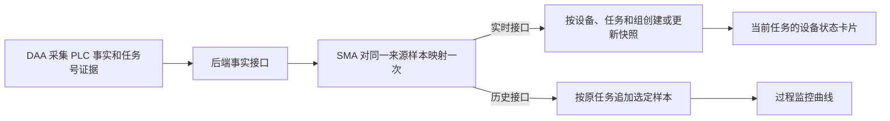

# 设备状态与过程监控讨论稿

[English](equipment-status-process-monitoring.md) · [项目文档目录](README.zh-CN.md) · [ARCH-OBS-001 r6 规格](../plans/ARCH-OBS-001-configuration-driven-equipment-monitoring/spec.md)

2026-11-11（Asia/Shanghai）。本文是 r6 从 0 到 1 的方案审阅稿，涵盖展示、采集、落库和接口。首版一个部署对应一个项目，从配置和空库开始。本次 D-06 补充第三方和 SMA 接入说明，授权限于文档，软件设计仍是草案。DDL、OpenAPI 发布、实施和首次现场启用各按对应范围审批。 [r6 §7.4 长期阅读指南](../plans/ARCH-OBS-001-configuration-driven-equipment-monitoring/spec.md#74-长期阅读指南) · [D-06 交付范围](../plans/ARCH-OBS-001-configuration-driven-equipment-monitoring/spec.md#r6-d-06-第三方与-sma-接入说明) · [D-05 交付范围](../plans/ARCH-OBS-001-configuration-driven-equipment-monitoring/spec.md#r6-d-05-完整方案审阅稿)

## 阅读入口

- [登记炉区 1 的两个指标](#metric-registry)
- [配置设备状态卡片](#latest-cards)
- [配置过程监控曲线](#history-curves)
- [从采集事实到实时和历史](#data-flow)
- [两张值表如何保存指标](#local-slots)
- [接口概览](#api-overview)
- [第三方直接上报：字段能否省略](#third-party-ingest)
- [首次启用与实施顺序](#adoption)
- [管理实时快照和过程历史](#admin-lists)

## 1. 登记炉区 1 的两个指标

以合成炉区 1 样本验证首版。管理员在温控采样组登记实际温度和设定温度，按需登记只用于实时快照的加热就绪。

指标定义将中英文名称与单位分开保存。两种语言共用一个可留空的 `unit`。

| 指标键 | 中文名 / English name | 类型 | 单位 | 合成值 |
| --- | --- | --- | --- | --- |
| `furnaceZone1Actual` | 实际温度 / Actual temperature | 数字 | °C | `810.2` |
| `furnaceZone1Set` | 设定温度 / Setpoint temperature | 数字 | °C | `815.0` |
| `furnaceHeatingReady` | 加热就绪 / Heating ready | 布尔值 | 留空 | `true` |

指标键在项目内唯一，启用后保持稳定。卡片、曲线和 SMA 映射沿用登记的键、类型和单位。指标名称、显示小数位及卡片和曲线组的中英文标题可分别调整，上报仍按 `metricKey` 识别指标。物理含义变化时登记新键。计划／实绩各自管理本域业务配置。 [r6 §3 指标定义](../plans/ARCH-OBS-001-configuration-driven-equipment-monitoring/spec.md#3-指标定义实时快照与过程历史) · [计划与实绩的字段设置衔接](generic-task-workflow-discussion.zh-CN.md#field-config-alignment)

## 2. 配置设备状态卡片

四页共用指标登记、实时查询和卡片组件。按已核实的工位、炉区和传动位置装配下列首版预设。

| 设备状态页 | 建议卡片中英文标题与指标值 |
| --- | --- |
| 生产参数 | 单指标卡片「卷号 / Coil No.」绑定可选字符串 `coilNo`，「已生产长度 / Produced length」绑定 `producedLength`，「产线状态 / Line state」绑定 `lineState`。已确认的规格、进线时间及工序可各配一张卡。「实际线速度 / Actual line speed」可引用传动组的 `lineSpeedAct`。 |
| 清洗工艺 | 按工位配卡，如「清洗工位 1 / Cleaning Station 1」。从 `cleaning` 取实测温度、可取得的设定温度及实测液位，从 `cleaningMotion` 取可取得的刷辊或就绪状态。碱洗工位复用此结构。 |
| 温控工艺 | 每个已确认炉区配一张温度卡，如「加热区 1 / Heating Zone 1」绑定炉区 1 的实际温度与设定温度。 |
| 传动工艺 | 「线速度 / Line speed」绑定 `lineSpeedAct` 与 `lineSpeedSet`。「开卷张力 / Uncoiler tension」和「收卷张力 / Recoiler tension」各绑对应位置的实测张力与已确认设定张力。其他位置可复用，转矩按需另配卡。 |

生产组通过 `values.coilNo` 上报卷号字符串，前导零原样保存。卷状态也是可选字符串指标 `values.coilState`，独立于任务号和产线运行状态。确认有卷且取到卷号时可同时上报两项，确认无卷或卷状态不明时省略卷号。生产组只走实时投递。 [生产组上报示例](../plans/ARCH-OBS-001-configuration-driven-equipment-monitoring/spec.md#生产组上报示例)

1. 管理员设置卡片中英文标题、启用状态与排序。
2. 按展示顺序绑定两个炉区指标，分别设置启用状态。同一卡片内的指标引用须唯一，每卡最多启用 10 项，也可以只显示一项。
3. 有查看权限的用户只读取所选设备已确认的当前任务的实时值。当前任务缺少某组快照或某项值时，启用且可查看的缺测指标保留位置并显示 `—`。每项按实际采集时间判断新鲜度，已知旧值标注陈旧，`0` 和 `false` 按有效值显示。现场确认无在制任务时显示空闲，任务未确认时显示归属不明的空态。页面没有可显示的卡片时也呈现空态。

响应分别提供当前语言的名称 `label` 和可选的 `unit`。有单位时，前端按当前语言组合指标项标题，例如中文的「实际温度（°C）」与英文的「Actual temperature (°C)」。单位留空或省略时，标题只显示名称，省去括号。值区只显示格式化后的值，例如 `810.2`。

[r6 §2 四页设计](../plans/ARCH-OBS-001-configuration-driven-equipment-monitoring/spec.md#2-设备状态四页) · [r6 §4.1 卡片配置和响应示例](../plans/ARCH-OBS-001-configuration-driven-equipment-monitoring/spec.md#41-卡片配置和响应)

## 3. 配置过程监控曲线

| 过程监控页 | 建议曲线组中英文标题与已存序列 |
| --- | --- |
| 温度曲线 | 「加热区 1 温度曲线 / Heating Zone 1 temperature history」对照实际温度和设定温度，每个已核实炉区复用此结构。 |
| 传动监控 | 「线速度曲线 / Line speed history」读取实际与设定线速度。各位置的实测与设定张力独立成组，如「开卷张力曲线 / Uncoiler tension history」。 |
| 清洗监控 | 「清洗工位 1 温度曲线 / Cleaning Station 1 temperature history」读取该工位实测温度和可取得的设定温度。实测液位按工位另成组，如「清洗工位 1 液位曲线 / Cleaning Station 1 level history」。 |

1. 管理员设置曲线组中英文标题、启用状态和排序，再按顺序绑定可独立启用的序列。
2. 组内指标使用同一物理量和单位。炉区 1 复用实际温度和设定温度的稳定键，两条曲线共用 °C 纵轴。共用纵轴只标注一次单位，单位留空时省去标注。
3. 有查看权限的用户按设备和时间范围查看已保存的样本，也可按原采样任务筛选。曲线使用原采集时间，缺样或缺值的时段留空或断线。管理员启用、隐藏或编辑曲线组，只改变展示。

[r6 §4 查询和配置接口](../plans/ARCH-OBS-001-configuration-driven-equipment-monitoring/spec.md#4-前端查询和管理接口) · [r6 §4.2 曲线组示例](../plans/ARCH-OBS-001-configuration-driven-equipment-monitoring/spec.md#42-过程监控曲线组)

## 4. 从采集事实到实时和历史

PLC 在实际开工或换单时更新 `activeTaskNo`。DAA 在采样时取得可核验的任务号证据，并随原事实保存。业务任务号去除首尾空格，英文字母统一为大写，规范化后在项目内唯一。数据库固定列为 `task_no`，接口用 `taskNo`。无法确认任务归属时，原始事实留待核对。两路任务型写入只接收归属可确认的样本。一个任务对应一卷时，两者可按项目约定取同一文本，例如任务号 `000042`、卷号字符串 `"000042"`。同卷返工使用新任务号，历史按任务号分别查询。 [r6 §3.2 任务归属和换单](../plans/ARCH-OBS-001-configuration-driven-equipment-monitoring/spec.md#32-任务归属和换单)

1. SMA 对同一来源样本执行一次指标映射，再按各自的投递周期和指标集合，以同一 JSON 信封格式分别组装实时快照与历史追加请求。两路沿用采样时确认的任务号和原采集时间，按 `metricKey` 上报原类型的 JSON 标量，如数字、布尔值或字符串。配置了单位时，两路共用指标登记的业务单位。业务时间采用 Asia/Shanghai 口径。
2. 实时接口为设备、任务和采样组首次创建快照，随后整份替换同一身份的采集字段。同一身份的旧包晚到时，保留来源采集时间较新的快照。省略的指标在新快照中为缺测。现场确认由 A 单切到 B 单后，迟到的 A 单样本只归 A 单。卡片只读 B 单快照，B 单缺组时显示缺测。设备当前任务由现场证据和来源时序判定。
3. SMA 按产线及采样组的历史白名单和采样间隔独立选样，两项配置独立于页面的展示开关和排序。合成炉区 1 的实际温度和设定温度可随合格样本进入历史，加热就绪仅走实时。生产参数和清洗动作组也仅走实时。缺少合格样本的间隔留空。满足规则的迟到 A 单样本仍按 A 单和原采集时间追加。后端永久保留已接收的历史，无自动过期清理。
4. 两路各有稳定的投递身份和持久回执。SMA 分别核对确认，按各路原身份重试。后端结合来源样本身份与持久回执对历史上报去重。

[r6 §3.1 采样策略与历史白名单](../plans/ARCH-OBS-001-configuration-driven-equipment-monitoring/spec.md#31-首版采样组与历史指标) · [r6 §5 写入接口、字段及 JSON 示例](../plans/ARCH-OBS-001-configuration-driven-equipment-monitoring/spec.md#5-sma-指标发现和写入接口)

### 4.1 两张值表如何保存指标

两表共用固定列。各表生成的 `id` 是行主键，`task_no` 是业务任务号。同一任务可有多条记录。其余固定列包括产线 `equipment_id`、采样组 `group_key`、原采集时间 `sampled_at`、来源质量、样本身份、回执引用和管理员备注。

| 值表 | 写入和查询 |
| --- | --- |
| `equipment_latest_snapshots` | 同一产线、任务和组只保留一行。较新样本替换采集字段并保留行 `id` 和备注。 |
| `monitor_history_samples` | 每次有效追加生成独立 `id`，按产线、原任务、组、原采集时间和来源身份去重，可按任务号查询并按采集时间和行 `id` 稳定分页。 |

两表共用指标登记表 `equipment_metric_configs`。槽位绑定表 `equipment_metric_slot_bindings` 按写入目标和采样组各分配 `01`–`100`，各自的值表在 `local_values` 中保存槽位与原类型 JSON 值。缺测项省略，`0`、`false` 和字符串前导零保留。首次成功存值后绑定固定。任一路开始存值后，该指标的键、类型和单位口径在两路固定。停用只关闭该目标的新写入，原槽位仍占用，已存值可解读。恢复沿用原绑定。

同一炉区 1 样本中，实时将实际温度、设定温度、加热就绪依次存入 `01/02/03`，例如 `{"01":810.2,"02":815.0,"03":true}`。历史只把两个温度存入 `07/08`，即 `{"07":810.2,"08":815.0}`。读回时，后端按各自绑定还原 `metricKey`，卡片和曲线再按当前名称、单位和展示配置渲染。两路写入各有持久回执，来源和映射可追溯。 [r6 §3.3 表、列型、键和索引](../plans/ARCH-OBS-001-configuration-driven-equipment-monitoring/spec.md#33-本地槽位与物理表) · [同源样本的落库结果](../plans/ARCH-OBS-001-configuration-driven-equipment-monitoring/spec.md#同源样本的落库结果)

### 4.2 接口概览

| 使用方 | 候选接口与用途 |
| --- | --- |
| SMA／第三方发现字段 | `GET /api/v1/integration/metric-definitions` 必须指定设备 `equipmentId`、采样组 `groupKey` 和目标 `target`，返回已获准且启用的指标键、类型和可选单位；历史再按设备和组的白名单过滤。 |
| SMA／第三方两路写入 | `POST /api/v1/integration/equipment/latest-snapshots` 写实时快照；`POST /api/v1/integration/monitor/history-samples` 追加历史。两路共用 JSON 信封，以路径区分目标，后端整包校验并按目标和组落槽。 |
| 业务读用户 | 用 `GET` 查询当前任务卡片、历史样本和曲线。历史支持按任务号筛选，返回还原后的指标和值。 |
| 管理员 | 登记指标、绑定槽位、配置卡片和曲线组。两类采集记录各用 `GET` 读列表和详情，用 `PATCH` 编辑白名单内的管理字段。 |

请求、响应及完整 JSON 由规格维护。 [指标发现示例](../plans/ARCH-OBS-001-configuration-driven-equipment-monitoring/spec.md#指标发现示例) · [两路写入与回执](../plans/ARCH-OBS-001-configuration-driven-equipment-monitoring/spec.md#5-sma-指标发现和写入接口) · [读接口与配置](../plans/ARCH-OBS-001-configuration-driven-equipment-monitoring/spec.md#4-前端查询和管理接口)

### 4.3 第三方直接上报：字段能否省略

SMA 每次发送完整信封，包括版本、写入方、投递事件、映射及版本、来源引用和 `data`。固定的版本、写入方、映射、设备和组可在 SMA 中配置一次，由程序每次自动带上；PLC 来源继续保留真实 `plc_fact` 引用。

第三方直接上报同样使用两条 POST。每次须提供一条 `external_event` 来源引用及其稳定的 `sourceEventId`，在 `data` 中提供采样时已确认的 `taskNo`、带时区的原采集时间 `sampledAt`，以及至少一个按 `metricKey` 命名的 `values` 标量。相同来源的同一次采样在两路及重试中使用同一来源事件号。历史请求还须据实提供 `quality: "good"`，并满足历史白名单和选样规则。

接入时配置机器身份、来源、可写设备、采样组、目标、指标范围及接入配置标识和版本。第三方请求可省略 `producerId`、`sourceRefs[0].sourceId`、成对的 `mappingId`／`mappingRevision` 及 `contractVersion`；后端从已认证的接入配置补齐，协议版本默认为 `aiis.metric-ingest/v1`。身份固定绑定一个设备和组时，`data.equipmentId` 与 `data.groupKey` 也可省略；多设备或多组时两项都须随请求提供。显式传入的值必须符合绑定和准入。系统管理行 ID、槽位、备注、复核标记、展示名称及单位，写入请求不接收这些字段。

可省略的 `eventId` 由后端按写入方、设备、组、来源、原来源事件及目标稳定生成，实时和历史各有回执。重试同一目标时始终使用相同的 `eventId` 或始终省略 `eventId`；必传的 `sourceEventId` 沿用原值，采样内容保持不变。同一事件的内容改变会冲突。已存回执使用原映射信息核对，即使接入配置版本后来更新，原事件仍可按原结果确认。

「省略」表示 JSON 不包含该键。第三方实时 `quality` 可省略或传 `null`，后端记为 `unknown`；历史必须明确提供 `good`，缺省、`null`、`bad` 或 `unknown` 都不追加。字段规则中的其他字段显式传 `null` 会被拒绝。某个指标缺测时省略 `values` 中该指标键，指标值 `null` 会使整包被拒绝；`0` 和 `false` 是有效值。 [字段规则与后端处理](../plans/ARCH-OBS-001-configuration-driven-equipment-monitoring/spec.md#third-party-ingest-fields) · [第三方实时最简 JSON](../plans/ARCH-OBS-001-configuration-driven-equipment-monitoring/spec.md#third-party-latest-example) · [第三方历史最简 JSON](../plans/ARCH-OBS-001-configuration-driven-equipment-monitoring/spec.md#third-party-history-example)

发现 GET 要求已认证、已启用的集成身份对指定设备、组和目标具有写入准入；未认证返回 `401`，未启用或越权返回 `403`，获准但没有可写指标时返回空列表。该接口只返回可写指标定义，不返回已存实时值、历史值或内部槽位。查询业务值和管理员操作分别校验对应权限，POST 写入时重新校验准入。凭据机制在实施合同时确定。 [GET 参数与响应](../plans/ARCH-OBS-001-configuration-driven-equipment-monitoring/spec.md#指标发现示例)

## 5. 首次启用与实施顺序

每条产线先准备指标、槽位绑定、卡片、曲线组、DAA 点位和 SMA 映射，实时快照和过程历史从空库开始。写入准入在首次获准启用前保持关闭。启用后，首份通过校验且任务归属已确认的样本建立该组实时快照。历史从首份同时符合白名单和采样策略的样本开始追加。缺少合格样本时，实时卡片显示空态或缺测，历史查询返回空序列。 [r6 §7.1 首次启用与数据起点](../plans/ARCH-OBS-001-configuration-driven-equipment-monitoring/spec.md#71-首次启用与数据起点)

1. 定稿接口、准入、回执、错误码、表结构、槽位和项目预设，用合成炉区 1 样本覆盖实际温度、设定温度、可选就绪和换单。
2. 后端建立配置、快照、历史及持久回执，提供业务读写、管理列表与权限校验。
3. 前端与 SMA 按同一获批合同并行。前端实现看板、历史及管理入口，SMA 接入 DAA，实现一次映射、两路投递和独立重试。
4. 在隔离环境从空库开始，用一份符合双路条件的样本核对一条快照、一条历史及各自回执，再验证槽位上限、换单、重复投递和管理字段保护。首次现场验证及启用按真实产线范围另行批准。启用前核实点表、任务证据、成帧、单位、周期、白名单和容量。 [r6 §7.2 实施与验证顺序](../plans/ARCH-OBS-001-configuration-driven-equipment-monitoring/spec.md#72-首版实施与验证顺序)

能耗和原始值更正另立范围。先测量采集到显示的时延，重复热点读取成为瓶颈时再评估 Redis。 [r6 §7.3 现场确认与后续优化](../plans/ARCH-OBS-001-configuration-driven-equipment-monitoring/spec.md#73-现场确认与后续优化)

## 6. 管理实时快照和过程历史

设备状态提供指标登记、槽位绑定和卡片配置，过程监控提供曲线组配置。前端仅向 admin 显示配置入口，后端校验登录和 admin 权限。槽位设置按目标和组查看已占用与剩余容量，登记新绑定或停用、恢复原绑定。展示开关与槽位启用分别配置。下面两个采集记录列表用于查询、备注和标记。 [r6 §4.4 槽位配置管理](../plans/ARCH-OBS-001-configuration-driven-equipment-monitoring/spec.md#44-槽位配置管理)

实时快照列表归设备状态模块，过程历史列表归过程监控模块。管理入口仅对 admin 可见。两个列表均可按任务号、设备或产线、采样组筛选，并由后端分页。过程历史还可按采集时间范围筛选。固定列为任务号、设备、采样组、采集时间和数据状态。详情按指标配置展示名称、单位及采集值，并提供指标键、来源、采集质量和管理信息。

| 列表 | 首版可编辑内容 |
| --- | --- |
| 实时快照 | 仅备注。SMA 更新同一设备、任务和组的采集字段时保留管理员备注。 |
| 过程历史 | 备注和管理标记，可标记异常或已复核。管理标记与来源采集质量分开保存和显示。 |

后端在列表查询、详情和编辑时校验登录、admin 权限及设备访问范围，并拒绝超出编辑白名单的字段。普通卡片与曲线沿用业务读权限。原始采集值更正列入后续范围。 [r6 §4.3 管理接口和编辑范围](../plans/ARCH-OBS-001-configuration-driven-equipment-monitoring/spec.md#43-实时快照与过程历史管理)
