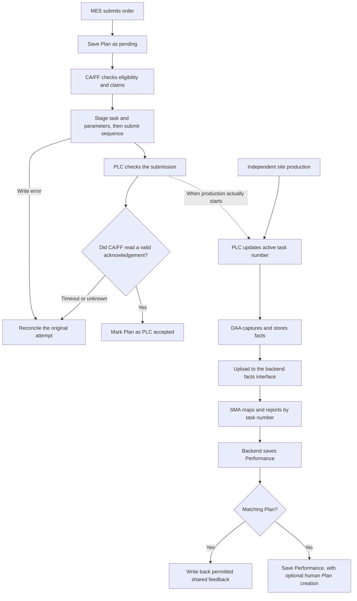
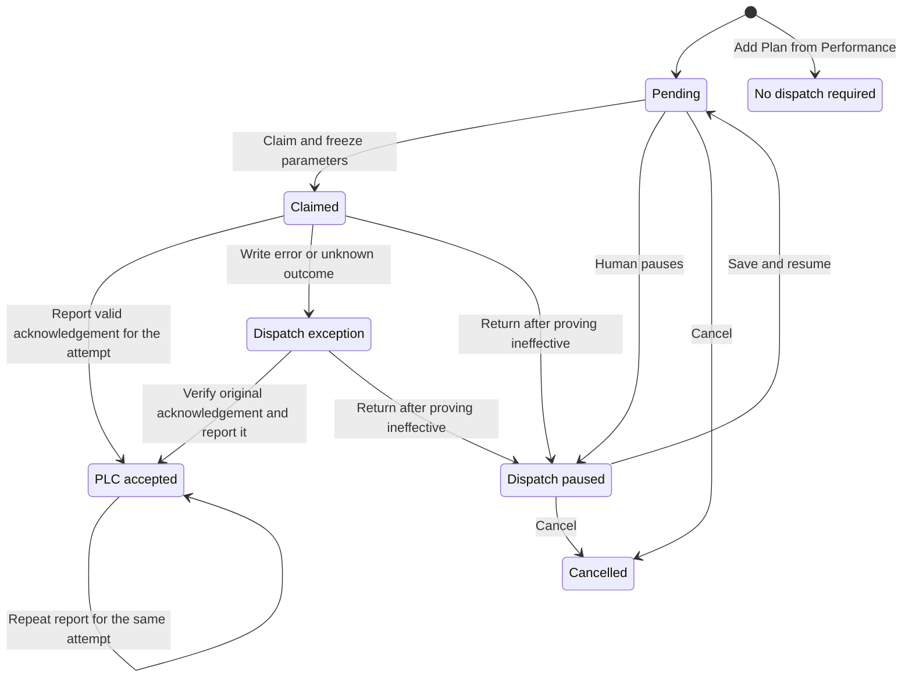
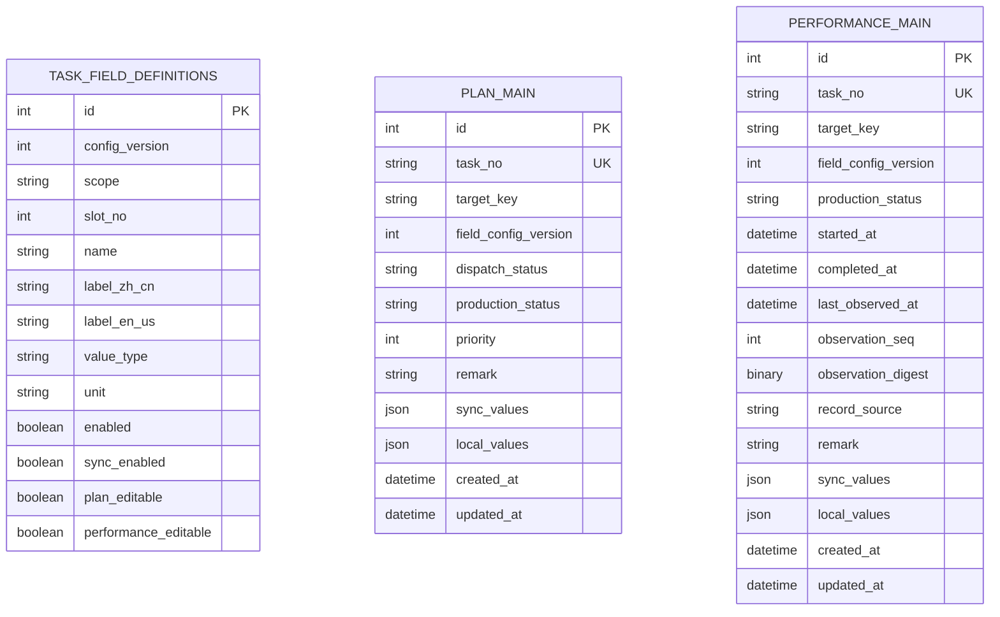

# Generic Plan and Performance Tasks · First-Version Review Draft

**MES order → Plan saved → CA/FF claims and dispatches → PLC acknowledges receipt → Production starts → DAA captures facts → SMA reports Performance → Write back to a matching Plan**

[中文](generic-task-workflow-discussion.zh-CN.md) · [Documentation index](README.md)

This is the review draft for generic Plan and Performance tasks. Section 1 follows one order. Sections 6–9 cover tables, pages, interfaces and write-back. Section 10 records agreed decisions, the proposed cutover and open items. **Confirmed** means agreed in discussion. **Open for confirmation** means a first-version decision remains. **To verify** means implementation needs a practical check. Sections 6.1 and 11 point to existing source and contracts.

## Reading guide

- [Follow one order](#workflow) · [Task numbers and repeated submissions](#task-identity)
- [Plan states and edits](#editing) · [Changes, pause and cancellation](#order-changes)
- [PLC handshake](#plc-conditions) · [Recovery after timeout or restart](#recovery)
- [Tables and fields](#storage) · [Configuration changes and old tasks](#field-config-evolution) · [Capacity, types and storage checks](#field-capacity-types)
- [Physical schema](#task-schema) · [List and claim indexes](#task-indexes) · [Requests and responses](#task-api-details)
- [Lists and settings entrypoints](#pages) · [Equipment status and process monitoring](#field-config-alignment)
- [Interfaces for each caller](#interfaces) · [Performance persistence and write-back](#writeback)
- [Supplemental Plan creation](#supplement-plan) · [Task changes, late reports and duplicates](#performance-ordering) · [Inheritance, write-back and ownership](#performance-writeback)
- [First-version decisions](#open-questions) · [Review scenarios](#first-version-recommendations)
- [Legacy coil cutover](#legacy-cutover) · [First-version acceptance](#first-version-acceptance) · [Source and contracts](#references)

<a id="workflow"></a>

## 1. Follow one order through the system

Suppose MES orders task `JOB-20261107-001` on `LINE-01` with a target length of **1,200 metres**. SMA later reports **300 metres** produced. The examples below follow that task.

| Point in the flow | What happens | What the page shows |
| --- | --- | --- |
| Order | MES sends the task number, line and order parameters. The backend creates a Plan. | The Plan is pending, with a target length of 1,200 metres. |
| Claim | CA/FF sees the agreed site condition and claims the task. The backend freezes a copy of the parameters for that attempt. | The Plan is claimed. The attempt uses the frozen parameters. |
| PLC acceptance | CA/FF stages the task and parameters and then writes the request sequence. The PLC acknowledges acceptance and CA/FF verifies and reports it. | The Plan shows “PLC accepted.” Production shows “Not reported” until a production report is accepted. |
| Actual start | The site starts production. The PLC changes the active task number, and DAA captures, stores and uploads the facts. | Production state refreshes once the backend accepts Performance. |
| Performance report | SMA maps data under the task number in the sample. The backend creates Performance on the first valid report and then updates the same record. | Performance shows “Running” and 300 metres produced. |
| Plan write-back | The backend finds the matching Plan and copies feedback allowed by its settings into the matching positions. | The Plan can show the 1,200-metre target and 300 metres produced together. |
| Completion | The site retains the final snapshot with its original task number. SMA submits final values and the completion fact. | Performance shows “Completed.” Plan shows the final feedback allowed by the write-back rules. |



**Read the three milestones separately.** PLC acceptance records that the device received the task. Site facts establish when production started. Performance persistence records that the backend accepted production data. Dispatch state and production state advance separately.

CA and FF both serve the field execution role in this flow. The project chooses which to use. Runtime polling drives dispatch, acquisition and reporting. DAA captures, stores and uploads facts, SMA maps facts into business values, and the backend saves records and performs write-back. The browser handles queries, edits and settings.

<a id="task-identity"></a>

## 2. Find a task by number and update submitted fields

### 2.1 Four keys with different purposes

| Key | Purpose |
| --- | --- |
| `taskNo` | Business identifier for one production task. A Plan and a Performance record can have the same number. |
| `targetKey` | A line or receiving area that can be dispatched independently, such as `LINE-01`. Provide it on Plan creation and Performance reports. Claiming a Plan locks the target. |
| `dispatchId` | Identifier for one claim and dispatch attempt. A verified redispatch uses a new attempt. |
| `observationSeq` | Sequence within a task's automated observations. It distinguishes later reports from duplicates and late arrivals. |

The first version uses one project per deployment. Each main table enforces task-number uniqueness across that project, including all its lines. Trim surrounding spaces, uppercase English letters and validate the result. Use 1–50 characters drawn from English letters, digits, hyphens, underscores and periods. Keep the number assigned at creation. Rework and new runs use new numbers. Coil, product and customer order identifiers can remain business fields. Validate the task-number encoding and length against the PLC point list at dispatch.

The backend matches by project and `taskNo`. Each table has its own internal `id`. Ordinary value submissions assign absolute values, with `eventId` optional for now. Published integration contracts define their own event identities.

### 2.2 When MES resubmits an order

| Submission | Backend behavior |
| --- | --- |
| First eligible submission | Create a Plan. If Performance already exists, follow supplemental creation in section 9.1. |
| A Plan exists and state permits editing | Update only the fields submitted and permitted. Keep the original `id` and creation time. |
| Field omitted | Use the stored value. |
| Explicit `0`, `false` or an empty string | Validate each as an actual value. |
| Explicit `null` | Clear the value when the field permits clearing. |
| Same values submitted again | Return success with no change and keep the business update time. |
| Invalid field, type or unauthorized change | Reject the entire submission. State, same-sequence content or configuration-version conflicts use `409`. |

For example, while A is pending, MES can submit only a revised target of 1,250 metres and keep the other values. If CA/FF claims it first, the backend applies the locked state. A unique constraint handles concurrent creation, and backend transactions govern claim and edit races. Automated SMA reports also follow the sequence rules in section 9.2.

<a id="editing"></a>

## 3. Plan states and operator actions

### 3.1 Dispatch and production state

| Dispatch state | Meaning |
| --- | --- |
| Pending `pending` | Awaiting claim by CA/FF. Authorized edits are allowed. |
| Claimed `claimed` | Parameters are frozen for the attempt. CA/FF is preparing or executing it. |
| PLC accepted `plc_accepted` | CA/FF reported the valid matching acknowledgement for this attempt. |
| Dispatch exception `exception` | Reconcile the original attempt. Details distinguish verified ineffective attempts from unknown outcomes. |
| Dispatch paused `paused` | Follow pending edit rules. A person resumes dispatch before the Plan can be claimed again. |
| Cancelled `cancelled` | This dispatch flow ends. The record and cancellation evidence are retained. |
| No dispatch required `not_required` | Used when a Plan is added from existing Performance. |

**CA/FF claims pending Plans with no known production facts.** The dispatch attempt records transport write progress. Performance has two production states in the first version, `running` and `completed`. Plan shows “Not reported” before it has an accepted production fact.

### 3.2 What MES and people can edit

| Stage | MES | Authorized user |
| --- | --- | --- |
| Pending or paused with no known production facts | May edit the target, priority, editable order fields and remark. | May edit the same fields. |
| Claimed, awaiting acknowledgement or PLC accepted | An identical resubmission can succeed. Changed order fields or remarks produce a conflict. | Can add a remark. Order parameters are locked. |
| Started or completed | The locked-state rules apply. | Can add information within Plan remark permissions. Performance rules govern production data. |

The system assigns `taskNo` at creation. The business workflow owns both state fields. Edits also require an enabled field, Plan-side editability and a valid type. The backend treats one submission as a unit. A submission that changes both a permitted remark and a locked parameter is rejected. Valid Performance can update read-only shared feedback through write-back. Configuration permission and order-editing permission are checked separately.

<a id="order-changes"></a>

### 3.3 Change, pause or cancel a Plan

- **Pending.** An authorized person can edit directly or pause first. A regular save keeps the pause. **Save and resume dispatch** saves edits and restores pending state in one operation.
- **Claimed with receipt under review.** Reconcile the attempt under section 5. Once verified ineffective, return it to paused for editing, resumption or cancellation.
- **PLC accepted or production started.** Use the site's withdrawal, stop or completion process. Plan retains the verified acknowledgement and Performance follows production facts.
- **Cancellation.** Applies to pending or paused Plans before acceptance and production start. Keep the original task number. A new production run uses a new number.

The backend checks pause, save-and-resume, cancellation and claim against the same Plan state. An edit that commits first becomes part of the claimed snapshot. A claim that commits first applies the lock. Verified PLC acceptance and production start are also checked.

<a id="plc-conditions"></a>

## 4. How the PLC permits a write and acknowledges acceptance

A project can agree that `receiveState == 20` permits a write, or use an equivalent signal and value. The value here illustrates the flow. CA/FF checks a fresh, valid reading before claiming and again before writing. The PLC applies its final interlocks when accepting the submission.

### 4.1 Five logical points

| Point | Writer and reader | Purpose |
| --- | --- | --- |
| `receiveState` | PLC provides it, CA/FF reads it | Whether the area can accept a task. |
| `incomingTaskNo` | CA/FF writes it, PLC reads it | Staged task number paired with this attempt's process parameters. |
| `requestSeq` | CA/FF writes it, PLC reads it | Submission signal written after the task and parameters have been staged. |
| `ackSeq` | PLC writes it, CA/FF reads it | Sequence acknowledged after the PLC accepts the submission. |
| `activeTaskNo` | PLC provides it, DAA reads it | Task actually running, updated at start or task change. |

### 4.2 Example with request sequence 41

1. CA/FF checks eligibility, claims A and gets the attempt's `dispatchId` and frozen parameters. Continue polling when the condition is unmet or no pending Plan is available. A list lookup reads results. The claim operation acquires the task.
2. CA/FF persists the attempt and sequence 41. It stages the task number and parameters, then writes `requestSeq` as 41.
3. The PLC treats the new sequence as one submission, validates it, places the task in the waiting area and writes `ackSeq = 41`. CA/FF checks that the acknowledgement is valid for the original receiving area and attempt, persists the evidence and reports it.
4. When production actually starts, the PLC sets `activeTaskNo`. DAA captures the number, and SMA uses the number in the sample. The site defines its idle value.

A receiving area holds one submission awaiting confirmation at a time. Keep staged contents until acceptance or reconciliation closes the attempt. The PLC retains its acknowledgement until the next acceptance. Choose a new sequence that is distinguishable from the old request and acknowledgement still visible. The project point list defines addresses, types, allowed values, process bindings, idle values, sequence width, restart retention and timeout. [AW execution design](AIIS_AW_Runtime_Design.md#8-ca-执行语义与安全边界) · [Siemens handshake example](https://support.industry.siemens.com/cs/attachments/109795979/109795979_MachineConnectMsgBuffer_DOC_v2_0_en.pdf#page=6)

<a id="recovery"></a>

## 5. Reconcile the original attempt after timeout, disconnection or restart

**Find the original `dispatchId` and sequence first.** For example, if CA/FF loses its connection after submitting sequence 41, reconcile sequence 41 on recovery. Report the result when the original acknowledgement can be verified.

| Evidence | Action |
| --- | --- |
| A valid acknowledgement was saved, or a trusted read confirms that the original `ackSeq` matches this attempt's `requestSeq` | Report acceptance again using the original `dispatchId`, sequence and evidence. The backend recognizes an identical report for the attempt. |
| A trusted record proves the request was never submitted, or site evidence proves it was not accepted and production has not started | After the return conditions are satisfied, an authorized person returns the Plan to paused. |
| Submission is possible, the original record is missing, a reading is invalid, sequence ownership is unclear or evidence conflicts | Keep the dispatch exception and have a person check the waiting area and production evidence. Report acceptance or return it once verified. |

### 5.1 When CA/FF records the evidence

Before writing the PLC, persist the `dispatchId`, `taskNo`, receiving area and `requestSeq` with a stage of “Not started.” Persist “Possibly submitted” before attempting to write the request sequence. After observing a valid acknowledgement, persist the evidence and time it was first seen, then report to the backend.

Automatic recovery reconnects, reads evidence and reports it. When checking the site, read `requestSeq` and `ackSeq` from the original receiving area. Use the first to check the submission and the second to verify acceptance. The active task number and Performance help establish production start. The original acknowledgement establishes acceptance of this attempt. After PLC restart or sequence wraparound, check sequence ownership under the project agreement. A receiving area has one effective writer. New dispatch to that area waits while the original attempt is under review. The backend advances Plan state using results for the current attempt. [Siemens data retention](https://docs.tia.siemens.cloud/r/en-us/v20/functional-description-of-s7-1200-cpus-s7-1200/operating-modes-s7-1200/startup-operating-mode-s7-1200/warm-restart-s7-1200)

### 5.2 Redispatch after returning the Plan

Before returning it, confirm that the old executor stopped, in-flight writes are settled, the PLC did not accept the old submission and the task did not start. Handle staged residue under the site procedure so the old attempt cannot take effect. An authorized person records the operator, time, reason and evidence, ends the old attempt and moves the Plan to paused. After editing, resume manually. The next claim freezes a new snapshot and uses a new `dispatchId` and `requestSeq`.



Exception details show the attempt, sequence, submission stage, reason and evidence. Section 6.7 proposes the backend attempt record. Site integration determines how to verify evidence and isolate the old writer.

<a id="storage"></a>

## 6. Main tables and supporting records

### 6.1 Existing code and first-version target

| Scope | Plan | Performance |
| --- | --- | --- |
| Current Python model | `plans` maps 25 columns for coils, products and materials, tension targets and management. | `performance_main` maps 44 columns for coils, output and quality, manual corrections, acquisition sources and `plan_id`. |
| Generic task target | `plan_main` saves order values, dispatch state and feedback written back to the Plan. | `performance_main` saves the order snapshot, actual values, production state and report ordering. |

Module business tables follow `xx_main`, where `xx` is the module name. Plan uses `plan_main` and Performance uses `performance_main`. Field definitions, configuration state, dispatch attempts and operator action tables use names based on their purpose. Match by project and `taskNo`, with each record holding its own values. Section 10.2 records the dev database inventory and proposed legacy cutover. [Current Plan model](../backend/app/plan/models/plan.py) · [Current Performance model](../backend/app/performance/models/performance.py)

### 6.2 Shared definitions with values on each task record

| Record | What it holds |
| --- | --- |
| `task_field_definitions` | A field's key, labels, type, writer, enabled status and write-back setting. |
| `plan_main` | Fixed fields and two value groups for one Plan. |
| `performance_main` | Fixed fields and two value groups for one Performance record. |
| `task_field_config_state` | Active business version and the revision used for admin saves. |
| `plan_dispatch_attempts` | Frozen values, original `dispatchId`, sequence, executor, acknowledgement and exception evidence. |
| `plan_action_events` | Operator records for pause, resume, cancellation and verified return. |

The example fields for A work as follows.

| Slot | API `name` | Plan | Performance |
| --- | --- | --- | --- |
| Shared 01 | `productCode` | MES submits `PRODUCT-A`. | Inherit when Performance is first created. |
| Shared 02 | `targetLength` | Order target of 1,200 metres. | Inherit 1,200 metres as an order snapshot. |
| Shared 03 | `completedLength` | Receives permitted write-back, such as 300 metres. | Actual length reported by SMA, such as 300 metres. |
| Plan-local 01 | `customerOrderNo` | Stores the customer order number. | — |
| Performance-local 01 | `currentSpeed` | — | Stores the current observed speed. |

Shared slot 03 has one definition. When Performance saves 300 metres, the backend uses the write-back switch to decide whether to update Plan slot 03. The two local slots numbered 01 belong to different groups.



The two groups each have 100 logical slots. The backend matches Plan and Performance by task number and writes back by shared slot number. The diagram covers the two main tables and field definitions. Section 6.7 proposes physical types, version state and dispatch attempt storage. Ordinary Plan writes may supply `eventId` for tracing.

### 6.3 What field settings contain

| Attribute | Meaning |
| --- | --- |
| `id`, `config_version`, creation and update times | Definition identity, business configuration version and time of change. |
| `scope` and `slot_no` | Group and position. Groups are `shared_sync`, `plan_local` and `performance_local`. |
| `name` | Stable key for MES, SMA and the frontend API. |
| `label_zh_cn` and `label_en_us` | Chinese and English display labels. |
| `value_type`, `unit` and nullability | Value type, display unit and whether the value can be cleared. |
| `enabled` | Whether the field is active in the business version. |
| `sync_enabled` | Whether shared feedback can write back from Performance to Plan. |
| `performance_owner`, `plan_editable` and `performance_editable` | Who produces a Performance value and which editing entrypoints can change it. See sections 6.7 and 8.6 for types and API names. |
| Visibility and order on both pages | Default visible columns and ordering for each list. |

Group and slot identify one definition within a project and version. A module's `name` values are unique, including names previously made active. Check shared names against both sets of local names.

A field definition returned to the frontend can look like this. SMA reports the value, and both business pages display it as read-only feedback.

```json
{
  "scope": "shared_sync",
  "slotNo": 3,
  "name": "completedLength",
  "labels": {"zh-CN": "已生产长度", "en-US": "Completed length"},
  "type": "number",
  "unit": "m",
  "enabled": true,
  "syncEnabled": true,
  "performanceOwner": "automated",
  "planEditable": false,
  "performanceEditable": false
}
```

### 6.4 Fixed fields and times

| Field | Tables | Purpose |
| --- | --- | --- |
| `id` | Both | Backend-generated internal primary key. |
| `task_no` | Both | Normalized task number, unique per table. The API uses `taskNo`. |
| `target_key` | Both | Line or receiving-area key. The API uses `targetKey`. |
| `field_config_version` | Both | Business field version bound to the matching task. |
| `remark` | Both | Nullable remark saved under business edit permissions. |
| `created_at`, `updated_at` | Both | First persistence and most recent actual update in the backend. |
| `priority`, `dispatch_status` | Plan | Order priority and dispatch state. Claims, valid acknowledgements and human actions advance the state. |
| `production_status` | Both | Performance records accepted production state. Plan stores progress maintained by the backend and uses null before any report. |
| `started_at`, `completed_at` | Performance | Actual start and completion times. Leave them empty when the source lacks exact times. |
| `last_observed_at` | Performance | Time of the most recent accepted sample, taken from `observedAt`. |
| `observation_seq`, `observation_digest` | Performance | Last accepted automated sequence and content digest for handling late and duplicate reports. |
| `record_source` | Performance | Backend records the source that created the record. |

Plan has 10 fixed fields and Performance has 14. Performance derives `hasPlan` by looking for the same task number. The dispatch attempt stores the first time CA/FF observed a valid acknowledgement for that attempt.

For example, DAA observes 300 metres at 10:30:00 and the backend accepts the update at 10:30:02. Performance shows 10:30:00 as the **observation time** and 10:30:02 as the **update time**. Duplicate reports and unchanged submissions keep the prior update time. Fixed identifiers, times and priority use native types. Section 6.7 proposes the first-version column types. Business times follow `Asia/Shanghai`, and the API includes `+08:00`. [Repository time contract](../AGENTS.md#7-时间与时区)

<a id="field-config-evolution"></a>

### 6.5 Which version applies to an existing task

If A was created under V1, its first Performance record uses V1 even if it arrives after V2 goes live. If Performance came first, a supplemental Plan uses the Performance version. The backend retains definitions referenced by tasks and applies the bound fields, types, writers and write-back rules.

| Admin action | Effect on tasks |
| --- | --- |
| Edit Chinese or English labels | Existing and new tasks show the latest labels when the frontend reloads them. |
| Replace an active name or type | Disable the original in a new version. Give its replacement a new name and unused slot. |
| Add, disable or re-enable a field, or change write and write-back rules | Save a new business version for tasks first created afterward. Existing tasks use their bound version. |

Disabled slots retain their definitions and history and count toward capacity. Re-enabling a slot restores its original field. For example, if V2 disables shared slot 03, A can still report and write back under V1. New V2 tasks use the V2 enabled set.

<a id="field-capacity-types"></a>

### 6.6 Capacity, value types and storage verification

**Confirmed capacity.** There are 100 slots each for shared, Plan-local and Performance-local values. Each main table uses two groups. One project has up to 300 distinct slots. Check the real project inventory by group, including slots disabled after activation. A group that reaches 100 rejects new definitions.

| Type | API value | First-version limit |
| --- | --- | --- |
| `string` | Text such as `"0007"`, which keeps leading zeros. | 255 Unicode characters. |
| `number` | A number such as `300` or `78.5`. | Up to 10 digits before the decimal point and 4 decimal places, ignoring trailing decimal zeros. |
| `boolean` | `true` or `false`. | JSON boolean. |

The storage layer represents these values as plain text. API reads restore their declared type. Submit `null` to clear a field that permits clearing. The empty string, zero and `false` are distinct values. Fixed fields carry dates and times.

**Confirmed storage layout, verified on sample tables.** Each main table uses two JSON value columns. `local_values` holds local values and `sync_values` holds shared values. Each group maps slot numbers to values. For example, the shared group on Performance could hold `{"01":"PRODUCT-A","02":"1200","03":"300"}`, with unused slots omitted. The frontend and integrations use `name` with simple values. The configuration table supplies labels, types and switches.

**Row-size background.** The 255-character limit applies to a single text value at the API. Declaring 200 `utf8mb4 VARCHAR(255)` columns would exceed MySQL's table definition row limit. With separate `TEXT` columns, a default 16 KB page and `DYNAMIC` row format keep 40-byte values inline. Two hundred of those values with their length markers use at least 8,200 bytes, above the InnoDB inline limit. This boundary is calculated from the manual. [MySQL row formats](https://dev.mysql.com/doc/refman/8.4/en/innodb-row-format.html) · [Row size limits](https://dev.mysql.com/doc/refman/8.4/en/column-count-limit.html) · [JSON type](https://dev.mysql.com/doc/refman/8.4/en/json.html)

**Measured results.** The temporary Docker MySQL 8.4.6 instance used InnoDB with 16 KB pages, `DYNAMIC` row format, `utf8mb4` and a `+08:00` session time zone.

| Check | Sample table result |
| --- | --- |
| Table creation | `plan_main` with 10 fixed fields and two JSON columns and `performance_main` with 14 fixed fields and two JSON columns both created successfully. Empty groups defaulted to `{}`. |
| Full slots | Both tables round-tripped 100 values per group and 200 per row. Separate fixtures used a 40-byte value and 255 four-byte characters per slot. Every retrieved value matched. |
| Single-slot updates | `JSON_SET` changed the requested slot and preserved other slots and the other group. Updates from two separate sessions to different slots in one JSON column both survived. Clearing one slot also passed. |
| List pagination | Each table had 2,400 pagination fixtures and 240 matches on target, state and creation time. All 15 pages in each direction sorted by creation time and `id` showed no duplicate or missing rows. `EXPLAIN` selected the sample composite index for target, state, creation time and `id`. |

The data directory was in memory. The temporary container was confirmed removed at the end. Pagination results apply to these sample tables, indexes and synthetic data. Sections 6.7 and 6.8 propose the first-version schema and additional indexes.

<a id="task-schema"></a>

### 6.7 First-version physical schema

The first version uses the agreed tables, column types and constraints below. Each main table has two JSON value columns. The design uses MySQL 8.4.6, InnoDB, `DYNAMIC` and `utf8mb4`, with one project per deployment. ASCII key columns use `ascii_bin`. Normalize task numbers as in section 2. `targetKey` is a registered project key. Both `targetKey` and `producerId` use 1–64 ASCII letters, digits, periods, underscores or hyphens, matched with their original case.

Record times use `DATETIME(6)` to retain source precision up to microseconds. Creation and update times use the database clock. Both can default to `CURRENT_TIMESTAMP(6)` on insert. The backend advances `updated_at` on an actual change. Align database time with the project contract for `Asia/Shanghai`. Start, completion, sample and acknowledgement times come from their respective sources. API responses return these times with `+08:00`.

#### Main tables

| Field | SQL type | Rule |
| --- | --- | --- |
| `id` | `BIGINT UNSIGNED` | Separate auto-incrementing primary key for each table. |
| `task_no` | `VARCHAR(50) ASCII` | Required and unique within each table. |
| `target_key` | `VARCHAR(64) ASCII` | Required on both. A claim locks the Plan target. Performance records the reporting target. |
| `field_config_version` | `INT UNSIGNED` | Required on both. The first record for a task number determines the version. |
| `remark` | `VARCHAR(500)` | Nullable on both. |
| `created_at`, `updated_at` | `DATETIME(6)` | Required on both. Use the database time rule above. |
| `production_status` | `VARCHAR(16) ASCII` | Required on Performance as `running` or `completed`. The backend maintains Plan progress, which is null before the first report. |
| `priority` | `SMALLINT UNSIGNED` | Required on Plan. Default 5 and range 1–10. Priority 1 is highest. |
| `dispatch_status` | `VARCHAR(24) ASCII` | Required on Plan. Normal creation defaults to `pending`. Supplemental creation uses `not_required`. See section 3 for state keys. |
| `started_at`, `completed_at`, `last_observed_at` | `DATETIME(6)` | Nullable on Performance. Store actual start, completion and the latest accepted observation time. |
| `observation_seq` | `BIGINT UNSIGNED` | Required on Performance. Set on creation from the first accepted automatic snapshot. |
| `observation_digest` | `BINARY(32)` | Required on Performance. Save the SHA-256 digest of the normalized snapshot with its sequence. |
| `record_source` | `VARCHAR(32) ASCII` | Required on Performance. The backend records the creation source as `sma` or `ca_ff`. |
| `local_values`, `sync_values` | `JSON NOT NULL DEFAULT (JSON_OBJECT())` | Two columns per main table. Each group is an object of up to 100 entries keyed by `"01"` through `"100"`. |

Plan has 10 fixed fields and Performance has 14, plus two JSON columns each. Database `CHECK` constraints require each JSON value to be an object with up to 100 entries, for example `JSON_TYPE(local_values) = 'OBJECT' AND JSON_LENGTH(local_values) <= 100`. Validate priority and fixed states against the ranges in the table. The service validates slots, writer eligibility, type and length against the bound version. It stores valid values as text and removes a key on explicit clearing. Section 8 describes the API mappings from snake_case column names. Performance derives `hasPlan` from the matching task number. [MySQL CHECK constraints](https://dev.mysql.com/doc/refman/8.4/en/create-table-check-constraints.html)

#### Field configuration

`task_field_config_state` uses one row per deployment. Its `id TINYINT UNSIGNED` primary key is 1. `active_version INT UNSIGNED NOT NULL` and `config_revision BIGINT UNSIGNED NOT NULL` start at 1. It also has required `created_at` and `updated_at`. Tasks bind to the business version. An admin save uses the revision to detect stale edits.

| `task_field_definitions` field | SQL type | Rule |
| --- | --- | --- |
| `id`, `config_version` | `BIGINT UNSIGNED`, `INT UNSIGNED` | Auto-incrementing primary key and required business version. |
| `scope`, `slot_no` | `VARCHAR(24) ASCII`, `TINYINT UNSIGNED` | Required group and position. Use the three defined groups and positions 1–100. |
| `name`, `value_type` | `VARCHAR(64) ASCII`, `VARCHAR(12) ASCII` | Required. Match the API key exactly. Keys start with a lowercase ASCII letter, followed by ASCII letters, digits or underscores. See section 6.6 for types. |
| `label_zh_cn`, `label_en_us`, `unit` | Two `VARCHAR(128)` and one `VARCHAR(32)` | Both labels required. Unit nullable. |
| `is_nullable`, `enabled`, `sync_enabled` | `BOOLEAN NOT NULL DEFAULT FALSE` | Separate switches for clearing, activation and write-back. |
| `plan_editable`, `performance_editable` | `BOOLEAN NOT NULL DEFAULT FALSE` | Allow edits through the Plan or Performance manual entrypoints, respectively. |
| `performance_owner` | `VARCHAR(16) ASCII` | Fields applicable to Performance use `order_snapshot`, `automated` or `manual`. Plan-local fields use `NULL`. |
| `plan_visible`, `performance_visible` | `BOOLEAN NOT NULL DEFAULT FALSE` | Separate defaults for the two lists. |
| `plan_order`, `performance_order` | `SMALLINT UNSIGNED` | Separate nullable orders for the two lists. Fall back to slot order. |
| `created_at`, `updated_at` | `DATETIME(6)` | Required. Use the database time rule. |

Each business version contains the complete definitions for all three scopes, including reserved slots disabled after use. The current labels and column display settings overlay older definitions. A display-only edit advances the revision. A business change publishes a new version and advances the revision in the same transaction. Keep `unit` with the business definition. Changing the unit meaning of an active field requires a replacement key and slot. The save merges the submitted scope and rejects an outdated revision.

`sync_enabled` is available for `shared_sync` feedback owned by `automated` or `manual`. Enabling it makes the field read-only on Plan. `performance_editable` applies to manually owned fields.

The config state row serializes task creation and config publishing. On a create path, lock that row in a short transaction and recheck both main tables. Use the existing task's version or the active version for a new task number. When updating Performance and writing back, lock matching rows in Plan-then-Performance order. Their respective services merge the submitted slots in one transaction.

#### Dispatch attempts and operator actions

| `plan_dispatch_attempts` field | SQL type | Rule |
| --- | --- | --- |
| `dispatch_id`, `claim_request_id` | `CHAR(36) ASCII` | UUIDs. The first is the attempt primary key. The second is unique for claim retries. |
| `task_no`, `target_key`, `attempt_no` | `VARCHAR(50) ASCII`, `VARCHAR(64) ASCII`, `INT UNSIGNED` | Required. Increment the per-task attempt number while holding the Plan row. |
| `field_config_version`, `producer_id` | `INT UNSIGNED`, `VARCHAR(64) ASCII` | Required version at freezing and caller trace key. |
| `parameters` | `JSON` | Required, with typed frozen order parameters keyed by API field name. |
| `attempt_status` | `VARCHAR(24) ASCII` | Required. Starts at `claimed` and can move to `exception`, `plc_accepted` or `returned`. |
| `active_target_key` | `VARCHAR(64) ASCII`, stored generated column | Uses `target_key` in `claimed` or `exception` and `NULL` in closed states, for a unique constraint. |
| `submission_phase` | `VARCHAR(24) ASCII` | Nullable. The source reports `not_submitted`, `possibly_submitted` or `acknowledged`. |
| `request_seq`, `ack_seq` | `BIGINT UNSIGNED` | Nullable. Store the reported original request and acknowledgement sequences. |
| `ack_observed_at` | `DATETIME(6)` | Nullable. First valid observation of acknowledgement for this attempt. |
| `failure_key`, `failure_detail` | `VARCHAR(64) ASCII`, `VARCHAR(500)` | Nullable. Reported reason key and reconciliation details. |
| `claimed_at`, `updated_at` | `DATETIME(6)` | Required. The database records claim time and actual update time. |

An unresolved exception retains the target reservation. A matching acknowledgement or verified return releases it. The generated unique key limits each receiving area to one open attempt and allows multiple closed attempts. CA/FF persists the original sequence, phase and device receipt in its local journal as in section 5. [MySQL generated columns](https://dev.mysql.com/doc/refman/8.4/en/create-table-generated-columns.html) · [Unique index NULL behavior](https://dev.mysql.com/doc/refman/8.4/en/create-index.html)

| `plan_action_events` field | SQL type | Rule |
| --- | --- | --- |
| `id`, `action_request_id` | `BIGINT UNSIGNED`, `CHAR(36) ASCII` | Auto-incrementing primary key and unique action request UUID. |
| `request_digest` | `BINARY(32)` | Required. Confirms a retry matches the original action. |
| `task_no`, `action_key`, `actor_id` | `VARCHAR(50) ASCII`, `VARCHAR(24) ASCII`, `BIGINT UNSIGNED` | Required task number, action key and signed-in operator ID. |
| `from_status`, `to_status` | `VARCHAR(24) ASCII` | Required dispatch states before and after the action. |
| `dispatch_id`, `reason`, `evidence` | `CHAR(36) ASCII`, `VARCHAR(500)`, `TEXT` | Nullable. A verified return records the original attempt, reason and evidence. A cancellation records its reason. |
| `created_at` | `DATETIME(6)` | Required. The database records the action time. |

Pause, save and resume, cancellation and verified return commit the Plan state and action record together. Plan details can show previous attempts and operator evidence. The two main tables still match by task number.

<a id="task-indexes"></a>

### 6.8 First-version indexes

| Table | Index | Purpose |
| --- | --- | --- |
| `plan_main`, `performance_main` | Primary key `id`, unique `uq_task_no (task_no)` | Detail lookup, concurrent creation and matching by task number. |
| Both main tables | `ix_created_page (created_at, id)` | Default list ordering and creation-time ranges. |
| `plan_main` | `ix_plan_target_state_page (target_key, dispatch_status, created_at, id)` | List by target, dispatch state and time. |
| `performance_main` | `ix_perf_target_state_page (target_key, production_status, created_at, id)` | List by target, production state and time. |
| `plan_main` | `ix_plan_claim (target_key, dispatch_status, production_status, priority, created_at, id)` | Claim a pending Plan for the target, ordered by priority, creation time and ID. |
| `task_field_definitions` | Unique `uq_task_field_slot (config_version, scope, slot_no)` and `uq_task_field_name (config_version, scope, name)` | Version lookup and uniqueness within each scope. The service checks shared keys against both local scopes and historical reservations. |
| `plan_dispatch_attempts` | Unique `claim_request_id`, `(task_no, attempt_no)` and `active_target_key` | Claim retries, latest attempt lookup and receiving-area exclusivity. |
| `plan_action_events` | Unique `action_request_id`, index `(task_no, id)` | Operator action retries and detail lookup. |

Lists default to `created_at DESC, id DESC`. Claim filters by `target_key`, `dispatch_status = 'pending'` and `production_status IS NULL`, then takes and locks the first result by `priority ASC, created_at ASC, id ASC`. On a receiving-area uniqueness conflict, recheck the original request ID or return `target_busy`.

The sample tables in section 6.6 verified the target, state and time index pattern for both lists. Verify the claim index and supporting constraints with the full migration. JSON values serve display and business writes, with first-version list queries using fixed fields. Plan details find the latest dispatch record by task and attempt number. The Performance list can look up the page’s task numbers in Plan together to derive `hasPlan`.

<a id="pages"></a>

## 7. Two lists and two settings entrypoints

| Page | Default information | Actions |
| --- | --- | --- |
| Plan Management → Plan List | Task, line, dispatch and production state, priority, selected order or feedback fields, creation and update times. | Edit allowed values, add a remark, pause, save and resume, or cancel. Exception details show the attempt and evidence. |
| Performance Management → Performance List | Task, line, production state, selected actual values, Plan presence, creation, latest observation and update times. | Open the full record and edit human-owned fields within permission. Users with Plan creation permission can add a missing Plan. |

Both lists support exact matching by task number and target key, state filters and a creation time range in Shanghai time. The backend filters and sorts before pagination. Default to descending creation time, with an ascending option. Break ties with `id` in the same direction. Settings select custom values for display, with the full set in details. List filters and sorting use fixed fields.

Plan and Performance each have an admin field settings entrypoint. They reuse the component and configuration API. Plan exposes shared and Plan-local settings. Performance exposes shared and Performance-local settings. Both edit the same definition for shared slot 03, and the other entrypoint sees the change when reloaded.

**On save**, the backend checks admin permission, scope, capacity and name uniqueness and merges the submitted scope atomically. It checks the revision read by the page and asks the editor to reload if someone saved in the meantime. Field enablement, feedback write-back and list visibility are separate settings.

The frontend reads types, units and permissions from the task's version and uses the current bilingual labels. Fixed text and state labels use frontend i18n. Ordinary columns can be resized, with minimum widths, horizontal scrolling, local persistence and a reset action. Personal visibility and widths use stable field identities and are restored when the page or app reopens. Refresh keeps filters, pagination, widths and unsaved edits. Display times in `Asia/Shanghai` using a 24-hour clock, and label observation and actual update separately.

<a id="field-config-alignment"></a>

### 7.1 Equipment status and process monitoring

Plan and Performance find task fields by `name`. Equipment status and process monitoring find metrics by `metricKey`. Equipment live values update the latest snapshot, and process samples append history. Temperature zones and other equipment points use metric settings. The task tables hold current or final task values. [Equipment status and process monitoring](equipment-status-process-monitoring.md)

The editor could share support for business keys, bilingual labels, type, unit, default visibility and order. Plan and Performance also need write-back and edit permissions. Equipment and process settings also need grouping, page display and history delivery rules. Each domain has its own configuration entrypoints and business meaning. The shared editor scope is open.

<a id="interfaces"></a>

## 8. Interfaces and data for each caller

### 8.1 Frontend and integration access

| Caller | First-version rule |
| --- | --- |
| Signed-in frontend user | Use the relevant permissions for queries, task edits and manual actions. |
| Admin | Sign in with admin permission to save field definitions. |
| MES, CA/FF and SMA generic task calls | Use the generic task integration entrypoints without the frontend login token. |
| DAA fact uploads and SMA fact reads | Follow the acquisition facts contract for the relevant integration. See section 8.2 for current entrypoints. |

The backend checks field types, state, entrypoint and eligibility. `producerId` supports tracing, and `dispatchId` identifies the attempt. Management entrypoints check management permissions separately. Frontend and integration adapters use the same business rules. Performance writes back through the Plan business service. When both use one database, Performance, the accepted sequence and permitted write-back commit together.

### 8.2 Interface list

This is the agreed first-version interface list for generic tasks. Section 8.6 specifies requests, responses and error keys.

| Caller | Method and path | Purpose |
| --- | --- | --- |
| Frontend | `GET /api/v1/plans` and `GET /api/v1/plans/{id}` | Plan list and details. |
| Frontend | `POST /api/v1/plans/upsert` | Create Plan or edit submitted values within permission and state rules. |
| Frontend | `POST /api/v1/plans/{id}/actions/{action}` | Pause, save and resume, cancel or return after verification. |
| Frontend | `GET /api/v1/performances` and `GET /api/v1/performances/{id}` | Performance list and details. |
| Frontend | `POST /api/v1/performances/upsert` | Edit authorized manual fields and remarks on existing Performance. |
| Frontend | `POST /api/v1/performances/{id}/actions/supplement-plan` | Create a Plan from existing Performance with optional backfill. |
| Frontend | `GET /api/v1/task-field-configs` | Read definitions for the current or a specified version. |
| Admin | `PUT /api/v1/task-field-configs` | Save the submitted scope after checking the revision. |
| Integration caller | `GET /api/v1/integration/task-field-configs` | Read current or version-specific definitions. |
| MES | `POST /api/v1/integration/plans/upsert` | Place an order or update a matching Plan under the rules. |
| CA/FF | `POST /api/v1/integration/plans/dispatch/claim` | Claim atomically and return frozen parameters, or return no work. |
| CA/FF | `POST /api/v1/integration/plans/dispatch/report` | Report acceptance or an exception for the attempt. |
| SMA | `POST /api/v1/integration/performances/upsert` | Create or update Performance. A project can designate CA/FF as the reporting source where needed. |
| MES or integration caller | `GET /api/v1/integration/plans/by-task/{taskNo}` | Read order progress, dispatch, PLC acceptance and any production progress written back. |
| MES or integration caller | `GET /api/v1/integration/performances/by-task/{taskNo}` | Read reported production state, times and actual values. |

For example, just after the PLC accepts A, the Plan lookup shows receipt and the Performance lookup may still have no record. Independent production can create Performance first, with `hasPlan: false`. The lookups answer different questions about order progress and actual production.

The current acquisition facts v2 service uses `POST /api/v1/integration/plc-facts/samples`. DAA writes use a dedicated machine Bearer. The acquisition pages use authorized reads such as `GET /api/v1/acquisition-data/latest` and `GET /api/v1/acquisition-data/history`. Decide how SMA reads facts during site integration. Generic Performance writes use the separate entrypoint above. Section 10.2 describes the proposed cutover for existing Performance integrations. [Facts interface contract](../contracts/published/http-api/plc-facts-v2/README.md) · [Business integration contract](../contracts/published/http-api/business-integration-v1/README.md)

### 8.3 MES submits task A

Submit the following to the Plan integration entrypoint using the field definitions in section 6.2.

```json
{
  "producerId": "mes-01",
  "taskNo": "JOB-20261107-001",
  "targetKey": "LINE-01",
  "fieldConfigVersion": 1,
  "syncValues": {"productCode": "PRODUCT-A", "targetLength": 1200},
  "localValues": {"customerOrderNo": "MES-ORDER-001"}
}
```

`syncValues` and `localValues` carry field keys and values. The backend validates them against the task's bound version and checks the submitted version. The definitions API provides labels, units and types.

### 8.4 CA/FF claims and reports acceptance

A claim identifies the dispatch target and includes the request ID generated and persisted for this claim.

```json
{
  "producerId": "ff-01",
  "targetKey": "LINE-01",
  "claimRequestId": "d0c01a28-cd77-4b56-aef8-efcc31163e04"
}
```

On claiming A, the backend returns the attempt identifier and frozen parameters. This example shows the response `data`.

```json
{
  "outcome": "claimed",
  "attempt": {
    "dispatchId": "260aef4a-65fd-484f-8baa-962513a72954",
    "claimRequestId": "d0c01a28-cd77-4b56-aef8-efcc31163e04",
    "taskNo": "JOB-20261107-001",
    "targetKey": "LINE-01",
    "attemptStatus": "claimed",
    "fieldConfigVersion": 1,
    "parameters": {"productCode": "PRODUCT-A", "targetLength": 1200}
  }
}
```

After confirming sequence 41, CA/FF reports it under the original attempt.

```json
{
  "dispatchId": "260aef4a-65fd-484f-8baa-962513a72954",
  "taskNo": "JOB-20261107-001",
  "targetKey": "LINE-01",
  "producerId": "ff-01",
  "requestSeq": 41,
  "ackSeq": 41,
  "ackObservedAt": "2026-11-07T10:05:03+08:00",
  "outcome": "plc_accepted"
}
```

Retry a timed-out claim with the original `claimRequestId`, then check the local journal when the original attempt is returned. See section 8.6 for exception and operator-action payloads.

### 8.5 SMA reports 300 metres for A

This is an update after A already has a Performance record. `observedAt` is the sample time. `observationSeq` increases in sampling order within the task.

```json
{
  "producerId": "sma-01",
  "taskNo": "JOB-20261107-001",
  "targetKey": "LINE-01",
  "fieldConfigVersion": 1,
  "productionStatus": "running",
  "observationSeq": 12,
  "observedAt": "2026-11-07T10:30:00+08:00",
  "syncValues": {"completedLength": 300},
  "localValues": {"currentSpeed": 78.5}
}
```

A response can express successful write-back to a matching Plan as follows.

```json
{
  "code": 200,
  "message": "success",
  "data": {
    "taskNo": "JOB-20261107-001",
    "outcome": "updated",
    "hasPlan": true,
    "planSync": {"outcome": "synced", "slots": ["03"]}
  }
}
```

A separate task from independent production can return successful creation as follows.

```json
{
  "code": 200,
  "message": "success",
  "data": {
    "taskNo": "JOB-20261107-002",
    "outcome": "created",
    "hasPlan": false,
    "planSync": {"outcome": "skipped", "slots": [], "reason": "no_plan"}
  }
}
```

With a matching Plan and no eligible feedback, `hasPlan` is still `true` and `planSync` carries the skip reason. See the next section for response shapes and error keys.

<a id="task-api-details"></a>

### 8.6 First-version requests and responses

This section details the agreed generic-task interfaces listed in section 8.2. Frontend entrypoints require a login token and the applicable permissions. Integration entrypoints follow section 8.1. Each integration write includes `producerId` for tracing. The project designates the automatic reporting stream.

#### Queries and common formats

| Scenario | Request and response |
| --- | --- |
| Frontend lists | `page` starts and defaults at 1. `pageSize` defaults to 20 with a maximum of 100. Optional filters are exact `taskNo` and `targetKey`, `productionStatus`, inclusive `createdFrom` and exclusive `createdTo`. Plan also accepts `dispatchStatus`. `sortOrder` is `desc` by default or `asc`, applied to both `createdAt` and `id`. |
| List results | `data` contains `items`, `total`, `page`, `pageSize` and `totalPages`. Each item has fixed summary fields and configured visible business values, interpreted under its own version. |
| Frontend details and integration lookups | The frontend looks up by internal `id` and integrations by normalized `taskNo`. Details return all saved values enabled for the task. Plan includes `latestDispatchAttempt`, which is `null` until a claim exists. Its fields are `dispatchId`, `attemptNo`, `attemptStatus`, `submissionPhase`, `requestSeq`, `ackSeq`, `ackObservedAt` and `claimedAt`. Authorized frontend details also include `failureKey`, `failureDetail` and the latest 20 `recentActionEvents` with `actionKey`, `actorId`, `fromStatus`, `toStatus`, `dispatchId`, `reason`, `evidence` and `createdAt`. |
| Fields returned by both modules | `id`, `taskNo`, `targetKey`, `fieldConfigVersion`, `productionStatus`, `remark`, `createdAt`, `updatedAt`, `syncValues` and `localValues`. Plan adds `dispatchStatus` and `priority`. Performance adds `startedAt`, `completedAt`, `lastObservedAt`, `observationSeq`, `recordSource` and `hasPlan`. |
| JSON and time | Fixed keys use camelCase. Preserve business value keys from `name` and the language keys in `labels` as written, such as `value_name` and `zh-CN`. Use decimal strings for `id`, `actorId` and configuration revisions and integers for the configuration version. Observation sequences are JSON integers from 1 to 9,007,199,254,740,991. PLC sequences start at 0 and use the lower of that JSON safe maximum and the site's sequence width. Timestamps include an offset and retain up to six fractional digits. Store Shanghai local time and return `+08:00`. |

Value objects use the configured field keys and simple typed values. The backend stores text by slot and restores JSON strings, numbers or booleans on read. A slot without a saved value is omitted. The frontend reads definitions separately using the task's `fieldConfigVersion` to get types, permissions and labels.

#### Plan writes and operator actions

| Entrypoint | Request | Success result and limits |
| --- | --- | --- |
| Frontend or MES Plan `upsert` | Require `taskNo` and `fieldConfigVersion`, plus `targetKey` on creation. Optional `priority`, `remark`, `syncValues` and `localValues`. MES also supplies `producerId` and may include `eventId` for tracing. | `data` includes `outcome` (`created`, `updated` or `unchanged`) and the `plan` summary. Update only submitted fields under section 3 rules. Repeating current values keeps the update time. An ordinary create for existing Performance without Plan returns `409 task.plan_supplement_required`. |
| Manual Performance `upsert` | Require an existing `taskNo` and its `fieldConfigVersion`. Optional `remark`, `syncValues` and `localValues`. | Update submitted editable fields owned by the manual writer. Return `outcome` (`updated` or `unchanged`), a `performance` summary and `planSync`. Automatic observations, production events and Performance creation use the reporting entrypoint. |
| Create a supplemental Plan from Performance details | Use the Performance `id` in the path. Require `targetKey` and the Performance `fieldConfigVersion`. May include Plan values and `remark`. `backfillExisting` defaults to `false`. | Check permission to create Plan, use the Performance `taskNo`, set `not_required` and carry over known production state. If a matching Plan already exists, return it. `data` includes `outcome` (`created` or `existing`) and `plan`. See section 9.1 for backfill. |

Pending and paused Plans allow edits under section 3. The claimed-state locks apply during reconciliation of an exception. Enter a supplemental Plan's order values on creation. Subsequent ordinary operator edits are limited to remarks. Cancelled Plans remain queryable and resubmitting current values can still return `unchanged`. MES writes to editable fields in backend acceptance order. The caller submits and retries sequentially for each task. The project's PLC dispatch mapping defines which fields to freeze and their required values. Check those parameters for the target and version when entering pending or changing dispatch parameters.

The actions below use `POST /api/v1/plans/{id}/actions/{action}`. Each includes a UUID `actionRequestId` generated for the operation.

| `action` | Additional fields | Backend action |
| --- | --- | --- |
| `pause` | Optional `reason`. | Move a pending Plan with no known production start to `paused`. |
| `save-and-resume` | Required `fieldConfigVersion` and optional Plan edit fields. | For an eligible paused Plan, commit the edits and restore `pending` together. |
| `cancel` | Required `reason`. | Move a pending or paused Plan to `cancelled` when it has neither been accepted nor started. |
| `return-to-paused` | Require the original `dispatchId`, `reason` and text `evidence`. | After operator reconciliation, verify the original attempt is current and claimed or in exception, with no acceptance or production start recorded. Close the attempt and move the Plan to `paused`. |

Actions return `outcome` (`applied` or `duplicate`), `taskNo` and `resultingDispatchStatus`. Retrying the same request ID, operator and content returns the recorded result. Reusing the ID with different content returns `409 task.action_request_conflict`. Section 5.2 describes on-site verification.

#### CA/FF claim, retry and report

| Entrypoint | Required fields and conditions | Result in `data` |
| --- | --- | --- |
| `dispatch/claim` | `targetKey`, `producerId` and `claimRequestId`. CA/FF persists the UUID before the first request and reuses it after timeouts. The backend chooses a pending Plan for the target with no known production facts, ordered by priority from 1 to 10, creation time and ID. The claim and frozen snapshot commit in one transaction. | `claimed` or `existing_attempt` in `outcome` includes `attempt` as shown in section 8.4. An open attempt in the receiving area gives `target_busy`. No eligible Plan gives `no_task`. In both cases `attempt` is `null`. |
| `dispatch/report` | `dispatchId`, `taskNo`, `targetKey`, `producerId` and `outcome`. `plc_accepted` also requires the original `requestSeq`, matching `ackSeq` and `ackObservedAt`. `exception` requires `submissionPhase` (`not_submitted` or `possibly_submitted`) and `reasonCode`, plus the original `requestSeq` when known and optional `detail`. | `outcome` is `accepted`, `exception_recorded` or `duplicate`, with `dispatchId`, `taskNo`, `attemptStatus` and `dispatchStatus`. |

After a request ID obtains a claim, its retry returns the original attempt and frozen parameters with the current attempt state. Reusing the ID with another target or executor is a conflict. Empty polls leave no record. The next regular poll uses a new ID. On receiving the original attempt, CA/FF uses its durable journal to determine whether to continue initial execution or only reconcile and report. Closed attempts are available for result lookup. Frozen `parameters` are order parameters selected by the project dispatch mapping and keyed by the bound version's `name`.

The backend checks reports against the current attempt, original sequence and evidence. The same evidence for an attempt succeeds on retry and keeps the original time. An exception can move to accepted on valid confirmation. An old attempt or conflicting evidence returns `409 task.dispatch_conflict`. Dispatch acceptance and Performance production state advance separately.

#### SMA automatic writes and write-back results

| Request fields | Rule |
| --- | --- |
| `producerId`, `taskNo`, `targetKey`, `fieldConfigVersion` | Required. The first Performance record sets its target and source. Later updates check that target and the project's designated reporter for it. Tasks in progress keep their original stream. Check against the bound Plan version when Plan exists first. |
| `productionStatus`, `observationSeq`, `observedAt` | Required. State is `running` or `completed`, and sequence increases per task. Use `null` for `observedAt` if the actual time is unavailable. |
| `syncValues`, `localValues` | Required objects. Each contains the full snapshot of enabled automatic fields owned by the stream, or `{}` when it owns none in the group. A clearable field accepts explicit `null`. |
| `startedAt`, `completedAt` | Send actual times when known. Omission preserves known facts and leaves unknown initial facts empty. Use `completedAt` on a completion snapshot. |

Lock by task and compare the sequence and normalized snapshot digest. Hash validated business content normalized by slot, independent of JSON key order. An accepted snapshot returns `created` or `updated`. A lower sequence gives `late`, the same sequence and content give `duplicate`, the same sequence with different content gives `409 task.observation_conflict`, and a higher sequence after completion gives `already_completed`. The three successful ignore outcomes keep the saved values, update time and write-back. A completion snapshot can be the first valid report.

`data` includes `taskNo`, `outcome`, `hasPlan` and `planSync`. Derive `hasPlan` from the matching task number. When shared values change on Plan, `planSync` returns `outcome: "synced"` and the corresponding `slots`. Otherwise it returns `outcome: "skipped"`, empty `slots` and a `reason`. First-version reason keys are `no_plan`, `no_eligible_values`, `no_value_change`, `report_ignored` and `incompatible_definition`. If only some submitted fields are compatible, `skippedSlots` can list `slot` and `reason` per skipped field. This result describes shared values. The Plan production state follows the accepted production facts separately. Performance, its accepted sequence and eligible Plan updates commit in the same transaction.

#### Field configuration interfaces

| Entrypoint | Request | Result |
| --- | --- | --- |
| Frontend and integration `GET .../task-field-configs` | Require `module` (`plan` or `performance`). Optional `fieldConfigVersion` defaults to the active version. | `data` contains `fieldConfigVersion`, `activeVersion`, `configRevision` and `fields`, covering the shared scope and the selected module's local scope. The frontend can read all definitions in the version. Integrations read enabled definitions. |
| Admin `PUT /api/v1/task-field-configs` | Submit `module`, the active `fieldConfigVersion`, the `configRevision` from the read and `changes`. Each change identifies `scope` and `slotNo` and supplies the changed properties. New slots require `name`, `type` and `labels`. Apply the defaults and validation in section 6.7. | Merge and validate together, then return the current configuration. Both pages edit the same shared definitions. List visibility and order edits apply to the selected module's properties. A stale save returns `409 task.config_revision_conflict`. |

A field includes `scope`, `slotNo`, `name`, `type`, `labels` (`zh-CN`, `en-US`), `unit`, `isNullable`, `enabled`, `syncEnabled`, `performanceOwner`, `planEditable`, `performanceEditable`, `planVisible`, `performanceVisible`, `planOrder` and `performanceOrder`. Historical tasks use their bound version for type, unit and business validation. Use the current slot settings for labels and list display. A save that makes no change keeps the revision.

For example, an admin renames shared slot 03 from the Plan page. Include both languages when submitting `labels`. This save advances `configRevision`, and Performance shows the same labels on reload.

```json
{
  "module": "plan",
  "fieldConfigVersion": 1,
  "configRevision": "2",
  "changes": [
    {
      "scope": "shared_sync",
      "slotNo": 3,
      "labels": {"zh-CN": "已生产米数", "en-US": "Metres produced"}
    }
  ]
}
```

#### HTTP and error codes

Success uses HTTP `200` and the project's `code`, `message` and `data` shape. Application errors use the matching HTTP status and a stable `errorCode` for frontend translations. Examples show the business fields. The current standard frontend response also includes a millisecond `timestamp`.

| HTTP | Error keys and conditions |
| --- | --- |
| `401`, `403` | `task.unauthenticated`, `task.forbidden`. Missing frontend login or applicable permission, or the caller lacks permission to write the field. |
| `404` | `task.not_found`. The requested Plan, Performance or configuration version is absent. |
| `409` | `task.state_conflict`, `task.field_version_conflict`, `task.config_revision_conflict`, `task.observation_conflict`, `task.dispatch_conflict`, `task.action_request_conflict` and `task.plan_supplement_required`. These cover state, bound version, config revision, same-sequence content, attempt or claim request ID, operator action ID and supplemental creation. |
| `422` | `task.invalid_request`. Invalid keys, types, required values, ranges or request shape reject the entire request. |
| `503` | `task.unavailable` or `task.commit_unknown`. Service unavailable or commit outcome uncertain. Reconcile or retry with the original request identity and content. |

For example, sequence 12 reported with two different snapshots returns HTTP `409`.

```json
{
  "code": 409,
  "message": "task.observation_conflict",
  "data": null,
  "errorCode": "task.observation_conflict"
}
```

<a id="writeback"></a>

## 9. Saving Performance, write-back and special cases

The backend checks the task, version, fields and report sequence. On first creation it inherits order values under section 9.3 and applies the accepted submission. With a matching Plan it writes back eligible shared feedback and reports skipped values and reasons. On one database, Performance, the report sequence when applicable, and permitted write-back commit together. Production facts advance Plan's production progress. The dispatch workflow owns dispatch state.

For task A, `targetLength` is 1,200 metres and `completedLength` is 300 metres. They occupy separate slots. The 300-metre write-back updates the Plan's completed length.

<a id="supplement-plan"></a>

### 9.1 Production exists before a Plan

1. The backend accepts valid Performance and saves it independently. Details show “No Plan.” A user with Plan creation permission can select **Add Plan** there.
2. The form carries the read-only `taskNo` and uses the Performance version. After required fields are supplied, the backend checks again by project and task number. It returns an existing Plan if found, and the unique constraint handles concurrent creation. Ordinary Plan creation directs callers here when matching Performance already exists.
3. A supplemental Plan has dispatch state `not_required`, so it is outside CA/FF's pending queue.
4. **Backfill existing Performance** starts unchecked. When selected, the backend reads saved Performance and backfills compatible shared values with both switches enabled. Authorized manual input takes precedence in this submission. Backfill fills omitted positions.

Later accepted reports follow the normal write-back rules. Section 8.6 covers the supplemental request and edit permissions.

<a id="performance-ordering"></a>

### 9.2 Task changes, late reports and duplicates

Before changing from A to B, the site retains one rereadable record of A's task number, original sample time and corresponding values. At actual completion, it also retains the completion fact and final values. Prefer the site's completion area and retain the record until DAA saves it reliably. SMA can report the saved A snapshot after the number changes. A site with only live points keeps the last acquired observation for A and records completion when completion evidence becomes available.

DAA persists samples. SMA reads replayable facts and holds each outbound snapshot until business acknowledgement. Each task has one designated automated reporting stream. Each submission is a complete snapshot of the fields that stream owns. `observationSeq` increases per task in sampling order. The completion snapshot is last in that automated sequence. Retries and restarts reuse the original sequence, time and content. [SMA reliable input and delivery design](AIIS_SMA_Detailed_Design.md)

| What the backend receives | Handling |
| --- | --- |
| It accepted 12 and then receives 11 | Acknowledge the late report and keep the Performance and write-back results for 12. |
| Same sequence 12 and same content | Acknowledge the duplicate successfully. |
| Same sequence 12 with different content | Return `409` so the producer can check the original snapshot. |
| First or later sequence while the task is open | Validate, save and write back under the rules. A completion snapshot saves final values and closes automated reporting for that task. |
| New automated report after completion | Return the completed outcome and keep the final Performance and Plan feedback. |

The backend keeps the last accepted sequence and digest for each task. It can accept A's pending completion snapshot after B starts. Site retention and release, sequence source and continuity after restart still need project decisions. Manual corrections to collected values have their own scope.

<a id="performance-writeback"></a>

### 9.3 Inherit once, write by ownership and write back by switch

| Example value | Source and use |
| --- | --- |
| Product code and target length | At Performance creation, inherit enabled, compatible shared order values from the matching Plan and show them as a read-only snapshot. |
| Completed length and current speed | The designated automated producer maintains these values under section 9.2. Current speed belongs to Performance-local. |
| Manual inspection result | An authorized user enters it through the Performance editing entrypoint. |

When Performance comes first, inherited order values can be empty. A later supplemental Plan leaves the order snapshot tied to the original Performance creation. Assign one writer to each Performance field. The backend validates the whole submission against its entrypoint and field ownership.

The backend selects eligible shared feedback from **this accepted submission**. The field must be enabled, the definitions compatible and the write-back switch on. Completed length goes to the corresponding Plan position and displays as read-only there. Manually entered feedback can use the same write-back rule. Order targets and feedback use separate positions, with write-back disabled for order fields. Local values belong to their own modules.

Task tables hold current and final business values. Process curves, equipment live views and raw/latest administration belong to their respective designs.

<a id="open-questions"></a>

## 10. First-version scope and items to confirm

This draft covers the generic Plan and Performance business modules. The agreed workflow, tables, indexes, APIs and business rules form the first-version design. Development and acceptance use the existing dev database.

| Status | Item |
| --- | --- |
| Confirmed | `plan_main` and `performance_main` each have a local and a shared JSON value column, with 100 slots per group. Sections 2–9 cover task identity, states, field versions, interfaces and write-back. |
| Confirmed | Priority 1 claims first, with creation time and ID breaking ties. MES updates in backend acceptance order and submits and retries sequentially for each task. Manual edits to Performance cover manually owned fields and remarks. Ordinary edits after supplemental Plan creation cover remarks. |
| Open for the first version | Confirm the list of legacy coil features to retire and the one-time dev database cutover in section 10.2. |
| Open for the first version | Confirm the acceptance scope in section 10.3, the fields in the A/B task example and the permissions. Specify which order values are frozen, which values SMA reports and writes back, and which values people can edit. Identify who can pause, resume, cancel, return after verification and create a supplemental Plan. |
| Decide before site integration | Specify PLC addresses, receive value, task number encoding, sequence retention and reset, timeout and old executor isolation. Decide when to save and release the final snapshot, where the SMA observation sequence comes from and how it resumes after restart. |
| Verify during implementation | Verify the complete migration, full slots, concurrent claims, the Performance and write-back transaction, permissions and page behavior. Section 6.6 records the completed sample-table tests. |

<a id="first-version-recommendations"></a>

### 10.1 Scenarios for a manual walkthrough

| Scenario | What to expect |
| --- | --- |
| The PLC accepted A and the site has yet to start | Plan shows “PLC accepted” and production shows “Not reported.” |
| SMA reports 300 metres for A with write-back enabled | Performance shows 300 metres. Plan's completed length updates to 300 metres and its target shows 1,200 metres. |
| A accepts sequence 12 and then receives 11 or a duplicate of 12 | The response identifies a late or duplicate report. The saved result reflects the accepted snapshot. |
| Performance exists without Plan and a person adds the Plan | Performance stays available. The supplemental Plan shows “No dispatch required.” Backfill is initially off. |
| V2 disables shared slot 03 while A is bound to V1 | A validates and writes back under V1. New V2 tasks use V2. |
| CA/FF disconnects after submission and finds the original acknowledgement on recovery | It reports acceptance for the original attempt. An unknown outcome stays in dispatch exception. |

These scenarios cover first-version business outcomes. See section 10.3 for verification.

<a id="legacy-cutover"></a>

### 10.2 Proposed cutover from legacy coil features

**Open for confirmation.** Switch the first version to generic Plan and Performance in one cutover. A read-only inventory of the existing dev database on 2026-11-11 found zero records in the legacy `plans` and `performance_main` tables and the 17 supporting tables below. `plan_main` was absent at the time. All 21 visible foreign keys that reference this group come from within it. The old dashboard and reports also contain code references to handle during cutover.

| Legacy feature | Proposed first-version cutover | Old tables or dependencies |
| --- | --- | --- |
| Plan XLSX | Retire template, import and export entrypoints and buttons. | Fixed order columns, forms and XLSX mappings. |
| Legacy Plan and Performance linkage | Retire the old link and backfill entrypoints. Use matching task-number write-back and supplemental creation. | `performance_main.plan_id` references `plans.id`. Both ORM relationships use it. |
| Splitting, merging and lineage | Retire the pages and APIs. | `performance_split`, `performance_transform` and `performance_lineage`. |
| Legacy Performance curves and push-down | Retire the old process records and Performance push-down. Dispatch tasks through Plan claims. | `performance_process_temperature`, `performance_process_tension`, `performance_process_speed` and `performance_push_down_record`. |
| Reports, OEE, print, quality and targets | Retire the pages, report APIs and queries that use fixed coil columns. | `quality_records`, `defect_records`, `print_records`, `production_reports`, `performance_targets` and `assessments`. |
| Legacy Performance integrations and mapping | Retire the anonymous production-observation and temperature, tension and speed sample entrypoints, along with their signed-in mapping equivalents. Connect SMA to generic Performance reporting. | `performance_mapping_receipts`, `performance_mapping_observation_state`, `performance_integration_receipts` and `performance_integration_observation_events`. |
| Legacy production dashboard | Retire the dashboard page and API. Open the Plan list by default. | Pending counts use legacy `Plan.status`. Recent plans also use the legacy model. |

1. Connect Plan and Performance lists and details to the generic APIs. Retire legacy pages, direct routes, API registrations, manual coil Performance creation and deletion entrypoints, and services that use old fields. Provide edits for manual values and remarks under the generic rules.
2. Update manifest and ORM registration. Remove the legacy `plan_id` relationship and retired model, service and Performance integration exports. The current registry can load models of disabled modules. [Performance API registration](../backend/app/performance/manifest.py) · [Model loading](../backend/app/module_registry.py) · [Legacy dashboard queries](../backend/app/dashboard/crud/async_dashboard.py)
3. Add a successor migration after the dev database's revision at implementation time. Recheck the affected tables, references and empty-table premise before execution. Retire dependent receipts, defect and lineage tables before their process, quality and transform parents and the legacy Performance and Plan tables. Create `plan_main`, the new `performance_main` and the supporting tables in section 6.7. Follow the full foreign-key order during execution.
4. Update the target revision registration and configuration for the active acquisition service. Use test-prefixed task numbers in the same dev database. Check the retired entrypoints, generic task flow, sign-in, acquisition writes and acquisition pages. [Acquisition target revision check](../backend/app/plc_facts/v2_config.py)

<a id="first-version-acceptance"></a>

### 10.3 Proposed first-version delivery and acceptance

Use one cross-module specification for the FastAPI schema and APIs and the existing frontend's Plan and Performance lists, details and two field settings entrypoints. Equipment status, process monitoring and field runtime wiring follow their own tasks. For first-version acceptance, run the backend and browser with the agreed dev database. Test clients provide MES orders, PLC acknowledgements and SMA snapshots. Verify the field runtime and a real PLC when the site settings in section 10 are available.

| Acceptance area | Passing result |
| --- | --- |
| Migration and data | Create the tables, constraints and indexes in sections 6.7 and 6.8. Both main tables support `100 + 100` populated slots. Concurrent edits to different slots preserve both results. Retire the confirmed legacy entrypoints and verify sign-in and acquisition. |
| Orders and claims | A repeated task number keeps one Plan and changes only authorized submitted values. Repeating current values keeps the update time. Concurrent claims leave one open attempt per receiving area. A repeated request returns the same frozen parameters and attempt. |
| Acknowledgements and actions | A matching acknowledgement advances dispatch. An unknown outcome retains the attempt. A verified return pauses the Plan. Save and resume makes it claimable again. Cancellation, return and retries have action records. |
| Performance and write-back | Handle late, duplicate and post-completion reports by task and sequence. A's target of 1,200 metres and feedback of 300 metres display separately. An injected save failure rolls back Performance and its write-back together. |
| Missing and supplemental Plans | Performance saves without a Plan. A supplemental Plan needs no dispatch and starts with backfill off. Selected backfill updates eligible shared slots and preserves manual values submitted with the request. |
| Settings and pages | Both settings entrypoints read the same shared definitions. Old tasks use their bound version and stale config saves are rejected. Check both languages, fixed-field pagination, restored widths and each role's actions in the browser. |

Check HTTP status and response bodies, actual database results and browser actions for acceptance.

<a id="references"></a>

## 11. Source and contracts

- Repository rules, time semantics and table preferences are documented in the [repository contract](../AGENTS.md).
- The current models show legacy tables, fields and constraints. [Plan model](../backend/app/plan/models/plan.py) · [Performance model](../backend/app/performance/models/performance.py)
- Check existing entrypoints before page changes. [Plan list](../frontend-js/src/app/plan/views/list/index.vue) · [Performance list](../frontend-js/src/app/performance/views/list/index.vue)
- Field roles, device acknowledgement and unknown-outcome recovery are covered in the [AW runtime design](AIIS_AW_Runtime_Design.md).
- Facts and existing business integration have published contracts. [Facts interface](../contracts/published/http-api/plc-facts-v2/README.md) · [Business interface](../contracts/published/http-api/business-integration-v1/README.md)
