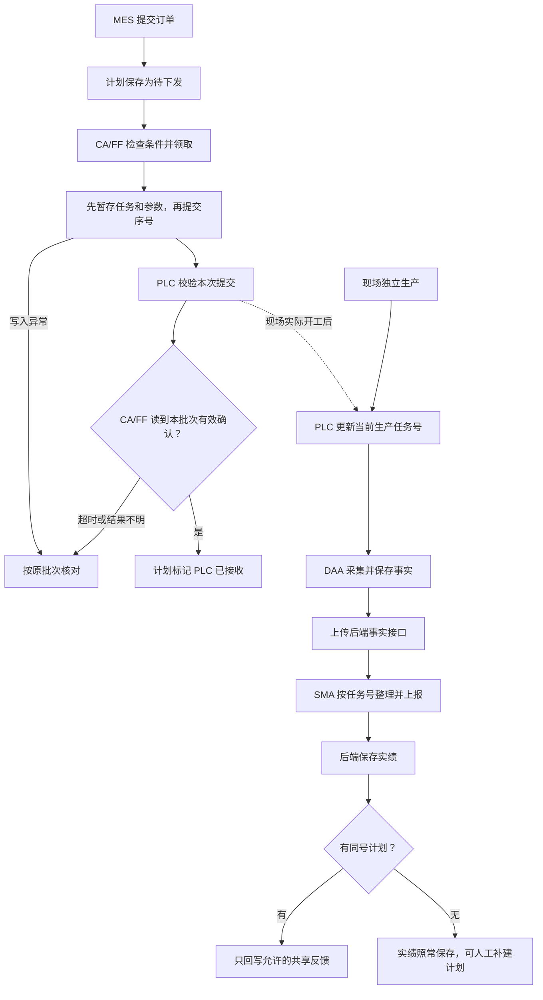
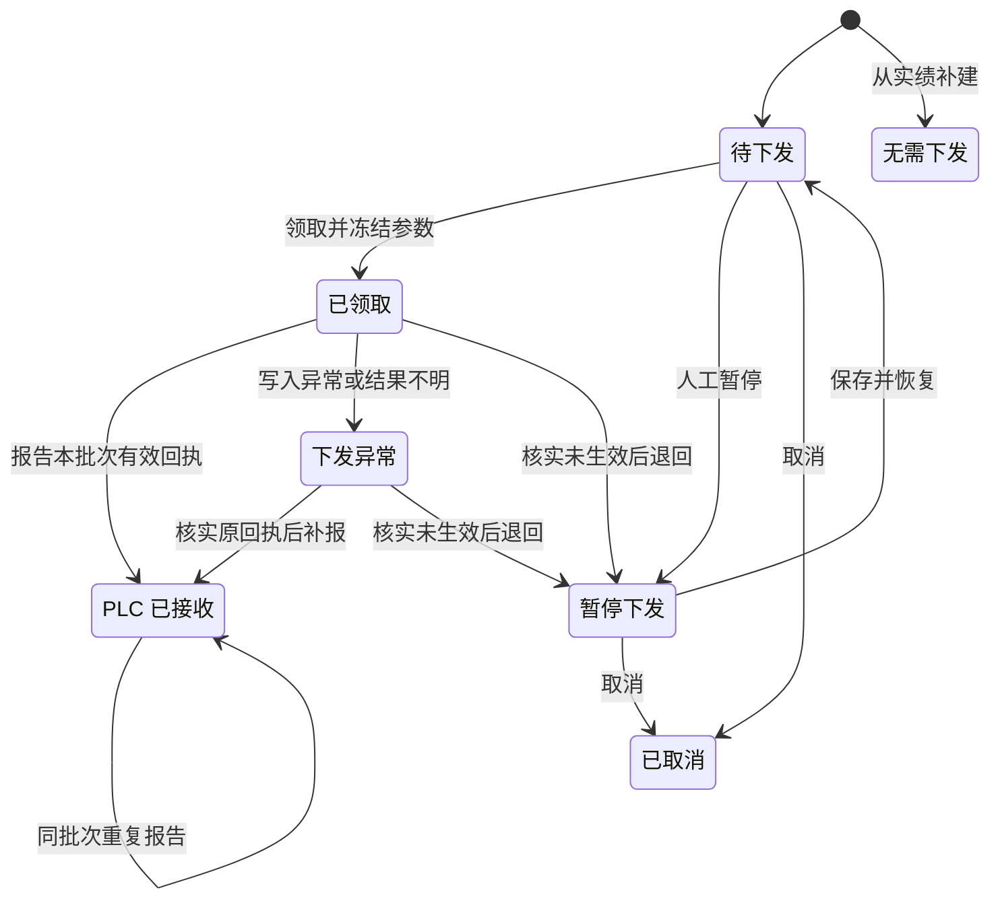
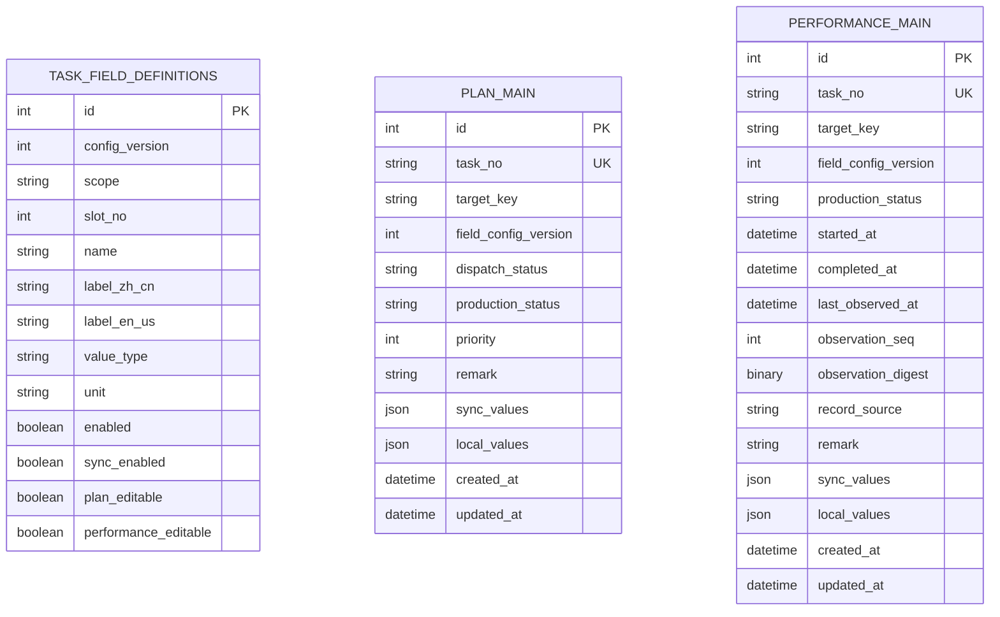

# 计划与实绩通用任务机制 · 首版审阅稿

**MES 下单 → 计划保存 → CA/FF 领取并下发 → PLC 确认接收 → 实际开工 → DAA 采集 → SMA 上报实绩 → 有同号计划时回写**

[English](generic-task-workflow-discussion.md) · [项目文档目录](README.zh-CN.md)

本文是计划和实绩通用任务机制的总审阅稿。第 1 节走完一张单，第 6 至 9 节查表、页面、接口和回写规则，第 10 节集中列出已确认口径、切换建议及剩余决定。**已确认**表示讨论已确定。**待确认**表示首版范围或做法需要决定。**待验证**表示需要按正式实现验证。现有源码和相关合同见第 6.1 和第 11 节。

## 阅读导航

- [先看一张单怎么走](#workflow) · [任务号和重复提交](#task-identity)
- [计划状态与编辑](#editing) · [改单、暂停和取消](#order-changes)
- [PLC 握手](#plc-conditions) · [超时和重启后怎么核对](#recovery)
- [表和字段怎么存](#storage) · [改配置后旧任务怎么读](#field-config-evolution) · [容量、类型和存储验证](#field-capacity-types)
- [物理表结构](#task-schema) · [查询和领单索引](#task-indexes) · [请求与返回审阅](#task-api-details)
- [两个列表和设置入口](#pages) · [与设备实时和过程监控的衔接](#field-config-alignment)
- [各端怎么调用接口](#interfaces) · [实绩怎么保存和回写](#writeback)
- [补建计划](#supplement-plan) · [换单、迟到和重复上报](#performance-ordering) · [继承、回写与写入权](#performance-writeback)
- [首版确认清单](#open-questions) · [人工过稿用例](#first-version-recommendations)
- [旧卷材功能切换](#legacy-cutover) · [首版验收](#first-version-acceptance) · [源码与合同](#references)

<a id="workflow"></a>

## 1. 用一张单走完全流程

假设 MES 下了一张任务号为 `JOB-20261107-001` 的单，目标产线是 `LINE-01`，目标长度是 **1,200 米**。SMA 后来上报这张单已生产 **300 米**。下文沿用这张单。

| 时点 | 谁做什么 | 页面上看到什么 |
| --- | --- | --- |
| 下单 | MES 把任务号、产线和订单参数交给后端。后端建一条计划。 | 计划显示「待下发」，目标长度为 1,200 米。 |
| 领单 | CA/FF 读到现场约定的允许值，向后端领取。后端把本次要下发的参数冻结成一份快照。 | 计划显示「已领取」。同一批次按冻结参数执行。 |
| PLC 接收 | CA/FF 写任务和参数，再写提交序号。PLC 接纳后回确认序号，CA/FF 核对并报告。 | 计划显示「PLC 已接收」。如果还没有生产上报，生产状态显示「未上报」。 |
| 实际开工 | 现场开始生产。PLC 更新当前生产任务号，DAA 持续采样、保存并上传事实。 | 后端收到有效实绩后，生产状态才会刷新。 |
| 实绩上报 | SMA 按采样里的任务号整理数据。后端第一次建实绩，之后继续更新同一条。 | 实绩显示「生产中」，已生产长度为 300 米。 |
| 计划回写 | 后端查到同号计划，把允许同步的已生产长度写到计划对应位置。 | 计划可同时显示目标 1,200 米和已生产 300 米。 |
| 完工 | 现场保留带原任务号的最终快照，SMA 提交最终值和完工事实。 | 实绩显示「已完成」。计划按规则显示回写的最终反馈。 |



**三个时点分开看。** PLC 接收表示设备确认收到这张单。开工由现场生产事实确定。实绩入库表示后端已经收到并接受相应的生产数据。计划的下发状态和实绩的生产状态分别更新。

CA 和 FF 在这里都承担现场流程执行职责，可按项目选择。下发、采集和上报都由运行时持续轮询。DAA 负责采集、保存和上传事实，SMA 负责把事实整理成业务值，后端负责保存计划与实绩以及执行回写。浏览器负责查询、编辑和配置。

<a id="task-identity"></a>

## 2. 用任务号找记录，重复提交按字段更新

### 2.1 四个容易混淆的键

| 键 | 用途 |
| --- | --- |
| `taskNo` | 一次生产任务的业务编号。计划和实绩可以各有一条同号记录。 |
| `targetKey` | 可独立领单和下发的产线或接收区，如 `LINE-01`。建计划和报实绩时提供，计划领取后锁定。 |
| `dispatchId` | 一次领取和下发的批次标识。同一张单核实后重新下发时会有新批次。 |
| `observationSeq` | 同一任务的自动采样上报序号，用于判断先后和重报。 |

首版按一个部署对应一个项目。`taskNo` 在每张主表内唯一，多产线仍用同一项目的唯一范围。去掉首尾空格，把英文字母转大写后校验。长度为 1–50 个字符，允许英文字母、数字、连字符、下划线和点。任务号建档后固定，返工或再次生产用新号。卷号、产品号和客户订单号可以作为各项目的业务字段。下发时还要按点表校验 PLC 的任务号编码和容量。

后端按同项目、同 `taskNo` 查找计划和实绩，各表有自己的内部 `id`。普通值提交按绝对值赋值，事件标识 `eventId` 暂为可选。已有正式集成接口的事件身份规则以已发布合同为准。

### 2.2 MES 重发同一张单时

| 提交情况 | 后端处理 |
| --- | --- |
| 首次提交，符合创建条件 | 建一条计划。先有实绩时走第 9.1 节的补建规则。 |
| 已有计划，状态允许改动 | 仅修改这次提交且有权修改的字段，保留原 `id` 和创建时间。 |
| 字段省略 | 沿用已保存的值。 |
| 显式提交 `0`、`false`、空字符串 | 作为各自的实际值校验。 |
| 显式提交 `null` | 字段允许清空时才清空。 |
| 重发相同值 | 返回成功、未变化，保留原业务更新时间。 |
| 包含非法字段、类型或越权变更 | 整次拒绝。状态、同序号内容或配置版本冲突采用 `409`。 |

例如 A 单待下发时，MES 只提交目标长度 1,250 米，其余订单字段沿用原值。CA/FF 如果先领到任务，后端按领单后的锁定规则处理改动。并发新建靠唯一约束，领单与修改由后端在事务内按状态处理。SMA 的自动上报还要走第 9.2 节的采样序号规则。

<a id="editing"></a>

## 3. 计划状态和人员操作

### 3.1 下发状态和生产状态

| 下发状态 | 含义 |
| --- | --- |
| 待下发 `pending` | 等待 CA/FF 领取，可按权限编辑。 |
| 已领取 `claimed` | 本次参数已冻结，CA/FF 正在准备或执行。 |
| PLC 已接收 `plc_accepted` | CA/FF 已报告本批次有效的匹配确认序号。 |
| 下发异常 `exception` | 需要核对原批次，详情区分已确认未生效与结果不明。 |
| 暂停下发 `paused` | 可以按待下发规则改数据，人工恢复后才重新进入领取范围。 |
| 已取消 `cancelled` | 此次下发流程结束，保留任务和取消记录。 |
| 无需下发 `not_required` | 用于从已有实绩补建的计划。 |

**CA/FF 只领取尚无生产事实的「待下发」计划。** 通讯写入的进度放在下发批次记录里。实绩的生产状态首版为「生产中」`running` 和「已完成」`completed`。计划尚无有效生产事实时显示「未上报」。

### 3.2 MES 和人工可以改什么

| 阶段 | MES | 有权限的人工 |
| --- | --- | --- |
| 待下发或暂停下发，且尚无生产事实 | 可以改目标、优先级、允许编辑的订单字段和备注。 | 可以改同样的字段。 |
| 已领取、等待接收或 PLC 已接收 | 相同值的重发可以成功，改订单字段或备注按冲突处理。 | 可以补备注，订单参数锁定。 |
| 已开工或已完成 | 沿用锁定规则。 | 可以按计划备注权限补充说明。生产数据按实绩规则处理。 |

`taskNo` 建档时确定。下发和生产状态由业务流程维护。字段还要满足启用、计划侧可编辑和类型校验。后端把一次提交作为整体处理，例如备注和锁定参数一起修改时会整次拒绝。人工只读的共享反馈可以由合法实绩回写更新。配置权限和改单权限各自校验。

<a id="order-changes"></a>

### 3.3 改单、暂停和取消

- **还在待下发时**，人工可以直接修改，或者先暂停再改。普通保存仍处于暂停。点「保存并恢复下发」时，后端一次保存改动并恢复待下发。
- **已经领单且接收待核实时**，先按第 5 节核对原批次。确认旧提交未生效后退回「暂停下发」，再修改、恢复或取消。
- **已经接收或开工时**，按项目现场流程撤销、停机或结束。计划保存已核实的接收事实，实绩继续按生产事实更新。
- **取消**适用于尚未接收且未开工的待下发或暂停任务。取消保留原任务号，需要再生产时使用新任务号。

暂停、保存并恢复、取消与领取在后端按同一计划核对状态。编辑先提交时，领取得到新值。领取先提交时，后端应用锁定规则。已核实的 PLC 接收和开工事实也参与校验。

<a id="plc-conditions"></a>

## 4. PLC 怎样允许写入并确认接收

项目可约定 `receiveState == 20` 表示允许写入，也可使用含义一致的其他点位和值。示例值只用来解释流程。CA/FF 在领单前和实际写入前都检查最新的有效读取，PLC 最终按自己的联锁条件决定是否接纳。

### 4.1 五个逻辑点位

| 点位 | 谁写、谁读 | 用途 |
| --- | --- | --- |
| `receiveState` | PLC 提供，CA/FF 读 | 当前是否允许接收任务。 |
| `incomingTaskNo` | CA/FF 写，PLC 读 | 暂存这次要下发的任务号，工艺参数与它配套。 |
| `requestSeq` | CA/FF 写，PLC 读 | 任务和参数暂存完成后写入，作为本次提交信号。 |
| `ackSeq` | PLC 写，CA/FF 读 | PLC 接纳本次提交后写入的确认序号。 |
| `activeTaskNo` | PLC 提供，DAA 读 | 实际正在执行的任务号。开工或换单时更新。 |

### 4.2 以提交序号 41 为例

1. CA/FF 确认允许接收，领取 A 单并取得本批次 `dispatchId`。后端返回冻结参数。条件不足或没有待下发单时继续轮询。查询计划列表只提供查询结果，领取由领取动作完成。
2. CA/FF 持久记录本批次及序号 41。先写任务号和参数，再把 `requestSeq` 写成 41。
3. PLC 按新序号识别一次提交，校验后把任务放入待执行区，回写 `ackSeq = 41`。CA/FF 确认这是原接收区、本批次的有效回执，保存证据，再向后端报告。
4. 现场实际开工后，PLC 更新 `activeTaskNo`。DAA 按这个号采集，SMA 按采样中的任务号归属数据。无当前任务时使用项目约定的空闲值。

同一接收区一次保留一笔待确认提交。提交后暂存内容保持到确认或核验结案，PLC 的确认序号保留到下一次接纳，新序号应与仍可见的旧提交及回执区分。现场点表负责地址、类型、允许值、工艺绑定、空闲值、序号位宽、重启保持及确认超时。[AW 执行语义](AIIS_AW_Runtime_Design.md#8-ca-执行语义与安全边界) · [Siemens 接收握手示例](https://support.industry.siemens.com/cs/attachments/109795979/109795979_MachineConnectMsgBuffer_DOC_v2_0_en.pdf#page=6)

<a id="recovery"></a>

## 5. 超时、断线和重启后先查原批次

**恢复时先找原 `dispatchId` 和原序号。** 例如下发序号 41 后 CA/FF 断线，恢复时先核对 41。找到可信的接收回执，就把这个结果补报给后端。

| 核对得到的证据 | 怎么处理 |
| --- | --- |
| 本地有有效回执，或可信读取确认原 `ackSeq` 等于本次原 `requestSeq` | 只补报。沿用原 `dispatchId`、序号和证据。后端识别同批次重复报告。 |
| 可信记录表明尚未提交，或现场证明原提交未被接纳且任务未开工 | 满足退回条件后，由有权限人员退回「暂停下发」。 |
| 可能提交过、原记录缺失、读取无效、序号归属不清或证据冲突 | 保持「下发异常」，人工核对待执行区和生产事实。核实后再补报或退回。 |

### 5.1 CA/FF 何时保存证据

写 PLC 前先保存 `dispatchId`、`taskNo`、接收区和 `requestSeq`，阶段记为「尚未发起」。发起提交序号写入前，把阶段持久标为「可能已提交」。取得有效确认后先保存回执和第一次有效读到它的时间，再报告后端。

恢复自动动作限于重连、只读核对和补报。需要查现场时读取原接收区的 `requestSeq` 和 `ackSeq`。前者用于对照提交，后者用于核实接收。当前生产任务号和实绩可用于核对是否已开工，接收本批次则以原确认序号的证据为准。PLC 重启或序号回绕时，按项目约定核实序号归属。同一接收区一次只允许一个有效写入方，待核对期间暂停该区新下发。后端只用当前批次的结果推进计划状态。[Siemens 数据保持说明](https://docs.tia.siemens.cloud/r/en-us/v20/functional-description-of-s7-1200-cpus-s7-1200/operating-modes-s7-1200/startup-operating-mode-s7-1200/warm-restart-s7-1200)

### 5.2 退回后怎样重新下发

退回要先确认旧执行已停、在途写入已结案、原提交未被接纳且任务未开工。按项目约定处置暂存残留，确保原提交无法再生效。人工记录操作人、时间、原因和证据，结束旧批次并把计划转入暂停。修改完成后手动恢复，下一次领取重新冻结参数，使用新的 `dispatchId` 和 `requestSeq`。



异常详情显示原批次、原序号、提交阶段、异常原因和证据。后端批次记录见第 6.7 节的审阅方案，现场核验方式和旧执行者隔离随项目接入确定。

<a id="storage"></a>

## 6. 两张主表和配套记录

### 6.1 现有代码和首版目标

| 范围 | 计划 | 实绩 |
| --- | --- | --- |
| 当前 Python 模型 | `plans` 有 25 个映射列，包含卷号、产品材料、张力目标和管理字段。 | `performance_main` 有 44 个映射列，包含卷材、产量质量、人工修正、采集来源和 `plan_id`。 |
| 通用任务目标 | `plan_main` 保存每张计划的订单值、下发状态和已回写反馈。 | `performance_main` 保存每张实绩的订单快照、实际值、生产状态和上报顺序。 |

模块主业务表沿用 `xx_main` 命名，`xx` 为模块名。计划主表为 `plan_main`，实绩主表为 `performance_main`。字段定义、配置状态、下发批次和人工动作表按用途命名。通用机制按同项目、同 `taskNo` 匹配，计划和实绩分别保存自己的值。dev 库盘点和旧表切换建议见第 10.2 节。[现有计划模型](../backend/app/plan/models/plan.py) · [现有实绩模型](../backend/app/performance/models/performance.py)

### 6.2 共享的是字段定义，每张单各有自己的值

| 记录 | 保存的内容 |
| --- | --- |
| `task_field_definitions` | 字段叫什么、怎么显示、用什么类型、谁能写、是否启用和允许回写。 |
| `plan_main` | 一条计划的固定字段和两组业务值。 |
| `performance_main` | 一条实绩的固定字段和两组业务值。 |
| `task_field_config_state` | 当前业务版本和管理员保存用的修订号。 |
| `plan_dispatch_attempts` | 每次下发的冻结值、原 `dispatchId`、序号、执行者、确认和异常证据。 |
| `plan_action_events` | 暂停、恢复、取消和核验退回时的操作记录。 |

A 单的字段配置可以这样理解。

| 槽位 | API 键 `name` | 计划侧 | 实绩侧 |
| --- | --- | --- | --- |
| 共享 01 | `productCode` | MES 提交 `PRODUCT-A`。 | 首次建实绩时继承。 |
| 共享 02 | `targetLength` | 订单目标 1,200 米。 | 首次继承 1,200 米，作为订单快照。 |
| 共享 03 | `completedLength` | 接收允许的回写，例如 300 米。 | SMA 上报的实际长度，例如 300 米。 |
| 计划本地 01 | `customerOrderNo` | 保存客户订单号。 | — |
| 实绩本地 01 | `currentSpeed` | — | 保存采到的当前速度。 |

共享 03 的字段定义只有一份。实绩写入 300 米时，后端按回写开关决定计划的共享 03 是否更新。两个本地 01 分属不同的组。



图中的两组值各有 100 个逻辑槽位。计划和实绩的对应关系由后端按任务号查询，回写按共享槽位号执行。图中展示两个业务主表和字段定义。物理列型、配置版本和下发批次的审阅方案见第 6.7 节。普通计划值提交的 `eventId` 可选，用于追踪。

### 6.3 字段设置保存哪些属性

| 属性 | 意思 |
| --- | --- |
| `id`、`config_version`、创建和更新时间 | 记录字段定义身份、业务配置版本和变更时间。 |
| `scope`、`slot_no` | 字段所在组和位置。组为 `shared_sync`、`plan_local`、`performance_local`。 |
| `name` | MES、SMA 和前端 API 使用的稳定键名。 |
| `label_zh_cn`、`label_en_us` | 页面显示的中文、英文名称。 |
| `value_type`、`unit`、可空设置 | 值的类型、显示单位和是否允许清空。 |
| `enabled` | 在相应业务版本中是否启用。 |
| `sync_enabled` | 是否允许共享反馈从实绩回写计划。 |
| `performance_owner`、`plan_editable`、`performance_editable` | 实绩值的写入归属，以及对应编辑入口能否修改。类型和 API 名称见第 6.7、8.6 节。 |
| 两边的列表可见和顺序 | 计划列表和实绩列表分别设默认显示列及顺序。 |

同一项目和版本内，组加槽位号定位一条定义。每个模块内的 `name` 唯一，已生效过的旧键也计入。新增共享键时同时检查两边的本地键。

前端读取的一条字段定义可以长这样。这个例子中，实绩值由 SMA 上报，两个业务页面都按只读反馈显示。

```json
{
  "scope": "shared_sync",
  "slotNo": 3,
  "name": "completedLength",
  "labels": {"zh-CN": "已生产长度", "en-US": "Completed length"},
  "type": "number",
  "unit": "m",
  "enabled": true,
  "syncEnabled": true,
  "performanceOwner": "automated",
  "planEditable": false,
  "performanceEditable": false
}
```

### 6.4 固定字段和时间

| 字段 | 所属表 | 用途 |
| --- | --- | --- |
| `id` | 两表 | 后端生成的内部主键。 |
| `task_no` | 两表 | 规范化任务号，各表内唯一。API 用 `taskNo`。 |
| `target_key` | 两表 | 产线或接收区键。API 用 `targetKey`。 |
| `field_config_version` | 两表 | 同号任务绑定的业务字段版本。 |
| `remark` | 两表 | 按业务编辑权限保存的可空备注。 |
| `created_at`、`updated_at` | 两表 | 后端首次保存、最后一次实际更新的时间。 |
| `priority`、`dispatch_status` | 计划 | 订单优先级和下发状态。状态由领取、有效回执及人工动作推进。 |
| `production_status` | 两表 | 实绩记录已接受的生产状态。计划保存后端维护的生产进度，未上报时为空。 |
| `started_at`、`completed_at` | 实绩 | 实际开工和完工时间。来源无确切时间时留空。 |
| `last_observed_at` | 实绩 | 最近接受的实际采样时间，取上报的 `observedAt`。 |
| `observation_seq`、`observation_digest` | 实绩 | 后端保存最近接受的自动上报序号和内容摘要，用于处理迟到和重报。 |
| `record_source` | 实绩 | 后端记录该条实绩的建档来源。 |

计划有 10 个固定字段，实绩有 14 个。`hasPlan` 由查询根据同号计划派生。确认时间放在下发批次中，取 CA/FF 第一次有效读到该批次确认的时间。

例如 DAA 在 10:30:00 采到 300 米，后端在 10:30:02 接受更新。实绩显示的**观测时间**是 10:30:00，**更新时间**是 10:30:02。重复上报和无变化提交沿用原更新时间。固定 ID、时间和优先级使用原生类型，首版列型见第 6.7 节。业务时间统一按 `Asia/Shanghai`，API 时间带 `+08:00`。[项目时间契约](../AGENTS.md#7-时间与时区)

<a id="field-config-evolution"></a>

### 6.5 改了字段设置，旧任务按哪一版读

A 单建在 V1，第一次实绩即使在 V2 上线后才收到，也沿用 A 单的 V1。先有实绩时同理，后来补建的计划沿用实绩的版本。后端保留任务引用的定义，按绑定版本处理字段集合、类型、写入归属和回写规则。

| admin 操作 | 对任务的影响 |
| --- | --- |
| 修改中英文显示名 | 前端重新读取时，新旧任务都显示最新标签。 |
| 更换生效过的键名或类型 | 在新版本停用旧字段，用新键和空余槽位建替代字段。 |
| 新增、停用、恢复字段，或调整写入与回写规则 | 保存为新业务版本，之后首次建档的任务采用新版本。已有任务按绑定版本处理。 |

停用后继续保留旧定义和历史值，槽位仍计入容量。恢复只用于原字段。比如 V2 停用共享 03 时，A 单仍可按 V1 上报和回写，新建的 V2 任务按 V2 的启用集合处理。

<a id="field-capacity-types"></a>

### 6.6 100 个槽位、值类型和存储验证

**已确认的容量。** 共享、计划本地、实绩本地各 100 个。每张主表使用其中两组，每个项目有最多 300 个不同的槽位。实施时按真实字段清单分别统计三组，含生效后停用的槽位。组满 100 个后拒绝新增。

| 类型 | API 如何提交 | 第一版上限 |
| --- | --- | --- |
| `string` | 文本，如 `"0007"`，保留前导零。 | 255 个 Unicode 字符。 |
| `number` | 数字，如 `300` 或 `78.5`。 | 整数部分最多 10 位，小数部分最多 4 位，末尾的零按数值忽略。 |
| `boolean` | `true` 或 `false`。 | 布尔类型。 |

文本、数字、布尔在存储里用简单文本表示，API 读回声明的类型。提交 `null` 表示清空，字段要允许清空。空字符串、数字零和 `false` 都是独立的有效值。日期和时间使用固定字段。

**已确认的存法，样表已验证。** 每张主表用两个 JSON 值列，`local_values` 保存本地组，`sync_values` 保存共享组。每组用槽位号找值。例如实绩的共享组可以保存 `{"01":"PRODUCT-A","02":"1200","03":"300"}`，未用槽位可省略。前端和第三方用 `name` 读写简单值，字段的中英文、类型和开关由配置表提供。

**行宽背景。** 255 字符是单个文本值的接口校验上限。200 列全部声明成 `utf8mb4 VARCHAR(255)` 时，声明上限就超过 MySQL 的建表行宽限制。即使用独立 `TEXT` 列，默认 16 KB 页和 `DYNAMIC` 行格式下，40 字节的短值仍留在行内。200 个这样的值连同长度标记至少 8,200 字节，已超过 InnoDB 的行内限制。这是按 MySQL 文档推算的边界。[MySQL 行格式](https://dev.mysql.com/doc/refman/8.4/en/innodb-row-format.html) · [行大小限制](https://dev.mysql.com/doc/refman/8.4/en/column-count-limit.html) · [JSON 类型](https://dev.mysql.com/doc/refman/8.4/en/json.html)

**实测结果。** 使用临时 Docker MySQL 8.4.6，实际配置为 InnoDB 16 KB 页、`DYNAMIC` 行格式、`utf8mb4` 和 `+08:00` 会话时区。

| 验证项 | 样表结果 |
| --- | --- |
| 建表 | `plan_main` 的 10 个固定字段加两个 JSON 列、`performance_main` 的 14 个固定字段加两个 JSON 列均建表成功。空组默认保存为 `{}`。 |
| 满槽写入 | 两表均验证每组 100 个、每行共 200 个槽位。每槽 40 字节短值与每槽 255 个四字节字符的长值分别写入，逐值读回一致。 |
| 单槽更新 | `JSON_SET` 只修改指定槽位，其他槽位和另一组保留原值。两个独立会话更新同一 JSON 列的不同槽位，两个结果都保留。清空指定槽位也通过。 |
| 列表分页 | 每表生成 2,400 条分页样本，按目标、状态和创建时间筛出 240 条。按创建时间及 `id` 升序和倒序各核对 15 页，无重复、无漏项。`EXPLAIN` 使用样表的目标、状态、创建时间及 `id` 联合索引。 |

试验使用内存数据目录，结束后确认临时容器已移除。分页结果对应本节的样表、索引与合成数据。首版表结构与新增索引见第 6.7 和 6.8 节。

<a id="task-schema"></a>

### 6.7 首版物理表结构

首版采用下列已确认的表、列型和约束。每张主表使用两个 JSON 值列。环境按 MySQL 8.4.6、InnoDB、`DYNAMIC` 和 `utf8mb4` 设计，每个部署对应一个项目。下文 ASCII 键列采用 `ascii_bin`，任务号按第 2 节规范化后入库。`targetKey` 使用项目登记的键，`targetKey` 和 `producerId` 都为 1–64 位英文字母、数字、点、下划线或连字符，按原大小写匹配。

所有记录时间使用 `DATETIME(6)`，保留来源中最多六位小数秒的精度。创建和实际更新时间由数据库时钟生成，新增的这两列可用 `DEFAULT CURRENT_TIMESTAMP(6)`，后端有实际变更时才更新 `updated_at`。数据库时钟与项目 `Asia/Shanghai` 时间契约对齐。开工、完工、采样和读到确认的时间取相应实际来源，API 统一返回带 `+08:00` 的时间。

#### 两张主表

| 字段 | SQL 类型 | 规则 |
| --- | --- | --- |
| `id` | `BIGINT UNSIGNED` | 两表各自自增主键。 |
| `task_no` | `VARCHAR(50) ASCII` | 两表必填、各表唯一。 |
| `target_key` | `VARCHAR(64) ASCII` | 两表必填，计划领取后锁定，实绩记录上报来源所属目标。 |
| `field_config_version` | `INT UNSIGNED` | 两表必填，首条同号记录确定版本。 |
| `remark` | `VARCHAR(500)` | 两表可空。 |
| `created_at`、`updated_at` | `DATETIME(6)` | 两表必填，按上文的数据库时间规则。 |
| `production_status` | `VARCHAR(16) ASCII` | 实绩必填 `running` 或 `completed`。计划侧由后端维护，未上报时为空。 |
| `priority` | `SMALLINT UNSIGNED` | 计划必填，默认 5，范围 1–10，1 为最高优先级。 |
| `dispatch_status` | `VARCHAR(24) ASCII` | 计划必填，普通新建默认 `pending`，补建写 `not_required`。状态键见第 3 节。 |
| `started_at`、`completed_at`、`last_observed_at` | `DATETIME(6)` | 实绩可空，分别记录实际开始、实际完成和最近接受的采样时间。 |
| `observation_seq` | `BIGINT UNSIGNED` | 实绩必填，建档时取首条有效自动快照的序号。 |
| `observation_digest` | `BINARY(32)` | 实绩必填，与序号同时保存规范化快照的 SHA-256 摘要。 |
| `record_source` | `VARCHAR(32) ASCII` | 实绩必填，由后端记录建档来源 `sma` 或 `ca_ff`。 |
| `local_values`、`sync_values` | `JSON NOT NULL DEFAULT (JSON_OBJECT())` | 两表各两列。每组是最多 100 项的对象，用 `"01"` 至 `"100"` 定位槽位。 |

两张主表各有 10、14 个固定字段，再各加两个 JSON 值列。数据库用 `CHECK` 校验两组值都是对象且各最多 100 项，例如 `JSON_TYPE(local_values) = 'OBJECT' AND JSON_LENGTH(local_values) <= 100`。优先级和固定状态按表中范围校验。Service 按绑定版本校验槽位、写入方、类型和长度，把有效值保存成文本，明确清空时移除该键。数据库字段使用 snake_case，接口映射见第 8 节。已有实绩的 `hasPlan` 按同号计划派生。[MySQL CHECK 约束](https://dev.mysql.com/doc/refman/8.4/en/create-table-check-constraints.html)

#### 字段配置

`task_field_config_state` 是配置状态表。每个部署使用一行，`id TINYINT UNSIGNED` 为主键且固定为 1。`active_version INT UNSIGNED NOT NULL` 和 `config_revision BIGINT UNSIGNED NOT NULL` 初始化为 1，另有必填的 `created_at`、`updated_at`。业务版本供任务绑定，修订号用于校验管理员保存是否过期。

| `task_field_definitions` 字段 | SQL 类型 | 规则 |
| --- | --- | --- |
| `id`、`config_version` | `BIGINT UNSIGNED`、`INT UNSIGNED` | 自增主键和必填的业务版本。 |
| `scope`、`slot_no` | `VARCHAR(24) ASCII`、`TINYINT UNSIGNED` | 组和位置必填，范围为三组及 1–100。 |
| `name`、`value_type` | `VARCHAR(64) ASCII`、`VARCHAR(12) ASCII` | 必填。接口键按原样匹配，以小写英文字母开头，后续允许英文字母、数字及下划线。类型见第 6.6 节。 |
| `label_zh_cn`、`label_en_us`、`unit` | 两个 `VARCHAR(128)`、一个 `VARCHAR(32)` | 中英文名必填，单位可空。 |
| `is_nullable`、`enabled`、`sync_enabled` | `BOOLEAN NOT NULL DEFAULT FALSE` | 可清空、启用和回写分别保存。 |
| `plan_editable`、`performance_editable` | `BOOLEAN NOT NULL DEFAULT FALSE` | 分别控制计划值入口与实绩人工入口能否编辑。 |
| `performance_owner` | `VARCHAR(16) ASCII` | 适用于实绩的字段指定 `order_snapshot`、`automated` 或 `manual`。计划本地字段留空。 |
| `plan_visible`、`performance_visible` | `BOOLEAN NOT NULL DEFAULT FALSE` | 两页各自的默认可见设置。 |
| `plan_order`、`performance_order` | `SMALLINT UNSIGNED` | 两页各自的列顺序，可空时按槽位顺序。 |
| `created_at`、`updated_at` | `DATETIME(6)` | 必填，按数据库时间规则。 |

业务版本每次发布保存三组完整定义，包含已生效后停用的槽位。中英文及列显示设置从当前定义叠加到历史版本。仅改展示属性时只推进修订号，调整业务规则时在同一事务发布新业务版本并推进修订号。`unit` 随业务定义保存，已生效的字段若需改变单位含义，用新键和槽位替换。管理员保存按提交范围合并，修订号过期就拒绝保存。

`sync_enabled` 仅可给 `shared_sync` 中归属为 `automated` 或 `manual` 的反馈字段开启，开启时计划侧设为只读。`performance_editable` 仅用于人工归属字段。

任务创建与配置发布用配置状态行串行化。创建路径在短事务内锁定该行并复查两张主表，然后采用已存在的绑定版本或当前版本。后续写实绩和回写按先计划、后实绩的固定顺序锁定同号记录，通过各自 Service 在同一次提交中合并值。

#### 下发批次和人工动作记录

| `plan_dispatch_attempts` 字段 | SQL 类型 | 规则 |
| --- | --- | --- |
| `dispatch_id`、`claim_request_id` | `CHAR(36) ASCII` | UUID，前者为批次主键，后者唯一，用于领单重试。 |
| `task_no`、`target_key`、`attempt_no` | `VARCHAR(50) ASCII`、`VARCHAR(64) ASCII`、`INT UNSIGNED` | 必填。锁定计划时按任务递增批次号。 |
| `field_config_version`、`producer_id` | `INT UNSIGNED`、`VARCHAR(64) ASCII` | 必填，冻结时的定义版本和领单方追踪键。 |
| `parameters` | `JSON` | 必填，冻结的订单参数，按 API 字段名保存类型化快照。 |
| `attempt_status` | `VARCHAR(24) ASCII` | 必填，初值 `claimed`。可转 `exception`、`plc_accepted` 或 `returned`。 |
| `active_target_key` | `VARCHAR(64) ASCII`，存储生成列 | `claimed` 或 `exception` 时取 `target_key`，其余状态取 `NULL`，用于唯一约束。 |
| `submission_phase` | `VARCHAR(24) ASCII` | 可空，来源实际报告的阶段。取 `not_submitted`、`possibly_submitted` 或 `acknowledged`。 |
| `request_seq`、`ack_seq` | `BIGINT UNSIGNED` | 可空，保存报告的原请求和确认序号。 |
| `ack_observed_at` | `DATETIME(6)` | 可空，首次有效读到本批次确认的时间。 |
| `failure_key`、`failure_detail` | `VARCHAR(64) ASCII`、`VARCHAR(500)` | 可空，记录报告的异常键和核对说明。 |
| `claimed_at`、`updated_at` | `DATETIME(6)` | 必填，数据库记录领取和实际更新的时间。 |

未结案的异常批次继续占用接收区。匹配回执或人工查明未生效后释放。生成列上的唯一索引为每个接收区限制一笔待结案批次，已结案批次可并存。CA/FF 的原序号、阶段和现场回执仍由现场执行方按第 5 节持久保存。[MySQL 生成列](https://dev.mysql.com/doc/refman/8.4/en/create-table-generated-columns.html) · [唯一索引的 NULL 规则](https://dev.mysql.com/doc/refman/8.4/en/create-index.html)

| `plan_action_events` 字段 | SQL 类型 | 规则 |
| --- | --- | --- |
| `id`、`action_request_id` | `BIGINT UNSIGNED`、`CHAR(36) ASCII` | 自增主键和唯一的动作请求 UUID。 |
| `request_digest` | `BINARY(32)` | 必填，用于确认重试与原动作内容一致。 |
| `task_no`、`action_key`、`actor_id` | `VARCHAR(50) ASCII`、`VARCHAR(24) ASCII`、`BIGINT UNSIGNED` | 必填，任务号、动作键和已登录操作人 ID。 |
| `from_status`、`to_status` | `VARCHAR(24) ASCII` | 必填，动作前后的下发状态。 |
| `dispatch_id`、`reason`、`evidence` | `CHAR(36) ASCII`、`VARCHAR(500)`、`TEXT` | 可空。人工核验退回时记录原批次、原因和证据。取消记录原因。 |
| `created_at` | `DATETIME(6)` | 必填，数据库记录动作时间。 |

暂停、保存并恢复、取消及核验退回成功时，计划状态和动作记录一起提交。保留旧批次及操作者信息，供计划详情核对。两张业务主表的匹配仍使用任务号。

<a id="task-indexes"></a>

### 6.8 首版索引

| 表 | 索引 | 用途 |
| --- | --- | --- |
| `plan_main`、`performance_main` | 主键 `id`，唯一 `uq_task_no (task_no)` | 详情定位、并发建档、同号匹配。 |
| 两张主表 | `ix_created_page (created_at, id)` | 默认列表排序和创建时间区间。 |
| `plan_main` | `ix_plan_target_state_page (target_key, dispatch_status, created_at, id)` | 产线、下发状态和时间的列表组合。 |
| `performance_main` | `ix_perf_target_state_page (target_key, production_status, created_at, id)` | 产线、生产状态和时间的列表组合。 |
| `plan_main` | `ix_plan_claim (target_key, dispatch_status, production_status, priority, created_at, id)` | 按目标领取待下发计划，优先级、创建时间和 ID 依次排序。 |
| `task_field_definitions` | 唯一 `uq_task_field_slot (config_version, scope, slot_no)` 和 `uq_task_field_name (config_version, scope, name)` | 版本定义查询和组内唯一性。共享键与两边本地键的重名及历史占用由 Service 核对。 |
| `plan_dispatch_attempts` | 唯一 `claim_request_id`、`(task_no, attempt_no)`、`active_target_key` | 领单重试、定位任务最新批次、单接收区互斥。 |
| `plan_action_events` | 唯一 `action_request_id`，索引 `(task_no, id)` | 人工动作重试和详情追踪。 |

列表默认按 `created_at DESC, id DESC` 排序。领单按 `target_key`、`dispatch_status = 'pending'` 和 `production_status IS NULL` 找候选，再按 `priority ASC, created_at ASC, id ASC` 取第一条并锁定。接收区唯一约束冲突时重查原请求号或返回 `target_busy`。

第 6.6 节已在样表验证两个列表的目标、状态和时间组合。领单索引和配套表约束随正式迁移验证。JSON 值用于显示与业务写入，首版列表按固定字段查询。计划详情用任务号和批次号定位最新下发记录，实绩列表可对当页任务号一次匹配计划，派生 `hasPlan`。

<a id="pages"></a>

## 7. 两个列表和两个设置入口

| 页面 | 默认看什么 | 可以做什么 |
| --- | --- | --- |
| 计划管理 → 计划列表 | 任务号、产线、下发和生产状态、优先级、选定订单或反馈字段、创建及更新时间。 | 按状态和权限改值、补备注、暂停、保存并恢复、取消。异常详情查看批次和证据。 |
| 实绩管理 → 实绩列表 | 任务号、产线、生产状态、选定实绩值、有无计划、创建、最近观测及更新时间。 | 在详情查看完整值，按归属编辑人工字段。无计划且有新增权限时可补建。 |

列表按任务号和目标键精确匹配，也可筛状态和上海时区的创建时间范围。后端先筛选和排序再分页。默认按创建时间倒序，可切换升序，同一时间用 `id` 同向排序。自定义值按配置选作显示列，完整值放详情，列表筛选和排序使用固定字段。

计划和实绩各有一个 admin「字段设置」入口，共用页面组件和配置接口。计划入口看共享和计划本地，实绩入口看共享和实绩本地。两边的共享 03 编辑的是同一条定义，另一边重新读取即可看到保存结果。

**保存配置时**，后端检查 admin 权限、提交范围、槽位容量和键名唯一性，并按提交范围一次合并。保存前核对页面读取的配置修订号，已有更新时提示刷新后再改。字段是否启用、反馈能否回写、该列是否显示是三个设置。

前端按任务版本读取类型、单位和权限，并使用当前中英文标签显示值。固定文案和状态使用前端 i18n。普通列可拖宽，支持最小列宽、横向滚动、本机记忆和恢复默认。个人显示和列宽偏好按稳定字段身份保存，重新打开页面或应用时恢复。自动刷新保留筛选、分页、列宽和未保存编辑。界面按 `Asia/Shanghai` 显示 24 小时制时间，分别标明观测与实际更新。

<a id="field-config-alignment"></a>

### 7.1 与设备实时和过程监控怎样配合

计划和实绩按 `name` 找任务字段，设备状态和过程监控按 `metricKey` 找指标。设备侧的实时值更新当前快照，过程值追加历史，温区等点位由设备指标配置管理。任务表保存任务当前或最终的业务值。[设备状态与过程监控方案](equipment-status-process-monitoring.zh-CN.md)

编辑器可考虑复用业务键、中英文名、类型、单位、默认显示和排序。计划和实绩还要维护回写与编辑权限，设备和过程还要维护指标分组、页面与历史投递规则。两个业务域保留各自的配置入口与业务含义，编辑器共用范围待定。

<a id="interfaces"></a>

## 8. 各端用什么接口、交什么数据

### 8.1 前端与集成端的权限

| 调用方 | 首版口径 |
| --- | --- |
| 登录后的前端用户 | 按查询、任务编辑和人工操作权限访问。 |
| admin | 登录并具有 admin 权限后保存字段定义。 |
| MES、CA/FF、SMA 的通用任务调用 | 使用通用任务集成入口，免前端登录 token。 |
| DAA 上传事实、SMA 读取事实 | 依各自接入的采集事实合同执行，当前入口见第 8.2 节。 |

后端仍检查字段类型、状态、调用入口和执行资格。`producerId` 用于追踪，`dispatchId` 用于定位本次下发。管理权限由管理入口单独校验。前端与集成适配器复用业务规则，实绩通过计划模块的业务服务回写。同库时实绩、上报序号与允许的回写一起提交。

### 8.2 入口一览

下表是已确认的通用任务首版接口清单。第 8.6 节列出请求、返回和错误码。

| 调用方 | 方法与路径 | 用途 |
| --- | --- | --- |
| 前端 | `GET /api/v1/plans`、`GET /api/v1/plans/{id}` | 计划分页和详情。 |
| 前端 | `POST /api/v1/plans/upsert` | 新建计划或按权限和状态修改已提交的计划值。 |
| 前端 | `POST /api/v1/plans/{id}/actions/{action}` | 暂停、保存并恢复、取消或核验退回。 |
| 前端 | `GET /api/v1/performances`、`GET /api/v1/performances/{id}` | 实绩分页和详情。 |
| 前端 | `POST /api/v1/performances/upsert` | 按权限编辑已有实绩的人工字段与备注。 |
| 前端 | `POST /api/v1/performances/{id}/actions/supplement-plan` | 从已有实绩补建计划，可选择回填。 |
| 前端 | `GET /api/v1/task-field-configs` | 读取当前或指定版本的字段定义。 |
| admin | `PUT /api/v1/task-field-configs` | 保存提交范围的定义并校验修订号。 |
| 集成端 | `GET /api/v1/integration/task-field-configs` | 读取当前或指定版本定义。 |
| MES | `POST /api/v1/integration/plans/upsert` | 下单或按规则更新同号计划。 |
| CA/FF | `POST /api/v1/integration/plans/dispatch/claim` | 原子领取并取得冻结参数，没有待下发任务时返回无任务。 |
| CA/FF | `POST /api/v1/integration/plans/dispatch/report` | 报告本批次接收或异常结果。 |
| SMA | `POST /api/v1/integration/performances/upsert` | 创建或更新实绩。项目需要时，CA/FF 也可作为指定上报方。 |
| MES 或集成端 | `GET /api/v1/integration/plans/by-task/{taskNo}` | 查看订单、下发状态、PLC 接收结果及已回写的生产进度。 |
| MES 或集成端 | `GET /api/v1/integration/performances/by-task/{taskNo}` | 查看实际已上报的状态、时间和业务值。 |

例如 A 单刚被 PLC 接收时，查计划能看到接收结果，查实绩可能还没有记录。现场独立任务可先有实绩，此时实绩返回 `hasPlan: false`。这两个查询各自回答订单流转和实际生产的问题。

当前采集事实 v2 使用 `POST /api/v1/integration/plc-facts/samples`，DAA 写入使用独立的机器 Bearer。采集数据页面通过授权的 `GET /api/v1/acquisition-data/latest`、`GET /api/v1/acquisition-data/history` 等入口查询。SMA 实际如何读取事实在现场接入时确定，通用实绩写入使用上表的独立接口。既有实绩集成入口的切换建议见第 10.2 节。[事实接口合同](../contracts/published/http-api/plc-facts-v2/README.zh-CN.md) · [业务集成合同](../contracts/published/http-api/business-integration-v1/README.zh-CN.md)

### 8.3 MES 提交 A 单

向计划集成入口提交以下内容。字段以第 6.2 节的配置为例。

```json
{
  "producerId": "mes-01",
  "taskNo": "JOB-20261107-001",
  "targetKey": "LINE-01",
  "fieldConfigVersion": 1,
  "syncValues": {"productCode": "PRODUCT-A", "targetLength": 1200},
  "localValues": {"customerOrderNo": "MES-ORDER-001"}
}
```

`syncValues` 和 `localValues` 传字段键和值。后端以任务绑定版本校验，提交的版本用于核对。一个字段的中英文、单位和类型由配置接口读取。

### 8.4 CA/FF 领取和报告接收

领取时指定下发目标，提交为这次领单生成并保存的请求号。

```json
{
  "producerId": "ff-01",
  "targetKey": "LINE-01",
  "claimRequestId": "d0c01a28-cd77-4b56-aef8-efcc31163e04"
}
```

领到 A 单时，后端返回本批次标识和冻结参数。下例展示响应的 `data`。

```json
{
  "outcome": "claimed",
  "attempt": {
    "dispatchId": "260aef4a-65fd-484f-8baa-962513a72954",
    "claimRequestId": "d0c01a28-cd77-4b56-aef8-efcc31163e04",
    "taskNo": "JOB-20261107-001",
    "targetKey": "LINE-01",
    "attemptStatus": "claimed",
    "fieldConfigVersion": 1,
    "parameters": {"productCode": "PRODUCT-A", "targetLength": 1200}
  }
}
```

CA/FF 确认本批次序号 41 后，使用原批次报告。

```json
{
  "dispatchId": "260aef4a-65fd-484f-8baa-962513a72954",
  "taskNo": "JOB-20261107-001",
  "targetKey": "LINE-01",
  "producerId": "ff-01",
  "requestSeq": 41,
  "ackSeq": 41,
  "ackObservedAt": "2026-11-07T10:05:03+08:00",
  "outcome": "plc_accepted"
}
```

领单超时使用原 `claimRequestId` 重试，取得原批次后查本地记录继续处理。报告异常和人工操作的格式见第 8.6 节。

### 8.5 SMA 报告 A 单生产到 300 米

下面是 A 单已经有实绩后的一次更新。`observedAt` 是采样时间，`observationSeq` 按该任务的采样顺序递增。

```json
{
  "producerId": "sma-01",
  "taskNo": "JOB-20261107-001",
  "targetKey": "LINE-01",
  "fieldConfigVersion": 1,
  "productionStatus": "running",
  "observationSeq": 12,
  "observedAt": "2026-11-07T10:30:00+08:00",
  "syncValues": {"completedLength": 300},
  "localValues": {"currentSpeed": 78.5}
}
```

有计划且回写成功时，响应可以这样表达。

```json
{
  "code": 200,
  "message": "success",
  "data": {
    "taskNo": "JOB-20261107-001",
    "outcome": "updated",
    "hasPlan": true,
    "planSync": {"outcome": "synced", "slots": ["03"]}
  }
}
```

现场另有一张独立任务，实绩创建成功时可以这样表达。

```json
{
  "code": 200,
  "message": "success",
  "data": {
    "taskNo": "JOB-20261107-002",
    "outcome": "created",
    "hasPlan": false,
    "planSync": {"outcome": "skipped", "slots": [], "reason": "no_plan"}
  }
}
```

有同号计划而本次无可回写值时，`hasPlan` 仍为 `true`，`planSync` 返回跳过原因。具体响应和错误键见下节。

<a id="task-api-details"></a>

### 8.6 首版请求与返回

本节细化第 8.2 节的通用任务接口。前端入口使用登录 token 与对应权限，集成入口沿用第 8.1 节的免前端登录口径。每个集成写入请求带 `producerId` 作为追踪键，现场自动上报使用项目指定的上报流。

#### 查询和通用格式

| 场景 | 请求与返回 |
| --- | --- |
| 前端列表 | `page` 从 1 开始，默认 1。`pageSize` 默认 20，上限 100。可选 `taskNo`、`targetKey` 精确匹配、`productionStatus`、`createdFrom`（含）和 `createdTo`（不含）。计划另支持 `dispatchStatus`。`sortOrder` 为 `desc`（默认）或 `asc`，按 `createdAt`、`id` 同方向排序。 |
| 列表结果 | `data` 含 `items`、`total`、`page`、`pageSize`、`totalPages`。每条返回固定摘要及配置为可见的业务值，按该条任务的版本解释。 |
| 前端详情与集成查询 | 前端按内部 `id` 查，集成端按规范化 `taskNo` 查。详情返回该任务已启用、已保存的全部业务值。计划详情含 `latestDispatchAttempt`，无批次时为 `null`。有批次时含 `dispatchId`、`attemptNo`、`attemptStatus`、`submissionPhase`、`requestSeq`、`ackSeq`、`ackObservedAt`、`claimedAt`。有核对权限的前端详情还含 `failureKey`、`failureDetail` 及最近 20 条 `recentActionEvents`（`actionKey`、`actorId`、`fromStatus`、`toStatus`、`dispatchId`、`reason`、`evidence`、`createdAt`）。 |
| 两模块返回字段 | `id`、`taskNo`、`targetKey`、`fieldConfigVersion`、`productionStatus`、`remark`、`createdAt`、`updatedAt`、`syncValues`、`localValues`。计划另带 `dispatchStatus`、`priority`，实绩另带 `startedAt`、`completedAt`、`lastObservedAt`、`observationSeq`、`recordSource` 和 `hasPlan`。 |
| JSON 与时间 | 固定键用 camelCase。业务值对象的 `name` 和 `labels` 中的语言键原样保留，如 `value_name`、`zh-CN`。`id`、`actorId` 和配置修订号用十进制字符串，配置版本用整数。采样序号用 1 至 9,007,199,254,740,991 的 JSON 整数，PLC 序号使用同一 JSON 安全上限和现场位宽上限中的较小值，下限为 0。时间带时区提交，保留最多六位小数秒，按上海时间保存，统一返回 `+08:00`。 |

值对象的键来自字段配置。按类型提交简单值，后端保存成槽位和文本，读回时还原为 JSON 字符串、数字或布尔。读到尚无值的槽位时省略该键。前端另读字段定义，根据任务的 `fieldConfigVersion` 取得类型、权限和中英文名。

#### 计划写入与人工动作

| 入口 | 请求 | 成功结果及限制 |
| --- | --- | --- |
| 前端或 MES 的计划 `upsert` | 必填 `taskNo`、`fieldConfigVersion`，首次建档还要 `targetKey`。可选 `priority`、`remark`、`syncValues`、`localValues`，MES 另带 `producerId`，可选 `eventId` 用于追踪。 | `data` 含 `outcome`（`created`、`updated`、`unchanged`）和计划摘要 `plan`。同号按第 3 节的状态和权限只改提交字段。值相同的重发保留原更新时间。已有实绩、尚无计划时，普通创建返回 `409 task.plan_supplement_required`。 |
| 实绩人工 `upsert` | 必填已有记录的 `taskNo`、绑定的 `fieldConfigVersion`，可选 `remark`、`syncValues`、`localValues`。 | 按提交项更新人工归属且可编辑的字段。返回 `outcome`（`updated`、`unchanged`）、`performance` 摘要和 `planSync`。自动采样、开完工事实及实绩创建走自动上报入口。 |
| 实绩详情「补建计划」 | 路径为实绩 `id`。必填 `targetKey` 和实绩绑定的 `fieldConfigVersion`。可提交计划值及 `remark`。`backfillExisting` 默认 `false`。 | 校验新增计划权限，按该实绩的 `taskNo` 建为 `not_required`，带入已知生产状态。已存在同号计划返回原计划。`data` 含 `outcome`（`created`、`existing`）和 `plan`。回填见第 9.1 节。 |

待下发、暂停的计划允许按第 3 节改订单，异常核对期间应用领取后的锁定规则。补建计划的订单值在创建表单提交，补建完成后普通人工编辑限备注。取消后的计划保留供查询，相同值重发仍可得到 `unchanged`。首版 MES 的可编辑值按后端接受顺序更新，调用方按任务串行提交或重试。项目的 PLC 下发映射定义要冻结的字段及其必填值，进入待下发或修改下发参数时按目标和版本校验。

下列动作使用 `POST /api/v1/plans/{id}/actions/{action}`，都带一次操作生成的 UUID `actionRequestId`。

| `action` | 额外请求字段 | 后端动作 |
| --- | --- | --- |
| `pause` | 可选 `reason`。 | 待下发、无开工事实时转为 `paused`。 |
| `save-and-resume` | 必填 `fieldConfigVersion`，可选计划编辑字段。 | 计划暂停且仍可下发时，保存改动与恢复 `pending` 一次提交。 |
| `cancel` | 必填 `reason`。 | 尚未接收或开工的待下发、暂停计划转为 `cancelled`。 |
| `return-to-paused` | 必填原 `dispatchId`、`reason` 和文本 `evidence`。 | 人工核验后，仅对仍在领取或异常状态的原批次退回。后端复查当前批次、无接收和开工事实，关闭批次并转为 `paused`。 |

动作返回 `outcome`（`applied`、`duplicate`）、`taskNo` 和 `resultingDispatchStatus`。同请求号、同操作人、同内容重试时返回原动作结果。重用请求号提交不同内容时返回 `409 task.action_request_conflict`。人工核验的现场要求见第 5.2 节。

#### CA/FF 领单、重试和报告

| 入口 | 必填内容与条件 | `data` 的结果 |
| --- | --- | --- |
| `dispatch/claim` | `targetKey`、`producerId`、`claimRequestId`。CA/FF 在首次请求前持久保存 UUID，超时用同一 ID 重试。后端按目标从待下发且无生产事实的计划中依次选优先级 1 至 10、创建时间、ID。领取与冻结快照在一个事务提交。 | `outcome` 为 `claimed` 或 `existing_attempt` 时带 `attempt`，字段见第 8.4 节。接收区已有未结案批次时为 `target_busy`，无符合条件计划时为 `no_task`，两者的 `attempt` 为 `null`。 |
| `dispatch/report` | `dispatchId`、`taskNo`、`targetKey`、`producerId`、`outcome`。`plc_accepted` 还要原 `requestSeq`、相等的 `ackSeq` 及 `ackObservedAt`。`exception` 还要 `submissionPhase`（`not_submitted` 或 `possibly_submitted`）、`reasonCode`，并在已知时提交原 `requestSeq` 与可选 `detail`。 | `outcome` 为 `accepted`、`exception_recorded` 或 `duplicate`，另带 `dispatchId`、`taskNo`、`attemptStatus` 和 `dispatchStatus`。 |

同一请求号已领到任务时，重试返回原批次、冻结参数与批次当前状态。同一请求号换目标或执行者时返回冲突。空轮询结果无需存记录，之后的正常轮询使用新 ID。CA/FF 拿到原批次后按本地持久记录判断是继续首次执行还是只核对和补报。已结案批次只能用于查询原结果。冻结的 `parameters` 是按项目下发映射选出的订单参数，键为绑定版本的 `name`。

后端用当前批次、原序号及证据核对报告。同批次同证据重试返回成功且沿用原时间。异常批次取得有效确认后可以补报接收，旧批次或冲突证据返回 `409 task.dispatch_conflict`。下发接收结果与实绩生产状态分别推进。

#### SMA 自动写入和回写结果

| 请求字段 | 约定 |
| --- | --- |
| `producerId`、`taskNo`、`targetKey`、`fieldConfigVersion` | 必填。首条实绩记录目标和来源。后续校验同一目标和该目标在项目中指定的上报方，进行中的任务沿用原上报流。同号计划先存在时校验其绑定版本。 |
| `productionStatus`、`observationSeq`、`observedAt` | 必填。状态为 `running` 或 `completed`，序号按每单递增。缺实际采样时间时 `observedAt` 传 `null`。 |
| `syncValues`、`localValues` | 必填对象。每组提供该流负责、启用的自动字段完整快照，无此类字段时用 `{}`。可清空字段可显式传 `null`。 |
| `startedAt`、`completedAt` | 来源有相应实际时间时提交。缺省沿用已有事实，首次未知则留空。`completedAt` 只用于完工快照。 |

先按任务锁定并核对序号及规范化快照摘要。摘要使用校验后的业务内容，按槽位归一化，忽略 JSON 键的排列次序。已接受的有效新快照返回 `created` 或 `updated`。低序返回 `late`，同序同内容返回 `duplicate`，同序不同内容返回 `409 task.observation_conflict`，完工后收到更高序号返回 `already_completed`。后三种成功的忽略结果保持原业务值、更新时间和回写。完工快照可以是第一条有效实绩。

`data` 含 `taskNo`、`outcome`、`hasPlan`、`planSync`。`hasPlan` 按项目内同号计划查得。有实际共享值更新时 `planSync` 返回 `outcome: "synced"` 和对应 `slots`。其余返回 `outcome: "skipped"`、空 `slots` 和 `reason`，首版原因键为 `no_plan`、`no_eligible_values`、`no_value_change`、`report_ignored`、`incompatible_definition`。仅部分字段兼容时可另带 `skippedSlots`，每项含 `slot` 和 `reason`。这组结果描述共享值回写，计划的生产状态按已接受的生产事实单独更新。实绩、已接受的序号和允许的计划更新在同一事务提交。

#### 字段配置接口

| 入口 | 请求 | 结果 |
| --- | --- | --- |
| 前端与集成的 `GET .../task-field-configs` | 必填 `module`（`plan` 或 `performance`）。可选 `fieldConfigVersion`，缺省为当前生效版。 | `data` 含 `fieldConfigVersion`、`activeVersion`、`configRevision` 和 `fields`。返回共享组与所选模块本地组。前端可读该版本完整定义，集成端读取启用定义。 |
| admin `PUT /api/v1/task-field-configs` | 提交 `module`、当前 `fieldConfigVersion`、读取时的 `configRevision` 和 `changes`。每项用 `scope`、`slotNo` 定位，附实际修改属性。新增槽位须给 `name`、`type` 和 `labels`，其余按第 6.7 节校验和应用默认值。 | 一次合并并校验，返回更新后的当前配置。不同页面修改的是同一组共享定义，列表可见和顺序只改当前模块的属性。过期保存返回 `409 task.config_revision_conflict`。 |

字段项含 `scope`、`slotNo`、`name`、`type`、`labels`（`zh-CN`、`en-US`）、`unit`、`isNullable`、`enabled`、`syncEnabled`、`performanceOwner`、`planEditable`、`performanceEditable`、`planVisible`、`performanceVisible`、`planOrder`、`performanceOrder`。历史任务按绑定版本读取类型、单位并校验业务属性，中英文标签及列表展示按当前槽位设置。保存结果无实际变更时沿用原修订号。

例如管理员在计划页面改共享 03 的显示名。提交 `labels` 时带两个语言键。这次保存只推进 `configRevision`，实绩页面重新读取后显示相同名称。

```json
{
  "module": "plan",
  "fieldConfigVersion": 1,
  "configRevision": "2",
  "changes": [
    {
      "scope": "shared_sync",
      "slotNo": 3,
      "labels": {"zh-CN": "已生产米数", "en-US": "Metres produced"}
    }
  ]
}
```

#### HTTP 与错误码

成功使用 HTTP `200` 和项目的 `code`、`message`、`data` 响应形状。应用错误返回匹配的 HTTP 状态及稳定的 `errorCode`，前端据此显示 i18n 文案。下文示例列出业务字段，前端现有标准响应另含毫秒时间戳 `timestamp`。

| HTTP | 错误键及触发条件 |
| --- | --- |
| `401`、`403` | `task.unauthenticated`、`task.forbidden`。前端未登录、缺对应权限，或调用方无字段写入资格。 |
| `404` | `task.not_found`。请求的计划、实绩或配置版本不存在。 |
| `409` | `task.state_conflict`、`task.field_version_conflict`、`task.config_revision_conflict`、`task.observation_conflict`、`task.dispatch_conflict`、`task.action_request_conflict`、`task.plan_supplement_required`。分别对应状态、版本、配置修订、同序快照、下发批次或请求号、人工动作请求和补建条件。 |
| `422` | `task.invalid_request`。字段键、类型、必填值、范围或请求形状有误时整次拒绝。 |
| `503` | `task.unavailable` 或 `task.commit_unknown`。服务暂不可用或提交结果未明，调用方沿用原请求身份与内容核对或重试。 |

例如同一实绩序号 12 被报了两份不同内容，返回 HTTP `409`。

```json
{
  "code": 409,
  "message": "task.observation_conflict",
  "data": null,
  "errorCode": "task.observation_conflict"
}
```

<a id="writeback"></a>

## 9. 实绩入库、回写和特殊情况

后端先校验任务、版本、字段和上报顺序。首次创建实绩时按第 9.3 节继承订单值，再保存本次有效提交。有同号计划时按配置回写共享反馈，并报告哪些值跳过及原因。同库时保存实绩、适用的上报序号和允许的回写在同一次事务中完成。计划的生产进度按生产事实更新，下发状态由下发流程维护。

A 单的 `targetLength` 是 1,200 米，`completedLength` 是 300 米。两个字段占不同槽位。回写 300 米时，写的是计划的已生产长度。

<a id="supplement-plan"></a>

### 9.1 现场先生产，后来才有计划

1. 后端接受有效实绩并独立保存。详情显示「无计划」。有新增计划权限的人可从这里点击「补建计划」。
2. 表单带入只读的 `taskNo`，使用这条实绩绑定的配置版本。填写计划必填项后，后端按同项目和同号重查。已有计划就返回该记录，并发创建由唯一约束处理。普通计划创建遇到已有实绩时也引导到补建入口。
3. 补建计划的下发状态为「无需下发」`not_required`，所以 CA/FF 的待下发队列里没有这张单。
4. 「同时回填已有实绩」默认关闭。勾选后，后端读取当前实绩，只回填定义兼容且两个开关都开启的共享值。当次允许人工填写的值优先，回填只补未提交的位置。

后续有效上报按通常规则回写。补建请求和编辑范围见第 8.6 节。

<a id="performance-ordering"></a>

### 9.2 换单、迟到和重复上报

从 A 单切到 B 单前，现场把 A 单的任务号、原采样时间和对应业务值保留成可重读的一份记录。实际完工时还要保留完工事实和最终值。优先使用现场已有的完工记录区，保留到 DAA 可靠保存。换号之后，SMA 仍可用快照中的 A 单号补报。如果现场只有实时点，保留已采到的最后一条 A 单观测，取得完工证据后再记完成。

DAA 持久保存采样。SMA 从可回放的事实取样，把待发快照保存到取得业务确认。每单只指定一条自动上报流，每次提交该流负责字段的完整业务快照。`observationSeq` 按来源的采样顺序每单递增，完工快照排在自动报告序列末尾。重试和重启沿用原序号、原观测时间和内容。[SMA 可靠输入与投递设计](AIIS_SMA_Detailed_Design.md)

| 后端收到什么 | 处理 |
| --- | --- |
| 已接受 12，又收到 11 | 确认为迟到并返回已处理，保留 12 的实绩和回写结果。 |
| 同样的 12、同样的内容 | 返回重复成功。 |
| 同样的 12、内容不同 | 返回 `409`，上报方核对原快照。 |
| 首次或更大的序号，任务仍在进行 | 校验后保存，按规则回写。完工快照保存最终值并关闭该单自动上报。 |
| 任务已完成后又收到新自动报告 | 返回已完工，保留最终实绩和回写结果。 |

后端按任务保存最后接受的序号和摘要。B 单开始后仍可接受 A 单尚未处理的完工快照。现场保留和释放、序号来源与重启续号办法待项目确认。采集值的人工更正另行确定。

<a id="performance-writeback"></a>

### 9.3 继承一次，按归属写值，按开关回写

| 值的例子 | 从哪来、怎样使用 |
| --- | --- |
| 产品编码和目标长度 | 首次创建实绩时，从同号计划复制已启用且定义兼容的共享订单值，实绩侧作为只读快照。 |
| 已生产长度和当前速度 | 项目指定的自动上报方维护，按第 9.2 节接收快照。当前速度在实绩本地组。 |
| 人工检验结论 | 有权限的人通过实绩编辑入口填写。 |

实绩先建时，继承类订单值可以留空。之后补建计划时，实绩的订单快照以首次建档为准。每个实绩字段约定一个写入方，后端按入口和字段归属校验整次写入。

后端只从**本次有效提交**中选符合条件的共享反馈回写。字段需要已启用、两边定义兼容，并且回写开关开启。已生产长度回写计划的对应位置，计划侧只读显示。人工录入的反馈也可按相同规则配置回写。目标字段与反馈字段分开，订单字段的回写开关设为关闭。本地值保存在自己的模块。

任务表承载当前及最终业务值。过程曲线、设备实时和 raw/latest 管理按各自议题设计。

<a id="open-questions"></a>

## 10. 首版范围与确认清单

本稿围绕通用计划和实绩两个业务模块。已确认的流程、表结构、索引、API 和业务规则作为首版设计口径。开发与验收使用现有 dev 库。

| 状态 | 事项 |
| --- | --- |
| 已确认 | 主表为 `plan_main`、`performance_main`，各有本地和共享两个 JSON 值列，每组 100 个槽位。任务身份、状态、字段版本、上下游接口和回写规则见第 2 至 9 节。 |
| 已确认 | 领单优先级 1 最高，同级按创建时间和 ID。MES 按后端接受顺序更新，同任务串行提交与重试。实绩人工编辑限人工归属字段和备注，补建计划完成后普通人工编辑限备注。 |
| 首版待确认 | 旧卷材功能的清退清单，以及是否按第 10.2 节在 dev 库一次性切换。 |
| 首版待确认 | 第 10.3 节的验收范围、A/B 单样例字段及权限表。样例明确冻结的订单值、SMA 上报与回写字段、人工值，以及暂停、恢复、取消、核验退回和补建权限。 |
| 现场接入前确定 | PLC 实际地址、允许接收值、任务号编码、序号保持与复位、超时和旧执行者隔离。另确定末次快照的保存与释放、SMA 采样序号来源及重启续号方式。 |
| 实施时验证 | 正式迁移、满槽写入、领单并发、实绩与回写的事务、权限及页面行为。第 6.6 节记录已完成的样表测试。 |

<a id="first-version-recommendations"></a>

### 10.1 可以拿这几种情况过一遍

| 场景 | 预期看到的结果 |
| --- | --- |
| A 单已被 PLC 接收，现场还没开工 | 计划显示「PLC 已接收」，生产显示「未上报」。 |
| A 单的 SMA 上报为 300 米，回写开关已开 | 实绩显示 300 米，计划的已生产长度更新为 300 米，目标显示 1,200 米。 |
| A 单已接收序号 12，再收到 11 或重复的 12 | 迟到或重复上报得到对应结果，已保存数据以接受的快照为准。 |
| 现场有实绩，无计划，人工补建 | 实绩一直可查，补建计划显示「无需下发」，可选回填默认关闭。 |
| V2 停用共享 03，A 单仍是 V1 | A 单按 V1 接受并回写，V2 新任务按新版本。 |
| 写入后断线，恢复发现原序号已被确认 | 沿用原批次补报接收结果。证据不明时保留下发异常。 |

首版可用这些场景验收业务结果。验证方式见第 10.3 节。

<a id="legacy-cutover"></a>

### 10.2 旧卷材功能切换建议

**待确认。** 建议首版一次切换到通用计划和实绩。2026-11-11 对现有 dev 库做了只读盘点。旧 `plans`、旧 `performance_main` 和下表 17 张配套表均为 0 条记录，`plan_main` 当时尚未建立。可见的 21 个引用这组表的外键均来自组内。旧首页和报表还有代码层面的引用，切换时一并处理。

| 旧功能 | 首版切换建议 | 旧表或依赖 |
| --- | --- | --- |
| 计划 XLSX | 停用模板、导入、导出及页面按钮。 | 旧订单固定列、表单和 XLSX 映射。 |
| 旧计划实绩关联 | 清退旧关联与回填入口，使用同号回写和补建。 | `performance_main.plan_id` 引用 `plans.id`，两侧 ORM 关系依赖该字段。 |
| 分卷、合卷和追溯 | 停用页面与对应接口。 | `performance_split`、`performance_transform`、`performance_lineage`。 |
| 旧实绩过程曲线与实绩下发 | 清退旧过程记录与实绩下发入口，任务下发走计划领单。 | `performance_process_temperature`、`performance_process_tension`、`performance_process_speed`、`performance_push_down_record`。 |
| 报表、OEE、打印、质检及目标考核 | 停用旧页面、报表接口和读取卷材固定列的查询。 | `quality_records`、`defect_records`、`print_records`、`production_reports`、`performance_targets`、`assessments`。 |
| 旧实绩集成和 mapping | 清退旧实绩生产观测及温度、张力、速度过程样本的匿名入口和对应的登录版 mapping 入口。SMA 接通用实绩上报。 | `performance_mapping_receipts`、`performance_mapping_observation_state`、`performance_integration_receipts`、`performance_integration_observation_events`。 |
| 旧生产首页 | 停用旧看板页面和 API，默认进入计划列表。 | 待产统计使用旧 `Plan.status`，最近计划也读取旧计划模型。 |

1. 将计划、实绩列表和详情接到通用接口。同步清退旧页面、直接访问路由、API 注册、旧卷材人工建实绩和删除入口，以及依赖旧字段的 Service。按通用设计保留人工值和备注编辑。
2. 调整 manifest 和 ORM 注册，拆掉旧 `plan_id` 关系及被清退的模型、服务引用和实绩集成导出。模块关闭后，当前注册器仍可加载其模型。[实绩接口注册](../backend/app/performance/manifest.py) · [模型加载规则](../backend/app/module_registry.py) · [旧首页查询](../backend/app/dashboard/crud/async_dashboard.py)
3. 按实施时 dev 库的实际 Alembic 版本追加一条后继迁移。执行前复查相关表及引用并核对空表前提。先清退回执、缺陷、追溯等子表，再清退它们引用的旧过程、质检、变换表以及旧实绩、旧计划，随后创建 `plan_main`、新版 `performance_main` 和第 6.7 节的配套表。执行时以完整外键依赖顺序为准。
4. 同步正在使用的采集服务目标版本登记及配置，再在同一 dev 库用带测试前缀的任务验收。核对旧入口的停用结果、通用计划实绩链路、登录、采集写入和采集数据页面。[采集目标版本校验](../backend/app/plc_facts/v2_config.py)

<a id="first-version-acceptance"></a>

### 10.3 首版交付与验收建议

建议一份跨模块规格交付 FastAPI 表结构和 API，以及既有前端的计划、实绩列表、详情和两个字段设置入口。设备实时、过程监控和现场运行时接线各按所属任务推进。首版业务验收使用真实后端、浏览器和已确定的 dev 库，以测试客户端提供 MES 订单、PLC 回执和 SMA 快照。现场运行时和真实 PLC 按第 10 节的现场参数另行联调。

| 验收项 | 通过标准 |
| --- | --- |
| 迁移与数据 | 目标表、约束、索引按第 6.7 和 6.8 节建立。两主表各 `100 + 100` 槽位可以写入，并发改不同槽位保留双方结果。旧入口按确认清单退场，登录及采集回归通过。 |
| 订单与领单 | 同号重交仍为一条计划，只更新获准提交的值。相同值重交保留原更新时间。并发领单每接收区仅一个未结案批次，重复请求返回同一冻结参数和批次。 |
| 回执与人工动作 | 匹配的回执推进下发状态。结果不明时保留原批次，核验退回后处于暂停。保存并恢复后才可重新领取。取消、退回和重试有相应动作记录。 |
| 实绩与回写 | 按任务和序号处理迟到、重复和完工后上报。A 单的目标 1,200 米和回写的 300 米分别显示。注入保存失败时实绩和回写一起回滚。 |
| 无计划与补建 | 无计划时实绩成功保存，补建标记无需下发，回填默认关闭。选择回填时只处理允许的共享位置，保留当次人工提交值。 |
| 配置与页面 | 两个设置入口读取同一共享定义。旧任务使用绑定版本，过期配置保存被拒。浏览器核对中英文、固定字段分页、列宽恢复和各角色的操作权限。 |

验收对照 HTTP 状态和响应体、数据库实际结果及浏览器操作。

<a id="references"></a>

## 11. 源码与合同入口

- 仓库规则、时间口径和表格偏好见[项目工程契约](../AGENTS.md)。
- 当前计划和实绩模型可用于核对旧表、字段与约束。[计划模型](../backend/app/plan/models/plan.py) · [实绩模型](../backend/app/performance/models/performance.py)
- 页面改造从现有列表入口核对。[计划列表](../frontend-js/src/app/plan/views/list/index.vue) · [实绩列表](../frontend-js/src/app/performance/views/list/index.vue)
- 现场角色、设备确认与结果不明的恢复边界见[AW 运行设计](AIIS_AW_Runtime_Design.md)。
- 事实与既有业务集成各有发布合同。[事实接口](../contracts/published/http-api/plc-facts-v2/README.zh-CN.md) · [业务接口](../contracts/published/http-api/business-integration-v1/README.zh-CN.md)
