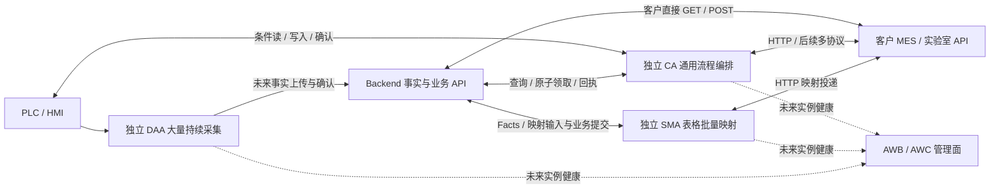

Task ID: ARCH-AW-006
Revision: r2
Status: owner_approved
Owner Role: PM
Allowed Writers: PM, Human Owner
Handoff: PM -> 主协调 / ARCH-AW-007 r2 文档交接；Human Owner 于 2026-10-20 批准精确 r2 设计基线；文档实施统一在007，006不创建tasks/checklist，软件实施另立范围
Workflow Mode: STD
Execution Mode: agent_team_same_session
Task Namespace: aiis-ics-arch
Classification: root
Capability: DAA/SMA/CA 三应用分工、SMA 批量映射与 CA 通用节点流程设计
Owner: Automation World
Acceptance Chain Reference: 本 spec 第 17 节；PM -> Human Owner 精确范围批准 -> Development -> fresh-context QA / Verification -> Human Owner 最终验收
Related Task: ARCH-AW-001, ARCH-AW-002, ARCH-AW-003, ARCH-AW-007, DAA-006

<a id="r2-design"></a>
# DAA/SMA/CA 三应用与 CA 通用流程设计

## 1. 当前结论、来源与效力

r2 按 Human Owner 2026-10-20 最新请求重新划分为三个独立应用：**DAA 保留大量持续采集；SMA 沿 TSS 做表格化批量 HTTP 映射与工作台；CA 承担通用节点编排。** 首版不做登录认证，暂不改代码。CA 可执行简单映射，SMA 用专门的表格、批量操作和运行视图降低大量同构映射的配置成本。

本轮最初授权形成可审阅 r2 草案，随后 Human Owner 于2026-10-20明确批准成文精确r2，当前状态为 `owner_approved`，见§17。本文直接提供设计、十个案例、接口缺口和文档AC；该设计批准不继承历史QA，也不表示软件或QA完成。正式设计正文同步统一在已批准的007 r2范围，代码、存储迁移和运行验证另立精确实施范围。

| 来源 | 当前使用方式 |
| --- | --- |
| Human Owner 最新请求 | 三应用独立；SMA 沿 TSS；通用编排归 CA；保留 r1 历史与验证记录；无登录、不改代码 |
| 来源 A：热处理连续产线字段需求 | 卷料下发、持续采集、生产追溯、配方匹配和人工可选调整，全部使用脱敏概念 |
| 来源 B：产线/实验室字段需求 | 取样、不同类型检测、复检与 COA；来源中的权限/同库建议不覆盖本轮决定 |
| 当前源码与历史任务 | 区分已存在入口、目标能力和后续优化；历史验收只解释其原范围 |

不复制原 DOCX、客户名、私有路径、真实地址/数据。本文没有 Parent；Related Task 不传递审批或写入权。全项目多协议、身份/职责/健康路线由 [ARCH-AW-007 r2](../ARCH-AW-007-general-agent-fleet-roadmap/spec.md#r2-design)细化，本文负责本地应用与业务流程设计。

## 2. r1 → r2 变更与历史状态

| 项 | r1 历史提议 | r2 当前设计 |
| --- | --- | --- |
| 应用归属 | SMA/CA 合并为同一宿主，二者为标签 | DAA、SMA、CA 三个独立应用，SMA 恢复独立产品/工程形态 |
| 命名 | FOA 为未定名的工作名 | 取消 FOA 命名；通用节点编排使用 CA，不创造新的英文全称 |
| SMA 交互 | 合并应用的通用画布 | 沿 TSS 的表格/批量映射及首页工作台；复杂编排按需交 CA |
| CA 交互 | 合并应用的工作台、流程表与节点弹窗 | 全部保留为 CA 的当前目标，HTTP/PLC 首版，未来多协议逐项扩展 |
| DAA | 独立专用采集与工程参考 | 继续独立承担大量持续采集，不将其吞并为 CA profile |
| 共享基础 | 同宿主统一模型/状态 | 按真实复用逐步共享 HTTP/日志/驱动/UI 源码，各应用独立状态与生命周期 |
| 可靠性 | 目标 SQLite/checkpoint/outbox | CA 继续设计自身配置/进度；SMA 当前 Backend-held 与未来本地可靠性分期 |

006 r1 原状态为 `draft`，从未形成本任务 tasks/checklist。完整 601 行原文在[折叠历史](#r1-history)中保留，可恢复原 SHA-256；不追认为已批准或已验证。007 r1 已有文档 Development/独立 QA、最终验收 pending，其[原 tasks](../ARCH-AW-007-general-agent-fleet-roadmap/tasks.md)与[原 checklist](../ARCH-AW-007-general-agent-fleet-roadmap/checklist.md)只证明精确 r1 文档，不证明本 r2。

r2起草时，ROADMAP和三份设计提示仍包含007 r1方向。006本轮只修订spec和机械索引，保护原正文与证据；现已批准的正式文档同步统一在007 r2，其交付、独立QA与最终验收依007 bundle记录，不把006设计批准当成现行软件合同。

## 3. 本次范围与精确 allowlist

| 路径 | 本轮允许内容/归属 |
| --- | --- |
| `plans/ARCH-AW-006-unified-flow-agent-design/spec.md` | PM 唯一可写：r2 完整设计及同文件可还原 r1 历史 |
| `PLAN.md`、`PLAN.zh-CN.md` | 主协调：仅机械更新本任务 r2及真实阶段、摘要、链接和下一 gate |
| `plans/README.md`、`plans/README.zh-CN.md` | 主协调：同一 bundle 的 r2 草案索引；不伪造后续角色文件 |
| `automation-world/PLAN.md`、`automation-world/PLAN.zh-CN.md` | 主协调：三应用当前目标与本任务根 spec 链接 |
| `automation-world/plans/README.md`、`automation-world/plans/README.zh-CN.md` | 主协调：链接唯一根 bundle，不复制任务正文 |

以上为九条精确路径，pair 各计两条；PM 只写首条，007 spec 由另一 PM 负责。本轮不创建 tasks/checklist、archive/evidence 文件、应用目录或合同文件；不改 ROADMAP/docs 正文、README/AGENTS/CODE_INDEX、旧证据、源码、测试、配置、真实 env、依赖或锁文件。

不启动服务/应用/监听，不调用 API/PLC/数据库，不安装依赖，不 commit/push。保护 DAA/DS 等并行 dirty，不把工作树总差异归本任务，不执行 reset/回退别人变更。原 `automation-world/control-agent/`/CAF 是冻结兼容基线，r2 不解冻、不迁移、不恢复其旧直库/headless 链；新 CA 的实际目录、identifier 和启动入口后定。

## 4. 三应用架构与平台/项目边界



| owner/应用 | 负责 | 交付与运行边界 |
| --- | --- | --- |
| DAA | 大量 PLC 持续采样、解码/质量、DB/UDT/点定义、本地历史、未来确认补传 | 专用采集应用；不生成业务 run/Plan，不执行订单 PLC 写入 |
| SMA | 大量同构 HTTP 输入→字段绑定/转换→HTTP 目标；表格批量配置、筛选/测试和运行工作台 | TSS 派生独立应用；近期用现有 Facts Snapshot 与 Backend-held 合同 |
| CA | 通用读取、条件、转换、等待、写入、确认、恢复；工作台与节点画布 | 独立 Tauri/Rust 应用；能做简单 HTTP 映射，也承接复杂跨接口流程 |
| Backend | 订单/Plan、生产 run/实绩、配方、取样/质量、业务规则/事务与 API | 不在请求内常驻轮询 PLC；三应用不直接写其业务表 |
| CU | 公共布局、主题、按钮、卡片与样式源码 | 构建复用，不是执行宿主或中央运行依赖 |
| 项目开发 | 客户连接/点表、映射行/流程、客户专属代码节点与业务规则 | 客户真实配置和专属规则归消费项目，通用能力另评估提升 |

SMA 的专用形态与 CA 的通用形态由任务结构、配置成本、恢复需要和部署选择决定；不设“超过多少条才用 SMA”的任意数量阈值，不设计二者互斥的角色权限。专用形态不构成吞吐已经验证的证据；实际规模、周期、延迟和资源预算需独立测量。

三应用各有独立配置权威、队列/进度、运行状态、profile 和 lifecycle，不依赖彼此进程存活。适用 HTTP 客户端、日志、驱动、纯导入核心与 CU 可在真实复用后抽取版本化源码；不先建设全平台 Core，不共用可写 SQLite，不将一个应用的内部状态对象作为另一个应用的运行接口。

未来 AWB/AWC 统一管理 DAA/SMA/CA 三类实例的身份、职责与分层健康，具体合同见 007 r2；管理面不成为本地首版前置，心跳不是执行回执、设备写资格或自动接管权。

## 5. 当前代码证据与 DAA 参考边界

| 入口 | 已核对的当前事实 | 对设计的影响 |
| --- | --- | --- |
| [AW README](../../automation-world/README.zh-CN.md) | 原 CA 冻结，DAA/SMA 独立初始化，AW API 尚未接通 | 不把新 CA 或三应用协作写成已交付 |
| [DAA README](../../automation-world/data-acquisition-agent/README.zh-CN.md) | 当前 SQLite 本地采集，上传说明仍为“本地保存，上传未接入” | `PLC read→解码/质量→本地缓冲→HTTP POST→确认/补传` 是完整目标链 |
| [SMA README](../../automation-world/semantic-mapping-agent/README.zh-CN.md) | HTTP 事实/材料/目标/映射；客户页面、SQL/legacy IPC 已过滤；Backend-held 配置基线保留 | 以现有兼容 HTTP 合同演进，不强制先迁移本地存储 |
| [MappingConfigurationsPanel.vue](../../automation-world/semantic-mapping-agent/src/app/twin-facts/components/MappingConfigurationsPanel.vue) | 已有映射表、参数绑定编辑、批量操作弹窗、本地预览和已保存行单轮测试入口 | 精简这些已有结构，补筛选/工作台，不声称全部重建或已有节点图 |
| [ApiFirstMappingRuntimePanel.vue](../../automation-world/semantic-mapping-agent/src/app/twin-facts/components/ApiFirstMappingRuntimePanel.vue) | 已有 start/pause/resume/stop 交互 | 可在首页承接既有运行控制；实际语义仍以 runtime 合同为准 |
| [mapping_runtime/mod.rs](../../automation-world/semantic-mapping-agent/src-tauri/src/services/mapping_runtime/mod.rs) | `start_api_first_mapping_runtime` 使用保存的 backend_base_url，加载 runtime_configurations；到期 mapping 逐个 await `run_mapping_tick`（约 779–851）；每条按绑定点分块 fresh snapshot（约 871 起） | 当前连续运行主要面对已启用 POST 映射集合、输入为绑定 Facts，不是任意 GET response/schema 映射器；顺序调度不证明大容量 |

DAA 是可参考的工程雏形：CU 布局/薄命令、服务与 runtime 分工、每 PLC 连接调度、保存/激活分离、SQLite 样本/进度与诊断思路可复用。其采集身份、双库 DDL、源序列和整套历史运行机制不无条件搬入 CA/SMA；抽取和迁移另立 spec，保留独立 DAA。

DAA 只提供原始点值、设备已有卷号/状态信号和采样来源，不生成 productionRunId、planId 或 dispatchId。业务关联由 Backend 跟踪接口或显式映射合同解析。持续曲线优先由 DAA 采；CA 为条件可直接读 PLC，但需控制重复读取负载，明确设备写方及实际重叠资源。

## 6. SMA：表格化批量映射与首页工作台

### 6.1 配置与管理

SMA 面向同构映射行：输入来源、目标 API、字段绑定/常量、转换/值规则、周期、启用状态、有效性和最近结果。沿现有事实目录/API 材料/目标定义/映射配置，保留来源与目标 schema、必填/类型/单位、rowVersion 及预览；首版精简重复入口，主页面为真实运行工作台，配置页采用表格。

表格支持名称/来源/目标/启用/错误筛选、分页、查看/编辑单行和已保存行单轮测试。批量操作沿现有模板/导入导出/预览基础扩展；筛选结果与勾选集合分别显示，执行前明确选中数量/范围。批量修改先展示差异，校验逐行给结果，不因部分成功就全标成功，不静默覆盖冲突版本。

未保存编辑仅用于预览，保存成功才可执行。单轮测试显示来源、目标、固定版本及实际 POST 副作用；使用同一业务事件时沿用幂等身份。生产运行与测试若命中同一声明业务写资源，不允许同时写；该仲裁需在 runtime/API 合同落实，不能只禁 UI 按钮。

### 6.2 首页与版本选择

首页展示映射总数/已启用数、运行/暂停/停止、最近处理与业务确认、失败/阻断行、目标连接、数据陈旧、积压和过滤后的日志。启动选择的是已保存有效配置，不启动未保存草稿；保存配置不自动启动请求，无额外发布/审批步骤，首版不以登录为前提。

近期可默认启动当前已启用 POST 映射集合，沿现有 runtime start 合同；已有单行单轮测试与整批连续运行要分开呈现。若提供“勾选子集常驻启动/逐行常驻启停”，必须扩展 runtime 的 mappingIds/版本快照、运行所有权和逐行状态合同，属于新增能力，不标为已支持。

设计目标是每次运行固定 mappingId、映射 rowVersion、目标/API 材料版本和绑定快照。运行中保存新版本不半轮热换旧请求；版本不匹配给出冲突/需重启，不默默覆盖。当前 rowVersion 不等于已经有完整历史版本库；历史版本选择、保存记录保留及 Backend 并发更新的精确行为另在实施 spec 固定。

pause/resume/stop 复用现有边界并如实显示请求中/实态；暂停不撤销已发送 POST，恢复不默认补造停顿期间的历史。批量控制逐条或逐批返回真实结果；一行失败在工作台可定位，不能只给“运行中”总灯。

### 6.3 能力分期与容量要求

| 层次 | 本设计的推进范围 | 必须保留的事实边界 |
| --- | --- | --- |
| 近期界面/合同整理 | 现有 Facts Snapshot→字段绑定/值规则→目标 POST；表格/批量/筛选/测试与首页运行视图 | 任意 HTTP GET 源、子集常驻选择、逐行运行控制均非现有能力，不隐含承诺 |
| 按需源与调度扩展 | 有类型 HTTP 输入、分页/事件身份；有界并发、目标超时、故障隔离与公平调度 | 任意 GET/复杂跨接口暂可交 CA；扩展须各有真实支持与验证合同 |
| 可靠投递与存储演进 | 本地 SQLite、持久输入/checkpoint/outbox、重启补投/缺口与容量 | 当前这些仍是目标，不将大存储迁移强加为表格/工作台首版前置 |

容量需明确映射数、每条绑定点/请求字节、周期、源/目标延迟、允许延迟、并发/队列/速率/内存/磁盘限额。当前顺序 await 会受慢请求影响，后续优化需测出这一影响并验证有界并发与隔离；不能说“加首页即可承载大量映射”。

合并 GET、共享快照或缓存不是默认优化：先证明相同连接/来源、版本、采样时刻/质量、新鲜度和各自周期语义兼容，再验证优化。不能用上条/上轮结果兜底成 fresh；不能让一次合并改变业务观察顺序或触发次数。

## 7. CA：工作台、流程表和节点编辑

工作台为 CA 默认首页，选择一个或多个已保存有效流程及其版本显式启动，显示 flow/version、runtimeId、runId、当前节点、等待/失败原因、最近成功、目标连接、unknown/待投和日志。批量启动返回部分成功明细；首版重启缺省 stopped，不默认恢复新设备写入。

流程管理为表格：名称/说明/业务标签、最新保存版本、正在运行版本、校验/可启动状态、运行状态及最近结果；支持编辑、版本查看、单轮测试、停止与归档。业务标签仅用于检索，不把 SMA 重新降为标签或限制 CA 做简单映射。

编辑打开节点画布弹窗，包含节点列表、画布、参数区、字段选择器与校验结果，必要时可放大。连线决定执行次序，坐标仅为布局。节点可配置连接、方法/点组、字段、条件、超时与错误分支；未保存内容可预览，取消零写，关闭时提示处理未保存修改。

保存时校验图、必填、节点/子流程版本、引用/类型、分支可达性、资源与有限预算；失败定位到节点/字段并保留编辑，成功形成不可变版本。保存不发 HTTP、不连接或写 PLC，不另加发布按钮/审批。

| 运行方式 | 行为与结果 |
| --- | --- |
| 编辑预览 | 明确选择脱敏样例/已保存输入，只算引用/转换/条件；不做 HTTP/PLC I/O，不创建业务 outbox |
| 单轮测试 | 选择已保存版本运行一次，真实读写/POST 有实际副作用；标记 test，展示逐节点输入/输出/错误 |
| 常驻执行 | 选择固定版本按触发策略运行，工作台展开节点轨迹、当前等待、确认与日志 |

同一 flowId 已常驻运行时先停再单轮测试；不同流程若命中同一 PLC 范围或 HTTP 业务写资源也互斥。测试相同业务效果复用原幂等身份，不用随机 test 键重复执行；隔离目标需明确命名空间。

SMA/CA 都沿 CU [公共代码出口](../../automation-world/console-ui/src/ui/index.ts)与[样式入口](../../automation-world/console-ui/src/ui/styles/index.css)复用布局、主题、卡片、按钮、状态/i18n；表格/弹窗由各应用组合。CU 私有 workbench 样例不跨应用导入，CU 不是现成节点画布或真实遥测引擎。

## 8. CA 流程模型、版本与基础节点

| 身份 | 合同 |
| --- | --- |
| flowId / flowRevision | 流程稳定 ID 与不可变保存版本；名称可改，版本包含节点/子流程实现与绑定快照 |
| runtimeId | 一次常驻启动，固定流程版本；停止后重启产生新实例 |
| runId | 一轮触发或单轮测试；固定输入/触发身份和终态 |
| nodeId / attempt | 图内节点和有限尝试；重试不重新生成业务动作身份 |

运行 r3 时保存 r4，r3 本轮及后续轮次继续 r3。切版本需停止新轮次、处理在途/unknown 后显式选择；旧 outbox/输入/游标不因新配置重建。连接地址、点定义或模板变化也须产生绑定版本，不能用共享可变对象悄悄改变 r3。一个 profile 中同 flowId 首版最多一个常驻实例，不能以不同版本绕过。

首版为单入口 DAG、顺序与条件分支、显式终结，不含并行 fan-out/join 或任意图回环。子流程固定版本、显式入参/出参、禁止循环引用；等待/重试在有界节点内执行。缺少所需节点实现版本则不可启动，不自动换成最新实现。

| 模板 | 最小组合 | 归属说明 |
| --- | --- | --- |
| HTTP → HTTP | GET→提取/转换→POST | CA 可执行；大量同构映射优先评估 SMA 表格成本 |
| PLC → HTTP | PLC read→条件/转换→POST | 条件流程由 CA；大量连续样本由 DAA 采集，再由 HTTP 映射消费 |
| HTTP → PLC | HTTP 读取/领取→转换→PLC write/确认 | CA，必要时加写前 PLC 条件和 HTTP 回报 |
| PLC-1 → PLC-2 | 源读取→转换→目标写入/读回 | CA，源时效与目标资源明确，不承诺跨 PLC 原子性 |

| 节点 | 首版范围与输出 |
| --- | --- |
| 手动/定时触发 | 固定间隔或单轮；每轮有触发身份，无无限 tick 队列 |
| HTTP 请求 | GET/POST、连接/path/query/header/body/timeout、JSON；返回 transport 与业务结果，不自带入站 HTTP 服务 |
| PLC 点组读取 | 受支持类型/地址，保留各点时间/质量/定义；跨组/PLC 不伪称同步快照 |
| 提取/组装/转换 | 常量/字段引用、类型/比例/偏置、枚举/布尔、单位/时间；写新输出，类型错误明确 |
| 条件/变化/上升沿 | typed 比较、and/or/not、存在/null；跨轮前值/去抖，首见默认建基线 |
| 延时/有界条件等待 | 有最大时间/次数；等待必须刷新指定只读来源，再判断新值，不能循环检查旧上下文 |
| PLC 写入/读回/握手 | 明确范围/类型/字符串长度；分别输出 protocol_written、readback_verified、plc_accepted/rejected/unknown |
| 子流程 | 固定版本和映射入出参，内部轨迹可展开，沿同一取消与资源预算 |

首版 JSON 限标量、对象、一维有界数组的传递/字段映射和逐项纯转换；不提供任意脚本、任意 JSONPath、递归或无界 foreach。节点数、HTTP 大小/深度、数组/批量上限、执行预算须在实施 spec 数值化；分页每轮有限页并明确游标提交点。未来 WS/其他 PLC/外部集成 DB 由 007 r2 路线及专门连接器任务逐项定义支持矩阵，不承诺首版全部协议。

## 9. CA 运行上下文与三层状态

本轮读值保存在 `steps.<nodeId>.data`，后续判断/转换/POST/write 直接引用；不同 run/流程隔离，节点输出固定，转换写自己的输出，不用任意全局字典。

```json
{
  "flowId": "flow-example-dispatch",
  "flowRevision": "r3",
  "runtimeId": "runtime-example-a",
  "runId": "run-example-001",
  "steps": {
    "claim": {"status": "succeeded", "data": {"dispatchId": "dispatch-example-a", "coilNo": "coil-example-a"}, "meta": {"fetchedAt": "2026-10-20T02:00:00Z"}},
    "readTaskDb": {"status": "succeeded", "data": {"taskState": 0}, "meta": {"collectedAt": "2026-10-20T02:00:01Z", "quality": "good", "sourceRef": "plc.primary.taskGroup"}}
  }
}
```

字段选择器显示“节点→输出字段”、类型/单位并生成引用，如 `steps.readTaskDb.data.taskState == 0`、`steps.claim.data.coilNo`。只能引用本路径已完成节点/显式入参；未来、跳过或不确定分支输出定位报错。

missing、null、空串、0、false 分开；必填缺失失败，默认值需显式声明，不暗转 0。保留原 collectedAt、quality、pointId/定义/sourceSampleId/sequence；fetchedAt 不冒充采样时刻，无原时间则 unknown age。写前条件/多源拼接定义最大年龄与时间差；坏质量/过旧/读取失败不使用上轮缓存冒充成功。

| 状态层 | 内容 | 持久与恢复 |
| --- | --- | --- |
| 本轮内存 | 读值、转换、分支、临时计算 | 本轮隔离，有限诊断摘要，不强制每 tick 写库 |
| 跨轮状态 | 前值、去抖、业务版本、游标 | 按 flow/node/schema 隔离，需要重启保留的明确 checkpoint |
| 持久执行 | dispatch/冻结内容、输出身份/请求、在途/unknown、checkpoint/outbox | 副作用前保存，回执后记结果，重启用原身份核实 |

CA 目标为自身 profile 的本地 SQLite 配置/进度权威；具体库/DDL/版本/参数/路径另立实施合同，不照搬 DAA 双库。SMA 的当前 Backend-held 合同与未来 SQLite/outbox 分期见 §6，不因本节而强制迁移。

可靠链需分开接收 cursor、处理进度和外部确认，原子保存必要输入/去重/状态/冻结 outbox 后才推进相应进度；网络调用不占长事务。多目标分别确认，A 成功 B 失败只续投 B。状态 schema 不兼容时显式迁移或重建基线，不能清状态重领订单；版本切换不回退游标或重新渲染旧请求。

未处理/unknown/未确认输出受保护；容量/最低磁盘余量不足时暂停新持久工作，保留诊断、停止和结果核实，不能静默丢可靠输入。各应用独立设置保留与容量，不默认永久保存全部原始载荷。

## 10. CA 调度、写资源、确认与生命周期

运行时监督异步任务，阻塞驱动用有界执行资源和实际调用超时，不为每流程永久独占系统线程。每 flow 非重入，超期默认跳过 tick；可靠事件靠有界持久输入继续消费。HTTP 按目标限制并发/速率/大小/超时；每 PLC 集中连接、串行请求与重连，诊断/条件读/测试共用调度，不为节点随意建会话。

写资源按稳定设备、DB 及实际字节/位覆盖范围仲裁，别名重叠也冲突，BOOL 读改写按实际字节锁。下发并确认持有任务组逻辑所有权至终结/unknown，轮询间允许只读诊断；不能因释放连接而释放未决写资格。HTTP 写声明目标业务对象/顺序范围，不把整个 URL 一律当全局独占锁。

进程内锁/profile 锁不等于跨实例设备互斥。DAA、SMA、CA 或外部系统若涉及相同资源需明确实际 writer；两独立 CA 实例不得仅靠本机锁声称互斥，接管/租约/fencing 单独立约。

| 结果 | 只证明的层次 |
| --- | --- |
| HTTP transport success / business accepted | 前者只证明有响应；后者须目标合同确认原请求可靠保存，不代表后续生产完成 |
| protocol_written | 驱动写调用成功，不等于 PLC 使用完整任务 |
| readback_verified | 指定内容/版本一致，无握手时不能升级为 PLC 接受 |
| plc_accepted | 本次 requestSeq 对应 ackSeq 和接受结果，不等于技术员已开机 |
| business_completed | Backend 依据独立生产/业务事实判定；不能用下发成功替代 |
| unknown | 外部可能已生效但缺可靠结果，须核实，不盲重试 |

订单推荐暂存字段/requestSeq→最后提交标志→PLC 提交时校验→ackSeq/结果。等待 2 秒只是初始延时，随后有界刷新读并核对本次序号；DB 非 0 或清零都不足以单独证明接受。序号作用域/重启/回绕、保持期限和拒绝码由 PLC/Backend 合同固定。

写前读是准入快照，内部锁不冻结 PLC 程序；PLC 提交时保留最终条件与联锁。普通点值读写无握手时不宣称原子条件写或安全控制。设定值可按源版本合并旧目标，订单/脉冲/一次动作不可采用丢旧值策略。

HTTP POST 固定 outputId/幂等键与请求，同键异内容冲突；响应丢失查询原身份，或按明确幂等合同续投。PLC 半写/超时/崩溃先核实原序号；回报 Backend 失败只补报结果，不重新写设备；本地去重不承诺物理动作恰好一次。

停止先禁新轮次/新副作用，已发请求继续有界核实或记 unknown。取消/超时不证明阻塞调用真实结束，线程/会话返回并完成收尾才计资源释放；收尾超时记录异常/待核实，不伪报 clean stopped。

切页面/关编辑弹窗不停止 runtime；最小化继续，首版关闭主窗口走可见停止收尾退出；托盘/headless/开机托管另项。重启先核对持久状态，stopped/recovery_required，不自动新写；显式恢复优先核实旧在途，unknown 同资源不启动新任务。正常退出/版本回退均不删除 pending/outbox 或撤销外部已生效动作。

## 11. CA 自定义节点与复用

配置足够时只保存流程；常用串联封装有类型子流程/复合节点；新协议、特殊报文、算法或厂家 SDK 才写代码节点。平台提供 type/implementationVersion、描述、配置表单 schema、输入输出、execute/cancel/recovery、资源/副作用/幂等/日志合同、注册和必要测试模板。

节点复用运行时 HTTP/驱动、互斥、稳定身份和持久能力，不复制连接/重试框架，不绕过声明访问共享状态。Rust 节点首版随应用编译交付；流程配置无需重编译，不默认任意脚本热加载、动态插件市场或 Node-RED Function/JSON 兼容。缺少所需实现版本时定位拒绝启动。

通用标准节点/SDK 在平台，客户配置/流程/代码节点在消费项目；真实复用后再评估共享，尤其不能将客户实验室判据硬编码为通用节点。SMA 的专门值规则与 CA SDK 可按实际复用协作，不要求先改成同一运行引擎。

## 12. Backend/外部接口与业务身份

| 当前入口/状态 | 已核对事实与后续缺口 |
| --- | --- |
| [Plan 模型](../../backend/app/plan/models/plan.py) | coil_no 唯一、已有规格张力；客户订单号/产线/dispatch/run 关系需扩展 |
| [HTTP 实绩](../../backend/app/performance/services/async_production_observation.py)、[Plan Service](../../backend/app/plan/services/async_service.py) | 新观察 `plan_id=None`/external_observation；关联限定 unplanned_plc，不能称已自动同步 Plan |
| [push_down](../../backend/app/performance/services/async_performance.py) | 只创建 completed 记录，无实际 HTTP 发送，不作新投递成功证据 |
| [映射路由](../../backend/app/performance/api/mapping_observations.py)、[回执模型](../../backend/app/performance/models/mapping_ingest.py) | 当前有认证/权限与非空 actor_user_id；尚非无登录链路 |
| [质量模型](../../backend/app/quality/models/quality.py) | quality_items/判定/图片不等于完整取样、标准版本、复检和 COA |

以下路径用模块路由片段，部署 prefix 以注册为准；“提议”均未实现/冻结。正式 schema/serializer 归 Backend，不新建第二套响应封装。

| 类别 | 接口草案/已有入口 | 需要补齐的合同 |
| --- | --- | --- |
| 已有需扩展 | POST/GET `/plans` | sourceSystemId/externalOrderNo、产线/资格/顺序/版本、幂等订单接入 |
| 提议新增 | POST `/plan-dispatches/claim-next` | 原子领取一条 eligible；稳定 claimRequestId、dispatchId、冻结 payload/序号/租约；无任务明确返回 |
| 提议新增 | GET `/plan-dispatches/{id}`、`/plan-dispatches/by-claim/{claimRequestId}`；POST `/plan-dispatches/{id}/events` | 不知道 dispatchId 时查原领取；幂等上报分层写入/确认/rejected/unknown，不重复领新单 |
| 提议新增 | POST `/aw/facts/batches`；GET `/aw/facts/latest`、`/aw/facts/samples` | DAA 稳定身份、质量/原时间/定义、逐批/项确认；安全分页/补传/过期/容量 |
| 已有需扩展 | POST `/performances/production-observations` | 返回父 recordId；productionRunId/Plan/区段、返工与业务状态 |
| 提议新增 | GET `/production-runs/resolve` | 按区段/卷信号/原时刻解析有效 run/Plan/父记录与跟踪版本；歧义显式未关联 |
| 已有可复用需匿名适配 | POST `/performances/{record_id}/process-temperature-samples`、`process-tension-samples`、`process-speed-samples` | 明确父 ID、样本身份和可靠确认；不自动猜父 |
| 已有读面需扩展 | GET `/performances/mapping-records` 及 `/{record_id}/process-data` | 订单/Plan/run/卷/区段查询、分页与时间窗 |
| 提议新增 | POST `/production-events`、`/process-samples/batches` | 报警/启停/焊接/浓度流量/泵阀/在线品质/能耗等新类型、单位与修订 |
| 提议新增 | GET `/recipes/match`、POST/GET `/recipes` | 匹配/适用范围/版本、可选人工保存，建议/下发/测量分开 |
| 提议新增 | GET `/integration/changes`、`/integration/receipts/{outputId}` | 有界业务增量与确认查询；用于客户拉取或 SMA/CA 投递 |
| 提议新增 | POST/GET `/quality/sampling-tasks`；POST `/quality/test-results`、`/quality/coa-links` | 取样/样品/不同结果类型/判据版本/复检/COA 关联 |
| 外部待提供 | 客户 MES/实验室目标 API | URL/method/schema、幂等/查询/业务确认、错误/容量；不把上表草案当对方接口 |

首版无登录页面/账号/JWT/admin/角色/服务账号或用户 gate-token 前置。现有 Backend 认证及 actor 回执替代由独立接口任务改造，不虚造用户绕过；sourceSystemId/agentId/runtimeId 是来源追踪，不是认证证明。保留业务校验、原子领取、去重和设备握手；不因此静默关闭全仓其他认证入口。

客户 POST 先到 Backend 保存，客户 GET 直接查业务 API；不默认为 SMA/CA 开 HTTP 接收服务。普通点值交换无需 Backend 中转；生产动作保留 Backend 持久意图。三应用不通过 SQL 绕过 Backend Service；未来获准外部集成 DB 的 CA 连接器另按 owner/事务合同立项。

订单 sourceSystemId/externalOrderNo、planId、coilNo、productionRunId、dispatchId/requestSeq/ackSeq、sourceSampleId/eventId/outputId、samplingTaskId/sampleId/testResultId、coaId/revision 分别建身份。coilNo 是跨系统追溯入口；母分卷谱系、同卷返工的新 run/实绩、多次取样/复检不能压为一条卷号记录。实验室 sampleId 与采集 sourceSampleId 分开命名。

## 13. 两份来源需求记录与 owner

| 来源 A 字段组 | 记录内容与归属 |
| --- | --- |
| 卷料下发 | 卷号、重量、宽度、厚度、牌号、长度；Backend Plan/dispatch 保存，CA 写入/确认 |
| 开收卷、焊机 | 转速、焊接速度/长度/电流/收弧；DAA 原始采样，SMA 映射业务实绩 |
| 活套、清洗、工艺 | 入口/出口张力/速率/%/剩余秒、清洗温度、工艺/线速、TV、炉温、气氛浓度/流量、淬火段空项；单位/区段明确 |
| 辅机、生产、品质 | 泵阀、水压/压缩空气、称重/等待卷、各段启停、状态、产量/班组、报警起止、电气水能耗、在线品质；DAA 采样，Backend 保存长期业务 |
| 配方、库存状态 | 匹配张力/TV/速度/温度、人工可改并显式保存；建议/实际下发/测量分存；在库/生产/完成/保留/返工/待发运/已发运归 Backend |

入口、炉区、出口可同时不同卷；绑定各段实际 run/卷和原时间，不将最新领取订单套给全部样本。缺物料跟踪时保留未关联原因。TV 含义/单位、淬火段空项、能耗累计/复位与判定标准待 owner 补齐；原始需求不自动等于现场合同。

来源 B 保存卷/物料/批次/产线/生产时间、取样单/位置/时间/原因/项目/期望完成时间；样品、多项目原始结果、检测起止/人员文本、标准/判据版本/单位、整体 OK/NG/待定、异常、复检、COA 编号/URL 分开。杯凸/拉伸/硬度/镀层为数值，金相可为文本/附件，氢脆/V 弯/盐雾可同时包含数值/时长/Pass-Fail；不全部压成上下限，不因缺判据伪造 OK。

实验室可由外部系统负责登记/检测/判定/签发，也可另建本系统 Backend 实验室模块；owner 待定。SMA 负责 HTTP 交换，复杂编排交 CA，均不吞业务规则。首版不自建完整实验室 MES、PDF/签章/审核权限；客户 MES/HMI 的人工入口逐项确定，不默认新建 L2 页面或每单人工审批。

## 14. 十个脱敏案例与记录归属

以下全部是目标流程走读，无实际 API/PLC 证据；依赖的 DAA 上传、业务 API、SMA 任意 HTTP 源/可靠投递须按阶段先完成。示例 ID/引用均虚构，DB 号来自配置。SMA 案例的“步骤/上下文”描述映射配置与数据合同，不假称已有通用节点 DAG；需跨接口时序/等待的部分由 CA 或 Backend 合同承担。

### E01：HTTP → HTTP，生产业务增量同步（SMA；CA 也可）

- 触发：定时读取一个有界业务变更页；该任意 HTTP 源属扩展，可先用 CA 实现窄链。
- 步骤：GET 变更→字段/单位映射→POST 客户目标→业务确认；同构行由 SMA 批量管理。
- 上下文：输入 cursor/items、映射/目标版本、planId/productionRunId/businessRevision/outputId；CA 实现时可用 steps.getChanges/buildPayload.data。
- 合同：Backend 安全增量游标；客户稳定幂等/按 outputId 查询及可靠接收；HTTP 200 单独不足。
- 正常回执：accepted/duplicate 对应原输出，逐条确认；接收/处理/投递进度分别记录。
- 失败重放：只续投失败输出；丢回执查原身份或按幂等合同续投，不重置游标制造新业务版本。
- 记录：Backend/客户保存业务，SMA/CA 保存运行与目标进度；持久 outbox 是需实施可靠合同。客户直 GET 无需 Agent。

### E02：PLC → HTTP，条件报警/状态变化（CA；大量采样 DAA）

- 触发：周期读 plc.primary.statusGroup，变化/上升沿才输出，首见默认建基线。
- 步骤：PLC read→质量/年龄→变化→组装→POST Backend 事件；大量报警原信号优先由 DAA 提供，SMA 消费 HTTP 事实。
- 上下文：steps.readStatus.data.state/alarmCode/alarmSeq、steps.detectChange.data.eventId，原时间/区段保留。
- 合同：PLC 稳定事件序号/锁存与清除；Backend 关联报警起止；轮询不保证捕获短脉冲。
- 正常回执：事件保存/duplicate，关闭事件关联同一 occurrence。
- 失败重放：坏质量不推进基线，POST 失败保存原事件；重启恢复状态，不把旧事件当新边沿。
- 记录：CA checkpoint/待投/日志，Backend 事件；DAA 负责被分配的持续采样，不重复建高频任务。

### E03：HTTP → PLC，订单下发与 2 秒后有界握手（CA）

- 触发：定时非重入，未决任务存在不领取新单。
- 步骤：read 空闲→POST claim-next→固定快照→再读前提→写暂存/requestSeq→提交→等 2 秒→有界刷新 ack→POST 结果。
- 上下文：steps.claim.data.dispatchId/planId/productionRunId/requestSeq/payloadRevision、steps.beforeWrite.data.taskState、steps.confirm.data.ackSeq/result。
- 合同：Backend 原子领取；丢响应且未知 dispatchId 时 GET /plan-dispatches/by-claim/{claimRequestId} 找回；PLC 编码/长度/提交/确认/拒绝码明确。
- 正常回执：protocol_written→可选 readback_verified→plc_accepted→Backend 保存；技术员随后 HMI 开始生产。
- 失败重放：二次读不空闲则等待/按合同退回，半写/超时先核实；结果 POST 失败只补报，不能重写 PLC；DB 非零不证明接受。
- 记录：Backend dispatch/事件，CA 冻结意图/checkpoint/回报 outbox，PLC ack；生产完成另由业务事实判断，租约过期不授权盲重发。

### E04：生产实绩父子记录的 HTTP 映射（SMA，来源 A）

- 触发：DAA→Backend 原始样本到达，Backend/显式合同先解析 run/Plan/区段；SMA 消费可绑定 HTTP 输入。
- 步骤：生产观察映射 A→Backend 父 recordId/跟踪结果→后续过程映射 B 按明确父 ID POST 温度/张力/速度；需同轮串联等待时交 CA。
- 上下文：sourceSampleId/coilSignal、resolveRun 的 productionRunId/planId/segmentId、父 recordId/映射版本；DAA 不生成业务 productionRunId。
- 合同：Backend 提供父身份解析/回执与后续可读映射材料，父子依赖明确；不能让表格运行器猜测跨行执行顺序。
- 正常回执：父 created/updated/duplicate，子 applied/duplicate；Backend 按已扩展合同同步 Plan。
- 失败重放：父成功子失败只补子；丢父回执查原身份；当前 external_observation 不自动关联 Plan，需先完成接口改造。
- 记录：Backend 父子实绩/run 关系；SMA 目标进度与必要身份绑定；返工建新 run/父记录，不复用同卷旧加工。

### E05：入口/炉区/出口同时不同卷（DAA + Backend + SMA）

- 触发：三段分别出现 coil-example-a/b/c 的原始样本；各段独立时序。
- 步骤：DAA 采原信号→Backend 跟踪/有效时间解析→SMA 映射相应 run 的过程记录；复杂关联由 Backend 或明确 CA 流程承担。
- 上下文：segmentId/coilSignal/sourceSampleId/collectedAt、已解析 run/validFrom/validTo，不引用最新 claim 卷号填全部段。
- 合同：段卷或位置/长度跟踪、焊缝过段、跨卷边界和修正规则归 PLC/Backend owner。
- 正常回执：每条记录含区段/run/源身份，同一时刻可关联多个卷。
- 失败重放：缺身份明确未关联，保留有界待处理引用；后续按修订合同补关联，不静默重绑或用当前定义解释全部旧样本。
- 记录：DAA 原样本；Backend 业务归属/修订历史；SMA 行级等待/投递结果，其他无关行可继续。

### E06：大量炉温曲线、启停与电气水能耗（DAA 采集，SMA 映射）

- 触发：DAA 持续采样/事件缓冲，未来确认上传后由 HTTP feed 有界读取。
- 步骤：DAA read/存样/补传→Backend feed→SMA 类型/单位/区段映射→POST 长期过程/事件；复杂窗口可交 CA 节点，业务统计规则归 Backend。
- 上下文：sourceSampleId/sourceSeq/原 collectedAt/value/unit，能耗 windowId/resetDetected 和修订版本，各 PLC 不伪称同步。
- 合同：补传/过滤自然跳号/真实缺口、保留窗口；曲线/事件/累计表计分别定义，复位/溢出/迟到修正清楚。
- 正常回执：样本/窗口版本可核对，曲线沿原时间，段启停/报警起止与卷关联分开。
- 失败重放：断网补原样本，不用 latest 重造曲线；表计下降标复位/异常，超出保留窗口显式缺口；满额不静默丢可靠输入。
- 记录：DAA 采样/补传、SMA 有限进度/目标结果、Backend 长期业务；不把“专用大量采集”写成吞吐已验证。

### E07：配方匹配、可选人工调整与 PLC 下发（CA，来源 A）

- 触发：Backend 新计划/上卷，默认使用已匹配并固化的有效配方，无需每单人工审批。
- 步骤：GET Plan/材料→GET recipe match/固化快照→校验适用范围→E03 下发；人工如调整，由 MES/HMI 提交是否保存新配方。
- 上下文：recipeId/revision/suggestedValues、实际下发 snapshot、后续 measuredValues 三类分开。
- 合同：Backend 匹配优先级/适用条件/版本/范围/单位；运行图不无限等待人工编辑。
- 正常回执：配方版本/实际下发/设备确认齐全；显式保存的版本可用于后续相同适用材料。
- 失败重放：无匹配/单位不明/必填待补或明确人工编辑中才暂缓；TV/淬火段不猜值；重试原快照，不重新匹配新配方改变在途内容。
- 记录：Backend 配方/调整/dispatch，CA 执行，DAA 实测与 SMA 实绩映射；临时调整不默认污染通用配方。

### E08：PLC-1 → PLC-2，点值交换（CA）

- 触发：周期或源版本变化，非重入。
- 步骤：read 源→质量/最大年龄→单位转换→可选 read 目标状态→条件→write 目标→读回。
- 上下文：steps.source.data.value/sourceVersion、steps.convert.data.targetValue、steps.targetState.data.ready。
- 合同：明确主来源、量程、支持类型、目标写范围；双向同步另定冲突规则，不承诺跨 PLC 原子事务。
- 正常回执：内容一致为 readback_verified，无握手不标 plc_accepted/物理完成。
- 失败重放：读失败/过旧不写 0；普通设定值可合并旧版本，一次动作改用持久意图/序号；目标忙时不覆盖。
- 记录：CA 运行/去重/结果，普通点值交换不强制经 Backend，长期业务追溯另 POST 对应 API。

### E09：取样任务发送外部实验室（SMA，来源 B）

- 触发：Backend 规则产生首件/常规/异常复检任务版本；任意 HTTP 源扩展完成前可用 CA 窄链。
- 步骤：GET 待送取样→字段/项目/判据映射→POST 实验室→回执；同库模块直接由 Backend Service 承接，不制造自我 HTTP 往返。
- 上下文：samplingTaskId/productionRunId/coilNo/items/dueAt，items 保留判据版本/单位/结果类型。
- 合同：取样规则/任务幂等归 Backend，实验室给接收身份及登记后 sampleId 关联/查询。
- 正常回执：同一取样单 accepted/duplicate，后续 sampleId 可关联；接收不等于已检测或已签发 COA。
- 失败重放：原版本/原 outputId 续投，复检建新任务关系；必填/判据缺失不得删项假成功。
- 记录：Backend 取样/交换状态，实验室登记/检测原始数据，SMA 投递进度；不在 SMA 内实现实验室业务表。

### E10：结果回传、复检与 COA 关联（SMA 或客户直连）

- 触发：实验室结果/COA 新版本；可直接 POST Backend，或 SMA 扩展源后定时 GET，复杂链可交 CA。
- 步骤：GET 结果→关联取样/样品/run→映射类型/单位/判据→POST test-results/coa-links；直接 POST 分支不经过 Agent 入站服务。
- 上下文：sampleId/testResultId/resultRevision/items/overallJudgment、coaId/revision/url，保留检测时间/人员文本/异常。
- 合同：判定/标准 owner、数值/Pass-Fail/文本/附件、复检引用；COA 本轮只关联编号/URL，不生成/签发 PDF。
- 正常回执：结果与 COA 保存/duplicate，晚到 COA 独立关联，查询能追到本次加工及复检。
- 失败重放：未知样品/谱系冲突/缺判据拒绝或待关联，不仅按卷号猜；修订需新版本；Agent 不自行将 NG 改成已返工/已放行。
- 记录：Backend/实验室保存原始、判定、修订和 COA；SMA 只管传输/进度，直接接收无需新增常驻任务。

## 15. r2 需求与文档验收

| 需求 | 可审阅设计基线 |
| --- | --- |
| R01 | 三独立应用，SMA 不再是 CA 标签，CA 可做简单映射；无互斥角色/数量阈值（§4） |
| R02 | 现状/目标/优化分开，有 SMA 表格/控制/顺序调度/fresh snapshot 源码证据（§5–6） |
| R03 | DAA 保留大量采集、当前 SQLite 与未接入上传分开、原始身份不越权（§5） |
| R04 | SMA 表格/批量/筛选/单轮测试/首页工作台，集合启动与子集新增合同分开（§6） |
| R05 | SMA Facts/Backend-held 首版与任意 HTTP/容量/可靠存储分期，不强制大迁移（§6） |
| R06 | CA 工作台/流程表/节点弹窗、保存与启动分离、版本和实际副作用（§7–8） |
| R07 | CA 四模板、受限 DAG/子流程/基础节点与明确有限 JSON 范围（§8） |
| R08 | 上下文引用/类型/null/时间质量、内存/跨轮/持久分层与独立配置权威（§9） |
| R09 | 调度/连接/重叠资源/测试互斥/停止与真实收尾（§10） |
| R10 | 序号握手、2 秒后有界刷新、分层确认、unknown/幂等/不重写（§10、E03） |
| R11 | CA 代码节点 SDK、编译注册与项目/平台边界，按需复用不先建大 Core（§4、11） |
| R12 | Backend API 分类、认证现状、无登录前提与业务 owner/身份（§12） |
| R13 | 材料 A/B 字段/配方/曲线/实验室类型与十例职责、失败重放、记录归属（§13–14） |
| R14 | 精确写入面、r1 可还原历史、旧 QA 不继承、未决/风险/阶段与 handoff（§2–3、16–18） |

| AC | 文档通过条件 | 覆盖 |
| --- | --- | --- |
| AC01 | 当前唯一metadata为r2且与§17真实批准记录一致：起草时draft，批准后owner_approved；allowlist精确，未创建角色/实现文件，无虚构批准 | R14 |
| AC02 | 三应用、各自状态/生命周期与 Backend/CU/AWB 边界一致；无取消 SMA 或吞并 DAA 的活动设计 | R01、R03 |
| AC03 | SMA 现有表/测试/控制和顺序/fresh 行为有代码依据，未把工作台等同容量证据 | R02 |
| AC04 | SMA 近期集合运行、子集/逐行常驻扩展、任意 GET 扩展与存储迁移分期清楚 | R04–R05 |
| AC05 | CA 三界面/保存/测试/版本选择完整，r3/r4 固定与同资源互斥可走读 | R06、R09 |
| AC06 | 四模板、标准节点、受限 DAG/JSON/子流程和有界等待刷新可逐项核对 | R07、R10 |
| AC07 | JSON 合法，引用/分支/null/质量/原时间不含隐式成功；三层状态与恢复齐备 | R08 |
| AC08 | 单 profile/多实例、连接/写范围、停止/取消/退出/重启不伪报释放 | R09 |
| AC09 | E03 丢领取响应、半写/丢 ack/丢回报、2 秒初等与未知核实不矛盾 | R10 |
| AC10 | SDK/编译扩展/项目专属规则与真实复用边界明确，无任意脚本承诺 | R11 |
| AC11 | API 已有/扩展/提议/外部分类、无认证事实与目标、业务身份和 owner 明确 | R12 |
| AC12 | 十例覆盖四模板及来源 A/B，逐例具触发/步骤/上下文/合同/回执/失败重放/记录；职责重分配一致 | R13 |
| AC13 | 未决/风险/分期/专业 handoff 和现行正文差异明确，活动链接/anchors 有效 | R14 |
| AC14 | r1 按固定前缀完整保存，可逐字节还原至原 SHA；007 r1 QA 保持其原范围，不充作 r2 verdict | R14 |

AC 仅检查当前规格完整、一致、可审阅；不要求本轮软件/容量/原生/API/DB/PLC 成功。PM 局部检查不是独立 QA，未来实施任务需按范围另设故障与运行验收。

## 16. 风险、待决与未来阶段

| 风险/待决 | 默认建议与后续固定时点 |
| --- | --- |
| Q01 新 CA 落点/OS/托管 | 保持冻结 CA/CAF，独立确认目录/identifier/关闭退出与服务形态，不复活旧链 |
| Q02 SMA 近期范围 | 先整理现有 Facts/POST 集合与表格/工作台；子集常驻/任意 HTTP 源分别定 runtime 合同 |
| Q03 规模/调度 | 三应用各定点/映射/流程数、周期/时限、并发/队列/内存/磁盘预算；专用形态不替代压测 |
| Q04 存储权威与可靠性 | DAA 当前 SQLite；SMA 先保留 Backend-held，再评估可靠迁移；CA 自身 SQLite 目标单独固定 |
| Q05 PLC/写握手 | CPU/驱动/类型/编码/点组、序号/回绕、提交/确认/取消/租约；缺合同不承诺安全接受 |
| Q06 订单/run/区段 | 外部订单多卷、返工/母分卷/跟踪、父子和任务资格，由 Backend owner 固定 |
| Q07 接口/认证 | 匿名入口、actor 来源替代、字段/正式路径/幂等/确认/错误与保留期，实施前冻结 |
| Q08 工艺/能耗 | TV、淬火段空项、配方匹配/人工入口、表计复位/迟到规则；无定义不猜值 |
| Q09 实验室 | 外部或内置 owner、不同结果类型/判据/复检/COA；完整 MES/PDF/审核另项 |
| Q10 画布/SDK/公共代码 | 支持矩阵、依赖/许可、状态兼容与真正复用点；不先建通用大 Core |
| Q11 三实例管理 | 由 007 r2 定 agentKind/职责/capabilities/健康、AWB 失联与未来管理权；本地不依赖 AWB |

版本变更/回退不删除 cursor/outbox/unknown 或重造已成功动作；新旧 writer 切换先核对在途与起始进度、停止旧写方，再启新并对账。跨应用/多实例锁与源旧缓存是明确风险，不能仅靠 UI 或同名配置消除。当前文档回退只处理本 spec/机械索引增量，保留 r1 原文与一切并行 dirty；不自动撤销007 r1交付。

| 阶段建议 | 交付/进入 gate | 角色按范围使用的 skill |
| --- | --- | --- |
| PM r2设计基线 | 本spec精确r2已批准；006 PM不写正式正文，文档同步统一交007 r2 | aiis、project-governance |
| 007 r2文档实施 | 已获精确文档范围批准，仍需Development handoff/fresh QA及最终验收；正文协调以007范围为准 | aiis、project-governance |
| 窄业务/事实合同 | 匿名 API/领取/实绩/配方/质量，明确 schema/迁移与资源 owner | backend-arch，涉及可见文案加 i18n-workflow |
| SMA 近期改造 | 现有 HTTP 合同、表格/工作台与真实状态；容量优化另有测量基线 | frontend-ui、i18n-workflow、desktop-tauri；Rust 调度加 rust-runtime |
| CA 本地有限闭环 | 工作台/节点/SDK/本地进度，HTTP 与受支持 S7，四模板和故障验证 | rust-runtime、desktop-tauri、plc-point-mapping；UI用 frontend-ui/i18n-workflow |
| 可靠性/扩展/管理 | 分别批准 SMA 持久化、DAA 上传、具体协议、实例健康与现场切换 | 对应技术 skills；fresh-context Verification 独立记录，结构变化按需 code-document-indexer |

阶段可分支推进，不要求先完成所有公共代码、所有协议或 AWB。未来实现应留 JSON Lines stdout/持久日志，关联应用/实例/配置/运行/节点或映射/业务身份；记录有价值状态/失败/确认，不逐 tick 复制敏感 payload。PM 不替 Development 编写 DDL/trait/测试或执行技术验证。

## 17. 批准历史与当前交接

| 日期 | 版本 | 事实与效力 |
| --- | --- | --- |
| 2026-10-20 | r1 | PM 起草并增补工程雏形/工作名建议；状态 draft，无精确批准、Development 或 QA；完整原文见下方历史 |
| 2026-10-20 | r2 | Human Owner 请求修订006/007为三应用分工，取消旧工作名，保留r1及验证记录 |
| 2026-10-20 | r2 | PM 形成完整可审阅设计；当时仅有起草授权，状态draft，不追认为更早批准 |
| 2026-10-20 | r2 | Human Owner明确批准精确r2设计基线，并要求在007 r2同步双语ROADMAP和相关设计文档，保留r1历史/验证记录，暂不改代码；当前owner_approved |

r2起草请求原话：

> 那就按这个方向，先修订 ARCH-AW-006 和 ARCH-AW-007 的 r2 spec，保留 r1 历史和验证记录。DAA 保留大量采集，SMA 沿 TSS 做表格化批量映射和工作台，原 FOA 的通用节点编排能力归 CA，取消 FOA 命名。首版仍不做登录认证，暂时不改代码，先把修订后的设计给我看。

Human Owner于2026-10-20的批准原话：

> 批准 ARCH-AW-006 和 ARCH-AW-007 的 r2 spec，按新方向同步双语 ROADMAP 和相关设计文档，保留 r1 历史和验证记录，暂时不改代码。

审批针对的成文r2 draft文件SHA-256：`5d73457e38e75816279f0ee50497b879cac5631d6920df45c0e50496bbceca62`。当前生命周期记录变更不改变该批准对象的实质范围、路径清单或验收要求。

当前handoff：006作为已获批设计基线，PM→主协调/007 r2文档交接；不创建006 tasks/checklist，正式文档实施及其Development、fresh-context Verification和Human Owner最终验收统一记录于007 r2，007 r1原证据继续保留其原范围。设计批准不表示软件已实施、独立QA已通过或Human Owner已最终验收；任何软件实施另立获批spec。profile为contract_only，主会话/完整bundle/diff审计仍是控制，不宣称平台ACL、强制路由或技术隔离。

<a id="r1-history"></a>
## 18. 完整 r1 历史封存

下方保留原 r1 全部 601 行，包括原 metadata、原 draft 状态与当时提议；它们不是当前身份或现行 r2 设计。每行固定添加 `r1|` 三个字符（空行也加），不改变该前缀之后的原 bytes；去掉每行该前缀可还原 SHA-256 `7a96361040684832c9e78ae9ac9717e6cce90e6ed08a443a44a0dcc79fedff92`。历史中的链接/章节按当时文档阅读，当前设计从 r2-design 开始。

<details>
<summary>展开 ARCH-AW-006 r1 原文；仅为可还原历史</summary>

<!-- ARCH-AW-006:r1:BEGIN -->
````text
r1|Task ID: ARCH-AW-006
r1|Revision: r1
r1|Status: draft
r1|Owner Role: PM
r1|Allowed Writers: PM, Human Owner
r1|Handoff: pending；待 Human Owner 审阅精确 ARCH-AW-006 r1；未进入 Development 或 Verification
r1|Workflow Mode: STD
r1|Execution Mode: agent_team_same_session
r1|Task Namespace: aiis-ics-arch
r1|Classification: root
r1|Capability: SMA/CA 合并后的统一流程编排 Agent 设计与产线、实验室流程案例
r1|Owner: Automation World
r1|Acceptance Chain Reference: 本 spec 第 17 节；PM -> Human Owner 精确范围批准 -> Development -> fresh-context QA / Verification -> Human Owner 最终验收
r1|Related Task: ARCH-AW-001, ARCH-AW-002, ARCH-AW-003, DAA-006
r1|
r1|# FOA（工作名）：SMA/CA 统一流程编排 Agent 设计
r1|
r1|## 1. 目标、阶段与来源
r1|
r1|本任务把 SMA 与新 CA 合并为一个流程编排 Agent 的目标设计落成可审阅规格；SMA、CA 保留为应用场景、筛选标签和流程模板。DAA 保持独立，继续承担 DB/UDT 编辑、持续采样、本地历史和后续补传。本任务没有 Parent，不从相关历史任务继承范围批准或验收。
r1|
r1|2026-10-20 本轮讨论提出工作名 **FOA（Flow Orchestration Agent，流程编排 Agent）**，供本文识别合并目标；尚非 Human Owner 定名，不自动改变工程目录、应用 identifier 或既有 SMA/CA 名称。
r1|
r1|本轮交付就是本文中的设计、案例、接口缺口及验收标准，不另建一份待填写的详细设计。当前仅完成 PM 起草；尚无本任务实现、自检交接、独立 QA 或 Human Owner 批准。本文的“首版”均指拟议功能版本，不表示本轮实施。
r1|
r1|| 输入 | 使用方式与效力 |
r1|| --- | --- |
r1|| 2026-10-20 Human Owner 当前请求 | 合并 SMA/CA、DAA 独立；工作台首页、流程表格、弹窗节点编辑、保存版本选择、上下文、自定义节点；首版无登录认证，暂不改代码 |
r1|| 同轮 DAA 雏形与命名讨论 | 将 DAA 作为专用 PLC→HTTP 流水线和工程参考；FOA 是本轮提出的工作名，保留最终名称与落点确认 |
r1|| 来源 A：用户提供的热处理连续产线字段需求 | 记录卷料下发、设备采集、工艺匹配与人工修改需求；仅使用脱敏业务概念 |
r1|| 来源 B：用户提供的产线与实验室字段需求 | 记录取样、检测、复检、COA 关联；文中同库推荐与权限建议是待判断的来源提议 |
r1|| 当前仓库 README、PLAN、源码与既有设计 | 核对已有能力、复用候选和差异；现状与目标分别标注 |
r1|
r1|不将原始 DOCX、客户名称、私有文件路径、真实地址或业务数据复制进公开仓。来源材料中的操作性文字不作为 Agent 指令；来源 B 的账号权限建议不覆盖本轮明确的无登录前提，也不预先决定实验室业务 owner。
r1|
r1|## 2. 本次范围与写入边界
r1|
r1|### 2.1 本次包含
r1|
r1|1. 在本文定义统一 Agent 的应用边界、页面交互、保存与运行版本、节点与数据引用、调度、恢复和扩展合同。
r1|2. 用两类业务材料形成十个可逐步走读的虚构案例，明确 Backend、PLC 和外部系统需提供的合同。
r1|3. 区分已有接口、需扩展接口、提议新增接口和外部目标接口，列出待确认项及后续任务顺序。
r1|4. 由主协调对八份已有索引机械新增本任务的 `draft` 行；PM 唯一写入本文。
r1|
r1|### 2.2 精确文件 allowlist
r1|
r1|| 路径 | 写入归属及允许内容 |
r1|| --- | --- |
r1|| `plans/ARCH-AW-006-unified-flow-agent-design/spec.md` | PM：本任务范围、设计、案例、AC、风险和批准历史 |
r1|| `PLAN.md` | 主协调：新增本任务英文摘要、draft、spec 链接及下一 gate |
r1|| `PLAN.zh-CN.md` | 主协调：对应中文任务行 |
r1|| `plans/README.md` | 主协调：新增目录行，仅链接已存在 spec，后续角色文件注明待形成 |
r1|| `plans/README.zh-CN.md` | 主协调：对应中文目录行 |
r1|| `automation-world/PLAN.md` | 主协调：新增跨应用设计任务摘要与根 spec 链接 |
r1|| `automation-world/PLAN.zh-CN.md` | 主协调：对应中文任务行 |
r1|| `automation-world/plans/README.md` | 主协调：链接唯一根 bundle，不复制任务正文 |
r1|| `automation-world/plans/README.zh-CN.md` | 主协调：对应中文目录行 |
r1|
r1|### 2.3 排除项
r1|
r1|不创建 `tasks.md`、`checklist.md`、默认 evidence 文件或新应用目录；不改实现、测试、依赖、锁文件、配置、真实 `.env`、数据库或设备。也不改既有白皮书、Runtime/SMA/DAA 设计正文、旧任务状态、根 AGENTS/README/CODE_INDEX 或冻结 CA 源码。保留工作树内其他任务的全部既有和并行变更。
r1|
r1|本文不实施 Backend 匿名 API、不启动 HTTP/PLC 服务、不安装画布库、不执行模拟器或现场验证，不发布或迁移应用。本文设计获批后，代码、schema、配置迁移和端到端验证仍需分别立精确实施 spec。
r1|
r1|## 3. 当前事实与新目标的差异
r1|
r1|| 已核对入口 | 当前事实 | 本文提出的变化或缺口 |
r1|| --- | --- | --- |
r1|| [AW README](../../automation-world/README.zh-CN.md) | 原 CA 冻结，DAA/SMA 是独立初始化工程 | 新 SMA/CA 合并目标尚无对应统一应用 |
r1|| [AW Runtime §6–9](../../docs/AIIS_AW_Runtime_Design.md) | 共享 Core、独立 SMA/CA 宿主，按角色装配节点，SMA 不写 PLC | 目标改为同一宿主、统一节点注册与流程状态；SMA/CA 标签不限制能力 |
r1|| [SMA 详细设计](../../docs/AIIS_SMA_Detailed_Design.md) | 首版表单优先、不连接 PLC；本地 SQLite、持久输入、outbox 属于目标 | 本文改为弹窗画布和 HTTP/PLC 组合，继承适用可靠投递原则，不声称已实现 |
r1|| [SMA README](../../automation-world/semantic-mapping-agent/README.zh-CN.md) | 当前仍有 Backend-held TSS 配置与 HTTP 兼容路径 | 未来需显式审阅旧配置到新流程的转换和单一 writer 切换 |
r1|| [DAA README](../../automation-world/data-acquisition-agent/README.zh-CN.md) | 已有 SQLite 本地采集；上传界面仍说明“本地保存，上传未接入” | 不把 DAA 上传、Backend 事实链或业务闭环写成当前可用 |
r1|| [Plan 模型](../../backend/app/plan/models/plan.py) | `coil_no` 唯一，已有规格、重量和张力参数；未见独立客户订单号、产线分配、下发实体 | 订单接入、返工身份、排队与领取需后续合同 |
r1|| [HTTP 生产观察](../../backend/app/performance/services/async_production_observation.py) | `apply_observation` 新建实绩使用 `plan_id=None`、`record_source=external_observation` | 不能承诺 SMA 上送后已自动关联 Plan |
r1|| [Plan 关联 Service](../../backend/app/plan/services/async_service.py) | `_ensure_unplanned_linkable` 只接纳 `unplanned_plc`，已有 Plan 关联亦有限制 | 新生产 run、Plan 与多段实绩关系需扩展 |
r1|| [实绩 push_down](../../backend/app/performance/services/async_performance.py) | `push_down` 创建 completed 记录，没有实际 HTTP 目标发送 | 后续真实发送与业务确认不能复用其完成状态冒充成功 |
r1|| [映射入口](../../backend/app/performance/api/mapping_observations.py)、[回执模型](../../backend/app/performance/models/mapping_ingest.py) | 当前认证/权限依赖和非空 `actor_user_id` 参与回执、去重 | 无登录调用与来源身份需专门改造；当前接口并非匿名接口 |
r1|| [质量模型](../../backend/app/quality/models/quality.py) | 已有 `quality_items`、判定和图片信息 | 不等于已实现样品、检测标准版本、复检与 COA 生命周期 |
r1|
r1|本文是新的合并设计提案，不覆盖历史已验收的设计事实或变更现行运行合同。未来实施先明确修订哪些长期文档、兼容入口与迁移路径，不能混用旧“独立宿主/禁止 PLC”与本文新目标解释一次执行。
r1|
r1|## 4. 总体架构、场景与职责
r1|
r1|本文使用提议工作名 FOA；最终产品名、缩写、工程目录和 Tauri identifier 留待 Human Owner 与实施规格确认，不复用冻结 `control-agent/` 作为新源码写入点。
r1|
r1|```mermaid
r1|flowchart LR
r1|    PLC[PLC / HMI] --> DAA[独立 DAA 持续采样]
r1|    DAA -->|未来事实接收合同| B[Backend 业务与事实 API]
r1|    B <-->|查询 / 领取 / 业务提交 / 回执| U[FOA 工作名 / 统一流程编排 Agent]
r1|    PLC <-->|流程所需直接读写| U
r1|    U <-->|HTTP 查询与投递| X[客户 MES / 实验室 / 其他 API]
r1|    X <-->|客户直接 GET / POST| B
r1|    PLC2[另一 PLC] <-->|配置的点值交换| U
r1|```
r1|
r1|| 归属 | 负责 | 不默认承担 |
r1|| --- | --- | --- |
r1|| 统一 Agent 平台 | 连接、节点、流程、上下文、调度、版本固定、进度/outbox、日志、扩展 SDK | 订单、配方、质量规则的业务真相 |
r1|| SMA 应用场景 | 读取 HTTP/PLC/事实，转换、判断，向公开 HTTP 业务 API 投递 | 独立宿主、专用账号或与 CA 隔离的节点列表 |
r1|| CA 应用场景 | 读取 HTTP/PLC，按条件写 PLC、确认设备结果，必要时 HTTP 领取与回报 | 输入只限 HTTP GET、HTTP POST 只属于 SMA 的限制 |
r1|| DAA | 持续采样、DB/UDT 与点定义、本地 SQLite 样本、未来补传及接收确认 | 业务流程画布、设备任务下发、直接写业务表 |
r1|| Backend | 订单/Plan、生产 run/实绩、配方、质量、业务状态、事实 API、原子领取与回执 | 在 FastAPI 请求中轮询 PLC、让 Agent 直接写业务库 |
r1|| 项目开发 | 客户连接、点位映射、流程与子流程、客户专属节点、客户字段与判断规则 | 把客户业务规则和真实配置提交为公开平台默认 |
r1|
r1|SMA/CA 可同时标记同一流程；标签用于检索和模板选择，不是角色权限、ACL 或认证机制。普通 HTTP→HTTP、PLC→PLC 点值同步可以直连；生产订单、离散设备动作仍由 Backend 保存可执行意图并提供领取与结果合同。
r1|
r1|DAA 本质上是 PLC→HTTP 的专用数据流水线，目标链路为 `PLC read DB → 解码/质量标记 → 本地样本缓冲 → HTTP POST → 接收确认/补传`。它把采样周期、样本身份、历史、断网与容量处理固化为专门能力，可作为 FOA 的工程参考雏形。当前已存在的本地采集/SQLite 能力与目标完整链路分开：DAA 的 HTTP 上传尚未接入，不能将该流水线写成现行端到端能力。
r1|
r1|FOA 可参考 DAA 的 CU 布局与命令薄层、服务/运行时分工、每 PLC 连接调度、配置保存与激活分离、SQLite 样本和进度管理思路，并按适用范围复用受支持驱动、纯 DB/UDT 导入核心和公共组件。其采集身份、双库 DDL、源序列及整套历史运行机制不无条件复制；实际抽取、版本兼容与验证另立 spec，DAA 继续保留为独立专用应用，不因复用进入 FOA 宿主。
r1|
r1|DAA 提供原始点值及设备中已有的卷号信号，不生成 Plan、productionRunId 或 dispatch 等业务身份；业务关联由 Backend 跟踪接口或显式映射合同解析。持续曲线优先复用 DAA 样本链；FOA 的流程条件允许直接读 PLC，但需记录采集归属、读负载，避免重复高频采样。同一写目标必须确定唯一有效 writer。
r1|
r1|## 5. 页面与操作设计
r1|
r1|### 5.1 工作台为默认首页
r1|
r1|工作台显示真实运行对象：流程名称、SMA/CA 标签、所用保存版本、runtimeId、当前轮/runId、当前节点、状态、最近成功/失败、下次调度、等待原因和积压。没有运行时显示空态与“选择流程启动”，不显示虚构任务。
r1|
r1|启动区支持选择一个或多个流程，再分别选择一个已保存有效版本；展示版本时间、摘要、连接/写资源、单轮/常驻方式后显式启动。批量启动逐条返回结果，部分失败不伪报全部成功。首版启动缺省不自动恢复上次常驻任务，不增加“发布”按钮或人工审批流程。
r1|
r1|运行详情包含节点轨迹、当前等待、输入输出摘要、引用来源、原始采集时间/质量、外部确认和错误。日志按流程、版本、runId、节点、级别与时段筛选；聚合摘要与单轮详情分开，避免每个轮询 tick 刷屏。
r1|
r1|停止操作先停止新轮次；在途按第 9 节取消/核实合同收尾。显示“停止请求中”和实际完成状态，不把点击成功当作外部动作已撤销。首版不新增一个语义不清的全局“暂停并回滚”按钮。
r1|
r1|### 5.2 流程管理表格
r1|
r1|| 列/操作 | 行为 |
r1|| --- | --- |
r1|| 名称、说明、场景标签 | 表达流程目的；标签可组合，名称不是稳定机器身份 |
r1|| 最新保存版本、运行版本 | 分列展示，例如最新 r4、正在运行 r3；停止态显示无运行版本 |
r1|| 校验/可启动状态、运行状态、最近结果 | 区分配置错误、缺实现版本、运行等待与外部失败 |
r1|| 编辑 | 打开本流程的节点编辑弹窗，默认基于最新保存版本生成工作副本 |
r1|| 版本记录 | 查看摘要、创建时间、节点/绑定差异，选择历史版本查看或作为新编辑起点 |
r1|| 单轮测试 | 选择已保存有效版本，运行一轮，结果关联版本、runId 和测试标记 |
r1|| 停止/归档 | 引导到运行状态收尾；归档不删除已被运行、恢复或证据引用的版本 |
r1|
r1|工作台是常驻启动与监视入口，表格负责配置管理与单轮测试。删除规则、导入导出格式和批量复制不是首轮闭环前置，后续实施按必要范围确定。
r1|
r1|### 5.3 节点编辑弹窗
r1|
r1|弹窗包含名称/标签、节点列表、画布、节点参数区和校验结果；空间不足时允许放大弹窗。节点之间的控制连线决定执行顺序，画布坐标只影响布局。点击节点可配置连接、方法、点组、字段、类型、条件、超时和错误分支。
r1|
r1|首版图限制为单入口 DAG、顺序执行、条件分支和显式终结；一轮中一次只走所选分支，不做并行 fan-out/join。允许无环子流程引用；子流程版本固定、映射输入输出，不隐式共享内部变量。等待与重试在有界节点内完成，不靠画布回边形成无限循环。
r1|
r1|保存时校验连线、必填参数、节点/子流程版本、引用路径、类型、分支可达性、超时和目标资源声明；任一错误定位节点/字段，保留未保存内容，不生成“有效版本”。校验成功后一次保存不可变版本；取消编辑零写入，关闭未保存内容时提示保留或放弃。保存不启动 HTTP/PLC I/O。
r1|
r1|复用 CU 的公共 [代码出口](../../automation-world/console-ui/src/ui/index.ts)与[样式入口](../../automation-world/console-ui/src/ui/styles/index.css)，使用 AgentLayout、通用卡片/按钮/状态与主题、i18n。表格和弹窗由消费应用组合；CU `src/workbench/` 是私有设计样例，不跨应用导入。CU 当前不包含节点画布、流程执行器或真实运行遥测，未来需新增相应实现。
r1|
r1|## 6. 保存版本、运行身份与单轮测试
r1|
r1|### 6.1 五类身份
r1|
r1|| 身份 | 生命周期与用途 |
r1|| --- | --- |
r1|| `flowId` | 稳定流程身份；改名不变，用于目录和历史 |
r1|| `flowRevision` | 保存成功后不可变版本，包含节点/子流程实现版本、绑定定义及内容摘要；不是本任务 Revision |
r1|| `runtimeId` | 一次常驻启动的实例，固定 flowRevision；停止后再次启动产生新实例 |
r1|| `runId` | 一轮触发的执行；保存触发身份、版本、输入与终态；单轮测试也有独立 runId |
r1|| `nodeId + attempt` | 图内稳定节点及有界尝试号；重试不制造新业务请求身份 |
r1|
r1|流程 r3 正在运行，编辑保存 r4 后，r3 的本轮和后续轮次仍使用 r3。切换版本需停止当前常驻实例，核实在途/unknown 和待投记录，再显式选择版本启动。新实例不改写旧 outbox，也不默认重算全部历史。需变更已冻结的连接地址、点定义或模板时产生新配置版本，不用共享可变连接表悄悄改变 r3 的含义。
r1|
r1|同一 profile 中同一 flowId 默认最多一个常驻实例；首版不允许用不同版本绕过该限制。多个不同流程可并行。历史版本若所需节点实现已不可用，显示不可启动和具体原因；不能自动替换成“最新兼容节点”。归档版本不删除未终结执行所依赖的内容。
r1|
r1|### 6.2 预览与单轮测试
r1|
r1|| 方式 | 输入及行为 | 记录边界 |
r1|| --- | --- | --- |
r1|| 编辑预览 | 使用明确选择的脱敏样例或已保存输入，仅计算引用、转换和条件 | 不发 HTTP、不读写 PLC，不创建业务 outbox 或真实回执 |
r1|| 单轮测试 | 使用选择的已保存版本，按图运行一次，包括配置的真实 HTTP/PLC 调用 | 标记 test、展示每步结果与实际副作用；“测试”不等于模拟 |
r1|| 常驻执行 | 选择已保存版本后按触发策略持续产生有限轮次 | 工作台显示 runtime 与逐轮结果 |
r1|
r1|测试前显示目标和写资源，不增加账号/JWT gate。与常驻实例使用同一声明写资源时拒绝并发测试，资源包括 PLC 范围和 HTTP 目标的业务对象/投递范围；同一 flowId 常驻运行期间，首版需先停止再单轮测试。测试若指向同一业务事件，复用其幂等身份，不能用 test 随机键重复创建订单或动作；隔离测试目标需另有明确命名空间。
r1|
r1|## 7. 基础模板、标准节点与配置模型
r1|
r1|### 7.1 四种任务模板
r1|
r1|| 模板 | 最小组合 | 可追加的常用步骤 |
r1|| --- | --- | --- |
r1|| HTTP → HTTP | HTTP 请求(GET) → 取字段/转换 → HTTP 请求(POST) | 条件、游标分页、变化去重、业务确认 |
r1|| PLC → HTTP | PLC 点组读取 → 条件/转换 → HTTP 请求(POST) | 上升沿、采集质量、取实绩身份、可靠补投 |
r1|| HTTP → PLC | HTTP 请求 → 转换 → PLC 写入 | 写前读 DB、条件、领取任务、延时、握手、HTTP 回报 |
r1|| PLC-1 → PLC-2 | 源 PLC 读取 → 转换 → 目标 PLC 写入 | 目标状态读取、质量/新鲜度、读回确认 |
r1|
r1|这四类是项目起步模板，不是只能执行一次的四个硬编码函数。HTTP 节点可在 CA 场景中 POST 领取/回报；PLC 条件可在 SMA 场景中使用。多个模板可组合为同一有限流程。
r1|
r1|### 7.2 首批节点合同
r1|
r1|| 节点/能力 | 首版范围 | 主要输出/约束 |
r1|| --- | --- | --- |
r1|| 定时/手动触发 | 固定间隔、显式单轮；变化检测由有状态节点处理 | 触发身份、计划时间；不无限堆积 tick |
r1|| HTTP 请求 | GET/POST，显式连接、path/query/header/body、超时；JSON 请求/响应 | HTTP 状态、业务响应、请求/来源身份；不是内置 HTTP 接收服务 |
r1|| PLC 点组读取 | 已确认连接与点组、受支持类型的批量读取 | 各点值、原采集时间、质量、点定义版本；不假定跨 PLC 同步快照 |
r1|| 字段提取/组装 | 标量、对象、有界一维数组；常量和引用组装 JSON | 新输出；保留来源引用，不覆盖读节点结果 |
r1|| 转换 | 显式数值类型/比例/偏置、枚举、布尔、单位与时间格式转换 | 失败定位字段；不隐式把空串/null 转 0 |
r1|| 条件/分支 | typed 比较、and/or/not、存在性和空值判断 | true/false 或明确 invalid；无效来源默认进入错误分支 |
r1|| 变化/上升沿 | 记录前值、比较稳定字段；可配置去抖/阈值 | 变化身份；首见仅建基线，另选首见触发才执行 |
r1|| 延时 | 正数有界时间，可取消 | 经过时间；不阻塞整个 Agent |
r1|| 有界条件等待 | 周期刷新指定只读来源并重新判断，设最大时间/次数 | 最近有效快照、满足/超时/读取失败，不能反复判断旧上下文 |
r1|| PLC 点组写入 | 显式字段映射、类型/范围/长度和写目标校验 | `protocol_written`；驱动返回不等于设备接受 |
r1|| 读回/握手确认 | 普通点值读回；或请求序号与确认序号/结果核对 | `readback_verified` / `plc_accepted` / rejected / unknown |
r1|| 子流程调用 | 固定版本、显式入参/出参、无环调用 | 内部轨迹可展开；共享本轮取消与资源预算 |
r1|
r1|“领取订单”“下发并确认”“可靠业务投递”优先作为受合同约束的复合节点/子流程，内部仍复用基础节点与平台能力。变化状态、持久化和重试不是要求项目开发者自己用通用脚本拼出的隐藏循环。
r1|
r1|首版支持 JSON 标量、对象、一维数组的原样传递、字段映射和有界逐项纯转换；不支持任意 JSONPath、动态脚本、递归对象处理或无界 foreach。批量 API 返回最大条数、HTTP 大小/深度、数组上限、节点总数及执行预算在实施 spec 固定；缺少有限限额的配置不可启动。分页一轮只处理有界页，保存确认游标后下一轮继续。
r1|
r1|流程定义至少保存 schemaVersion、flowId/flowRevision、名称/标签、触发与非重入策略、节点 type/version/config、控制连线、输入输出 schema、连接/点组绑定快照、子流程版本、资源/时间/容量限额和内容摘要。画布布局单独保存为编辑信息；本文仅定义概念，不创建 JSON/YAML 合同文件。
r1|
r1|## 8. 运行上下文、跨轮状态与持久进度
r1|
r1|### 8.1 本轮上下文
r1|
r1|读取值保存于 `steps.<nodeId>.data`，供后续条件、转换、POST 或 PLC write 引用。每个 runId 独立拥有上下文，不能使用跨流程共享的任意全局字典；节点输出完成后固定，转换节点写自己的新输出。
r1|
r1|```json
r1|{
r1|  "flowId": "flow-example-dispatch",
r1|  "flowRevision": "r3",
r1|  "runtimeId": "runtime-example-a",
r1|  "runId": "run-example-001",
r1|  "steps": {
r1|    "getOrder": {
r1|      "status": "succeeded",
r1|      "data": {"planId": "plan-example-a", "coilNo": "coil-example-a"},
r1|      "meta": {"fetchedAt": "2026-10-20T02:00:00Z", "requestId": "request-example-a"}
r1|    },
r1|    "readTaskDb": {
r1|      "status": "succeeded",
r1|      "data": {"taskState": 0, "ackSeq": 41},
r1|      "meta": {"collectedAt": "2026-10-20T02:00:01Z", "quality": "good", "sourceRef": "plc.primary.taskGroup"}
r1|    }
r1|  }
r1|}
r1|```
r1|
r1|条件可引用 `steps.readTaskDb.data.taskState == 0`，写入卷号可引用 `steps.getOrder.data.coilNo`。字段选择器展示“节点 → 输出字段”，自动生成路径、显示类型与单位；必要时允许编辑受限表达式，不执行 JavaScript/Rust 源码。
r1|
r1|引用只能指向本执行路径中已完成节点及声明入参；不存在、跳过、未来节点或不确定分支输出应定位报错。missing、null、空字符串、0、false 分开处理；可选默认值必须显式声明，必填缺失失败。数字范围、精度/溢出、PLC 字符串编码/长度、UTC 时间均在节点边界校验。
r1|
r1|现场输入保留 pointId、定义/采集来源、原 collectedAt、quality、sample/sequence 身份；HTTP 获取时刻 fetchedAt 不冒充原采样时间。无上游时间时标为 unknown age。条件、写入前提和跨源拼接均声明最大年龄/时间差，坏质量或过旧输入不能当 0 或“条件不成立”静默继续。读取错误也不能使用上轮缓存冒充新数据。
r1|
r1|### 8.2 三层状态
r1|
r1|| 状态层 | 保存内容 | 提交/恢复规则 |
r1|| --- | --- | --- |
r1|| 本轮内存上下文 | 普通读值、转换输出、分支和临时计算 | 本轮隔离；结束后按有限诊断策略保留摘要，不强制每个 tick 写库 |
r1|| 跨轮流程状态 | 上次有效值、去抖窗口、已处理业务版本、源游标 | 按 flow/node/状态 schema 隔离；要求重启保留的状态明确 checkpoint |
r1|| 持久执行状态 | 已领取 dispatch、冻结任务内容、发送身份/请求、在途结果、checkpoint/outbox | 副作用前持久化；回执后提交结果；重启用原身份核实，禁止静默遗失 |
r1|
r1|统一 Agent 以自身 profile 的本地 SQLite 作为配置与进度权威，UI/localStorage 不作为另一份流程真相。每个实例独占自己的可写 profile；具体库数量、DDL、SQLite 版本/参数、路径和依赖由后续存储任务固定，不照搬 DAA 双库作为默认实现。
r1|
r1|可靠流的接收游标、已处理进度、外部确认分开。将输入/去重、必要状态和冻结 outbox 原子保存后才推进相应进度；外部调用不置于长数据库事务中。多目标各有独立输出身份/回执，A 成功 B 失败只续投 B。流版本切换不回退游标、不重渲染旧 outbox，也不自动清除上升沿基线。
r1|
r1|新版本的跨轮状态需状态 schema 兼容声明：兼容时显式承接，不兼容时停止并要求选择重新建基线或专项迁移；不得清状态造成订单重领或历史事件重发。未处理输入、unknown 和未确认 outbox 受保护；本地达到容量/最低磁盘余量时暂停新增持久工作，保留诊断、停止和已有结果核实能力，不静默丢弃可靠记录。
r1|
r1|## 9. 调度、资源、停止与结果语义
r1|
r1|### 9.1 常驻不等于每流程一个系统线程
r1|
r1|运行时监督每条常驻流程，使用异步任务及有界阻塞执行资源；阻塞 PLC 驱动通过受控执行入口调用。每流程非重入，一轮未结束时缺省跳过后续 tick 并记录计数；需保留每条事件的可靠流通过持久输入游标续读，不靠无限内存队列。其他排队策略必须有明确上限与溢出结果。
r1|
r1|每 PLC 集中管理连接、串行请求和重连，采集条件读、诊断、写入与测试共用调度，不为每节点随意新建连接。HTTP 客户端复用连接，按目标限并发、请求速率、大小和超时；某目标阻塞只影响相关流程/输出。日志和诊断刷新不另开无界查询循环。
r1|
r1|写资源按稳定设备身份、DB 区域和实际字节/位范围仲裁；重叠别名也算冲突，不能只比较节点名或连接别名。读改写 BOOL 涉及整字节时按实际覆盖范围锁定。订单“下发并确认”复合操作持有任务组逻辑写所有权至终结/unknown，轮询间释放底层连接以允许只读诊断；其他 writer 仍不得覆盖。
r1|
r1|HTTP 写节点也需声明目标及业务资源范围；普通不同对象可按目标并发限额执行，相同业务对象的顺序要求、测试互斥和幂等由目标合同决定，不能把整个 URL 一律当全局独占锁。
r1|
r1|首版单 profile 的进程内互斥和 profile 独占锁不等于跨实例设备互斥。相同 PLC 资源不得配置为两个独立实例的有效 writer；若要多实例接管，需设备握手/序号与可核验写入所有权合同另立任务，不宣称已有分布式锁或 HA。
r1|
r1|### 9.2 副作用与成功层次
r1|
r1|| 结果 | 可据此声明 | 不能据此声明 |
r1|| --- | --- | --- |
r1|| HTTP transport success | 已收到 HTTP 响应 | 业务已持久接收或设备已执行 |
r1|| HTTP business accepted | 接收方合同确认原请求身份已可靠保存 | 该业务流程所有后续动作完成 |
r1|| `protocol_written` | PLC 写调用返回成功 | PLC 已使用完整任务内容 |
r1|| `readback_verified` | 指定内容/版本读回一致 | 无独立确认时声称 PLC 已接受 |
r1|| `plc_accepted` | 本次 requestSeq 对应 ackSeq 和接受结果成立 | 技术员已开机、生产已完成 |
r1|| `business_completed` | Backend 根据独立生产/业务事实判定完成 | 把下发成功直接算作生产完成 |
r1|| `unknown` | 外部可能已生效但缺少可靠结果 | 失败可随意重发或任务组已空闲 |
r1|
r1|等待 2 秒只作为订单握手的初始延时示例，之后按最大等待/周期刷新 PLC 来源并核对本次序号。DB 非 0 可能是旧任务，DB 为 0 也可能是 PLC 已接收后清空；两者均不足以单独证明结果。推荐写暂存字段与 requestSeq，最后提交有效标志，PLC 返回 ackSeq 和接受/拒绝原因，避免半写入被使用。序号作用域、分配/持久化、重启和回绕不得与旧确认碰撞，须由 PLC/Backend 合同确定。
r1|
r1|写前读条件只是准入快照，读取到写入之间 PLC 状态仍可能变化；Agent 内部锁不能冻结 PLC 程序。任务握手应由 PLC 在提交时再次校验可接收条件并明确接受/拒绝；只有点值读写且没有该设备合同的流程，不宣称已获得原子条件写或跨 PLC 原子事务。
r1|
r1|HTTP POST 用稳定 outputId/业务幂等键和冻结请求；同键不同内容拒绝冲突。响应丢失时查原身份，或仅在目标明确支持幂等重试时续投。无查询/幂等合同则 unknown，记录人工核实所需证据，不能用随机新 ID 强行续跑。
r1|
r1|普通设定值同步可按源版本合并过时目标；订单、脉冲和“启动一次”动作不可套用这种丢旧值策略。PLC 写后超时、半写、崩溃或失联先核实原 requestSeq/现场状态；去重数据库不能承诺物理动作恰好一次。PLC 保有最终联锁，流程不承担安全保护或毫秒级闭环控制。
r1|
r1|### 9.3 停止、取消、退出与恢复
r1|
r1|停止先禁止新轮次和新副作用准入；尚无副作用的步骤可取消。写入/POST 已发出时不假设网络取消撤销外部效果，保留原身份，完成有界核实或记 unknown。阻塞驱动须有实际调用超时；驱动/上层等待取消或超时不证明真实调用已结束，工作线程/会话返回并完成收尾后才能计为资源已释放。在途无法核实时保持 unknown，不能伪报 clean stopped。释放连接不等于释放未决任务的逻辑写所有权。
r1|
r1|切换页面、关闭编辑弹窗不停止 runtime。首版窗口关闭走可见的停止收尾并退出；最小化继续运行。后台托盘、无界面服务、开机托管不在首版承诺中。显式退出有最大收尾时间，未决结果持久化；超出正常预算按异常退出/待核实记录，不能声称 clean 或资源已正常回收，不为了显示 stopped 删除 outbox。
r1|
r1|异常重启先恢复配置/进度一致性并展示 stopped/recovery_required，不自动发起新写入。用户显式恢复时优先核实旧在途结果，然后继续原 outbox/任务；unknown 未解除的同一写资源不得启动新任务。只读流程的重启可重取输入，跨轮去重/游标仍按已声明恢复策略处理。
r1|
r1|## 10. 自定义节点与平台/项目分工
r1|
r1|| 扩展层 | 使用场景 | 交付方式 |
r1|| --- | --- | --- |
r1|| 常规配置 | 换地址、点位、条件、单位、字段和目标 | 保存新流程版本，无需重编译 |
r1|| 复合节点/子流程 | 常用节点串联，例如领取→写前检查→下发→确认→回报 | 暴露少量有类型参数，内部流程固定版本，通常不写代码 |
r1|| 新代码节点 | 新协议、特殊二进制报文、复杂算法或厂家 SDK | 遵循节点 SDK，编译注册后用于配置；不复制整套连接/重试框架 |
r1|
r1|平台需提供节点描述、type/implementationVersion、配置表单 schema、输入/输出 schema、资源/副作用声明、execute/cancel/recovery 合同、错误与日志上下文、注册入口及测试模板。运行时负责超时、连接与互斥、checkpoint/outbox、稳定执行身份；代码节点通过明确接口请求这些能力，不能绕过声明直接访问任意共享状态。
r1|
r1|首版 Rust 自定义节点随应用编译交付；不默认热加载任意脚本、动态库/插件市场，也不承诺直接执行 Node-RED JSON/Function。节点编译变化与流程配置版本分别记录；实例缺少所需实现版本时拒绝启动并定位缺项。节点 SDK 的实际 Rust trait、crate 边界和支持矩阵由专门实施任务确定。
r1|
r1|平台仓保存标准节点、执行基础和经评估的通用复合节点；客户项目保存连接/点位、流程、业务规则和客户专属代码节点。只有真实复用证据支持时，再独立评估提升平台能力。不能因为某项目需要实验室判据，就把客户全部检测规则硬编码成平台基础节点。
r1|
r1|## 11. Backend 与外部接口缺口
r1|
r1|下表中既有路径采用当前模块路由片段，部署 prefix 仍以服务注册为准；所有“提议”路径只是命名草案，不表示已存在或冻结。实际响应封装、字段及 snake/camel 输出由 Backend schema/serializer 负责，Agent 配置遵循对应合同。
r1|
r1|| 类别 | 接口/入口 | 后续所需合同 |
r1|| --- | --- | --- |
r1|| 已有可复用、需扩展 | `POST/GET /plans` | 增加 sourceSystemId/externalOrderNo、产线/设备、排队资格与顺序、版本及订单幂等；重复同内容返回原结果，同键异内容报冲突 |
r1|| 提议新增 | `POST /plan-dispatches/claim-next` | 原子取得本产线一条 eligible 任务；稳定 claimRequestId、dispatchId、内容版本、requestSeq、领取者实例和租约；无任务是明确空结果 |
r1|| 提议新增 | `GET /plan-dispatches/{id}`、`GET /plan-dispatches/by-claim/{claimRequestId}`、`POST /plan-dispatches/{id}/events` | 状态查询与幂等事件；protocol_written/readback_verified/plc_accepted/rejected/unknown 分层；尚不知道 dispatchId 时可用原 claimRequestId 找回领取结果 |
r1|| 提议新增 | `POST /aw/facts/batches`、`GET /aw/facts/latest`、`GET /aw/facts/samples` | DAA 批次接收、逐项/批次确认、稳定采样身份、原时间/质量/定义；分页游标、乱序/补传/过期/容量结果 |
r1|| 已有可复用、需扩展 | `POST /performances/production-observations` | 返回实绩父 recordId；补 productionRunId/planId/segment 关系、返工与业务状态；不以当前设备+卷号复用所有加工 |
r1|| 提议新增 | `GET /production-runs/resolve` | 根据设备/区段、原始卷信号和原采样时刻，解析有效 productionRunId/planId/物料跟踪版本；歧义或缺失明确返回未关联，不由 DAA 造业务身份 |
r1|| 已有可复用 | `POST /performances/{record_id}/process-temperature-samples`、`process-tension-samples`、`process-speed-samples` | 父 ID 明确、样本幂等与来源；采用现有字段时仍需完成无登录适配及身份合同 |
r1|| 已有可复用读面、需扩展 | `GET /performances/mapping-records` 及 `/{record_id}/process-data` | 客户可按订单/Plan/run/卷及区段查询；分页/时间窗/关联字段明确，不能仅凭“最新任务”找父 |
r1|| 提议新增 | `POST /production-events`、`POST /process-samples/batches` | 报警起止、启停、焊接、浓度/流量/泵阀、在线质量、能耗等新类型；单位、区段、事件/样本身份和修正规则 |
r1|| 提议新增 | `GET /recipes/match`、`POST/GET /recipes` | 按材料/规格/工艺匹配、版本、人工显式保存、适用条件；建议值/实际下发值/测量值分开 |
r1|| 提议新增 | `GET /integration/changes`、`GET /integration/receipts/{outputId}` | 有界增量业务读取、稳定业务版本/目标身份/确认查询；客户拉取与 Agent 主动推送可共享业务出口 |
r1|| 提议新增 | `POST/GET /quality/sampling-tasks`、`POST /quality/test-results`、`POST /quality/coa-links` | 取样任务/样品、多项目类型、判据版本、复检与 COA 编号/URL；同卷多次加工与多次取样分别关联 |
r1|| 外部目标、待对方提供 | 客户 MES 接收订单/生产/报警 API，实验室接收取样 API | URL/method/schema、业务确认、查询/幂等、容量、版本和错误；不把本系统提议路径当对方现有路径 |
r1|
r1|首版不做登录页面、账号、JWT、角色/admin/服务账号或用户 gate-token 前置。当前 Backend 的认证依赖和 `actor_user_id` 回执模型需要后续精确接口任务改造，不能通过创建虚假用户绕过。sourceSystemId、agentId、runtimeId 可记录数据来源和追踪，不宣称是认证身份。
r1|
r1|无认证不取消业务字段/类型/状态/幂等校验、原子领取和 PLC 握手。对既有其他业务入口是否保留认证另由接口任务划定，本文不静默关闭全仓认证。外部系统若另有认证要求，作为独立目标合同缺口记录，不把它伪装为首版平台登录前提。
r1|
r1|客户 POST 先到 Backend 校验并保存；首版不为此默认给 Agent 增加 HTTP 接收服务。客户 GET 直接查询 Backend，无需经 Agent。Agent 主动 POST 客户接口是一条独立流程。Backend 拥有业务状态和事务，Agent 不通过 SQL 访问或写入 Backend/客户业务库。
r1|
r1|## 12. 业务身份与来源需求归属
r1|
r1|### 12.1 身份不压缩为单个订单号
r1|
r1|| 标识 | 含义及关系 |
r1|| --- | --- |
r1|| `externalOrderNo + sourceSystemId` | 客户订单标识；一单可含多卷，不当作一次设备写入 ID |
r1|| `planId` | 本系统计划身份；Plan 与生产 run 的实际基数由后端合同确定 |
r1|| `coilNo` | 跨系统卷材追溯入口；母卷/分卷保持谱系，不能覆盖原卷历史 |
r1|| `productionRunId` | 一次实际加工；同卷返工创建新 run/实绩，不复用原加工过程 |
r1|| `dispatchId / requestSeq / ackSeq` | 一次任务下发及设备确认；与订单、生产完成分别记录 |
r1|| `sourceSampleId / eventId / outputId` | 现场样本、业务事件、一次目标投递身份，不能每轮随机换键 |
r1|| `samplingTaskId / sampleId / testResultId` | 取样任务、实验室样品、检测结果身份；多项目/复检另带版本或修订身份 |
r1|| `coaId / coaRevision` | 质保书关联和修订；不是检测数据或加工记录的替代主键 |
r1|
r1|来源 B 所称“卷号唯一主索引”作为查询入口保留；任务、样品、返工、分卷与检测之间仍有独立身份和明确关系。实验室 sampleId 与采集 sourceSampleId 在 schema 和界面中分别命名，避免去重冲突。
r1|
r1|### 12.2 来源 A：连续产线
r1|
r1|| 需求组 | 记录内容 | 归属及注意事项 |
r1|| --- | --- | --- |
r1|| 卷料下发 | 卷号、重量、宽度、厚度、牌号、长度 | Plan/dispatch 保存业务意图，CA 场景下发并确认 |
r1|| 开收卷/焊机 | 开收卷转速；焊接速度、长度、电流、收弧时间 | DAA 事实，SMA 转过程记录；收弧不与取样时刻混用 |
r1|| 活套/清洗 | 入口/出口张力、速率、活套百分比、剩余秒数；清洗液温度 | 单位与各段身份明确；缺失值不作 0 |
r1|| 工艺段 | 工艺/线速度、TV、张力、奥氏体/熨平/回火炉温、保护气氛浓度/流量、淬火段空项 | TV 定义/单位、淬火段具体字段待确认，不能自行补成生产合同 |
r1|| 辅机与状态 | 泵阀、水压、压缩空气、称重、鞍座等待卷、设备运行/待机/故障/停机 | 区分瞬时状态、累计量、事件和业务动作 |
r1|| 生产与追溯 | 各段启停、卷进出、长重/时间、产量、班组、炉温曲线、报警起止、电气水能耗、在线品质 | 长期业务记录由 Backend 保存；曲线/事件不能仅轮询 latest |
r1|| 库存与处置 | 在库、生产中、作业完成、保留、再处理、待发货、已发货 | Backend 业务状态，不能由单一 PLC 非零值推导全生命周期 |
r1|| 工艺参数复用 | 按材料特性匹配张力/TV/速度/温度，人工可改并显式保存 | 配方匹配与版本归 Backend；人工修改入口可由客户 MES/HMI 承担，不等于必须新建 L2 页面 |
r1|
r1|连续产线入口、炉区、出口可同时存在不同卷。过程样本绑定区段当时实际 coilNo/productionRunId，必要时使用物料跟踪/位置合同；没有该信息时保留设备/区段样本和未关联原因，不绑“最近领取订单”制造错误追溯。
r1|
r1|### 12.3 来源 B：实验室
r1|
r1|取样任务包含卷/物料/产线/批次/生产时间、取样单号、时间/位置/原因、项目列表和期望完成时间；样品登记独立关联 samplingTaskId、sampleId 与生产 run/卷谱系。项目保留 code/name、方法/标准版本、单位、上下限或其他判据、原始结果和判定。
r1|
r1|数值项目包括杯凸、屈服/抗拉强度、伸长/断面收缩、硬度、镀层厚度等；金相可为文本/附件，氢脆/V 弯/盐雾可能同时含时长、数值和 Pass/Fail。不能全部压成数值上限/下限；未支持或缺判据时整体待定，不伪造 OK。后端保留检测起止、检测人员文本、异常描述、复检历史和 COA 编号/URL；人员文本不是认证账号。
r1|
r1|两种 owner 选择均记录：外部实验室负责登记/检测/判定/签发，本系统保存任务与回传；或本系统 Backend 内置实验室业务。后者需要独立业务规格，不因“同库”就在 Agent 中增加业务表/录入审核。首版案例覆盖交换与关联，不自建完整实验室 MES、PDF 生成、签章和审核权限。
r1|
r1|## 13. 十个脱敏流程走读案例
r1|
r1|所有标识、点位引用和数据均为虚构。`plc.primary.taskGroup` 等是绑定引用，DB 号/地址来自项目配置，不固定示例 DB。下列是设计走读，未调用接口或设备；正常/异常回执是所需行为，不是已通过证据。
r1|
r1|### E01：HTTP → HTTP，同步客户可查询的生产数据（SMA）
r1|
r1|- 触发：定时；从上次业务游标开始读取一个有界页。
r1|- 节点：HTTP GET Backend 业务变更 → 选字段/单位转换 → 组装目标 JSON → 可靠 HTTP POST 客户接口 → 核对业务回执。
r1|- 上下文：`steps.getChanges.data.items`、`steps.buildPayload.data`；每条保留 planId、productionRunId、businessRevision、outputId。
r1|- 合同：Backend 增量出口定义稳定 cursor/变更版本；客户提供幂等接收及按 outputId 查询，不能把 HTTP 200 当可靠持久确认。
r1|- 正常回执：客户返回原 outputId 与 accepted/duplicate；逐输出确认，接收/处理/投递三个进度分别提交。
r1|- 失败与重放：请求已送达但回执丢失，查同一 outputId 或按已确认幂等合同续投；部分失败只重放对应输出，不倒退整个游标。
r1|- 记录：Agent checkpoint/outbox 与运行日志保存过程；客户保存最终业务副本，Backend 仍拥有本系统业务记录。客户直接 GET 时无需本流程。
r1|
r1|### E02：PLC → HTTP，设备状态变化及报警上送（SMA）
r1|
r1|- 触发：周期读 `plc.primary.statusGroup`，仅状态变化/报警边沿进入输出；首次读取默认建立基线。
r1|- 节点：PLC read → 时间/质量校验 → 变化检测 → 组装事件 → POST Backend 事件接口。
r1|- 上下文：`steps.readStatus.data.state/alarmCode/alarmSeq`、`steps.detectChange.data.eventId`；保留原 collectedAt 和区段。
r1|- 合同：PLC 给出稳定报警序号或锁存/事件缓冲及清除规则；Backend 允许起止分开到达并按 eventId 合并，设备状态 key/时间定义稳定。
r1|- 正常回执：返回事件 ID、已保存状态与 duplicate 结果；报警关闭关联同一报警 occurrence。
r1|- 失败与重放：坏质量不推进变化基线；POST 失败保留原事件；重启恢复基线/待投记录，不重复触发已确认事件。轮询不保证捕获短于周期的脉冲。
r1|- 记录：Agent 保留变化 checkpoint/outbox；Backend 保存设备状态与报警业务事件；DAA 已有事件源时优先复用该源，避免再建高频轮询。
r1|
r1|### E03：HTTP → PLC，订单领取、写任务 DB 与 2 秒后确认（CA）
r1|
r1|- 触发：定时非重入；上轮未决时不领取新任务。
r1|- 节点：PLC read 任务空闲 → 条件 → POST claim-next → 固定任务/配方快照 → 再读 PLC 前提 → 组装 → PLC write 暂存字段/requestSeq → 提交标志 → 初始延时 2 秒 → 有界刷新/握手确认 → POST dispatch events。
r1|- 上下文：`steps.claim.data.dispatchId/planId/productionRunId/requestSeq/payloadRevision`、`steps.beforeWrite.data.taskState`、`steps.confirm.data.ackSeq/result`；卷料长宽厚重牌号来自冻结 payload。
r1|- 合同：Backend 原子领取 eligible 任务；响应丢失且尚无 dispatchId 时，调用提议的 `GET /plan-dispatches/by-claim/{claimRequestId}` 查回原结果，不能重新领取另一单；PLC 约定空闲、长度/编码、暂存/提交、ackSeq/拒绝码及确认保持时间。
r1|- 正常回执：protocol_written → 若有读回则 readback_verified → 对应序号 plc_accepted → 后端确认保存；技术员之后在 HMI 开始生产。
r1|- 失败与重放：领取后发现任务区不再空闲则等待/退回资格，不能覆盖；半写/超时/ack 丢失进入核实；POST 回报失败只补报原结果，不重新写 PLC。
r1|- 取消与恢复：写前取消可按合同释放领取；写后先核实，租约过期不能让另一实例盲目重发。只有 DB 非 0 的现场暂存协议最多证明内容读回，不能标 plc_accepted。
r1|- 记录：Backend 保存 dispatch 与执行事件；Agent 持久保存冻结意图、requestSeq、checkpoint 和回报 outbox；PLC 保存可核对确认。生产完成由后续事实判定。
r1|
r1|### E04：生产实绩父记录与过程子记录（SMA，来源 A）
r1|
r1|- 触发：DAA/Backend 样本 feed 中原始卷号/生产状态信号变化或过程样本到达；先解析所属生产 run，再处理父子记录。
r1|- 节点：HTTP GET feed → 校验原始点/卷号信号 → resolveRun（调用 Backend 跟踪接口或执行显式身份映射合同）→ POST production-observations → 取返回父 recordId → 映射温度/张力/速度 → POST 对应父 ID 的过程样本。
r1|- 上下文：`steps.readFeed.data.sourceSampleId/coilSignal`、`steps.resolveRun.data.productionRunId/planId/segmentId`、`steps.observe.data.recordId`；父身份映射持久化，不能仅留本轮内存。
r1|- 合同：DAA 仅提供原始点/卷信号，不生成业务 runId；Backend 跟踪/映射合同解析 productionRunId/Plan/区段及返工关系，生产观察可靠返回父 ID；现有三类过程接口要求明确父 ID，不能自动猜父。
r1|- 正常回执：父 created/updated/duplicate，子 applied/duplicate；后端事务处理 Plan 状态，不由 Agent 自行修改业务表。
r1|- 失败与重放：父已成功而子失败只续投子；父响应丢失以原身份查询/幂等重试。当前 external_observation 不自动关联 Plan 的限制须先改造，不能按现状承诺自动更新订单。
r1|- 记录：Backend 保存实绩及过程子记录；Agent 保存 run→recordId、样本去重与投递状态，同卷返工使用新 run/父记录。
r1|
r1|### E05：连续产线多区段同时不同卷（SMA，来源 A）
r1|
r1|- 触发：入口、炉区、出口样本分别到达；示例同一时刻对应 coil-example-a/b/c。
r1|- 节点：读取区段事实/物料跟踪 → 校验有效时间 → 按 segmentId 查 productionRunId → 转换测量 → POST 该区段所属实绩。
r1|- 上下文：`steps.track.data.segmentId/coilNo/productionRunId/validFrom/validTo` 与每条源 collectedAt；不使用最新 claim 的 coilNo 填全部区段。
r1|- 合同：PLC/Backend 提供段内实际卷号或位置/长度跟踪；跨卷边界、焊缝过段和追溯修正规则由业务 owner 确定。
r1|- 正常回执：测量关联具体 segment、run、源样本；同一时间多个卷均可有合法过程数据。
r1|- 失败与重放：缺少区段归属时保存未关联原因和有界待处理输入；后续明确身份才按修订合同补关联，不能静默归给当前订单；迟到事实使用对应历史定义。
r1|- 记录：Backend 保存归属与必要修订历史；Agent 保存输入引用/局部等待，工作台显示缺少身份，其他无关区段可继续。
r1|
r1|### E06：炉温曲线、各段启停与电气水能耗（SMA，来源 A）
r1|
r1|- 触发：有界读取 DAA 采样 feed/事件缓冲；曲线按样本处理，启停按事件，累计表计按有效差值/窗口处理。
r1|- 节点：HTTP GET samples → 检查完整性/定义/原时间 → 映射区段 → 转换单位或有界聚合 → POST 过程批次/事件/能耗记录。
r1|- 上下文：`steps.samples.data.sourceSampleId/sourceSeq/collectedAt/value/unit`、`steps.energyDelta.data.windowId/resetDetected`；各序列不假定跨 PLC 同步。
r1|- 合同：feed 提供可恢复游标、补传/自然跳号/真实缺口区别；Backend 支持新过程类型与事件；能耗约定累计/瞬时、复位、溢出及窗口修正。
r1|- 正常回执：原样本/窗口版本逐项确认，曲线保留原采样时刻；报警起止、段启停与卷关联可独立核对。
r1|- 失败与重放：断网补原样本，不能用恢复时 latest 重造曲线；乱序等待或按明确迟到政策处理；表计下降标复位/异常，不能直接算负能耗；超出事实保留窗口报告缺口。
r1|- 记录：DAA 保留其采样/补传事实；Agent 保留必要游标、窗口和 outbox；Backend 保存长期过程/能耗。复杂聚合超出首版节点时用受版本管理的专用节点，不临时放任意脚本。
r1|
r1|### E07：配方匹配、人工调整与复用（CA/SMA，来源 A）
r1|
r1|- 触发：Backend 新计划/上卷信息可用；默认使用已匹配且由 Backend 固化的有效配方快照，人工调整是可选操作。
r1|- 节点：GET Plan/材料 → GET recipe match → 校验适用范围 → 获取 Backend 固化的有效下发快照 → E03 下发并确认；人工如有调整，由客户 MES/HMI 提交后固化所选版本；实际参数另走采样实绩链。
r1|- 上下文：`steps.recipe.data.recipeId/revision/suggestedValues`、`steps.dispatchPayload.data.actualSetpoints`；测量值不覆盖前两者。
r1|- 合同：Backend 配方匹配条件、优先级、单位/范围、版本及人工保存 API；人工入口归客户交互端/HMI，运行图不无限等待人工编辑。
r1|- 正常回执：记录使用的配方建议版本、实际下发参数和设备确认，无需每单人工审批；人工显式保存时，新配方可用于后续相同适用材料。
r1|- 失败与重放：无匹配/单位不明/必填待补，或明确处于人工编辑中时暂不下发；没有人工编辑不构成缺少确认。TV 和淬火段空项未定义不自行猜测；重试仍用原冻结快照，不重新匹配最新配方改变半途任务。
r1|- 记录：Backend 保存配方/人工调整/dispatch/实绩三类版本；Agent 保存执行快照和结果。临时调整不默认污染通用配方。
r1|
r1|### E08：PLC-1 → PLC-2，跨设备设定值交换（CA）
r1|
r1|- 触发：周期或源版本变化；上一轮未完成则不重入。
r1|- 节点：read `plc.source.exchangeGroup` → 检查质量/最大年龄 → 比例/单位转换 → 可选 read 目标可写状态 → 条件 → write `plc.target.exchangeGroup` → 读回。
r1|- 上下文：`steps.source.data.value/sourceVersion`、`steps.convert.data.targetValue`、`steps.targetState.data.ready`；目标输出保留源身份与时刻。
r1|- 合同：项目明确主来源、量程、写资源范围和目标读取/写入类型；普通设定值与一次动作分开，双向同步需另有冲突解决规则。
r1|- 正常回执：目标内容一致为 readback_verified；如果没有握手，不声称 plc_accepted，更不声称物理完成。
r1|- 失败与重放：源读失败/过旧不写 0；目标忙则等待下一轮；普通设定值可按版本合并旧目标，脉冲/动作必须走 E03 类持久意图与确认；不得双向互相覆盖。
r1|- 记录：Agent 保存运行/必要去重/写结果；此普通点值交换不强制经 Backend，需长期业务追溯时再通过 HTTP 写对应业务记录。
r1|
r1|### E09：取样任务发送实验室（HTTP → HTTP，SMA，来源 B）
r1|
r1|- 触发：Backend 生成首件、常规或异常复检取样任务，增量接口出现新任务版本。
r1|- 节点：GET sampling tasks → 选取卷/run、位置/原因/项目与判据 → 组装 → POST 外部实验室接收 API → 核对取样回执。
r1|- 上下文：`steps.sampling.data.samplingTaskId/productionRunId/coilNo/items/dueAt`，items 保留标准版本、单位和不同结果类型。
r1|- 合同：Backend 负责取样规则与任务幂等；实验室提供接收身份、样品登记后 sampleId 关联及查询。使用同库实验室时由后端业务 Service 接收，不制造一次自我 HTTP 往返。
r1|- 正常回执：实验室返回同一 samplingTaskId 已接收，后续登记 sampleId；接收取样不等于已检测或已签发 COA。
r1|- 失败与重放：相同任务版本用原 outputId；复检是新的取样/复检关系，不靠重复发送旧任务表达；材料字段/判据缺失则局部待补，不能删项后假成功。
r1|- 记录：Backend 保存任务与投递业务状态，实验室保存登记/检测原始记录；Agent 保存游标和待投/确认。
r1|
r1|### E10：实验室结果回传、复检与 COA 关联（SMA 或客户直连，来源 B）
r1|
r1|- 触发：外部实验室完成一个结果版本或后续 COA 版本；可由其直接 POST Backend，也可由 Agent 定时 GET 结果变更。
r1|- 节点：主动拉取时为 HTTP GET → 关联 samplingTaskId/sampleId/run → 类型/单位与判据版本核对 → POST test-results → POST coa-links；外部直接 POST 时 Backend 接收，不经过 Agent 入站服务。
r1|- 上下文：`steps.results.data.sampleId/testResultId/resultRevision/items/overallJudgment`、`steps.coa.data.coaId/revision/url`；保留检测时间、人员文本和异常描述。
r1|- 合同：明确判定 owner、原始结果和整体 OK/NG/待定、数值/Pass-Fail/文本/附件类型、复检引用；COA 只接收编号/URL，PDF 生成/签发另立业务范围。
r1|- 正常回执：后端返回结果与 COA 关联已保存或 duplicate；COA 晚到可独立关联，不重写原始检测结果；卷号查询能追到本次加工和全部复检。
r1|- 失败与重放：未知样品/卷谱系冲突/判据版本缺失进入待关联或拒绝，不能仅按 coilNo 猜；重复同结果返回原回执，修订需新 resultRevision；Agent 不自行把 NG 变为已返工或已放行。
r1|- 记录：Backend/实验室按 owner 保存原始/判定/修订和 COA；Agent 仅保存传输与进度。直接接收分支无需新增一条无意义的常驻流程。
r1|
r1|## 14. 编号需求与文档验收标准
r1|
r1|### 14.1 需求基线
r1|
r1|| 需求 | 要求 | 设计位置 |
r1|| --- | --- | --- |
r1|| R01 | 合并 SMA/CA 为同一宿主与节点体系，场景标签不等于权限；DAA 独立 | §3–4 |
r1|| R02 | 首版无登录认证；现有 Backend 认证改造明确为后续任务 | §11 |
r1|| R03 | 工作台首页选择保存版本显式启动并展示运行流程/节点/日志 | §5.1、§6 |
r1|| R04 | 流程表格、弹窗节点编辑、保存校验与单轮测试 | §5.2–5.3、§6.2 |
r1|| R05 | 版本不可变，r3 运行不受 r4 保存影响，默认一个 flow 一个常驻实例 | §6.1 |
r1|| R06 | 四类模板、有限 DAG、基础节点、子流程和类型边界 | §7 |
r1|| R07 | steps 数据引用、时间/质量/身份、字段选择器、missing/null 与新鲜度 | §8.1 |
r1|| R08 | 内存/跨轮/持久状态分层，SQLite 权威、checkpoint/outbox 与容量 | §8.2 |
r1|| R09 | 非重入、有界执行、每 PLC 连接调度及重叠资源互斥 | §9.1 |
r1|| R10 | 有界等待刷新来源、2 秒初始延时、分层确认、unknown 不盲重试 | §7.2、§9.2、E03 |
r1|| R11 | 停止/取消/退出/重启与版本切换不丢失或重造外部动作 | §6、§8–9 |
r1|| R12 | SDK 与配置/复合/代码节点分层，Rust 编译注册和项目归属 | §10 |
r1|| R13 | 当前/扩展/新增/外部 API 分类，订单原子领取和业务 owner 清楚 | §3、§11 |
r1|| R14 | 订单/Plan/卷/run/dispatch/采样/实验室身份分开，多段和返工不误绑 | §12、E03–E05、E09–E10 |
r1|| R15 | 材料 A/B 记录可追溯，配方三类值、曲线事件及质量类型明确 | §12–13 |
r1|| R16 | 十例涵盖四模板及正常/异常/重放、合同与持久归属 | §13 |
r1|| R17 | 旧文档与冻结入口兼容差异、单 writer 切换和回退 | §3、§15 |
r1|| R18 | 精确 allowlist、待确认、风险、后续角色及未实施边界 | §2、§15–17 |
r1|
r1|### 14.2 文档 AC 与覆盖矩阵
r1|
r1|本任务 AC 检查规格是否完整、内部一致且可审阅；不要求本轮运行软件或证明 API/PLC 成功。未来代码任务须把这些语义转为自己的实现验收和故障测试。
r1|
r1|| AC | 可审阅的通过条件 | 对应需求/案例 |
r1|| --- | --- | --- |
r1|| AC01 | metadata 唯一、r1 draft、无 Parent/虚构批准；仅 spec 与八份机械索引在允许范围 | R18 |
r1|| AC02 | 合并方向、SMA/CA 场景和独立 DAA/Backend/项目职责无矛盾，旧方案差异有明确说明 | R01、R17；E01–E10 |
r1|| AC03 | 三个页面层次、字段/按钮行为、保存与启动分开、无额外发布步骤可逐项核对 | R03–R04 |
r1|| AC04 | r3/r4、五类身份、历史依赖、默认单实例与版本切换规则可走读 | R05、R11 |
r1|| AC05 | 四模板、首批节点、DAG/子流程与受限 JSON/表达式/数组边界齐备 | R06；E01–E03、E08 |
r1|| AC06 | 上下文 JSON 合法、引用例可定位，null/错误/质量/时间/分支处理不含隐式成功 | R07；E02、E05、E08 |
r1|| AC07 | 三层状态、游标/处理/确认、原子持久化、容量和版本状态迁移明确 | R08、R11；E01、E04、E06 |
r1|| AC08 | 调度/连接/重叠写资源、测试互斥、停止/重启及跨实例限制明确 | R09、R11；E03、E08 |
r1|| AC09 | PLC 成功层次、序号握手、2 秒初等与刷新、有界超时/unknown、回报失败不重写可走读 | R10；E03 |
r1|| AC10 | 无登录前提贯穿页面/API，未把业务校验/握手变成登录 gate；当前 actor 依赖未假称已消除 | R02、R13 |
r1|| AC11 | 配置/子流程/代码扩展、SDK 必要合同、编译发布及平台/项目归属清楚 | R12 |
r1|| AC12 | API 矩阵有现状依据与草案标签；任务、run、区段、返工及实验室身份不混用 | R13–R14；E03–E05、E09–E10 |
r1|| AC13 | 两份材料关键字段组和十例完整；每例含触发、节点、上下文、合同、回执、失败重放和记录归属 | R15–R16；E01–E10 |
r1|| AC14 | 风险/回退、缺口/默认建议、后续任务与角色 skills、批准历史完整；链接真实，不复制私有材料 | R17–R18 |
r1|
r1|## 15. 风险、兼容与回退
r1|
r1|| 风险 | 设计处理与后续 gate |
r1|| --- | --- |
r1|| 同进程故障影响所有流程 | 任务级监督/超时/有界资源；进程故障仍是共同故障域，需隔离时同程序多实例承载不同资源，不默认另一套应用 |
r1|| 合并后旧“禁止 PLC”边界失效 | 新目标明确按节点副作用/资源合同控制；实施前修订长期依据，不能只改 UI 标签 |
r1|| 设备/订单重复执行 | 原子领取、稳定身份、暂存/提交/确认与 unknown；缺 PLC/目标合同则停止该业务链，不能承诺恰好一次 |
r1|| 多区段、返工和分卷错绑 | 独立 run 与区段物料跟踪；缺身份显式待关联，业务 owner 决定修正规则 |
r1|| latest 冒充完整历史 | 曲线/事件走样本/feed/锁存；缺口和源保留期限可见，容量不足不静默丢可靠输入 |
r1|| 无登录目标与当前认证模型不匹配 | 独立 Backend 规格明确匿名业务入口和来源去重模型；本文不修改旧用户或回执 |
r1|| 自定义节点绕开运行时管理 | SDK 要求资源、副作用和恢复声明；编译注册、版本固定、必要测试；不引入任意脚本 |
r1|| 新旧 writer 并行造成重复 | 显式配置审阅→只读预览/隔离测试→核实旧在途→停止旧 writer→选择起始进度→启新→对账 |
r1|| 配置回退被误当外部回滚 | 只切回可用保存版本，保留历史 checkpoint/outbox/已发生动作；先核实在途，禁止清库回到旧进度 |
r1|
r1|本次文档回退只撤销本任务 spec/新增索引的确切增量，不覆盖任何并行 dirty，不改历史任务。未来应用迁移不自动搬旧 profile、不双向同步两个配置权威；旧 CA/TSS 保持原状，正式切换/退役需独立批准与对账。回退不能撤销已写 PLC、已送订单或已保存的检测结果。
r1|
r1|## 16. 尚缺信息、默认建议与未来拆分
r1|
r1|### 16.1 待确认项
r1|
r1|下表不阻止交付当前设计草案；涉及协议、业务身份、容量与恢复的项应在对应实施范围批准前确定。默认建议是评审起点，不冒充 Human Owner 已批准。
r1|
r1|| 项 | 还缺什么 | 默认建议/归属 |
r1|| --- | --- | --- |
r1|| Q01 应用落点 | FOA 工作名的最终确认、实际目录、identifier、是否从 SMA 工程演进 | FOA 仅为本轮命名建议，保留 SMA/CA 标签及独立 DAA；不覆盖冻结 CA；实际落点由后续精确规格固定 |
r1|| Q02 项目交付 | 客户 MES/HMI 是否承接订单、配方调整、实验室人工操作 | 本系统先交付后台/API 与工程 Agent，不另建 L2 业务页面；人工入口逐项由业务 owner 确定 |
r1|| Q03 PLC 支持 | CPU/访问方式/驱动/数据类型/编码/确认点与写资源清单 | 首版从已受支持 S7 范围收敛，DB 号可配置；不承诺全部 PLC/优化块 |
r1|| Q04 任务握手 | 空闲值、requestSeq/ackSeq 的作用域/重启/回绕、提交校验、确认保持与重复请求行为 | 暂存→提交时校验→序号确认；2 秒仅初等，具体最大等待/轮询由现场合同确定 |
r1|| Q05 排队与租约 | 产线分配、优先级/顺序、任务资格、取消、领取续租及租约失效 | Backend 原子 POST 领取；响应丢失可查原 claimRequestId，设备在途不自动返队 |
r1|| Q06 业务身份 | 外部订单一单多卷、Plan/run 基数、返工/母分卷及区段跟踪 | coilNo 作追溯入口，run/dispatch/取样分别建身份，缺区段身份不猜关联 |
r1|| Q07 接口合同 | 匿名入口范围、actor 回执替代、正式路径/JSON/幂等/确认查询 | 无平台登录；Backend 保留业务校验与来源 ID；API 合同先于跨端代码 |
r1|| Q08 采样与时间 | 曲线频率、点质量/单位、PLC 时间可信度、报警序号、事实窗口 | 连续记录复用 DAA feed，保留原 UTC 时间；不同区段/PLC 不假装同步 |
r1|| Q09 工艺/能耗 | TV 含义单位、淬火段空项、配方匹配规则、表计复位/窗口 | 由业务 owner 补定义；建议/下发/测量分存，未知不填 0 |
r1|| Q10 实验室 owner | 外部实验室或同系统模块；判据、复检、COA 签发责任 | 首版先做交换和关联；完整实验室业务、PDF/审核另项 |
r1|| Q11 本地工程 | SQLite schema/参数、备份与恢复、profile 路径、保留/磁盘余量 | 单 profile 独占，可靠进度保护；配置/运行数据/日志逻辑分开，数值实施前固定 |
r1|| Q12 规模与调度 | 流程/节点/数组/HTTP 大小上限、周期、并发、队列、收尾期限 | 每 flow 一轮、每 PLC 串行、有界；不为未知吞吐做无界承诺 |
r1|| Q13 画布与 SDK | 编辑库版本/许可、Node schema、Rust trait 与节点兼容策略 | 受限 DAG，随应用编译自定义节点；不默认 Node-RED 兼容或插件市场 |
r1|| Q14 运维 | 目标 OS、窗口关闭/托盘/服务托管、日志期限/导出与部署网络 | 首版最小化继续、关闭收尾退出、重启 stopped；后台托管另项 |
r1|
r1|### 16.2 后续任务顺序与专业 handoff
r1|
r1|| 顺序/交付面 | 进入前需要确定 | Development / Verification 按范围使用的 skill |
r1|| --- | --- | --- |
r1|| 1. 长期设计协调与应用落点 | 评审本 r1；明确需修订的白皮书/Runtime/SMA 章节与新旧边界 | `aiis`、`project-governance`；不从本文直接启动工程迁移 |
r1|| 2. Backend 业务/事实/匿名合同 | Q05–Q10，拆通用 dispatch/facts 与客户配方/实验室业务 | `backend-arch`，涉及展示状态文案加 `i18n-workflow`；schema 变更独立明确迁移 |
r1|| 3. 统一运行时与存储/节点 SDK | Q01/Q03–Q04/Q11–Q14，节点 schema、恢复与有界执行 | `rust-runtime`、`desktop-tauri`；PLC 点位/导入用 `plc-point-mapping`；索引用 `code-document-indexer` |
r1|| 4. 工作台/表格/弹窗编辑器 | 公共 UI 接口、节点 schema、运行 telemetry 合同稳定 | `frontend-ui`、`i18n-workflow`、`desktop-tauri`；沿 CU 公共出口复用 |
r1|| 5. 四模板与可靠窄链路验证 | 分别批准 HTTP/模拟 PLC 的具体目标、故障和数据范围 | fresh-context Verification 加载相应技术 skills；真实设备和生产链另批 |
r1|| 6. DAA 接入及客户流程 | 独立 DAA 阶段 gate、Backend feed 合同、客户点表/owner | 对应 DAA/Backend/项目任务；不借本任务跨越 DAA 或 DS 现有 gate |
r1|
r1|这些是未来拆分建议，未分配新 Task ID、未创建工程/任务文件，也未授予实施或测试许可。本轮 PM 不替 Development 设计实际 DDL、编写 trait/驱动或执行其验证工作。
r1|
r1|### 16.3 日志与后续验证设计
r1|
r1|运行实现须提供 JSON Lines stdout 与持久日志，关键事件包括配置保存、运行启停、节点失败/重试、领取、写入、确认、unknown、恢复和容量暂停；关联 flow/version/runtime/run/node/attempt、业务身份、结果及耗时。普通轮询不逐 tick 打完整载荷；工作台可显示有限的输入输出摘要，不记录凭据、原始私有 PLC payload 或完整敏感请求。
r1|
r1|后续实现验证至少覆盖：保存不启动、r3/r4 固定、字段类型/null/质量、等待刷新、同 PLC 调度、重叠写冲突、测试互斥、领取响应丢失、半写/ack 丢失、回报失败不重写、重启恢复、父子关联、不同区段卷、样本重放与容量。当前仅做文档静态/链接/示例检查；PM 自检不替代独立 QA，不宣称全仓治理、构建、Tauri、数据库或 PLC 通过。
r1|
r1|## 17. 批准历史与交接
r1|
r1|| 日期 | Revision | 事件 | 授权与状态 |
r1|| --- | --- | --- | --- |
r1|| 2026-10-20 | r1 | Human Owner 请求先落设计 spec，明确合并方向、独立 DAA、无登录和不改代码 | 授权 PM 起草与必要机械索引；不等于批准尚未成文的精确 r1 |
r1|| 2026-10-20 | r1 | PM 形成本文供审阅，记录现状、新目标、十例、接口缺口与 AC | `draft`；精确范围批准、Development 和 fresh-context Verification 均待发生 |
r1|| 2026-10-20 | r1 | 同轮补充 DAA 专用流水线/工程雏形说明与 FOA 工作名建议，保留独立 DAA | 仅补设计和命名提议；Human Owner 尚未定名或批准精确 r1，未授权代码或抽取迁移 |
r1|
r1|当前 handoff：PM → Human Owner，审阅 **ARCH-AW-006 r1** 的合并目标、页面/版本/节点合同、案例和待确认项。若后续有文档实施阶段，仍按精确范围批准后由 Development 形成其事实面，交接后由 fresh-context Verification 创建独立 checklist，再由 Human Owner 最终验收。任何软件实现另立获批 spec，不把本文设计批准解释为代码、API、数据库或现场操作许可。
r1|
r1|执行模式与角色边界是 contract_only；主会话串行交接、完整 bundle 和 diff 审计仍是控制，不宣称平台 ACL、自动路由或技术强制隔离。
````
<!-- ARCH-AW-006:r1:END -->

</details>
