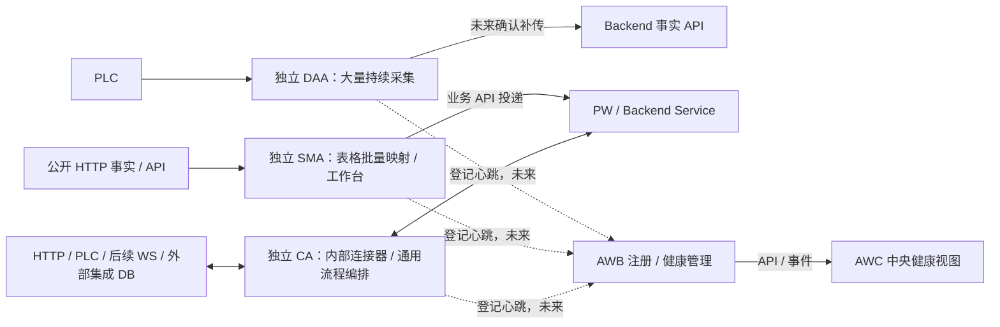

Task ID: ARCH-AW-007
Revision: r2
Status: owner_approved
Owner Role: PM
Allowed Writers: PM, Human Owner
Handoff: PM -> Development；Human Owner 于 2026-10-20 精确批准 ARCH-AW-007 r2，依第 2 节既有五正文范围同步；独立 QA 与最终验收待后续，不含软件实施
Workflow Mode: STD
Execution Mode: agent_team_same_session
Task Namespace: aiis-ics-arch
Classification: root
Capability: DAA/SMA/CA 三应用职责、CA 内部连接器与全类型 AWB/AWC 健康管理路线修订
Owner: Automation World
Acceptance Chain Reference: 本 spec 第 12 节；PM -> Human Owner 精确范围批准 -> Development -> fresh-context QA / Verification -> Human Owner 最终验收
Related Task: ARCH-MULTI-001, ARCH-AW-001, ARCH-AW-002, ARCH-AW-003, ARCH-AW-006

# AW 三应用职责、连接器与集中健康路线

<a id="r2-design"></a>
## 1. r2 目标、变更对照与真实阶段

本 r2 为已获精确文档范围批准的 PM 路线规格：保留 DAA、SMA、CA 三个应用，按不同工作方式分工；CA 内部逐步扩展多协议连接器，未来 AWB/AWC 统一登记与查看三类实例健康。CA 不在本文另造英文全称，不以既有目录或设计记录宣称新通用 CA 已上线。

2026-10-20 Human Owner 先要求修订 006/007 的 r2 spec、先看设计、暂不改代码；该请求当时仅授权起草。随后对成文的两个 r2 spec 明确批准文档同步，原话和本任务批准草案 SHA 见第 12 节。本文没有 Parent；[ARCH-AW-006 r2 设计](../ARCH-AW-006-unified-flow-agent-design/spec.md#r2-design) 同次获精确范围批准，相关应用设计的实际交付/验证仍归其 bundle，不转移实现或验收。

| r1 方向或记录 | r2 拟调整 | 效力 |
| --- | --- | --- |
| FOA 工作名、SMA/CA 合并为同宿主场景 | 取消 FOA 命名；通用节点编排归 CA，SMA 恢复为独立专用应用，DAA 保留大量采集 | 新路线提案，不追改 r1 的真实批准 |
| FOA 内部连接器、登记 FOA 后上报心跳 | 连接器归 CA 内部；登记/健康协议覆盖 DAA、SMA、CA 各类实例 | 全类型管理，不要求三类都有流程节点 |
| r1 文档同步及 AC01–AC14 独立 qa_passed | 保留完整 r1 scope、Development 和 QA；Human Owner final acceptance 一直 pending | r1 QA 不覆盖 r2，r2 范围更新不抹去旧 QA |

最新起草依据原话（方向变更对照）：

> 那就按这个方向，先修订 ARCH-AW-006 和 ARCH-AW-007 的 r2 spec，保留 r1 历史和验证记录。DAA 保留大量采集，SMA 沿 TSS 做表格化批量映射和工作台，原 FOA 的通用节点编排能力归 CA，取消 FOA 命名。首版仍不做登录认证，暂时不改代码，先把修订后的设计给我看。

**阶段边界：** PM 交接时，正式双语 ROADMAP 和三份旧设计方向提示仍是 007 r1 文档候选；现已准入 r2 Development，正文实际同步与新 QA 待后续角色记录。[tasks.md](tasks.md) 与 [checklist.md](checklist.md) 在本次 PM 更新时仍仅记录 r1 developer_handoff / qa_passed，不能因顶部 r2 owner_approved 而被解释成 r2 证据。原 r1 全文见[折叠历史](#r1-history)。

## 2. 当前写入范围与未来文档面

PM 阶段只修订两个 spec 的范围/批准事实和机械更新八索引；各 PM 只写自己的 spec。007 PM 的唯一可写文件是本文，不修改 006、tasks/checklist、ROADMAP、旧设计或软件。主协调负责索引，不替代角色记录；获批 Development 正文面见下表。

| 本轮路径 | 写入归属与限制 |
| --- | --- |
| `plans/ARCH-AW-007-general-agent-fleet-roadmap/spec.md` | 本 PM：r2 草案及完整 r1 历史 |
| `plans/ARCH-AW-006-unified-flow-agent-design/spec.md` | 另一 PM：对应 r2 应用设计；本 PM 只读 |
| `PLAN.md`、`PLAN.zh-CN.md` | 主协调：仅 006/007 行，r2 draft 与 r1 历史分层 |
| `plans/README.md`、`plans/README.zh-CN.md` | 主协调：唯一 bundle、当前 spec 与历史 DEV/QA 的真实状态 |
| `automation-world/PLAN.md`、`automation-world/PLAN.zh-CN.md` | 主协调：对应跨应用索引，不复制正文 |
| `automation-world/plans/README.md`、`automation-world/plans/README.zh-CN.md` | 主协调：指向根 bundle 的对应目录行 |

以下五份正文现已获本次精确 r2 批准，可交命名 Development 同步；PM 不代写，不从 r1 批准继承权限：

| 未来拟同步文件 | 严格文档范围 |
| --- | --- |
| `ROADMAP.md`、`ROADMAP.zh-CN.md` | 按 §9 双语拟文修订 §4/5/7/8；最小协调 §1/3/6/9 的直接矛盾，不改无关 PW/AIW 方向 |
| `docs/AIIS_AW_Whitepaper_Roadmap_v0.4.md` | 仅替换 007 r1 方向提示块并指向 r2；原白皮书正文/来源保留 |
| `docs/AIIS_AW_Runtime_Design.md` | 仅替换同类方向提示块；原 Runtime 及 DS 增补正文保留 |
| `docs/AIIS_SMA_Detailed_Design.md` | 仅替换同类方向提示块；原 SMA 设计仍按当时范围解释，不全篇重写 |

不改实现、测试、依赖/锁文件、配置、真实 .env、合同 schema、应用目录、根 AGENTS/README/CODE_INDEX 或其它任务；不启动服务/监听，不运行 API、DB、PLC、Docker、安装依赖、commit/push 或部署。保留 DS/DAA 并行 dirty。未来实际 SMA 精简、存储/调度、CA 原型和平台管理实现各自另立精确 spec。

## 3. 当前事实与拟议能力

| 已核对入口 | 当前事实/限制 | r2 目标及后续门槛 |
| --- | --- | --- |
| [AW README](../../automation-world/README.zh-CN.md) / [PLAN](../../automation-world/PLAN.zh-CN.md) | 冻结 control-agent/CAF 与独立 DAA/SMA 工程；AW API/新闭环未接通 | 新 CA 是未来应用目标，不解冻旧 CA，不重新认证旧迁移 |
| [DAA README](../../automation-world/data-acquisition-agent/README.zh-CN.md) | SQLite 本地采集；旧直库/headless 退役；上报仍说明本地保存、上传未接入 | 保留大量持续采集，未来确认补传依既有阶段/接收合同另批 |
| [SMA README](../../automation-world/semantic-mapping-agent/README.zh-CN.md) | 已过滤 TSS 派生；当前 Backend-held TSS 配置、HTTP 兼容路径；SQLite/持久 outbox 是目标 | 先沿现有配置/HTTP 合同精简表格与工作台，不强制先迁存储 |
| [映射表组件](../../automation-world/semantic-mapping-agent/src/app/twin-facts/components/MappingConfigurationsPanel.vue)、[批量弹窗](../../automation-world/semantic-mapping-agent/src/app/twin-facts/components/MappingBatchOperationsDialog.vue) | 已有表格、JSON/XLSX 批量预览/导入等基础 | 复用并收敛操作，不把现状描述为从零新建；具体精简实施另批 |
| [运行面板](../../automation-world/semantic-mapping-agent/src/app/twin-facts/components/ApiFirstMappingRuntimePanel.vue)、[调度器](../../automation-world/semantic-mapping-agent/src-tauri/src/services/mapping_runtime/mod.rs) | 已有启停/暂停/恢复；调度循环约 779–851 行逐项 await `run_mapping_tick` | 不假称批量并发或吞吐已验证；隔离、容量、持久恢复按真实需求实证 |
| [已交付 ROADMAP](../../ROADMAP.zh-CN.md)、三份旧设计提示 | PM 交接时仍体现 r1 方向；r1 QA 通过，最终验收 pending | r2 精确范围已批准，仍待五正文实际同步、新 handoff 和新 QA；范围批准不等于已替换正式路线 |

## 4. R01–R03：三应用责任与独立生命周期

**R01：** DAA 独立承担大量持续 PLC 读取、解码/质量、样本身份、本地缓冲/历史与未来确认补传；不因 CA 具备读取节点而取消 DAA。SMA 是沿已过滤 TSS 基线精简的专用 HTTP 读→字段映射→HTTP 投递应用，采用表格化批量配置和首页工作台；它不是 CA 标签，也不并入 CA。

**R02：** CA 承接通用 Tauri/Rust 节点编排、工作台、流程表格、弹窗画布、不可变保存版本、单轮测试、本轮上下文/跨轮状态、持久进度/扩展节点等设计能力，详见 006 r2。CA 可以执行简单 HTTP 映射；SMA 优化同构映射的配置和诊断工作，不靠未经实证的吞吐宣称或硬数量阈值划界。



| 组件 | 负责 | 边界 |
| --- | --- | --- |
| DAA | 连续采样、质量/原时间、历史/容量与未来补传 | 当前上传未接通，不负责一般业务流程/设备任务下发 |
| SMA | 大量同构 HTTP 映射的表格/批量管理、工作台、投递诊断 | 当前沿 TSS Backend-held 配置，不因本路线取得 PLC/DB 通用连接器 |
| CA | 有类型节点/条件/子流程、内部连接器、版本固定、运行/核实 | 不代行 PW 业务规则；不把协议写成功当设备/业务完成 |
| PW / Backend | 业务规则、数据 owner、事务、Service/API 和 schema | 不在请求线程内轮询 PLC；所属业务写入不被连接器绕过 |
| CU / 本机 UI | CU 源码复用；各 App 工作台管理本机对象 | UI 源码不成为在线依赖；本机工作台不等于中央 AWC |
| AWB / AWC | 未来控制/注册与分层健康管理、中央读取 | 不代替各 App 执行/现场事实，不逐台直连 PLC/DB |

**R03：** 三 App 与各自实例独立拥有配置范围、可写状态、队列、凭据和生命周期；同机/共源码不合并运行队列。按真实重复抽取协议适配、纯类型/日志/恢复基础，不要求先建完所有共享 Core，也不依赖另一个 App 进程存活。窗口关闭、后台、退出和 OS 托管以各 App 实施合同为准，不由 Tauri/sidecar 名称推定。

## 5. R04–R05：CA 内部连接器与数据 owner

**R04：** 连接器是 CA 内部节点/adapter 能力，不单独形成 Agent。已支持输入输出可跨 HTTP、PLC、WS、DB 组合；CA 首版仍按 006 r2 收敛 HTTP GET/POST 与明确受支持 S7。多 PLC/WS/数据库是后续扩展，不成为本地首版或 SMA 表格工作台的前置。

| 连接器 | 路线与逐项验收边界 |
| --- | --- |
| HTTP | 请求/输出身份、大小/超时/并发、业务确认、幂等重试或 unknown；主动请求不自动新增接收服务器 |
| 多 PLC | 具体协议/CPU/访问方式/驱动及版本/OS/类型/编码/读写支持矩阵；协议写、读回、设备接受、物理完成分层 |
| WebSocket | 订阅/发送；消息身份、初始快照与增量衔接、顺序/游标、重连重同步、缺口、背压与有界存储；连接不等于可靠交付 |
| 外部/集成数据库 | 产品/版本/驱动/OS/类型矩阵，分别声明只读和写能力；目标 owner、表/操作范围、参数化查询、事务/隔离、幂等与未知结果核实 |

**R05：** 获准外部/集成 DB 可按所属合同由 CA 直接读取、受控写入；凭据引用、连接池与事务留在 adapter 内。PW/Backend 拥有的业务规则、schema、事务与业务状态仍经所属 Service/API，不复活 legacy 直接写业务表。任意 SQL/DDL 不在首版，不承诺跨 PLC/HTTP/多个 DB 原子事务或物理动作恰好一次。

每项连接器按具体组合区分 planned / implemented / verified，不承诺全部 PLC、数据库或 OS；流式输入、取消、恢复、容量与实例间写资源冲突必须单独立约。SMA 的可靠投递优化、DAA 的持续采样与 CA 的设备 unknown 核实各保留副作用语义，不用一种重试策略覆盖全部应用。

## 6. R06–R07：全类型身份与配置权威

**R06：** 同一未来登记/心跳协议覆盖 DAA、SMA、CA；`agentKind` 表示应用类型，`dutyProfile` 表示该类型实例的具体职责。两者分开，均不是登录角色/ACL；并非只有 CA 可注册。下列概念字段不构成已实现或冻结 schema。

| 字段组 | 最小信息与约束 |
| --- | --- |
| 稳定身份/归属 | `agentId`、显示名、`deploymentId/siteId/projectId`；改名不换主键，归属标签不扩大写资源 |
| 应用类型/职责 | `agentKind`＝DAA/SMA/CA，`dutyProfileId/revision`；实际应用与能力须匹配，不靠改标签变应用 |
| 进程代次/顺序 | `instanceId`、`bootId`、`seq`；重启分代，不能复用旧启动序号 |
| 实际软件/能力 | `softwareVersion`、`capabilityManifest` 版本/摘要；DAA 驱动/采集类型、SMA 映射功能、CA 节点/连接器按实际报告 |
| 已分配工作 | DAA 采集/点定义版本，SMA 映射配置版本，CA `flowId/flowRevision` 与节点版本；各有 assignment/resourceRefs |
| 配置状态 | `configSource`、期望/已缓存/已校验/已生效版本与应用结果；不是只报一个混合 version |

克隆 profile/主机镜像须显式选择恢复原部署或新 agentId；AWB 保留冲突 instance/boot/kind 证据，不将同 ID 多活 last-write-wins 合并为健康实例。替换、注销、登记信任与旧代次隔离由平台合同固定，不把客户端自报 agentId 当认证凭据。

**R07：** 配置权威必须按 App 当前事实和未来目标分别说明：

| App | 当前事实 | 目标/变化门槛 |
| --- | --- | --- |
| DAA | 已有 SQLite 本地配置与采集状态 | 保留现有配置/历史与迁入规则，补传按自身阶段另批 |
| SMA | Backend-held TSS 映射配置；技术启动偏好不等于另一份映射权威 | 近期精简/表格/工作台可沿现有合同；本地 SQLite、可靠 outbox/持久恢复是可独立立项目标，不冒充已实现或强制近期前置 |
| CA | 新通用应用的配置/执行存储尚为设计 | 006 r2 提议自身 SQLite、固定版本与持久进度；具体库/schema/路径/迁移在实施 spec 冻结 |

未来 AWB 发布职责/配置时，每个对象只保留单一可写权威；缓存、期望与实际生效分别报告 received / validated / applied / failed。ACK 不等于激活，激活不等于执行完成；版本切换和回退保留未决任务、unknown、outbox/采样 pending、游标与审计，不清库、不重渲染旧请求。平台管理不要求三 App 先统一存储或同时迁移。

## 7. R08–R10：AWB 心跳、分层健康与离线

**R08：** AWB 是未来控制/注册与运行健康管理面。能力上线、各 App 适配验收且实例登记启用后，每个登记的 DAA/SMA/CA 实例按统一协议报告心跳；AWB 不取代 DAA 现场事实、SMA 投递或 CA 执行，也不取代 PW 数据 owner。

| 提议接口，均未实现/未冻结 | 信息职责 |
| --- | --- |
| `POST /api/aw/v1/agents/register` | 身份、agentKind、职责/软件/实际能力与配置版本登记；冲突可见 |
| `POST /api/aw/v1/agents/{agentId}/heartbeats` | 特定 instance/boot 的有序健康快照及接收确认，不是执行命令 |
| `GET /api/aw/v1/agents`、`GET /api/aw/v1/agents/{agentId}` | 各类型实例/代次、期望/生效版本、lastSeen 与分层健康 |
| `POST /api/aw/v1/assignments/{assignmentId}/acknowledgements` | 后续配置/职责的接收、校验、应用/失败确认，不能视为业务完成 |

共同心跳最少包含 agentId、agentKind、instanceId/bootId/seq、职责、软件/capability/config 版本、observedAt；AWB 另记 receivedAt/lastSeen。类型化摘要如下，不能要求三类都报告流程节点数：

| App | 最小类型化健康/积压摘要 |
| --- | --- |
| DAA | 采集连接、最近成功样本/质量、采样进度、磁盘/容量、待补传量/字节/最老年龄；上传未接入须明确 unavailable/未配置 |
| SMA | 映射启用/运行/成功失败、最近成功读取/投递、目标错误、投递延迟与可观测积压；尚无持久 outbox 时不伪造可靠 backlog 为零 |
| CA | 流程/节点状态与版本、等待/失败、unknown/待核实、输出积压与资源摘要 |

**R09：** 心跳采用有界 latest 合并/有限保留，不能无限挤占业务 outbox/采样空间。参数化 heartbeatInterval、抖动、staleAfter、offlineAfter 及重试限量，正值和阈值顺序明确。AWB 以当前有效代次的合格新心跳 receivedAt 判 TTL；旧 boot、重复/倒序、历史补传/回放不刷新在线。重连发送当期快照，Agent 时钟仅辅助诊断，不能代替服务端接收时间。

健康分成 Agent 存活/管理链路、App 工作状态、外部连接、数据新鲜度/质量及积压。unknown＝无当前证据；online＝心跳在 staleAfter 内；stale＝超过陈旧阈值而未达离线阈值；offline＝达到 offlineAfter；conflict＝同 agentId 多活代次不能安全合并。degraded 为独立异常标记，可与 online 同时存在；收到心跳不证明采样完整、映射成功、PLC 在线、安全或业务完成，offline 也不证明进程死亡。

**R10：** AWC 经 AWB API/事件查看三类实例、职责、版本/能力、类型化工作/连接健康、lastSeen/陈旧、错误和积压，不逐台直连 PLC/DB。先只读健康，再分别立约中央配置、远程改职责/启停/更新及自动运维；心跳不是执行授权、HA 锁或设备写租约，不能据失联超时自动接管设备。

AWB 短时不可用时，默认本机已激活且不依赖在线资格的任务按自身恢复/容量合同继续，AWC 显示最后接收/陈旧；依赖设备租约或资格的任务遵循独立 fencing/续租/失联合同，不泛化全部继续写或全部停机。重启按各 App 生命周期和恢复合同处理，未决结果用原身份核实。首版仍无登录认证；现有 Backend 认证/actor 依赖的实际改造另立合同，不默关全仓认证。未来登记可信度/通信保护单独规划，不倒灌账号/JWT 为首版前置，也不承诺 fleet 永远匿名。

## 8. R11：S0–S4 与分支推进

| 现有阶段 | 本路线能力与进入/完成 gate |
| --- | --- |
| S0 文档 | 本 r2 spec 审阅→精确批准→五正文 Development→fresh 文档 QA→Human Owner 最终验收；保留 r1 原历史 |
| S1 合同 | 窄业务/事实 API、三应用身份/capability/健康合同可分支定义；固定 owner、版本、幂等、原时间/质量、TTL/冲突 |
| S2 前置 | 保留 ARCH-AW-001 的 DAA/SMA 初始化/CAF 冻结证据，不扩张为新 CA 或 fleet 完成 |
| S2 本地有限交付 | DAA 持续采集线、SMA 沿 TSS 精简/表格/工作台、CA 设计/原型分别立项推进；各自窄链路/生命周期/配置/恢复验证，无统一存储或 AWB 前置 |
| S3 可靠性/连接器 | 逐项验证采样/投递/流程恢复与容量、CA 多 PLC/WS/外部 DB 支持矩阵；隔离/吞吐须实证，设备/长运行另批 |
| S4 按需中央管理 | 三类型 AWB 登记/心跳→AWC 只读健康→单一权威配置发布→远程操作；身份冲突、TTL、失联、ACK/应用/回退先验，HA/写租约另验 fencing |

三应用、CA 连接器与 AWB 管理合同可按真实依赖并行推进，不要求所有协议、共享 Core、AWB 或另一个 App 进程先完成。阶段不绑定日期、不虚构支持矩阵；既有 PW/AIW、PG/Redis、HA/SA、OS 托管方向保留各自范围，不打包为本地首版门槛。

## 9. R12：未来 ROADMAP 双语拟文与提示协调

以下拟文已获精确 r2 文档范围批准，作为 Development 同步依据。实施时 §1 更新修订依据，§3 将两类专用链与 CA 流程分别画出，§6 保留 TSS 来源/现行 Backend-held 和 DAA SQLite 事实，§9 指向 006/007 r2；其它章节只修直接矛盾。PM 不代写正式 r1 正文。

### 9.1 §4 — English / 中文

**DAA, SMA and CA remain three applications.** DAA handles bulk continuous PLC acquisition, decoding/quality, sample identity, local buffering/history and future acknowledged replay. Its current SQLite acquisition baseline does not include the new upload chain. SMA evolves from the filtered TSS baseline into a focused application for many similar HTTP-read → field-map → HTTP-deliver configurations, with table/batch management and a home workbench. SMA remains independent rather than a CA scenario.

CA owns the general Tauri/Rust node orchestration design: local workbench, flow table, popup canvas, saved versions, contexts and extensions. CA may also run simple HTTP mappings; SMA specializes their bulk configuration and diagnosis. This split uses task shape and usability rather than unproven throughput or a fixed mapping-count threshold. Each application/instance owns independent state, queues and lifecycle; reuse foundations after real overlap is established without requiring every shared Core or another application's process. CAF remains frozen. CU is reusable UI source; AWC is a future central console, distinct from local workbenches.

**DAA、SMA、CA 保留为三个应用。** DAA 承担大量持续 PLC 采集、解码/质量、样本身份、本地缓冲/历史与未来确认补传；当前 SQLite 采集基线尚未接入新上传链。SMA 沿已过滤 TSS 基线收敛为专用应用，以表格/批量管理和首页工作台承载大量同构 HTTP 读取→字段映射→HTTP 投递；SMA 独立存在，不作为 CA 场景。

CA 承担通用 Tauri/Rust 节点编排设计，包括本机工作台、流程表格、弹窗画布、保存版本、上下文与扩展；CA 也可执行简单 HTTP 映射，SMA 优化同构映射的批量配置与诊断。分工依据工作形态与易用性，不靠未验证吞吐或固定映射数量阈值。各应用/实例独立拥有状态、队列与生命周期；按真实重复复用基础，不要求先建完共享 Core 或依赖另一应用进程。CAF 保持冻结；CU 是复用 UI 源码，AWC 是未来中央控制台，与本机工作台区分。

### 9.2 §5 — English / 中文

**Typed connectors belong inside CA.** CA's initial scope remains the 006 r2 proposal for HTTP GET/POST and explicitly supported S7, with no login authentication. Later CA nodes/adapters may add selected PLC drivers, WS subscription/sending and approved external/integration database reads/controlled writes. Supported inputs/outputs may be combined freely; this creates no separate connector Agent or dependency for SMA's table/workbench delivery. Support is accepted per protocol/CPU/access/driver/version/OS/type/read-write matrix, never as all PLCs or databases.

WS contracts define message identity, snapshot/delta continuity, reconnect, gaps, backpressure and bounded storage. DB adapters own credentials, parameterized queries and transactions; declare read-only and write capabilities separately with data-owner, table/operation, idempotency and unknown-result contracts. PW/Backend-owned rules, schema and business state continue through their Service/API. Arbitrary SQL/DDL and cross-system atomicity are outside the first version; delivery retry cannot replace reconciliation of uncertain device actions.

**类型化连接器归 CA 内部。** CA 首版仍以 006 r2 提议的 HTTP GET/POST 和明确受支持 S7 为范围，首版无登录认证。后续 CA 节点/adapter 可增加选定 PLC 驱动、WS 订阅/发送和获准外部/集成数据库读取/受控写入。已支持输入输出可自由组合，不形成独立连接器 Agent，也不成为 SMA 表格/工作台交付前置。按协议/CPU/访问方式/驱动/版本/OS/类型/读写矩阵分别验收，不承诺所有 PLC 或数据库。

WS 合同定义消息身份、快照/增量衔接、重连、缺口、背压与有界存储。DB adapter 管理凭据、参数化查询和事务，分别声明只读/写入能力，以及数据 owner、表/操作、幂等和未知结果合同。PW/Backend 的业务规则、schema 与状态仍经所属 Service/API；任意 SQL/DDL 和跨系统原子性不在首版，投递重试不能代替设备不确定动作核实。

### 9.3 §7 — English / 中文

**Configuration and fleet management cover all three application types.** DAA currently owns local SQLite configuration; SMA currently uses Backend-held TSS configuration and may refine its tables/workbench before a separately approved local-SQLite or reliable-outbox project. CA's versioned local configuration/progress is a target design. Neither this roadmap nor AWB management forces a simultaneous storage migration. Future publication requires one writable authority per object, desired/cached/applied versions and separate receipt, validation and application acknowledgements; rollback preserves pending samples/work, unknown outcomes, outboxes, cursors and audit.

Future enrolled DAA, SMA and CA instances use a common identity/heartbeat contract: stable agentId and deployment/site/project, agentKind as application type distinct from duty profile, actual software/capability and acquisition/mapping/flow versions, process instance/boot/sequence, desired/applied configuration and observedAt. AWB adds receivedAt/lastSeen, rejects conflicting identity and old/replayed generations from refreshing TTL, and uses configurable stale/offline thresholds and bounded latest-state heartbeat retention. Types report their own work: DAA sampling/disk/replay; SMA mapping results/delivery latency/backlog; CA flows/nodes/unknown outcomes. Unsupported metrics remain explicit rather than fabricated zeros.

AWC reads AWB APIs/events for all types; liveness, work results, external connections and data freshness/backlog remain separate, with unknown/online/stale/offline/conflict and an independent degraded flag. Heartbeat is neither business completion nor HA/write-lease authority. Local active work normally continues through AWB outages under its own contract; lease/fencing exceptions and restart recovery remain application-specific. Read-only health precedes central configuration and remote operations. Future enrollment trust and communication protection are separate platform work, adding no first-version login prerequisite and making no permanent-anonymity promise.

**配置与集中管理覆盖三个应用类型。** DAA 当前本地 SQLite 权威；SMA 当前沿 Backend-held TSS 配置，可先精简表格/工作台，本地 SQLite 或可靠 outbox 另立任务；CA 的版本化本地配置/进度仍为设计目标。本路线和 AWB 管理不强制同步迁移三者存储。未来发布须保证每个对象单一可写权威，区分期望/缓存/已生效版本与接收、校验、应用确认；回退保留待补传样本/任务、unknown、outbox、游标与审计。

未来登记 DAA、SMA、CA 实例采用统一身份/心跳合同：稳定 agentId 与部署/现场/项目、作为应用类型的 agentKind 与独立职责 profile、实际软件/能力及采集/映射/流程版本、进程 instance/boot/seq、期望/生效配置及 observedAt。AWB 补 receivedAt/lastSeen，冲突身份和旧代次/回放不刷新 TTL，阈值可配置，心跳按有界 latest 保留。各类型报告自身工作：DAA 采样/磁盘/补传，SMA 映射结果/投递延迟/积压，CA 流程/节点/unknown；尚不支持的指标明确说明，不伪造零值。

AWC 经 AWB API/事件查看所有类型；存活、工作结果、外部连接和数据新鲜度/积压分层，显示 unknown/online/stale/offline/conflict 及独立 degraded 标记。心跳不等于业务完成或 HA/写租约授权。AWB 失联时本地已激活任务通常按自身合同继续，租约/fencing 例外与重启恢复按各 App 合同；先只读健康，再中央配置和远程操作。未来登记可信度/通信保护归平台专项，不增加首版登录前置，也不承诺永久匿名。

### 9.4 §8 — paired stage replacement

| Stage | Proposed capability / gate |
| --- | --- |
| S0 | Review/approve r2 documents, implement the five-document scope, fresh QA and Human Owner acceptance; retain r1 history |
| S1 | Define narrow APIs and all-kind identity/capability/heartbeat contracts with owners, versions, idempotency, time/quality and TTL/conflict rules |
| S2 prerequisite | Retain original DAA/SMA initialization and CAF freeze evidence without implying new CA/fleet completion |
| S2 | Advance DAA, TSS-based SMA simplification/table/workbench and CA design/prototype independently; verify each local chain without AWB or shared-storage prerequisites |
| S3 | Evidence-based recovery, isolation/capacity and selected CA PLC/WS/DB connector matrices; field and long-run actions separately approved |
| S4 | All-kind registration/heartbeats and AWC read-only health, then single-authority publication and separately contracted remote/HA/fencing |

| 阶段 | 拟增量 / 门槛 |
| --- | --- |
| S0 | 审阅批准 r2 文档，实施五正文范围，fresh QA 与 Human Owner 验收；保留 r1 历史 |
| S1 | 窄 API 与全类型身份/能力/心跳合同，固定 owner、版本、幂等、时间/质量及 TTL/冲突 |
| S2 前置 | 保留原 DAA/SMA 初始化与 CAF 冻结证据，不暗示新 CA/fleet 完成 |
| S2 | DAA、沿 TSS 的 SMA 精简/表格/工作台、CA 设计/原型分别推进，各自验证本地闭环，无 AWB 或统一存储前置 |
| S3 | 恢复、隔离/容量实证与选定 CA PLC/WS/DB 支持矩阵；现场/长期运行另批 |
| S4 | 全类型登记/心跳与 AWC 只读健康，然后单一权威发布；远程/HA/fencing 分别立约 |

这些能力阶段没有日期承诺；各线按合同依赖推进，不等待全部连接器或平台上线。There are no date commitments; each line advances by its own contracts without waiting for every connector or the central platform.

### 9.5 三份旧设计仅替换现有方向提示块

> 方向更新（ARCH-AW-007 r2 草案）：新路线提议保留 DAA、SMA、CA 三应用；DAA 负责大量持续采集，SMA 沿已过滤 TSS 基线精简表格化批量 HTTP 映射与工作台，CA 承担通用节点编排及内部多协议连接器。AWB/AWC 未来统一管理三类实例，先登记/心跳与只读健康，再配置/远程操作。完整范围和状态以 007 r2 及 006 r2 bundle 为准；原设计正文/来源和 r1 验证历史保留，当前配置事实与未来存储目标分别解释，不由本提示宣称实施、QA 或设备/部署许可。

该段现可由 Development 在已批准范围内替换原 007 提示，按真实批准/交付阶段收敛草案标签，不写成 final accepted；实质拟文不变。链接采用相对 docs 的 `../ROADMAP.md`、`../ROADMAP.zh-CN.md`、两个 spec 的 `#r2-design`；三份旧文去除 007 提示块后的原字节必须保持，不将旧 TSS/SMA 全篇改造成新运行合同。

## 10. r2 文档验收标准

AC 只检查本路线草案与未来获批文档同步的可审阅、一致与历史可追溯；没有软件/原生/吞吐/DB/设备通过声明。r1 同号 AC 结果仅属历史，不充当下列 r2 证据。

AC01 / AC03 中的 draft 描述 PM 起草及关联初稿阶段；当前状态按第 12 节及对应 bundle 的真实精确批准记录判定，不要求获批后继续保持 draft。其余验收要求不变，scope approval 不替代 Development、独立 QA 或最终验收。

| AC | r2 可审阅通过条件 |
| --- | --- |
| AC01 | 当前 metadata 唯一且为 r2 draft，无 Parent/虚构批准；精确 allowlist、角色与后续 gate 明确 |
| AC02 | 三 App 分工、CA 可做简单映射与 SMA 批量工作方式、独立队列/lifecycle 明确，无硬数量/吞吐断言 |
| AC03 | 取消旧统一产品名仅在变更/历史出现；冻结 CAF 不解冻，新 CA 不冒充现有实现；006 r2 链接明确为 draft |
| AC04 | SMA 已过滤 TSS/表格批量/启停/逐项 await 与 Backend-held 现状有依据，SQLite/outbox/隔离容量仍标未来 |
| AC05 | CA 内部连接器、HTTP/S7 首版及 PLC/WS/DB 逐项矩阵与恢复/owner/Service/API 边界完整 |
| AC06 | DAA 当前 SQLite 与上传未接入、SMA 当前 Backend-held、CA 目标存储三者分开，非强制统一迁移 |
| AC07 | agentKind 和 dutyProfile 分开，登记/心跳覆盖三类；字段/版本/代次与冲突规则明确 |
| AC08 | 类型化工作健康覆盖三类真实摘要，不统一索要 flow 数或将不可用指标伪报为零 |
| AC09 | receivedAt TTL、boot/seq、回放隔离、有界 latest 心跳、分层状态与 degraded 明确 |
| AC10 | AWC 经 AWB、失联本地继续及租约/fencing/重启例外、先只读后管理、无登录与未来信任边界无矛盾 |
| AC11 | S0–S4 分支推进、无平台/所有连接器/所有共享 Core 前置，无虚构日期/支持证明 |
| AC12 | §9 英中拟文逐段与阶段表语义对齐，未来五正文/提示替换可直接执行且不重写三旧文原正文 |
| AC13 | 折叠完整 r1 去除固定前缀恢复原 SHA；旧 tasks/checklist bytes/Revision/状态不变，r1 qa_passed 与 final pending 清晰 |
| AC14 | 风险/未决/角色 handoff、活动链接/锚点及 checker 分阶段兼容限制完整；PM 自检不称独立 QA |

## 11. 风险、回退、未决与专业 handoff

| 风险/待决项 | 本路线控制与未来固定时点 |
| --- | --- |
| 三应用重新被读成一个宿主或相互在线依赖 | 类型/职责/队列分开，CA/SMA 能力有重叠但工作方式不同；实施按真实复用，不全量先造共享 Core |
| SMA 简化被夸为可靠批量吞吐 | 保留逐项 await 与 Backend-held 现状；目标规模、隔离/并发、失败重放/outbox与容量另立实证任务 |
| 未做统一迁移导致配置混淆 | 每 App/配置对象明确当前权威；若未来迁移须唯一写权威、版本激活、旧记录保护和回退 |
| 身份克隆、旧代次/历史心跳复活 | agentKind 与身份/代次并列诊断，冲突显式保留；服务端接收 TTL、有界当期快照，不自动选主 |
| 存活掩盖采样/投递/执行失败 | 三类摘要和健康层次分开，数据原时间/质量/积压、unknown 可见，不用 heartbeat 代替业务确认 |
| WS/DB/设备副作用与失联 | 支持矩阵、owner、幂等/unknown/背压；独立设备资格/fencing，不能仅凭网络失联切主 |
| 旧方向已落正文而 r2 尚待同步 | PM 交接时正式五正文仍为 r1；现已批准由 Development 最小同步，再新的 fresh QA，不追改 r1 验证 |
| CA 落点/平台、连接器优先级、正式 API/阈值/注册信任、远程权限 | 分别在对应实施前定案；本 r2 不建目录、不锁依赖版本、不增加现场动作权限 |

本次回退只撤销 007 r2 的确切 spec/索引增量并保留可恢复 r1；不 reset 全工作树，不覆盖 DS/DAA 或他人文件。未来配置/软件回退和单 writer 切换须保留未决样本/任务、历史与对账，不能以配置回退撤销已发生外部动作。

文档 Development/Verification 用 `aiis`、`project-governance`；实际软件另立 spec：CA runtime/连接器用 `rust-runtime`，桌面壳/生命周期加 `desktop-tauri`，PLC 点位/布局加 `plc-point-mapping`；SMA/CA UI 用 `frontend-ui` + `i18n-workflow`，Backend/事务用 `backend-arch`，结构索引按需用 `code-document-indexer`。PM 不代写技术实现或执行专业验证。

## 12. 版本记录、兼容限制与当前 handoff

| Revision / 日期 | 真实记录 | 当前效力 |
| --- | --- | --- |
| r1 / 2026-10-20 | 精确范围获批，五正文 developer_handoff，独立 AC01–AC14 qa_passed | 完整原 scope 见折叠历史；DEV/QA 文件仍 r1，Human Owner final acceptance pending |
| r2 / 2026-10-20 | Human Owner 要求按三 App 新方向先修订两个 spec 并先看设计 | 起草阶段仅授权成文 draft；当时无精确批准、正文同步、Development 或独立 QA，原时序保留 |
| r2 / 2026-10-20 | Human Owner 对成文的 006/007 r2 明确批准，要求按新方向同步双语 ROADMAP 和相关设计文档 | `owner_approved`，只批准既有五正文文档范围；PM → Development，后续独立 QA 与 Human Owner 最终验收仍待发生 |

本次 Human Owner 精确批准原话：

> 批准 ARCH-AW-006 和 ARCH-AW-007 的 r2 spec，按新方向同步双语 ROADMAP 和相关设计文档，保留 r1 历史和验证记录，暂时不改代码。

批准针对的本任务成文 draft SHA-256：`e972e305c459ef00069d2d060a008d702ec0f6503e77f85553f90016050ef4d2`。本次仅更新批准/阶段事实，实质范围、allowlist、双语拟文和验收要求保持；不据此次批准推断软件实施、独立 QA 或最终验收。

**旧记录保护：** r1 spec 可还原 SHA-256 `083d64b9ad274eed1a41380ad62e0d58757457a57a090eaffd880f8be1a0b494`；tasks `e8dfad1584329c1e2a92595854992683ff920b7a34eb9c632ca4b2e361f2d2de`、checklist `9d268a7dfc21d0f0ecd06831d2e0989703247901c6f11fa4bbf9de3d61097279` 在本次 PM 更新时逐字节保持。它们不是 r2 角色记录，PM 不代改旧 metadata，也不能据旧 qa_passed 推断 r2/final acceptance。

现行治理 checker 要求三文件 Revision 相同，并在 tasks.md 存在时要求当前 spec 为 owner_approved；它未区分 PM draft 与历史 DEV/QA。起草阶段的 r2 draft 加 r1 tasks/checklist 曾触发两项 Revision 不一致及 tasks.md requires owner_approved spec.md 兼容诊断。当前真实批准解除 spec 批准状态项，历史 Revision 仍须按阶段分别核验；不为消除诊断改 checker、伪升旧记录或追加未发生的 r2 QA。由对应角色按真实批准/交接顺序形成 r2 记录并保留 r1 历史，PM 不提前回填。

本次 PM 更新保持 r1 `tasks.md` / `checklist.md` 整文件 bytes 不变；现已精确批准 r2，Development / Verification 应在这两个固定路径按真实阶段推进 r2，并完整归档各自 r1 历史，不另建平行 task-r2.md 事实面，不继承 r1 verdict。r1 从未最终验收是保留的历史事实，不构成 r2 实施前必须补做的 gate。

当前 handoff：PM → Development，依据 **ARCH-AW-007 r2** 的真实精确批准及上述 draft SHA，由命名 Development 按第 2 节既有五正文范围同步路线/提示，在固定 tasks.md 记录 r2 并完整封存 r1；精确 developer_handoff 后新的 fresh-context Verification 在固定 checklist.md 验证 r2 并完整封存 r1，不能继承旧 verdict，再由 Human Owner 最终验收。软件、存储迁移、依赖、API/DB/设备/部署和发布均不在本次文档批准内。

本 profile 为 contract_only；实际命名角色、主会话串行 handoff、完整 bundle 和 diff 审计是必要控制，不宣称平台 ACL、强制路由或技术隔离。

<a id="r1-history"></a>
## 13. r1 完整原文历史（不作为 r2 当前范围）

下列保存已批准 r1 的完整原 bytes；每行仅增加固定 ASCII 前缀 `r1|`（含原空行）。提取四反引号 text fence 内全部行并各去前 3 字符，可还原原 UTF-8 bytes/换行及上述 SHA；不得编辑其中旧 metadata、批准原话或范围。旧 DEV/QA 仍在原文件保存，只覆盖 r1。

<details>
<summary>ARCH-AW-007 r1 完整原文、真实批准与交接（只读历史）</summary>

<!-- ARCH-AW-007:r1:BEGIN -->
````text
r1|Task ID: ARCH-AW-007
r1|Revision: r1
r1|Status: owner_approved
r1|Owner Role: PM
r1|Allowed Writers: PM, Human Owner
r1|Handoff: PM -> Development；Human Owner 于 2026-10-20 精确批准 ARCH-AW-007 r1 文档范围；依第 2.2 节同步文档，独立 Verification 与最终验收待后续
r1|Workflow Mode: STD
r1|Execution Mode: agent_team_same_session
r1|Task Namespace: aiis-ics-arch
r1|Classification: root
r1|Capability: AW 通用执行宿主、类型化连接器与 AWB/AWC 实例健康管理的全项目路线修订
r1|Owner: Automation World
r1|Acceptance Chain Reference: 本 spec 第 14 节；PM -> Human Owner 精确范围批准 -> Development -> fresh-context QA / Verification -> Human Owner 最终验收
r1|Related Task: ARCH-MULTI-001, ARCH-AW-001, ARCH-AW-002, ARCH-AW-003, ARCH-AW-006
r1|
r1|# AW 通用 Agent 与实例健康管理路线
r1|
r1|## 1. 目标与效力
r1|
r1|将“同一通用软件通过配置承担不同 AW Agent 任务，逐步支持多 PLC、HTTP、WebSocket 和数据库，并向 AWB 上报心跳，由 AWC 查看健康”的长期方向纳入全项目 ROADMAP。本文直接给出目标合同、阶段、差异、双语拟文和最小旧文档协调方案，作为精确 r1 文档实施依据。
r1|
r1|2026-10-20 Human Owner 最初提出将这些方向写入全项目路线，当时仅授权形成可审阅的 PM 提案，不等于批准尚未成文的 r1。随后对成文的精确 r1 明确批准，见第 14 节；范围批准不等于已完成路线正文同步。本文没有 Parent；相关任务只提供背景，不转移批准或验收。FOA（Flow Orchestration Agent）沿用 [ARCH-AW-006 r1](../ARCH-AW-006-unified-flow-agent-design/spec.md) 的提议工作名，未完成产品定名。
r1|
r1|007 是独立的路线修订任务。006 r1 仍是 draft，其首版只提议 HTTP GET/POST、已受支持的 S7 范围、有限流程及无登录认证；007 不扩大该首版，也不修改其文件、状态、案例或验收条件。本文所有未来能力均是规划合同，不能据此宣称 API、驱动、AWB/AWC 或运行健康功能已经实现。
r1|
r1|## 2. 阶段写入边界与获批文档交付
r1|
r1|### 2.1 PM 起草阶段的九路径 allowlist
r1|
r1|| 路径 | 归属与允许内容 |
r1|| --- | --- |
r1|| `plans/ARCH-AW-007-general-agent-fleet-roadmap/spec.md` | PM 唯一写入：本规格、拟文、AC、风险和批准历史 |
r1|| `PLAN.md` | 主协调：仅新增本任务英文 draft 摘要、spec 链接与下一 gate |
r1|| `PLAN.zh-CN.md` | 主协调：对应中文任务行 |
r1|| `plans/README.md` | 主协调：仅新增目录行，链接已存在 spec，后续角色文件注明待形成 |
r1|| `plans/README.zh-CN.md` | 主协调：对应中文目录行 |
r1|| `automation-world/PLAN.md` | 主协调：新增跨应用路线任务行，链接唯一根 spec |
r1|| `automation-world/PLAN.zh-CN.md` | 主协调：对应中文任务行 |
r1|| `automation-world/plans/README.md` | 主协调：新增根 bundle 引用，不复制正文 |
r1|| `automation-world/plans/README.zh-CN.md` | 主协调：对应中文目录行 |
r1|
r1|### 2.2 精确 r1 批准后的 Development 同步清单
r1|
r1|以下五份正文在 PM 起草阶段未写；现已按第 14 节取得精确 r1 文档范围批准，由 Development 同步，不与上表 PM 写入权限混用。Development 可创建本任务 `tasks.md`；其精确 handoff 后，fresh-context Verification 才创建 `checklist.md`。八份索引只机械跟随真实阶段，PM 不代写后续角色记录。
r1|
r1|| 拟同步文件 | 允许变更 |
r1|| --- | --- |
r1|| `ROADMAP.md` | 全项目英文主入口：按 §10 拟文修订 §4/5/7/8，并做下述必要一致性协调 |
r1|| `ROADMAP.zh-CN.md` | 对称中文路线，不扩大英文范围或能力承诺 |
r1|| `docs/AIIS_AW_Whitepaper_Roadmap_v0.4.md` | 仅在导言增加方向更新提示及 ROADMAP/007 链接，保护原章节与历史来源 |
r1|| `docs/AIIS_AW_Runtime_Design.md` | 仅在阅读依据前增加同类提示，标明独立宿主/角色节点限制是旧设计 |
r1|| `docs/AIIS_SMA_Detailed_Design.md` | 仅在导言增加同类提示，标明 HTTP/表单优先及不连 PLC 是旧 SMA 范围 |
r1|
r1|ROADMAP 主要替换 §4 的独立 SMA/CA 宿主表、§5 的两宿主装配与 SMA 拒写旧句、§7 的配置/凭据总括句、§8 的 S2/S4 行；同时协调 §1 文档归属、§3 目标链路中 SMA/CA 标签、§6 旧路径与外部数据库适配的区别、§9 未来任务门槛。只处理由本方向直接引发的矛盾，保留 PW/AIW 路线、现行源码事实、冻结来源与兼容链路。
r1|
r1|排除实现、测试、依赖/锁文件、接口/schema 合同文件、真实配置、数据库与 PLC 操作、服务监听、部署和 Git 发布；不创建应用目录，不改根 AGENTS/README/CODE_INDEX、006 或其它任务 bundle。保留 DS/DAA 等既有和并行 dirty；不从工作树总体差异推断为本任务变更。
r1|
r1|## 3. 当前依据与拟变更差异
r1|
r1|| 真实入口 | 当前文档或工程事实 | 007 提案及保留边界 |
r1|| --- | --- | --- |
r1|| [ROADMAP §4–5](../../ROADMAP.zh-CN.md) | SMA/CA 独立宿主、角色装配；SMA 不写 PLC/业务库 | 未来同一 FOA 软件按实例职责与实际能力配置；该提案尚未成为现行实现 |
r1|| [ROADMAP §7–8](../../ROADMAP.md) | 本地 SQLite；AWB/中央配置为 S4；Agent 不持 Backend/Redis 凭据 | 保留本地首版与 PW owner；增加外部集成 DB 连接器、实例健康及分阶段管理面 |
r1|| [白皮书 §3、9、12–15](../../docs/AIIS_AW_Whitepaper_Roadmap_v0.4.md) | AWB 管配置/身份/运行管理；AWC 与 CU 不同；心跳失联不授予接管权 | 细化登记、心跳与健康读取，不把中央管理或 HA 设置为本地首版前置 |
r1|| [Runtime §2、6–7、10–12](../../docs/AIIS_AW_Runtime_Design.md) | 两宿主/两状态；SMA Rust 装配拒绝设备写节点；生命周期与实例身份待细化 | 新方向改按节点副作用、资源与恢复合同判断；旧正文保留为历史设计，入口提示适用范围 |
r1|| [SMA 详细设计 §1](../../docs/AIIS_SMA_Detailed_Design.md) | HTTP/表单优先，不连 PLC、不直写业务库 | 006 提议画布与 HTTP/PLC 组合；007 再提长期多协议，不将旧禁用句推广成未来外部 DB 总禁令 |
r1|| [AW README](../../automation-world/README.zh-CN.md) | CA 冻结，DAA/SMA 是当前独立工程，AW API 尚未接通 | 维护当前工程事实；不把目标 FOA 或中央 AWC 写成已有应用 |
r1|| [DAA README](../../automation-world/data-acquisition-agent/README.zh-CN.md) | SQLite 本地采集，阶段 C 明示“本地保存，上传未接入” | 保留专用 DAA；其 PLC→HTTP 确认补传是完整目标链，不是当前端到端能力 |
r1|| [006 完整 spec](../ARCH-AW-006-unified-flow-agent-design/spec.md) | 同一流程宿主、SMA/CA 场景、DAA 独立；首版无登录 | 仅作为近期设计提案引用；原 r1 draft 与首版范围不变 |
r1|
r1|## 4. R01–R03：通用执行宿主与责任合同
r1|
r1|**R01：** FOA 是 AW 可配置职责的通用执行宿主。同一软件由“实例信息 + 职责 profile + 实际可用 capabilities + 已分配版本化流程”组成一个可诊断实例，承担数据交换、语义加工、条件判断或受控执行任务。SMA/CA 沿用 006，作为场景、检索标签与模板，不再代表必须拆成两个应用，也不是登录角色或 ACL。
r1|
r1|```mermaid
r1|flowchart LR
r1|    IO[获准 HTTP / WS / PLC / 外部集成 DB] <--> AD[FOA 内部类型化连接器]
r1|    AD <--> FOA[FOA 实例：职责 / capabilities / 固定流程版本]
r1|    UI[本机工作台 / CU 共享 UI 源码] <--> FOA
r1|    FOA <--> LS[(自身 SQLite 配置与执行进度)]
r1|    PLC[采集目标 PLC] --> DAA[独立 DAA 专用采集]
r1|    DAA -->|未来确认补传| BF[事实 API]
r1|    FOA <--> BP[PW / Backend 业务 Service 与 API]
r1|    FOA -->|未来登记实例心跳| AWB[AWB 注册 / 配置 / 健康管理面]
r1|    AWB -->|API / 事件| AWC[AWC 中央健康视图]
r1|    AWB -.未来版本分配与确认.-> FOA
r1|```
r1|
r1|| 组件 | 责任与完成依据 | 边界 |
r1|| --- | --- | --- |
r1|| FOA | 本机连接、流程、上下文、调度、稳定版本、执行记录/outbox 与结果核实 | 不代行 PW 业务规则；一个软件可多实例，各有独占可写 profile 与资源范围 |
r1|| DAA | 大量持续 PLC 读取、解码/质量、样本身份、本地历史、未来确认补传 | 当前保留独立专用应用，不因通用宿主方向而吞并或停用 |
r1|| PW / Backend | 业务模型、规则、事务、业务 API、所属 schema | 其业务写入继续经 Service/API；不在请求线程轮询 PLC |
r1|| AWB | 控制/注册与运行健康管理面；以后按合同发布职责/配置 | 不取代 FOA 执行、DAA 现场事实或 PW 业务数据 owner |
r1|| AWC | 通过 AWB 读取实例、职责、版本、流程/连接健康及陈旧信息 | 不逐台直连 PLC/DB；中央视图不等于已获远程启停或设备写入权 |
r1|| CU / 本机工作台 | CU 提供构建复用 UI；FOA 工作台管理本机流程与诊断 | CU 不是 AWB，FOA 本机工作台不是中央 AWC；目录存在不等于对应能力完成 |
r1|
r1|**R02：** DAA 的完整目标仍为 `PLC read → 解码/质量 → 本地样本缓冲 → HTTP POST → 接收确认/补传`。未来可评估把专用采集形成 FOA acquisition profile，前提是采样身份、定义版本、历史/补传、容量与磁盘保护、每 PLC 调度、原生生命周期及迁移回退均有等价证据，并通过独立任务验收；在此之前保留 DAA。
r1|
r1|**R03：** 不同职责可由同一实例承担，也可按故障域、资源与部署需求分成同软件多实例；标签不能加载不存在的驱动，也不能自动扩大可写资源。新职责不能绕过节点副作用与恢复合同。FOA 首版、连接器和 AWB 管理合同可分支推进，无需全部协议完成或 AWB 在线才交付本地首版。
r1|
r1|## 5. R04–R06：通用 I/O 与类型化连接器
r1|
r1|**R04：** 连接器归 FOA 内部能力，不单独形成 Agent；通用 I/O 节点使用连接引用和类型化 adapter。HTTP、WS、PLC、DB 的输入和输出可按已支持能力自由组合，例如 DB→HTTP、WS→PLC、PLC→DB、HTTP→WS。它们不是四种固定流水线，也不意味着每个组合都已实现。统一节点模型保留协议特有的身份、时间、质量、取消、副作用和恢复结果，不能只返回无语义的 success。
r1|
r1|| 连接器 | 路线范围 | 必须逐项固定的支持与恢复合同 |
r1|| --- | --- | --- |
r1|| HTTP | 006 首版 GET/POST；后续方法/载荷按需扩展 | 请求/输出身份、限额、业务确认、幂等重试或 unknown；主动客户端不等于内嵌接收服务器 |
r1|| 多 PLC | 先沿已受支持 S7 范围；后续按项目需求增加具体驱动 | 协议/CPU/访问方式/驱动及版本/OS/数据类型/编码/读写矩阵；写成功、读回、设备接受与物理完成分层 |
r1|| WebSocket | 后续订阅和发送，流式输入单独建模 | 初始快照/增量衔接、消息身份/顺序/游标、断线缺口、重连重同步、背压与容量；连接成功不等于可靠接收/投递 |
r1|| 数据库 | 后续对获准外部/集成库读取及受控写入 | 明确数据库产品/版本/驱动/OS/类型、只读或写能力、目标 owner、表/操作范围、事务/隔离、游标、幂等与结果核实 |
r1|
r1|**R05：** 数据库 adapter 内管理连接池、凭据引用、参数化查询和事务边界；流程只配置经评审的查询/写入操作及有类型参数，不把任意 SQL、DDL、schema 管理列入 006 首版。只读能力与写入能力分别声明和验收；DB 写入先确定数据 owner、具体表/操作、冲突规则、事务内幂等回执和超时未知结果，不承诺跨数据库、PLC 与 HTTP 的分布式事务。
r1|
r1|获准的外部或集成数据库可以成为 FOA 的直接输入/输出；不能因旧“SMA 不写库”否决该路线。PW/Backend 拥有的业务规则、表结构及事务仍归对应 Service/API，不借连接器绕开 owner。Backend 内部存储/Redis 凭据与显式获准的外部 DB 连接凭据是两类资源；新路线不重新启用 legacy 直写业务表路径。
r1|
r1|**R06：** 每个扩展任务交付可审阅支持矩阵及失败/恢复证据，按具体组合标记 planned / implemented / verified 和适用限制，不承诺“所有 PLC”“所有数据库”或所有 OS。WS 长连接和 DB 分页/流式输入的重入、取消、断点与有界缓存单独立约，不把 HTTP 周期轮询的实现直接视为流式可靠性证明。
r1|
r1|## 6. R07–R08：实例、职责与配置权威
r1|
r1|**R07：** 以下是路线所需的最小概念字段，使用 camelCase 便于跨文档阅读；正式 API 命名和 schema 由对应平台合同固定，本文不创建合同文件。
r1|
r1|| 字段组 | 最小字段 | 生命周期与校验要求 |
r1|| --- | --- | --- |
r1|| 稳定身份 | `agentId`、`displayName` | agentId 跨重启稳定，显示名可改；名称/职责名不是机器主键或认证凭证 |
r1|| 部署归属 | `deploymentId`、`siteId`、`projectId` 与显示标签 | 表达部署/现场/项目归属，不自动获得对应资源写权限 |
r1|| 进程代次 | `instanceId`、`bootId` | 标识本次驻留进程及启动代次；新启动不得续用旧代次心跳序号 |
r1|| 职责 | `dutyProfileId`、`dutyProfileRevision` | 声明当前任务种类与资源约束；与登录角色、业务权限分别定义 |
r1|| 实际能力 | `softwareVersion`、`capabilityManifest`、manifest 版本/摘要 | 报告实际编译/注册节点与驱动实现版本及读写能力；配置标签不能伪造能力 |
r1|| 流程分配 | `assignmentId`、`flowId/flowRevision`、`resourceRefs` | 固定流程与绑定版本、实际读写资源；缺少节点/驱动或超出资源合同时不可激活 |
r1|| 配置状态 | `configSource`、`desiredConfigRevision`、`appliedConfigRevision`、摘要/应用结果 | 区分配置来源、中央期望、已下载缓存与本机实际生效；不只报一个 version |
r1|
r1|复制 profile 或主机镜像必须显式选择恢复原部署还是创建新 agentId；不能让两个活跃进程以同一 agentId 被 AWB 合并成一条“更健康”的记录。AWB 保留 instance/boot 证据并显示冲突；替换/注销旧实例的规则在注册合同冻结，不能简单 last-write-wins。
r1|
r1|**R08：** 近期 FOA 自身 SQLite 是唯一可写配置权威；本机保存与显式激活遵循 006，UI/localStorage 不形成第二事实源。未来 AWB 发布配置或职责时，必须先选择中央或本地的单一可写权威及迁移时点；本机缓存不暗中变成与中央双向编辑的配置副本。
r1|
r1|中央分配需分别报告 received / validated / applied / failed 与期望、实际版本；更新 ACK 只确认对应阶段，不代表流程已执行或业务已完成。激活固定完整版本和依赖摘要，进行兼容性检查，在明确边界切换；回退保留旧版本所依赖的未决任务、unknown、outbox、游标与审计，不自动用新配置重渲染旧请求。软件降级也须验证旧节点/状态 schema 可读，不能以清库解决不兼容。
r1|
r1|## 7. R09–R12：AWB 登记、心跳与分层健康
r1|
r1|### 7.1 管理面与提议接口
r1|
r1|**R09：** AWB 能力上线且实例完成登记并启用管理后，每个登记的 FOA 实例定期上报 heartbeat/health。此要求不倒灌为 006 的本地启动依赖；DAA 等专用应用接入相同健康协议须另立适配范围。AWB 的管理状态与业务执行事实分开存储和查询，不把心跳当业务回执。
r1|
r1|| 提议接口，均未实现/未冻结 | 信息职责 |
r1|| --- | --- |
r1|| `POST /api/aw/v1/agents/register` | 登记稳定 agentId、部署归属、进程代次、职责/软件/能力摘要，返回明确登记结果和冲突 |
r1|| `POST /api/aw/v1/agents/{agentId}/heartbeats` | 接收指定 instance/boot 的有序健康快照，返回接收结果；不是远程执行指令 |
r1|| `GET /api/aw/v1/agents`、`GET /api/aw/v1/agents/{agentId}` | 查询各实例/代次、健康分层、lastSeen、陈旧原因及期望/实际版本 |
r1|| `POST /api/aw/v1/assignments/{assignmentId}/acknowledgements` | 后续职责/配置分配的接收、校验、应用或失败确认；未赋予远程自动修改任务能力 |
r1|
r1|未来注册可信度、实例撤销、通信保护与管理授权由独立平台合同设计。006 无登录认证的首版前提保留；未来 fleet 不承诺永久匿名，也不把账号/JWT 追加入 006 首版。
r1|
r1|### 7.2 心跳最小信息与时序
r1|
r1|**R10：** 心跳是可限量合并的管理快照，不是无损事件流；周期与阈值参数化，不承诺当前实现或数值。
r1|
r1|| 字段组 | 心跳最小信息 | 判定边界 |
r1|| --- | --- | --- |
r1|| 身份/顺序 | `agentId`、`instanceId`、`bootId`、`seq` | seq 在启动代次内递增；旧代次、重复/倒序和冲突分别处理 |
r1|| 版本/职责 | duty profile、软件、config 期望/实际版本、capability manifest 版本/摘要 | 摘要变化可关联完整登记资料，不每次传全量驱动或流程定义 |
r1|| 流程摘要 | 运行/等待/失败 flow 数、最近失败摘要、待核实数 | 计数包含统计窗口/重启含义；不能由 PID 存活推断全部流程成功 |
r1|| 外部与积压 | 连接/依赖健康摘要、pending 数/字节/最老年龄、资源/磁盘摘要 | 以诊断摘要为限，不上传凭据、完整请求或 PLC 载荷；详细诊断另有受控合同 |
r1|| 时间 | Agent `observedAt`，AWB `receivedAt`、`lastSeen` | 原观察时间用于诊断；AWB 接收时间作为在线 TTL 判据，不信任 Agent 时钟代替接收时间 |
r1|
r1|定义 `heartbeatInterval`、抖动、`staleAfter`、`offlineAfter` 及有限重试/存储量，满足正值和阈值先后关系。AWB 只让当前有效代次的合格新心跳刷新 lastSeen；旧 boot、历史补传和回放不能把实例重新判在线。重新连接发送当期健康快照；离线心跳按 latest 合并或有限保留，不能无限堆入业务 outbox，挤占可靠任务/样本空间。
r1|
r1|### 7.3 健康层次与离线行为
r1|
r1|**R11：** AWC 展示以下层次及原因/观察时间；AWB 收到心跳只证明管理链路上报，不等于流程成功、PLC 在线、设备安全或业务完成。
r1|
r1|| 层次 | 必须单独可见的结果 |
r1|| --- | --- |
r1|| Agent / 管理链路 | 登记状态、当前 instance/boot、接收时刻、在线 TTL、重复身份冲突 |
r1|| 流程 | stopped/running/waiting/failed/recovery_required/unknown 等实际状态、版本与失败摘要 |
r1|| 外部连接 | HTTP/WS、PLC、DB 各自连接与最近请求结果；连接正常不证明数据新鲜 |
r1|| 数据与进度 | 原数据时间/质量、最近成功处理/确认、缺口、陈旧、pending 容量与最老年龄 |
r1|
r1|管理链路状态定义为：`unknown`＝未取得有效当前证据；`online`＝合格心跳在 staleAfter 内；`stale`＝超过 staleAfter、尚未到 offlineAfter；`offline`＝达到 offlineAfter；`conflict`＝同 agentId 有不能安全合并的活跃代次/实例。`degraded` 是独立健康标记，表示流程/依赖/数据/容量部分异常，可与 online 同时存在；离线只描述管理不可达，不证明进程已死。
r1|
r1|**R12：** AWB 短时不可用时，FOA 默认继续本机已生效且不依赖在线资格的任务，按连接器自身容量与恢复策略运行；AWC 显示最后接收时间和陈旧状态。进程重启仍遵循 006 的 stopped/recovery_required，不因“本地继续”变成自动重启执行。
r1|
r1|持有独立设备写租约/执行资格的任务必须遵循该资源的 fencing、续租和失联合同；不得泛化为失联继续写或一断网全部停机。心跳不是远程执行授权、HA 锁或设备写租约；备用实例不能凭 AWB 超时接管设备。已提交且结果不明的动作继续按原身份核实，未决事实不因离线判定删除。
r1|
r1|## 8. R13–R14：AWC 与能力阶段
r1|
r1|**R13：** AWC 通过 AWB API/事件查看各 agentId/instance/boot、职责、期望/已生效配置、capabilities、流程与连接健康、lastSeen/陈旧原因、错误与积压。中央只读健康视图先行；远程改职责、流程启停、配置下发、更新或自动运维分别进入后续授权合同与审计范围。本路线记录方向，不默认授权中央自动改变现场任务。
r1|
r1|**R14：** 继续使用 S0–S4 能力阶段；不新增实现日期或假定支持完成。阶段映射不是要求各工作线整齐串行，AWB 身份/心跳合同可在本地 FOA 和连接器迭代时独立推进。
r1|
r1|| 现有阶段 | 本方向的能力增量 | 可检查的进入/完成 gate，均为未来实施要求 |
r1|| --- | --- | --- |
r1|| S0 文档 | 双语通用宿主/连接器/fleet 路线及旧依据提示 | 精确文档范围批准、Development handoff、fresh 文档 Verification、Human Owner 最终验收 |
r1|| S1 合同 | 窄业务 API；另分支定义实例身份、capability、心跳与健康视图 | 数据/资源 owner、版本、幂等、时间/质量、注册冲突与 TTL 明确；不要求实现所有协议或 AWB |
r1|| S2 前置 | 保留 ARCH-AW-001 原工程初始化事实及 DAA 独立线 | 只引用原 owning bundle；不把初始化验收扩张为 FOA 或 fleet 交付 |
r1|| S2 本地有限闭环 | 独立批准 006 所述本地 FOA；先 HTTP/受支持 S7，固定版本/资源/恢复 | 本地保存/激活、流程恢复、实际支持矩阵与窄链路实证；AWB 离线不成为启动阻塞 |
r1|| S3 可靠性与连接器 | 按需增加具体 PLC、WS、外部 DB 读写及采集 profile 等价评估 | 每连接器有类型/平台矩阵、断线/重复/缺口/背压/容量/未知结果/回退证据；设备/现场另批 |
r1|| S4 中央管理按需交付 | AWB 登记/心跳→AWC 只读健康；再职责/配置发布；远程操作及 HA 再后置 | 先验证代次冲突、TTL、管理失联本地行为；发布前单一权威/ACK/应用/回退；租约/HA 单独 fencing 验证 |
r1|
r1|PG/Redis、HA/SA、独立 OS 托管以及 PW/AIW 既有长期方向不因本修订成为心跳系统的强制一揽子依赖。Tauri 壳或 sidecar 名称不证明关闭窗口、用户注销或主机重启后的常驻能力；具体托管与目标 OS 仍单独验收。
r1|
r1|## 9. R15：长期文档协调与历史保护
r1|
r1|007 后续文档同步保留 ARCH-MULTI-001 r2、ARCH-AW-002 r2/r3、ARCH-AW-003 和 006 的原范围/状态；新路线的范围批准、开发及验收分别由 007 的对应记录证明。不得重写历史 Task ID、用新方向解释旧 QA 或把 006 draft 升级为已批准。
r1|
r1|三份旧设计只加以下方向提示，链接相对 `docs/` 使用 `../ROADMAP.md`、`../ROADMAP.zh-CN.md` 和 `../plans/ARCH-AW-007-general-agent-fleet-roadmap/spec.md`：
r1|
r1|> 方向更新：AW 通用执行宿主、多协议连接器与 AWB/AWC 实例健康管理的新路线见全项目 ROADMAP（中/英文）及 ARCH-AW-007；其精确批准和验收以该任务 bundle 为准。本文保留原设计及历史来源，其中 SMA/CA 独立宿主、SMA HTTP/表单优先和角色节点限制属于当时范围，不能作为未来通用宿主的全部能力边界。006 首版及 DAA 专用采集仍各依所属规格；本文不因新路线自动扩大实现、设备或部署许可。
r1|
r1|该提示现可由 Development 在已批准文档范围内加入；在尚未 final accepted 时如实显示该阶段，不写“已全面替代旧方案”。旧正文的可靠投递、PW owner、版本固定及结果核实原则继续作为适用参考；存在冲突时由后续精确实施 spec 明确采用和替代的条款，不能择句拼成一份未批准的新运行合同。
r1|
r1|## 10. 可直接用于 ROADMAP 的双语拟文
r1|
r1|下列英文/中文对应拟文是已获精确 r1 文档范围批准的同步依据，并按第 14 节明确连接器属于 FOA 内部、DAA 保留大量持续采集。ROADMAP 的 §1 增加 007 为本次路线修订依据；§3 将目标链路写为 FOA（SMA/CA 场景），保留 DAA 与 PW API；§6 明确历史直库兼容与获准外部 DB 连接器的区别；§9 链接 006/007，并说明本地、连接器与管理面可分别立项。其余无关路线不改。
r1|
r1|### 10.1 English proposed replacement — §4
r1|
r1|**General execution host, dedicated acquisition and CU.** FOA (Flow Orchestration Agent) is a proposed working name for an AW host configured through instance identity, a versioned duty profile, actual available capabilities and assigned flow versions. SMA and CA are scenarios and templates within this host, rather than separate application or login-role requirements. Changing a profile label neither installs a missing driver nor expands writable resources. Multiple isolated instances of the same software may serve different duties.
r1|
r1|DAA remains a dedicated application for PLC reading, decoding/quality, sample identity, local history and future acknowledged HTTP replay. Its current local acquisition does not include the new upload chain. A future acquisition profile in the general host requires separate identity, history, replay, capacity, native-lifecycle and migration-equivalence evidence before any replacement. CAF remains the frozen compatibility reference. CU is shared UI source; the FOA workbench manages the local instance. AWC is a future central console using AWB, distinct from CU and the local workbench.
r1|
r1|### 10.2 中文对应拟文 — §4
r1|
r1|**通用执行宿主、专用采集与 CU。** FOA（Flow Orchestration Agent）是 AW 通用执行宿主的提议工作名，通过实例身份、版本化职责 profile、实际可用能力及已分配流程版本配置。SMA、CA 是该宿主内的场景与模板，不要求两个应用或两种登录角色。修改职责标签不安装缺失驱动，也不扩大可写资源；同一软件可用多个隔离实例承担不同职责。
r1|
r1|DAA 继续作为专用应用，承担 PLC 读取、解码/质量、样本身份、本地历史与未来 HTTP 确认补传；当前本地采集不代表新上传链已接通。通用宿主若要提供采集 profile 并替代专用应用，先另行取得身份、历史、补传、容量、原生生命周期及迁移等价证据。CAF 保持冻结兼容参考；CU 是共享 UI 源码，FOA 工作台管理本机实例；AWC 是未来通过 AWB 工作的中央控制台，与 CU 和本机工作台区分。
r1|
r1|### 10.3 English proposed replacement — §5
r1|
r1|**Flow Core and typed connectors.** Shared UI/editor source and Rust Flow Core support a general FOA host with versioned nodes and instance-owned configuration, queues and execution state. Duties are validated against actual capabilities, declared resources and side-effect/recovery contracts. CU supplies UI source and remains outside PLC/DB execution. Sharing software does not merge independent instances or make the design workbench an online dependency.
r1|
r1|The local first version proposed in ARCH-AW-006 remains limited to HTTP GET/POST and the explicitly supported S7 scope, with no login authentication. Later connectors may add specific PLC drivers, WebSocket subscription/sending, and reading/controlled writing of approved external or integration databases. Supported inputs and outputs can be combined across HTTP, WS, PLC and DB. Each connector needs its own protocol/CPU/driver/OS/type/read-write support matrix; no universal PLC or database support is promised.
r1|
r1|WS recovery must define message identity, snapshot/delta continuity, reconnect, gaps, backpressure and bounded storage. Database adapters own credentials, parameterized queries and transaction boundaries, with read-only and write capabilities declared separately. Writes require a data owner, table/operation scope, idempotency and result-reconciliation contract. Arbitrary SQL/DDL is outside the first version; PW/Backend-owned business rules, schema and transactions continue through their Service/API rather than being bypassed through a connector.
r1|
r1|### 10.4 中文对应拟文 — §5
r1|
r1|**流程 Core 与类型化连接器。** 共享 UI/编辑器源码和 Rust Flow Core 支撑通用 FOA 宿主，节点版本固定，实例独立拥有配置、队列和执行状态。职责须与实际能力、声明资源及副作用/恢复合同匹配；CU 只提供 UI 源码，不执行 PLC/DB 操作。同一软件不合并独立实例，也不让设计工作台成为在线依赖。
r1|
r1|ARCH-AW-006 提议的本地首版仍限定 HTTP GET/POST 与明确受支持的 S7 范围，首版无登录认证。后续连接器可逐步增加具体 PLC 驱动、WebSocket 订阅/发送，以及获准外部或集成数据库的读取/受控写入；已支持的 HTTP、WS、PLC、DB 输入输出可自由组合。每个连接器分别确定协议/CPU/驱动/OS/类型/读写支持矩阵，不承诺通配所有 PLC 或数据库。
r1|
r1|WS 恢复须定义消息身份、快照/增量衔接、重连、缺口、背压和有界存储。数据库 adapter 管理凭据、参数化查询及事务边界，分别声明只读和写入能力；写入需要明确数据 owner、表/操作范围、幂等与结果核实合同。任意 SQL/DDL 不在首版；PW/Backend 的业务规则、schema 和事务继续经所属 Service/API，不借连接器绕开。
r1|
r1|### 10.5 English proposed replacement/addition — §7
r1|
r1|**Instance configuration and fleet health.** Local SQLite remains the near-term FOA configuration authority. Each instance records stable agentId and deployment/site/project identity; process instanceId/bootId; duty profile/revision; actual software/node/driver capability versions; assigned flow versions/resource references; and configuration source, desired and applied revisions. Profile clones must not silently reuse a live identity. Future AWB publication requires one writable authority, explicit activation/rollback, and separate receipt, validation and application acknowledgements. Configuration rollback preserves pending work, unknown outcomes, outboxes and cursors.
r1|
r1|Once AWB registration/health capabilities are delivered and enrollment is enabled, every enrolled FOA instance periodically reports agent/instance/boot/sequence, duty/software/config/capability versions, running/failed flows, dependency/backlog/resource summaries and observedAt. AWB adds receivedAt and evaluates online/stale/offline from valid current-generation receipt times; unknown and identity conflict remain visible. Historical replay cannot refresh liveness. Heartbeats use bounded latest-state handling rather than an unbounded business outbox. Intervals and offline thresholds are configurable.
r1|
r1|AWC reads AWB APIs/events for instance duties, desired/applied versions, flows, connections, lastSeen/staleness, errors and backlog. Agent liveness, flow results, external connection state and data freshness remain separate; online may also be degraded. Heartbeats do not prove PLC safety or business completion and grant no execution authority, HA lock or device-write lease. During AWB outages, locally active work normally continues under its own recovery/capacity contract; tasks with independent device-write eligibility follow their fencing/loss-of-contact contract. Process restart retains the separate local recovery gate.
r1|
r1|Read-only central health precedes remote duty changes, start/stop, configuration distribution and automatic operations, each requiring a separate management contract. Future enrollment trust and communication protection are platform work; they neither add login/JWT prerequisites to the first version nor promise a permanently anonymous fleet. Agents do not acquire internal Backend/Redis storage access; approved external DB connector credentials are a separately scoped resource.
r1|
r1|### 10.6 中文对应拟文 — §7
r1|
r1|**实例配置与集中健康。** 近期 FOA 配置权威保持自身 SQLite。每个实例记录稳定 agentId 与部署/现场/项目归属、进程 instanceId/bootId、职责 profile/revision、实际软件/节点/驱动能力版本、分配的流程版本/资源引用，以及配置来源、期望和实际生效版本。复制 profile 不能静默复用活跃身份。未来 AWB 发布必须选择单一可写权威、显式激活/回退，并区分接收、校验、应用确认；配置回退保留未决任务、unknown、outbox 和游标。
r1|
r1|AWB 登记/健康能力交付且实例登记启用后，每个登记 FOA 实例定期报告 agent/instance/boot/序号、职责/软件/config/capability 版本、运行/失败流程、依赖/积压/资源摘要及 observedAt。AWB 补 receivedAt，以当前有效代次的接收时间判断在线/陈旧/离线，并显示未知和身份冲突；历史补传不能刷新存活。心跳采用有界 latest 状态策略，不无限堆积业务 outbox；周期和离线阈值可配置。
r1|
r1|AWC 经 AWB API/事件读取实例职责、期望/已生效版本、流程、连接、lastSeen/陈旧、错误与积压。Agent 存活、流程结果、外部连接和数据新鲜度分层，online 可同时 degraded；心跳不证明 PLC 安全或业务完成，也不授予执行、HA 锁或设备写租约。AWB 失联时，本机已生效任务通常按自身恢复/容量合同继续；依赖独立设备写资格的任务遵循其 fencing/失联合同。进程重启仍保留本地恢复 gate。
r1|
r1|中央只读健康先于远程改职责、启停、配置分发和自动运维，后者分别需要管理合同。未来登记可信度与通信保护归平台专项，不为首版追加登录/JWT 前置，也不承诺 fleet 永远匿名。Agent 不获得 Backend/Redis 内部存储访问；获准外部 DB 连接器凭据作为另一类资源单独限定。
r1|
r1|### 10.7 English / 中文 proposed §8 stage updates
r1|
r1|| Stage | Proposed AW capability and gate |
r1|| --- | --- |
r1|| S0 | Bilingual general-host/fleet roadmap with historical-scope notices; exact document approval, fresh Verification and Human Owner acceptance |
r1|| S1 | Narrow API contracts plus a parallel identity/capability/heartbeat contract line; fix owners, versions, idempotency, TTL and conflict behavior |
r1|| S2 prerequisite | Preserve ARCH-AW-001 foundation evidence without extending its acceptance to FOA or fleet delivery |
r1|| S2 | Separately approved local FOA with HTTP/supported S7, SQLite activation and limited recovery; AWB availability is not a local-first-version prerequisite |
r1|| S3 | Add selected PLC/WS/external DB connectors and reliability evidence per support matrix; a DAA acquisition profile needs separate equivalence evidence |
r1|| S4 | AWB registration/heartbeats and AWC read-only health first; later duty/config publication, then remote operations/HA under separate contracts and fencing gates |
r1|
r1|| 阶段 | AW 拟增量与门槛 |
r1|| --- | --- |
r1|| S0 | 双语通用宿主/fleet 路线与历史范围提示；精确文档批准、fresh Verification、Human Owner 验收 |
r1|| S1 | 窄 API 合同，另分支形成身份/能力/心跳合同；固定 owner、版本、幂等、TTL 与冲突行为 |
r1|| S2 前置 | 保留 ARCH-AW-001 工程证据，不把其验收扩大为 FOA 或 fleet 交付 |
r1|| S2 | 单独批准本地 FOA：HTTP/受支持 S7、SQLite 激活与有限恢复；AWB 可用不是本地首版前置 |
r1|| S3 | 按支持矩阵增加选定 PLC/WS/外部 DB 连接器与可靠性证据；DAA 采集 profile 另需等价证明 |
r1|| S4 | 先 AWB 登记/心跳与 AWC 只读健康，再职责/配置发布，后续远程操作/HA 分别满足合同及 fencing gate |
r1|
r1|The stages remain capability milestones, without dates or new implementation approval. Local FOA, connector additions and AWB management contracts may progress independently. Existing PW/AIW, PG/Redis, HA/SA and OS-hosting directions retain their own scope and gates.
r1|
r1|各阶段仍是能力里程碑，不附日期、不产生新的实施授权；本地 FOA、连接器及 AWB 管理合同可分别推进。既有 PW/AIW、PG/Redis、HA/SA 与 OS 托管方向保持各自范围和门槛。
r1|
r1|### 10.8 English / 中文 required coordination — §6 historical DAA sentence
r1|
r1|替换 §6 中把“当前 DAA 暂保留旧快照实现”当作现状的句子；不把冻结 CAF 的兼容路径或旧任务证据一起删除：
r1|
r1|**EN:** The original CAF database-snapshot and Backend Projection chain remains a historical compatibility/rollback reference until a separately approved switch. The current DAA README describes SQLite-owned local acquisition and retirement of the inherited direct-database/headless path; its new fact upload and acknowledgement chain is not connected. Preserve these current facts separately from the earlier roadmap snapshot. Future FOA database connectors may read and perform controlled writes against approved external/integration databases under their data-owner contracts; PW/Backend-owned business state still passes through its Service/API. This direction neither restores legacy business-table writes nor authorizes a live-chain switch.
r1|
r1|**中文：** 原 CAF 数据库快照与 Backend Projection 链路保持历史兼容/回退参考，实际切换另行批准。现行 DAA README 描述 SQLite 权威的本地采集，继承的直库/headless 路径已退役；新事实上传和接收确认链尚未接通。须将这些当前事实与较早 ROADMAP 快照分开。未来 FOA 数据库连接器可按数据 owner 合同读取并受控写入获准外部/集成数据库；PW/Backend 拥有的业务状态仍经其 Service/API。该方向不恢复 legacy 业务表直写，也不授权切换现行链路。
r1|
r1|## 11. 文档验收标准
r1|
r1|以下 AC 只判断路线提案及获批后的文档同步是否可审阅、一致且可追溯；不要求本轮构建、API、原生运行、DB、PLC、容量或现场证据，PM 局部自检不是独立 QA。
r1|
r1|| AC | 可审阅通过条件 | 对应需求 |
r1|| --- | --- | --- |
r1|| AC01 | metadata 唯一、r1 状态与最新批准历史一致、无 Parent/虚构批准，PM 起草九路径与获批 Development 正文范围分开 | §1–2、R15 |
r1|| AC02 | FOA 可配置通用宿主、SMA/CA 场景、DAA 独立及转 profile 等价门槛明确，006 原范围保持 | R01–R03 |
r1|| AC03 | 架构图与责任表覆盖 FOA/DAA/PW/AWB/AWC/CU，未将目录或设计写成已交付 | R01–R03、R13 |
r1|| AC04 | 多 PLC/HTTP/WS/DB 自由组合和逐项支持矩阵明确，未承诺全部驱动/数据库 | R04、R06 |
r1|| AC05 | WS 身份/缺口/重连/背压、DB 只读/写入/owner/参数化/事务/幂等、PW Service 边界齐备 | R04–R06 |
r1|| AC06 | 身份/职责/capability/assignment/config 字段表完整，复制冲突、配置权威与 ACK/应用/执行分层 | R07–R08 |
r1|| AC07 | AWB 登记、心跳、查询与配置确认均标提议；心跳最小字段、代次/seq、接收 TTL 与限量策略可走读 | R09–R10 |
r1|| AC08 | 四层健康、online/stale/offline/unknown/conflict 与 degraded、lastSeen/陈旧均有定义 | R11、R13 |
r1|| AC09 | AWB 失联本地继续、重启 gate、设备租约/fencing 例外及心跳非执行授权无矛盾 | R12 |
r1|| AC10 | AWC 经 AWB 读取，CU/本机工作台分开；只读健康与后续远程操作、未来通信信任分阶段 | R09、R13 |
r1|| AC11 | S0–S4 依赖/完成 gate、可分支推进及无日期/无新支持声明明确 | R14 |
r1|| AC12 | 中英文 §4/5/7/8 拟文逐段、字段与阶段含义一致；必要的 §1/3/6/9 协调不改无关方向 | §10、R01–R15 |
r1|| AC13 | 三份旧设计提示只新增入口说明/新路线链接，原正文、历史任务与006字节/状态保持 | R15 |
r1|| AC14 | 风险、回退、待决与角色 handoff 齐备；新增 Markdown 链接/路径和无空角色文件可静态检查 | §12–14 |
r1|
r1|## 12. 风险、离线与回退
r1|
r1|| 风险/情形 | 必须保留的处理与 gate |
r1|| --- | --- |
r1|| “通用”变成支持一切的承诺 | 逐连接器矩阵，实际 capability 与配置分开；不因标签声明不存在的实现 |
r1|| 克隆身份或重启序号碰撞 | agent/instance/boot 分层，冲突显式保留；旧代次/历史心跳不刷新 TTL，不自动选主 |
r1|| 管理健康掩盖业务失败 | 在线/降级与流程、连接、数据/积压分层，原观察和接收时刻都显示 |
r1|| AWB 失联、网络分区或进程重启 | 已生效任务按自身合同；租约任务按 fencing；重启先恢复核实，不以 heartbeat 自动重发动作 |
r1|| WS 缺口、DB 写超时或容量满 | 独立游标/重同步、幂等/unknown、有界存储与暂停/拒绝策略，不能静默丢可靠任务 |
r1|| 中央与本地双权威/错误回退 | 明确迁移时点、版本激活与兼容；保留 pending/outbox/cursor，回退不撤销外部已生效动作 |
r1|| 通用 DB 绕过 PW 或泄漏凭据 | 目标 owner 与资源引用先定；凭据留 adapter，健康载荷只送摘要；不复活 legacy 业务直库 |
r1|| 路线同步抹去旧验收 | 三旧文只加提示，历史记录不动；当前事实、006首版和未来路线各有来源 |
r1|
r1|本次文档回退只撤销 007 的确切正文/索引增量，不 reset 工作树或覆盖未知 dirty。未来软件/配置回退、DAA 替换、中央权威切换和生产 writer 切换分别立项；需保留旧兼容路径与对账，不借文档验收停用应用、删除数据或变更资源归属。
r1|
r1|## 13. 已决、待决与专业 handoff
r1|
r1|本提案已明确：同软件实例化职责、SMA/CA 场景、DAA 当前独立、多协议逐项扩展、AWB 登记心跳、AWC 分层健康和分支推进。上述方案于 2026-10-20 获 Human Owner 精确 r1 文档范围批准，见第 14 节；以下技术细则及软件实施仍待各自规格，不把范围批准解释为独立 QA 或最终验收。
r1|
r1|| 待决项 | 固定时点/归属 |
r1|| --- | --- |
r1|| FOA 最终产品名、目录、identifier、交付 OS 与后台托管 | 本地应用实施规格；不阻止路线评审 |
r1|| 优先 PLC 协议/CPU/驱动、WS 上游协议、数据库产品/表/操作与规模 | 各连接器实施批准前，须有目标 owner、矩阵和恢复需求 |
r1|| agentId 签发/替换/注销、instance/boot 生成、冲突解除与注册信任 | AWB/Agent 平台合同；不能以显示名或客户端自报身份代替可信登记 |
r1|| 正式 URL/schema、心跳周期/阈值/抖动、离线限额、时钟漂移及统计窗口 | AWB 心跳实施前冻结；本文 URL/字段都是提议 |
r1|| 中央权威迁移、配置分配/激活/回退、凭据安全存储与通信保护 | 后续管理面任务；不追加为006无登录首版前置 |
r1|| 远程改职责/启停、设备资格、fencing、HA/SA 及自动运维 | 独立平台/现场控制规格和相应资源批准，心跳不能替代 |
r1|| DAA 是否形成通用采集 profile | 等专用采集身份/历史/补传/容量/原生等价与迁移证据，继续保留当前 DAA |
r1|
r1|后续文档 Development/Verification 使用 `aiis`、`project-governance`，只做批准文档面和链接/双语一致性检查。技术实施另立精确 spec：Rust 连接器/运行时用 `rust-runtime`，Tauri 生命周期加 `desktop-tauri`，PLC 点位/布局加 `plc-point-mapping`；平台 API/业务事务用 `backend-arch`；本地/中央 UI 用 `frontend-ui` + `i18n-workflow`；真实结构索引按需用 `code-document-indexer`。本次 PM 不替这些角色编写 trait/DDL/接口代码或执行技术验证。
r1|
r1|## 14. 批准历史与交接
r1|
r1|| 日期 | Revision | 事实 | 状态与下一 gate |
r1|| --- | --- | --- | --- |
r1|| 2026-10-20 | r1 | Human Owner 提出多 PLC/HTTP/WS/DB 通用体、可配职责、未来 AWB 心跳与 AWC 健康，询问纳入全项目路线 | 方向提议；不等于精确 r1 范围批准 |
r1|| 2026-10-20 | r1 | PM 形成本文及双语拟文；主协调可机械新增八索引 draft 行 | `draft`；待 Human Owner 审阅 §2.2 五份文档实施范围、责任合同、AC 和风险 |
r1|| 2026-10-20 | r1 | Human Owner 对已成文精确 r1 明确批准，要求先同步双语 ROADMAP 和相关设计文档，并澄清 FOA/DAA/SMA/CA 归属 | `owner_approved`，仅为文档范围批准；PM → Development，独立 Verification 与 Human Owner 最终验收仍待后续 |
r1|
r1|Human Owner 本次批准原话：
r1|
r1|> 那就按这个方向，批准 ARCH-AW-007 r1，先同步双语 ROADMAP 和相关设计文档。连接器归 FOA 内部，DAA 继续保留做大量采集，SMA 和 CA 作为 FOA 的应用场景，暂时不改代码。
r1|
r1|本次批准解释与交接边界：连接器为 FOA 内部节点/类型化 adapter 能力，不单独形成 Agent；DAA 保留为大量持续采集的独立专用应用，原后续 acquisition profile 等价评估仍是条件性方向；SMA/CA 为 FOA 场景。006 首版无登录认证及其原 draft 状态保持，007 r1 的实质范围、其余 AC 与风险不变。此前起草/待审阅记录按真实时序保留，不追认为更早批准。
r1|
r1|当前 handoff：PM → Development，依据 **ARCH-AW-007 r1** 的真实精确批准，由命名 Development 依 §2.2 同步五份正文并记录 `tasks.md` 与 self-check；精确 developer_handoff 后由新的 fresh-context Verification 创建 `checklist.md` 并给出独立文档 verdict，再由 Human Owner 最终验收。当前 `owner_approved` 不表示文档已同步、独立 QA 通过或最终验收。任何代码、依赖安装、监听、DB/设备操作和部署不在此链的文档批准内。
r1|
r1|本 profile 为 contract_only；实际命名角色、主会话串行 handoff、完整 bundle 与 diff 审计是必要控制，不宣称平台 ACL、强制路由或自动技术隔离。
````
<!-- ARCH-AW-007:r1:END -->

</details>
