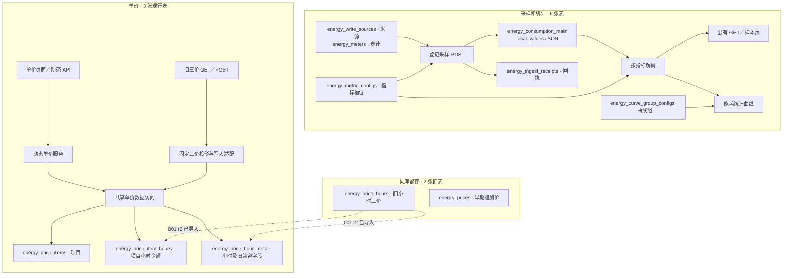
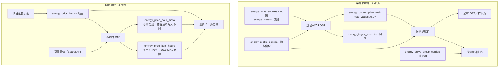

Task ID: ARCH-ENERGY-006
Revision: r1
Status: draft
Owner Role: PM
Allowed Writers: PM, Human Owner
Handoff: r1 草稿提交 Human Owner 审阅，等待精确范围批准
Workflow Mode: STD
Execution Mode: agent_team_same_session
Task Namespace: aiis-ics-arch
Classification: root
Capability: 旧三价退役与动态单价重建
Owner: Core 能耗管理
Acceptance Chain Reference: 精确范围批准 → Development handoff → fresh-context Verification → Human Owner 最终验收
Related Task: ARCH-ENERGY-001、ARCH-ENERGY-002、ARCH-ENERGY-003、ARCH-OBS-010

# 能耗旧三价退役与动态单价重建 · r1

## 1. 决定和目标

2026-11-26，Human Owner 确认本方案并批准按 STD 起草本规格。目标是在动态单价项目和能耗采样继续工作的基础上，退役旧固定三价表、旧三价 HTTP 接口及专用兼容字段。原项目配置继续可用，旧价按明确清单处理，验收用页面和公共采样接口产生的新记录完成。

本次授权为只读核对和 PM 规格起草。本文 `draft` 等待 Human Owner 批准精确 `ARCH-ENERGY-006 r1` 开发范围，之后才由 Development 在批准范围内实施，并交 fresh-context Verification。真实或共享数据库的迁移、删除和服务切换另行针对目标批准。

本任务与 [ARCH-ENERGY-001 r2](../ARCH-ENERGY-001-configurable-hourly-pricing/spec.md) 相互关联。001 r2 在本机采用时通过了[独立复核](../ARCH-ENERGY-001-configurable-hourly-pricing/checklist.md)，Human Owner 最终验收留在原任务链。本规格不会替原任务作验收决定。

## 2. 已核实基线与依据

1. 001 r2 将旧小时三价逐项导入现行价格事实，并建立项目配置和小时元数据。2026-11-25 本机 3307 dev 采用记录是 `7cb6e40f3d19`，当时旧小时表 3 行对应 3 行小时元数据和 9 行项目价格，早期追加表另有 1 行。该记录是历史证据，不能当作执行当天的删除清单。 [001 采用复核](../ARCH-ENERGY-001-configurable-hourly-pricing/checklist.md) · [原导入映射](../../backend/alembic/versions/20261125_1800_7cb6e40f3d19_configurable_energy_pricing.py)
2. 当前单价页面已经使用动态 `/energy/pricing/*` 接口。旧 `/energy` 三路通过项目价格和小时元数据构造固定三价视图。旧路由模块提供时间和日期函数，旧、新路由均会调用。动态路由还继承该模块的 `PriceRoute`，由它处理精确数值请求解析。 [动态 API](../../backend/app/energy/api/energy_pricing.py) · [旧 API 与公共工具](../../backend/app/energy/api/energy_price.py) · [价格查询](../../backend/app/energy/crud/async_energy_price.py)
3. 能耗采样以 `energy_consumption_main.local_values` 保存槽位值，通过表计指标配置解码。实时、过程与计划／实绩都使用动态字段和槽位思路，数据分别由各自领域管理。 [能耗写入](../../backend/app/equipment_observation/services/energy_registered_ingest.py) · [实时／过程写入](../../backend/app/equipment_observation/services/registered_ingest.py) · [计划／实绩字段映射](../../backend/app/task/domain.py)
4. 001 r2 的原兼容合同此前已经批准。Human Owner 于本次确认旧三价无需继续兼容，新的退役范围由本任务单独提出。001 的历史规格及其验收证据继续按原记录保存。 [001 r2 旧合同](../ARCH-ENERGY-001-configurable-hourly-pricing/spec.md)

## 3. 表结构合同

上次核对的能耗相关结构共 11 张表，本任务完成后为 9 张。两张旧表的数据按第 6 节处理。目标字段、类型、主键及现有独立约束如下。 [采样模型](../../backend/app/equipment_observation/models/records.py) · [项目小时模型](../../backend/app/energy/models/energy_pricing.py)

| 目标表 | 主要字段与类型 | 作用 |
| --- | --- | --- |
| `energy_consumption_main` | `id BIGINT UNSIGNED` 主键，`meter_id`、`group_key VARCHAR(64)`，`observed_at DATETIME(6)`，`quality VARCHAR(16)`，可选 `interval_start_at`、`interval_end_at DATETIME(6)`，`local_values JSON`，`ingest_receipt_id BIGINT UNSIGNED` 引用回执，另有 `remark TEXT`、`review_mark`、创建和更新时间 | 一行存一个表计、采样组和时刻的一次样本 |
| `energy_metric_configs` | `(meter_id, group_key, metric_key)` 主键，`slot_no TINYINT UNSIGNED` 在同表计和组内唯一，另有双语名称、`value_type`、`quantity_key`、`measurement_mode`、单位、精度、启停、显示次序、`rules JSON` 和首次使用时间 | API 指标键与槽位映射，以及数值和统计含义 |
| `energy_curve_group_configs` | `curve_group_key VARCHAR(64)` 主键，另有 `meter_id`、`group_key`、双语标题、排序、启停、`series JSON` | 统计页曲线组的指标和显示配置 |
| `energy_meters` | `meter_id VARCHAR(64)` 主键，另有双语名称、`read_roles JSON` 和创建修改时间 | 表计信息和登录用户读取范围 |
| `energy_write_sources` | `source_key VARCHAR(64)` 主键，`storage_identity VARCHAR(64)` 唯一，另有名称、启用及创建／修改／删除时间 | 公共样本写入来源登记 |
| `energy_ingest_receipts` | `id BIGINT UNSIGNED` 主键，`(target, producer_id, event_id)` 唯一，另有请求摘要、处理结果、时间、合同版本及 `result_detail JSON` 等 | 每包回执与原包重试 |
| `energy_price_items` | `item_key VARCHAR(128)` 主键，另有双语名称、单位、`sort_order BIGINT`、`enabled BOOLEAN` | 动态单价项目，决定卡片、录价字段和历史列 |
| `energy_price_item_hours` | `(item_key VARCHAR(128), hour_start DATETIME(6))` 联合主键，分别关联项目和小时，另有 `price DECIMAL(10,4)`、`remark TEXT`、`observed_at DATETIME(6)`、`operator VARCHAR(50)`、`created_at`、`updated_at DATETIME(6)` | 每项目每小时的真实单价及其记录信息 |
| `energy_price_hour_meta` | `id BIGINT` 自增主键，`hour_start DATETIME(6)` 唯一，另有 `remark TEXT` 与可空 `updated_at DATETIME(6)` | 历史小时分组、总备注和同小时写入协调 |

旧 `energy_price_hours` 固定列保存电、氢、氩的小时金额，`energy_prices` 是更早的固定三价追加表。二者从目标运行库清退。小时元数据删除仅供旧投影使用的 `has_builtin`、`observed_at`、`operator`、`created_at` 以及依赖旧 `observed_at` 的索引。保留小时 `id`、唯一小时键、总备注与 `updated_at`，保留项目级记录时间、创建时间、实际修改时间、操作者和备注。小时下仍有任一有效价格时，其小时行与总备注继续保留。

已启用的单价项目按现有配置生成卡片、录价字段和历史列，`electric`、`hydrogen`、`argon` 与新增 `industrial_water`、`steam` 等使用同一动态项目机制。现有项目及其启停、名称、单位、排序按实际记录保留。新库可以沿用历史迁移创建的默认项目，新项目由管理员按需配置。金额仍使用 `DECIMAL(10,4)`，新录单项不会更改同小时其他项目。

采样六表的表结构、含义和历史槽位保持现行合同。显示顺序由配置管理，已写入的槽位继续代表原指标。`meter_id` 和 `group_key` 用于能耗域。能耗与实时、过程、计划及实绩各自独立，不引入跨域外键、JOIN 或 `taskNo` 依赖。

## 4. 接口与页面合同

下表路径包含 `/api/v1` 前缀。用户和管理接口继续使用登录 Bearer，保留原权限与返回信封。 [动态单价合同](../../contracts/published/http-api/energy-pricing-v1/README.zh-CN.md) · [登记写入合同](../../contracts/published/http-api/energy-registered-ingest-v1/README.zh-CN.md) · [公有读取合同](../../contracts/published/http-api/energy-public-reads-v1/README.zh-CN.md)

| 用途 | 目标方法和路径 | 认证及行为 |
| --- | --- | --- |
| 单价项目 | `GET/POST /api/v1/energy/pricing/items`、`PATCH /api/v1/energy/pricing/items/{itemKey}` | Bearer。读取需要 `energy-price-read`，维护需要 `energy-price-manage` 和管理员角色 |
| 现价 | `GET /api/v1/energy/pricing/current` | Bearer 和读取权限。每个启用项目返回最近适用值，无价格返回空值 |
| 小时历史 | `GET /api/v1/energy/pricing/hours` | Bearer 和读取权限。沿用 `date`、分页、`columns` 及每小时 `values`，无日期的页面请求最近一条 |
| 写单价 | `POST /api/v1/energy/pricing/hours` | Bearer 和管理权限。`items` 按项目键提交一项或多项，同小时未提交项保留 |
| 公共写样本 | `POST /api/v1/integration/energy/registered-samples` | 不带 Bearer，已启用 `sourceKey` 登记后按表计、组写入，一包可以有一表或多表 |
| 公共读最新 | `GET /api/v1/integration/energy/latest` | 不带 Bearer。可选 `meterId`、`groupKey`，每个匹配的表计和组返回一条最新样本 |
| 公共读历史 | `GET /api/v1/integration/energy/samples` | 不带 Bearer。`meterId`、`from`、`to` 必填，`groupKey` 与分页可选 |
| 配置、样本管理和统计 | `/api/v1/energy/write-sources`、`/api/v1/energy/meters`、`/api/v1/energy/metric-configs`、`/api/v1/energy/curve-configs`、`/api/v1/energy/consumption/*`、`/api/v1/energy/admin/consumption-samples` 的现行方法 | 登录 Bearer 和既有角色、表计范围 |

撤下 `GET /api/v1/energy/current`、`GET /api/v1/energy`、`POST /api/v1/energy` 及其固定三价查询投影和写入适配。移除前核对仓库现有调用并将需要的调用迁至动态接口。仓库外调用情况尚未核实，采用时识别受影响调用方并按本节提供新入口。`POST /api/v1/integration/energy/samples` 是现有机器 Bearer 样本接口，继续沿用原合同。撤掉旧路由后，动态接口仍保留精确 JSON 数字解析、请求错误、权限、日期解析、未来时间判断、上海自然日和小时归属等既有行为。

管理界面沿用现有卡片、弹窗和表格交互。启用项目同时出现卡片、录价字段和历史列，尚无价格显示 `—`，零值显示 `0`。停用项目在页面的卡片、录价字段和历史列隐藏，重新启用后仍可读取保留的价格。历史日期清空时页面显示最近一条实际小时记录，选定日期时显示该日记录。API 的历史 `columns` 仍按现行合同包含启用项目及查询范围内有记录的停用项目，页面按启用状态展示。

公共采样按当前合同追加样本。一个样本的 `values` 只包含本包实际提供的指标，查询最新返回该表计和采样组的最新样本，不跨多个采集时刻拼接未传指标。单价同小时未提交项目保留的行为由动态价格事务提供，两个合同分别验收。

## 5. 实施前后原理图

图中箭头表示数据流或解释关系，虚线表示历史迁移。能耗与过程／实时是独立数据域。

### 实施前

### 实施后

## 6. 旧数据识别、清理和迁移

通用结构后继与某个实际库的旧价清理分开制定。通用 Alembic 后继清退两个旧表和第 3 节的兼容列，原样保留 `energy_price_item_hours` 和 `energy_price_items` 中的所有行，不删除或覆盖这两表的记录。旧迁移文件保持原样。空库从根迁移到新后继，以及含旧数据的隔离库升级均须可执行。真实目标的数据清理仅在本机 `3307` dev 按独立批准的清单操作，不通过通用后继清空其他环境的价格。

本机 3307 dev 旧价拟按以下顺序处理。实际执行由 Human Owner 针对目标与清单另行批准，规格或 Development 批准本身不执行真实库操作。

1. 在 `energy_price_hours` 和新表都仍可读取时，核对目标和版本，按 001 r2 迁移映射生成候选清单。旧 `hour_start`、`observed_at`、`created_at`、`updated_at` 按原迁移规则转换为固定 `+08:00` 存储值，旧每小时的电、氢、氩三项分别映射相应项目键。来源时区不明确或来源结构不符合已验收迁移时停止对应识别。
2. 用 `(item_key, hour_start)` 定位候选，并对金额、逐项备注、操作者、记录时间、创建和修改时间逐字段比对来源转换值与 001 r2 采用证据。仅把证据能证明为当次迁入且未发生后续修改的行列入待清理清单。`has_builtin`、项目键、小时或单纯数值相等均不足以证明来源。新增项目、新小时、后来修改的项目，以及证据不足或有歧义的行保留。
3. 清单列明目标库身份、生成时间、来源与候选复合键、预计删除数量、保留及歧义原因，并供采用授权核对。清理前在受控单价停写窗口重新比对清单对应行和小时下全部项目。只删除确认的候选行。某小时所有价格均已删除且无其他项目时，才删除本次受影响的空小时行。如果还有任一价格或需保留的有效记录，则保留小时行及其总备注。
4. 完成获批清理并对账后，再运行结构后继移除旧表。清理和 DDL 中断时保持现行有效数据的可恢复状态，核对数据库版本、保留行、小时归属和实际表结构后再决定恢复或续行。MySQL DDL 可能单独提交，不能通过手工修改版本号冒充完成。旧价无需作为业务长期归档，也无需恢复旧三价协议。

`energy_prices` 的早期记录保留在旧表中直到结构清退，原 001 r2 未将其静默混入当前价格。以新页面和现行 `energy_price_item_hours` 为价格来源。实际清理后通过项目配置与录价创建新的示例，不把合成值写入项目种子或迁移。

## 7. 未来 Development 允许触达的范围

以下是待 Human Owner 精确批准 r1 后的实现范围。实际修改限于完成本任务必需的行和文件，保留并行工作。

- `backend/app/energy/` 的 API 聚合、旧三价路由及其兼容服务／投影、动态 API 复用的时间与请求工具、小时元数据模型和价格事务。现有动态项目、值、权限、日志和 API 合同继续覆盖。
- `backend/alembic/versions/` 中本任务的新显式后继，及与旧价识别清理相关的受控维护入口。旧迁移文件不修改。真实库的操作依据第 6 节单独批准。
- `frontend-js/src/app/auxiliary/api/` 中确认无活动业务使用的旧三价封装，以及能耗单价直接受影响的调用。页面保留现有样式和第 4 节的行为。用户可见文案受影响时按既有双语方式维护。
- `backend/tests/`、`backend/tests_mysql/` 与 `frontend-js/tests/module-registry/` 的相关回归。`contracts/published/http-api/energy-pricing-v1/` 及旧三价相关公开说明、`backend/app/energy/README*`、`backend/README*`、`frontend-js/README*`、`docs/` 和 `CODE_INDEX.md` 中直接受影响的内容。任务索引由协调者按事实同步。
- 开发时适用 `backend-arch`、`code-document-indexer`。修改 Vue 页面或 JavaScript 时适用 `frontend-ui`，用户可见文案变更时适用 `i18n-workflow`。测试使用项目声明的 `uv`、`pnpm` 环境。

本任务使用现有登记、采样、公有读取和统计合同，不新增单价免 Token API、不连接实时／过程数据表、不修改 SMA/CA/FF 客户端、不重写旧迁移或重设其他环境的现有价格。必要的范围或验收变化交 PM 修订并重新审批。

## 8. 验收标准

| 项目 | 可复验结果 |
| --- | --- |
| AC01 表结构 | 隔离 MySQL 的空库全链及含前驱数据库升级到本后继。能耗相关表为第 3 节目标 9 张，两旧表和列／旧索引已退役，单价三表的主键、外键、金额类型和小时唯一性正确，采样六表保留。已有旧 Alembic 文件字节未改变。 |
| AC02 精确清理 | 使用完整源、已迁入未改项、迁入后改过的同项目、相同小时新项目、新小时项目及证据不足项的合成数据。仅确认迁入且未改项进入待删除清单并按清单清理，其他项目、记录和备注保持。有剩余价格的小时保留，无剩余价格的受影响小时移除。重复检查与中断恢复不会误删或产生空历史页。 |
| AC03 动态项目和页面 | 创建并启用工业用水，卡片、录入字段和历史列出现，尚无价时显示 `—`。页面录入 3.60 后显示现价及对应历史。停用时三处隐藏，重新启用后价格可见。同小时只提交水价时其他项目保持。真实零、总备注、各项备注及实际记录信息正确。日期清空显示最近一小时。 |
| AC04 新 API 和旧路由退役 | Bearer 的项目、现价、历史和写入按第 4 节工作，无认证和越权按原合同拒绝。请求和响应业务键、Decimal 精度、错误语义、分页、日期、时间边界及并发单项更新保持，三个旧三价路由及 OpenAPI 入口移除。外部调用方的识别结果和切换边界如实记录。 |
| AC05 样本及曲线 | 隔离环境创建来源、表计、累计水量指标及曲线组。用免 Token POST 于 10:00 和 10:05 写 `quality: good` 的 100.0、102.4，原包重试返回原回执。公有最新 GET 返回第二笔，历史 GET 和样本页显示两笔，曲线显示两个对应点。统计边界恰为两笔时刻，配置 `continuityConfirmed=true`、`maxGapSeconds=300` 时，按既有算法返回 2.4 m³。 |
| AC06 既有链路与迁移边界 | 现有机器 Bearer 样本 POST、用户 Bearer 配置和统计、设备实时、过程读取及样本回执保持。未知／停用来源和权限按原合同处理。全库有无关后继后，业务请求不会因 revision 编号变化而拒绝。能耗无跨域外键、JOIN 或任务号依赖。 |
| AC07 验证与交付 | Development 使用隔离合成数据完成聚焦测试、构建和 OpenAPI／文档引用检查，记录命令结果。fresh-context Verification 独立复核精确候选和关键场景。用户可在真实目标另行批准后于 5190 亲自配置水价并录入，用 Swagger 推送样本。交接报告正式源码、验证环境、目标可用性及临时资源。 |

## 9. 风险、恢复与授权边界

三条旧价格路由退役后，仓库外若有调用方需要切到 `/energy/pricing/*`，调用方使用其登录 Bearer 和相应权限。当前无仓库外调用清单，采用时记录实际核对结果。清理过程中识别不明的现行价格继续保留，报告待处理范围。保留的有效数据需要在结构变更前后可核对并可在故障时恢复。旧三价数据无需满足业务历史保留或旧协议回退。

有数据前驱与空库全链均在隔离 MySQL 覆盖。将来真实目标的身份、具体清理清单、迁移、删除和服务切换由 Human Owner 在操作时明确批准。项目既有实时、过程和能耗采样数据不属于旧价删除清单。

## 10. 修订与交接

| 日期 | 决定 |
| --- | --- |
| 2026-11-26（Asia/Shanghai） | Human Owner 确认旧三价退役与动态单价重建方案，批准按 STD 起草独立 r1 规格。本次仅授权只读核对和规格起草。 |

本稿等待 Human Owner 审阅并决定是否批准 `ARCH-ENERGY-006 r1` 按 STD 启动 Development。Development 和独立 Verification 尚未启动。无临时资源。
