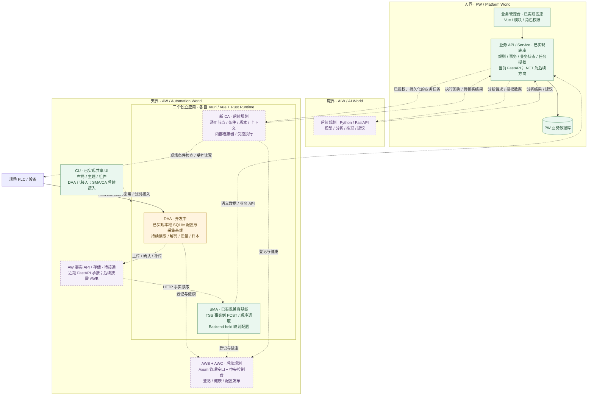
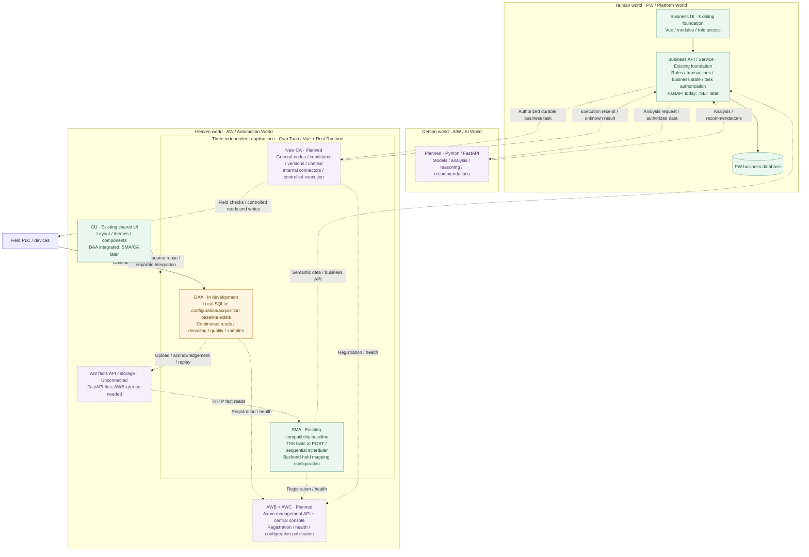

Task ID: ARCH-MULTI-002
Revision: r1
Status: owner_approved
Owner Role: PM
Allowed Writers: PM, Human Owner
Handoff: Human Owner 于 2026-10-21 明确批准精确 ARCH-MULTI-002 r1 成文范围；交命名 Development 按本 spec 同步两份 ROADMAP 并记录自检，随后 fresh-context Verification 与 Owner 最终验收仍待后续
Workflow Mode: STD
Execution Mode: agent_team_same_session
Task Namespace: aiis-ics-arch
Classification: root
Capability: 双语 ROADMAP 三界总图与当前实施状态快照同步
Owner: AIIS ICS Architecture Core
Acceptance Chain Reference: 本 spec §8；PM -> Human Owner 精确 Revision 批准 -> Development -> fresh-context Verification -> Human Owner 最终验收
Related Task: ARCH-MULTI-001, ARCH-AW-007
Created: 2026-10-21
Updated: 2026-10-21

# 最新三界总图与状态快照同步

## 1. 目标、用户请求与现有任务关系

用户已审阅主会话展示的 2026-10-21 三界架构图，随后明确要求：

> 可以，把这个最新的三界架构图同步到 ROADMAP.md 和 ROADMAP.zh-CN.md，标清当前已实现、开发中和后续规划的部分，先只改文档，不改代码。

本任务将这份已确认内容整理为两份 ROADMAP 的同构 Mermaid 总图、状态说明和最小矛盾协调，不改变任何应用的功能或批准状态。用户确认的是已展示内容及两文件文档边界；此前未向用户提出本 Task ID/r1，故当前如实记录 `draft`，不倒填精确 Revision 批准。

ARCH-MULTI-001 r2 记录原三界蓝本；ARCH-AW-007 r2 的三应用方向已经获得独立文档 QA 和 Human Owner 最终验收。本次以独立任务记录新的总图与日期快照，保留原 bundle、历史、哈希和验收，不以旧 QA 覆盖本增量。

## 2. 写入 allowlist 与排除范围

| 路径 | 归属与允许变更 |
| --- | --- |
| 本 `spec.md` | PM：本次精确范围、拟文、批准记录 |
| `ROADMAP.md`、`ROADMAP.zh-CN.md` | Development：§4/§5 的同构新节及 §3 列出的最小文字协调 |
| 同目录 `tasks.md` | Development：批准后创建；真实实施、自检和 handoff |
| 同目录 `checklist.md` | 独立 Verification：developer_handoff 后创建；真实检查、verdict 与 Owner 最终验收记录 |
| 根 `PLAN.md` / `PLAN.zh-CN.md` | 主协调：只增加/更新 ARCH-MULTI-002 唯一任务行 |
| 根 `plans/README.md` / `plans/README.zh-CN.md` | 主协调：只增加/更新本唯一 bundle 行；只链接已经形成的角色文件 |

不修改其他任务的 spec/tasks/checklist、应用 README/PLAN、docs 设计正文、AGENTS、CODE_INDEX、运行源码、测试、配置、真实 env、依赖/锁文件或 schema。不创建应用目录，不执行构建/启动、服务监听、API、数据库、PLC、Docker、安装、commit/push、发布或部署。并行 DAA/DS/FF 及已有 ROADMAP dirty 必须保留。

## 3. 插入位置与最小文字协调

将 §4/§5 拟文分别插入两份 ROADMAP 的现有 §2 结尾、§3 之前。现有 §4 的 AW 专项图继续保留；新增总图的图例只适用于新增总图。

正文其余部分只允许以下协调：

1. §1 当前基线：把原 CA 的 raw/latest 直库/Projection 链明确为“冻结 CAF 兼容源码路径”，并注明新 DAA 的本地 SQLite 基线另见新增快照。保留旧兼容路径，不暗示已经切换生产。
2. §1 工程初始化段末尾：用以下配对句替换“共享 UI 集成仍是目标”的笼统表述；其余来源/任务归属保持：
   - EN: `CU shared UI source has been delivered and DAA has adopted its layout; SMA/CA integration remains separately scoped. New AW APIs, DAA upload/acknowledgement/replay and the end-to-end business chain remain targets; the status snapshot below distinguishes existing code from those goals.`
   - 中文：`CU 共享 UI 源码已交付，DAA 已接入其布局；SMA/CA 接入仍由各自任务处理。新 AW API、DAA 上传/确认/补传及业务闭环仍是目标，下方状态快照区分已有源码与这些目标。`
3. §2 AW 行的配置/过渡栏替换为以下配对文本，保持其职责列：
   - EN: `Rust; reuse CAF/TSS material. DAA owns local SQLite configuration; SMA currently uses Backend-held TSS mapping configuration. Existing FastAPI is the near-term host for AW API contracts; the new upload/durable-intent chains and AWB/Axum remain future work.`
   - 中文：`使用 Rust，复用 CAF/TSS 素材。DAA 使用本地 SQLite 配置，SMA 当前使用 Backend-held TSS 映射配置；现有 FastAPI 暂承 AW API 合同，新上传/持久意图链与 AWB/Axum 仍按后续任务推进。`
4. §3 的 `Current source path` / `当前源码链路` 标题分别改为 `Frozen CAF compatibility source path` / `冻结 CAF 兼容源码链路`；紧随来源锚点段补充：
   - EN: `The current DAA application instead uses local SQLite configuration and acquisition storage; its new upload chain is not connected. See the dated snapshot in §2.2. This documentation update does not switch or retire a field runtime.`
   - 中文：`当前 DAA 应用采用本地 SQLite 配置与采集存储，新上传链尚未接通，见 §2.2 日期快照。本次文档更新不切换或退役现场运行程序。`
5. §1 文档职责表可新增本 spec 的配对链接行，说明“最新总图与状态快照的文档同步范围”；不修改原任务状态或历史。

不统一重排既有章节，不重写 §4–§9；任何超出以上清单的实质改动先返回 PM 修订。

## 4. ROADMAP.zh-CN.md 确切新增拟文

````markdown
### 2.1 三界架构总图

**状态快照日期：2026-10-21。** PW 负责业务规则与授权，AIW 提供分析与建议，AW 负责采集、映射与现场执行。总图按职责组织，不强制目录、仓库或部署拆分。

本图实线表示已有源码中的职责关系，虚线表示规划、尚未接通或需要各应用分别接入的关系；均不代表真实现场链路已验收。绿色为已有源码基线，橙色为整体仍在开发/验证中的应用，紫色虚框为后续规划。具体范围和验收以 §2.2 来源任务为准。



### 2.2 当前已实现、开发中与后续规划

“已实现”仅说明对应源码或有限基线已存在，不自动表示整阶段验收、现场验证或部署完成。状态会随所属任务变化，本表保留上述日期的快照。

| 部分 | 状态 | 当前边界与后续门槛 | 来源 |
| --- | --- | --- | --- |
| PW | 已实现底座；技术栈迁移为后续规划 | 当前 FastAPI + Vue 继续承载业务；.NET/FastEndpoints 后续单独迁移 | [根 README](README.zh-CN.md)、[当前 PLAN](PLAN.zh-CN.md) |
| DAA | 已实现本地基线；整体开发/验证中 | 本地 SQLite 配置、采集、历史和导入已有实现；阶段 B 整体未关闭，DAA–DS S7→SQLite 联调另批；上传/确认/补传尚未接通 | [DAA README](automation-world/data-acquisition-agent/README.zh-CN.md)、[DAA PLAN](automation-world/data-acquisition-agent/PLAN.zh-CN.md) |
| SMA | 已实现 TSS 兼容基线；专用工作台演进为后续规划 | 当前 Backend-held 映射配置、HTTP 事实→POST、逐项调度；任意 HTTP 源、逐行常驻、本地 SQLite/可靠 outbox 等另立范围 | [SMA README](automation-world/semantic-mapping-agent/README.zh-CN.md)、[三应用路线](plans/ARCH-AW-007-general-agent-fleet-roadmap/spec.md#r2-design) |
| CU | 已实现共享源码与工作台 | DAA 已接入布局；SMA/新 CA 接入分别推进。构建后各应用运行自身产物，无需 CU 在线 | [CU PLAN](automation-world/console-ui/PLAN.zh-CN.md)、[DAA PLAN](automation-world/data-acquisition-agent/PLAN.zh-CN.md) |
| DS | 开发中：产品 MVP 收敛与独立核验 | 尚未最终验收；DAA–DS 完整应用 S7→SQLite 联调独立批准，不以 DS 局部证据关闭 DAA 阶段 B | [DS 实施任务](plans/ARCH-AW-005-ds-g0-prototype-validation/spec.md)、[当前 PLAN](PLAN.zh-CN.md) |
| Field Flow | 后续规划；当前只有文档 | Rust/Python 两个独立现场流程程序尚无运行源码，未来可作为 CA 流程迁移来源 | [FF README](field-flow/README.zh-CN.md) |
| 新 CA | 后续规划；设计方向已明确 | 通用节点、版本、上下文、内部连接器及受控执行待实施；各连接器按支持矩阵验收 | [CA 流程设计](plans/ARCH-AW-006-unified-flow-agent-design/spec.md#r2-design) |
| AW 事实上传链 | 后续规划 / 待接通 | 新 DAA 上传、接收确认、幂等补传及事实到业务闭环按各自 API/运行合同实施 | [DAA README](automation-world/data-acquisition-agent/README.zh-CN.md)、[三应用路线](plans/ARCH-AW-007-general-agent-fleet-roadmap/spec.md#r2-design) |
| AWB / AWC | 后续规划 | 先登记/心跳与只读健康，再配置发布及远程操作；心跳不代表业务完成或设备写租约 | [三应用路线](plans/ARCH-AW-007-general-agent-fleet-roadmap/spec.md#r2-design) |
| AIW | 后续规划 | Python/FastAPI 分析与建议；由 PW 校验、授权采用，不直接获得设备动作权 | 本节三界职责与[协作背景](docs/AIIS_Three_Worlds_Background_Notes_v0.1.md#bg-01) |
| CAF / 旧 CA | 已有冻结兼容基线 | `automation-world/control-agent/` 保留原 raw/latest 与 Projection 参考；与新通用 CA 分开，不据本文切换现场链路 | [CAF README](automation-world/control-agent/README.zh-CN.md) |

两条目标主链路为：

- 数据上行：`PLC → DAA → AW 事实 API → SMA → PW 业务 API → 业务库 / 界面`。
- 业务动作下行：`人员或 AIW 建议 → PW 校验授权 → CA 检查现场条件 → 设备执行 → 回执`。

普通点值交换仍可按 §3/§5 的资源与副作用合同由 CA 直接组合已支持连接器。`aw_` 仅标记 AW 所属后端表，具体 schema、独立存储、HA/SA 与归档按 §7/§8 推进；不将示例表名写成已落库事实。
````

## 5. ROADMAP.md 确切新增拟文

````markdown
### 2.1 Three-world architecture overview

**Status snapshot: 2026-10-21.** PW owns business rules and authorization, AIW provides analysis and recommendations, and AW owns acquisition, mapping and field execution. The overview organizes responsibilities without requiring directory, repository or deployment separation.

Solid lines in this overview describe responsibilities already represented in source; dotted lines represent planned, unconnected or separately integrated relationships. Neither establishes accepted live-field operation. Green marks existing source baselines, amber an application whose overall development/verification remains open, and dashed purple future work. The source tasks in §2.2 own exact scope and acceptance.



### 2.2 Implemented, in development and planned

“Implemented” means the corresponding source or bounded baseline exists; it does not establish whole-stage acceptance, field verification or deployment. The owning tasks may advance after this dated snapshot.

| Area | Status | Current boundary and next gate | Source |
| --- | --- | --- | --- |
| PW | Existing foundation; stack migration planned | FastAPI + Vue continue to own business capabilities; .NET/FastEndpoints migration is separate future work | [Root README](README.md), [current PLAN](PLAN.md) |
| DAA | Local baseline exists; overall development/verification open | SQLite configuration, acquisition, history and imports exist; overall Stage B remains open, DAA–DS S7-to-SQLite validation requires separate approval, and upload/acknowledgement/replay are unconnected | [DAA README](automation-world/data-acquisition-agent/README.md), [DAA PLAN](automation-world/data-acquisition-agent/PLAN.md) |
| SMA | Existing TSS compatibility baseline; focused-workbench evolution planned | Backend-held mapping configuration, HTTP facts-to-POST and sequential scheduling today; arbitrary HTTP sources, per-row continuous runs, local SQLite/reliable outbox and similar extensions need separate scope | [SMA README](automation-world/semantic-mapping-agent/README.md), [three-application roadmap](plans/ARCH-AW-007-general-agent-fleet-roadmap/spec.md#r2-design) |
| CU | Shared source and workbench implemented | DAA adopted its layout; SMA/new CA integrate separately. Built applications run their own artifacts without an online CU process | [CU PLAN](automation-world/console-ui/PLAN.md), [DAA PLAN](automation-world/data-acquisition-agent/PLAN.md) |
| DS | In development: product MVP refinement and independent verification | Final acceptance pending; full DAA–DS application S7-to-SQLite validation requires separate approval, and partial DS evidence does not close overall DAA Stage B | [DS implementation task](plans/ARCH-AW-005-ds-g0-prototype-validation/spec.md), [current PLAN](PLAN.md) |
| Field Flow | Planned; documentation only today | Two independent Rust/Python field-flow programs have no runtime source yet; their future flows can provide input for CA migration | [FF README](field-flow/README.md) |
| New CA | Planned; design direction defined | General nodes, versions, context, internal connectors and controlled execution await implementation; connectors require explicit support matrices | [CA flow design](plans/ARCH-AW-006-unified-flow-agent-design/spec.md#r2-design) |
| AW fact-upload chain | Planned / unconnected | New DAA upload, receipt acknowledgement, idempotent replay and facts-to-business integration follow their API/runtime contracts | [DAA README](automation-world/data-acquisition-agent/README.md), [three-application roadmap](plans/ARCH-AW-007-general-agent-fleet-roadmap/spec.md#r2-design) |
| AWB / AWC | Planned | Registration/heartbeat and read-only health first, then configuration publication and remote operations; heartbeat is neither business completion nor a device-write lease | [Three-application roadmap](plans/ARCH-AW-007-general-agent-fleet-roadmap/spec.md#r2-design) |
| AIW | Planned | Python/FastAPI analysis and recommendations are adopted through PW validation/authorization; no direct field-action authority | This section and [collaboration background](docs/AIIS_Three_Worlds_Background_Notes_v0.1.md#bg-01) |
| CAF / old CA | Existing frozen compatibility baseline | `automation-world/control-agent/` retains raw/latest and Projection reference behavior, distinct from new general CA; this document does not switch the field chain | [CAF README](automation-world/control-agent/README.md) |

The two main target paths are:

- Data upward: `PLC → DAA → AW facts API → SMA → PW business API → business database / UI`.
- Business actions downward: `Human or AIW recommendation → PW validation/authorization → CA field checks → device execution → receipt`.

Ordinary point-value exchange can still compose supported CA connectors directly under the resource and side-effect contracts in §3/§5. `aw_` marks AW-owned backend tables only; exact schemas, independent storage, HA/SA and archiving follow §7/§8. Example table names do not assert that those tables already exist.
````

## 6. 验收标准与检查

| 编号 | 验收条件 |
| --- | --- |
| AC01 | 两 ROADMAP 含 §4/§5 的对应总图、日期、图例、状态表；节点 ID、边、class 与表格行对应，保留 pair 互链和既有正文 |
| AC02 | PW 当前 FastAPI/Vue、未来 .NET/FastEndpoints；AW Rust；AIW Python/FastAPI 规划和建议/授权边界准确 |
| AC03 | DAA/SMA/CA 三独立应用、各自 runtime/UI、CU 与 AWC 区分；未把新 CA 与冻结 CAF 混淆 |
| AC04 | DAA SQLite 本地能力与上传未接分开；整体 B、DS 联调、C 阶段未被写成已完成 |
| AC05 | SMA 保留 Backend-held TSS/顺序调度事实；专用工作台、任意源、本地存储/outbox 规划不冒充交付 |
| AC06 | CU 已有源码/DAA 布局接入与其他 App 未来接入分开；DS 开发/独立核验/终验待定、FF 仅文档、AWB/AWC/AIW 规划准确 |
| AC07 | `aw_` 归属、业务 API owner、普通连接器点值交换与受控业务任务边界、无现场切换等措辞与现有路线一致 |
| AC08 | §3 协调仅修直接矛盾；无无关正文/任务历史写入；根四索引只触达本任务行；外部 dirty 保留 |
| AC09 | 新/变更相对链接、锚点、围栏、Mermaid 语法/拓扑、双语语义与 diff 空白检查通过，记录真实命令和限制 |
| AC10 | Development handoff 与 fresh-context Verification 分层；未冒充构建、运行、现场、部署、原任务终验或本任务 Owner 最终验收 |

验证只需文档检查：双语人工核对、Mermaid 静态解析/可用已有渲染器检查、链接/锚点与范围审计、`git diff --check -- ROADMAP.md ROADMAP.zh-CN.md`。不为本文安装依赖，不运行应用测试/构建或连接外部目标。若无可用离线 Mermaid 解析/渲染器，记录实际静态检查方法及未渲染限制，不宣称已验证视觉效果。

## 7. 风险、来源与角色交接

- 状态漂移：DS 有并行推进；快照保留日期，链接来源任务，不复制具体单测失败或临时进程状态。新 verdict 形成前不将“独立核验中”升级为已验收。
- 已实现与已验收混淆：表明局部基线存在，Owner 终验与阶段整体 gate 仍由所属 bundle 决定。
- 图例误读：实线仅表示源码职责；CU 编译引用为分别接入的关系；不把虚线解释成当前连通证明。
- 并行改动：Development 写前固定两 ROADMAP 接手字节，补丁只处理本增量；不以 HEAD 全 diff 替代本任务差异，不 reset。
- 回退只撤销本任务明确增量，保留其他任务修改和原有批准/验收历史；不据文档回退触发外部操作。

PM/Development/Verification 使用 `aiis` 与 `project-governance`，只处理文档表面。源状态来自根 PLAN、各应用 README/PLAN 和关联任务；这些来源文件均只读。没有新增能力合同、技术选型或软件实施范围，不触发后端/Rust/Tauri/UI 实施。

批准后，Development 创建 tasks 并按本 spec 编辑两正文、自检与交接；主协调做本任务四索引的机械同步；fresh-context 命名 Verification 独立核验并创建 checklist；最终交 Owner 审阅。任务文档不是软件实施授权。

## 8. 批准与 Revision 历史

- 2026-10-21 r1 draft：用户先确认主会话展示的总图与两 ROADMAP 文档同步边界；PM 将确切双语拟文、最小协调、allowlist 和 AC01–AC10 写入本文件。
- 2026-10-21 精确 r1 范围批准：主协调者在本会话通过 async 问题展示成文 r1 后，Human Owner 明确回复：『批准 ARCH-MULTI-002 r1，继续同步』。批准对象为交审草案 SHA-256 `c6c5eca766eb7a8c521a2266f253af08fa45aaa3f8f8e95222a7f50eabbe6253`。PM 仅据该真实回复更新状态和 handoff，确切拟文、allowlist、AC 与约束均保留原字节。
- §1 的 draft 说明保留为起草时点记录；当前 gate 以本次精确批准及顶部 `owner_approved` 为准。此批准准入命名 Development 的文档实施，不等于独立 QA、Human Owner 最终验收或软件/外部操作授权。PM 未创建 tasks/checklist 或修改 ROADMAP。
