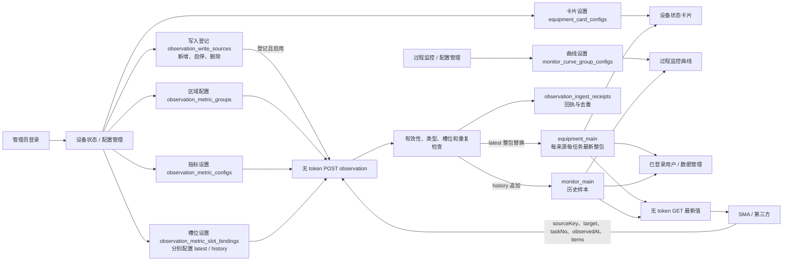

Task ID: ARCH-OBS-005
Revision: r1
Status: owner_approved
Owner Role: PM
Allowed Writers: PM, Human Owner
Handoff: Human Owner 已批准精确 r1 实施与隔离验证；交 Development，dev 迁移及服务切换另行确认
Workflow Mode: STD
Execution Mode: agent_team_same_session
Task Namespace: aiis-ics-arch
Classification: root
Capability: 设备状态及过程监控的登记来源接入与最新值读取
Owner: Core 设备状态与过程监控
Acceptance Chain Reference: 本规格范围批准 → Development handoff → fresh-context Verification → Human Owner 最终验收；dev 切换另行确认
Related Task: ARCH-OBS-001、ARCH-OBS-002、ARCH-OBS-003、ARCH-OBS-004、ARCH-ACQ-006

# 设备状态与过程监控：写入登记 r1

## 1. 目标、现状与边界

本任务以现有源码和配置管理页面为基础，增加一张来源登记表、一个「写入登记」页签、一对第三方读写接口，以及让既有卡片、曲线和数据管理能读到新来源的必要适配。登记一次 `sourceKey` 后，SMA 或第三方将它放在 POST 正文中；不需要为每个来源再配置设备、产线、生产者 token、区域授权或指标权限。`sourceKey` 是**稳定来源标识，不是每条数据的事件号，也不是密码**。

当前工作树已有 `equipment_main` 实时整包、`monitor_main` 历史、共用指标配置及 `observation_ingest_receipts`；旧机器写入使用私有 profile、Bearer、设备及范围授权，旧用户查询也按 profile 的设备范围过滤。当前两页选项直接来自 profile，直接加表并不能让新来源出现在页面。还必须调整写入服务、选项和读取投影、已有目标保护与必要的 Alembic revision 判断；本任务**不是只加一张表和一张页面**。已验证的旧合同及旧记录必须保持。ARCH-OBS-003、004 的任务状态以其各自记录为准，本规格不改写这些事实。

`sourceKey` 可被他人复制，因此登记只解决“这个名字是否在列表中”和来源归属，**不能证明真实身份、防止冒充或作为网络安全保护**。新增无 token 接口仅适合部署方已控制访问的内网；开放网络访问不属于本任务的验收结论。前端管理仍要求登录并经现有 admin 校验。旧机器接口及其鉴权、范围与能耗链继续保留，不把新接口的简单规则套到旧接口上。

当前后端有默认关闭的 observation 全局启用配置、仓库外私有 profile 以及数据库目标 guard；本任务保留它们对 MySQL 目标身份、schema、revision、数据库时间等的校验。**全局目标配置仍是运行前提**，不是为每个来源再写 JSON；在有效全局目标配置下，`devices` 和 `producers` 为空时，新登记来源也必须能完整运行。不得把它描述成已经消除所有运行环境配置。

不包含能耗、采集数据、计划／实绩或 SMA 源码改造，不做同步推送、不接真实 PLC、不修改旧迁移；不清理或覆盖既有业务数据、回执和配置。隔离验证完成后报告结果，dev 或其他真实数据库的迁移、服务切换及演示继续均需 Human Owner 另行确认。

## 2. 调整后的完整流程



1. 配好 `heatZone1` 区域、`zone1Actual`／`zone1Set` 指标，以及这两个指标分别在 `latest` 和 `history` 下的启用槽位。两个目标的槽位彼此独立；卡片和曲线也分别需要配置。槽位是后台储存位置，外部请求使用稳定的区域键和指标键，不发送槽位号。
2. 管理员新增来源，例如 `sma-demo-1`。该名称代表哪个发送系统由用户管理；它既不是一条采样事件，也不是新的“产线”实体。一个来源可以按现有配置发送多个区域；本任务不建立来源到区域的授权清单。
3. 第三方发送 `target=latest` 写实时，发送 `target=history` 写过程；两次发送是两个独立目标、两份各自的回执，一次 POST 不自动同时写入两张业务表。服务端将指标映射到相应槽位并与回执同一事务提交。
4. 实时是**一个来源＋一个任务的完整快照替换**。提交 `heatZone1` 后，下一包只提交 `otherZone` 是允许的，但 `heatZone1` 不会从旧包补回，卡片显示缺测。想同时显示两个温区，发送方应在每个实时包中一起发送当前两个温区。历史则按每包追加，允许单区域或多区域；历史图按已发送的真实样本显示缺测和断点。
5. 设备状态页面通过现有卡片配置读取实时，过程页面通过现有曲线配置读取历史。新增第三方 GET 仅按来源和目标取当前最新一条已有记录，并不向第三方推送、补齐缺失字段或替代历史序列接口。

## 3. 页面与交互

- 位置：**设备状态 → 配置管理**，在现有「区域配置 / 指标设置 / 槽位设置 / 卡片设置」之后增加「写入登记」。延续当前上方类别选择、下方对应设置的双卡片、主题、双语、桌面和窄屏布局，不新建与项目无关的独立页面。
- 下卡标题「写入登记」，右上为「新增」「重置列宽」；提供按来源标识或名称的关键词查询与重置。表格列为来源标识 `sourceKey`、名称、启用状态、操作；支持编辑、启用／停用和删除。新增表单只需来源标识、可选名称、启用状态；编辑不能更改标识。禁用与删除应有清楚提示，删除前确认会停止该来源写入，已有数据不会删除且标识不再重新分配。
- 删除采用逻辑删除，普通登记列表隐藏已删除项；不同名来源可继续新增。**已删除的同一 `sourceKey` 不可重新创建或分配给另一个来源**，避免历史和回执误归属；若将来需要恢复，另定需求。停用可重新启用。登记标识区分大小写；只能使用 1–64 个 ASCII 字母、数字、下划线、点或连字符，名称可为空或 1–128 字符，不做自动大小写变换。
- 设备状态和过程监控的来源选择、任务选择、卡片、曲线和数据管理须能使用新登记来源。新来源在现有 `equipmentId` 调用兼容层内部映射，界面显示来源名称及 `sourceKey`，不显示内部虚拟标识。启用和停用的未删除来源均可查看已有数据；删除后一般页面不再提供选择，但管理员在数据管理中可辨认并查询其已删除来源的旧记录，删除不能级联删除任何数据或回执。
- 权限明确：沿用设备／过程页面原登录和页面读权限；通过对应页面读权限的用户可查看**所有未删除的新登记来源**，不另外配置每源或每指标授权。已删除来源的保留记录仅管理员在数据管理中可查。旧 profile 设备继续只按其原 `readScopes` 范围可见；不得因此扩大旧设备范围。新公开 GET 对已停用来源可读取已有数据，对已删除来源返回 404；这与写入是否开放分别判断。
- 表格采用现有公共列宽工具：普通列可拖拽，最小宽度、横向滚动、本机持久化、当前表独立重置与现有页面一致。区分加载、空表、无匹配和失败；切换、筛选、保存请求乱序时不能显示或操作错误行。新增中文与英文文案对称。

## 4. 数据表

只新增 `observation_write_sources`，不新增设备、产线、事件或第二套指标配置表。下表为明确的目标结构；数据库字段 snake_case，外部 JSON 使用 camelCase。

| 列 | MySQL 类型和约束 | 含义 |
| --- | --- | --- |
| `source_key` | `VARCHAR(64) CHARACTER SET utf8mb4 COLLATE utf8mb4_bin NOT NULL`，主键 | 用户登记的不可修改标识，大小写敏感；逻辑删除后仍占用。 |
| `storage_identity` | `VARCHAR(64) CHARACTER SET utf8mb4 COLLATE utf8mb4_bin NOT NULL`，唯一索引 | 后端内部稳定映射，不作为用户输入；连接旧记录结构，不能与旧设备／生产者身份混用。 |
| `name` | `VARCHAR(128) NULL` | 可选展示名称；缺失时显示来源标识。 |
| `enabled` | `BOOLEAN NOT NULL` | 是否允许此来源继续写入；默认启用。 |
| `created_at`, `updated_at` | `DATETIME(6) NOT NULL` | 登记和最后修改的真实上海时间。 |
| `deleted_at` | `DATETIME(6) NULL` | 逻辑删除的真实上海时间；空为未删除。 |

不新增外键指向来源表，也不修改以下现有表的结构。新来源复用既有行与回执的字段，因此不能删除旧数据或改变旧字段的意思：

| 表 | 关键结构和职责 |
| --- | --- |
| `observation_metric_groups` | `group_key` 主键，类别、中英文名称、`enabled`、排序；如 `heatZone1`。 |
| `observation_metric_configs` | `metric_key` 主键、`source_group_key`、类别、名称、`value_type`、单位和小数位；如 `zone1Actual`。 |
| `observation_metric_slot_bindings` | `(target, group_key, slot_no)` 主键，同一目标＋组＋指标唯一，含 `metric_key`、`enabled`、列表配置和首次使用时间。两目标分别配置。 |
| `equipment_card_configs` | `card_key`、页面、标题、排序、启用状态与 JSON `items`，决定实时卡片展示什么。 |
| `monitor_curve_group_configs` | `curve_group_key`、类别、标题、排序、启用状态与 JSON `series`，决定过程曲线展示什么。 |
| `equipment_main` | 行 ID、`equipment_id`、`task_no`、`observed_at`、`quality`、`local_values`、`ingest_receipt_id` 等；`(equipment_id, task_no)` 唯一，保存最新整包。 |
| `monitor_main` | 与实时行类似，另有历史复核标记；每个被接受的历史样本追加一行。 |
| `observation_ingest_receipts` | 行 ID、`target`、`producer_id`、`event_id`、请求摘要、结果、结果记录 ID 等；`(target, producer_id, event_id)` 唯一，保存原始写入回执和重试结果。 |

现有 `local_values` 使用区域键＋槽位号存储；读取时根据对应目标的槽位反查指标键。回执 ID、旧行主键、旧引用、旧内容及旧重试行为原样保留。`energy_metric_configs`、`energy_consumption_main` 和 `energy_ingest_receipts` 仍属于能耗，完全不依赖本登记表；采集来源登记也仍是独立机制。

### 4.1 内部身份及碰撞保护

新来源仍需与现有 `equipment_id`／`producer_id` 长度 64 的列衔接。内部身份固定为 ASCII `obsreg_` 加 `sourceKey` UTF-8 的 SHA-256 十六进制小写前 57 位，共 64 字符；`storage_identity` 唯一，标识不可变，不能从用户输入取得。样本 `equipment_id` 和新路径回执 `producer_id` 均使用该映射；外部 POST、GET 和人类页面使用 `sourceKey`。

登记必须在同一受控流程中检查内部身份是否与既有 profile 的设备／生产者或已有 `equipment_main`、`monitor_main`、`observation_ingest_receipts` 中的旧身份相同；与其他登记映射冲突也拒绝并返回 409，不能静默合并、覆盖或改名。新路径的回执版本与内部身份要能区分旧记录；之后加载／更改旧 profile 时如引入与已登记映射相同的身份，应明确拒绝该冲突，不能让旧新数据串用。用户标识仅作身份映射，不是设备和产线配置。哈希极小概率碰撞仍由唯一约束及上述检查显式拒绝，不能假定绝不发生。

## 5. 接口合同

以下路径均包含 `/api/v1`。新增接口的示例是 r1 **拟议合同**，不是声称现已实现。沿用项目标准成功信封 `{"code":200,"message":"success","data":...}`。管理接口需现有用户 JWT 及 admin；新增第三方 POST/GET 不依赖 Bearer，也不接受请求体内其他字段当作授权。新旧接口并存，旧 `/integration/equipment/latest-snapshots`、`/integration/monitor/history-samples`、`/integration/metric-definitions` 的路径、Bearer、范围、请求、响应和去重行为不变。

### 5.1 登记管理：仅前端／管理员使用

| 方法和路径 | 行为 |
| --- | --- |
| `GET /api/v1/equipment/write-sources` | 返回未删除来源数组，含 `sourceKey`、`name`、`enabled`、`createdAt`、`updatedAt`；供页面检索展示。 |
| `POST /api/v1/equipment/write-sources` | 新增 `{"sourceKey":"sma-demo-1","name":"演示来源","enabled":true}`；`name` 可省略／null，`enabled` 可省略并默认为 true。 |
| `PATCH /api/v1/equipment/write-sources/{sourceKey}` | 仅更新 `name` 或 `enabled`；不能更改 `sourceKey`，被删除或不存在返回 404。 |
| `DELETE /api/v1/equipment/write-sources/{sourceKey}` | 逻辑删除并停止写入；返回 `data: {"sourceKey":"sma-demo-1","deleted":true}`；不存在或已删除返回 404。 |

POST/PATCH 成功返回该登记行；重复标识、已删除标识重建或内部身份冲突返回 409。参数无效返回 422；未登录或权限不足沿用现有 401/403；目标 guard 不就绪返回 503。管理操作和并发写入必须使用同一来源行的事务锁：停用／删除提交以后开始的 POST 不能写入；先获得锁并提交的 POST 可以成功，不能出现登记已删除但另有后完成的新业务行。只锁本来源，不引入权限矩阵或其他新业务对象。

### 5.2 第三方 POST：写一条实时或历史样本

`POST /api/v1/integration/observations`，`Content-Type: application/json`，最多 65,536 字节。无需 token；须且仅须下列五个顶层字段：

```json
{
  "sourceKey": "sma-demo-1",
  "target": "history",
  "taskNo": "DEMO-0001",
  "observedAt": "2026-11-20T14:30:00+08:00",
  "items": {
    "heatZone1": {
      "zone1Actual": 123,
      "zone1Set": 120
    }
  }
}
```

`target` 仅 `latest` 或 `history`；`taskNo` 继续沿用现有规则：ASCII 字符串，去首尾空格后转大写，1–50 位且只含字母、数字、`_`、`.`、`-`。`observedAt` 是发送方提供的实际事件时间，须带时区且最多无损到微秒，后端换成上海时间，不以收到时间冒充。`items` 的外层是已启用的区域，内层是属于该区域的已配置指标；每个指标必须有当前目标的已启用槽位，类型必须匹配。为避免误发空包清空实时快照，至少提供一个指标；可只提供一部分已配置指标。未知／停用区域、未知指标、目标槽位未配置或停用、错误类型均整包拒绝，回执和业务行均不生成。合法 `0`、`false`、空字符串须保留，`null` 不是有效指标值；数值必须可无损保存。

原历史机器 v2 要求发送 `quality=good`；本新接口不要求、也不接收发送方 quality。新路径的实时和历史都以 `quality="unknown"` 保存，含义是**发送方没有提供质量，不是测量结果质量良好或不好**。新历史可以进入曲线并保留 unknown；曲线按指标是否存在显示样本，不能因为 unknown 就伪造成缺测或过滤掉，数据详情与第三方 GET 返回 unknown。旧 v2 历史仍要求 good；不得伪造 `good` 或改变旧接口规则。无 `eventId`、`equipmentId`、`line`、设备 profile 或新增 token 字段。

首次成功示例（ID 为示意字符串；重试返回同一个原结果，不是新 ID）：

```json
{
  "code": 200,
  "message": "success",
  "data": {
    "sourceKey": "sma-demo-1",
    "target": "history",
    "taskNo": "DEMO-0001",
    "observedAt": "2026-11-20T14:30:00.000000+08:00",
    "outcome": "stored",
    "receiptId": "42",
    "recordId": "87"
  }
}
```

未登记、已停用或已删除来源统一返回 403 `source_not_enabled`，包括对其旧请求的重试；请求体超过上限返回 413、媒体类型不是 JSON 返回 415；非法字段／时间／类型／未启用槽位返回 422，业务身份相同但内容不同返回 409，目标校验失败、暂不可用或提交结果未知返回 503。错误使用稳定英文 reason、沿用项目错误信封；提交结果未知时，原内容原时间重试。来源校验、输入校验、回执和数据写入在一次事务中保证不出现半包。旧接口原错误优先级不因新增接口改变。

### 5.3 第三方 GET：读取目标的最新一条

`GET /api/v1/integration/observations/latest?sourceKey=sma-demo-1&target=history&taskNo=DEMO-0001`。无需 Bearer；`sourceKey` 和 `target` 必填，`taskNo` 可选，提供时沿用同一规范化规则。`latest` 从 `equipment_main` 查询，`history` 从 `monitor_main` 查询，不把两个目标混在一起；存在多个任务且省略 `taskNo` 时按 `observed_at` 降序、任务号升序、记录 ID 降序取一条，若同一历史任务同一时刻存在旧记录也依 ID 降序稳定选取。仅输出真正保存的指标，不补全、合并不同样本或使用当前时间冒充事件时间。

```json
{
  "code": 200,
  "message": "success",
  "data": {
    "sourceKey": "sma-demo-1",
    "target": "history",
    "taskNo": "DEMO-0001",
    "observedAt": "2026-11-20T14:30:00.000000+08:00",
    "quality": "unknown",
    "items": {"heatZone1": {"zone1Actual": 123, "zone1Set": 120}}
  }
}
```

登记存在但该条件无记录返回 200 且 `data: null`；未知或逻辑删除的来源 404，停用来源仍可读已有值；参数无效 422、目标不可用 503。GET 不暴露虚拟设备 ID、旧 producer、其他来源或能耗数据。它是当前一条，不提供批量历史查询。

### 5.4 现有人类页面接口

`GET /equipment/observation-options`、`GET /monitor/observation-options` 加入新来源投影，保持原选项字段兼容；`GET /equipment/sampled-tasks`、`/equipment/latest-cards`、`/monitor/history-samples`、`/monitor/history-curves` 及管理员 `/equipment/admin/latest-snapshots`、`/monitor/admin/history-samples` 列表／详情继续服务相应页面。路径均以 `/api/v1` 为前缀，原参数、权限与旧记录结果保持兼容。新来源内部 `equipmentId` 的映射仅由服务端和既有前端 API 层衔接；界面可见标签、数据管理的已删除来源识别及来源筛选需要相应适配，不得要求另建 profile 设备或额外机器授权。卡片、曲线及记录仍由现有配置接口 `/equipment/metric-groups`、`/equipment/metric-configs`、`/equipment/metric-slot-bindings`、`/equipment/card-configs`、`/monitor/curve-configs` 管理。

新来源卡片以统一 `staleAfterSeconds=60` 秒判定 fresh/stale，未来时间容差固定 30 秒，超出返回 422；两者相对 guard 核验过的数据库上海时间计算。超过 60 秒仅显示 stale，不删除数值；缺失的值显示 missing，不能填 0。此为 r1 暂定统一口径，避免新增配置；旧 profile 设备仍使用各自原有参数。真实采样频率若不同，需要另行调整设计。

新来源曲线无需在 profile 为来源／区域配置 `historyRules`；未配置的 `intervalSeconds` 返回 `null`，不能猜测采样周期。旧设备已有规则不变。

## 6. 去重、顺序和并发

1. 新路径的一个逻辑样本由 **`sourceKey + target + 规范化 taskNo + 规范化到上海时区和微秒的 observedAt`** 标识。后台以现有 `canonical_bytes` 编码数组 `["aiis.observation-write/v1", sourceKey, target, taskNo, observedAt]`，其中时间固定为六位小数和 `+08:00`，取 SHA-256 小写十六进制并加 `obsreg1_` 前缀作为现有回执 `event_id`；内部 producer 为 §4.1 的稳定映射。新回执 `contract_version` 明确为 `aiis.observation-write/v1`，以便与旧 v2 区分。`eventId` 不需要调用方生成，且旧路径仍使用调用方的原 `eventId`。
2. 对规范化后的五个字段和按键排序的 `items` 计算持久请求摘要；数值按现有精确十进制 canonical 规则计算，等价值如 `123`／`123.0`、等价时区和不同 JSON 键顺序视为相同。先完成 JSON／基础形状和可规范化的标量校验，并在事务内确认来源仍启用；然后先查原回执和摘要，**原回执存在时先重放或判冲突，不再依赖当前可变的区域／指标／槽位启用状态或未来时间容差**。所以来源仍启用而槽位后来停用，相同请求仍返回原回执；来源停用／删除则不能重放。回执不存在时才按当前配置及当前数据库时间做完整校验，失败不创建回执或业务行。相同样本、相同规范化内容返回原回执及原结果，不新增历史行；相同样本身份、不同内容返回 409。不同目标、来源、任务或采样时刻分别去重。回执、结果与业务记录同事务，数据库唯一约束与重试处理须覆盖并发相同请求；并发冲突只能产生一份结果。
3. 该简化设计意味着**同一来源、目标、任务在同一微秒只能有一份内容**。若现场确有同微秒多份不同采样，它们会冲突；应让发送方提供真实不同采样时间，或另行设计显式事件号，不能伪造时间。旧接口对不同 eventId 的同时间历史样本保留原行为。
4. `latest` 较新的完整包替换，同一身份改内容 409，较早但未见过的样本返回并持久记录 `stale` 回执而不覆盖最新值；该回执的 `recordId` 是当时未被覆盖的当前快照行 ID。历史较晚到达的旧时间样本仍按真实时间追加、按时间排序，不改已有快照。第一次处理结果和之后重试结果一致。历史不得依靠改变 timestamp 来绕过重复提交。
5. 禁用或删除必须与写入的来源检查串行化；先提交删除的一方使随后写入失败，先提交写入的一方保留已提交结果。查询不得把删除或停用造成的空结果误报为成功写入。登记删除不删除槽位、卡片、曲线、样本或回执。

## 7. 显式迁移与兼容

1. 当前工作树 Alembic 唯一 head 为 `d8f2a4c6b915`。拟新增 revision **`e9f3b5d7c021`**，`down_revision = "d8f2a4c6b915"`，只创建 §4 的新表和索引，不改旧表、数据、回执或旧 migration。实施、独立验证前须重新核对唯一 head 和前驱字节；若并行任务改变 head、schema 或守卫语义，停止并回 PM 修订，不擅自创建分叉。
2. 迁移运行前校验 MySQL 8.4、schema/目标身份、前驱 revision、时区、新表不存在及旧表必要结构；无法证实即停止。迁移与应用启动不自动 seed 来源，默认空表。隔离 MySQL 迁移须覆盖空库完整链、非空前驱升级、业务表与回执逐项比对。DDL 异常或提交状态未知时停止，报告实际 revision 与表状态，不盲目 stamp／重跑。自动降级不可在登记表非空时删除映射；不得丢失已产生的数据和去重能力，任何真实库回退另有明确方案和授权。
3. 现有 `equipment_observation/profile.py` 的严格 revision 和 `services/guard.py` 的目标核验应匹配新 revision 与真实 schema，不放宽目标身份、MySQL、时区或就绪保护；迁移前源码与后继 schema/profile 不匹配时不可假定服务可用。`plc_facts/v2_config.py` 的采集消费及继承的 revision 判定、`common/integration/storage.py` 的通用业务 adoption 判定只做新 revision 的必要兼容，不能因后继 revision 让已启用的采集上传、续读、清理退回旧机制，也不能扩大计划／实绩业务范围。旧源码／旧数据库组合继续按其原合同处理。
4. 隔离验收使用专用合成配置、专用 MySQL 和专用浏览器资源；记录资源归属和回收。真实 dev 当前版本、目标身份、备份、停写及服务恢复均待另行方案和确认；本 r1 的批准不等于允许对 dev 执行 Alembic、整合热重载或做手动演示。

## 8. 实施允许范围及交接

获得 Human Owner 对精确 r1 的范围批准后，Development 才能按最小必要修改以下范围；存在并行未提交修改，必须逐文件核对并保留，不覆盖其他任务。

- `backend/alembic/versions/*_e9f3b5d7c021_observation_write_sources.py` 新增迁移；`backend/app/equipment_observation/{api,models,schemas,services}/` 下与新来源管理、匿名读写、记录／选项映射直接相关的现有或新文件，以及该模块 `profile.py`／guard；不修改能耗实现和旧接口合同。
- `backend/app/plc_facts/v2_config.py`、`backend/common/integration/storage.py` 仅限上述 revision 准入及既有采集／计划实绩机制所需的后继判断；若发现需要修改其他业务文件或前驱，停止并回 PM 修订。
- `frontend-js/src/app/equipment/`、`frontend-js/src/app/monitor/` 仅与新增登记页、来源可见、选择和数据读取相关的组件、API 和成对 locales；保持现有页面布局、栏目与功能。可按需要新增本任务组件，不能改其他业务模块。
- 对应的新测试可放 `backend/tests/`、`backend/tests_mysql/`、`frontend-js/tests/module-registry/`；仅当现有断言确受新 head／元数据影响时更新相关观察、采集或通用业务回归测试。合成浏览器与 MySQL 脚本／产物放专用临时目录。
- 新合同目录 `contracts/published/http-api/observation-write-sources-v1/` 的中英文说明、OpenAPI／向量及现有 `docs/equipment-status-process-monitoring-guide{,.zh-CN}.md` 的相关使用说明；新增内容必须如实标注，不改历史已发布 v2 OpenAPI、向量或回执解释。必要时更新 `backend/app/equipment_observation/README{,.zh-CN}.md` 和因源码结构变化需要维护的 `CODE_INDEX.md`。
- Development 写本任务 `tasks.md`；fresh-context Verification 独立写 `checklist.md`；协调者在角色事实存在后机械同步根 `PLAN`、`plans/README` 双语索引的本任务条目。PM 本阶段只写本 `spec.md`。新增或修改目录以本表为上界；若需要其他路径、权限或数据迁移，返回 PM 新 revision。

Development 应按任务加载 `backend-arch`、`frontend-ui`、`i18n-workflow`，新增或改变源码结构时按项目规则加载 `code-document-indexer`；不得把此规格误作实现或独立验证证据。

## 9. 验收标准

| 编号 | 可观察的通过条件 |
| --- | --- |
| AC01 迁移与保护 | 在任务专属隔离 MySQL 8.4 上，以空库和含非空旧配置、各目标样本、无引用回执及能耗／采集／计划实绩夹具的 `d8f2a4c6b915` 库升级到新 head；仅新增目标表与索引，旧记录所有 ID、字段、外键和回执逐项一致，冲突前置条件安全拒绝。 |
| AC02 登记管理 | 空 `devices`／`producers`、有效全局目标条件下，通过实际前端登录新增、查询、编辑名称、停用、启用和删除；验证重复／已删除键不可复用、内部身份冲突拒绝、非管理员拒绝、记录保留、表格列宽和中英文／窄屏。 |
| AC03 两目标端到端 | 至少两个温区、每区两个指标，配置两目标槽位、卡片、曲线；无 token 分别 POST latest/history 后在真实隔离前端看到对应卡片、曲线和管理记录，GET 返回对应最新一条。再增加仅单目标或单区域的配置，证明已配置目标独立工作；实时只发另一温区时原温区显示缺测，两个温区同包恢复；历史部分包形成真实缺测。 |
| AC04 幂等与值 | 相同 POST 顺序变化／等价时间／等价数值重放同一回执、无新增行；写入后停用槽位但来源仍启用，原请求重放相同回执；无回执的新请求使用该停用槽位则 422 且无新增行。同身份不同值 409；不同目标独立、乱序实时 stale 及其当前快照行 ID、乱序历史保留真实顺序；并发重复不多写。验证 `0`、`false`、空串、未知键、类型错误、空包、无效时间、413 和 415；unknown 历史显示真实数值而非缺测，未伪造 good。 |
| AC05 停用／删除及权限 | 停用后 POST（含重放）403、GET 可读，重新启用恢复写入；删除与写入并发按提交先后串行化，删除后 POST 403、公开 GET 404，普通选择隐藏而管理员仍能查旧数据；旧设备各角色访问范围不扩大，新来源仅按 §3 范围可见。 |
| AC06 兼容与 guard | 重放旧机器 latest/history 请求及旧回执，验证 Bearer、作用域、响应、去重和旧 good 质量规则未变；原能耗及采集上传、续读、受保护清理、计划／实绩既有行为在新 revision 正常。错误目标、时区或 revision 的 guard 仍拒绝；旧表数据与旧接口不受新增匿名接口影响。 |
| AC07 文档与交付 | `uv`／`pnpm` 锁定环境的相关后端、MySQL、前端测试及构建通过；使用真实浏览器对隔离前后端完成 AC02–AC05 核心操作，记录命令、退出码、夹具、完整证据、局限和资源清理。公开合同和双语手册与实际实现一致；正式交付源码与已验证候选一致。Development 自检和 fresh-context Verification 分开，不将其宣称为真实环境采用或 Owner 最终验收。 |

## 10. 风险、待确认及批准语句

`sourceKey` 明文可复制，无身份认证，必须由部署方控制网络访问；本规格不提供防冒充承诺。新来源对持有对应页面读权限的用户可见，是明确选择的简化范围；旧设备范围不扩大。实时整包替换、同微秒冲突、60 秒显示 stale 与 30 秒未来容差均须在审阅时确认。已删除键不复用，保留旧数据但不提供恢复按钮；新接口历史质量为 unknown，不能将它误认为 good。新 revision 涉及多个严格 guard，不能只跑建表迁移就声称系统可用。

**建议执行语句（请先审阅本 r1）：**

> 批准 ARCH-OBS-005 r1 按 spec 执行 STD 开发及隔离 MySQL、浏览器验证，随后进行 fresh-context 独立复核。只新增 observation 写入来源表和约定接口，保留旧数据、回执、旧接口及既有范围；开发完成后报告结果。dev 数据库迁移、服务切换及继续演示等我单独确认。

此为建议语句，不代表已经批准。当前仅形成 PM 规格草案；Development 计划、实现、独立 QA、dev 切换和 Human Owner 最终验收均未发生。

### r1 Human Owner 批准与交接

Human Owner 对精确 `ARCH-OBS-005 r1` 的范围批准原话为：

> 批准 ARCH-OBS-005 r1 按 spec 执行 STD。请完成写入登记页签、Alembic 单表迁移和第三方读写接口，保留旧数据、回执 ID、去重行为和旧接口。完成开发自检后，由独立 Verification 在隔离 MySQL 和浏览器复核并向我报告。dev 迁移、服务切换及继续演示等我单独确认。

批准前规格 SHA-256 为 `7bc527969634aee14aaa3cd61813a4b7cb4fb3e61919c6ebce81ef3d4a0dfb16`。上方批准前的草案说明保留为历史记录；本记录与文件头的 `owner_approved` 表示 r1 范围已获批准，不代表 Development、独立 Verification 或 Human Owner 最终验收已完成。精确 r1 的范围、设计、验收和边界均不变。

交 Development 按本规格实施并记录 `tasks.md`、自检和 `developer_handoff`，随后交 fresh-context Verification 独立核验并记录 `checklist.md`。dev 数据库迁移、服务切换及继续演示须由 Human Owner 单独确认。
