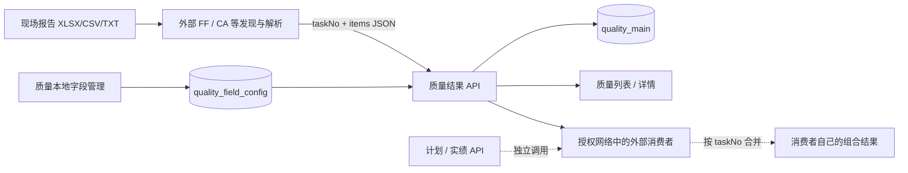

Task ID: ARCH-QUALITY-001
Revision: r2
Status: owner_approved
Owner Role: PM
Allowed Writers: PM, Human Owner
Handoff: Human Owner 已批准 r1 及精确 r2 补充；交 Development 完成整合、自检并按流程移交
Workflow Mode: STD
Execution Mode: agent_team_same_session
Task Namespace: aiis-ics-arch
Classification: root
Capability: 独立质量结果、本地字段配置与查询 API
Owner: AIIS ICS Architecture 质量管理模块
Acceptance Chain Reference: 本规格第 7 节及 Development Lifecycle Workflow
Created: 2026-11-23 Asia/Shanghai
Updated: 2026-11-23 Asia/Shanghai

# 质量管理：任务质量结果 r2

## 1. 目标与当前状态

Human Owner 已批准精确 **r1** 范围及第 6.1 节的 **r2** 补充，交 Development 按本规格实施；真实数据库迁移、上线和最终验收仍须分别批准。质量管理承接每个任务号的一组可配置质量结果；现场 FF、CA、SMA 或其他程序负责发现和解析报告，并调用同一套接口提交提取后的结构化结果。平台仅保存和展示结果，不接收或解析报告文件。`items` 是可配置字段的键值对象，一项结果不是原始报告的一万行数据。

参考计划/实绩的列表、筛选、本地字段管理和对外 API 设计，但质量数据、字段配置及服务独立。`taskNo` 只是一致的业务标识：质量读取、创建和编辑不查询计划或实绩，也不依赖订单存在、完成或其他条件；无外键、跨模块 SQL 读取/关联、联合查询或回写。以后需要组合时，由独立消费者分别调用各模块 API，按 `taskNo` 自行合并。



图中的外部程序、原始文件发现、订单标签、MES 推送和合并只是背景或未来工作，均不在本任务交付范围。本任务不新增报告完成标志：存在质量行、收到空 `items`、或 HTTP 成功都不等同于报告完成。SPC 页面、数据和 API 保持现状，SPC 配置、数据管理及计算另行规划。

## 2. 存储和配置

### 2.1 两张独立表

| 表 | 必需内容与约束 |
| --- | --- |
| `quality_main` | `id` 主键；`task_no` 非空且唯一；可空 `target_key`；非空 `items` JSON 对象；`created_at`、`updated_at`。可添加本规格查询所需索引。一个任务号至多一行，当前值按字段合并，不保存原始报告明细。 |
| `quality_field_config` | 固定单行 `id=1`；`definitions` JSON 数组；单调递增 `revision`；`created_at`、`updated_at`。新安装初始化空数组、revision 1；每个部署/项目只有本行配置，没有共享字段表和配置历史表。 |

`taskNo` 采用与计划/实绩相同的值规则但由质量自身校验：去首尾空白、ASCII 转大写，最终为 1–50 位 `[A-Z0-9._-]`；归一化后建唯一约束，API 返回归一化值。`targetKey` 为可选 1–64 位 `[A-Za-z0-9._-]`，区分大小写；创建时可以不提供或为 null，原来为空时可设置一次，已设置后相同值可重复提交、不同值或显式清空返回 409。省略表示不修改。它只标识质量记录自身，不校验或读取其他模块。

新表时间按项目统一上海时区合同：MySQL `DATETIME(6)`，SQLite 存携带 `+08:00` 的 RFC 3339；API 显式 `+08:00`，UI 用 `YYYY-MM-DD HH:mm:ss`。`updatedAt` 代表实际值改变的时间，完全相同的重试不改变它。旧质量数据的时间口径另行评估，本任务不猜测原时区、不批量换算或修改历史记录。

### 2.2 本地字段定义

配置是一组独立于计划和实绩的定义，至多 100 项（含停用项），键唯一且严格保留大小写。每项包含稳定的字段键 `name`（`[a-z][A-Za-z0-9_]{0,63}`）、`labels`（`zh-CN`、`en-US`）、`type`、可空 `unit`、`enabled`、`visible`、`editable`、`isNullable`、`order`；链接类型另有可空 `linkText`。字段键 `name`、类型、单位在创建后不可更改；r1 不删除或复用已定义的键，需要停用时关闭 `enabled`。标签、启用、显示、编辑、可空、排序及链接文本可修改。`linkText` 为用户配置的同一个展示文本，不自动翻译；界面固定文案使用中英 i18n。配置提交为完整定义集合，必须保留已有键及其不可变属性；重复键、移除或修改不可变属性均拒绝，且不改变原配置和版本。

`type` 支持 `string`、`number`、`boolean`、`link`：字符串最长 255 字符；数字为 JSON 有限数，整数部分最多 10 位、小数最多 4 位，不将布尔或数字字符串当数字；布尔值必须是 JSON boolean；链接值是最长 2048 字符的绝对 `http`/`https` URL，不允许凭据、空白或控制字符及其他 scheme。`linkText` 最长 128 字符，仅用于链接；未设置或仅空白则显示 URL。字段值应保持 `0`、`false` 和空字符串原值。`isNullable=false` 禁止显式写入 null；省略字段不作修改，新记录也允许暂未赋值，因此读取时未赋值可为 null。`enabled=false` 保留已存值、禁止写入并从结果 API 隐藏，重新启用后可再次读取；`visible` 仅控制列表列显示，`editable` 仅控制人工编辑，不限制集成接口写入已启用字段。

管理员更新配置须提交当前 `revision`，服务端在同一事务中核对并更新；版本过期返回 409，内容不变不增加版本。结果写入不改变配置版本。配置与结果写入并发时，以事务内一致的当前配置判定；同任务的不同字段并发写入不能互相丢失，同字段以后一次成功提交为准。不得凭配置变更丢弃或改写已有数据。

## 3. HTTP API 与更新语义

以下路径均位于本项目现有 `/api/v1` 前缀下；命名、统一响应和错误结构遵循现有计划/实绩 API 惯例，**接口面向所有获准接入者相同**，没有按 SMA/FF/第三方分别建立业务逻辑。

| 方法和路径 | 用途 |
| --- | --- |
| `POST /integration/quality/upsert` | 按任务号创建或部分更新质量结果。 |
| `GET /integration/quality/by-task/{taskNo}` | 根据任务号读取一条；不存在返回 404。 |
| `GET /integration/quality` | 分页查询质量结果。 |
| `GET /integration/quality/field-config` | 只读启用的质量字段定义及版本。 |
| `GET /quality/results`、`GET /quality/results/by-task/{taskNo}` | 登录用户的质量列表与详情。 |
| `POST /quality/results/upsert` | 登录用户人工编辑现有结果；不能通过此入口创建结果，只能修改有权限且标记 `editable` 的启用字段。 |
| `GET /quality/field-config`、`PUT /quality/field-config` | 读取及完整保存定义；仅管理员可用。 |

集成接口与现有计划/实绩集成接口一致使用可信网络接入边界，r1 不发明区分发送方的新凭据体系或按来源分支；上线网络隔离和访问控制仍由部署方负责。登录界面的读取及人工写入在后端执行现有 `quality` 模块权限校验，人工写入按现有管理员、主管、操作员写入规则，其他角色只读；字段配置读取和修改都须管理员。前端菜单、隐藏按钮不能替代服务端校验。未认证/无权分别按现有合同返回 401/403。

提交示例，均为合成内容：

```json
{
  "taskNo": "AISI12312312",
  "targetKey": "line-01",
  "items": { "defectCount": 12, "reportUrl": "https://example.com/report/123" }
}
```

`items` 是对象，键必须精确匹配已启用字段，未知/停用字段、类型不符或非法 URL 返回 422，整次提交不写入；不可悄悄忽略字段。字段键是业务数据，不能被通用 snake/camel 转换改变。省略 `items` 或提交 `{}` 表示没有字段变更；集成端允许创建空行但不生成完成状态。已存记录中只更新提交的字段，其他字段保留；可空字段的显式 null 表示清空。创建/更新在唯一约束和事务下原子执行；返回统一 envelope，`data` 含 `outcome`（`created`、`updated`、`unchanged`）及当前 `quality`（`id`、`taskNo`、`targetKey`、`items`、`createdAt`、`updatedAt`）。各结果读取返回全部已启用字段的值，未赋值为 null，停用字段不输出；人工界面根据 `visible` 控制列表列。

列表支持按 `taskNo`、`targetKey` 精确筛选和创建时间范围筛选（`createdFrom` 含下界、`createdTo` 不含上界，带时区并转上海时间）；默认第 1 页、每页 20 条、最多 100 条，固定以创建时间和 id 稳定排序并返回总数。无匹配为空列表。相同请求在当前值相同时返回 `unchanged`；服务端响应丢失时调用者只能权威重读并核对后决定是否重试，不能声称 exactly-once 或自动重放旧值安全。

## 4. 界面与兼容

质量列表参照计划列表的页面结构、筛选组件和命名，使用现有主题及共享组件；有查询、重置、分页、空态、失败态、详情和按权限编辑。字段列从已启用且 `visible` 的质量配置生成，缺失值明确显示，`0` / `false` 正常显示。管理员可从质量模块进入标题为 **本地字段管理** 的页面：按计划本地字段页的三部分布局提供筛选、新增、查看、编辑、停用和配置版本冲突提示；不得提供删除或改名入口。中间筛选区域与上、下卡片的左右内容边界对齐。管理员保存新配置后列表和表单按最新配置刷新，冲突时保留草稿并提示重读核对，不自动覆盖。

链接字段在列表和详情中以安全文本渲染：配置 `linkText` 时显示该文本，否则显示 URL；非空合法链接可点击并在新标签页打开，带 `noopener noreferrer`，不由平台自动抓取或上传。无效历史值或空值不可产生可执行链接。表格列宽采用项目公共能力：稳定字段键隔离本机偏好、可拖拽、刷新/切页后保留、可横向滚动，提供“重置列宽”入口及“恢复默认列宽”提示；不写业务数据。支持窄屏、明暗主题、键盘可达和对称中英文，避免内容与操作被裁切。

保留现有 `quality.list` 的路径、页面权限和导航身份，默认进入新质量列表；同一页面提供清晰的“历史检验”入口，切到 `?view=legacy` 显示现有列表，并可返回新列表，不要求用户为原有列表重新获得新增页面权限。现有 `quality.control` 路径、权限、CRUD 调用和历史数据继续可用；旧控制页的返回/保存后导航应回到 `?view=legacy`。本地字段管理作为独立管理员页面加入质量模块。原旧质量 API、原有前端 `getQualityList/getQualityById/createQuality/updateQuality` 及实绩页面对这些方法的使用必须保持兼容；新路由注册顺序须避免旧 `/quality/{id}` 捕获新静态路径，同时保留旧质量和 SPC 路由行为。不得调整实绩页面或改变 SPC 页面及 API。

## 5. 迁移、影响及排除项

新增一个显式 Alembic 修订以建立两表并初始化配置；当前静态检查的单一 head 为 `e9f3b5d7c021`，拟用新 revision `f0a2b4c6d8e1`，实施前必须重新检查 head 和冲突；若已变化则停止并回 PM 处理。新旧修订兼容需要同步五处现有严格版本门卫：`plc_facts/v2_config.py` 的消费许可集合、`equipment_observation/profile.py` 的允许版本、其 `services/guard.py` 的注册表布局校验、`services/write_sources.py` 的启用判断以及 `common/integration/storage.py` 的 schema 版本许可。新版本必须走与当前版本同等的目标、布局、授权和一致性校验，保留旧版本行为；未知/不匹配版本仍拒绝，不能靠放宽检查通过。此影响源于各模块共用数据库版本号，并非质量业务依赖这些模块。

本次只允许开发迁移源码及隔离数据库验证；已有部署、真实数据库执行迁移、凭据或配置更改、上线及回退均须独立的明确批准。现存旧质量时间实现有既有时区风险，不在本任务盲目修正；保留历史数据并在 Development/Verification 中说明。迁移回退不得删除、重写旧质量、计划、实绩或 SPC 数据；实际部署回退和新表中已生产的数据处理须另行制定及批准。

明确排除：真实报告及其数据入库、XLSX/CSV/TXT 上传与解析、现场运行时或任务发现、订单状态写回、报告完成字段、第三方 MES 推送、批量原始明细上传、消息队列、异步任务、SPC 设计或开发、跨模块表依赖、计划/实绩业务实现调整、质量结果删除及配置历史。未来规模化推送、分批和可靠投递应基于实测负载与目标系统合同另立任务；本规格不承诺单次可安全提交一万条明细。

## 6. 实施 allowlist 与 handoff

Human Owner 已批准下表的 r1 路径及第 6.1 节的 r2 补充；超出路径或用途、改变需求/验收/风险时停止，交 PM 修订并重新批准。开工前检查并保留并行工作，验证候选须与正式交付树一致。

| 路径 | 允许用途 |
| --- | --- |
| `backend/app/quality/manifest.py`、`backend/app/quality/models/__init__.py` | 注册新路由/模型；调整新旧路由先后，保留原有入口。 |
| `backend/app/quality/models/results.py`、`backend/app/quality/api/results.py`、`backend/app/quality/schemas/results.py`、`backend/app/quality/services/results.py`、`backend/app/quality/crud/results.py`、`backend/app/quality/domain.py` | 新增独立质量结果、配置、权限和校验实现。 |
| `backend/alembic/versions/20261123_1500_f0a2b4c6d8e1_quality_results.py` | 新增两表及配置初始化的显式修订；实施前核对 revision/head。 |
| `backend/app/plc_facts/v2_config.py`、`backend/app/equipment_observation/profile.py`、`backend/app/equipment_observation/services/guard.py`、`backend/app/equipment_observation/services/write_sources.py`、`backend/common/integration/storage.py` | 仅做第 5 节新 revision 的等价兼容，保留其他判断。 |
| `frontend-js/src/app/quality/manifest.js`、`frontend-js/src/app/quality/api/index.js`、`frontend-js/src/app/quality/api/mock.js`、`frontend-js/src/app/quality/locales/zh-CN.json`、`frontend-js/src/app/quality/locales/en-US.json` | 注册和访问新界面/API，增量双语文案；保留现有 facade。 |
| `frontend-js/src/app/quality/views/results/index.vue`、`frontend-js/src/app/quality/views/results/QualityList.vue`、`frontend-js/src/app/quality/views/local-fields/index.vue`、`frontend-js/src/app/quality/components/QualityFieldForm.vue` | 仅新增质量列表、历史列表入口、字段管理与字段表单。 |
| `frontend-js/src/app/quality/views/control/index.vue` | 仅更改旧控制页返回/保存成功后的两个导航目标，保留其余业务。 |
| `backend/tests/test_quality_results.py`、`backend/tests/test_quality_revision_guards.py`、`backend/tests_mysql/test_quality_results_mysql.py`、`frontend-js/tests/module-registry/quality-results.test.mjs` | 新增此任务的隔离测试。 |
| `backend/tests/test_generic_task_revision_guards.py`、`backend/tests/test_equipment_observation_domain.py`、`backend/tests/test_equipment_observation_r8.py`、`backend/tests/test_equipment_observation_r10.py`、`backend/tests/test_observation_write_sources.py`、`backend/tests_mysql/test_acquisition_consumption.py`、`backend/tests_mysql/test_equipment_observation_mysql.py`、`frontend-js/tests/module-registry/registry.test.mjs`、`frontend-js/tests/module-registry/page-access.test.mjs` | 仅按本修订补充或调整必要兼容回归。 |
| `contracts/published/http-api/quality-results-v1/README.md`、`contracts/published/http-api/quality-results-v1/README.zh-CN.md`、`contracts/published/http-api/quality-results-v1/openapi.json`、`contracts/published/http-api/quality-results-v1/examples/requests.json`；`contracts/README.md`、`contracts/README.zh-CN.md` | 发布新质量 API 的合成示例和双语合同索引，不改其他模块合同。 |
| `backend/README.md`、`backend/README.zh-CN.md`、`frontend-js/README.md`、`frontend-js/README.zh-CN.md`、`CODE_INDEX.md` | 仅同步此任务造成的稳定模块事实、结构和索引。 |
| 本任务 `tasks.md`、`checklist.md` | 仅由 Development 和 fresh-context Verification 分别按工作流创建。 |

Development 使用 `backend-arch`（含模块注册与 API/数据库合同）、`frontend-ui`（含 DESIGN/FRAMEWORK）、`i18n-workflow` 和 `code-document-indexer`；Verification 独立检查上述合同。保留 `backend/app/task/`、计划/实绩前后端业务文件和共享组件原样；复用公共能力时不为此扩张共享框架。样例、测试和浏览器夹具只用合成数据，不读取或提交真实附件。正式 `developer_handoff` 后，由不继承 Development 推理的 fresh-context Verification 独立创建 `checklist.md`；QA 通过后仍由 Human Owner 决定最终验收。

### 6.1 Human Owner 已批准的 r2 补充

r1 候选扩大回归时记录 152 passed、8 skipped、6 failed、7 setup errors；执行到的失败暴露了旧全局 head 断言。r2 只增加以下测试路径及用途，r1 的业务、接口、两表、UI、权限、迁移和部署边界不变：

| 增补路径 | 精确允许用途 |
| --- | --- |
| `backend/tests/test_observation_retirement.py`、`backend/tests/test_acquisition_consumption_contract.py`、`backend/tests/test_observation_receipt_separation.py`、`backend/tests/test_equipment_temperature_migration.py`、`backend/tests/test_legacy_acquisition_retirement.py`、`backend/tests/test_mapping_migration.py`、`backend/tests/test_generic_task_migration_r3.py` | 仅将当前唯一 head 断言从 `e9f3b5d7c021` 更新为 `f0a2b4c6d8e1`。其中 `test_legacy_acquisition_retirement.py` 还可仅在**当前**完整元数据表集合预期中增加 `quality_main`、`quality_field_config`。保留历史表集合、迁移版本、父子关系及其他保护断言。 |

这七个文件须重跑并如实记录通过、失败和跳过；如出现超出上述修改才能解决的问题，停止扩大范围并反馈 PM。`backend/tests/test_business_integration_storage.py` 已在候选回归中通过，不纳入修改；r2 不额外允许新增 README 或其他路径。验证仍须覆盖 r1 的适用验收，不能把此前结果当作正式树整合后的验证。

Human Owner 同时单独批准本任务的操作窗口：暂停当前使用正式 `backend/` 目录的本地 `:8000` 开发进程，以便在核对原始文件及保留并行修改的前提下将候选合入正式交付树；使用一次性、隔离的 MySQL 8.4 实例和合成数据完成验证。只可操作本任务创建的隔离数据库资源，核对实例与 schema 身份及空目标，验证后按资源生命周期清理并保留必要证据。不得迁移或写入真实数据库，不得将服务重启到未迁移数据库，不授权部署、其他服务重启或对现有数据库的任何变更。候选整合与隔离验证不等于上线、QA 通过或最终验收。

## 7. 验收标准

| 编号 | 可观察结果 |
| --- | --- |
| AC01 | 干净安装得到两张独立 `quality_` 表和一行初始空配置；不存在与计划/实绩的 FK、SQL 查询/关联或调用依赖。无同号计划或实绩仍可写入和读取，归一化 taskNo 不产生重复行。 |
| AC02 | 管理员新增四种类型字段、改标签/可见性/链接文本、停用再启用；键/类型/单位不可改且无法删除，已存值保留。非管理员及过期 revision 的配置写入被服务端拒绝，无部分变更或意外版本增长。 |
| AC03 | `string`、`number`、`boolean`、`link` 的合法、非法、长度和边界值如实校验；`0`、`false`、空字符串、显式 null、缺失以及动态键大小写均可区分。未知/停用字段和混合合法非法字段整次拒绝；无动态键变换。 |
| AC04 | 通过同一集成接口分别模拟多个发送方；新建、部分更新、原字段保留、目标首次设置/冲突、原样重试及并发同任务不同字段符合第 3 节；空结果不表示完成。模拟响应丢失后可重读核对，不宣称写入未发生。 |
| AC05 | 读单条、分页、目标和时间筛选按合同工作；不存在返回 404，启用但未赋值为 null，停用字段隐藏，重启后保留；UI 的 `visible` 与人工编辑的 `editable` 不影响获准集成写入。 |
| AC06 | 后端独立验证登录、质量模块权限、管理员配置权限、各人工写入角色及集成可信网络边界；前端仅隐藏入口不会成为唯一保护，其他模块的权限不扩大。 |
| AC07 | 中英文、明暗主题、桌面和窄屏下，质量列表与本地字段管理按计划列表风格工作，筛选区左右对齐；错误/空态、详情编辑、键盘、列宽持久化及重置均可用。链接有/无文本两种显示，安全新标签可点击；`javascript:`、相对 URL、凭据、空白与控制字符不能形成链接。 |
| AC08 | 旧 `quality.list` 权限用户无需新增页面授权即可进入历史列表；从旧控制页返回和保存后仍可回历史列表。旧质量的列表/详情/创建/更新 facade、实绩使用路径以及 SPC 页/API 兼容，既有数据未变化；新增静态路由不会被旧 ID 路由截获。 |
| AC09 | 在合成隔离 SQLite/MySQL 环境执行迁移与重复升级验证；测试旧、新版本各严格门卫，确认合法配置保持启用、目标及布局等检查仍有效，未知/不匹配版本被拒绝。检查无真实数据库迁移或历史数据写入。 |
| AC10 | 新质量 API 合同/示例与实际 OpenAPI、一致 envelope、错误、字段和授权边界一致。运行适当后端专项、已有模块回归及前端 `pnpm check:modules`、`pnpm test:modules`、隔离输出构建、双语键和链接检查；记录实际命令、退出码、限制和浏览器检查结果。审计 allowlist 与正式交付树。 |
| AC11 | 对 r2 列明的七个测试完成限定断言更新并重跑，保留其历史和保护断言；执行无失败和 setup errors，记录实际结果和跳过原因，额外失败不隐藏。正式树候选与验证结果一致；MySQL 8.4 使用确认身份的空隔离实例和合成数据，留存命令、版本、环境、结果及资源收尾证据，无真实数据库写入或未经授权的部署。 |

## 8. 风险与决策记录

- 限定一任务号一行、100 个定义及无配置删除使首版简单；项目需要多份报告、逐行缺陷明细或字段变更历史时，应先另行设计数据模型和迁移。
- `targetKey` 和可信网络语义参照现有约定；集成接口不是互联网公开认证方案，外网或逐发送方权限必须独立设计。
- 配置和结果并发、重复请求及网络超时可能产生覆盖或提交结果不确定；部分更新、事务及重读核对降低风险，但不保证 exactly-once。
- 共库 Alembic head 变化会影响其他已启用模块的启动或写入门卫；上线前须用目标环境进行经单独批准的兼容与迁移评估。
- 旧质量列表及 SPC 不属于新质量结果数据源；原有质量时间口径已知可能不一致，未经核实不处理历史值。

| 日期 | 角色 | 记录 |
| --- | --- | --- |
| 2026-11-23 | Human Owner | 确认质量独立承接结构化结果，字段可配置并增加可选显示文字的链接类型；仅借鉴计划/实绩，不建立表依赖；SPC 暂不改动。请求先落 spec。 |
| 2026-11-23 | PM | 起草 r1，明确两表、字段和 API、旧入口兼容、共库版本影响及可验证范围，等待 Human Owner 审阅批准。 |
| 2026-11-23 | Human Owner | 明确回复“批准 ARCH-QUALITY-001 r1，开始开发”，批准精确 r1。批准前草案 SHA-256：`c61bf9e86fa91c702112b49287d9411fa7f4ce1d9456d4971dde2dea217b9cef`。 |
| 2026-11-23 | Human Owner | 对已提出的两项测试增补和独立操作窗口明确回复“批准补充测试范围，允许暂停 8000、合入候选并做隔离 MySQL 验证”。PM 据此记录精确 r2；r1 批准后、r2 修改前规格 SHA-256：`fdeda1a283a72e1db18938af424224528b9689a3ec81933cd3632355e59b895c`。 |
