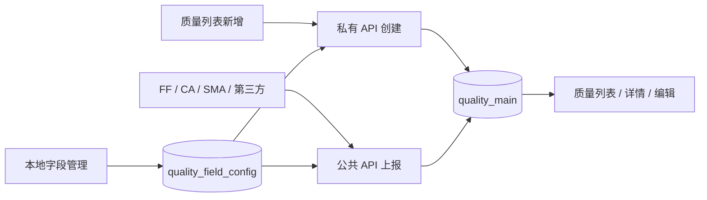

Task ID: ARCH-QUALITY-002
Revision: r1
Status: owner_approved
Owner Role: PM
Allowed Writers: PM, Human Owner
Workflow Mode: STD
Execution Mode: agent_team_same_session
Task Namespace: aiis-ics-arch
Classification: independent_fix
Capability: 任务质量结果人工新增与旧检验入口退役
Owner: AIIS ICS Architecture 质量管理模块
Acceptance Chain Reference: 本规格第 7–8 节及 Development Lifecycle Workflow
Related Task: ARCH-QUALITY-001
Created: 2026-11-24 Asia/Shanghai
Updated: 2026-11-24 Asia/Shanghai
Handoff: Human Owner 已批准精确 ARCH-QUALITY-002 r1，交 Development 实施

# 质量结果人工新增与旧检验退役

## 1. 目标

质量列表新增人工创建单条任务质量结果的入口，退役按料卷维护的历史检验列表、表单以及旧质量检验与缺陷 API。任务质量沿用每个 taskNo 至多一条结果、items 动态字段及现有外部集成接口。旧检验支持人工逐条登记缺陷，退役后这项旧能力随之关闭。本次人工新增承接任务质量结果，不自动迁移旧缺陷明细。

ARCH-QUALITY-001 r2 独立 QA 为 qa_passed，Human Owner 最终验收仍由该任务单独确认。本任务不改写其状态。当前工作树含并行修改，Development 先识别并保留。



taskNo 是独立业务标识，任务质量不查询计划或实绩，不添加外键、跨模块关联或订单状态写回。现场程序负责报告发现及解析，本任务不上传或解析报告。SPC 独立于此流程。

## 2. 数据和接口

### 2.1 数据与字段

复用 quality_main 与 quality_field_config，不新增列、表或 Alembic 修订。taskNo 去首尾空白并转 ASCII 大写，按现有 1–50 位 [A-Z0-9._-] 规则校验，归一化后唯一。targetKey 可省略或为 null，非空值遵循现有 1–64 位、区分大小写规则。人工创建时设置的目标，与公共上报使用相同的现有目标冲突规则。创建、更新时间由服务端按上海时区合同生成。

字段沿用当前配置。enabled 控制是否可用，editable 控制人工写入，visible 控制列表列显示。新增表单展示已启用且允许人工编辑的字段，即使其不在列表显示。未知或停用键拒绝写入，已启用但不可人工编辑的键按现有合同返回 403。类型、数值精度、链接、空值和字段名规则复用现有验证。未触及的字段不提交。用户明确输入再清空文本字段时，提交空字符串，输入的 0 和 false 按其类型保留。其他类型的空值按既有字段约束处理。无可编辑字段时仍可仅凭任务号创建，items 可省略或为 {}。

### 2.2 API 称呼和新增接口

“私有 API”是当前平台前端使用、按现有登录及角色权限保护的接口。“公共 API”是面向获准接入的 SMA、CA、FF 和第三方的现有集成接口，继续遵循可信网络部署边界。这是使用对象的称呼，不新增分来源接口，也不改变现有认证、授权或路由前缀。

| 类型 | 方法和路径 | 行为 |
| --- | --- | --- |
| 私有 | POST /api/v1/quality/results | 新增，仅创建一条。成功 HTTP 201，已存在返回 HTTP 409。 |
| 私有 | GET /api/v1/quality/results、GET /api/v1/quality/results/by-task/{taskNo}、POST /api/v1/quality/results/upsert | 沿用列表、详情和仅编辑已有记录的行为。 |
| 私有 | GET／PUT /api/v1/quality/field-config | 沿用管理员字段配置行为。 |
| 公共 | POST /api/v1/integration/quality/upsert | 沿用按任务号创建或部分更新的行为。 |
| 公共 | GET /api/v1/integration/quality、GET /api/v1/integration/quality/by-task/{taskNo}、GET /api/v1/integration/quality/field-config | 沿用查询及启用字段投影。 |

新增请求示例中的字段仅为项目配置示例：

```json
{
  "taskNo": "AISI12312312",
  "targetKey": "line-01",
  "items": { "defectCount": 12, "reportUrl": "https://example.com/report/123" }
}
```

taskNo 必需，targetKey 和 items 可省略。items 的键严格匹配配置，禁止递归重命名。外层字段、类型和额外字段处理遵循现有严格合同。

成功返回 HTTP 201，沿用现有成功信封，信封 code 保持 200，以兼容前端响应拦截器。data 使用 { "outcome": "created", "quality": ... }，质量对象的键与现有结果接口一致。未登录、无 quality 模块权限和只读角色按现有 401／403 合同处理。人工创建角色与现有人工编辑一致，为 admin、supervisor、operator，服务端独立校验。

归一化后任务号已存在时返回 HTTP 409 和稳定错误码 quality.task_no_conflict，不覆盖或合并旧行。两个人工创建并发提交同一任务号，最多一次 201，其余返回该 409。人工创建与公共 upsert 并发时，按数据库事务顺序产生完整一致结果。公共上报先创建则人工得到 409，人工先创建则公共上报按现有部分更新合同处理。不得出现部分写入、未提交字段丢失或重复行，同字段按现有最后成功写入规则处理。配置和创建并发时，以事务取得的当前字段配置校验整次请求。仅将能确认由任务号唯一约束造成的冲突映射为该 409，不把其他数据库错误误报为重复。

提交校验失败不得写入任何字段。提交结果不明时沿用 quality.commit_unknown／503 错误合同。前端保留草稿并提示按任务号重读核对，不自动重试或覆盖。

## 3. 质量列表交互

- 在质量列表卡头提供「新增质量记录」，有写入权限的用户可见。表单参考本次已展示原型和计划／实绩列表的紧凑三段式弹窗，包含「基本信息」与「质量结果」分区。任务号必填，目标可选，结果字段根据当前配置生成。
- 按类型提供文本、数字、布尔和链接输入，支持现有中英文标签、单位与校验。链接显示文本继续来自字段配置，填写的是链接地址。未填写字段不预填示例业务值。
- 保存期间防重复提交。成功后关闭弹窗、刷新列表并保留当前筛选语义。重复任务号、字段无效、权限错误及其他失败均显示可理解的反馈并保留草稿。配置在表单打开后发生变化时，以服务端当前配置为准。失败后保留草稿供核对。
- 详情、编辑、筛选、列宽、本地字段管理及现有时区说明保持当前行为。PC 和平板横屏按根 AGENTS 第 9 节检查浅色、深色、可访问性、内容滚动及页脚可达。

## 4. 旧检验退役与兼容

### 4.1 本仓源码范围

移除质量列表的「历史检验」按钮及旧检验列表、旧新增／查看／编辑表单的业务入口。移除旧检验和缺陷 HTTP 路由：

- GET／POST /api/v1/quality
- GET／PUT／DELETE /api/v1/quality/{quality_id}
- POST /api/v1/quality/{quality_id}/defects
- DELETE /api/v1/quality/{quality_id}/defects/{defect_id}
- GET /api/v1/defects

按本仓引用检查同步退役旧前端 facade、mock 和不再注册的实绩旧质量页面中的旧调用，不改造实绩列表或其业务数据。旧检验的 API 专用服务、CRUD、schema 和 seed 可仅在确认不再有调用且不影响 SPC 时清理。保留旧表 ORM 模型和 metadata 注册，避免已存在的物理表变成意外 schema 差异。保留 /api/v1/quality/spc/data、/api/v1/quality/spc/stats 的路径、权限和数据行为。

### 4.2 已有页面权限与深链接

quality.control 已出现在页面授权配置示例。当前权限配置只接受已注册、非 redirect 的叶子页面，直接删除该 pageId 或仅使用 manifest redirect 会让残留授权校验失败。因此本修订保留隐藏的 QualityControl 路由及 quality.control pageId，使用不含旧检验业务的轻量兼容组件导航至 quality.list。跳转目标继续由现有路由守卫独立检查 quality.list 权限，不因旧页面授权而增加质量列表权限。只有旧控制页权限、没有质量列表权限的角色走既有无权回退。

已有 /quality/control/new、/quality/control/{id} 和 /quality/list?view=legacy 深链接不再打开旧检验，进入质量列表时不把旧 ID 当作任务号，也不展示旧表记录。无权用户和未登录用户沿用当前路由守卫。保留旧 pageId 仅为兼容现存权限配置，后续彻底删除标识须单独规划配置迁移。

### 4.3 数据和切换

源码退役后，quality_inspections、quality_defect_records 及其中数据继续留在数据库，不进行自动迁移、删除或转换。此前对 dev 库的只读检查显示两张表为空，该事实不代表其他库为空。真实部署切换前由部署方核对旧接口的外部调用方、访问日志及旧数据处置。本仓源码搜索无法证明外部无调用，旧接口移除会影响既有外部调用。

首页质量分布和 quality_grade_stats 清理、旧表实际删除、设备观测及采集数据库版本校验调整，另立范围。本任务不修改这些功能、数据库配置或现场服务。

## 5. 实施边界和路径

仅在 Human Owner 批准精确 r1 后交 Development，超出以下路径或用途时交 PM 确认。

| 路径 | 允许用途 |
| --- | --- |
| backend/app/quality/api/results.py、backend/app/quality/schemas/results.py、backend/app/quality/domain.py、backend/app/quality/services/results.py、backend/app/quality/crud/results.py、backend/app/quality/manifest.py | 实现人工仅创建、错误码和事务边界，保持现有结果及字段配置接口。 |
| backend/app/quality/api/routes.py、backend/app/quality/services/async_quality.py、backend/app/quality/crud/async_quality.py、backend/app/quality/schemas/quality_in.py、backend/app/quality/schemas/quality_out.py、backend/app/quality/schemas/__init__.py | 仅退役旧检验及缺陷路由和其独占代码，保留 SPC 依赖、旧数据模型和 metadata。 |
| frontend-js/src/app/quality/manifest.js、frontend-js/src/app/quality/views/results/index.vue、frontend-js/src/app/quality/views/results/QualityList.vue、frontend-js/src/app/quality/views/control/index.vue、frontend-js/src/app/quality/views/list/index.vue | 新增质量弹窗，移除历史入口，保留隐藏兼容叶子。可移除不再使用的旧列表文件。 |
| frontend-js/src/app/quality/api/index.js、frontend-js/src/app/quality/api/mock.js、frontend-js/src/app/quality/locales/zh-CN.json、frontend-js/src/app/quality/locales/en-US.json | 对接新增接口、退役旧 facade 和 mock，维护对称双语文案。 |
| frontend-js/src/app/performance/views/quality/index.vue | 仅移除不再注册且直接调用旧检验 facade 的旧页面，不调整其他实绩页面。 |
| backend/tests/test_quality_results.py、backend/tests/test_business_module_permissions.py、backend/tests_mysql/test_quality_results_mysql.py、backend/tests_mysql/test_business_module_reintegration.py | 增加新增和退役必要回归，调整针对当前旧接口可用的断言，保留旧表、历史数据和其他业务保护。 |
| frontend-js/tests/module-registry/quality-results.test.mjs、frontend-js/tests/module-registry/page-access.test.mjs、frontend-js/tests/module-registry/registry.test.mjs | 验证新增弹窗及保留页面权限标识、路由兼容。其他模块既有失败如实记录。 |
| contracts/published/http-api/quality-results-v1/README.md、contracts/published/http-api/quality-results-v1/README.zh-CN.md、contracts/published/http-api/quality-results-v1/openapi.json、contracts/published/http-api/quality-results-v1/examples/requests.json | 同步私有新增方法和私有／公共接口说明，公开集成路径及行为不变。 |
| backend/README.md、backend/README.zh-CN.md、frontend-js/README.md、frontend-js/README.zh-CN.md、CODE_INDEX.md | 仅同步本次实际变化的稳定事实、被移除路径及代码索引。 |
| 本任务 tasks.md、checklist.md | 分别由 Development 与 fresh-context Verification 按流程创建。 |

没有授权修改数据库迁移、真实配置、实际 dev 数据、计划／实绩业务规则、SPC、本地字段配置语义、首页看板、设备观测或采集模块。

## 6. 检查与交接

Development 使用 backend-arch、frontend-ui、i18n-workflow 和 code-document-indexer，运行后端定向测试、前端质量及路由权限测试、pnpm build、合同／OpenAPI 一致性与文档链接检查。并发测试使用隔离 SQLite 和 MySQL 8.4 合成目标，验证同号人工创建、人工与公共上报竞争及旧记录完整保留。若隔离 MySQL 验证前提不可用，如实报告验证未完成，不得将 SQLite 结果代称 MySQL 通过，也不操作真实 dev 数据库。

前端浏览器检查使用合成 API／身份和数据，验证 PC 与平板横屏、浅／深主题及原型主要布局。未验证的设备或环境单独说明。Development 完成后记录精确文件、命令、结果及已知失败，形成 developer_handoff。fresh-context Verification 独立复核后创建 checklist.md，由 Human Owner 最终验收。

## 7. 验收标准

| 编号 | 验收结果 |
| --- | --- |
| AC01 | 不依赖计划或实绩记录，有权限的用户能在质量列表人工创建，服务端返回 HTTP 201、现有成功信封和新结果，刷新及按任务号查询一致。 |
| AC02 | 每种字段类型、visible=false editable=true、停用、不可编辑、缺失、空字符串、0、false、合法／非法链接和配置变化均按第 2 节处理。无可编辑字段仍可仅凭任务号创建。非法字段不产生质量行。 |
| AC03 | 普通与归一化后重复创建返回 quality.task_no_conflict／409，不改变已有行。隔离 MySQL 的两个并发人工创建仅一个成功，人工创建与公共 upsert 竞争满足第 2.2 节，结果可权威重读。 |
| AC04 | 管理员、主管、操作员可创建，未登录和无权限角色返回相应 401／403。不可人工编辑字段不能通过直接 API 绕过。保存失败或结果不明保留草稿，不自动覆盖或重复提交。 |
| AC05 | 旧列表按钮、旧检验表单及第 4.1 节旧 HTTP 路由在当前源码运行入口不可用，现有公开质量结果、字段配置和 SPC 接口正常。旧表结构、合成旧数据及 SPC 数据未改变。 |
| AC06 | 合成主管／操作员 ACL 含 quality.control 时配置可解析，旧深链不打开旧表单，不放宽 quality.list 授权。旧列表 query 不再显示历史检验。当前实绩路由和页面权限行为保持原状。 |
| AC07 | 新增弹窗遵循根 AGENTS 第 9 节，PC、平板横屏浅／深主题下分区、内容、保存状态及滚动可用。字段变化、冲突和失败反馈清楚。 |
| AC08 | 现有公共 API 的路径、输入输出、部分更新和并发字段保留语义通过回归。私有新增在发布合同中有清晰路径、201／409 和真实认证说明，OpenAPI 与实际应用一致。 |
| AC09 | 无新表、字段或 Alembic 修订，没有真实库或私有配置写入。记录外部旧调用方、数据处置与实际部署切换仍需现场核对。 |

## 8. 审批

Human Owner 于 2026-11-24 明确批准「ARCH-QUALITY-002 r1，开始开发」，交 Development 按本规格实施。本规格审批不代表最终验收，也不授权实际部署、数据库迁移或旧数据删除。
